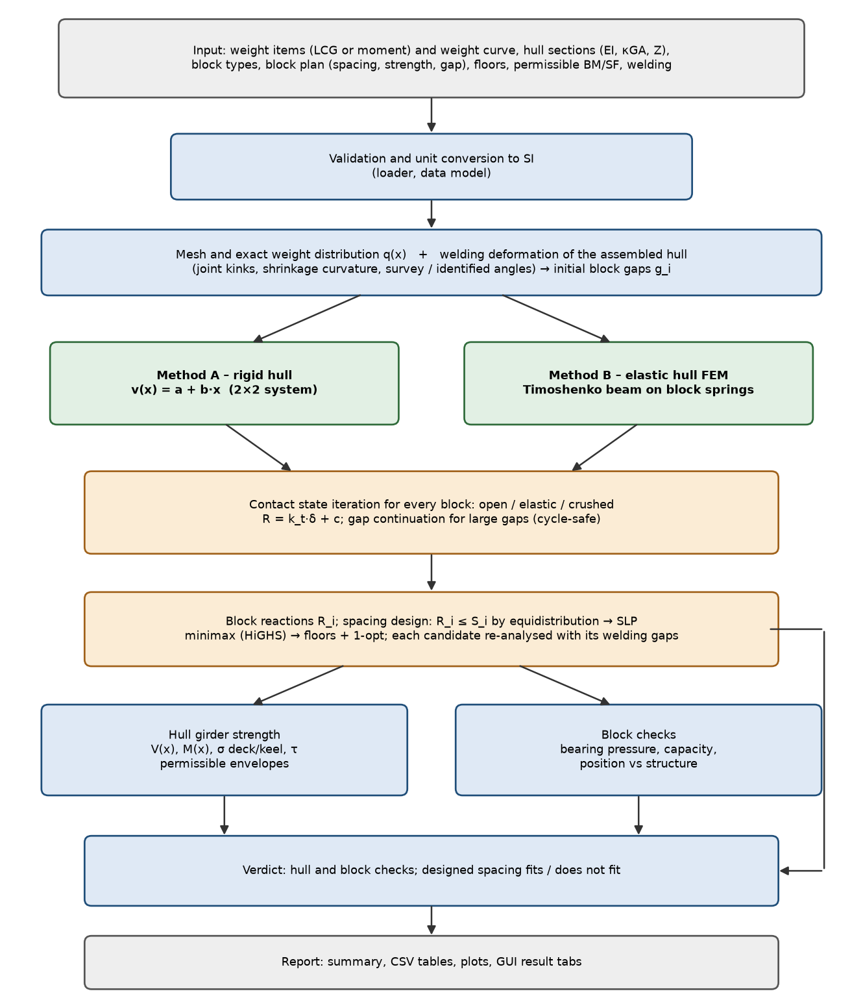
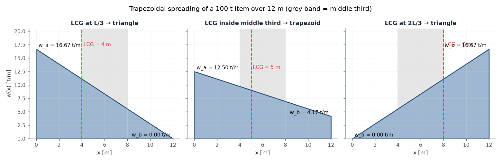
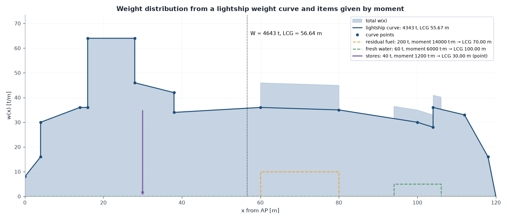
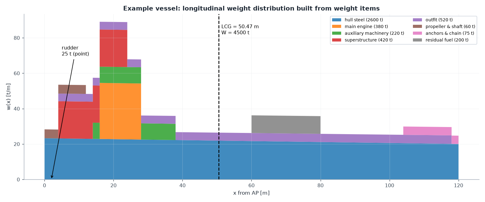
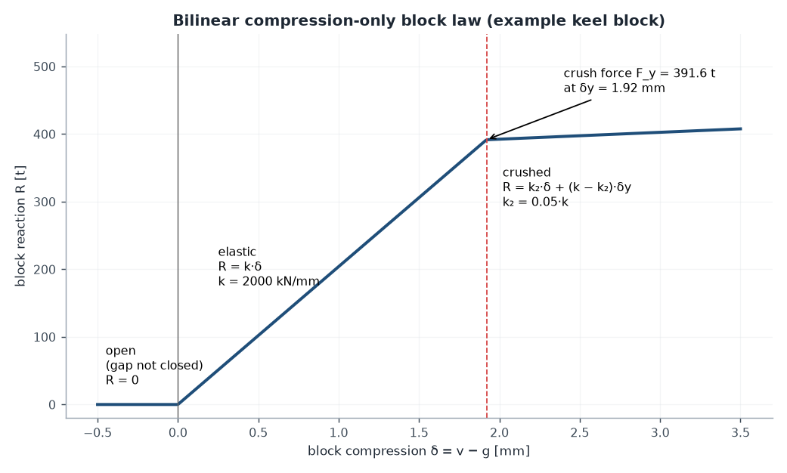
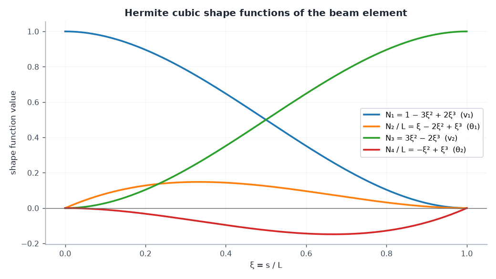

# Implementation of a Simulation System for Predicting Keel-Block Reaction Forces and Optimizing Support Spacing During Ship Construction

*Weight Distribution, Contact Algorithms, Welding Deformation and Minimax Spacing Optimisation in a Verified Python Application*

> Markdown copy of [thesis/output/thesis.docx](thesis/output/thesis.docx); the typeset version is [thesis/output/thesis.pdf](thesis/output/thesis.pdf).
>
> This is **part 1 of 3** (the front matter and Chapters 1–3). [Part 2](THESIS-part2.md) – Chapters 4–7, the references and Appendix A · [Part 3](THESIS-part3.md) – Appendix B (source code).

**\[University Name\]**  
\[Department / Faculty\]

A thesis submitted in partial fulfilment of the requirements for the degree of  
**Bachelor of Science in Computer Science and Ship Engineering**

by **\[Student Full Name\]** (\[Student ID\])

Supervisor: \[Supervisor Name, Title\]  
Co-supervisor: \[Co-supervisor Name, Title — delete this line if none\]

\[City\], \[Month Year\]

# Declaration of Authorship

I, **\[Student Full Name\]**, declare that this thesis, titled *“Implementation of a Simulation System for Predicting Keel-Block Reaction Forces and Optimizing Support Spacing During Ship Construction”*, and the work presented in it are my own, except where otherwise acknowledged. I confirm that:

1.  This work was done wholly or mainly while in candidature for a bachelor’s degree at **\[University Name\]**.
2.  No part of this thesis has previously been submitted for a degree or any other qualification at this or any other institution.
3.  Where I have consulted the published work of others, this is always clearly attributed.
4.  Where I have quoted from the work of others, the source is always given.
5.  I have acknowledged all main sources of help.
6.  The software developed for this thesis, its test suite and all numerical results reported here were produced by the work described in Chapters 3–6.
7.  **Use of generative AI tools:** \[State here, in line with your university’s regulations, whether and how generative AI tools were used — for example for drafting text, writing or reviewing code, or producing figures — and confirm that you have checked and take responsibility for all content.\]

 

Signed: \_\_\_\_\_\_\_\_\_\_\_\_\_\_\_\_\_\_\_\_\_\_\_\_\_\_\_\_\_\_

Date: \_\_\_\_\_\_\_\_\_\_\_\_\_\_\_\_\_\_\_\_\_\_\_\_\_\_\_\_\_\_

# Abstract

A ship in dry dock rests on keel blocks of limited strength. The statically indeterminate, compression-only block reactions depend on the weight distribution, the stiffness of hull and blocks and the fit between keel and blocks, which welding deformation disturbs in block-built hulls. This thesis develops, implements and verifies methods and software that compute the reaction of every block and, as the final result, the spacing of given blocks at which no reaction exceeds the strength of its block.

Weight items, given with their centre of gravity or moment, and weight-distribution curves are converted exactly into trapezoidal loads. The reactions are computed with a rigid-hull method and a sparse Timoshenko finite element model on compression-only, crushable block springs, solved exactly by an active-set iteration with gap continuation, followed by hull girder and block checks. Welding deformation is represented by joint kinks and shrinkage curvature, identified from a keel survey by regularised least squares. The spacing design minimises the largest ratio of reaction to strength by strength-weighted equidistribution, sequential linear programming with a trust region, and rounding to the floors with a local search; every candidate is analysed with the welding gaps at its own block positions, and infeasible plans are diagnosed. The layered software has command-line and PyQt5 interfaces and passes 131 automated tests.

For an illustrative 120 m, 4500 t vessel, the elastic model predicted an end-block reaction of 254.6 t where the rigid method gave 145.1 t. For 44 blocks of 190 t and 160 t, the spacing design reduced the largest ratio of reaction to strength from 1.340 to 0.761 in 193 analyses (0.7 s), with all checks passed; with 160 t blocks it fitted the theoretical minimum of 29 blocks, each used to 93–98 % of its strength. Under welding deformation the spacing alone sufficed up to an end lift of about 21 mm; beyond it the erection joints act as hard points, more blocks do not help, and block heights must be adjusted. Verified algorithms thus turn block strengths and a keel survey into a buildable spacing and reveal its limits.

**Keywords:** dry docking; keel block reactions; block spacing design; minimax optimisation; sequential linear programming; equidistribution; finite element method; unilateral contact; welding deformation; inverse identification; software engineering; Python

# Acknowledgements

\[Replace this text with your own acknowledgements.\]

I would like to thank my supervisor, **\[Supervisor Name\]**, for guidance throughout this project, and **\[Co-supervisor / Other Persons\]** for helpful discussions on dry-docking practice and structural analysis.

I also thank the developers of the open-source scientific Python ecosystem — NumPy, SciPy, Matplotlib, PyYAML, PyQt5 and pytest — on which the software of this thesis is built.

# Table of Contents

- [Declaration of Authorship](#declaration-of-authorship)
- [Abstract](#abstract)
- [Acknowledgements](#acknowledgements)
- [List of Figures](#list-of-figures)
- [List of Tables](#list-of-tables)
- [Nomenclature](#nomenclature)
- [1 Introduction](#1-introduction)
  - [1.1 Background and motivation](#11-background-and-motivation)
  - [1.2 Problem statement](#12-problem-statement)
  - [1.3 Aim and objectives](#13-aim-and-objectives)
  - [1.4 Scope and limitations](#14-scope-and-limitations)
  - [1.5 Research questions](#15-research-questions)
  - [1.6 Contributions](#16-contributions)
  - [1.7 Thesis structure](#17-thesis-structure)
  - [1.8 Summary](#18-summary)
- [2 Theoretical Background and Literature Review](#2-theoretical-background-and-literature-review)
  - [2.1 Dry docking practice](#21-dry-docking-practice)
  - [2.2 Block construction and welding distortion in shipbuilding](#22-block-construction-and-welding-distortion-in-shipbuilding)
  - [2.3 Hull girder longitudinal strength](#23-hull-girder-longitudinal-strength)
  - [2.4 Classical docking calculations](#24-classical-docking-calculations)
  - [2.5 Beam theory](#25-beam-theory)
  - [2.6 Beams on elastic foundations](#26-beams-on-elastic-foundations)
  - [2.7 Matrix structural analysis and the finite element method](#27-matrix-structural-analysis-and-the-finite-element-method)
  - [2.8 Unilateral contact and complementarity](#28-unilateral-contact-and-complementarity)
  - [2.9 Optimisation for design](#29-optimisation-for-design)
  - [2.10 Algorithms and complexity in computational mechanics](#210-algorithms-and-complexity-in-computational-mechanics)
  - [2.11 Interpolation and inverse problems](#211-interpolation-and-inverse-problems)
  - [2.12 Software engineering for engineering applications](#212-software-engineering-for-engineering-applications)
  - [2.13 Verification and validation](#213-verification-and-validation)
  - [2.14 Research gap and positioning of this work](#214-research-gap-and-positioning-of-this-work)
  - [2.15 Summary](#215-summary)
- [3 Methodology](#3-methodology)
  - [3.1 Overview of the approach](#31-overview-of-the-approach)
  - [3.2 Coordinate system, sign conventions and units](#32-coordinate-system-sign-conventions-and-units)
  - [3.3 Longitudinal weight distribution](#33-longitudinal-weight-distribution)
  - [3.4 Block model and block plan](#34-block-model-and-block-plan)
  - [3.5 Method A: rigid hull on elastic blocks](#35-method-a-rigid-hull-on-elastic-blocks)
  - [3.6 Method B: elastic hull girder FEM](#36-method-b-elastic-hull-girder-fem)
  - [3.7 Contact and crushing iteration](#37-contact-and-crushing-iteration)
  - [3.8 Hull girder loads and checks; block strength and utilisation](#38-hull-girder-loads-and-checks-block-strength-and-utilisation)
  - [3.9 Welding deformation of the assembled hull](#39-welding-deformation-of-the-assembled-hull)
  - [3.10 Identification of joint angles from a keel survey](#310-identification-of-joint-angles-from-a-keel-survey)
  - [3.11 Robust contact solution for large gaps](#311-robust-contact-solution-for-large-gaps)
  - [3.12 Automatic spacing design from block strengths](#312-automatic-spacing-design-from-block-strengths)
  - [3.13 Computational complexity](#313-computational-complexity)
  - [3.14 Summary](#314-summary)
- [4 Software Implementation](THESIS-part2.md#4-software-implementation)
  - [4.1 Development process](THESIS-part2.md#41-development-process)
  - [4.2 Requirements](THESIS-part2.md#42-requirements)
  - [4.3 Technology choices](THESIS-part2.md#43-technology-choices)
  - [4.4 Architecture](THESIS-part2.md#44-architecture)
  - [4.5 Design decisions](THESIS-part2.md#45-design-decisions)
  - [4.6 Data model and input validation](THESIS-part2.md#46-data-model-and-input-validation)
  - [4.7 Input format](THESIS-part2.md#47-input-format)
  - [4.8 Solver implementation](THESIS-part2.md#48-solver-implementation)
  - [4.9 Welding-deformation module](THESIS-part2.md#49-welding-deformation-module)
  - [4.10 Spacing-design module](THESIS-part2.md#410-spacing-design-module)
  - [4.11 Post-processing and reporting](THESIS-part2.md#411-post-processing-and-reporting)
  - [4.12 Command-line interface](THESIS-part2.md#412-command-line-interface)
  - [4.13 Graphical user interface](THESIS-part2.md#413-graphical-user-interface)
  - [4.14 Requirements traceability](THESIS-part2.md#414-requirements-traceability)
  - [4.15 Code metrics](THESIS-part2.md#415-code-metrics)
  - [4.16 Summary](THESIS-part2.md#416-summary)
- [5 Verification](THESIS-part2.md#5-verification)
  - [5.1 Verification strategy](THESIS-part2.md#51-verification-strategy)
  - [5.2 Test suite overview](THESIS-part2.md#52-test-suite-overview)
  - [5.3 Analytical benchmark cases](THESIS-part2.md#53-analytical-benchmark-cases)
  - [5.4 Convergence studies](THESIS-part2.md#54-convergence-studies)
  - [5.5 Verification of the welding-deformation model and the identification](THESIS-part2.md#55-verification-of-the-welding-deformation-model-and-the-identification)
  - [5.6 Verification of the spacing design](THESIS-part2.md#56-verification-of-the-spacing-design)
  - [5.7 Run-time self-checks](THESIS-part2.md#57-run-time-self-checks)
  - [5.8 Consistency of the graphical user interface and the core](THESIS-part2.md#58-consistency-of-the-graphical-user-interface-and-the-core)
  - [5.9 Performance and scalability](THESIS-part2.md#59-performance-and-scalability)
  - [5.10 Limitations of the verification](THESIS-part2.md#510-limitations-of-the-verification)
  - [5.11 Summary](THESIS-part2.md#511-summary)
- [6 Results and Discussion](THESIS-part2.md#6-results-and-discussion)
  - [6.1 Case description](THESIS-part2.md#61-case-description)
  - [6.2 Weight distribution](THESIS-part2.md#62-weight-distribution)
  - [6.3 Block reactions: rigid versus elastic hull](THESIS-part2.md#63-block-reactions-rigid-versus-elastic-hull)
  - [6.4 Hull girder loads and stresses](THESIS-part2.md#64-hull-girder-loads-and-stresses)
  - [6.5 Block checks against block strength](THESIS-part2.md#65-block-checks-against-block-strength)
  - [6.6 Parametric studies](THESIS-part2.md#66-parametric-studies)
  - [6.7 Welded hull: as-built reactions and identification from a survey](THESIS-part2.md#67-welded-hull-as-built-reactions-and-identification-from-a-survey)
  - [6.8 Automatic spacing design from block strengths](THESIS-part2.md#68-automatic-spacing-design-from-block-strengths)
  - [6.9 Discussion](THESIS-part2.md#69-discussion)
  - [6.10 Summary](THESIS-part2.md#610-summary)
- [7 Conclusions and Recommendations](THESIS-part2.md#7-conclusions-and-recommendations)
  - [7.1 Summary of the work](THESIS-part2.md#71-summary-of-the-work)
  - [7.2 Conclusions](THESIS-part2.md#72-conclusions)
  - [7.3 Answers to the research questions](THESIS-part2.md#73-answers-to-the-research-questions)
  - [7.4 Recommendations for practice](THESIS-part2.md#74-recommendations-for-practice)
  - [7.5 Recommendations for future work](THESIS-part2.md#75-recommendations-for-future-work)
- [References](THESIS-part2.md#references)
- [Appendix A – Example Input Files](THESIS-part2.md#appendix-a--example-input-files)
  - [A.1 Example vessel (`examples/example_case.yaml`)](THESIS-part2.md#a1-example-vessel-examplesexample_caseyaml)
  - [A.2 Welded-hull case (`examples/welding_case.yaml`)](THESIS-part2.md#a2-welded-hull-case-exampleswelding_caseyaml)
  - [A.3 Spacing design for a block plan (`examples/spacing_case.yaml`)](THESIS-part2.md#a3-spacing-design-for-a-block-plan-examplesspacing_caseyaml)
  - [A.4 Weight-distribution curve (`examples/weight_curve_case.yaml`)](THESIS-part2.md#a4-weight-distribution-curve-examplesweight_curve_caseyaml)
- [Appendix B – Source Code](THESIS-part3.md#appendix-b--source-code)
  - [B.1 Folder Structure](THESIS-part3.md#b1-folder-structure)
  - [B.2 Project configuration](THESIS-part3.md#b2-project-configuration)
  - [B.3 Calculation package](THESIS-part3.md#b3-calculation-package)
  - [B.4 Graphical user interface](THESIS-part3.md#b4-graphical-user-interface)
  - [B.5 Automated tests](THESIS-part3.md#b5-automated-tests)

# List of Figures

- Figure 3.1: Overall calculation procedure: input data, validation, load model and welding gaps, the two support models, the contact iteration, the block reactions and the spacing design, the hull girder and block checks, the verdict and the report.
- Figure 3.2: Trapezoidal spreading of a 100 t item over 12 m with the LCG at L/3, inside the middle third and at 2L/3. The grey band marks the admissible middle third.
- Figure 3.3: Weight distribution of the weight-curve example: lightship weight curve with jumps (line and points), deadweight items entered with their longitudinal moments (dashed, the point weight as an arrow) and the total intensity (shaded).
- Figure 3.4: Longitudinal weight distribution of the example vessel built from nine weight items (placeholder data). The rudder is a point weight.
- Figure 3.5: Bilinear compression-only force law of the example keel block (placeholder properties).
- Figure 3.6: Hermite cubic shape functions of the two-node beam element; N₂ and N₄ are shown divided by the element length.
- Figure 4.1: Layered architecture of the program. The numerical core contains the weight model, the welding-deformation model, the solvers, the spacing design and the strength checks. The calculation package has no dependency on the graphical user interface.
- Figure 4.2: Block-force chart produced by the program for the example vessel (elastic hull FEM). Top: weight distribution w(x) with W, LCG and the block positions; middle: hull schematic with the blocks; bottom: force on every block, bars coloured by utilisation, diamonds showing the rigid-hull result for comparison.
- Figure 4.3: Weights tab of the input editor with the example vessel’s weight items, the (empty) weight curve and the live total weight and LCG.
- Figure 4.4: Blocks tab with the block type and the block plan editor (left), showing the reaction and the ratio of reaction to strength of every block of the example vessel, and the Block reactions result tab (right).
- Figure 4.5: Main window after an analysis of the example vessel, with the Blocks input tab on the left and the Block forces result tab on the right.
- Figure 4.6: Settings input tab (left) and Checks result tab (right), listing every hull girder and block check for each support solution with utilisation and status.
- Figure 4.7: Welding deformation input tab (left) and Welding data result tab (right) for the welded-hull example.
- Figure 5.1: Measured run times of the contact solution, the strength post-processing and the complete analysis as functions of the number of elements for the example vessel (log–log scale). The dotted line shows slope 1 for reference.
- Figure 6.1: Longitudinal weight distribution of the example vessel, built from the weight items of Table 6.2; the rudder is a point load at x = 2.0 m.
- Figure 6.2: Weight distribution of the weight-curve case: lightship curve with its points and jumps, deadweight items given by their moments (dashed; the stores as a point load) and the total distribution w(x).
- Figure 6.3: Weight distribution (top) and force on every block of the example vessel. Bars: elastic hull (Method B), coloured by utilisation of the block limit; diamonds: rigid hull (Method A); dashed line: block capacity of 200 t; dotted line: average load W/N = 102.3 t.
- Figure 6.4: Example vessel. From top: weight distribution and block reactions; hull settlement; shear force; bending moment. Both methods are shown with the permissible envelopes.
- Figure 6.5: Effect of a uniform block spacing on the largest and end-block reactions of the elastic model and on the largest reaction of the rigid model; N is the number of blocks.
- Figure 6.6: Effect of the hull bending stiffness on the end-block and largest reactions (left) and on the largest bending moment (right); dotted lines show the rigid-hull end-block reactions.
- Figure 6.7: Identification of the joint angles from a synthetic keel survey (stations every 5 m, 1 mm noise). Left: survey points with the fitted straight line removed and the identified kink model; right: true and identified joint angles.
- Figure 6.8: Welding deformation data of the survey-based case (synthetic survey). Top: keel lift with its components, the survey points and the block positions; middle: identified joint angles and zone shrinkage curvature; bottom: gap from welding at every block, blocks without contact as built highlighted.
- Figure 6.9: Spacing design for the block plan of `spacing_case.yaml` (44 blocks, strengths 190 t and 160 t, elastic hull). Top: weight distribution with the given (light) and designed (dark) block positions; second: given and designed spacing to the next block along the hull; third: block reactions of the designed spacing (bars) against the block strengths (dashed), with the reactions at the given spacing as markers; bottom: largest ratio of reaction to strength over the number of analyses in the three phases.
- Figure 6.10: Largest ratio of reaction to strength at the given spacing (2.4 m) and at the designed spacing (at the floors) as a function of the welding end lift of the keel (44 blocks of 200 t, elastic hull).
- Figure 6.11: Spacing design of the welded hull with the full welding deformation (`welding_case.yaml` with the spacing design enabled; end lift 41.4 mm). Top: weight distribution with the given and designed block positions; second: given and designed spacing; third: reactions of the designed spacing against the strength of 200 t (red: above strength), with the reactions at the given spacing as markers; bottom: largest ratio of reaction to strength over the analyses.

# List of Tables

- Table 2.1 – Approaches to the determination of block loads and block arrangements.
- Table 3.1 – Sign conventions used throughout the methodology.
- Table 3.2 – Linearisation of the block law for each contact state.
- Table 3.3 – Parameters of the spacing design and their default values.
- Table 3.4 – Time and memory complexity of the algorithms and their dominant terms for the examples.
- Table 4.1 – Functional (F) and non-functional (N) requirements.
- Table 4.2 – Libraries used and the reasons for their selection.
- Table 4.3 – Data classes of the calculation core, their main fields with internal units, and the validation performed.
- Table 4.4 – Top-level sections of the YAML case file.
- Table 4.5 – Input keys of the weights and the weight curve.
- Table 4.6 – Input keys of the block types and the block plan.
- Table 4.7 – Input keys of the welding-deformation section.
- Table 4.8 – Input keys of the spacing design.
- Table 4.9 – Structure of the module `spacing.py`.
- Table 4.10 – Files written by the command-line interface.
- Table 4.11 – Options of the command-line interface.
- Table 4.12 – Tabs of the input editor.
- Table 4.13 – Tabs of the result view.
- Table 4.14 – Requirements traceability matrix: requirements, realising modules and verifying tests.
- Table 4.15 – Size of the modules of the program.
- Table 5.1 – Modules of the automated test suite, number of tests and verified properties.
- Table 5.2 – Analytical benchmark cases: exact values, program results and relative errors.
- Table 5.3 – Difference between FEM and rigid-hull reactions as a function of the hull bending stiffness.
- Table 5.4 – Block reactions for different mesh densities compared with a 0.1 m reference mesh.
- Table 5.5 – Contact solutions for large gaps: convergence, complementarity and equilibrium.
- Table 5.6 – Verification of the spacing design.
- Table 5.7 – Run-time self-checks for the example cases, including the designed spacings.
- Table 5.8 – Run times for mesh refinement of the example vessel (elastic hull only, one contact iteration in every case).
- Table 5.9 – Analyses per phase, result and run time of the spacing design (phase 1 includes the analyses of the given plan and of the starting layout; phase 3 includes the rounding).
- Table 6.1 – Principal particulars and given block plan of the example vessel (illustrative data).
- Table 6.2 – Weight items of the example vessel.
- Table 6.3 – Hull girder section properties.
- Table 6.4 – Keel block type.
- Table 6.5 – Case files of the example vessel.
- Table 6.6 – Weight-curve case: lightship curve and deadweight items given by their moments. The moment of the curve is $`W \cdot`$ LCG from the program; the item LCGs follow from LCG = moment / weight.
- Table 6.7 – Reactions, compressions and bearing pressures of selected blocks (`example_case.yaml`).
- Table 6.8 – Governing hull girder checks of `example_case.yaml` (location of the governing value in brackets).
- Table 6.9 – Highly utilised blocks in the elastic solution of the given block plans (2.4 m spacing). B43 of `spacing_case` is listed for comparison.
- Table 6.10 – Effect of a uniform block spacing (block line from 6.4 m, ending at or before 109.6 m).
- Table 6.11 – Effect of the number of blocks on the fixed block line 6.4 – 109.6 m (uniform spacing).
- Table 6.12 – Effect of the extent of the block line (uniform spacing 2.4 m).
- Table 6.13 – Effect of the hull bending stiffness (second moments of area of all regions scaled; shear areas unchanged).
- Table 6.14 – Effect of the block stiffness (upper part: prescribed stiffness; lower part: modulus of the softwood cap varied, stiffness from the layers).
- Table 6.15 – Effect of a single initial gap.
- Table 6.16 – Ranking of the parameters by their influence on the largest block reaction (straight hull, uniform spacing).
- Table 6.17 – Selected block reactions of the welded hull as built (`welding_case.yaml`, given block plan).
- Table 6.18 – Identification of the joint angles from synthetic keel surveys (`identify_joint_angles`; one realisation shown per row, standard deviations over 200 realisations).
- Table 6.19 – Convergence of the spacing design of `spacing_case.yaml` by phase.
- Table 6.20 – Checks of the elastic model for the given and the designed spacing of `spacing_case.yaml`.
- Table 6.21 – Spacing design for variants of the block plan of the example vessel (elastic hull unless stated; $`s_{\min}`$ = 0.8 m; positions at the floors unless stated). “Mean” is the mean ratio of reaction to strength of the designed plan, which equals the bound $`\bar{u}`$ of Equation (6.4) up to round-off.
- Table 6.22 – Spacing design under scaled welding deformation (44 blocks of 200 t, elastic hull).
- Table 6.23 – Spacing design for the full welding deformation with more blocks on the line 6.4–109.6 m (governing block always at the erection joint at 20 m; 5–14 blocks open).

# Nomenclature

## Latin symbols

| Symbol | Description | Unit |
|----|----|----|
| $`A`$ | contact area of a block, $`A = b\,\ell`$ | m² |
| $`A_{s}`$ | effective shear area of the hull girder | m² |
| $`a,\ b`$ | rigid-body translation and rotation parameters of Method A | m, rad |
| $`b,\ \ell`$ | contact width and contact length of a block | m |
| $`c`$ | constant term of the linearised block law $`R = k_{t}\delta + c`$ | N |
| $`E,\ G`$ | Young’s modulus, shear modulus | Pa |
| $`e`$ | eccentricity of the LCG from the centroid of the block line | m |
| $`EI`$ | bending stiffness of the hull girder | N·m² |
| $`F_{y}`$ | crush force of a block, $`F_{y} = \sigma_{c}A`$ | N |
| $`\mathbf{F}`$ | global load vector | N, N·m |
| $`g_{i}`$ | initial gap between keel line and top of block $`i`$ (plan gap plus welding gap at $`x_{i}`$) | m |
| $`h_{\max}`$ | maximum element length of the mesh | m |
| $`I`$ | second moment of area of the hull girder section | m⁴ |
| $`I_{S}`$ | maximum number of sequential-LP iterations of the spacing design | – |
| $`J_{ik}`$ | sensitivity of the utilisation of block $`i`$ to the position of block $`k`$, $`\partial u_{i}/\partial x_{k}`$ | 1/m |
| $`\mathbf{K}`$, $`\mathbf{K}_{e}`$ | global and element stiffness matrices | N/m, … |
| $`k_{i}`$ | initial stiffness of block $`i`$ | N/m |
| $`k_{2}`$ | post-crush stiffness of a block, $`k_{2} = \rho\, k`$ | N/m |
| $`k_{f}`$ | equivalent foundation modulus of a block line, $`k/s`$ | N/m² |
| $`k_{t}`$ | tangent stiffness of a block in its current state | N/m |
| $`L`$ | element length; length of a weight item | m |
| $`L_{pp}`$ | length between perpendiculars | m |
| $`LCG`$, $`{LCG}_{j}`$ | longitudinal centre of gravity of the ship, of weight item $`j`$ (from AP) | m |
| $`M(x)`$ | hull girder bending moment, sagging positive | N·m |
| $`M_{j}`$ | longitudinal moment of weight item $`j`$ about the AP, $`M_{j} = W_{j}\,{LCG}_{j}`$ (input: t·m) | N·m |
| $`N`$ | number of blocks of the block plan | – |
| $`N_{\text{sug}}`$ | suggested number of blocks when a plan does not fit, $`\lceil N\, U/u_{\text{target}}\rceil`$ | – |
| $`N_{1}\ldots N_{4}`$ | Hermite shape functions | – |
| $`n,\ n_{e}`$ | number of degrees of freedom, number of beam elements | – |
| $`P_{j}`$ | point weight | N |
| $`p`$ | block bearing pressure, $`R/A`$; (Section 3.13) number of survey stations | Pa; – |
| $`Q(x)`$ | cumulative load along the block line used by the equidistribution step | N |
| $`q(x),\ w(x)`$ | load intensity (weight per unit length), downward positive; $`q(x)`$ also the input weight-distribution curve | N/m |
| $`(x_{k},\ q_{k})`$ | points of the piecewise-linear weight-distribution curve | m, N/m |
| $`R_{i}`$ | reaction of block $`i`$, upward on the hull | N |
| $`S_{i}`$ | strength of block $`i`$: the force it may carry (block-plan value, else capacity of its type) | N |
| $`s`$ | block spacing (generic); local coordinate in an element | m |
| $`s_{i}`$ | spacing between block $`i`$ and block $`i + 1`$, $`s_{i} = x_{i + 1} - x_{i}`$ (result of the spacing design) | m |
| $`\bar{s}`$ | mean spacing of the block line | m |
| $`s_{\min},\ s_{\max}`$ | minimum and maximum spacing between neighbouring blocks (default $`s_{\max}`$: twice the given mean spacing) | m |
| $`t`$ | epigraph variable of the minimax problem (bound on all utilisations) | – |
| $`U`$ | largest utilisation of the block line, $`U = \max_{i}u_{i}`$ (objective of the spacing design) | – |
| $`U^{*}`$ | optimal largest utilisation; closed form $`qL/(NS)`$ for a uniform load on $`N`$ equal blocks | – |
| $`u_{i}`$ | utilisation of block $`i`$, $`u_{i} = R_{i}/S_{i}`$ | – |
| $`u_{\text{target}}`$ | target utilisation; a plan fits when $`U \leq u_{\text{target}}`$ (default 1) | – |
| $`\mathbf{u}`$ | global displacement vector | m, rad |
| $`V(x)`$ | hull girder shear force | N |
| $`v(x)`$ | vertical hull displacement, downward positive | m |
| $`W`$, $`W_{j}`$ | ship weight; weight of item $`j`$ | N |
| $`w_{a},\ w_{b}`$ | end intensities of a trapezoidal weight item | N/m |
| $`w_{i}`$ | strength weight of the interval between blocks $`i`$ and $`i + 1`$, $`\frac{1}{2}(S_{i} + S_{i + 1})`$ | N |
| $`x`$ | longitudinal coordinate from the aft perpendicular, forward positive | m |
| $`x_{i}`$ | position of block $`i`$ | m |
| $`x_{a,j},\ x_{b,j}`$ | aft and forward end of the extent of weight item $`j`$ | m |
| $`x_{\text{lo}},\ x_{\text{hi}}`$ | aft and forward limit of the allowed extent of the block line in the spacing design | m |
| $`x_{j}`$ | (Sections 3.9–3.10) position of erection joint $`j`$ | m |
| $`z(x)`$ | upward keel lift of the welded hull | m |
| $`Z_{\text{deck}},\ Z_{\text{keel}}`$ | section moduli at deck and keel | m³ |

## Greek symbols

| Symbol | Description | Unit |
|----|----|----|
| $`\alpha`$ | Tikhonov regularisation parameter (Section 2.11) | – |
| $`\Delta_{k}`$ | step of the position of block $`k`$ in a sequential-LP iteration | m |
| $`\Delta^{2}x_{i}`$ | second difference of the block positions, $`x_{i + 2} - 2x_{i + 1} + x_{i}`$ | m |
| $`\delta_{i}`$ | compression of block $`i`$, $`\delta_{i} = v_{i} - g_{i}`$ | m |
| $`\delta`$ | trust radius of the sequential linear programming (spacing design) | m |
| $`\delta_{y}`$ | compression at which crushing starts, $`F_{y}/k`$ | m |
| $`\varepsilon_{\text{deck}},\ \varepsilon_{\text{bottom}}`$ | welding shrinkage strain of deck and bottom | – |
| $`\eta_{i}`$ | violation of the assumed state of block $`i`$ (contact iteration) | m |
| $`\theta`$ | rotation of the hull girder axis, $`dv/dx`$ | rad |
| $`\kappa`$ | welding-shrinkage curvature of a construction block; shear correction factor in $`\kappa GA`$ | 1/m; – |
| $`\kappa GA`$ | shear stiffness of the hull girder | N |
| $`\lambda`$ | characteristic parameter of a beam on elastic foundation, $`(k_{f}/4EI)^{1/4}`$; continuation parameter of the gap homotopy | 1/m; – |
| $`\lambda_{R}`$ | Tikhonov weight of the joint-angle identification from a keel survey (Section 3.10) | – |
| $`\mu`$ | smoothing weight of the spacing variation in the sequential LP, $`0.002/\bar{s}`$ (Section 3.12.4) | 1/m |
| $`\xi`$ | normalised element coordinate, $`s/L`$; integration variable | –; m |
| $`\Pi`$ | potential energy of the hull–block system | J |
| $`\rho`$ | post-crush stiffness ratio $`k_{2}/k`$; (Section 2.9.4) monitor function | –; – |
| $`\sigma`$ | normal stress, tension positive | Pa |
| $`\sigma_{c}`$ | crush stress of a block | Pa |
| $`\tau`$ | shear stress | Pa |
| $`\Phi`$ | shear-deformation parameter, $`12EI/(\kappa GAL^{2})`$ | – |
| $`\varphi_{j}`$ | angular distortion (kink) at erection joint $`j`$ | rad |
| $`\psi`$ | section rotation of the Timoshenko beam | rad |
| $`\psi(x)`$ | unit-curvature shape function of a construction block | m² |
| $`\omega`$ | under-relaxation factor of the equidistribution fixed-point iteration (0.5) | – |

## Abbreviations

| Abbreviation | Meaning                                           |
|--------------|---------------------------------------------------|
| AP / FP      | aft / forward perpendicular                       |
| BM / SF      | bending moment / shear force                      |
| CLI          | command-line interface                            |
| COO / CSR    | coordinate / compressed sparse row matrix formats |
| CSV          | comma-separated values                            |
| EB           | Euler–Bernoulli (beam theory)                     |
| FD           | finite differences                                |
| FEM          | finite element method                             |
| GUI          | graphical user interface                          |
| HiGHS        | high-performance linear optimisation solver       |
| LCP          | linear complementarity problem                    |
| LP           | linear programme                                  |
| PCHIP        | piecewise cubic Hermite interpolating polynomial  |
| SLP          | sequential linear programming                     |
| SWBM / SWSF  | still-water bending moment / shear force          |
| YAML         | YAML Ain’t Markup Language (input file format)    |

# 1 Introduction

## 1.1 Background and motivation

Every ship rests on keel blocks at least twice in its life cycle: on the building berth or in the building dock while it is constructed, and in a dry dock during its regular periods out of the water. Hull plating has to be inspected and recoated, sea chests and valves overhauled, propellers and rudders examined, and the underwater hull surveyed for classification. In both situations the ship is supported by a row of prepared supports, usually stacks of concrete, steel and timber called *keel blocks*. They are placed along the centreline under the keel and are sometimes supplemented by *side blocks* or bilge blocks further outboard ([Mazurkiewicz 1980](THESIS-part2.md#ref-mazurkiewicz1980); [Naval Sea Systems Command, n.d.](THESIS-part2.md#ref-nstm997)).

A ship on blocks is supported very differently from a floating ship. Afloat, the weight of the ship is balanced by buoyancy distributed continuously along the hull. On blocks, the same weight is carried by a finite number of discrete supports, each of a limited size and strength. The hull girder, which was designed mainly for still-water and wave loading, must then carry concentrated reactions at the block positions. The blocks themselves must carry their share of the weight without the timber caps crushing and without excessive local pressure on the bottom structure.

Modern ships are not built as a single piece. They are assembled from prefabricated *construction blocks* (also called hull blocks or sections), which are outfitted, transported to the building dock or berth, positioned on the keel blocks and joined by welding at the *erection joints* ([Storch et al. 1995](THESIS-part2.md#ref-storch1995); [Okumoto et al. 2009](THESIS-part2.md#ref-okumoto2009)). Welding introduces shrinkage and angular distortion ([Ueda et al. 2012](THESIS-part2.md#ref-ueda2012)). At an erection butt the weld metal shrinks on cooling, and because the deck and the bottom structure are welded with different amounts of weld metal and at different times, the shrinkage is not uniform over the depth of the hull. The accumulated effect is that the welded hull is no longer straight. Typically its keel line becomes slightly concave upward, so that the ends of the hull *lift*. When the hull is supported on keel blocks whose tops lie on a straight line, the blocks near the ends may no longer touch the keel. They then carry no load, the load moves to the remaining blocks, and individual blocks can be overloaded well beyond the values predicted for a straight hull.

The consequences of an unsuitable support arrangement range from costly to dangerous. An overloaded block can crush its timber cap, which transfers load to its neighbours and may start a progressive overload of the block line. Concentrated reactions under a stiff keel or at the end of a long overhang can dent bottom plating, buckle floors or overstress the hull girder. For these reasons docking practice requires block-load calculations before a ship is docked, and docking facilities are subject to formal certification ([U.S. Department of Defense, n.d.-a](THESIS-part2.md#ref-milstd1625), [n.d.-b](THESIS-part2.md#ref-ufc421310); [Naval Sea Systems Command, n.d.](THESIS-part2.md#ref-nstm997)).

Each block that a yard or dock uses has a limited *strength*: the force it may carry, given by its rated capacity or, for older or differently built blocks, by a lower value fixed by the dock master. The decisive design decision of a docking plan is therefore not only *how large* the block reactions are, but *where* the blocks must be placed so that every block carries no more than its own strength. In practice the block line is laid out from rules of thumb — a uniform spacing, blocks under floors and bulkheads, closer spacing under machinery — and checked afterwards by a calculation. If the check fails, the layout is changed by hand and checked again. This trial-and-error loop is slow, it does not tell the engineer how much margin the given blocks could provide, and it gives no answer to the question whether a satisfactory spacing exists at all.

The engineering tools used for the calculation vary widely. At one end are hand calculations and spreadsheet versions of the classical *trapezoidal method*, which treats the hull as rigid and assumes the block load varies linearly along the block line ([Naval Sea Systems Command, n.d.](THESIS-part2.md#ref-nstm997)). At the other end are detailed three-dimensional finite element models of the ship and dock, which are expensive to build and rarely available at the time a docking plan is prepared. Neither end of this range treats the initial shape of the welded hull, and neither designs the block positions. There is a useful middle ground: a longitudinal beam model of the hull on discrete, compression-only elastic supports whose initial gaps follow the as-built keel line. It represents the main mechanisms that the rigid method ignores, namely that a flexible hull concentrates load under heavy items, at the ends of the block line and wherever the keel and the block tops do not fit. It needs only data that are normally available: the weight distribution, approximate hull girder properties, the block construction and strengths, the positions of the floors, and either estimates of the welding distortion or a survey of the keel line. And it is fast enough to be evaluated hundreds of times, which is what an automatic design of the block spacing requires.

Seen from computer science, the task is a compact but demanding computational problem with two nested levels. The inner level is the *analysis*: a statically indeterminate structure with supports that can only push is a *nonlinear complementarity problem* — each block is either in contact with a non-negative reaction or open with a non-negative gap, and which of the two holds is not known in advance ([Cottle et al. 1992](THESIS-part2.md#ref-cottle1992)). Its solution requires a sparse linear-algebra kernel for the hull girder and an algorithm that finds the correct set of contacts exactly and terminates reliably even when the welding gaps are large. The outer level is the *design*: the positions of the blocks are to be chosen so that the largest ratio of reaction to strength is as small as possible. This is a non-smooth (minimax) and non-convex optimisation problem whose every function evaluation is a complete contact analysis, subject to spacing limits, the extent of the block line and the discrete positions of the floors. Finally, the whole chain has to be delivered as software whose results can be trusted by engineers who did not write it ([Sommerville 2016](THESIS-part2.md#ref-sommerville2016); [Martin 2017](THESIS-part2.md#ref-martin2017)).

This thesis therefore treats the work as a combined computer science and ship engineering task. Its computer science core consists of the algorithms, data structures and software engineering needed to analyse and design the support exactly, efficiently and verifiably: an exact load model, sparse finite element assembly and solution, an exact contact algorithm with continuation for large gaps, regularised identification from survey data, a three-phase minimax optimisation of the block spacing, and a layered, tested Python application. The ship engineering side supplies the mechanical models, the engineering checks, the welding deformation of block-built hulls and the interpretation of the results.

## 1.2 Problem statement

The total weight $`W`$ and the longitudinal centre of gravity (LCG) of a ship on blocks are usually known from the docking plan or the loading condition. They are not, however, sufficient to determine the force on each block. For a ship resting on $`N`$ blocks in a single line, the vertical equilibrium of the rigid body supplies only two independent equations: equilibrium of vertical forces and equilibrium of moments about any transverse axis.

``` math
\sum_{i = 1}^{N}R_{i} = W\quad\quad\quad\quad(1.1)
```

``` math
\sum_{i = 1}^{N}R_{i}\, x_{i} = W \cdot LCG\quad\quad\quad\quad(1.2)
```

Here $`R_{i}`$ is the upward reaction of block $`i`$ and $`x_{i}`$ its position measured from the aft perpendicular (AP), positive forward. With more than two blocks the system is statically indeterminate of degree $`N - 2`$. In practical docking arrangements $`N`$ is often several tens, so the degree of indeterminacy is high.

The missing $`N - 2`$ equations come from *compatibility*: the deflected hull and the compressed tops of all loaded blocks must coincide. If $`v_{i}`$ denotes the downward displacement of the hull at block $`i`$ and $`g_{i}`$ the initial gap between the undeformed keel line and the top of that block, the compression of the block is $`\delta_{i} = v_{i} - g_{i}`$. A block can only push; it cannot pull the hull down. Its reaction is therefore a non-negative function of $`\delta_{i}`$, linear for an elastic block:

``` math
R_{i} = \left\{ \begin{matrix}
k_{i}\,\delta_{i}, & \delta_{i} > 0 \\
0, & \delta_{i} \leq 0
\end{matrix} \right.\ \quad\quad\quad\quad(1.3)
```

where $`k_{i}`$ is the vertical stiffness of the block. The displacements $`v_{i}`$ depend in turn on the bending and shear stiffness of the hull girder and on the distribution of the load along it. The block reactions are thus governed by a coupled problem whose inputs include the longitudinal weight distribution $`q(x)`$ (not just $`W`$ and LCG), the positions $`x_{i}`$ of the blocks and the extent of the block line, the stiffness $`k_{i}`$ of each block, the bending stiffness $`EI(x)`$ and shear stiffness $`\kappa GA(x)`$ of the hull girder, and the initial gaps $`g_{i}`$. For a hull built from welded construction blocks the gaps are dominated by the **welding deformation** of the keel line. They are then not small tolerances but can amount to several centimetres at the hull ends, and they must either be predicted from the angular distortion at the erection joints and the shrinkage of the construction blocks, or obtained from a survey of the keel line, which is noisy and has an arbitrary datum.

The task addressed in this thesis consists of three consecutive steps:

1.  **Weight distribution.** From the ship information, build the longitudinal weight distribution $`q(x)`$ exactly from the data in which it is normally available: weight items with their extent and either their LCG or their longitudinal moment $`M_{j} = W_{j}\,{LCG}_{j}`$ about the AP, point loads, and/or a weight-distribution curve $`q(x)`$ given point by point.

2.  **Reaction of every block.** For a given block plan — block type, number of blocks, spacing, and the strength and gap of every block — compute the reaction $`R_{i}`$ of every keel block, with a rigid-hull model (Method A) and with an elastic hull girder model on compression-only, crushable block springs (Method B), including the welding deformation of the assembled hull, and check the hull girder and the blocks against their limits.

3.  **Automatic spacing design.** The user defines the strength $`S_{i}`$ of every block. The program then computes the spacing $`s_{i} = x_{i + 1} - x_{i}`$ between the blocks automatically, keeping the number and the order of the blocks (and so the strength of each block), such that no block reaction exceeds its own strength:

``` math
\min_{x_{1} < \ldots < x_{N}}\ U(\mathbf{x}) = \max_{i}\frac{R_{i}(\mathbf{x})}{S_{i}}\quad\text{subject to}\quad s_{\min} \leq x_{i + 1} - x_{i} \leq s_{\max},\quad\quad x_{\text{lo}} \leq x_{1},\ \ x_{N} \leq x_{\text{hi}},\quad\quad\quad\quad(1.4)
```

- with the block positions restricted finally to the floors (transverse structure) of the hull. The layout *fits* when $`U \leq u_{\text{target}}`$, normally $`u_{\text{target}} = 1`$. **The designed spacing is the final result of the procedure.**

The third step is the central one, and it is coupled to the first two in an essential way. The reactions $`R_{i}(\mathbf{x})`$ in Equation (1.4) are those of the complete support model, so every candidate layout must be analysed with the full contact solution. Moreover, the welding gaps are a property of the *position* along the keel: a block moved to another position meets a different keel lift. The welding deformation is therefore a **constraint** of the design — every candidate layout is analysed with the gaps recomputed at its own block positions — and it can make the problem infeasible: if the keel bears only on part of the block line, the blocks under the lifted ends carry no load wherever they are placed. The method must recognise this situation and say why no spacing fits.

Two features make the analysis nonlinear even when the hull and blocks are linearly elastic. The unilateral nature of Equation (1.3) means that the set of blocks in contact is itself an unknown, and large initial gaps make this set very different from the “all blocks in contact” state in which a simple iteration would start. Timber caps also crush beyond a certain stress, which gives a piecewise-linear block law. The design problem (1.4) inherits this non-smoothness: the objective is a maximum of functions, each of which changes its slope whenever a block opens, closes or crushes.

The problem addressed in this thesis is therefore the following: *to formulate, implement and verify a computational method that builds the weight distribution of a ship from weight items, moments and a weight curve; that determines the reaction on every keel block from this weight distribution, the block plan, the block construction, the hull girder stiffness and the as-built keel shape of the welded hull; that evaluates the hull girder loads and the utilisation of every block against its strength; that computes automatically, as its final result, the spacing of a given set of blocks of given strengths at which every reaction is within the strength of its block, with the welding deformation as a constraint, or reports why no such spacing exists; and that is implemented as transparent, tested software usable by engineers and students.*

## 1.3 Aim and objectives

The aim of this work was to design, implement and verify the algorithms and the software that design the spacing of the keel blocks of a ship from the strength of every block, on the basis of an exact weight distribution and of a reaction analysis that includes the elastic hull girder, unilateral and crushable block contact and the welding deformation of the assembled hull, and to apply them to ship engineering cases.

The aim was pursued through seven objectives:

- **O1 – Load model.** Build the longitudinal weight distribution exactly from weight items given with their LCG or their longitudinal moment, point loads and a piecewise-linear weight-distribution curve (with jumps), by trapezoidal spreading under the middle-third condition and an exact conversion of every curve segment into a trapezoid, with exact integration and weight checks.
- **O2 – Reaction models.** Compute the reaction of every block with the rigid-hull method (Method A), generalised to blocks of unequal stiffness, gaps, crushing and lift-off, and with an elastic Timoshenko hull girder finite element model (Method B) on compression-only, bilinear crushable block springs, with an exact contact iteration that is robust also for large gaps; and check the hull girder (shear force, bending moment, stresses) and the blocks (bearing pressure, load against strength, crushing, position under structure).
- **O3 – Welding deformation.** Model the welding deformation of block-built hulls by angular distortion at the erection joints and shrinkage curvature of the construction blocks, convert it into block gaps at any block position, and identify the joint angles from a keel survey by regularised least squares.
- **O4 – Automatic spacing design.** For a block plan with a given number of blocks and a given strength of every block, compute the spacing of the blocks that minimises the largest ratio of reaction to strength, within minimum and maximum spacing, the extent of the block line and the positions of the floors, with every candidate analysed by the full support model including the welding gaps at its block positions; diagnose infeasibility and suggest a number of blocks.
- **O5 – Software engineering.** Engineer the software with a layered architecture that separates the calculation core from the user interfaces, validated immutable data structures, a plain-text input format, a command-line interface with tabular and graphical reports, and a PyQt5 graphical user interface (GUI) with an editor for the block plan and an automatic spacing calculation.
- **O6 – Verification and complexity.** Verify all components against closed-form solutions, limiting cases and independent computations by an automated test suite — including a closed-form optimum of the spacing design — and analyse and measure the computational complexity of the algorithms.
- **O7 – Application.** Apply the methods to case studies of an illustrative vessel: a straight hull with weight items, a weight-curve case, a block plan with individual strengths whose spacing is designed, and a welded hull with predicted and surveyed welding deformation, including parametric studies and a study of welding deformation as a constraint of the spacing design.

## 1.4 Scope and limitations

The scope of the work was deliberately limited so that every part of the model could be derived, implemented and verified in full. The main limitations are the following.

**Two-dimensional longitudinal model.** The hull is represented as a single beam along its length, and all blocks act on that beam. Transverse load sharing between keel blocks and side blocks, the transverse flexibility of the bottom structure, transverse welding distortion and heel are not modelled.

**Fully docked condition only.** The block reactions, hull girder loads and the spacing design are computed for the condition in which the ship is supported only by the blocks. The landing phase of a docking, in which the ship is still partly afloat, and the adjustment of the block heights (shims, wedges) to the keel line are outside the scope of this thesis and are recommended as future work (Section 7.5).

**Spacing design within a given block plan.** The spacing design keeps the number of blocks, their order and their strengths, and it changes only their positions. The strengths are limits, not design variables. The design problem is non-convex, so the method finds a good local optimum with a verified closed-form benchmark (Section 3.12.7), not a proof of global optimality. Where no spacing fits, the program diagnoses the reason and suggests a number of blocks, but it does not change the block plan itself.

**Reduced kinematic welding model.** The welding deformation is described by a kink (angular distortion) at each erection joint and a uniform curvature within each construction block, the latter derived from the difference between deck and bottom shrinkage. The model describes the resulting shape of the keel line; it is *not* a thermo-mechanical welding simulation and does not predict the distortion from welding procedures, heat input or sequence. Its parameters must be estimated from experience or identified from a survey. The welding deformation is treated as a stress-free initial shape of the hull girder; residual stresses are not considered.

**Synthetic survey data.** No measured keel surveys were available. The identification of the joint angles was therefore demonstrated with a sample survey generated from the model with added measurement noise.

**No coupling with the dock structure.** The dock floor or building berth is assumed rigid. The flexibility of a floating dock can be included only approximately, by adding it in series to the block stiffness.

**Hull girder properties.** The hull is described by piecewise-constant section properties ($`EI`$, shear area and section moduli) over a few longitudinal zones. Local stiffening, openings and the three-dimensional distribution of stiffness are not represented.

**Material behaviour.** Blocks are linear-elastic up to an optional crushing threshold and follow a reduced stiffness beyond it. Time-dependent behaviour such as creep of the timber, unloading and reloading paths, and friction are not modelled.

**Illustrative case data.** The example vessel used throughout this thesis has a length between perpendiculars of 120 m and a weight of 4500.0 t, supported on 44 keel blocks. Its variants — a weight-curve case, a block plan with individual strengths, and the same vessel built from six construction blocks with welding deformation — use the same hull. All data of all examples — weights, hull properties, block construction and strengths, welding distortion and permissible limits — are **illustrative placeholders** chosen to demonstrate the methods. They do not describe a real ship and must not be used as design values.

**Verification, not validation.** The implementation was verified against analytical solutions, limiting cases and independent computations. A validation against full-scale measurements of block loads or keel shapes was outside the scope of this work. The distinction between the two activities is discussed in Section 2.13 and Chapter 5.

**Standards.** The program follows the general approach of established docking practice ([Naval Sea Systems Command, n.d.](THESIS-part2.md#ref-nstm997); [U.S. Department of Defense, n.d.-a](THESIS-part2.md#ref-milstd1625)) but does not reproduce the specific factors, limits or procedures of any standard. Real docking calculations must apply the governing standard and the ship-specific documents.

## 1.5 Research questions

The work was guided by the following research questions:

- **RQ1.** How large is the difference between the block reactions predicted by the classical rigid-hull method and by an elastic hull girder model with compression-only supports, and where along the block line does it occur?
- **RQ2.** How does the welding deformation of a block-built hull change the block reactions, and can its parameters be identified from a keel survey?
- **RQ3.** Can the spacing of a given set of blocks be computed automatically such that every block reaction is within the strength of its block? How close to the optimum does the computed spacing come, how efficient is the computation, and when is the task impossible?
- **RQ4.** How does the welding deformation constrain the spacing design, and up to which deformation can it be compensated by the spacing alone?
- **RQ5.** How do the verification strategy and the software architecture ensure that the results are trustworthy, reproducible and usable through both a scriptable and a graphical interface?

A first indication of the answers is the following; Chapter 6 analyses the results in detail. For the straight-hull example vessel, the elastic model predicts a reaction of 254.63 t on the aftmost block (B01) against 145.06 t from the rigid-hull method, and 246.26 t against 59.48 t on the foremost block (B44): at the forward end the two methods differ by a factor of about four (RQ1). For the welded hull (placeholder data) the keel lifts by 41.4 mm at the aft end block and 39.0 mm at the forward end block relative to the block line; the elastic model then predicts that eight blocks carry no load, one block crushes, and the largest ratio of block load to capacity reaches 1.971 (RQ2). For the block plan of 44 blocks with individual strengths of 160 t and 190 t, the given uniform spacing of 2.4 m loads the most heavily used block to 1.340 times its strength; the spacing design reduces this to 0.761 after 193 analyses, with spacings between 0.80 m and 4.80 m and all blocks under floors (RQ3). With the welding deformation as a constraint, a spacing that fits exists up to about half of the modelled deformation (an end lift of 20.7 mm); for the full deformation no spacing fits and more blocks do not help, because the gaps rather than the spacing govern (RQ4).

## 1.6 Contributions

The thesis makes contributions in computer science, which form its methodological core, and in ship engineering, which is the application domain and supplies the models and their interpretation.

**Computer science — algorithms, data structures and software:**

1.  **Exact load model.** A load model that accepts weight items with an LCG or a longitudinal moment, point loads and a piecewise-linear weight curve with jumps; every curve segment is converted exactly into a trapezoidal item, and a key-point mesh makes all load integrals and weight checks exact to machine precision.
2.  **Sparse finite element kernel.** Vectorised assembly of Timoshenko (and, as a limit, Euler–Bernoulli) beam elements in coordinate format with conversion to compressed sparse row storage, and sparse direct solution of the banded system, with the block springs and gaps added as diagonal and load terms; the cost is linear in the number of nodes.
3.  **Exact unilateral contact algorithm.** An active-set (state) iteration that solves the piecewise-linear complementarity problem of compression-only, crushable supports exactly, without penalty parameters, with cycle detection, a one-at-a-time fallback and a gap-continuation (homotopy) strategy that makes it robust for the large gaps caused by welding deformation.
4.  **Inverse identification from measurement data.** Regularised linear least-squares identification of the welding joint angles from a keel survey with an arbitrary datum, monotone (PCHIP) interpolation for directly used surveys, and import of survey files in CSV format.
5.  **Minimax spacing-design algorithm.** A three-phase algorithm for the non-smooth, non-convex design problem (1.4): a strength-weighted equidistribution fixed-point iteration adapted from adaptive mesh methods ([Huang and Russell 2011](THESIS-part2.md#ref-huang2011)); sequential linear programming on the epigraph form of the minimax problem with finite-difference sensitivities, a trust region and a small smoothing term, solved with HiGHS ([Huangfu and Hall 2018](THESIS-part2.md#ref-huangfu2018)); and rounding to the floor positions by an admissible sweep followed by a best-improvement local search. Every candidate is analysed with the full contact model, including the welding gaps at its own block positions. The algorithm diagnoses infeasibility (insufficient total strength, a governing end block at the limit of the extent, blocks kept out of contact by gaps) and suggests a number of blocks. Its result is checked against a closed-form optimum.
6.  **Complexity analysis.** An analysis of the time and memory cost of every algorithm, with the number of support analyses as the cost measure of the design, compared with measured run times.
7.  **Software engineering.** A layered architecture in which the calculation core is independent of the user interfaces, validated immutable data structures with a single error type for input errors, a plain-text (YAML) input format, a dependency-injected analysis function that decouples the spacing design from the support models, a command-line interface and a PyQt5 graphical interface that share one calculation path (with the design running in a worker thread), reports in text, CSV and PNG form, test-driven verification with 131 automated tests, static checking with a linter, and a reproducible build of this document whose figures and source-code appendix are generated from the program itself.

**Ship engineering — application and findings:**

1.  A load model that uses the weight data of docking practice directly, including longitudinal moments and weight-distribution curves.
2.  A quantitative comparison of the rigid-hull and the elastic hull girder support models, showing where and why their block reactions differ.
3.  A model of the welding deformation of block-built hulls, its identification from a keel survey, and its effect on the block reactions, including the loss of contact at the hull ends.
4.  A design method that turns the block-load calculation into a design tool: it computes the spacing of blocks of given strengths so that every block carries at most its strength, keeps the blocks under the floors, treats the welding deformation as a constraint, and determines the limit beyond which the welding deformation cannot be compensated by the spacing.
5.  Practical recommendations for the arrangement of keel blocks under welded hulls on the building berth and in dry dock.

## 1.7 Thesis structure

The remainder of the thesis is organised as follows.

**Chapter 2 – Theoretical background and literature review** describes dry-docking practice, block construction and welding distortion in shipbuilding, hull girder longitudinal strength and the classical docking calculations. It reviews beam theory, beams on elastic foundations, the finite element method and unilateral contact; optimisation for design, including linear programming, minimax problems, sequential linear programming with trust regions and equidistribution in adaptive mesh methods; algorithms and complexity in computational mechanics; interpolation and inverse problems; software engineering for engineering applications; and verification and validation. It ends by identifying the research gap: no existing tool designs the block spacing from the block strengths with the welding deformation as a constraint.

**Chapter 3 – Methodology** presents the models and algorithms in the order of the calculation pipeline: the longitudinal weight distribution from items, moments and a weight curve; the block model and the block plan; the rigid-hull method and the elastic hull girder finite element model; the contact and crushing iteration; the hull girder and block checks with the block strength and utilisation; the welding deformation of the assembled hull and the identification of joint angles from a keel survey; the robust contact solution for large gaps; and, as the culmination, the automatic spacing design from the block strengths (Section 3.12), with its three phases, the welding deformation as a constraint, the infeasibility diagnosis and a closed-form optimum. Section 3.13 analyses the computational complexity of all algorithms.

**Chapter 4 – Software implementation** describes how the methodology was engineered as a Python application ([Harris et al. 2020](THESIS-part2.md#ref-harris2020numpy); [Virtanen et al. 2020](THESIS-part2.md#ref-virtanen2020scipy)). It covers the development process, the requirements, the technology choices, the layered architecture and the design decisions, the data model and input validation, the input format (weights, block plan, welding deformation and spacing design), the solver, welding-deformation and spacing-design modules, the reporting, the command-line interface, the desktop GUI built with PyQt5 ([Riverbank Computing, n.d.](THESIS-part2.md#ref-pyqt5)), the traceability of the requirements and the code metrics.

**Chapter 5 – Verification** presents the evidence that the implementation solves the model equations correctly: analytical benchmark cases (including the weight curve and the moment input), convergence studies, the verification of the welding-deformation model and the identification, the verification of the spacing design (including its closed-form optimum), run-time self-checks, the consistency of the GUI and the core, and measured performance and scalability compared with the complexity analysis. The verification is automated in a suite of 131 tests run with pytest ([Krekel et al., n.d.](THESIS-part2.md#ref-pytest)).

**Chapter 6 – Results and discussion** applies the methods to the illustrative vessel: the straight hull with weight items (`examples/example_case.yaml`), the weight-curve case (`examples/weight_curve_case.yaml`), the block plan with individual strengths whose spacing is designed (`examples/spacing_case.yaml`), and the welded hull with predicted welding deformation (`examples/welding_case.yaml`) and with joint angles identified from a sample keel survey (`examples/welding_survey_case.yaml` with `examples/welding_survey.csv`). It compares the rigid-hull and elastic reactions, evaluates the hull girder and block checks, presents parametric studies, analyses the welded hull, and presents the automatic spacing design as the final result, including the study of the welding deformation as a constraint. It discusses the results by research question.

**Chapter 7 – Conclusions and recommendations** summarises the work, answers the research questions, and gives recommendations for practice and for future work.

**Appendix A** reproduces the input files of the example cases. **Appendix B** contains the folder structure of the software and the complete source code listing.

## 1.8 Summary

Ships are supported on discrete keel blocks both during construction and in dry dock. Because the problem is statically indeterminate, the force on each block depends on the weight distribution, the block arrangement and construction, the hull girder stiffness and the initial fit between keel and blocks, not merely on the total weight and LCG. For hulls assembled from welded construction blocks the fit is disturbed by welding deformation, which lifts the hull ends so that end blocks lose contact and other blocks are overloaded. Every block has a limited strength, and the key decision of a docking plan is where to place the blocks so that none of them is overloaded. This thesis set out to solve this task in three steps: to build the weight distribution exactly from weight items, moments and a weight curve; to compute the reaction of every block with a rigid-hull and an elastic hull girder model with exact unilateral, crushable contact and the welding deformation; and to compute automatically, as the final result, the spacing of the given blocks at which every reaction is within the strength of its block, with the welding deformation as a constraint. Seven objectives and five research questions were defined, and the contributions were listed in computer science — an exact load model, a sparse finite element kernel, an exact contact algorithm with continuation, inverse identification, a three-phase minimax spacing-design algorithm, complexity analysis and a layered, tested application — and in ship engineering. The scope was limited to a longitudinal model of the fully docked condition, a spacing design within a given block plan, a reduced kinematic welding model, illustrative and synthetic data, and verification rather than full-scale validation.

# 2 Theoretical Background and Literature Review

This chapter reviews the engineering practice and the theory on which the present work is built. It draws on two disciplines. The ship engineering background supplies the application domain: dry-docking practice (Section 2.1), block construction and welding distortion in shipbuilding (Section 2.2), hull girder longitudinal strength (Section 2.3), the classical docking calculations (Section 2.4) and the structural mechanics used to go beyond them: beam theory, beams on elastic foundations, the finite element method and unilateral contact (Sections 2.5 to 2.8). The computer science background — optimisation for design, including minimax problems, sequential linear programming and equidistribution (Section 2.9), algorithms and complexity in computational mechanics (Section 2.10), interpolation and inverse problems (Section 2.11), software engineering for engineering applications (Section 2.12) and verification and validation (Section 2.13) — supplies the algorithmic and software methods that form the core of the work. Section 2.14 identifies the gap that this thesis addresses.

## 2.1 Dry docking practice

### 2.1.1 Types of docking facility

Three principal types of facility are used to take ships out of the water: graving docks, floating docks and ship lifts or slipways ([Mazurkiewicz 1980](THESIS-part2.md#ref-mazurkiewicz1980)). A **graving dock** is a basin built into the shore and closed by a gate or caisson. The ship is floated in, the gate is closed and the water is pumped out, so that the ship settles onto supports laid on the dock floor. The floor of a graving dock is a massive structure and is normally treated as rigid in block-load calculations. Design criteria for such docks, including the floor and the loads it must sustain, are the subject of facility design standards such as U.S. Department of Defense ([n.d.-b](THESIS-part2.md#ref-ufc421310)). Graving docks are also widely used as **building docks**, in which a new ship is assembled on keel blocks and floated out on completion ([Storch et al. 1995](THESIS-part2.md#ref-storch1995)).

A **floating dock** is a pontoon structure with side walls that is ballasted down to receive the ship and then deballasted to lift it. Its pontoon deck is itself a flexible structure. The distribution of block loads therefore depends not only on the ship and the blocks but also on the stiffness of the dock and on how its ballast is distributed. **Ship lifts and slipways** transfer the ship onto cradles or platforms on land and raise similar questions of support distribution.

The present work is concerned with the support of the ship on its blocks. It treats the dock floor as rigid, which is appropriate for graving docks and building docks. For floating docks this is an idealisation, and the limitation was stated in Section 1.4.

### 2.1.2 The docking plan and the docking sequence

Each ship has a **docking plan**: a drawing that gives the ship’s profile and bottom contours, the positions where blocks may and may not be placed, the locations of hull openings, appendages, sonar domes and docking keels, and the docking weight and centre of gravity. Docking practice uses this plan to lay out the blocks in advance of the docking ([Naval Sea Systems Command, n.d.](THESIS-part2.md#ref-nstm997)). Naval docking practice is codified in technical manuals such as the U.S. Navy’s *Naval Ships’ Technical Manual*, Chapter 997 ([Naval Sea Systems Command, n.d.](THESIS-part2.md#ref-nstm997)). The certification of the facilities and procedures used to dock naval ships is governed by U.S. Department of Defense ([n.d.-a](THESIS-part2.md#ref-milstd1625)).

A docking proceeds in stages. The ship is brought over the block line and aligned with it, the water level is lowered, and the ship settles onto the blocks, first at one end and then along its full length. Once the water has been removed, the full weight is carried by the blocks. This fully docked condition, which also describes a hull standing on its building blocks, is the condition considered in this thesis (Section 1.4).

### 2.1.3 Keel blocks, side blocks and timber caps

Keel blocks are placed along the centreline under the keel or flat keel plate. They typically consist of a base of concrete or steel, intermediate layers of hardwood, and a softwood **cap** that bears on the hull ([Mazurkiewicz 1980](THESIS-part2.md#ref-mazurkiewicz1980); [Naval Sea Systems Command, n.d.](THESIS-part2.md#ref-nstm997)). The cap has two functions. It conforms to small irregularities of the hull surface and so spreads the contact pressure. It is also the most flexible layer of the stack and therefore governs the vertical stiffness of the block. Timber loaded perpendicular to its grain is much less stiff and much weaker than timber loaded along the grain. Beyond a certain stress it deforms progressively and permanently, which is referred to as **crushing**.

Side blocks, or bilge blocks, are placed outboard of the centreline under the bottom or the turn of the bilge. They increase the support area, reduce the load on the keel line and provide transverse support. Their share of the load depends on the transverse stiffness of the bottom structure and on how closely they fit the hull. That share is a three-dimensional effect, which lies outside the longitudinal model of the present work.

Blocks are preferably positioned under transverse structure such as floors, transverse bulkheads and web frames. The concentrated reaction is then introduced into structure able to carry it, rather than into unsupported plating ([Naval Sea Systems Command, n.d.](THESIS-part2.md#ref-nstm997)). The admissible block positions therefore form a discrete set — in a typical hull, the floors at a regular frame spacing — and any design of the block spacing must end at positions of that set.

### 2.1.4 Why block loads must be calculated

Block loads must be known for three reasons. First, each block has a limited **capacity**, both as a whole and as an allowable **bearing pressure** on its contact area. Overloading a block crushes the cap and can transfer load progressively to neighbouring blocks. Second, the **hull girder** must carry the concentrated reactions together with its own weight distribution, and the resulting shear forces and bending moments must not exceed permissible values. Third, the **local structure** at each block, meaning the keel, floors and bottom plating, must be able to carry the reaction. Docking standards therefore require block-load calculations as part of the preparation of a docking ([U.S. Department of Defense, n.d.-a](THESIS-part2.md#ref-milstd1625); [Naval Sea Systems Command, n.d.](THESIS-part2.md#ref-nstm997)).

The blocks of a dock or yard are not all alike. Their capacity depends on their construction and their condition, so that the force a block may carry — its **strength** in the sense of this thesis — can differ from block to block along the line. Because the block loads depend on the block positions, the calculation is not only a check of a given arrangement: it is the basis for *choosing* the arrangement. The traditional practice of laying out the blocks by rules of thumb — a uniform spacing, closer spacing under heavy machinery and at the ends of the block line — and checking the result afterwards ([Naval Sea Systems Command, n.d.](THESIS-part2.md#ref-nstm997); [Mazurkiewicz 1980](THESIS-part2.md#ref-mazurkiewicz1980)) leaves this choice to trial and error.

## 2.2 Block construction and welding distortion in shipbuilding

### 2.2.1 Block construction

Modern merchant and naval ships are built by **block construction**. The hull is divided into construction blocks (also called units, sections or grand blocks) that are fabricated, and to a large extent outfitted, in workshops and on assembly areas before being transported to the building dock or berth ([Storch et al. 1995](THESIS-part2.md#ref-storch1995); [Okumoto et al. 2009](THESIS-part2.md#ref-okumoto2009)). There the blocks are positioned on keel blocks, aligned and joined by welding at the **erection joints**, usually transverse butts through the bottom, side shell, decks and longitudinal members. Block construction shortens the building time and moves much of the welding to controlled workshop conditions, but it places high demands on dimensional accuracy, because each block must fit its neighbours at the erection joints ([Storch et al. 1995](THESIS-part2.md#ref-storch1995)).

### 2.2.2 Welding distortion

Fusion welding heats the material locally to above its melting point. As the weld and the surrounding metal cool, they contract, but the contraction is restrained by the colder material around them. The result is a combination of residual stresses and permanent deformation, known as **welding distortion** ([Ueda et al. 2012](THESIS-part2.md#ref-ueda2012)). The principal forms relevant to a ship hull are:

- **longitudinal shrinkage** along a weld line, which shortens the welded members;
- **transverse shrinkage** across a weld line, which shortens the structure in the direction normal to the weld;
- **angular distortion**, a rotation of the plates on either side of a weld caused by a variation of transverse shrinkage through the plate thickness; and
- **bending distortion** of members whose welds lie eccentrically to their neutral axis.

A widely used way of predicting such distortion in large structures is the concept of **inherent strain**: the permanent strains left in and near the weld are treated as an initial strain field, which is applied to an elastic model of the structure to compute the resulting deformation ([Ueda et al. 2012](THESIS-part2.md#ref-ueda2012)). The present work does not compute the inherent strains themselves. It adopts the idea that, once the welding is complete, its effect on the global shape of the hull can be represented by equivalent kinematic quantities.

### 2.2.3 Consequences for the keel line

At the scale of the hull girder, two effects of welding are important for the support on keel blocks. First, the welding of an erection joint produces a small **angular distortion** of the hull girder at that joint: the two adjoining blocks are no longer exactly in line, and the keel line acquires a kink. Second, if the upper part of the hull (decks and upper side shell) shrinks more than the bottom, for example because it contains more weld metal per unit length, each construction block **bends** so that its keel becomes concave upward. With a girder depth $`D`$ and longitudinal shrinkage strains $`\varepsilon_{\text{deck}}`$ and $`\varepsilon_{\text{bottom}}`$, simple beam kinematics gives the corresponding curvature

``` math
\kappa = \frac{\varepsilon_{\text{deck}} - \varepsilon_{\text{bottom}}}{D}\quad\quad\quad\quad(2.1)
```

which is positive (concave upward) when the deck shrinks more than the bottom.

Both effects accumulate along the hull. Even small kink angles of the order of a fraction of a milliradian at each of several joints, and small curvatures in each block, add up to deviations of the keel line of several centimetres at the ends of a long hull. If the hull is then supported on keel blocks whose tops lie on a straight line, the hull ends lift off the end blocks. Shipbuilding practice therefore pays considerable attention to accuracy control and to the measurement of the keel line ([Storch et al. 1995](THESIS-part2.md#ref-storch1995); [Okumoto et al. 2009](THESIS-part2.md#ref-okumoto2009)). For the calculation of block loads, the welding distortion appears as a set of **initial gaps** between the keel and the block tops, which can be large compared with the elastic deflections of the hull. Because the gap at a block is the keel lift *at the position of that block*, the gaps change whenever the blocks are moved. For a design of the block positions the welding deformation is therefore not a fixed input of the analysis but a function of the design variables.

## 2.3 Hull girder longitudinal strength

### 2.3.1 The ship as a beam

For the analysis of overall (primary) strength, a ship’s hull is idealised as a thin-walled box girder, the **hull girder**, that bends in the vertical plane under the difference between the distributed weight and the distributed support ([Hughes and Paik 2010](THESIS-part2.md#ref-hughes2010); [Lewis 1988](THESIS-part2.md#ref-lewis1988)). In still water the support is buoyancy, and the net load per unit length is $`q(x) = w(x) - b(x)`$, where $`w(x)`$ is the weight distribution and $`b(x)`$ the buoyancy distribution. The shear force $`V(x)`$ and bending moment $`M(x)`$ follow by integration along the length. They are the **still-water shear force** and **still-water bending moment**. In waves, the wave-induced components are added to them. A bending moment that makes the hull concave upward is called **sagging**, and one that makes it convex upward **hogging**.

The weight distribution $`w(x)`$ is traditionally built from grouped weights — hull structure, machinery, outfit, tank contents — each spread over its extent so that its weight and its centre of gravity are preserved, or it is taken directly from the weight curve of the loading manual ([Hughes and Paik 2010](THESIS-part2.md#ref-hughes2010); [Lewis 1988](THESIS-part2.md#ref-lewis1988)). Weight lists commonly state the longitudinal moment of each item about a reference point instead of its centre of gravity, from which the centre follows by division by the weight.

On blocks the buoyancy is replaced by the block reactions, so the net load becomes the weight distribution minus a series of concentrated upward forces. The same integration then gives the hull girder loads on the blocks. The shear-force diagram is therefore saw-toothed, with a jump at every block, and the bending moment is governed by how closely the reaction distribution follows the weight distribution.

### 2.3.2 Bending stress and section modulus

Under the assumptions of simple beam theory (Section 2.5), the longitudinal bending stress at a distance $`z`$ from the neutral axis of the hull girder cross-section is

``` math
\sigma = \frac{M\, z}{I}\quad\quad\quad\quad(2.2)
```

where $`I`$ is the second moment of area of the effective longitudinal material about the neutral axis ([Hughes and Paik 2010](THESIS-part2.md#ref-hughes2010)). The extreme stresses occur at the deck and at the keel. They are conveniently expressed through the **section moduli** $`Z_{\text{deck}} = I/z_{\text{deck}}`$ and $`Z_{\text{keel}} = I/z_{\text{keel}}`$. In sagging the deck is in compression and the keel in tension, and in hogging the reverse holds. The shear stress in the side shell and longitudinal bulkheads is governed by the shear force. To a first approximation it can be estimated by dividing the shear force by an effective shear area.

### 2.3.3 Permissible values

Classification societies set minimum requirements for hull girder strength. The common requirements for longitudinal strength of seagoing ships are laid down in the IACS Unified Requirement S11 ([International Association of Classification Societies, n.d.](THESIS-part2.md#ref-iacss11)). For each ship, the approved **loading manual** gives permissible still-water bending moments and shear forces, usually as envelopes along the length with separate limits for hogging and sagging and, for some ships, separate harbour and seagoing values. In a docking calculation, the hull girder loads caused by the block reactions are compared with these permissible values. The comparison is meaningful only if the reactions themselves are realistic. A method that misrepresents how the reactions are distributed misrepresents the bending moment as well, as the results of this thesis show (Chapter 6). The same envelopes apply to any redesigned block arrangement, because moving the blocks redistributes the reactions and therefore changes the bending moment.

## 2.4 Classical docking calculations

### 2.4.1 The rigid-hull (trapezoidal) method

The traditional method for estimating keel-block loads treats the ship as a **rigid body** resting on a continuous, uniformly elastic block line ([Naval Sea Systems Command, n.d.](THESIS-part2.md#ref-nstm997)). Because the hull is rigid, the compression of the block line, and therefore the load per unit length on it, varies linearly along its length. The two unknowns of the linear distribution are fixed by the two equilibrium equations, Equations (1.1) and (1.2). For a continuous block line of length $`L_{b}`$ whose centroid lies a distance $`e`$ aft or forward of the ship’s LCG, the load per unit length at the two ends of the block line is

``` math
q_{\text{end}} = \frac{W}{L_{b}}\left( 1 \pm \frac{6e}{L_{b}} \right)\quad\quad\quad\quad(2.3)
```

provided $`|e| \leq L_{b}/6`$. If the eccentricity exceeds one sixth of the block-line length, the formula would give a negative load at one end, which blocks cannot provide. The distribution then becomes triangular over only part of the block line, and the remainder of the blocks lifts off. This is the same “middle-third” result that governs the bearing pressure under a rigid footing.

The method is attractive because it requires only the weight, the LCG and the block-line geometry, and it can be evaluated by hand. Its essential limitation follows from its rigid-hull assumption: it cannot represent the redistribution of load that occurs when the hull bends. A real hull deflects more under heavy concentrated weights such as machinery and at the ends of the block line, where the overhanging bow and stern act as cantilevers. In practice such effects have to be covered by additional allowances or by engineering judgement. The method also has no means of representing a keel line that is not straight: a rigid hull with a curved keel touches only a few blocks, which is a poor description of a real, flexible hull. For the design of the block spacing the rigid method is of limited use for the same reason: the reactions it predicts depend on the block positions only through two parameters, so it cannot show where along the line a closer or wider spacing is needed. The present work addresses these effects directly by modelling the hull as an elastic beam with initial gaps.

### 2.4.2 Discrete blocks of unequal stiffness

The rigid-hull idea generalises readily to discrete blocks of unequal stiffness. If the hull displacement is $`v(x) = a + bx`$ and block $`i`$ has stiffness $`k_{i}`$, the two equilibrium equations become two linear equations in $`a`$ and $`b`$, and each reaction follows as $`R_{i} = k_{i}(a + bx_{i})`$. With equal stiffnesses this reduces to the familiar result that the reaction varies linearly with the distance of the block from the centroid of the block line. The method is still a two-parameter model of the support distribution, however detailed the block data. Chapter 3 develops it fully, including gaps and crushing (Section 3.5).

## 2.5 Beam theory

### 2.5.1 Euler–Bernoulli beam

The classical theory of bending, attributed to Euler and Bernoulli, assumes that plane cross-sections remain plane and perpendicular to the deformed axis, and that deflections and rotations are small ([Gere and Goodno 2013](THESIS-part2.md#ref-gere2013)). For a beam of bending stiffness $`EI(x)`$ under a distributed transverse load $`q(x)`$, the deflection $`v(x)`$ satisfies the fourth-order equation

``` math
\frac{d^{2}}{dx^{2}}\left( EI\,\frac{d^{2}v}{dx^{2}} \right) = q(x)\quad\quad\quad\quad(2.4)
```

and the bending moment is related to the curvature by $`M = - EI\, v''`$ for the conventions of this thesis (downward displacement and sagging moment positive, Section 3.2). The shear force is the derivative of the bending moment. These relations underlie the hull girder idealisation of Section 2.3.

### 2.5.2 Timoshenko beam

For beams that are short or deep relative to their span, or in which the shear stiffness is low compared with the bending stiffness, the deformation caused by shear is no longer negligible. Timoshenko’s theory ([Timoshenko 1921](THESIS-part2.md#ref-timoshenko1921)) relaxes the assumption that cross-sections remain perpendicular to the deformed axis. It introduces the cross-section rotation $`\psi`$ as an independent field, with the shear strain given by the difference between the slope of the axis and the rotation. The shear force is then proportional to this strain through the shear stiffness $`\kappa GA`$, where $`G`$ is the shear modulus, $`A`$ the cross-sectional area and $`\kappa`$ a shear correction factor accounting for the non-uniform distribution of shear stress. For a ship hull girder the effective shear area is essentially that of the side shell and longitudinal bulkheads ([Hughes and Paik 2010](THESIS-part2.md#ref-hughes2010)). The relative importance of shear deformation over an element of length $`L`$ is measured by the dimensionless parameter

``` math
\Phi = \frac{12\, EI}{\kappa GA\, L^{2}}\quad\quad\quad\quad(2.5)
```

which vanishes in the Euler–Bernoulli limit. For a whole ship hull the parameter is small, but over the short distance between neighbouring blocks it is not. Shear deformation therefore influences how load is shared between adjacent blocks.

## 2.6 Beams on elastic foundations

A beam supported continuously by a medium whose reaction is proportional to the local deflection is called a **beam on an elastic (Winkler) foundation**. The classical treatment is that of Hetényi ([1946](THESIS-part2.md#ref-hetenyi1946)). With a foundation modulus $`k_{f}`$ (force per unit length per unit deflection) and constant $`EI`$, the governing equation becomes

``` math
EI\,\frac{d^{4}v}{dx^{4}} + k_{f}\, v = q(x)\quad\quad\quad\quad(2.6)
```

Its solutions are characterised by the parameter

``` math
\lambda = \left( \frac{k_{f}}{4\, EI} \right)^{1/4}\quad\quad\quad\quad(2.7)
```

which has the dimension of an inverse length. A concentrated load on such a beam produces a deflection that decays and oscillates with distance, and the load is spread over a length of the order of $`\pi/\lambda`$ on each side of its point of application ([Hetényi 1946](THESIS-part2.md#ref-hetenyi1946)). Two limits follow. If $`1/\lambda`$ is large compared with the length of the beam, the beam behaves as rigid on its foundation, which is the rigid-hull method of Section 2.4.1. If $`1/\lambda`$ is small, the foundation reaction follows the applied load closely and each load is carried locally.

A line of closely spaced keel blocks of stiffness $`k`$ at spacing $`s`$ approximates a Winkler foundation with $`k_{f} \approx k/s`$. Equation (2.7) therefore gives a direct physical measure of whether the hull of a docked ship behaves rigidly or flexibly relative to its blocks. For the illustrative example vessel of this thesis, the load-spreading length $`\pi/\lambda`$ is about 37 m, roughly one third of the block line. This explains why the rigid-hull method and the elastic model give markedly different results (Chapter 6). The relation $`k_{f} \approx k/s`$ also shows why the spacing is an effective design variable: a locally closer spacing makes the foundation locally stiffer and draws load to that region, but it spreads the load over more blocks, so that each block carries less. It also means that the hull can bend far enough under its own weight to close part of an initial gap at its ends, so that the effect of a welding-induced end lift cannot be judged from the gap alone. The continuous-foundation idealisation does not, however, represent individual blocks, gaps, block crushing or lift-off. These are represented exactly in a discrete model with block springs, which this thesis adopts.

## 2.7 Matrix structural analysis and the finite element method

The **displacement (stiffness) method** of matrix structural analysis expresses the equilibrium of a structure discretised into elements in the form

``` math
\mathbf{K}\,\mathbf{u} = \mathbf{F}\quad\quad\quad\quad(2.8)
```

where $`\mathbf{u}`$ is the vector of nodal displacements, $`\mathbf{F}`$ the vector of nodal loads and $`\mathbf{K}`$ the global stiffness matrix assembled from element stiffness matrices ([Przemieniecki 1968](THESIS-part2.md#ref-przemieniecki1968)). For a plane beam element with a transverse displacement and a rotation at each of its two nodes, the element stiffness matrix can be derived exactly from beam theory. This holds for both Euler–Bernoulli and Timoshenko assumptions ([Przemieniecki 1968](THESIS-part2.md#ref-przemieniecki1968); [Cook et al. 2002](THESIS-part2.md#ref-cook2002)).

The **finite element method** generalises this approach by approximating the displacement field within each element with shape functions and deriving the element matrices from a variational principle ([Cook et al. 2002](THESIS-part2.md#ref-cook2002); [Bathe 2014](THESIS-part2.md#ref-bathe2014)). For the Euler–Bernoulli beam, the cubic Hermite shape functions reproduce the exact homogeneous solution of the beam equation. When distributed loads are converted into **consistent nodal loads** using the same shape functions, the nodal displacements of a beam with prismatic elements are then exact, independent of the number of elements ([Cook et al. 2002](THESIS-part2.md#ref-cook2002)). This property is relevant to the present work. It means that, for piecewise-linear loads on piecewise-prismatic hulls, mesh refinement serves only to resolve the deflected shape between nodes and does not change the nodal results.

Supports modelled as springs add their stiffness to the diagonal of $`\mathbf{K}`$. A beam that is held only by springs, as a docked hull is, has two rigid-body modes (vertical translation and rotation). It is therefore only stably supported if at least two springs at different positions are active. Because the stiffness matrix of a beam is banded and sparse, Equation (2.8) is solved efficiently by sparse direct methods ([Davis 2006](THESIS-part2.md#ref-davis2006)). The SciPy library ([Virtanen et al. 2020](THESIS-part2.md#ref-virtanen2020scipy)) provides such solvers, based on the SuperLU package ([Li 2005](THESIS-part2.md#ref-li2005superlu)). The low cost of one solution is essential for the present work, because the design of the block spacing requires hundreds of complete analyses, each with a new mesh and new block positions.

## 2.8 Unilateral contact and complementarity

A block can push on the hull but cannot pull it. Its reaction is therefore subject to a **unilateral constraint**: either the block is in contact and its reaction is compressive, or it is out of contact and its reaction is zero. For rigid supports with an initial gap $`g_{i}`$, the conditions take the form of a **complementarity problem**:

``` math
R_{i} \geq 0,\quad\quad g_{i} - v_{i} \geq 0,\quad\quad R_{i}\,(g_{i} - v_{i}) = 0\quad\quad\quad\quad(2.9)
```

that is, at each support either the reaction or the remaining gap is zero. When the structure is linear elastic, the problem of finding displacements and reactions that satisfy equilibrium together with Equation (2.9) is a **linear complementarity problem** (LCP). The mathematical theory of the LCP, including existence and uniqueness of solutions and pivoting and iterative solution algorithms, is treated comprehensively by Cottle et al. ([1992](THESIS-part2.md#ref-cottle1992)). For elastic supports, the reaction is a piecewise-linear function of the compression $`\delta_{i} = v_{i} - g_{i}`$, as in Equation (1.3). The same structure appears, with the springs regularising the contact.

In computational contact mechanics more generally, unilateral constraints are enforced by **penalty**, **Lagrange multiplier** or **augmented Lagrangian** methods, often combined with an **active-set strategy** that iterates on which constraints are in contact ([Wriggers 2006](THESIS-part2.md#ref-wriggers2006)). For the docking problem the block springs are physical, not numerical penalties. Their stiffness is a property of the block, so a penalty-type formulation is in this case exact rather than approximate. Because the block law is piecewise linear, an active-set iteration on the state of every block (open, elastic or crushed) solves a linear problem for each trial set of states. It terminates with a solution that satisfies the block law exactly once the assumed states are consistent with the computed compressions. Simple active-set iterations are, however, known to be sensitive to the starting point and can cycle when many constraints change state at once ([Wriggers 2006](THESIS-part2.md#ref-wriggers2006)). This is precisely the situation created by large initial gaps, and Chapter 3 therefore combines the iteration with a continuation in the gaps (Section 3.11).

A consequence for design is that the block reactions are continuous but only piecewise smooth functions of the block positions: their derivatives jump whenever a block changes its state. Any optimisation of the positions must cope with this non-smoothness.

## 2.9 Optimisation for design

Structural optimisation seeks the values of design variables — member sizes, shapes, or the positions of supports — that minimise an objective subject to constraints on stresses, displacements and geometry, with every evaluation requiring a structural analysis ([Haftka and Gürdal 1992](THESIS-part2.md#ref-haftka1992)). The optimal positioning of supports is a classical branch of this field: the support positions of beams and frames have been optimised for minimum bending moment, minimum compliance or maximum fundamental frequency ([Mróz and Rozvany 1975](THESIS-part2.md#ref-mroz1975); [Wang et al. 2004](THESIS-part2.md#ref-wang2004)). Two features of such problems recur. The objective is often the largest of many local responses, which leads to minimax problems (Section 2.9.2), and the responses are available only through an analysis, which leads to methods that solve a sequence of approximate subproblems (Section 2.9.3). A third, independent line of work — the equidistribution principle of adaptive mesh methods — addresses the closely related problem of placing a given number of points along a line so that each carries an equal share of a density (Section 2.9.4). All three are building blocks of the spacing design of Section 3.12; their common computational tool is linear programming.

### 2.9.1 Linear programming

A **linear programme** (LP) minimises a linear objective subject to linear equality and inequality constraints and bounds on the variables ([Nocedal and Wright 2006](THESIS-part2.md#ref-nocedal2006); [Boyd and Vandenberghe 2004](THESIS-part2.md#ref-boyd2004)):

``` math
\min_{\mathbf{x}}\ \mathbf{c}^{\mathsf{T}}\mathbf{x}\quad\text{subject to}\quad\mathbf{A}\,\mathbf{x} \leq \mathbf{b},\quad\quad\mathbf{l} \leq \mathbf{x} \leq \mathbf{u}\quad\quad\quad\quad(2.10)
```

The feasible set of an LP is a convex polyhedron, every local minimum is a global minimum, and if an optimum exists it is attained at a vertex of the polyhedron. LPs with thousands of variables and constraints are solved reliably by **simplex** and **interior-point** methods ([Nocedal and Wright 2006](THESIS-part2.md#ref-nocedal2006)). LP problems are convex optimisation problems, and their optimality conditions and duality theory are well established ([Boyd and Vandenberghe 2004](THESIS-part2.md#ref-boyd2004)). **HiGHS** is an open-source solver for large-scale LP problems; its dual revised simplex implementation is described by Huangfu and Hall ([2018](THESIS-part2.md#ref-huangfu2018)). HiGHS is accessible from Python through the optimisation module of SciPy ([Virtanen et al. 2020](THESIS-part2.md#ref-virtanen2020scipy)), which is how it was used in the present work.

### 2.9.2 Minimax problems

Many engineering design criteria are of the **minimax** type: the largest of several quantities, for example the largest utilisation of a set of components, is to be made as small as possible,

``` math
\min_{\mathbf{x}}\ F(\mathbf{x}),\quad\quad F(\mathbf{x}) = \max_{i = 1,\ldots,N}f_{i}(\mathbf{x})\quad\quad\quad\quad(2.11)
```

Even when every $`f_{i}`$ is smooth, $`F`$ is not differentiable wherever two or more of the $`f_{i}`$ attain the maximum, and at a minimax optimum this is typically the case: several functions are *active* and equal, and no direction lowers all of them at once ([Fletcher 1987](THESIS-part2.md#ref-fletcher1987)). Gradient methods for smooth problems applied directly to $`F`$ therefore stall or zig-zag. The standard remedy is the **epigraph formulation**, which introduces an auxiliary variable $`t`$ as an upper bound of all functions ([Boyd and Vandenberghe 2004](THESIS-part2.md#ref-boyd2004)):

``` math
\min_{\mathbf{x},\, t}\ t\quad\text{subject to}\quad f_{i}(\mathbf{x}) \leq t,\quad i = 1,\ldots,N\quad\quad\quad\quad(2.12)
```

This problem has a smooth objective and smooth constraints; when every $`f_{i}`$ is affine it is an LP of the form (2.10). An objective based on absolute values, $`\sum_{i}^{}|f_{i}(\mathbf{x})|`$, is linearised in a similar way by bounding each absolute value by an auxiliary variable from above and below.

The characterisation of the optimum by several equal active functions has a familiar structural counterpart. A **fully stressed design**, in which every member of a structure is loaded to its allowable stress, is a classical design criterion and the basis of simple resizing algorithms ([Haftka and Gürdal 1992](THESIS-part2.md#ref-haftka1992)). For the docking problem the analogue is a block arrangement in which every block uses the same share of its strength. Where such a layout is attainable, it minimises the largest utilisation; where constraints such as a minimum or maximum spacing prevent it, the optimum equalises the utilisation of the blocks that govern. Both views are used in Section 3.12.

### 2.9.3 Sequential linear programming and trust regions

When the functions $`f_{i}`$ are nonlinear, the epigraph problem (2.12) can be solved by **sequential linear programming** (SLP), introduced by Griffith and Stewart ([1961](THESIS-part2.md#ref-griffith1961)) for process design and widely used in structural optimisation ([Haftka and Gürdal 1992](THESIS-part2.md#ref-haftka1992)). At the current point $`\mathbf{x}_{k}`$ each function is replaced by its first-order Taylor expansion, and the step $`\mathbf{\Delta}`$ is obtained from the linear programme

``` math
\min_{\mathbf{\Delta},\, t}\ t\quad\text{subject to}\quad f_{i}(\mathbf{x}_{k}) + \nabla f_{i}(\mathbf{x}_{k})^{\mathsf{T}}\mathbf{\Delta} \leq t,\quad\quad\mathbf{A}(\mathbf{x}_{k} + \mathbf{\Delta}) \leq \mathbf{b},\quad\quad \parallel \mathbf{\Delta} \parallel_{\infty} \leq \delta_{k}\quad\quad\quad\quad(2.13)
```

in which linear constraints of the original problem are kept exactly. The last condition is essential. Without it the linearised problem is often unbounded or produces steps far outside the region in which the linearisation is valid, and the iteration oscillates. In structural optimisation such bounds are known as **move limits** ([Haftka and Gürdal 1992](THESIS-part2.md#ref-haftka1992)); in the theory of nonlinear optimisation they define a **trust region** of radius $`\delta_{k}`$ ([Conn et al. 2000](THESIS-part2.md#ref-conn2000); [Nocedal and Wright 2006](THESIS-part2.md#ref-nocedal2006)). The trust radius is adapted from the agreement between the decrease predicted by the linear model, $`F(\mathbf{x}_{k}) - t_{k}`$, and the actual decrease $`F(\mathbf{x}_{k}) - F(\mathbf{x}_{k} + \mathbf{\Delta})`$: the step is accepted and the radius enlarged if the actual decrease is satisfactory, and the step is rejected and the radius reduced otherwise. For minimax problems this combination of an LP subproblem in the epigraph form with an $`\ell_{\infty}`$ trust region is a well-established method with global convergence properties ([Fletcher 1987](THESIS-part2.md#ref-fletcher1987); [Conn et al. 2000](THESIS-part2.md#ref-conn2000)).

The gradients $`\nabla f_{i}`$ are rarely available in closed form when each $`f_{i}`$ is the output of a nonlinear analysis. They can be approximated by **finite differences**, at the cost of one additional analysis per design variable ([Nocedal and Wright 2006](THESIS-part2.md#ref-nocedal2006); [Haftka and Gürdal 1992](THESIS-part2.md#ref-haftka1992)). The step size is a compromise between truncation error and round-off error and, for piecewise-smooth responses such as contact reactions, between capturing the local slope and stepping across a change of contact state. The cost of an SLP iteration is thus dominated by the analyses for the sensitivities, which makes the number of analyses the natural measure of the efficiency of the method.

SLP converges to a local optimum. For non-convex problems a good starting point is therefore important, both for the quality of the result and for the number of iterations, and SLP is commonly preceded by a fast heuristic that brings the design into the neighbourhood of the optimum.

### 2.9.4 Equidistribution in adaptive mesh methods

The **equidistribution principle** was introduced by Boor ([1974](THESIS-part2.md#ref-deboor1974)) for the choice of the knots of spline approximations and has become the basis of adaptive moving-mesh methods ([Huang and Russell 2011](THESIS-part2.md#ref-huang2011)). Given a positive **monitor function** $`\rho(x)`$ that measures where resolution is needed, the nodes $`x_{1} < x_{2} < \ldots < x_{N}`$ of a one-dimensional mesh on $`\lbrack x_{1},x_{N}\rbrack`$ are placed so that every cell contains the same share of its integral:

``` math
\int_{x_{i}}^{x_{i + 1}}\rho(\xi)\, d\xi = \frac{1}{N - 1}\int_{x_{1}}^{x_{N}}\rho(\xi)\, d\xi,\quad\quad i = 1,\ldots,N - 1\quad\quad\quad\quad(2.14)
```

With the cumulative function $`P(x) = \int_{x_{1}}^{x}\rho\, d\xi`$, which is increasing, the nodes follow by inverting $`P`$ at equally spaced values. The mesh is dense where $`\rho`$ is large and coarse where it is small. When the monitor function depends on the solution, and the solution on the mesh, equidistribution becomes a **fixed-point iteration**: compute the solution on the current mesh, evaluate the monitor function, redistribute the nodes, and repeat. Practical moving-mesh methods stabilise this iteration by smoothing the monitor function over neighbouring cells and by under-relaxing the node movement, and they impose bounds on the ratio of neighbouring cell sizes ([Huang and Russell 2011](THESIS-part2.md#ref-huang2011)). The analogy with the support problem is direct: the blocks play the role of the mesh nodes, the load to be carried plays the role of the monitor function, and equal shares of the load per cell correspond to equal utilisations of equal blocks. For blocks of different strength the shares are weighted by the strengths (Section 3.12.3). The fixed-point iteration is not an optimisation method and offers no guarantee of optimality, but it is global, cheap and robust, which makes it a natural starting point for the SLP refinement of Section 2.9.3.

## 2.10 Algorithms and complexity in computational mechanics

The models reviewed above become useful only through algorithms whose cost and reliability are understood. Computer science judges an algorithm by its correctness, its time and memory complexity as a function of the problem size, and its behaviour on the inputs that occur in practice. This section summarises the results that are relevant to the algorithms of Chapter 3; their complexity in the present application is analysed in Section 3.13.

### 2.10.1 Sparse direct solution of banded systems

The stiffness matrix of a beam discretised into elements couples each node only with its neighbours. It is therefore **banded**: all non-zero entries lie within a narrow band around the diagonal, whose width does not grow with the number of elements. Gaussian elimination (LU or Cholesky factorisation) of a banded matrix produces no fill-in outside the band. For a matrix of dimension $`n`$ and half-bandwidth $`b`$ the factorisation costs of the order of $`n\, b^{2}`$ operations and $`n\, b`$ words of storage, and every subsequent solution with a new right-hand side costs of the order of $`n\, b`$ operations ([Davis 2006](THESIS-part2.md#ref-davis2006)). For a one-dimensional beam model, where $`b`$ is a small constant, both factorisation and solution are thus linear in the number of nodes. General sparse direct solvers such as SuperLU ([Li 2005](THESIS-part2.md#ref-li2005superlu)) do not assume a band structure; they reduce fill-in by reordering the unknowns and gain efficiency by operating on dense blocks of columns (supernodes). For matrices that are already banded they retain the linear behaviour. Because every change of the block states changes the diagonal of the system, each step of the contact iteration requires a new factorisation; its linear cost is what makes the complete analysis, and hence the hundreds of analyses of a spacing design, affordable.

### 2.10.2 Complexity of linear programming

The **simplex method** moves from vertex to vertex of the feasible polyhedron. Its worst-case number of iterations grows exponentially with the problem size, but on practical problems it typically needs a number of iterations of the order of the number of constraints, and it is the method of choice for many medium-sized problems ([Nocedal and Wright 2006](THESIS-part2.md#ref-nocedal2006)). **Interior-point methods** have polynomial worst-case complexity and are competitive for large problems ([Nocedal and Wright 2006](THESIS-part2.md#ref-nocedal2006); [Boyd and Vandenberghe 2004](THESIS-part2.md#ref-boyd2004)). Modern solvers such as HiGHS combine carefully engineered implementations of the dual revised simplex method with presolve techniques that reduce the problem before solving it ([Huangfu and Hall 2018](THESIS-part2.md#ref-huangfu2018)). The linear programmes of the spacing design have of the order of $`3N`$ variables and $`5N`$ constraints for $`N`$ blocks, that is, some hundreds for a typical block line, and such solvers return their solution in a small fraction of the time needed for the analyses that produce their data.

### 2.10.3 Active-set methods and continuation

Active-set methods for complementarity problems guess which constraints are active, solve the resulting linear system, and update the guess ([Cottle et al. 1992](THESIS-part2.md#ref-cottle1992); [Wriggers 2006](THESIS-part2.md#ref-wriggers2006)). Each iteration is cheap, but the number of possible active sets grows exponentially with the number of constraints, and a naive update rule can cycle between sets. Termination therefore has to be ensured by the update rule itself, for example by changing one constraint at a time once cycling is detected. **Continuation** (or homotopy) methods address the dependence on the starting point in a different way: they embed the difficult problem in a family of problems controlled by a parameter, start from a member whose solution is easy, and follow the solution as the parameter is changed in small steps, so that each step needs only a few iterations from a good starting point. Chapter 3 combines both techniques for the contact problem with large welding gaps (Sections 3.7 and 3.11). For the spacing design their robustness is a precondition: an analysis that fails for some candidate layout would make the objective undefined there and break the optimisation.

## 2.11 Interpolation and inverse problems

### 2.11.1 Interpolation of measured profiles

A surveyed keel line consists of heights measured at discrete stations. To evaluate it at the block positions it must be interpolated. Piecewise-linear interpolation is robust but has kinks at every station. Cubic splines are smooth but can overshoot between data points, producing artificial waves that the measured shape does not contain. **Monotone piecewise cubic Hermite interpolation** (PCHIP) chooses the derivatives at the data points so that the interpolant is monotone wherever the data are monotone ([Fritsch and Carlson 1980](THESIS-part2.md#ref-fritsch1980)). It is therefore well suited to measured shapes in which spurious oscillations would be misinterpreted as physical deviations. For a design that moves the blocks, the interpolant must be evaluated at arbitrary positions, not only at the surveyed stations or at the blocks of the given plan.

### 2.11.2 Least squares and regularisation

Instead of interpolating a survey, one can fit the parameters of a physical model to it. If the model is linear in its parameters $`\mathbf{p}`$ — as a sum of kinks at known joint positions is — the fit is a **linear least-squares problem**. When the data are noisy and the columns of the model matrix are nearly dependent, the problem is **ill-conditioned**: small measurement errors produce large errors in the estimated parameters. **Tikhonov regularisation** stabilises the estimate by adding a penalty on the size of the parameters ([Hansen 1998](THESIS-part2.md#ref-hansen1998)):

``` math
\min_{\mathbf{p}}\ \left. \parallel\mathbf{A}\,\mathbf{p} - \mathbf{d} \right.\parallel_{2}^{2} + \alpha\,\left. \parallel\mathbf{p} \right.\parallel_{2}^{2}\quad\quad\quad\quad(2.15)
```

where $`\mathbf{d}`$ is the vector of measured values and $`\alpha \geq 0`$ the regularisation parameter, which trades the fit to the data against the stability of the solution ([Hansen 1998](THESIS-part2.md#ref-hansen1998)). The identification of welding parameters from a keel survey in Chapter 3 (Section 3.10) is such an inverse problem. Its reliability depends on the number and spacing of survey stations relative to the joint positions and on the measurement noise. An identified model has the further advantage over a direct interpolation that it describes the keel line by a few physical parameters, which can be evaluated at any candidate block position.

## 2.12 Software engineering for engineering applications

### 2.12.1 Requirements and architecture

Software engineering is concerned with the systematic specification, design, implementation, verification and evolution of software ([Sommerville 2016](THESIS-part2.md#ref-sommerville2016)). A first step is the formulation of **requirements**, usually divided into functional requirements (what the system must compute or do) and non-functional requirements such as accuracy, performance, usability, maintainability and portability ([Sommerville 2016](THESIS-part2.md#ref-sommerville2016)). For engineering calculation software, traceability of every result to its inputs and to the documented method is a further essential requirement.

The **architecture** of a system describes its decomposition into components and their dependencies. A **layered architecture** organises the components so that each layer uses only the services of the layers below it ([Sommerville 2016](THESIS-part2.md#ref-sommerville2016)). Martin ([2017](THESIS-part2.md#ref-martin2017)) formulates the related **dependency rule**: source-code dependencies should point from the details — user interfaces, file formats, frameworks — towards the policies that embody the essential logic of the application, and never the reverse. Applied to an engineering application, the calculation core is then independent of the graphical interface and of the input format. It can be tested in isolation, reused from scripts, and given new interfaces without being changed. The same principle applies inside the core: an optimisation algorithm that receives the analysis as a function argument (**dependency injection**) does not depend on the structural model it optimises, and it can be tested with a simple substitute analysis whose optimum is known ([Martin 2017](THESIS-part2.md#ref-martin2017)).

### 2.12.2 Testing and maintainability

Testing is the main technique for demonstrating that a program does what it is intended to do and for discovering defects ([Sommerville 2016](THESIS-part2.md#ref-sommerville2016)). **Unit tests** check individual components, **integration tests** check their interaction, and **regression tests** — usually the whole automated suite — are re-run after every change to ensure that it has not broken existing behaviour. For numerical software, meaningful tests compare computed results with analytical solutions, limiting cases or independent computations, with tolerances chosen to reflect round-off rather than to hide errors. For optimisation software, tests additionally check that the result satisfies all constraints and that it reaches a known optimum on problems constructed to have one. Frameworks such as pytest ([Krekel et al., n.d.](THESIS-part2.md#ref-pytest)) make such suites easy to write and run. Readable code, explicit units and conventions, input validation at the boundary and a documented data model contribute to maintainability, which matters particularly for software that will be extended by others, as is the case for academic engineering tools.

## 2.13 Verification and validation

The credibility of results from a computational model rests on two distinct activities ([Oberkampf and Roy 2010](THESIS-part2.md#ref-oberkampf2010)). **Verification** establishes that the computer program solves the equations of the mathematical model correctly. It covers code verification, by comparison with analytical or manufactured solutions, and solution verification, by estimation of numerical errors such as discretisation and round-off. **Validation** establishes how accurately the mathematical model represents the physical reality it is meant to describe, by comparison with experimental or full-scale measurements.

The two activities answer different questions, and neither substitutes for the other. A program can be perfectly verified and yet represent reality poorly. A model can capture reality well and yet be implemented incorrectly. Systematic verification is a prerequisite for meaningful validation, because without it a disagreement with measurements cannot be attributed to the model rather than to the code ([Oberkampf and Roy 2010](THESIS-part2.md#ref-oberkampf2010)). For a design method a third question arises: whether the design algorithm actually finds a good solution of the design problem. It is answered, as far as possible, by benchmark problems with a known optimum.

In software practice, verification is supported by **automated tests** that check computed results against known solutions every time the code changes (Section 2.12.2). In the present work such tests were written with the pytest framework ([Krekel et al., n.d.](THESIS-part2.md#ref-pytest)). As stated in Section 1.4, this thesis addresses verification. Validation against measured block loads and keel shapes remains a subject for future work.

## 2.14 Research gap and positioning of this work

The literature and practice reviewed in this chapter provide all the theoretical ingredients for the analysis and the design of the support of a ship on keel blocks: the hull girder idealisation and its strength criteria ([Hughes and Paik 2010](THESIS-part2.md#ref-hughes2010); [Lewis 1988](THESIS-part2.md#ref-lewis1988); [International Association of Classification Societies, n.d.](THESIS-part2.md#ref-iacss11)), the classical docking calculations ([Naval Sea Systems Command, n.d.](THESIS-part2.md#ref-nstm997); [Mazurkiewicz 1980](THESIS-part2.md#ref-mazurkiewicz1980)), beam theory including shear deformation ([Gere and Goodno 2013](THESIS-part2.md#ref-gere2013); [Timoshenko 1921](THESIS-part2.md#ref-timoshenko1921)), beams on elastic foundations ([Hetényi 1946](THESIS-part2.md#ref-hetenyi1946)), the finite element method ([Przemieniecki 1968](THESIS-part2.md#ref-przemieniecki1968); [Cook et al. 2002](THESIS-part2.md#ref-cook2002); [Bathe 2014](THESIS-part2.md#ref-bathe2014)), the treatment of unilateral contact ([Cottle et al. 1992](THESIS-part2.md#ref-cottle1992); [Wriggers 2006](THESIS-part2.md#ref-wriggers2006)), the understanding of welding distortion in block-built hulls ([Ueda et al. 2012](THESIS-part2.md#ref-ueda2012); [Storch et al. 1995](THESIS-part2.md#ref-storch1995); [Okumoto et al. 2009](THESIS-part2.md#ref-okumoto2009)), optimisation for design, including minimax problems, sequential linear programming with trust regions, support-position optimisation and equidistribution ([Haftka and Gürdal 1992](THESIS-part2.md#ref-haftka1992); [Fletcher 1987](THESIS-part2.md#ref-fletcher1987); [Conn et al. 2000](THESIS-part2.md#ref-conn2000); [Boyd and Vandenberghe 2004](THESIS-part2.md#ref-boyd2004); [Nocedal and Wright 2006](THESIS-part2.md#ref-nocedal2006); [Huangfu and Hall 2018](THESIS-part2.md#ref-huangfu2018); [Boor 1974](THESIS-part2.md#ref-deboor1974); [Huang and Russell 2011](THESIS-part2.md#ref-huang2011)), the treatment of inverse problems ([Fritsch and Carlson 1980](THESIS-part2.md#ref-fritsch1980); [Hansen 1998](THESIS-part2.md#ref-hansen1998)) and the principles of software engineering and verification ([Sommerville 2016](THESIS-part2.md#ref-sommerville2016); [Martin 2017](THESIS-part2.md#ref-martin2017); [Oberkampf and Roy 2010](THESIS-part2.md#ref-oberkampf2010)). These ingredients are, however, usually encountered separately. Table 2.1 compares the typical approaches to determining block loads and block arrangements.

| Approach | Hull stiffness | Discrete blocks, gaps, lift-off | Block crushing | Welded (curved) keel line | Block spacing | Effort and transparency |
|----|----|----|----|----|----|----|
| Rigid-hull (trapezoidal) hand calculation | rigid | continuous line; lift-off by triangle rule | no | no | rules of thumb, checked afterwards | low effort; fully transparent |
| Beam on continuous elastic foundation | elastic | smeared; no individual blocks | no | no | no | moderate; analytical insight |
| Elastic beam on discrete contact springs | elastic, incl. shear | yes | yes (piecewise-linear) | if gaps are supplied | by trial and error | moderate; transparent if documented |
| 3-D finite element model of ship and dock | full 3-D | yes | possible | possible, with detailed data | by trial and error | high effort; requires detailed model |
| This work | elastic, incl. shear | yes, robust for large gaps | yes | kink and curvature model, or survey | designed automatically from the block strengths (minimax), welding gaps at every candidate position | moderate; open, verified software |

Table 2.1 – Approaches to the determination of block loads and block arrangements.

The table shows the gap. Existing approaches *analyse* a given block arrangement; the spacing itself is chosen by rules of thumb and corrected by trial and error. **No existing tool designs the block spacing from the strengths of the individual blocks, with the reactions of an elastic hull on unilateral, crushable supports and with the welding deformation of the hull as a constraint.** The general literature on structural optimisation treats support positions, but for continuous structures with bilateral supports and smooth responses ([Mróz and Rozvany 1975](THESIS-part2.md#ref-mroz1975); [Wang et al. 2004](THESIS-part2.md#ref-wang2004)), not for a free–free hull resting on compression-only blocks whose initial gaps follow a welded keel line and change with every move of a block.

From the point of view of computer science, the gap is not a missing physical theory but a missing **computational solution**: the algorithms, data structures and software that turn the theory into exact, robust, efficient and verifiable results for the problems that arise in practice. It lies at the intersection of four topics that are usually treated separately: **exact algorithms for unilateral contact** on a sparse elastic model of the hull girder, robust also for the large gaps of welded hulls; **data processing and inverse identification** of the as-built keel shape from survey data; **non-smooth design optimisation** of the block positions, in which every function evaluation is a complete contact analysis and the welding gaps move with the design; and **software engineering** that makes the combination verified, maintainable and usable. The ship engineering topics — the weight distribution, the elastic support model, the welding deformation of block-built hulls and the hull girder and block checks — define the problems these methods must solve. More specifically, what is missing is an implementation that is simultaneously

- **algorithmically exact and robust**, solving the piecewise-linear complementarity problem of the block law without artificial penalty or tolerance parameters that influence the result, with cycle detection and a continuation strategy for the large gaps caused by welding deformation, so that every candidate layout of a design can be analysed;
- **prescriptive**, computing the spacing of a given set of blocks of given strengths so that the largest ratio of reaction to strength is minimised, within spacing limits, the extent of the block line and the floor positions, by a combination of equidistribution, sequential linear programming with a trust region and a discrete local search;
- **constraint-aware**, treating the welding deformation as a constraint of the design by recomputing the gaps at every candidate block position, and diagnosing why a plan cannot be made to fit;
- **efficient**, exploiting the sparse, banded structure of the hull girder model, with a cost that is analysed and measured in terms of the number of analyses;
- **data-aware**, able to build the load from weight items, moments and a weight curve, and to use either a parametric welding model or a keel survey from which interpretable welding parameters are identified by regularised least squares;
- **verified**, with every major component, including the spacing design, tested against closed-form solutions, limiting cases and independent computations in an automated test suite, and with equilibrium checks evaluated at run time;
- **engineered**, with a layered architecture in which the calculation core is independent of its interfaces, and usable through a scriptable command-line interface and a graphical user interface; and
- **transparent and open**, with the derivations, the source code and the input format fully documented so that every number can be traced and reproduced.

The present work develops and documents such an implementation. Its models and algorithms, including their complexity, are derived in Chapter 3, its software engineering is described in Chapter 4, its verification and performance are presented in Chapter 5, and its application to the illustrative vessel — straight and welded, with a designed block spacing as the final result — is reported in Chapter 6.

## 2.15 Summary

Ships rest on keel blocks whose construction, especially the timber cap, governs their stiffness and their resistance to crushing, both in dry dock and in the building dock. Every block has a limited strength, and the blocks should stand under the floors of the hull. Block construction and welding leave the hull with angular distortion at the erection joints and shrinkage curvature within the blocks, which together lift the hull ends and create large initial gaps that depend on the position of each block. The hull girder must carry the concentrated reactions within permissible bending-moment and shear-force limits. The classical rigid-hull method gives a simple linear estimate of the block loads but cannot show where the spacing should change. Beam theory, beams on elastic foundations and the finite element method represent the flexibility of the hull, while complementarity and contact-mechanics theory describe the unilateral behaviour of the blocks, which makes the reactions piecewise-smooth functions of the block positions. Optimisation for design supplies the tools for choosing the positions: linear programming, the epigraph reformulation of minimax objectives and the analogy with fully stressed design, sequential linear programming with trust regions and finite-difference sensitivities, and the equidistribution principle of adaptive mesh methods as a fast global start. Banded sparse factorisation makes each analysis linear in cost with respect to the number of nodes, which makes the hundreds of analyses of a design affordable, and active-set iterations combined with continuation give a robust route to the exact solution of the contact problem. Monotone interpolation and regularised least squares provide the means to use keel surveys. Software engineering principles — requirements, layered architecture with an independent calculation core, dependency injection and automated testing — together with the distinction between verification and validation, govern how such a tool should be built and assessed. The chapter identified the research gap: no existing tool designs the block spacing from the block strengths with the welding deformation as a constraint. Closing it is the subject of the remainder of this thesis.

# 3 Methodology

This chapter sets out the mathematical models and numerical procedures developed in this thesis. Their purpose is a single result: the spacing of a given set of keel blocks, each with its own strength, such that no block reaction exceeds the strength of its block while the ship rests in dry dock. To obtain this result the chapter first builds the load model of the ship, the model of the blocks and two models for the block reactions, together with the hull girder checks and the welding deformation of the assembled hull. It then formulates the spacing design as an optimisation problem and solves it by a three-phase algorithm. Each model is derived from first principles to the level of detail needed for implementation. The software realisation is described in Chapter 4 and the verification in Chapter 5.

## 3.1 Overview of the approach

A ship supported on $`N`$ blocks is a statically indeterminate system whenever $`N > 2`$. Vertical force and moment equilibrium give only two equations for $`N`$ unknown reactions. The remaining $`N - 2`$ conditions follow from compatibility: the deflected keel line and the compressed block tops must coincide at every block that is in contact. The block reactions therefore depend on:

- the longitudinal weight distribution;
- the block positions, that is, the spacing;
- the block stiffness;
- the initial fit between the block tops and the keel, which for a hull assembled from welded construction blocks is governed by the welding deformation of the hull;
- the bending and shear stiffness of the hull girder.

Of these quantities, the spacing is the one that the docking engineer can choose freely within practical limits. The methodology is therefore organised as a pipeline that ends in a design step for the spacing, shown in Figure 3.1.

<figure>

<figcaption aria-hidden="true"><p>Figure 3.1: Overall calculation procedure: input data, validation, load model and welding gaps, the two support models, the contact iteration, the block reactions and the spacing design, the hull girder and block checks, the verdict and the report.</p></figcaption>
</figure>

The boxes of Figure 3.1 correspond to the following steps:

1.  **Input (Section 3.4.4 and Chapter 4).** Weight items with an LCG or a longitudinal moment and a weight-distribution curve, hull sections with bending stiffness $`EI`$, shear stiffness $`\kappa GA`$ and section moduli $`Z`$, block types, the block plan (spacing, strength and gap of every block), the floors, the permissible bending moment and shear force, and the welding deformation.
2.  **Validation and unit conversion (Section 3.2.3).** The input is checked and converted to SI units by the loader and the data model of the program.
3.  **Load model and welding gaps (Sections 3.3 and 3.9–3.10).** Weight items and the weight curve are converted into a piecewise-linear load intensity $`q(x)`$ on a mesh that makes all load integrals exact. In parallel, the welding deformation of the assembled hull (joint kinks, shrinkage curvature and, optionally, a survey or identified joint angles) is converted into initial block gaps $`g_{i}`$.
4.  **Support models (Sections 3.4–3.6).** Each block is a compression-only, possibly crushable spring. Method A treats the hull as rigid, so that its displacement is the straight line $`v(x) = a + b\, x`$ and the problem reduces to a $`2 \times 2`$ system. Method B models the hull as a Timoshenko beam on the block springs, discretised by finite elements.
5.  **Contact iteration (Sections 3.7 and 3.11).** For both models the contact state of every block (open, elastic or crushed) is found by an active-set iteration on the affine block law $`R = k_{t}\,\delta + c`$, protected against cycling and embedded in a gap continuation when the gaps are large.
6.  **Block reactions and spacing design (Section 3.12).** The converged reactions $`R_{i}`$ are compared with the block strengths $`S_{i}`$. The spacing design then moves the blocks so that $`R_{i} \leq S_{i}`$ for every block, by a strength-weighted equidistribution, a sequential linear programme for the minimax problem (solved with HiGHS) and a final rounding to the floors with a local search (labelled 1-opt in the figure). Every candidate layout is re-analysed with the support model, including the welding gaps at its own block positions.
7.  **Checks (Section 3.8).** For the given and for the designed layout, the shear force, bending moment and stresses of the hull girder are compared with the permissible envelopes, and every block is checked for bearing pressure, load against its strength and position relative to the floors.
8.  **Verdict and report (Chapter 4).** The hull and block checks are combined with the outcome of the spacing design (the designed spacing fits or does not fit, with the reason), and the results are written as a summary, CSV tables, plots and the result tabs of the graphical user interface.

The analysis assumes that the dock is dry, that the ship is supported only by the keel block line, and that the problem is two-dimensional in the longitudinal–vertical plane.

## 3.2 Coordinate system, sign conventions and units

### 3.2.1 Coordinates and kinematics

The longitudinal coordinate $`x`$ is measured from the aft perpendicular (AP), positive forward. The hull extends from $`x_{\text{aft}}`$ to $`x_{\text{fwd}}`$; these normally coincide with $`0`$ and $`L_{pp}`$, but either end may lie outside the perpendiculars. The vertical displacement of the hull girder is $`v(x)`$, taken **positive downward**, that is, into the blocks. The rotation is $`\theta = dv/dx`$.

The block at position $`x_{i}`$ has an initial gap $`g_{i}`$, defined as the vertical distance between the undeformed keel line and the top of the block. A positive gap means the block top lies below the keel, so the hull must settle by $`g_{i}`$ before contact is made. The compression of block $`i`$ is

``` math
\delta_{i} = v_{i} - g_{i},\quad\quad v_{i} = v(x_{i})\quad\quad\quad\quad(3.1)
```

A block is in contact only when $`\delta_{i} > 0`$.

### 3.2.2 Forces and stress resultants

The load intensity $`q(x)`$ (weight per unit length) is positive downward. The block reaction $`R_{i}`$ is positive upward on the hull, which corresponds to compression in the block. The shear force at a section $`x`$ is defined as the sum of upward forces minus the sum of downward forces acting on the part of the hull aft of $`x`$:

``` math
V(x) = \sum_{x_{i} < x}^{}R_{i} - \int_{x_{\text{aft}}}^{x}q(\xi)\, d\xi - \sum_{x_{j} < x}^{}P_{j}\quad\quad\quad\quad(3.2)
```

where $`P_{j}`$ are concentrated (point) weights. The bending moment is the integral of the shear force:

``` math
M(x) = \int_{x_{\text{aft}}}^{x}V(\xi)\, d\xi\quad\quad\quad\quad(3.3)
```

With these definitions a simply supported beam under a uniform downward load has a positive mid-span moment. Hence **sagging is positive** and hogging negative. Normal stresses are taken positive in tension, so a sagging moment produces compression in the deck and tension in the keel.

The conventions are collected in Table 3.1.

| Quantity | Symbol | Positive sense |
|----|----|----|
| Longitudinal coordinate | $`x`$ | forward, origin at AP |
| Vertical displacement | $`v`$ | downward |
| Rotation | $`\theta = dv/dx`$ | bow moves down relative to stern |
| Load intensity, point weight | $`q`$, $`P`$ | downward |
| Longitudinal moment of a weight | $`M_{j} = W_{j}\,\text{LCG}_{j}`$ | weight forward of AP |
| Block reaction | $`R_{i}`$ | upward on hull (block in compression) |
| Block gap | $`g_{i}`$ | block top below keel line |
| Block compression | $`\delta_{i} = v_{i} - g_{i}`$ | block compressed |
| Keel lift from welding | $`z`$ | upward, away from the blocks |
| Shear force | $`V`$ | net upward force aft of the section |
| Bending moment | $`M`$ | sagging |
| Normal and shear stress | $`\sigma`$, $`\tau`$ | tension; same sign as $`V`$ |

Table 3.1 – Sign conventions used throughout the methodology.

### 3.2.3 Units

All internal calculations use SI units (N, m, Pa). Input and output use the units customary in docking practice, converted at the boundary of the program:

- weights and block strengths in tonnes, with $`1\ \text{t} = 9.80665\ \text{kN}`$;
- longitudinal moments in t·m and weight-curve intensities in t/m;
- stresses and pressures in MPa, layer moduli in MPa and block stiffnesses in kN/mm;
- block gaps and keel lifts in millimetres, joint angles in mrad and shrinkage strains in mm/m.

## 3.3 Longitudinal weight distribution

The load model has to reproduce the total weight and its longitudinal centre exactly, because the block reactions are in equilibrium with them, and it has to keep the local distribution, because the elastic hull transfers local weights mainly to nearby blocks. Two forms of input are supported, which can be combined: discrete weight items and a weight-distribution curve.

### 3.3.1 Weight items with LCG or moment

The ship’s docking weight is described by a list of weight items. Each item $`j`$ has a weight $`W_{j}`$, a longitudinal position of its centre of gravity and an extent $`\lbrack x_{a,j},\, x_{b,j}\rbrack`$. Hull structure, machinery, superstructure, outfit, tank contents and similar groups are entered in this way. This representation follows the usual practice of building the longitudinal weight curve from grouped weights for still-water strength calculations ([Hughes and Paik 2010](THESIS-part2.md#ref-hughes2010); [Lewis 1988](THESIS-part2.md#ref-lewis1988)).

Weight tables in practice often list the longitudinal moment of each group about the aft perpendicular instead of its LCG, because moments can be added directly. The program therefore accepts the position either as $`\text{LCG}_{j}`$ or as the moment $`M_{j}`$ \[t·m\]; in the latter case

``` math
\text{LCG}_{j} = \frac{M_{j}}{W_{j}}\quad\quad\quad\quad(3.4)
```

If both are given, they must agree. The check uses a combined relative and absolute tolerance,

``` math
\left| \frac{M_{j}}{W_{j}} - \text{LCG}_{j} \right| \leq \max\left( 10^{- 6}\max\left( \left| \frac{M_{j}}{W_{j}} \right|,|\text{LCG}_{j}| \right),\ 10^{- 6}\ \text{m} \right)\quad\quad\quad\quad(3.5)
```

and an item that violates it is rejected with an error that names both values. Accepting redundant but inconsistent data silently would hide input errors that shift the centre of gravity and thus every reaction. An item without an extent, or with a single position $`x`$, is a point weight at its LCG. The weight $`W_{j}`$ must be non-zero; negative values are allowed for deductions.

### 3.3.2 Trapezoidal spreading

Over its extent, each distributed item is replaced by a linearly varying load intensity, that is, a trapezoid. With $`L = x_{b} - x_{a}`$, local coordinate $`s = x - x_{a}`$ and end intensities $`w_{a}`$ and $`w_{b}`$, the intensity is

``` math
w(s) = w_{a} + (w_{b} - w_{a})\,\frac{s}{L},\quad\quad 0 \leq s \leq L\quad\quad\quad\quad(3.6)
```

The two end intensities are fixed by requiring the trapezoid to reproduce the item’s weight and its centre of gravity. The resultant gives

``` math
W_{j} = \int_{0}^{L}w(s)\, ds = \frac{L}{2}\,(w_{a} + w_{b})\quad\quad\quad\quad(3.7)
```

and the first moment about the aft end of the item, with $`\bar{x} = \text{LCG}_{j} - x_{a}`$, gives

``` math
W_{j}\,\bar{x} = \int_{0}^{L}w(s)\, s\, ds = \frac{L^{2}}{6}\,(w_{a} + 2w_{b})\quad\quad\quad\quad(3.8)
```

Solving Equations (3.7) and (3.8) for the end intensities yields

``` math
w_{a} = \frac{2W_{j}}{L}\left( 2 - \frac{3\bar{x}}{L} \right),\quad\quad w_{b} = \frac{2W_{j}}{L}\left( \frac{3\bar{x}}{L} - 1 \right)\quad\quad\quad\quad(3.9)
```

The linear system of Equations (3.7)–(3.8) in the unknowns $`(w_{a},w_{b})`$ has the determinant $`\frac{L}{2} \cdot \frac{2L^{2}}{6} - \frac{L}{2} \cdot \frac{L^{2}}{6} = \frac{L^{3}}{12} > 0`$, so the trapezoid with a prescribed weight and centre of gravity is unique. For an item with its LCG at mid-length, $`\bar{x} = L/2`$, Equation (3.9) gives $`w_{a} = w_{b} = W_{j}/L`$, a uniform load as expected.

### 3.3.3 Middle-third condition

A physically meaningful weight distribution must not contain negative intensities (for a positive item weight). Requiring $`w_{a} \geq 0`$ and $`w_{b} \geq 0`$ in Equation (3.9) gives

``` math
\frac{L}{3} \leq \bar{x} \leq \frac{2L}{3}\quad\quad\quad\quad(3.10)
```

so the LCG of each item must lie in the middle third of its extent. At the limits $`\bar{x} = L/3`$ and $`\bar{x} = 2L/3`$ the trapezoid degenerates into a triangle with its peak at the aft or forward end respectively. Figure 3.2 shows the three cases for an item of 100 t spread over 12 m.

If the condition is violated, the program rejects the item. A balancing distribution with a negative end would be mathematically valid but physically meaningless; the item must instead be split, or its extent changed.

<figure>

<figcaption aria-hidden="true"><p>Figure 3.2: Trapezoidal spreading of a 100 t item over 12 m with the LCG at L/3, inside the middle third and at 2L/3. The grey band marks the admissible middle third.</p></figcaption>
</figure>

### 3.3.4 Weight-distribution curve as exact trapezoids

When a detailed weight distribution is available, for example the lightship weight curve of the loading manual, it is entered directly as a curve: a sequence of points $`(x_{k},q_{k})`$, $`k = 0,\ldots,n`$, with $`x_{0} \leq x_{1} \leq \ldots \leq x_{n}`$ and $`q_{k} \geq 0`$ \[t/m\]. The curve defines the piecewise-linear intensity

``` math
q_{c}(x) = q_{k} + (q_{k + 1} - q_{k})\,\frac{x - x_{k}}{x_{k + 1} - x_{k}},\quad\quad x_{k} \leq x \leq x_{k + 1},\quad\quad q_{c}(x) = 0\ \text{outside}\ \lbrack x_{0},x_{n}\rbrack\quad\quad\quad\quad(3.11)
```

Two consecutive points with the same $`x`$ define a jump of the intensity, for example at the end of a superstructure or of a cargo hold. The points must be given from aft to forward, every intensity must be finite and non-negative, and the curve must carry a positive weight; otherwise it is rejected.

Instead of adding a second kind of load to the program, every segment $`k`$ of length $`L_{k} = x_{k + 1} - x_{k} > 0`$ with $`q_{k} + q_{k + 1} > 0`$ is converted into one trapezoidal weight item with the extent $`\lbrack x_{k},x_{k + 1}\rbrack`$, the weight and the LCG

``` math
W_{k} = \frac{(q_{k} + q_{k + 1})\, L_{k}}{2},\quad\quad\text{LCG}_{k} = x_{k} + L_{k}\,\frac{q_{k} + 2\, q_{k + 1}}{3\,(q_{k} + q_{k + 1})}\quad\quad\quad\quad(3.12)
```

Segments of zero length (jumps) and unloaded segments ($`q_{k} = q_{k + 1} = 0`$) carry no weight and are skipped. The conversion has three properties, which together show that it is exact.

*The item satisfies the middle-third condition automatically.* With $`{\bar{x}}_{k} = \text{LCG}_{k} - x_{k}`$, Equation (3.12) gives

``` math
\frac{{\bar{x}}_{k}}{L_{k}} - \frac{1}{3} = \frac{q_{k + 1}}{3\,(q_{k} + q_{k + 1})} \geq 0,\quad\quad\frac{2}{3} - \frac{{\bar{x}}_{k}}{L_{k}} = \frac{q_{k}}{3\,(q_{k} + q_{k + 1})} \geq 0\quad\quad\quad\quad(3.13)
```

because $`q_{k},q_{k + 1} \geq 0`$, so Equation (3.10) holds and the item is always accepted.

*The trapezoid reproduces the segment exactly.* Substituting Equation (3.12) into Equation (3.9), with $`2W_{k}/L_{k} = q_{k} + q_{k + 1}`$ and $`3{\bar{x}}_{k}/L_{k} = (q_{k} + 2q_{k + 1})/(q_{k} + q_{k + 1})`$, gives

``` math
w_{a} = (q_{k} + q_{k + 1}) \cdot 2 - (q_{k} + 2\, q_{k + 1}) = q_{k},\quad\quad w_{b} = (q_{k} + 2\, q_{k + 1}) - (q_{k} + q_{k + 1}) = q_{k + 1}\quad\quad\quad\quad(3.14)
```

A linear function on an interval is determined by its two end values, so the spread item coincides with $`q_{c}`$ on $`\lbrack x_{k},x_{k + 1}\rbrack`$ pointwise, not only in its weight and centre. Equivalently, since the trapezoid with a given weight and LCG is unique (Section 3.3.2) and the segment itself is such a trapezoid, the conversion cannot produce anything else.

*Weight and moment are preserved.* Summing over the loaded segments $`\mathcal{K}`$,

``` math
W_{c} = \sum_{k \in \mathcal{K}}^{}\frac{(q_{k} + q_{k + 1})\, L_{k}}{2},\quad\quad M_{c} = \sum_{k \in \mathcal{K}}^{}W_{k}\,\text{LCG}_{k} = \sum_{k \in \mathcal{K}}^{}\frac{L_{k}}{6}\left\lbrack q_{k}\,(2x_{k} + x_{k + 1}) + q_{k + 1}\,(x_{k} + 2x_{k + 1}) \right\rbrack\quad\quad\quad\quad(3.15)
```

which are the exact integrals $`\int q_{c}\, dx`$ and $`\int q_{c}\, x\, dx`$ of Equation (3.11); the second form follows from $`W_{k}\,\text{LCG}_{k} = W_{k}\, x_{k} + L_{k}^{2}\,(q_{k} + 2q_{k + 1})/6`$. The centre of the curve is $`\text{LCG}_{c} = M_{c}/W_{c}`$.

Because the segments become ordinary items, the mesh, the load model, the exact integration of Section 3.3.6 and all later steps apply unchanged; the curve needs no special treatment anywhere else in the program. Its segment ends become key points of the mesh (Section 3.3.5), so a jump is represented exactly as a discontinuity between two elements. Figure 3.3 shows the weight-curve example used in Chapter 6: a lightship curve of 18 points with five jumps, converted into 12 trapezoidal items of 4343.0 t in total at LCG 55.67 m, and three deadweight items entered with their moments (200 t with 14 000 t·m, 60 t with 6000 t·m, and a point weight of 40 t with 1200 t·m), which give 4643.0 t at LCG 56.639 m.

<figure>

<figcaption aria-hidden="true"><p>Figure 3.3: Weight distribution of the weight-curve example: lightship weight curve with jumps (line and points), deadweight items entered with their longitudinal moments (dashed, the point weight as an arrow) and the total intensity (shaded).</p></figcaption>
</figure>

### 3.3.5 Superposition and mesh construction

The load intensities of all items, including the items obtained from the curve, are superposed. The resulting $`q(x)`$ is piecewise linear, with discontinuities wherever an item starts or ends. To represent it without approximation, the one-dimensional mesh used by all subsequent calculations is built from a set of *key points*:

- the hull ends;
- every item boundary $`x_{a,j}`$ and $`x_{b,j}`$;
- every boundary of a hull girder section;
- every block position $`x_{i}`$.

The key points are sorted, and points closer than $`10^{- 6}`$ m are merged. Each interval of length $`\Delta x`$ between consecutive key points is then divided uniformly into $`\lceil\Delta x/h_{\max}\rceil`$ elements, where $`h_{\max}`$ is a user-defined maximum element length (0.5 m by default).

Because no element straddles an item boundary, the load on every element $`e`$ between nodes $`x_{1}`$ and $`x_{2}`$ is exactly linear. It is stored by its end values $`q_{1}^{(e)}`$ and $`q_{2}^{(e)}`$. Point weights are stored as nodal loads $`P_{n}`$ at the node coinciding with their position. Because the block positions are key points, the mesh depends on the layout; the spacing design of Section 3.12 therefore rebuilds the mesh and the load model for every candidate layout.

Figure 3.4 shows the distribution obtained for the example vessel used in Chapter 6. Its data are placeholder values chosen for illustration.

<figure>

<figcaption aria-hidden="true"><p>Figure 3.4: Longitudinal weight distribution of the example vessel built from nine weight items (placeholder data). The rudder is a point weight.</p></figcaption>
</figure>

### 3.3.6 Exact integration and weight checks

For a linear load on an element of length $`L_{e} = x_{2} - x_{1}`$, the resultant is

``` math
F^{(e)} = \frac{L_{e}}{2}\left( q_{1}^{(e)} + q_{2}^{(e)} \right)\quad\quad\quad\quad(3.16)
```

The first moment about $`x = 0`$ is obtained by writing the load in terms of the linear interpolation functions $`(x_{2} - x)/L_{e}`$ and $`(x - x_{1})/L_{e}`$ and integrating:

``` math
\int_{x_{1}}^{x_{2}}q(x)\, x\, dx = \frac{L_{e}}{6}\left\lbrack q_{1}^{(e)}\,(2x_{1} + x_{2}) + q_{2}^{(e)}\,(x_{1} + 2x_{2}) \right\rbrack\quad\quad\quad\quad(3.17)
```

The total weight and its LCG then follow from

``` math
W = \sum_{e}^{}F^{(e)} + \sum_{n}^{}P_{n},\quad\quad\text{LCG} = \frac{1}{W}\left( \sum_{e}^{}{\int_{x_{1}}^{x_{2}}q}\, x\, dx + \sum_{n}^{}P_{n}x_{n} \right)\quad\quad\quad\quad(3.18)
```

Because the integration is exact, $`W`$ and LCG from Equation (3.18) agree with the sums over the input items, and with Equation (3.15) for the curve, to machine precision. The program uses this agreement as an internal consistency check. A separate, user-controlled tolerance (0.5 % by default) compares the computed weight and LCG with the declared docking weight and LCG from the docking plan, and a warning is issued if they differ.

For the example vessel the mesh contains 256 nodes. The computed weight is 4500.0 t at LCG = 50.469 m, against a declared 4500.0 t at 50.47 m.

## 3.4 Block model and block plan

### 3.4.1 Stiffness of a layered block

A keel block typically consists of a concrete or steel base, one or more hardwood layers and a softwood cap that conforms to the hull. The layers carry the same force and their compressions add, so they act as springs in series. For layer $`m`$ with thickness $`t_{m}`$ and modulus $`E_{m}`$ in the loading direction (perpendicular to the grain for timber), loaded over the contact area $`A`$, the block stiffness is

``` math
\frac{1}{k_{i}} = \sum_{m}^{}\frac{t_{m}}{E_{m}\, A}\quad\quad\quad\quad(3.19)
```

The contact area is the product of the transverse contact width $`b`$ (keel or flat-bottom width resting on the block) and the longitudinal block length $`\ell`$:

``` math
A = b\,\ell\quad\quad\quad\quad(3.20)
```

The softest layer, usually the softwood cap, dominates the sum in Equation (3.19), so the block stiffness is sensitive to the cap material and thickness. The program also accepts a measured or prescribed stiffness, which overrides Equation (3.19).

For the example keel block the layers are 0.90 m of concrete ($`E`$ = 30 GPa), 0.20 m of hardwood ($`E`$ = 1.0 GPa) and 0.10 m of softwood ($`E`$ = 0.4 GPa), with $`b`$ = 0.8 m and $`\ell`$ = 1.2 m. These give $`A = 0.96\ \text{m}^{2}`$ and $`k = 2.0 \times 10^{9}`$ N/m (2000 kN/mm). These values are placeholders, not recommended design data.

### 3.4.2 Compression-only bilinear law

A block can push on the hull but cannot pull it down. Beyond a certain stress, the timber cap crushes, that is, it deforms permanently with a much reduced tangent stiffness. Both effects are captured by the piecewise-linear law

``` math
R_{i}(\delta_{i}) = \left\{ \begin{matrix}
0, & \delta_{i} \leq 0\quad\text{(open)} \\
k_{i}\,\delta_{i}, & 0 < \delta_{i} \leq \delta_{y,i}\quad\text{(elastic)} \\
k_{2,i}\,\delta_{i} + (k_{i} - k_{2,i})\,\delta_{y,i}, & \delta_{i} > \delta_{y,i}\quad\text{(crushed)}
\end{matrix} \right.\ \quad\quad\quad\quad(3.21)
```

with the crush force, the compression at which crushing starts, and the post-crush stiffness

``` math
F_{y,i} = \sigma_{c,i}\, A_{i},\quad\quad\delta_{y,i} = \frac{F_{y,i}}{k_{i}},\quad\quad k_{2,i} = \rho_{i}\, k_{i}\quad\quad\quad\quad(3.22)
```

Here $`\sigma_{c}`$ is the crush stress of the block and $`\rho \in \lbrack 0,1\rbrack`$ is the post-crush stiffness ratio (default 0.05). If no crush stress is specified, $`\delta_{y,i} = \infty`$ and the law reduces to a linear compression-only spring. The law is continuous and monotonically non-decreasing in $`\delta_{i}`$, a property used in Sections 3.7 and 3.11.

Figure 3.5 shows the law for the example block with $`\sigma_{c}`$ = 4.0 MPa. The crush force is then $`F_{y}`$ = 3.84 MN (391.6 t), reached at $`\delta_{y}`$ = 1.92 mm, and the post-crush stiffness is $`k_{2} = 1.0 \times 10^{8}`$ N/m.

<figure>

<figcaption aria-hidden="true"><p>Figure 3.5: Bilinear compression-only force law of the example keel block (placeholder properties).</p></figcaption>
</figure>

### 3.4.3 State-wise linearisation

Within each branch of Equation (3.21) the force is an affine function of the compression. Introducing a block state $`s_{i} \in \{\text{open},\text{elastic},\text{crushed}\}`$, the law can be written uniformly as

``` math
R_{i} = k_{t,i}(s_{i})\,\delta_{i} + c_{i}(s_{i})\quad\quad\quad\quad(3.23)
```

with the tangent stiffness $`k_{t,i}`$ and offset $`c_{i}`$ listed in Table 3.2. For a fixed set of states, every support model in this thesis becomes linear in the unknowns. Section 3.7 describes how the correct states are found.

| State $`s_{i}`$ | Range of $`\delta_{i}`$ | $`k_{t,i}`$ | $`c_{i}`$ |
|----|----|----|----|
| open | $`\delta_{i} \leq 0`$ | $`0`$ | $`0`$ |
| elastic | $`0 < \delta_{i} \leq \delta_{y,i}`$ | $`k_{i}`$ | $`0`$ |
| crushed | $`\delta_{i} > \delta_{y,i}`$ | $`k_{2,i}`$ | $`(k_{i} - k_{2,i})\,\delta_{y,i}`$ |

Table 3.2 – Linearisation of the block law for each contact state.

Substituting Equation (3.1) into Equation (3.23) expresses the reaction in terms of the hull displacement:

``` math
R_{i} = k_{t,i}\, v_{i} - \left( k_{t,i}\, g_{i} - c_{i} \right) = k_{t,i}\, v_{i} - r_{i},\quad\quad r_{i} = k_{t,i}\, g_{i} - c_{i}\quad\quad\quad\quad(3.24)
```

The term $`r_{i}`$ collects the effect of the gap and the crushing offset. In both support models it appears as a known load.

### 3.4.4 Block plan: number, spacing, strength and gap of every block

The blocks are defined by a single *block plan*, which is the object of the spacing design. A plan names one block type (Section 3.4.1–3.4.2), the position $`x_{1}`$ of the first (aftmost) block, the number of blocks $`N \geq 2`$, and three per-block quantities, each given either as one value for all blocks or as a list:

- the spacings $`s_{1},\ldots,s_{N - 1} > 0`$, where $`s_{i}`$ is the distance from block $`i`$ to block $`i + 1`$;
- the strengths $`S_{1},\ldots,S_{N} > 0`$ \[t\], the force that each block may carry;
- the initial gaps $`g_{1}^{0},\ldots,g_{N}^{0}`$ \[mm\], for example from uneven block heights.

If the number is omitted it is inferred from the length of a list. The block positions follow by accumulating the spacings:

``` math
x_{1} = x_{\text{start}},\quad\quad x_{i + 1} = x_{i} + s_{i},\quad\quad i = 1,\ldots,N - 1\quad\quad\quad\quad(3.25)
```

so the positions are strictly increasing by construction. The blocks are labelled $`B01,B02,\ldots`$ from aft to forward. The strength of block $`i`$ is

``` math
S_{i} = \left\{ \begin{matrix}
S_{i}^{\text{plan}}, & \text{if given in the plan} \\
R_{\text{cap}}, & \text{otherwise (capacity of the block type)}
\end{matrix} \right.\ \quad\quad\quad\quad(3.26)
```

The strength and the initial gap belong to the block, not to a position: when the spacing design moves block $`i`$, its strength $`S_{i}`$ and its gap $`g_{i}^{0}`$ move with it. The design keeps the number and the order of the blocks, so every block keeps its strength. This reflects the practical situation in the dock, where a known set of blocks, possibly of different condition or rating, is available and only their positions are to be chosen.

The strength is a limit, not a stiffness: it does not enter the support models. The reactions therefore do not depend on the strengths, which enter only the block checks (Section 3.8.5) and the objective of the spacing design (Section 3.12).

## 3.5 Method A: rigid hull on elastic blocks

### 3.5.1 Formulation

If the hull girder is much stiffer than the block line, its deflection can be neglected relative to the block compressions, and the hull moves as a rigid body. To improve the numerical conditioning, positions are measured from the centroid of the block positions, $`x_{0} = \frac{1}{N}\sum_{i}^{}x_{i}`$, so that $`x_{c,i} = x_{i} - x_{0}`$. The displacement is then linear:

``` math
v(x) = a + b\,(x - x_{0}),\quad\quad v_{i} = a + b\, x_{c,i}\quad\quad\quad\quad(3.27)
```

where $`a`$ is the settlement at $`x_{0}`$ and $`b`$ the rotation. The reactions follow from Equation (3.24) as $`R_{i} = k_{t,i}(a + b\, x_{c,i}) - r_{i}`$. Vertical force equilibrium and moment equilibrium about $`x_{0}`$ require

``` math
\sum_{i}^{}R_{i} = W,\quad\quad\sum_{i}^{}R_{i}\, x_{c,i} = M_{0}\quad\quad\quad\quad(3.28)
```

where $`M_{0} = M_{W} - Wx_{0}`$ is the first moment of the load about $`x_{0}`$ and $`M_{W} = W \cdot \text{LCG}`$ is the first moment about the origin from Equation (3.18). Substitution gives the $`2 \times 2`$ linear system

``` math
\begin{bmatrix}
\sum k_{t,i} & \sum k_{t,i}\, x_{c,i} \\
\sum k_{t,i}\, x_{c,i} & \sum k_{t,i}\, x_{c,i}^{2}
\end{bmatrix}\begin{bmatrix}
a \\
b
\end{bmatrix} = \begin{bmatrix}
W + \sum r_{i} \\
M_{0} + \sum r_{i}\, x_{c,i}
\end{bmatrix}\quad\quad\quad\quad(3.29)
```

The coefficient matrix is symmetric. It is non-singular if and only if at least two blocks with $`k_{t,i} > 0`$ are in contact at distinct positions, which is the same support condition that applies to the elastic model (Section 3.6.6).

Centring does not change the solution, but it reduces the condition number of the matrix. Without centring, the off-diagonal terms grow with the distance of the block line from the origin, while with centring they vanish for a symmetric block arrangement of equal stiffness.

### 3.5.2 Closed form for equal stiffness

For $`N`$ blocks of equal stiffness $`k`$, no gaps and no crushing, $`\sum x_{c,i} = 0`$ and Equation (3.29) decouples. The solution is the familiar “P/A ± Mc/I” form:

``` math
R_{i} = \frac{W}{N} + \frac{W\, e\,(x_{i} - \bar{x})}{\sum_{m}^{}(x_{m} - \bar{x})^{2}},\quad\quad e = \text{LCG} - \bar{x}\quad\quad\quad\quad(3.30)
```

where $`\bar{x} = x_{0}`$ is the block centroid and $`e`$ the eccentricity of the weight relative to it. The reactions therefore vary linearly along the block line, increasing towards the side on which the centre of gravity lies. In particular, all reactions are equal to $`W/N`$ when the block centroid lies under the centre of gravity, a fact used in Section 3.12.7.

### 3.5.3 Continuous block line: trapezoidal and triangular distributions

When the blocks are closely and evenly spaced, the line can be idealised as a continuous elastic support of length $`L_{b}`$, and the reaction becomes a load per unit length $`p(x)`$. Applying Equation (3.30) in continuous form, the end values of the trapezoidal reaction distribution are

``` math
p_{\text{end}} = \frac{W}{L_{b}}\left( 1 \pm \frac{6e}{L_{b}} \right),\quad\quad|e| \leq \frac{L_{b}}{6}\quad\quad\quad\quad(3.31)
```

This is the classical trapezoidal method of docking calculations ([Naval Sea Systems Command, n.d.](THESIS-part2.md#ref-nstm997); [U.S. Department of Defense, n.d.-a](THESIS-part2.md#ref-milstd1625)). If $`|e| > L_{b}/6`$, Equation (3.31) would give a negative end value, which a compression-only support cannot provide. Contact is then lost over part of the line, and the reaction becomes triangular. Its length $`c`$ and peak value follow from force and moment equilibrium of a triangle whose centroid lies at the LCG:

``` math
c = 3\left( \frac{L_{b}}{2} - |e| \right),\quad\quad p_{\text{peak}} = \frac{2W}{c}\quad\quad\quad\quad(3.32)
```

Equations (3.31) and (3.32) are not used directly by the program. They are the continuous limit of the discrete formulation, and they explain the lift-off behaviour that the contact iteration reproduces for discrete blocks.

### 3.5.4 Limitations

Method A satisfies equilibrium exactly but ignores the deformation of the hull. It therefore cannot represent:

- the concentration of reactions under heavy local weights;
- the additional load attracted by the end blocks from unsupported overhangs;
- the redistribution caused by gaps between the keel and individual blocks.

It does, however, provide an important reference. It is the limit that the elastic model must approach as the hull stiffness tends to infinity (Chapter 5), and it is the basis of established docking practice.

## 3.6 Method B: elastic hull girder FEM

### 3.6.1 Governing equations

The hull girder is idealised as a beam with bending stiffness $`EI(x)`$ and, optionally, effective shear stiffness $`\kappa GA(x)`$ ([Hughes and Paik 2010](THESIS-part2.md#ref-hughes2010)). In Euler–Bernoulli theory ([Gere and Goodno 2013](THESIS-part2.md#ref-gere2013)), plane sections remain plane and normal to the deflected axis, and the deflection under the net load $`q_{\text{net}}(x)`$ satisfies

``` math
\frac{d^{2}}{dx^{2}}\left( EI\,\frac{d^{2}v}{dx^{2}} \right) = q_{\text{net}}(x)\quad\quad\quad\quad(3.33)
```

where $`q_{\text{net}}`$ is the weight intensity minus the block reactions, the latter acting as concentrated forces.

The Timoshenko theory ([Timoshenko 1921](THESIS-part2.md#ref-timoshenko1921)) relaxes the normality assumption. It introduces the section rotation $`\psi`$ as an independent field, so that the shear strain is $`\gamma = dv/dx - \psi`$, and the equations become

``` math
\frac{d}{dx}\left( EI\,\frac{d\psi}{dx} \right) + \kappa GA\left( \frac{dv}{dx} - \psi \right) = 0,\quad\quad\frac{d}{dx}\left\lbrack \kappa GA\left( \frac{dv}{dx} - \psi \right) \right\rbrack = - q_{\text{net}}\quad\quad\quad\quad(3.34)
```

In the limit $`\kappa GA \rightarrow \infty`$ the shear strain vanishes, $`\psi \rightarrow dv/dx`$, and eliminating the shear force between the two equations recovers Equation (3.33). Shear deformation is significant for short, deep girders and for the short spans between closely spaced blocks. The relative importance of shear over an element of length $`L`$ is measured by the dimensionless parameter

``` math
\Phi = \frac{12\, EI}{\kappa GA\, L^{2}}\quad\quad\quad\quad(3.35)
```

For the example hull ($`EI = 4.12 \times 10^{12}`$ N·m², $`\kappa GA = 7.14 \times 10^{10}`$ N amidships), $`\Phi`$ is 0.048 for the full length of 120 m but 120 for a block spacing of 2.4 m. At the scale of individual block spans, shear deformation therefore dominates the local flexibility.

### 3.6.2 Finite element discretisation

The beam is divided into two-node elements on the mesh of Section 3.3.5, with two degrees of freedom per node, $`v`$ and $`\theta`$. For node $`n`$ the global degrees of freedom are numbered $`2n`$ (displacement) and $`2n + 1`$ (rotation). Within an element of length $`L`$, with local coordinate $`\xi = s/L \in \lbrack 0,1\rbrack`$, the Euler–Bernoulli displacement is interpolated by the Hermite cubic shape functions ([Przemieniecki 1968](THESIS-part2.md#ref-przemieniecki1968); [Cook et al. 2002](THESIS-part2.md#ref-cook2002)):

``` math
N_{1} = 1 - 3\xi^{2} + 2\xi^{3},\quad N_{2} = L\,(\xi - 2\xi^{2} + \xi^{3}),\quad N_{3} = 3\xi^{2} - 2\xi^{3},\quad N_{4} = L\,( - \xi^{2} + \xi^{3})\quad\quad\quad\quad(3.36)
```

so that $`v(\xi) = N_{1}v_{1} + N_{2}\theta_{1} + N_{3}v_{2} + N_{4}\theta_{2}`$. The functions are plotted in Figure 3.6. Each takes the value one for its own degree of freedom and zero for the other three, in both displacement and slope.

<figure>

<figcaption aria-hidden="true"><p>Figure 3.6: Hermite cubic shape functions of the two-node beam element; N₂ and N₄ are shown divided by the element length.</p></figcaption>
</figure>

### 3.6.3 Element stiffness matrix

For the Euler–Bernoulli element, the stiffness matrix follows from the strain energy $`U = \frac{1}{2}\int_{0}^{L}EI\,(v'')^{2}\, ds`$:

``` math
\mathbf{K}_{e} = \int_{0}^{L}EI\,\mathbf{B}^{\mathsf{T}}\mathbf{B}\, ds,\quad\quad\mathbf{B} = \frac{d^{2}}{ds^{2}}\begin{bmatrix}
N_{1} & N_{2} & N_{3} & N_{4}
\end{bmatrix}\quad\quad\quad\quad(3.37)
```

Evaluating Equation (3.37) for constant $`EI`$ gives the classical matrix. If the Timoshenko element is formulated with interdependent interpolation of $`v`$ and $`\psi`$, which reproduces the exact homogeneous solution of Equation (3.34) ([Przemieniecki 1968](THESIS-part2.md#ref-przemieniecki1968); [Bathe 2014](THESIS-part2.md#ref-bathe2014)), the stiffness matrix becomes

``` math
\mathbf{K}_{e} = \frac{EI}{L^{3}\,(1 + \Phi)}\begin{bmatrix}
12 & 6L & - 12 & 6L \\
6L & (4 + \Phi)L^{2} & - 6L & (2 - \Phi)L^{2} \\
 - 12 & - 6L & 12 & - 6L \\
6L & (2 - \Phi)L^{2} & - 6L & (4 + \Phi)L^{2}
\end{bmatrix}\quad\quad\quad\quad(3.38)
```

with $`\Phi`$ from Equation (3.35). Setting $`\Phi = 0`$ recovers the Euler–Bernoulli matrix exactly. The program therefore uses Equation (3.38) for every element and sets $`\Phi = 0`$ wherever no shear stiffness is given, or where shear deformation is switched off by the user.

### 3.6.4 Consistent load vector

The distributed load is transferred to the nodes as work-equivalent (consistent) nodal forces and moments, $`\mathbf{f}_{e} = \int_{0}^{L}\mathbf{N}^{\mathsf{T}}q(s)\, ds`$. For the linear load $`q(\xi) = q_{1}(1 - \xi) + q_{2}\,\xi`$, integration of the products of the Hermite functions with the two linear functions gives

``` math
\mathbf{f}_{e} = \begin{bmatrix}
\frac{L\,(7q_{1} + 3q_{2})}{20} & \frac{L^{2}\,(3q_{1} + 2q_{2})}{60} & \frac{L\,(3q_{1} + 7q_{2})}{20} & - \frac{L^{2}\,(2q_{1} + 3q_{2})}{60}
\end{bmatrix}^{\mathsf{T}}\quad\quad\quad\quad(3.39)
```

For a uniform load $`q_{1} = q_{2} = q`$ this reduces to the familiar fixed-end values $`qL/2`$ and $`\pm qL^{2}/12`$. Point weights $`P_{n}`$ are added directly to the displacement degree of freedom of their node.

### 3.6.5 Assembly and support springs

The global stiffness matrix $`\mathbf{K}_{0}`$ and load vector $`\mathbf{F}_{0}`$ are assembled by adding each element contribution to the rows and columns of its four degrees of freedom $`(2e,2e + 1,2e + 2,2e + 3)`$:

``` math
\mathbf{K}_{0} = \sum_{e}^{}\mathbf{A}_{e}^{\mathsf{T}}\,\mathbf{K}_{e}\,\mathbf{A}_{e},\quad\quad\mathbf{F}_{0} = \sum_{e}^{}\mathbf{A}_{e}^{\mathsf{T}}\,\mathbf{f}_{e} + \sum_{n}^{}P_{n}\,\mathbf{e}_{2n}\quad\quad\quad\quad(3.40)
```

where $`\mathbf{A}_{e}`$ is the Boolean gather matrix of element $`e`$ and $`\mathbf{e}_{2n}`$ is the unit vector of the displacement degree of freedom of node $`n`$. In the implementation the assembly is performed in coordinate (COO) sparse format, and duplicate entries are summed.

The blocks enter through Equation (3.24). Moving the stiffness term to the left-hand side, each block in state $`s_{i}`$, located at node $`n_{i}`$, contributes

``` math
K_{2n_{i},\, 2n_{i}} + = k_{t,i},\quad\quad F_{2n_{i}} + = r_{i} = k_{t,i}\, g_{i} - c_{i}\quad\quad\quad\quad(3.41)
```

and the linear system for a given set of block states is

``` math
\left( \mathbf{K}_{0} + \mathbf{K}_{s} \right)\mathbf{u} = \mathbf{F}_{0} + \mathbf{F}_{s}\quad\quad\quad\quad(3.42)
```

where $`\mathbf{u}`$ contains all nodal displacements and rotations, $`\mathbf{K}_{s}`$ is the diagonal spring matrix and $`\mathbf{F}_{s}`$ the vector of spring loads. After solution, the block compressions follow from Equation (3.1) and the reactions from Equation (3.23).

### 3.6.6 Free–free support condition

No displacement boundary conditions are imposed: the ship is held only by the blocks. The unsupported stiffness matrix $`\mathbf{K}_{0}`$ is therefore singular. Its null space is spanned by the two rigid-body modes, vertical translation ($`v = 1`$, $`\theta = 0`$ at every node) and rotation ($`v = x`$, $`\theta = 1`$). The spring matrix $`\mathbf{K}_{s}`$ removes both modes only if at least two blocks with $`k_{t,i} > 0`$ are in contact at distinct longitudinal positions.

The program checks this condition before every solve. If it is not met, the support is reported as unstable instead of attempting to solve a singular system. The usual physical cause is a centre of gravity outside the block line, for which no compression-only support can provide moment equilibrium. A preliminary check rejects such cases before the analysis starts.

### 3.6.7 Solution of the linear system

The matrix in Equation (3.42) is symmetric, sparse and banded (each row has at most six non-zeros), and it is positive definite whenever the support condition of Section 3.6.6 holds. It is solved with a sparse direct method ([Davis 2006](THESIS-part2.md#ref-davis2006)), using the SuperLU-based solver ([Li 2005](THESIS-part2.md#ref-li2005superlu)) provided by SciPy ([Virtanen et al. 2020](THESIS-part2.md#ref-virtanen2020scipy)). For the meshes of interest, with a few hundred to a few thousand degrees of freedom, a solve takes milliseconds. This matters for the spacing design, which analyses hundreds of candidate layouts (Section 3.13).

### 3.6.8 Accuracy of the discretisation

For the Euler–Bernoulli beam with Hermite cubic elements and consistent loads, the nodal displacements are exact for any load that is polynomial within each element. This is because the element Green’s functions lie in the space of cubic polynomials ([Cook et al. 2002](THESIS-part2.md#ref-cook2002)). Since the mesh of Section 3.3.5 makes the load exactly linear within each element, and blocks act only at nodes, the computed reactions do not depend on the element size. Refining the mesh only increases the resolution of the plotted displacement, shear force and moment curves. The Timoshenko element of Equation (3.38) is likewise exact for uniform loads. Chapter 5 confirms both properties numerically. For the spacing design, this property has a further consequence: the reactions of a candidate layout do not contain a discretisation error that changes with the mesh, which would otherwise appear as noise in the finite-difference sensitivities of Section 3.12.4.

### 3.6.9 Beam on elastic foundation: characteristic length

Insight into the elastic model is obtained by smearing closely spaced blocks of stiffness $`k`$ at spacing $`s`$ into a continuous foundation of modulus $`k_{f} = k/s`$. The governing equation becomes that of a beam on an elastic foundation ([Hetényi 1946](THESIS-part2.md#ref-hetenyi1946)):

``` math
EI\,\frac{d^{4}v}{dx^{4}} + k_{f}\, v = q(x)\quad\quad\quad\quad(3.43)
```

Its homogeneous solutions decay with the characteristic parameter

``` math
\lambda = \left( \frac{k_{f}}{4\, EI} \right)^{1/4}\quad\quad\quad\quad(3.44)
```

A concentrated load is effectively spread over a length of the order of $`\pi/\lambda`$ on either side of its point of application. If this length is large compared with the block line, the hull behaves almost rigidly and Method A is adequate. If it is short, reactions are dominated by the local weight distribution and overhangs.

For the example vessel, $`k_{f} = 2.0 \times 10^{9}/2.4 = 8.33 \times 10^{8}`$ N/m² and $`EI = 4.12 \times 10^{12}`$ N·m². These give $`\lambda = 0.0843`$ m⁻¹, $`1/\lambda = 11.86`$ m and $`\pi/\lambda = 37.3`$ m. This is substantially shorter than the 103.2 m block line, so significant differences between Methods A and B are to be expected (Section 6.3). Equation (3.44) also shows why the spacing is an effective design variable for the elastic hull: a local reduction of the spacing raises the local foundation modulus $`k_{f}`$ and draws load to that region, while a larger spacing sheds load to the neighbours.

## 3.7 Contact and crushing iteration

### 3.7.1 Complementarity formulation

Without crushing, the compression-only block law of Equation (3.21) is a set of complementarity conditions ([Cottle et al. 1992](THESIS-part2.md#ref-cottle1992); [Wriggers 2006](THESIS-part2.md#ref-wriggers2006)). For each block,

``` math
R_{i} \geq 0,\quad\quad k_{i}\,\delta_{i} - R_{i} \leq 0,\quad\quad R_{i}\,\left( k_{i}\,\delta_{i} - R_{i} \right) = 0\quad\quad\quad\quad(3.45)
```

In words: the reaction is non-negative, it is not smaller than the elastic spring force $`k_{i}\,\delta_{i}`$ (which is negative for an open gap), and at least one of the two inequalities holds with equality. Either the block is open with $`R_{i} = 0`$ and $`\delta_{i} \leq 0`$, or it is in contact with $`R_{i} = k_{i}\,\delta_{i} > 0`$. Together with the linear equilibrium equations (3.29) or (3.42), this forms a linear complementarity problem. Crushing adds a third linear branch, so the problem becomes a piecewise-linear system with three possible states per block.

### 3.7.2 State iteration

Because each branch is linear, the problem is solved by iterating on the block states. This is an active-set strategy. Each iteration solves one linear system (Equation (3.29) or (3.42)) for the assumed states and updates the states from the computed compressions. The algorithm used for both support models is given as Algorithm 3.1.

**Algorithm 3.1 – Block-state iteration for compression-only, crushing supports.**

```text
input : block data (x_i, k_i, g_i, δy_i, k2_i), linear solver S(kt, c) -> δ
output: compressions δ_i, states s_i, reactions R_i

 1  s_i <- elastic for all blocks                  (assume full contact)
 2  seen <- {} ; one_at_a_time <- false
 3  for iteration = 1, 2, ..., max_iterations
 4      (kt_i, c_i) <- linearisation of s_i       (Table 3.2)
 5      check that >= 2 blocks with kt_i > 0 at distinct x   (else: unstable)
 6      δ <- S(kt, c)                              (solve Eq. 3.29 or 3.42)
 7      s'_i <- state implied by δ_i              (Eq. 3.21 ranges)
 8      if s' = s then return δ, s, R_i = kt_i δ_i + c_i
 9      add s to seen
10      if one_at_a_time or s' in seen or s' leaves < 2 supports then
11          one_at_a_time <- true
12          j <- block with largest violation η_j among changed blocks
13          s'' <- s ; s''_j <- s'_j ; s' <- s''
14      s <- s'
15  error: no convergence within max_iterations
```

### 3.7.3 Cycle detection and fallback

In the standard mode (line 14), all inconsistent states are updated simultaneously. This usually converges in very few iterations: for the example vessel a single solve suffices with the initial all-elastic assumption, and for the welded hull of Chapter 6 three (elastic hull) and five (rigid hull) iterations were needed. For some configurations, however, simultaneous updates can cycle between sets of states. To prevent such cycling, every visited state set is recorded. If a state set is about to be revisited — or if the simultaneous update would leave fewer than two separated blocks in contact, which can happen with large initial gaps — the algorithm switches permanently to a one-at-a-time mode, in which only the block with the largest violation of its assumed state is changed per iteration. The violation measure is

``` math
\eta_{i} = \left\{ \begin{matrix}
\max(\delta_{i},0), & s_{i} = \text{open} \\
\max( - \delta_{i},0) + \max(\delta_{i} - \delta_{y,i},0), & s_{i} = \text{elastic} \\
\max(\delta_{y,i} - \delta_{i},0), & s_{i} = \text{crushed}
\end{matrix} \right.\ \quad\quad\quad\quad(3.46)
```

that is, the distance of the computed compression from the admissible range of the assumed state. Changing a single block at a time corresponds to a classical pivoting step and avoids the oscillation of simultaneous updates. Because the force law is monotone, this procedure terminates in practice. A maximum iteration count (200 by default) is nevertheless retained as a safeguard, and Section 3.11 provides a robust fallback when it is reached.

### 3.7.4 Support stability check

At line 5 of Algorithm 3.1 the algorithm verifies the free–free support condition of Section 3.6.6 for the current state set: at least two blocks with positive tangent stiffness at distinct positions. Crushed blocks with $`\rho = 0`$ carry a constant force but no stiffness, so they do not count towards this condition. If it fails, the iteration stops with an instability error. Before any iteration, the analysis also verifies that the LCG lies within the extent of the block line. This is a necessary condition for any compression-only equilibrium.

### 3.7.5 Equilibrium residuals

After convergence, the global equilibrium residuals

``` math
\varepsilon_{F} = \frac{\sum_{i}^{}R_{i} - W}{W},\quad\quad\varepsilon_{M} = \frac{\sum_{i}^{}R_{i}\, x_{i} - W \cdot \text{LCG}}{W\,(x_{\text{fwd}} - x_{\text{aft}})}\quad\quad\quad\quad(3.47)
```

are evaluated and reported. For the example vessel they were $`1.7 \times 10^{- 16}`$ and $`0`$ for Method A and $`0`$ and $`5.1 \times 10^{- 15}`$ for Method B, that is, at the level of round-off. Force equilibrium, $`\sum_{i}^{}R_{i} = W`$, is also the basis of the lower bound on the achievable utilisation in Section 3.12.6.

## 3.8 Hull girder loads and checks; block strength and utilisation

### 3.8.1 Exact piecewise integration

Once the reactions are known, the shear force and bending moment follow from Equations (3.2) and (3.3). Because the load is linear within each element and all concentrated forces (point weights and block reactions) act at nodes, both curves can be integrated exactly.

Let $`V_{j}^{+}`$ and $`M_{j}`$ denote the shear force just forward of node $`j`$ and the bending moment at node $`j`$. Within element $`j`$, at distance $`s \in \lbrack 0,L\rbrack`$ from its aft node and with $`\Delta q = q_{2} - q_{1}`$,

``` math
V(s) = V_{j}^{+} - \left( q_{1}\, s + \frac{\Delta q\, s^{2}}{2L} \right)\quad\quad\quad\quad(3.48)
```

``` math
M(s) = M_{j} + V_{j}^{+}\, s - \left( \frac{q_{1}\, s^{2}}{2} + \frac{\Delta q\, s^{3}}{6L} \right)\quad\quad\quad\quad(3.49)
```

Thus $`V`$ is quadratic and $`M`$ cubic within each element. At node $`j + 1`$ the shear force jumps by the net concentrated force applied there, while the bending moment is continuous:

``` math
V_{j + 1}^{+} = V(L) + \sum_{i \in j + 1}^{}R_{i} - P_{j + 1},\quad\quad M_{j + 1} = M(L)\quad\quad\quad\quad(3.50)
```

Starting from $`V = M = 0`$ at the aft end of the hull, Equations (3.48)–(3.50) are applied element by element. Several interior sample points per element are retained for plotting and for locating maxima. Each node is stored twice, with the shear values on either side of the jump, so that the stepped shape of the shear force curve is represented exactly.

### 3.8.2 Closure check

At the forward end of the hull, both $`V`$ and $`M`$ must return to zero, because the reactions are in equilibrium with the weight. The normalised closure errors

``` math
\varepsilon_{V} = \frac{V(x_{\text{fwd}})}{\max|V|},\quad\quad\varepsilon_{M} = \frac{M(x_{\text{fwd}})}{\max|M|}\quad\quad\quad\quad(3.51)
```

provide an independent check on the combined weight, reaction and integration procedures. Values above $`10^{- 6}`$ are reported as warnings. For the example vessel the largest of them was $`1.6 \times 10^{- 12}`$.

### 3.8.3 Hull girder stresses

With section moduli $`Z_{\text{deck}}`$ and $`Z_{\text{keel}}`$ and the tension-positive convention, the longitudinal bending stresses at deck and keel are

``` math
\sigma_{\text{deck}} = - \frac{M}{Z_{\text{deck}}},\quad\quad\sigma_{\text{keel}} = \frac{M}{Z_{\text{keel}}}\quad\quad\quad\quad(3.52)
```

so a sagging moment compresses the deck and stretches the keel. The mean shear stress over the effective shear area $`A_{s}`$ is

``` math
\tau = \frac{V}{A_{s}}\quad\quad\quad\quad(3.53)
```

Equation (3.53) is a simplification of the shear flow distribution in thin-walled sections ([Hughes and Paik 2010](THESIS-part2.md#ref-hughes2010)). It is adequate for a screening check of the docked condition. Section properties are taken piecewise constant along the hull, as defined in the input.

### 3.8.4 Permissible envelopes and utilisation

The loading manual of a ship defines permissible still-water bending moments, with separate sagging and hogging limits, and permissible shear forces as functions of $`x`$ ([International Association of Classification Societies, n.d.](THESIS-part2.md#ref-iacss11)). These are interpolated linearly to every sample point. The utilisation of the bending moment selects the limit corresponding to the sign of the moment:

``` math
u_{M}(x) = \left\{ \begin{matrix}
M(x)/M_{\text{sag}}(x), & M(x) \geq 0 \\
 - M(x)/M_{\text{hog}}(x), & M(x) < 0
\end{matrix} \right.\ ,\quad\quad u_{V}(x) = \frac{|V(x)|}{V_{\text{perm}}(x)}\quad\quad\quad\quad(3.54)
```

The stresses of Equations (3.52) and (3.53) are compared in the same way with allowable bending and shear stresses. For every check the program reports the *governing* value: the location of maximum utilisation, together with the demand and limit there. A check passes when $`u \leq 1`$. If no limit is defined for a quantity, its maximum absolute value is reported for information only. The hull girder checks are not constraints of the spacing design; they are evaluated for the given and for the designed layout, so that the effect of the new spacing on the hull girder is reported (Chapter 6).

### 3.8.5 Block strength and utilisation

The central quantity of this thesis is the utilisation of a block with respect to its own strength $`S_{i}`$ from Equation (3.26),

``` math
u_{i} = \frac{R_{i}}{S_{i}},\quad\quad U = \max_{i = 1,\ldots,N}u_{i}\quad\quad\quad\quad(3.55)
```

A layout is acceptable when $`U \leq u_{\text{target}}`$, with a target utilisation $`u_{\text{target}}`$ that is normally 1; a smaller target provides an additional margin. $`U`$ is the objective of the spacing design (Section 3.12), and the same $`u_{i}`$ is reported as the block check “block load vs capacity”. Two further block checks are evaluated. The bearing pressure on the contact area and its utilisation against the allowable pressure of the block type are

``` math
p_{i} = \frac{R_{i}}{A_{i}},\quad\quad u_{p,i} = \frac{p_{i}}{p_{\text{allow},i}}\quad\quad\quad\quad(3.56)
```

and blocks in the crushed state of Equation (3.21) are reported separately, because they indicate permanent deformation even where the strength check passes. For every category the governing block, with the largest utilisation, is reported.

### 3.8.6 Position relative to the floors

Blocks should be located under transverse structure (floors, bulkheads, web frames), so that the reaction is carried into the hull without local overload of the bottom plating. Given the positions $`x_{k}^{s}`$ of such structure, the offset of block $`i`$ is

``` math
d_{i} = \min_{k}\left| x_{i} - x_{k}^{s} \right|\quad\quad\quad\quad(3.57)
```

A warning is issued if $`d_{i}`$ exceeds a user-defined tolerance (0.15 m by default). This is a positional check only; the local strength of the bottom structure is outside the scope of the present model. In the spacing design, the same structure positions serve as the admissible final block positions (Section 3.12.5), so that a designed layout satisfies $`d_{i} = 0`$.

## 3.9 Welding deformation of the assembled hull

### 3.9.1 Origin of the initial keel shape

In block construction the hull is assembled from prefabricated construction blocks that are erected on the building berth or in the dock and joined by erection butt welds ([Storch et al. 1995](THESIS-part2.md#ref-storch1995); [Okumoto et al. 2009](THESIS-part2.md#ref-okumoto2009)). The weld metal and the heat-affected zone shrink on cooling. Two effects of this shrinkage are important for the global keel shape ([Ueda et al. 2012](THESIS-part2.md#ref-ueda2012)):

- **angular distortion at the erection joints**, which makes the keel line kink at each joint;
- **differential longitudinal shrinkage** within a construction block, where the deck and upper structure, with their larger weld volume, shorten more than the bottom. This bends the block as a whole.

Both effects commonly make the keel concave upwards, so that the ends of the completed hull lift away from the block line. The first and last blocks can then lose contact, and their load is transferred to the remaining blocks. The model below describes this initial, stress-free keel shape kinematically. It does not attempt to compute welding distortion from the welding process; the distortion parameters are inputs, obtained from experience, from welding simulation ([Ueda et al. 2012](THESIS-part2.md#ref-ueda2012)) or from a survey of the hull (Section 3.10). The implementation is in `src/shipsupport/deformation.py`.

### 3.9.2 Kinematic model

Let $`z(x)`$ denote the upward lift of the keel relative to a straight line. An angular distortion $`\varphi_{j}`$ at an erection joint at $`x_{j}`$ is represented by the symmetric kink function

``` math
z_{j}(x) = \frac{\varphi_{j}}{2}\,\left| x - x_{j} \right|\quad\quad\quad\quad(3.58)
```

whose slope jumps by exactly the joint angle:

``` math
z_{j'}\left( x_{j}^{+} \right) - z_{j'}\left( x_{j}^{-} \right) = \varphi_{j}\quad\quad\quad\quad(3.59)
```

The symmetric form lifts both hull ends equally; any other choice differs from it only by a straight line, which, as shown in Section 3.9.4, has no influence on the reactions.

A uniform shrinkage curvature $`\kappa`$ over a construction block $`\lbrack x_{a},x_{b}\rbrack`$ is represented by $`\kappa\,\psi(x)`$, where $`\psi`$ has unit curvature inside the block and is straight outside it:

``` math
\psi(x) = \left\{ \begin{matrix}
0, & x < x_{a} \\
\frac{1}{2}\,(x - x_{a})^{2}, & x_{a} \leq x \leq x_{b} \\
(x_{b} - x_{a})\left( x - \frac{1}{2}(x_{a} + x_{b}) \right), & x > x_{b}
\end{matrix} \right.\ \quad\quad\quad\quad(3.60)
```

$`\psi`$ and its slope are continuous at $`x_{a}`$ and $`x_{b}`$. If the deck and bottom shrinkage strains of the block are $`\varepsilon_{\text{deck}}`$ and $`\varepsilon_{\text{bottom}}`$ (shortening positive) and $`D`$ is the depth between them, plane sections give the curvature

``` math
\kappa = \frac{\varepsilon_{\text{deck}} - \varepsilon_{\text{bottom}}}{D}\quad\quad\quad\quad(3.61)
```

A positive $`\varphi_{j}`$ or $`\kappa`$ makes the keel concave upwards and lifts the hull ends. In the welding example of Chapter 6, a deck shrinkage of 0.24 mm/m, a bottom shrinkage of 0.20 mm/m and $`D`$ = 10 m give $`\kappa = 4.0 \times 10^{- 6}`$ m⁻¹ (placeholder values).

When a survey of the keel line is available, its measured lifts $`z_{m}`$ at stations $`x_{m}`$ are interpolated to give a third contribution $`z_{s}(x)`$. Three interpolants are offered: shape-preserving piecewise cubic Hermite interpolation (PCHIP), which avoids overshoot between stations ([Fritsch and Carlson 1980](THESIS-part2.md#ref-fritsch1980)); piecewise linear interpolation; and a natural cubic spline. All three pass exactly through the survey points and are extrapolated beyond the outermost stations. A survey measures the complete keel shape. When it is used directly, it therefore replaces the model terms: joints or zones given in addition are not added to it, and the program issues a warning. When it is used to identify the joint angles (Section 3.10), the zone curvatures are treated as known and only the joint angles are fitted. Formally, the keel lift is

``` math
z(x) = \sum_{j}^{}\frac{\varphi_{j}}{2}\,\left| x - x_{j} \right| + \sum_{z}^{}\kappa_{z}\,\psi_{z}(x)\quad\text{(model)},\quad\quad z(x) = z_{s}(x)\quad\text{(survey used directly)}\quad\quad\quad\quad(3.62)
```

### 3.9.3 Conversion to block gaps

A lift of the keel above the block tops increases the gap of the block below it. Because the absolute datum and inclination of $`z`$ are arbitrary, the straight line that best fits the lift at the block positions is first removed:

``` math
(a^{*},b^{*}) = \arg\min_{a,\, b}\sum_{i = 1}^{N}\left( z(x_{i}) - a - b\, x_{i} \right)^{2}\quad\quad\quad\quad(3.63)
```

The welding gap of block $`i`$ is then the remaining lift, shifted so that the lowest block point has zero gap:

``` math
g_{i}^{w} = {\widetilde{z}}_{i} - \min_{k}{\widetilde{z}}_{k},\quad\quad{\widetilde{z}}_{i} = z(x_{i}) - a^{*} - b^{*}x_{i}\quad\quad\quad\quad(3.64)
```

It is added to the initial gap $`g_{i}^{0}`$ of the block plan (Section 3.4.4), so the effective gap used by both support models is

``` math
g_{i} = g_{i}^{0} + g_{i}^{w}\quad\quad\quad\quad(3.65)
```

For the welding example, Equations (3.58)–(3.64) give gaps of 41.4 mm at the aft end block and 39.0 mm at the forward end block. Equations (3.63)–(3.64) depend on the block positions; Section 3.12.2 uses this dependence to make the welding deformation a constraint of the spacing design.

### 3.9.4 Invariance to a straight-line part

The normalisation of Equations (3.63)–(3.64) is admissible because a change of all gaps by a straight line, $`\Delta g_{i} = \alpha + \beta\, x_{i}`$, does not change any reaction or block state in either support model.

In the rigid-hull model (Section 3.5) the block compressions are $`\delta_{i} = a + b\, x_{c,i} - g_{i}`$. Replacing $`g_{i}`$ by $`g_{i} + \alpha + \beta x_{i}`$ and $`(a,b)`$ by $`(a + \alpha + \beta x_{0},\, b + \beta)`$ leaves every $`\delta_{i}`$ unchanged. The equilibrium equations (3.28) contain only the reactions, so the shifted pair is the solution of the shifted problem.

In the elastic model (Section 3.6) the same argument applies to the rigid-body modes of the free–free beam. The displacement field $`v(x) + \alpha + \beta x`$, $`\theta(x) + \beta`$ produces no strain, so $`\mathbf{K}_{0}`$ of Equation (3.42) annihilates it, and the consistent load vector is unchanged:

``` math
\mathbf{K}_{0}\,\mathbf{u}_{\text{rb}} = \mathbf{0},\quad\quad\mathbf{u}_{\text{rb}} = \left\lbrack \ \alpha + \beta x_{n},\ \beta\  \right\rbrack_{n}\quad\quad\quad\quad(3.66)
```

Adding $`\mathbf{u}_{\text{rb}}`$ to the solution therefore satisfies the shifted equations with unchanged compressions and reactions. The automated tests of Chapter 5 confirm this numerically: the reactions with and without an added tilt and offset agreed to a relative tolerance of $`10^{- 8}`$.

## 3.10 Identification of joint angles from a keel survey

A raw survey contains measurement noise and an unknown datum. When the erection joint positions are known, the survey can instead be used to estimate the joint angles, which gives a smooth, physically interpretable keel shape. The shrinkage curvature of the construction blocks is usually estimated separately, from the welding procedure, and is contained in the survey. Its contribution is therefore subtracted from the measured lifts before the fit; otherwise it would be counted twice, once in the identified angles and once in the zone term of Equation (3.62). The corrected survey lifts are modelled as

``` math
z_{m} - \sum_{z}^{}\kappa_{z}\,\psi_{z}(x_{m}) \approx c_{0} + c_{1}\,\frac{x_{m}}{L_{s}} + \sum_{j = 1}^{J}\varphi_{j}\,\frac{\left| x_{m} - x_{j} \right|}{2},\quad\quad m = 1,\ldots,p\quad\quad\quad\quad(3.67)
```

where $`c_{0}`$ and $`c_{1}`$ absorb the survey datum and tilt and $`L_{s}`$ is the length of the surveyed range, which scales the second column. In matrix form $`\mathbf{z} \approx \mathbf{A}\,\mathbf{p}`$, where $`\mathbf{z}`$ now denotes the corrected lifts, with $`\mathbf{p} = \lbrack c_{0},c_{1},\varphi_{1},\ldots,\varphi_{J}\rbrack^{\mathsf{T}}`$. The parameters minimise the regularised least-squares functional ([Hansen 1998](THESIS-part2.md#ref-hansen1998))

``` math
\min_{\mathbf{p}}\ \left. \parallel\mathbf{A}\,\mathbf{p} - \mathbf{z} \right.\parallel_{2}^{2} + \lambda_{R}\, L_{s}^{2}\sum_{j = 1}^{J}\varphi_{j}^{2}\quad\quad\quad\quad(3.68)
```

with Tikhonov weight $`\lambda_{R} \geq 0`$. Only the joint angles are penalised, not the datum terms. The minimiser satisfies the normal equations

``` math
\left( \mathbf{A}^{\mathsf{T}}\mathbf{A} + \lambda_{R}\, L_{s}^{2}\,\mathbf{D} \right)\mathbf{p} = \mathbf{A}^{\mathsf{T}}\mathbf{z},\quad\quad\mathbf{D} = diag(0,0,1,\ldots,1)\quad\quad\quad\quad(3.69)
```

In the implementation the problem is solved as an augmented least-squares problem by an orthogonal factorisation, which avoids forming $`\mathbf{A}^{\mathsf{T}}\mathbf{A}`$.

Between two consecutive joints each kink column of $`\mathbf{A}`$ is linear in $`x`$, so it is locally indistinguishable from the datum columns. A joint angle is therefore identifiable only through the change of slope across the joint, and at least one station is needed in every segment between joints. Sparse stations and survey noise make the problem ill-conditioned. For the welding example with stations every 5 m and Gaussian noise of 1 mm standard deviation, the condition number of $`\mathbf{A}`$ was about $`1.2 \times 10^{3}`$. The fit residual was 0.76 mm rms and the largest error of an identified angle was 0.25 mrad; halving the station spacing to 2.5 m reduced the largest angle error to 0.12 mrad. For the sample survey supplied with the program (Section 6.7: 25 stations, 0.5 mm noise, known zone shrinkage), the angles were recovered within 0.07 mrad with a residual of 0.295 mm rms. The regularisation term stabilises the estimate when stations are sparse or the joint spacing is small, at the cost of a bias towards zero angles. The identified angles define the keel lift $`z(x)`$ by Equation (3.62), which can then be evaluated at any block position, including the candidate positions of the spacing design.

## 3.11 Robust contact solution for large gaps

### 3.11.1 Failure of the direct state iteration

The state iteration of Algorithm 3.1 starts with all blocks elastic. For gaps of the order of the elastic settlement this start is close to the solution. Welding gaps are often an order of magnitude larger. The first linear solution then predicts tension in most blocks, and a simultaneous update of all states either leaves fewer than two supporting blocks or starts a cycle. The fallback of Section 3.7.3 then changes one state per iteration; on its own, however, it does not guarantee convergence within the iteration limit. For the example vessel with joint angles of 0.2 mrad only (end lifts of 13.6 and 13.7 mm), the direct iteration of the rigid-hull model did not converge in 200 iterations.

### 3.11.2 Gap continuation

The solution of the contact problem depends continuously on the gaps. For linear or bilinear monotone block laws it is the unique minimiser of the convex potential energy

``` math
\Pi(\mathbf{u}) = \frac{1}{2}\,\mathbf{u}^{\mathsf{T}}\mathbf{K}_{0}\,\mathbf{u} - \mathbf{F}_{0}^{\mathsf{T}}\mathbf{u} + \sum_{i = 1}^{N}{\int_{0}^{\max(0,\,\delta_{i}(\mathbf{u}))}R_{i}}(\delta)\, d\delta\quad\quad\quad\quad(3.70)
```

provided that at least two separated blocks are in contact ([Cottle et al. 1992](THESIS-part2.md#ref-cottle1992); [Wriggers 2006](THESIS-part2.md#ref-wriggers2006)). Small changes of the gaps therefore change only a few block states. This motivates a continuation (homotopy) in the gaps:

``` math
\mathbf{g}(\lambda) = g_{\min}\,\mathbf{1} + \lambda\left( \mathbf{g} - g_{\min}\,\mathbf{1} \right),\quad\quad 0 \leq \lambda \leq 1\quad\quad\quad\quad(3.71)
```

At $`\lambda = 0`$ all gaps are equal to the smallest gap, which is a rigid shift of the block line; every block is in contact and the direct iteration converges as in the ordinary docking problem. The continuation parameter is then increased in steps, each started from the converged states of the previous step. A failed step is halved, a successful step is doubled up to 0.5. The procedure is given as Algorithm 3.2.

**Algorithm 3.2 – Gap continuation for the block-state iteration.**

```text
input : springs (k, crush law), gaps g, linear solver, iteration limit n_max
output: compressions δ, states S, total iterations
 1  try Algorithm 3.1 with gaps g, all states elastic           -> return if converged
 2  g_min <- min(g)
 3  (δ, S) <- Algorithm 3.1 with gaps g_min·1, all states elastic
 4  λ <- 0 ; Δλ <- 0.25
 5  while λ < 1:
 6      λ' <- min(1, λ + Δλ)
 7      try (δ', S') <- Algorithm 3.1 with gaps g(λ') of Eq. (3.71), starting from S
 8      if failed:   Δλ <- Δλ / 2 ;  stop with error if Δλ < 1/4096
 9      else:        λ <- λ' ; S <- S' ; Δλ <- min(2 Δλ, 0.5)
10  return δ', S, total iterations
```

For the 0.2 mrad case of Section 3.11.1, Algorithm 3.2 converged with one solve at $`\lambda = 0`$ and three continuation steps (11 state iterations in total). The final state had 28 open blocks, as expected for a rigid hull on a concave keel line. The continuation is used only when the direct iteration fails, so the results of ordinary cases are unaffected. For the spacing design the robustness of the contact solution is essential: every candidate layout on a welded hull has its own, large and uneven gaps, and a single failed analysis would stop the design.

## 3.12 Automatic spacing design from block strengths

The methods of Sections 3.3–3.11 analyse a given layout. This section turns them into a design method. The blocks are given by the block plan: their number $`N`$, their order and the strength $`S_{i}`$ of every block are fixed. The method computes the positions $`x_{1} < \ldots < x_{N}`$, and thus the spacing $`x_{i + 1} - x_{i}`$ of every block, such that no block reaction exceeds the strength of its block. This spacing is the final result of the program. The implementation is in `src/shipsupport/spacing.py` (Section 4.10). The problem belongs to the class of support-position optimisation problems of structural optimisation ([Mróz and Rozvany 1975](THESIS-part2.md#ref-mroz1975); [Wang et al. 2004](THESIS-part2.md#ref-wang2004); [Haftka and Gürdal 1992](THESIS-part2.md#ref-haftka1992)), here with unilateral, crushable supports, a rigid or elastic hull, an individual strength for every support and an initial deformation of the supported structure.

### 3.12.1 Problem statement

Let $`\mathbf{x} = (x_{1},\ldots,x_{N})`$ denote the block positions, and let $`R_{i}(\mathbf{x})`$ be the reaction of block $`i`$ computed by one of the support models (Method A or B, Sections 3.5–3.7 and 3.11) for the layout $`\mathbf{x}`$, with the gaps of Section 3.12.2. With the utilisations of Equation (3.55), the objective is

``` math
U(\mathbf{x}) = \max_{i = 1,\ldots,N}u_{i}(\mathbf{x}),\quad\quad u_{i}(\mathbf{x}) = \frac{\max\left( R_{i}(\mathbf{x}),\, 0 \right)}{S_{i}}\quad\quad\quad\quad(3.72)
```

and the spacing design problem is the minimax problem

``` math
\begin{aligned}
\min_{\mathbf{x} \in \mathbb{R}^{N}}\quad & U(\mathbf{x}) \\
\text{s.t.}\quad & s_{\min} \leq x_{i + 1} - x_{i} \leq s_{\max},\quad\quad i = 1,\ldots,N - 1, \\
 & x_{\text{lo}} \leq x_{1},\quad\quad x_{N} \leq x_{\text{hi}}, \\
 & x_{i} \in \mathcal{G}\quad\text{(admissible final positions, if given)}.
\end{aligned}\quad\quad\quad\quad(3.73)
```

The layout *fits* when its value satisfies $`U \leq u_{\text{target}}`$. The constraints have the following meaning and defaults:

- $`s_{\min}`$ (default 1 m; in the examples the floor spacing of 0.8 m) is the smallest practicable distance between two blocks.
- $`s_{\max}`$ is the largest admissible span. By default it is twice the mean spacing of the given plan, $`s_{\max} = 2\,(x_{N}^{0} - x_{1}^{0})/(N - 1)`$. A maximum spacing is necessary: without it, the minimax optimum leaves very long unsupported spans amidships, where the reactions are small, which is unacceptable in practice and would load the hull girder locally.
- $`\lbrack x_{\text{lo}},x_{\text{hi}}\rbrack`$ is the allowed extent of the block line, by default the extent of the given plan, limited to the hull. With the option *fix end blocks*, $`x_{1}`$ and $`x_{N}`$ stay at their given positions and only the interior blocks move.
- $`\mathcal{G}`$ is the set of structure (floor) positions, or a regular grid, at which blocks may stand (Section 3.12.5).

The order constraint $`x_{1} < \ldots < x_{N}`$ is implied by $`s_{\min} > 0`$. The problem has feasible continuous solutions if and only if

``` math
(N - 1)\, s_{\min} \leq x_{\text{hi}} - x_{\text{lo}}\quad\text{and, with fixed ends,}\quad x_{\text{hi}} - x_{\text{lo}} \leq (N - 1)\, s_{\max}\quad\quad\quad\quad(3.74)
```

and the program rejects the problem with an explanatory error otherwise. With free ends, if $`(N - 1)\, s_{\max} < x_{\text{hi}} - x_{\text{lo}}`$, the blocks cannot span the whole extent, and the extent is shortened to $`x_{\text{hi}} = x_{\text{lo}} + (N - 1)\, s_{\max}`$.

Minimising $`U`$, rather than merely finding some layout with $`U \leq u_{\text{target}}`$, gives the most even safety margin that the given blocks allow, and it gives a meaningful answer also when the plan does not fit: the smallest achievable utilisation, which quantifies how far the plan is from being feasible.

Problem (3.73) is difficult for three reasons. It is *non-smooth*: $`U`$ is the maximum of $`N`$ functions and is not differentiable where the maximising block changes; the reactions are only piecewise smooth, because block states change with the positions (Section 3.7) and the welding gaps have kinks (Section 3.12.2). It is *non-convex*. And every evaluation of $`U`$ is a complete nonlinear support analysis, with no analytical derivatives. The method therefore treats the analysis as a black box, `evaluate(blocks)`, which is passed to the design procedure (dependency injection, Section 4.10), and solves Problem (3.73) in three phases: a fast global heuristic (Section 3.12.3), a local minimax refinement (Section 3.12.4) and a discrete phase for the admissible positions (Section 3.12.5). Throughout, layouts are compared by the lexicographic score

``` math
score(\mathbf{x}) = \left( round\left( U(\mathbf{x}),\, 10^{- 9} \right),\ \sum_{i = 1}^{N}u_{i}(\mathbf{x})^{8} \right)\quad\quad\quad\quad(3.75)
```

The first component is the objective. The second, a smooth measure dominated by the highest utilisations, breaks ties between layouts with practically the same maximum, so that a step that lowers the second-highest utilisations without changing the maximum still counts as progress. This matters for minimax problems, where several blocks are typically at the maximum at the optimum.

### 3.12.2 Welding deformation as a constraint

The welding deformation of the assembled hull (Section 3.9) is not a property of a layout but of the hull: the keel lift $`z(x)`$ is fixed, and the gap that a block sees depends on where it stands. Every candidate layout $`\mathbf{x}`$ is therefore analysed with the gaps recomputed at its own block positions, by Equations (3.63)–(3.65):

``` math
g_{i}(\mathbf{x}) = g_{i}^{0} + g_{i}^{w}(\mathbf{x}),\quad\quad g_{i}^{w}(\mathbf{x}) = {\widetilde{z}}_{i}(\mathbf{x}) - \min_{k}{\widetilde{z}}_{k}(\mathbf{x}),\quad\quad{\widetilde{z}}_{i}(\mathbf{x}) = z(x_{i}) - a^{*}(\mathbf{x}) - b^{*}(\mathbf{x})\, x_{i}\quad\quad\quad\quad(3.76)
```

where $`a^{*}(\mathbf{x})`$ and $`b^{*}(\mathbf{x})`$ are the least-squares line of Equation (3.63) through the candidate positions and $`g_{i}^{0}`$ is the plan gap that moves with block $`i`$. The reactions of a candidate are thus

``` math
R_{i}(\mathbf{x}) = \mathcal{R}_{i}\left( \mathbf{x},\ \mathbf{g}(\mathbf{x}) \right)\quad\quad\quad\quad(3.77)
```

where $`\mathcal{R}`$ denotes the solution of the contact problem (Algorithms 3.1 and 3.2) for given positions and gaps. In this sense the welding deformation is a constraint of the design: a layout is acceptable only if it satisfies $`U \leq u_{\text{target}}`$ on the actual, deformed hull. Optimising the spacing for a straight keel and checking the welded hull afterwards would ignore that a block moved by the design also changes its gap.

The least-squares line in Equation (3.76) couples all blocks, but by the invariance of Section 3.9.4 it does not affect the reactions: $`\mathbf{g}(\mathbf{x})`$ and $`\mathbf{g}^{0} + \left( z(x_{1}),\ldots,z(x_{N}) \right)`$ differ only by a straight line in $`x_{i}`$, so that

``` math
\mathcal{R}\left( \mathbf{x},\ \mathbf{g}(\mathbf{x}) \right) = \mathcal{R}\left( \mathbf{x},\ \mathbf{g}^{0} + z(\mathbf{x}) \right)\quad\quad\quad\quad(3.78)
```

The welding deformation therefore acts on block $`i`$ only through the value of the keel lift $`z(x_{i})`$ at its own position. Moving block $`i`$ by $`\Delta`$ changes its gap by approximately $`z'(x_{i})\,\Delta`$, relative to a straight line. This has two consequences.

First, the effect of the deformation on the reactions is not smooth in $`\mathbf{x}`$: by Equation (3.59), $`z'`$ jumps by $`\varphi_{j}`$ at every erection joint. When a block crosses a joint, the sensitivity of its gap to its position changes abruptly. This is one of the sources of non-smoothness of Problem (3.73) noted in Section 3.12.1.

Second, an erection joint acts as a *hard point* that spacing alone can relieve only partly. For a positive joint angle the kink of Equation (3.58) points towards the blocks, so near the joint the keel is lowest at the joint itself. Relative to the tangent of the smooth part of $`z`$ at the joint, a block at the distance $`d`$ from the joint sees the additional gap $`\varphi_{j}\, d/2`$. The hull can close this gap only by bending over the short distance $`d`$, which requires a large local bending moment, so the block nearest to the joint tends to carry a disproportionate share of the load. A scale comparison shows when this governs. The compression of a block that carries exactly its strength is

``` math
\delta_{S,i} = \frac{S_{i}}{k_{i}}\quad\quad\quad\quad(3.79)
```

For the welded example (blocks of 200 t at 2000 kN/mm) $`\delta_{S} = 0.98`$ mm, while the largest joint angle, $`\varphi = 0.9`$ mrad at $`x = 20`$ m, gives $`\varphi\, d/2 = 1.08`$ mm at the given spacing $`d = 2.4`$ m. A neighbour at the given spacing therefore starts with an additional gap larger than the compression at which the joint block reaches its strength. Reducing the distance to one floor spacing (0.8 m) reduces the additional gap to 0.36 mm, which explains why moderate deformations can be absorbed by the spacing design. The neighbours cannot, however, come closer than $`s_{\min}`$, and blocks that stand on the lifted parts of the keel near the hull ends remain out of contact whatever their spacing. Beyond a certain deformation, adding blocks or moving them no longer lowers $`U`$, and the gaps rather than the spacing govern. In the welded example of Chapter 6 the design fits for deformations up to half of the full welding deformation and does not fit for the full deformation, with the governing block at the 20 m joint for every number of blocks tried (Section 6.8). The diagnosis of Section 3.12.6 detects this situation.

### 3.12.3 Phase 1: strength-weighted equidistribution

The first phase computes a good global layout with few analyses. It adapts the equidistribution principle of adaptive mesh generation ([Boor 1974](THESIS-part2.md#ref-deboor1974); [Huang and Russell 2011](THESIS-part2.md#ref-huang2011)) to the block line: the blocks play the role of mesh nodes, the load carried by the blocks plays the role of the monitor function, and the strengths play the role of the target cell weights.

*Start layout.* Unless the end blocks are fixed, the end blocks are placed at the limits of the extent, $`x_{1} = x_{\text{lo}}`$ and $`x_{N} = x_{\text{hi}}`$, which shortens the overhangs as far as allowed, and the interior blocks are mapped affinely from the given layout onto $`\lbrack x_{\text{lo}},x_{\text{hi}}\rbrack`$. The layout is then made admissible by the sweep of Equation (3.83) below.

*Load density.* From the reactions $`R_{i}`$ of the current layout, the tributary cell of block $`i`$ is $`\lbrack e_{i - 1},e_{i}\rbrack`$ with

``` math
e_{0} = x_{1},\quad\quad e_{i} = \frac{1}{2}\,(x_{i} + x_{i + 1}),\quad i = 1,\ldots,N - 1,\quad\quad e_{N} = x_{N}\quad\quad\quad\quad(3.80)
```

and the load $`\ell_{i} = \max(R_{i},0)`$, raised to at least $`5\,\%`$ of the mean of the $`\ell_{i}`$, is spread uniformly over the cell. The floor keeps the density positive where blocks are lifted off, for example by welding gaps, so that the cumulative load is strictly increasing and can be inverted. The cumulative load $`Q(x)`$ is the piecewise-linear function through the points

``` math
Q(e_{0}) = 0,\quad\quad Q(e_{i}) = \sum_{k = 1}^{i}\ell_{k},\quad i = 1,\ldots,N\quad\quad\quad\quad(3.81)
```

*Equidistribution map.* The new positions divide the total load in proportion to the mean strength of neighbouring blocks:

``` math
y_{j} = Q^{- 1}\left( F_{j}\, Q(e_{N}) \right),\quad\quad F_{j} = \frac{\sum_{i < j}^{}w_{i}}{\sum_{i = 1}^{N - 1}w_{i}},\quad\quad w_{i} = \frac{1}{2}\,(S_{i} + S_{i + 1}),\quad\quad j = 1,\ldots,N\quad\quad\quad\quad(3.82)
```

with $`y_{1} = x_{1}`$ and $`y_{N} = x_{N}`$ (since $`F_{1} = 0`$, $`F_{N} = 1`$). Because $`Q`$ is strictly increasing and the $`F_{j}`$ are strictly increasing, the $`y_{j}`$ are strictly increasing. The load between two neighbouring new positions is $`(F_{j + 1} - F_{j})\, Q(e_{N}) \propto w_{j}`$, that is, proportional to the mean strength of the two blocks that share it. Where the hull presses hard or the blocks are weak, the spacing becomes small; where the load is small or the blocks are strong, it becomes large. For equal strengths, Equation (3.82) is the classical equidistribution of the load. At a fixed point with locally uniform spacing, the load between interior neighbours, $`(R_{j} + R_{j + 1})/2`$, is proportional to $`(S_{j} + S_{j + 1})/2`$, which is satisfied by $`R_{j} = c\, S_{j}`$, that is, by equal utilisations. The map is a heuristic, not an exact optimality condition: the end blocks also carry the overhang loads, which the tributary view assigns to the end intervals only approximately, and the elastic hull redistributes load when blocks move. Phase 2 corrects both effects.

*Admissible sweep.* The proposed positions are made admissible by one sweep from aft to forward with fixed end blocks. With $`x_{1}`$ and $`x_{N}`$ fixed, block $`j = 2,\ldots,N - 1`$ is kept in the window

``` math
\max\left( x_{j - 1} + s_{\min},\ x_{N} - (N - j)\, s_{\max} \right)\mspace{6mu} \leq \mspace{6mu} x_{j}\mspace{6mu} \leq \mspace{6mu}\min\left( x_{j - 1} + s_{\max},\ x_{N} - (N - j)\, s_{\min} \right)\quad\quad\quad\quad(3.83)
```

that is, it keeps the spacing limits to its (already placed) predecessor and leaves room for the $`N - j`$ remaining spacings. Without admissible positions, $`x_{j}`$ is the proposed position clipped to the window; with admissible positions (Section 3.12.5), it is the admissible position in the window nearest to the proposed one. Finally the last spacing $`x_{N} - x_{N - 1}`$ is checked.

*Lemma (the continuous sweep never fails).* If $`(N - 1)\, s_{\min} \leq x_{N} - x_{1} \leq (N - 1)\, s_{\max}`$ and $`s_{\min} \leq s_{\max}`$, the window (3.83) is non-empty for every $`j`$, and the sweep returns a layout that satisfies all spacing limits.

*Proof.* Consider the invariant

``` math
x_{N} - (N - j + 1)\, s_{\max}\mspace{6mu} \leq \mspace{6mu} x_{j - 1}\mspace{6mu} \leq \mspace{6mu} x_{N} - (N - j + 1)\, s_{\min}\quad\quad\quad\quad(3.84)
```

For $`j = 2`$ it is the precondition. If it holds, the four inequalities that make the window non-empty are satisfied: $`x_{j - 1} + s_{\min} \leq x_{j - 1} + s_{\max}`$ because $`s_{\min} \leq s_{\max}`$; $`x_{j - 1} + s_{\min} \leq x_{N} - (N - j)\, s_{\min}`$ by the right inequality of (3.84); $`x_{N} - (N - j)\, s_{\max} \leq x_{j - 1} + s_{\max}`$ by the left inequality; and $`x_{N} - (N - j)\, s_{\max} \leq x_{N} - (N - j)\, s_{\min}`$. Any $`x_{j}`$ in the window satisfies (3.84) with $`j`$ replaced by $`j + 1`$, by the second terms of the max and min in (3.83). By induction, the window is non-empty up to $`j = N - 1`$, and for $`j = N - 1`$ it gives $`s_{\min} \leq x_{N} - x_{N - 1} \leq s_{\max}`$. Every spacing $`x_{j} - x_{j - 1}`$ lies in $`\lbrack s_{\min},s_{\max}\rbrack`$ by the first terms. $`▫`$

The sweep is also idempotent: a layout that already satisfies the limits lies in every window and is returned unchanged, so it acts as a projection onto the admissible layouts that changes the positions only where necessary. With a discrete set of admissible positions the sweep is greedy and can fail even when an admissible layout exists; this case is treated in Section 3.12.5.

*Fixed-point iteration.* Because the reactions depend on the positions, the map is applied repeatedly: analyse, re-space, analyse again. The full step of Equation (3.82) tends to overshoot, because blocks moved towards a load peak attract more load in the next analysis, which makes the iteration oscillate. The update is therefore under-relaxed,

``` math
\mathbf{x} \leftarrow \mathcal{A}\left( \mathbf{x} + \omega\,(\mathbf{y} - \mathbf{x}) \right),\quad\quad\omega = 0.5\quad\quad\quad\quad(3.85)
```

where $`\mathcal{A}`$ is the admissible sweep. Convergence of the fixed-point iteration is not guaranteed in general. The phase is therefore protected in three ways: it performs at most 15 iterations, it stops when the largest move is below 1 mm or the sweep fails, and it keeps the best layout found according to the score (3.75), not the last one. For the spacing example of Chapter 6 the phase lowered $`U`$ from 1.340 (given plan) to 0.787 within its 17 analyses, for the weight-curve example from 1.064 to 0.629 (Section 6.8).

### 3.12.4 Phase 2: sequential linear programming with a trust region

The second phase refines the layout by solving the minimax problem locally. The classical approach for non-smooth minimax problems is to keep the individual functions $`u_{i}`$, which are piecewise smooth, rather than the non-smooth maximum, to linearise each of them, and to solve the resulting linear minimax problem as a linear programme in epigraph form ([Boyd and Vandenberghe 2004](THESIS-part2.md#ref-boyd2004); [Fletcher 1987](THESIS-part2.md#ref-fletcher1987)). This sequential linear programming goes back to Griffith and Stewart ([Griffith and Stewart 1961](THESIS-part2.md#ref-griffith1961)) and is widely used in structural optimisation ([Haftka and Gürdal 1992](THESIS-part2.md#ref-haftka1992)). The linear programme chooses the active (governing) blocks itself, so the non-differentiability of the maximum causes no difficulty. A trust region bounds the step, because the linearisation is valid only near the current layout ([Nocedal and Wright 2006](THESIS-part2.md#ref-nocedal2006); [Conn et al. 2000](THESIS-part2.md#ref-conn2000)).

*Linearisation.* At the current layout $`\mathbf{x}`$, with utilisations $`u_{i}`$, the utilisations of the moved layout $`\mathbf{x} + \mathbf{\Delta}`$ are approximated by

``` math
u_{i}(\mathbf{x} + \mathbf{\Delta}) \approx u_{i}(\mathbf{x}) + \sum_{k}^{}J_{ik}\,\Delta_{k},\quad\quad J_{ik} \approx \frac{\partial u_{i}}{\partial x_{k}}\quad\quad\quad\quad(3.86)
```

The sensitivities are computed by one-sided finite differences, one column per movable block,

``` math
J_{ik} = \frac{u_{i}(\mathbf{x} + h\,\mathbf{e}_{k}) - u_{i}(\mathbf{x})}{h}\quad\text{or, if }\mathbf{x} + h\,\mathbf{e}_{k}\text{ is not admissible,}\quad J_{ik} = \frac{u_{i}(\mathbf{x} - h\,\mathbf{e}_{k}) - u_{i}(\mathbf{x})}{- h}\quad\quad\quad\quad(3.87)
```

with $`h = 0.05`$ m; if neither perturbation is admissible, the column is zero. Each column costs one complete analysis, including the welding gaps at the perturbed position, so the sensitivities contain the effect of the gap change of Section 3.12.2. The step $`h`$ is large compared with the precision of the positions (1 µm) and of the analysis, and small compared with the floor spacing. Because the reactions are only piecewise smooth, a finite difference over a few centimetres is a secant slope that averages over small kinks, which is preferable here to an exact but local derivative.

*Linear programme.* With the movable blocks $`\mathcal{M}`$ (all blocks, or the interior blocks when the end blocks are fixed), the step $`\mathbf{\Delta}`$ ($`\Delta_{k} = 0`$ for $`k \notin \mathcal{M}`$), the new positions $`{x'}_{i} = x_{i} + \Delta_{i}`$, their spacings $`\Delta{x'}_{i} = {x'}_{i + 1} - {x'}_{i}`$ and second differences $`\Delta^{2}{x'}_{i} = {x'}_{i + 2} - 2{x'}_{i + 1} + {x'}_{i}`$, the linearised subproblem is

``` math
\begin{aligned}
\min_{\mathbf{\Delta},\, t}\quad & t + \mu\sum_{i = 1}^{N - 2}\left| \Delta^{2}{x'}_{i} \right| + \varepsilon\sum_{k \in \mathcal{M}}^{}|\Delta_{k}| \\
\text{s.t.}\quad & u_{i} + \sum_{k \in \mathcal{M}}^{}J_{ik}\,\Delta_{k} \leq t, & & i = 1,\ldots,N, \\
 & s_{\min} \leq \Delta{x'}_{i} \leq s_{\max}, & & i = 1,\ldots,N - 1, \\
 & {x'}_{1} \geq x_{\text{lo}},\quad{x'}_{N} \leq x_{\text{hi}}, \\
 & |\Delta_{k}| \leq \delta, & & k \in \mathcal{M}.
\end{aligned}\quad\quad\quad\quad(3.88)
```

The variable $`t`$ is the predicted largest utilisation (epigraph variable of the maximum). The trust radius $`\delta`$ bounds the step. The second term, with $`\mu = 0.002/\bar{s}`$ per metre and $`\bar{s} = (x_{\text{hi}} - x_{\text{lo}})/(N - 1)`$ the mean spacing, prefers a spacing that changes gradually: it trades $`0.002`$ of utilisation for one mean spacing of total variation in the spacing, which is negligible for the objective but selects, among layouts with practically the same largest utilisation, the one that is easiest to set out in the dock. The third term, with $`\varepsilon = 10^{- 6}`$, avoids needless moves.

Problem (3.88) becomes a linear programme by the standard reformulation of absolute values ([Boyd and Vandenberghe 2004](THESIS-part2.md#ref-boyd2004)). The step is split into its positive and negative parts, $`\Delta_{k} = \Delta_{k}^{+} - \Delta_{k}^{-}`$ with $`\Delta_{k}^{\pm} \geq 0`$, and every absolute second difference is replaced by an auxiliary variable $`a_{i}`$ with two inequalities:

``` math
\begin{aligned}
\min\quad & t + \mu\sum_{i}^{}a_{i} + \varepsilon\sum_{k}^{}\left( \Delta_{k}^{+} + \Delta_{k}^{-} \right) \\
\text{s.t.}\quad & \sum_{k}^{}J_{ik}\,(\Delta_{k}^{+} - \Delta_{k}^{-}) - t \leq - u_{i}, \\
 & - (\Delta_{i + 1} - \Delta_{i}) \leq (x_{i + 1} - x_{i}) - s_{\min},\quad\quad(\Delta_{i + 1} - \Delta_{i}) \leq s_{\max} - (x_{i + 1} - x_{i}), \\
 & \pm \left( \Delta^{2}x_{i} + \Delta_{i + 2} - 2\Delta_{i + 1} + \Delta_{i} \right) - a_{i} \leq 0, \\
 & 0 \leq \Delta_{k}^{+} \leq \delta_{k}^{+},\quad 0 \leq \Delta_{k}^{-} \leq \delta_{k}^{-},\quad a_{i} \geq 0,\quad t\ \text{free},
\end{aligned}\quad\quad\quad\quad(3.89)
```

with $`\Delta^{2}x_{i}`$ the second difference of the current positions, $`\delta_{k}^{\pm} = \delta`$ for interior blocks, and $`\delta_{1}^{-} = \min(\delta,x_{1} - x_{\text{lo}})`$, $`\delta_{N}^{+} = \min(\delta,x_{\text{hi}} - x_{N})`$ for the end blocks, which are the only blocks that can reach the limits of the extent. At an optimum, $`a_{i} = |\Delta^{2}{x'}_{i}|`$ because $`\mu > 0`$, and at most one of $`\Delta_{k}^{\pm}`$ is non-zero because $`\varepsilon > 0`$, so Problem (3.89) is equivalent to Problem (3.88). With $`m = |\mathcal{M}|`$ movable blocks it has $`2m + (N - 2) + 1`$ variables and at most $`N + 2(N - 1) + 2(N - 2) = 5N - 6`$ inequality rows. The programme is always feasible, because the current layout ($`\mathbf{\Delta} = \mathbf{0}`$, $`t = \max_{i}u_{i}`$) satisfies all constraints, and bounded, because the step is boxed and $`t`$ is bounded below by the first rows. It is solved with the HiGHS solver ([Huangfu and Hall 2018](THESIS-part2.md#ref-huangfu2018)).

*Acceptance and trust-region update.* Let $`t^{*}`$ be the optimal $`t`$. If the predicted improvement $`U(\mathbf{x}) - t^{*}`$ is below $`10^{- 5}`$, the linearised optimum is reached and the phase ends. Otherwise the trial layout $`\mathbf{x} + \mathbf{\Delta}`$ is formed, the end blocks are clipped to the extent, and, if round-off makes a spacing smaller than $`s_{\min}`$, the layout is repaired by the admissible sweep (3.83); if the repair fails, the radius is halved without an analysis. The trial is then analysed with the full model and accepted only if it improves the score (3.75):

``` math
\text{accept if }score(\mathbf{x} + \mathbf{\Delta}) < score(\mathbf{x}):\quad\delta \leftarrow \min(2\delta,\ \bar{s}),\quad\quad\text{otherwise}:\quad\delta \leftarrow \delta/2\quad\quad\quad\quad(3.90)
```

The initial radius is $`\delta = \bar{s}/4`$. After an accepted step the sensitivities are recomputed at the new layout; after a rejected step they are reused, and only the linear programme is solved again with the smaller radius, which costs no analyses. The phase stops when $`\delta < 5`$ mm, when the predicted improvement is below $`10^{- 5}`$, when the linear programme fails, or after $`I_{S}`$ iterations (20 by default). Equation (3.90) is the simple-decrease variant of the trust-region method: instead of comparing the actual with the predicted reduction, every actual decrease is accepted. Since the score decreases strictly with every accepted step and the radius halves with every rejected one, the phase cannot cycle, and the number of analyses is bounded by $`I_{S}\,(m + 1)`$.

### 3.12.5 Phase 3: admissible positions at the floors and local search

Blocks must stand under transverse structure. The admissible positions $`\mathcal{G}`$ are therefore the structure (floor) positions of the input, sorted, when snapping to structure is enabled (the default); otherwise, if a grid step $`\Delta_{g}`$ is given, they are the multiples of $`\Delta_{g}`$ within the extent,

``` math
\mathcal{G} = \left\{ m\,\Delta_{g}\ :\ m \in \mathbb{Z},\ x_{\text{lo}} \leq m\,\Delta_{g} \leq x_{\text{hi}} \right\}\quad\quad\quad\quad(3.91)
```

and without either the continuous layout of phase 2 is the result.

*Rounding.* If the end blocks are free, each is moved to the nearest admissible position within the extent. The interior blocks are then rounded by the admissible sweep (3.83), each to the admissible position in its window nearest to its continuous position. A rounded layout satisfies all constraints of Problem (3.73) by construction. If the sweep finds no admissible position in some window, phase 3 is skipped and the continuous layout is kept; the position check of Section 3.8.6 then reports the blocks that are off the floors.

*Local search.* Rounding to floors spaced 0.8 m apart can raise $`U`$ noticeably, because a single block moved by up to 0.4 m changes its share of the load. The rounded layout is therefore improved by a best-improvement local search on $`\mathcal{G}`$. Its neighbourhood $`\mathcal{N}(\mathbf{x})`$ is built around the governing blocks:

``` math
\mathcal{H} = \left\{ i \in \text{three largest }u_{i}\ :\ u_{i} \geq 0.98\, U(\mathbf{x}) \right\},\quad\quad\mathcal{K} = \left\{ i - 1,\ i,\ i + 1\ :\ i \in \mathcal{H} \right\} \cap \mathcal{M}\quad\quad\quad\quad(3.92)
```

For every block $`k \in \mathcal{K}`$, every direction (aft or forward), every step size (one or two admissible positions) and every group, either block $`k`$ alone or blocks $`k`$ and $`k + 1`$ together (if both are movable), a trial layout is formed by moving each block of the group by the given number of admissible positions from its own current position. A trial is discarded if a block runs off $`\mathcal{G}`$, if it leaves the extent or violates the spacing limits, or if it repeats an earlier trial. Hence $`|\mathcal{N}(\mathbf{x})| \leq 8\,|\mathcal{K}| \leq 72`$. The design of this neighbourhood follows from the minimax structure: only moves near the governing blocks can lower the maximum, so moving other blocks would spend analyses without effect on the objective. Moves of two positions allow a block to pass a position that is blocked by the spacing limits, and moving a block together with its forward neighbour shifts load along the line without changing the spacing between the two.

All trials of the neighbourhood are analysed, and the best is accepted if it improves the score (3.75); otherwise the layout is a local optimum with respect to $`\mathcal{N}`$ and the search ends. The search also ends when its budget of $`25N`$ analyses is used up. Because the score decreases strictly with every accepted move and $`\mathcal{G}`$ is finite, the search terminates even without the budget, which bounds the cost in the worst case. Section 6.8 reports the effect of this phase for the examples.

### 3.12.6 Infeasibility diagnosis and suggested number of blocks

When the final layout has $`U > u_{\text{target}}`$, the plan does not fit, and the result must say why, because the remedy depends on the cause. The diagnosis rests on a lower bound that holds for every support model and every layout.

*Lemma (strength bound).* For any layout in equilibrium with $`\sum_{i}^{}R_{i} = W`$ and $`R_{i} \geq 0`$,

``` math
U(\mathbf{x})\mspace{6mu} \geq \mspace{6mu}\frac{\sum_{i}^{}R_{i}}{\sum_{i}^{}S_{i}}\mspace{6mu} = \mspace{6mu}\frac{W}{\sum_{i = 1}^{N}S_{i}}\quad\quad\quad\quad(3.93)
```

with equality if and only if all utilisations are equal.

*Proof.* By the definition of $`U`$, $`R_{i} = u_{i}\, S_{i} \leq U\, S_{i}`$ for every $`i`$. Summing gives $`W = \sum_{i}^{}R_{i} \leq U\sum_{i}^{}S_{i}`$. Equality requires $`u_{i} = U`$ for every block with $`S_{i} > 0`$, that is, for all blocks. $`▫`$

Equation (3.93) is the discrete form of the obvious requirement that the blocks together must be able to carry the ship. It also shows that equal utilisations are the ideal that the design aims at. For the spacing example of Chapter 6 the bound is $`4500/8090 = 0.556`$ and the design reached 0.761; for the weight-curve example the bound is $`4643/8800 = 0.528`$ and the design reached 0.568. The difference is caused by the end blocks, which also carry the overhangs, by the minimum spacing, which limits how densely blocks can be placed under heavy regions, and by the elastic hull.

The program distinguishes three causes and formulates the message accordingly:

1.  **Total strength too small.** If $`u_{\text{target}}\sum_{i}^{}S_{i} < \sum_{i}^{}\max(R_{i},0)`$, Equation (3.93) proves that no spacing can satisfy the target. The message states the total strength and the load.
2.  **End block at the limit of the extent.** If the governing block is the first or the last block and the end blocks are not fixed, the end block stands at the limit $`x_{\text{lo}}`$ or $`x_{\text{hi}}`$ (phase 1 placed it there), and its load is dominated by the overhang. The message recommends a longer block line, that is, a smaller $`x_{\text{lo}}`$ or a larger $`x_{\text{hi}}`$, to shorten the overhang.
3.  **Blocks out of contact.** If blocks of the final layout carry no load ($`R_{i} \leq 0`$), they are held off the keel by gaps, typically by the welding deformation. The gaps rather than the spacing then govern (Section 3.12.2), and more blocks may not help. The message recommends adjusting the block heights to the keel line, which is outside the scope of the present program, or using stronger blocks where the keel bears.

Causes 1 and 2 are combined in one reason text; cause 3 selects the wording of the recommendation. In every case of a failed design the number of blocks probably needed is suggested,

``` math
N_{\text{sug}} = \max\left( N + 1,\ \left\lceil \frac{N\, U}{u_{\text{target}}} \right\rceil \right)\quad\quad\quad\quad(3.94)
```

The estimate assumes that the load shared by the blocks scales inversely with their number, $`U' \approx NU/N_{\text{sug}}`$, so that $`N_{\text{sug}}`$ blocks of the same kind would bring $`U'`$ to the target. It is an estimate, not a guarantee: overhangs and gaps do not scale with $`N`$, which is why the message for cause 3 qualifies it (“if the load spread”). If the plan fits, the message states that all blocks are within strength, the value of $`U`$ and the number of analyses.

### 3.12.7 Closed-form optimum for a uniform load

A case with a known optimum shows what the method should achieve and serves as a verification benchmark (Section 5.6).

*Proposition.* Let a hull of length $`L`$ carry the uniform load $`q`$ on $`\lbrack 0,L\rbrack`$, and let $`N`$ blocks of equal strength $`S`$ support it. Then for every layout and every support model in equilibrium

``` math
U(\mathbf{x})\mspace{6mu} \geq \mspace{6mu} U^{*} = \frac{q\, L}{N\, S}\quad\quad\quad\quad(3.95)
```

The bound is attained by the layout with equal spacing and half-spacing overhangs,

``` math
x_{i}^{*} = \left( i - \frac{1}{2} \right)\frac{L}{N},\quad\quad x_{i + 1}^{*} - x_{i}^{*} = \frac{L}{N},\quad\quad i = 1,\ldots,N\quad\quad\quad\quad(3.96)
```

in which every block carries exactly $`qL/N`$, both for the rigid hull and for the tributary-area model in which every block carries the load of its cell between the midpoints to its neighbours, the end blocks including the overhangs. All utilisations are then equal to $`U^{*}`$.

*Proof.* The lower bound is Equation (3.93) with $`W = qL`$ and $`\sum_{i}^{}S_{i} = NS`$. For the tributary model, the cell of block $`i`$ in the layout (3.96) is $`\lbrack(i - 1)L/N,\ iL/N\rbrack`$, with the overhangs $`\lbrack 0,L/(2N)\rbrack`$ and $`\lbrack L - L/(2N),L\rbrack`$ included in the first and last cells, so every cell has the length $`L/N`$ and carries $`qL/N`$. For the rigid hull, the block centroid of the layout (3.96) is $`L/2`$, which coincides with the LCG of the uniform load, so $`e = 0`$ in Equation (3.30) and every block carries $`W/N = qL/N`$ (equal stiffness, no gaps). In both cases $`U = qL/(NS) = U^{*}`$. $`▫`$

The layout (3.96) is feasible for Problem (3.73) if $`s_{\min} \leq L/N \leq s_{\max}`$ and the extent contains $`\lbrack L/(2N),\ L - L/(2N)\rbrack`$. For the elastic hull, the bound (3.95) still holds, but equal reactions are attained only approximately, because the hull redistributes load near its free ends. The proposition shows in particular that the optimum is not the layout with the end blocks at the hull ends: each end block must stand half a spacing inboard so that its cell, including the overhang, has the same length as the others. The automated test of Section 5.6 starts from a random layout of 11 blocks and confirms that the method reaches $`U^{*}`$ within 1 % with all utilisations within 2 % of each other.

### 3.12.8 Algorithm

The complete method is summarised in Algorithm 3.3. The function `analyse` is the injected analysis: mesh and load model for the candidate positions, welding gaps by Equation (3.76), and the contact solution of the selected support model (Algorithms 3.1 and 3.2). Every call is counted. The default parameters are listed in Table 3.3.

**Algorithm 3.3 – Spacing design from block strengths.**

```text
input : blocks 1..N in order with strengths S_i and plan gaps g0_i, given positions x0,
        extent [x_lo, x_hi], s_min, s_max (default 2 × mean given spacing), u_target,
        fix_end_blocks, admissible positions G (floors or grid, optional), I_S
output: positions x, spacing x_{i+1} − x_i, status, message, history
 1  reject if (N−1) s_min > x_hi − x_lo, or fixed ends and (N−1) s_max < x_hi − x_lo
 2  if (N−1) s_max < x_hi − x_lo: x_hi ← x_lo + (N−1) s_max            (free ends)
 3  U(x0) ← analyse(x0)                                     (given plan, for reference)
 4  x ← x0; unless fix_end_blocks: x_1 ← x_lo, x_N ← x_hi, interior mapped affinely
 5  x ← A(x) (Eq. 3.83); analyse(x); best ← x
    — phase 1: strength-weighted equidistribution —
 6  repeat at most 15 times
 7      y ← equidistribution map of the reactions of x (Eqs. 3.80–3.82)
 8      y ← A(x + 0.5 (y − x)); stop if A fails or max|y − x| < 1 mm
 9      x ← y; analyse(x); if score(x) < score(best): best ← x        (Eq. 3.75)
10  x ← best
    — phase 2: sequential linear programming with trust region —
11  s̄ ← (x_hi − x_lo)/(N−1); δ ← s̄/4; μ ← 0.002/s̄; J ← none
12  for it = 1 … I_S
13      if J is none: J ← finite differences (Eq. 3.87)       (≤ m analyses)
14      (Δ, t*) ← solve LP (Eq. 3.89) with radius δ; stop if it fails
15      stop if U(x) − t* < 1e-5
16      y ← x + Δ; clip end blocks to the extent; if a spacing < s_min: y ← A(y)
17      if A failed: δ ← δ/2; continue
18      analyse(y)
19      if score(y) < score(x): x ← y; δ ← min(2δ, s̄); J ← none
20      else: δ ← δ/2; stop if δ < 5 mm
    — phase 3: admissible positions and local search —
21  if G is given:
22      y ← end blocks to nearest position of G in the extent (unless fixed); y ← A_G(y)
23      if y exists:
24          x ← y; analyse(x); budget ← 25 N
25          repeat
26              T ← neighbourhood of x (Eq. 3.92: governing blocks ± 1, moves of 1 or 2
                    positions, alone or with the next block, admissible only)
27              analyse every z in T while the budget lasts; z* ← best score
28              if z* is none or score(z*) ≥ score(x): stop
29              x ← z*
30  U ← max_i R_i(x)/S_i
31  if U ≤ u_target: status ← fits
32  else: status ← does not fit; N_sug ← max(N+1, ⌈N U/u_target⌉);
          reason ← total strength (Eq. 3.93) / end block at the extent limit / open blocks
33  return x, spacing, status, message, history of all phases
```

| Parameter | Symbol | Default | Purpose |
|----|----|----|----|
| Target utilisation | $`u_{\text{target}}`$ | 1.0 | acceptance of the layout |
| Minimum spacing | $`s_{\min}`$ | 1.0 m | practicable block distance |
| Maximum spacing | $`s_{\max}`$ | $`2 \times`$ mean given spacing | no long unsupported spans |
| Extent | $`\lbrack x_{\text{lo}},x_{\text{hi}}\rbrack`$ | given block line | limits of the block line |
| Equidistribution iterations, relaxation | –, $`\omega`$ | 15, 0.5 | phase 1 |
| Finite-difference step | $`h`$ | 0.05 m | sensitivities, phase 2 |
| Trust radius: initial, maximum, minimum | $`\delta`$ | $`\bar{s}/4`$, $`\bar{s}`$, 5 mm | phase 2 |
| Smoothing weight, move penalty | $`\mu`$, $`\varepsilon`$ | $`0.002/\bar{s}`$, $`10^{- 6}`$ | phase 2 |
| SLP iterations | $`I_{S}`$ | 20 | phase 2 |
| Governing tolerance, number of governing blocks | – | 2 %, 3 | phase 3 neighbourhood |
| Local-search budget | – | $`25N`$ analyses | phase 3 |

Table 3.3 – Parameters of the spacing design and their default values.

## 3.13 Computational complexity

This section analyses the time and memory requirements of the algorithms of Sections 3.3–3.12 as they are implemented in the program (Chapter 4). The analysis uses the following symbols:

- $`n_{e}`$ number of beam elements and $`n = 2(n_{e} + 1)`$ number of degrees of freedom;
- $`n_{w}`$ number of weight items (including the items obtained from a weight curve) and $`n_{s}`$ number of hull sections;
- $`N`$ number of blocks and $`m \leq N`$ number of movable blocks in the spacing design;
- $`I`$ number of iterations of the block-state iteration;
- $`p`$ number of survey stations and $`q`$ number of identified parameters;
- $`T_{A}`$ the cost of one complete support analysis of a layout.

For the example vessel, $`n_{e} = 255`$, $`n = 512`$, $`N = m = 44`$, $`n_{w} = 9`$ and $`n_{s} = 3`$. The measured run times that confirm the predictions of this section are reported in Section 5.9.

### 3.13.1 Load model, assembly and factorisation

**Mesh and weight distribution.** A weight curve of $`n_{c}`$ points is converted into at most $`n_{c} - 1`$ items by Equation (3.12) in $`O(n_{c})`$. The mesh generator sorts the key points and subdivides the intervals between them, which costs $`O(n_{e} + n_{p}\log n_{p})`$ for $`n_{p}`$ key points. Each weight item is then spread over the elements it covers with vectorised array operations over all elements, so the load model costs $`O(n_{w}\, n_{e})`$ time and $`O(n_{e})`$ memory. The exact integrals of Equations (3.16)–(3.18) used in the weight check are single passes over the elements, $`O(n_{e})`$.

**Assembly.** The element matrices of Equation (3.38) are computed for all elements at once as an array of shape $`n_{e} \times 4 \times 4`$. The $`16\, n_{e}`$ entries are written in coordinate (COO) format and converted to compressed sparse row (CSR) format, which sums the overlapping entries of neighbouring elements. Both steps are linear, $`O(n_{e})`$ in time and memory. The consistent load vector is accumulated in the same way.

**Factorisation.** The global matrix of the free–free beam couples only the two nodes of each element. With the degrees of freedom numbered node by node, every row has at most six non-zero entries, and all of them lie within a distance of three from the diagonal. The matrix is therefore banded with half-bandwidth $`b = 3`$, and the block springs only add to diagonal entries. LU factorisation of a banded matrix creates fill-in only inside the band ([Davis 2006](THESIS-part2.md#ref-davis2006)). The sparse direct solver SuperLU used by SciPy ([Li 2005](THESIS-part2.md#ref-li2005superlu)) does not exploit the band explicitly: it applies a fill-reducing column ordering and threshold partial pivoting. For a matrix of this one-dimensional structure, the factors remain of order $`O(n)`$ in size, so that both factorisation and solution cost

``` math
T_{\text{LU}} = O(n\, b^{2}) = O(n),\quad\quad M_{\text{LU}} = O(n\, b) = O(n)\quad\quad\quad\quad(3.97)
```

operations and memory. Section 5.9 confirms the near-linear growth by measurement.

### 3.13.2 Contact iteration and gap continuation

Every iteration of Algorithm 3.1 linearises the $`N`$ block laws ($`O(N)`$), adds the tangent stiffnesses to the diagonal and solves one sparse system. In the implementation, the matrix is factorised anew in each iteration, because the tangent stiffnesses change. One iteration of the elastic model therefore costs $`O(n + N) = O(n)`$, and $`I`$ iterations cost $`O(I\, n)`$. The rigid-hull model needs only the sums of Equation (3.29) and a $`2 \times 2`$ solve, $`O(N)`$ per iteration.

The number of iterations is bounded, but not by a small polynomial in general. Each block can be open, elastic or crushed, so there are at most $`3^{N}`$ state sets. Cycle detection prevents the simultaneous update from revisiting a state set, and the one-at-a-time fallback changes one block per iteration. In the implementation, a hard limit of $`I_{\max} = 200`$ iterations per solve is applied; if it is reached, or if the support becomes unstable, the gap continuation of Algorithm 3.2 is used. The continuation repeats the state iteration for a sequence of gap vectors; its cost is the sum of the iterations over all continuation steps. In practice the counts are small: the example vessel converged in one iteration, the welded hull in three (elastic) and five (rigid) iterations, and the hardest case found, a rigid hull with uniform 0.2 mrad joint kinks, in 11 iterations over one plus three continuation steps (Section 3.11).

**One analysis.** A complete support analysis of a layout, as performed for every candidate of the spacing design, rebuilds the mesh and the load model (the block positions are mesh nodes), evaluates the keel lift at the $`N`$ block positions with $`J`$ joints and $`n_{z}`$ shrinkage zones and fits the line of Equation (3.63), and solves the contact problem:

``` math
T_{A} = O\left( n_{w}\, n_{e} + N\,(J + n_{z}) + I\, n \right)\quad\quad\quad\quad(3.98)
```

which is linear in the mesh size for a bounded number of contact iterations.

### 3.13.3 Spacing design

The spacing design is dominated by the number of analyses. Counting the calls of `analyse` in Algorithm 3.3:

- the given plan and the start layout: 2 analyses;
- phase 1: at most 15 analyses;
- phase 2: per iteration at most $`m`$ analyses for the sensitivities (only after an accepted step) and one for the trial, so at most $`I_{S}\,(m + 1)`$ analyses;
- phase 3: one analysis of the rounded layout and at most $`25N`$ analyses in the local search, each step evaluating at most 72 trials.

The total number of analyses is therefore bounded by

``` math
n_{A}\mspace{6mu} \leq \mspace{6mu} 17 + I_{S}\,(m + 1) + 1 + 25\, N\quad\quad\quad\quad(3.99)
```

which is linear in $`N`$ for a fixed iteration limit; for $`N = m = 44`$ and $`I_{S} = 20`$ the bound is 2018 analyses. In practice far fewer are needed, because the trust region converges before the iteration limit, columns of $`\mathbf{J}`$ are skipped where a block cannot move, and the local search stops at a local optimum: the spacing example of Chapter 6 used 193 analyses and the weight-curve example 501 (Section 6.8).

Every SLP iteration also solves one linear programme (3.89) with

``` math
n_{\text{var}} = 2m + (N - 2) + 1 \leq 3N - 1,\quad\quad n_{\text{row}} \leq 5N - 6\quad\quad\quad\quad(3.100)
```

which is 131 variables and 214 rows for the example. The constraint matrix is assembled densely, $`O(N^{2})`$ entries. The programme is solved by HiGHS, by default with the dual revised simplex method ([Huangfu and Hall 2018](THESIS-part2.md#ref-huangfu2018)). The simplex method has exponential worst-case complexity, but on practical problems the number of iterations typically grows roughly linearly with the number of rows and columns; at this size a solve takes milliseconds and is negligible compared with the analyses for the sensitivities. The finite-difference sensitivities cost $`O(m\, T_{A})`$ per Jacobian, which is the dominant term of phase 2. Together, the spacing design costs

``` math
T_{\text{spacing}} = O\left( n_{A}\, T_{A} + I_{S}\, T_{\text{LP}}(3N,5N) \right),\quad\quad n_{A} = O(I_{S}\, N)\quad\quad\quad\quad(3.101)
```

with memory $`O(N^{2})`$ for the sensitivities and the linear programme, in addition to the $`O(n)`$ of one analysis. Because the analyses are independent, the finite-difference columns and the trials of the local search could be evaluated in parallel; the present implementation evaluates them sequentially.

### 3.13.4 Identification and post-processing

**Identification.** The least-squares problem of Equation (3.68) has $`p`$ survey stations and $`q = J + 2`$ unknowns ($`J`$ joint angles and the two straight-line coefficients), plus $`J`$ rows when regularisation is used. It is solved by an orthogonal factorisation in $`O(p\, q^{2})`$ time and $`O(p\, q)`$ memory. For the sample survey, this is $`25 \times 7`$, which is negligible. The identification is performed once per case, not per candidate layout.

**Strength post-processing.** Shear force and bending moment are integrated element by element with a fixed number of sample points per element (eight in the implementation, with both one-sided values at every node), $`O(n_{e})`$. The section properties and envelope limits are evaluated at all sample points, $`O(n_{s}\, n_{e})`$. The distance of every block to the nearest transverse structure is computed with a dense $`N \times n_{\text{st}}`$ comparison for $`n_{\text{st}}`$ structure positions (151 floors in the example). The post-processing is performed for the given and for the designed layout, not for the candidates of the spacing design.

### 3.13.5 Summary of the complexity

Table 3.4 summarises the analysis. Every step of a single analysis is linear in the size of the mesh, apart from the number of contact iterations, which is small in practice. The spacing design multiplies this cost by the number of analyses, which grows linearly with the number of blocks.

| Algorithm | Time | Memory | Dominant term for the examples |
|----|----|----|----|
| Weight curve to items | $`O(n_{c})`$ | $`O(n_{c})`$ | 18 points, 12 items |
| Mesh and load model | $`O(n_{w}\, n_{e})`$ | $`O(n_{e})`$ | $`9 \times 255`$ element updates |
| Assembly (COO → CSR) | $`O(n_{e})`$ | $`O(n_{e})`$ | $`16 \times 255`$ matrix entries |
| Sparse LU and solve | $`O(n)`$ | $`O(n)`$ | $`n = 512`$, half-bandwidth 3 |
| Contact iteration | $`O(I\, n)`$ | $`O(n)`$ | $`I = 1`$ (example), $`I = 3`$ (welded hull) |
| Rigid-hull iteration | $`O(I\, N)`$ | $`O(N)`$ | $`N = 44`$ |
| One complete analysis | $`T_{A}`$, Eq. (3.98) | $`O(n)`$ | mesh, welding gaps, contact |
| Spacing design, phase 1 | $`\leq 17\, T_{A}`$ | $`O(N)`$ | 17 analyses |
| Spacing design, phase 2 | $`\leq I_{S}\,(m + 1)\, T_{A} + I_{S}\, T_{\text{LP}}`$ | $`O(N^{2})`$ | LP 131 variables × 214 rows |
| Spacing design, phase 3 | $`\leq (1 + 25N)\, T_{A}`$ | $`O(N)`$ | ≤ 72 trials per step |
| Spacing design, total | $`n_{A} \leq 17 + I_{S}(m + 1) + 1 + 25N`$ analyses | $`O(N^{2} + n)`$ | 193 and 501 analyses |
| Survey identification | $`O(p\, q^{2})`$ | $`O(p\, q)`$ | $`25 \times 7`$ |
| Strength post-processing | $`O(n_{s}n_{e} + Nn_{\text{st}})`$ | $`O(n_{e})`$ | 2297 sample points |

Table 3.4 – Time and memory complexity of the algorithms and their dominant terms for the examples.

## 3.14 Summary

This chapter has established the methodology used in this thesis:

- The ship’s weight is represented by trapezoidally spread items, which preserve each item’s weight and centre of gravity, subject to the middle-third condition. An item can be positioned by its LCG or by its longitudinal moment, with a consistency check when both are given. A weight-distribution curve with jumps is converted segment by segment into trapezoidal items; the conversion is exact and satisfies the middle-third condition automatically. On a mesh containing every item boundary, all load integrals are exact (Equations (3.4)–(3.18)).
- Each block is a compression-only spring whose stiffness follows from its layers in series, with an optional bilinear crushing branch; for a fixed contact state the block law is affine. The blocks are defined by a block plan that gives the number of blocks and the spacing, strength and gap of every block (Equations (3.19)–(3.26)).
- Method A treats the hull as rigid and reduces the problem to a $`2 \times 2`$ system; for equal stiffness and continuous block lines it reproduces the classical trapezoidal and triangular distributions (Equations (3.27)–(3.32)).
- Method B models the hull as a free–free Timoshenko or Euler–Bernoulli beam on block springs, discretised with Hermite elements and consistent loads and solved by a sparse direct method. Its nodal results are independent of mesh density (Equations (3.33)–(3.44)).
- The nonlinear support conditions are resolved by an active-set state iteration with cycle detection, a one-at-a-time fallback and a support-stability check (Algorithm 3.1, Equations (3.45)–(3.47)), and large, uneven gaps by a continuation in the gaps (Algorithm 3.2, Equations (3.70)–(3.71)).
- Shear force and bending moment are integrated exactly element by element, with a closure check. Stresses, envelope utilisations, the utilisation of every block with respect to its own strength, bearing pressures and positions relative to the floors are then evaluated (Equations (3.48)–(3.57)).
- The welding deformation of the hull is described by joint kinks, block shrinkage curvatures and an interpolated survey, and converted into block gaps; a straight-line part has no influence on the reactions. Joint angles can be identified from a keel survey by regularised least squares (Equations (3.58)–(3.69)).
- The spacing design computes the positions of the given blocks that minimise the largest ratio of reaction to strength, subject to spacing limits, the extent of the block line and the floor positions (Problem (3.73)). Every candidate is analysed with the full support model and the welding gaps at its own positions, so the welding deformation is a constraint of the design; erection joints act as hard points that limit what spacing can achieve (Equations (3.76)–(3.79)). The problem is solved by a strength-weighted equidistribution with a provably admissible sweep, a sequential linear programme with a trust region, and rounding to the floors with a best-improvement local search (Algorithm 3.3, Equations (3.80)–(3.92)). If the plan does not fit, a lower bound and the state of the final layout identify the cause, and a block count is suggested (Equations (3.93)–(3.94)). For a uniform load the optimum is known in closed form (Equations (3.95)–(3.96)).
- The time and memory cost of every algorithm was analysed; a single analysis is linear in the mesh size, and the number of analyses of the spacing design is linear in the number of blocks (Section 3.13, Table 3.4).

Chapter 4 describes how these models were implemented in software, and Chapter 5 how they were verified.

---

Continued in [Part 2](THESIS-part2.md) – Chapters 4–7, the references and Appendix A.
