> **Part 2 of 3** of the thesis *Implementation of a Simulation System for Predicting Keel-Block Reaction Forces and Optimizing Support Spacing During Ship Construction* (Chapters 4–7, the references and Appendix A). [Part 1](THESIS-part1.md) – the front matter and Chapters 1–3 · [Part 3](THESIS-part3.md) – Appendix B (source code).

# 4 Software Implementation

This chapter describes how the models and algorithms of Chapter 3 were turned into a maintainable and verifiable program. The program consists of two Python packages. The calculation package `shipsupport` contains the data model, the input reader, the weight-distribution model, the welding-deformation model, the two support solvers with the shared contact iteration, the hull girder and block checks, the automatic spacing design and the reporting functions. The package `shipsupport_gui` is a desktop front end built on PyQt5.

The chapter treats the program as a software-engineering artefact in its own right (objective O5). It first describes the development process and the requirements, then justifies the technology choices, the architecture and the principal design decisions. The data model, the input format and the implementation of the solvers, the welding-deformation module and the spacing-design module follow. The chapter closes with the reporting functions, the two user interfaces, a requirements traceability matrix and code metrics.

## 4.1 Development process

The program was developed iteratively and incrementally ([Sommerville 2016](#ref-sommerville2016)). Each increment added one capability on top of a working, tested core:

1.  the longitudinal weight distribution from weight items and the rigid-hull method (Method A);
2.  the elastic-hull finite element method (Method B) with compression-only, crushable blocks;
3.  the hull girder and block checks;
4.  reporting, the command-line interface and the graphical user interface;
5.  the welding-deformation model of the assembled hull, including the identification of joint angles from a keel survey;
6.  a robust contact solution for large gaps (gap continuation);
7.  the block plan, in which the number, spacing, strength and initial gap of every block are given directly;
8.  the automatic spacing design from the block strengths, developed test-first against a substitute analysis (Section 4.10);
9.  weight items given by their longitudinal moment and the weight-distribution curve.

Within each increment the work followed a test-first discipline where this was practical. Before a numerical module was considered complete, at least one test compared it with an analytical solution or with an independent computation (Chapter 5). The complete test suite was run after every change, so that a later increment could not silently break an earlier one. Several defects were found in this way; for example, the first version of the contact iteration lost all support when large welding gaps were applied, which led to the gap continuation of Section 4.8.5. The static analyser ruff was used to keep the code free of unused names, shadowed variables and similar defects that tests do not reveal.

## 4.2 Requirements

The requirements were derived from the problem statement of Section 1.2 and from the intended use of the program: a transparent design tool for students and engineers, whose final result is the spacing of the keel blocks, and which a reader can check line by line against the theory. They are listed in Table 4.1. Functional requirements (F) describe what the program must calculate or provide; non-functional requirements (N) describe properties of the software itself.

| ID | Requirement |
|----|----|
| F1 | Build the longitudinal weight distribution from weight items given with their LCG or their longitudinal moment about AP (distributed as trapezoids, or as point loads), preserving the total weight and the LCG exactly |
| F2 | Accept a weight-distribution curve (piecewise-linear $`q(x)`$ with jumps), alone or together with weight items, and integrate it exactly |
| F3 | Define the blocks by a block plan: number of blocks, position of the first block, spacing to the next block, strength of every block (default: capacity of the block type) and initial gap of every block |
| F4 | Compute the block reactions with a rigid-hull model (Method A) |
| F5 | Compute the block reactions with an elastic hull girder model including shear deformation (Method B) |
| F6 | Treat blocks as compression-only springs with initial gaps and optional bilinear crushing, and solve the contact problem reliably also for gaps of several centimetres |
| F7 | Compute shear force, bending moment and hull girder stresses, and check them against permissible values |
| F8 | Check block bearing pressure, block load against the strength of each block, crushing, and the block position relative to the transverse structure |
| F9 | Model the welding deformation of the assembled hull from erection-joint kinks and construction-block shrinkage, and convert it into block gaps |
| F10 | Accept a surveyed keel line (inline or as a CSV file), interpolate it, and optionally identify the joint kink angles from it |
| F11 | Compute the spacing of the blocks of the plan (number and order of the blocks kept) at which no block reaction exceeds the strength of its block, within the spacing limits, the allowed extent and the floor positions, with the welding gaps recomputed for every candidate layout; diagnose the cause when no such spacing exists |
| F12 | Produce a text summary, CSV tables and charts, including the force on every block and the designed spacing |
| F13 | Offer a command-line interface with exit codes suitable for scripts |
| F14 | Offer a graphical user interface with a block plan editor and a one-click automatic spacing design that writes the designed spacing back into the plan |
| N1 | Use SI units internally and convert only at the input/output boundary |
| N2 | Reject invalid or inconsistent input with a message that names the offending item |
| N3 | Keep the calculation core independent of the user interfaces |
| N4 | Make results verifiable: equilibrium residuals and closure errors reported at run time |
| N5 | Provide an automated test suite with analytical benchmarks |
| N6 | Analyse a typical case in well under one second, and design its spacing in a few seconds, on a personal computer |
| N7 | Run on Windows, Linux and macOS with freely available libraries |
| N8 | Correctness of the design: every designed spacing is the result of a full analysis with the support model, not of a surrogate |
| N9 | Traceability: every requirement realised by identifiable modules and covered by tests |
| N10 | Maintainability: small modules with one responsibility each, readable against the theory |
| N11 | Testability of the design algorithm independently of the solvers |

Table 4.1 – Functional (F) and non-functional (N) requirements.

The modules that realise each requirement and the tests that cover it are given in the traceability matrix of Section 4.14. Requirement N6 was checked by timing: a complete analysis of the example vessel with both methods took 0.017 s, and the analysis including the spacing design took 0.76 s for the spacing example and 1.97 s for the weight-curve example (Section 5.9).

## 4.3 Technology choices

Python was chosen as the implementation language. It is widely taught in engineering curricula, its syntax is close to the mathematical notation of Chapter 3, and it has mature, open-source libraries for every task required. The libraries and the reasons for choosing them are summarised in Table 4.2.

| Component | Library | Purpose in the program | Reason for the choice |
|----|----|----|----|
| Arrays and dense linear algebra | NumPy ([Harris et al. 2020](#ref-harris2020numpy)) | load arrays, element matrices, rigid-hull 2×2 solve, least-squares identification, sensitivities | de facto standard; vectorised operations avoid slow Python loops |
| Sparse linear algebra | SciPy ([Virtanen et al. 2020](#ref-virtanen2020scipy)) | assembly in coordinate format; sparse direct solution of the FEM system | provides `scipy.sparse` and `spsolve`, based on SuperLU ([Li 2005](#ref-li2005superlu)) |
| Linear programming | SciPy `optimize.linprog` with HiGHS ([Huangfu and Hall 2018](#ref-huangfu2018)) | linearised minimax subproblem of the spacing design | high-performance open-source LP solver bundled with SciPy |
| Interpolation | SciPy `interpolate` | surveyed keel line (PCHIP ([Fritsch and Carlson 1980](#ref-fritsch1980)), natural cubic spline) | shape-preserving interpolation without overshoot |
| Input files | PyYAML ([The YAML Project, n.d.](#ref-pyyaml)) | reading and writing case files | human-readable, supports comments, maps directly to dictionaries |
| Plotting | Matplotlib ([Hunter 2007](#ref-hunter2007matplotlib)) | result plots, block-force chart, welding data chart, spacing design chart | publication-quality output; embeddable in Qt |
| Graphical interface | PyQt5 ([Riverbank Computing, n.d.](#ref-pyqt5)) | desktop application | mature cross-platform toolkit with table widgets and threading |
| Testing | pytest ([Krekel et al., n.d.](#ref-pytest)) | automated verification suite | concise tests, fixtures, parametrisation |

Table 4.2 – Libraries used and the reasons for their selection.

Several alternatives were considered. A spreadsheet implementation would have been easier to distribute, but it cannot reasonably handle a sparse finite element system with a contact iteration, let alone a design loop that performs hundreds of such analyses. A compiled language such as C++ or Fortran would run faster, but one analysis of the example vessel takes about 4 ms, so speed was not a deciding factor, and the code would be much less readable for the intended audience. A commercial optimisation package was not needed: the linearised subproblem of the spacing design is a linear programme with about $`3N`$ variables that HiGHS solves in milliseconds. A web front end was rejected in favour of a desktop application because docking plans and yard survey data are often confidential, and a local program does not transmit them anywhere.

## 4.4 Architecture

The program follows a layered architecture (Figure 4.1). Each layer uses only the layers below it, and the user interfaces sit at the top.

<figure>
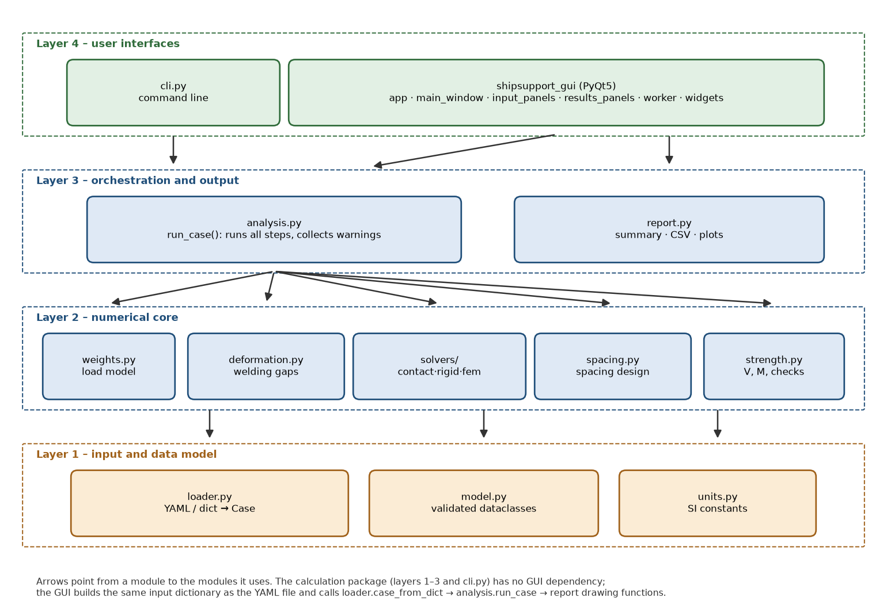
<figcaption aria-hidden="true"><p>Figure 4.1: Layered architecture of the program. The numerical core contains the weight model, the welding-deformation model, the solvers, the spacing design and the strength checks. The calculation package has no dependency on the graphical user interface.</p></figcaption>
</figure>

The layers are:

1.  **Input and data model** (`model.py`, `loader.py`, `units.py`). Validated data classes describe the ship, its weight items and weight curve, hull sections, block types and blocks, permissible envelopes, welding deformation, the settings of the spacing design and the analysis settings. The loader converts a YAML file, or an equivalent dictionary, into these classes and converts all quantities to SI units.
2.  **Numerical core.**
    - `weights.py` builds the finite element mesh and the piecewise-linear load intensity.
    - `deformation.py` evaluates the keel lift of the welded hull, identifies joint angles from a survey and converts the lift into block gaps.
    - `solvers/` contains the compression-only block springs with the contact iteration (`contact.py`), the rigid-hull solver (`rigid.py`), the FEM solver (`fem.py`) and the common result type (`result.py`).
    - `strength.py` computes shear force, bending moment, stresses and all checks.
    - `spacing.py` designs the spacing of the blocks of the plan. It does not import the solvers; the analysis of a candidate layout is passed to it as a function (Section 4.5).
3.  **Orchestration and output** (`analysis.py`, `report.py`). The function `run_case` performs the complete analysis of a case in a fixed sequence, runs the spacing design when it is requested and collects warnings. It also creates the analysis function for the spacing design. The report module produces the text summary, the CSV files and the charts.
4.  **User interfaces** (`cli.py`, `shipsupport_gui`). The command-line program and the desktop application.

The architecture follows the dependency rule of clean architecture ([Martin 2017](#ref-martin2017)): source-code dependencies point only inwards, from the interfaces towards the numerical core and the data model. The numerical modules do not know how they are called, and in particular they import nothing from the GUI (requirement N3). Within the core, the spacing design sits beside the solvers rather than above them: it depends only on the data model, and the composition of the design algorithm with a concrete support model takes place in the orchestration layer.

The most important consequence of this structure is that the GUI never performs calculations of its own. It assembles a dictionary with exactly the schema of the YAML input file and passes it to the same function chain as the command-line interface: `case_from_dict` followed by `run_case`. The GUI and the command-line program therefore produce identical results for identical input, which was verified by automated tests (Section 5.8). The core can also be used from scripts, for example for the parameter studies of Chapter 6, without any graphical dependency.

## 4.5 Design decisions

The following design decisions shaped the implementation. Each was taken to support one or more non-functional requirements.

- **Validated data classes, frozen where they describe physical objects (N2, N10).** All input is represented by data classes that check their own consistency at construction. The classes of physical objects — weight items, weight curve, sections, layers, block types, blocks, envelopes, joints, zones and the survey — are declared `frozen`, so an object cannot change after it has been validated; a modified copy must be made explicitly with `dataclasses.replace`. The spacing design relies on this: a candidate layout is a list of copies of the given blocks with new positions, so a block keeps its type, strength and gap, and neither the user’s input nor an earlier candidate can be altered by the design.
- **Validation at the boundary (N2).** Every check of the input happens once, when the data classes are constructed by the loader. Code inside the core can rely on consistent input, which keeps the numerical modules short; the core raises errors only for conditions that depend on the solution, such as a support that becomes unstable.
- **SI units only inside the core (N1).** Conversion happens in the loader and in the report. No numerical function has to know about tonnes, millimetres or MPa, which removes a frequent source of errors in engineering software.
- **Pure functions.** The numerical functions take arrays and data objects and return new objects. They hold no hidden state, which makes them easy to test in isolation and to call repeatedly, as the spacing design does hundreds of times.
- **A shared contact strategy (N10).** The contact iteration receives the support model as a function `linear_solve(kt, c, gap)`, which solves the linear problem for given tangent stiffnesses, constant terms and gaps. The rigid-hull and FEM solvers supply different implementations of this function, a form of the Strategy pattern. Gaps, lift-off, crushing and gap continuation are therefore implemented once and behave identically in both methods.
- **Dependency-injected analysis for the spacing design (N8, N11).** The design algorithm `design_spacing` receives a function `evaluate(blocks)` that returns an object with the block reactions of a candidate layout. In the program this function is created by `analysis.spacing_evaluator`, which rebuilds the mesh around the candidate block positions, recomputes the welding gaps at these positions and calls the chosen solver — exactly the analysis that `run_case` performs for the given plan. Every candidate is therefore judged with the full support model (N8). In the tests the function is replaced by a substitute analysis whose optimum is known in closed form, so the algorithm could be developed and tested before it was connected to the solvers, in milliseconds per test (N11).
- **Layered core, CLI and GUI (N3).** The user interfaces are thin: they translate between the user and the case dictionary and display the result objects. All logic that both interfaces need — reading survey files, computing structure positions, drawing charts — lives in the core and is called by both.
- **Verification built into the product (N4).** Every support solution reports its equilibrium residuals and every strength result the closure error of its shear and moment curves. The designed spacing is stored as an ordinary support solution and checked like any other.

## 4.6 Data model and input validation

All input data are represented by Python data classes defined in `model.py`. Table 4.3 lists the classes, their main fields with the units used internally, and the validation performed at construction.

| Class | Main fields (internal units) | Validation performed at construction |
|----|----|----|
| `WeightItem` | `name`, `weight` \[N\], `lcg`, `xa`, `xb` \[m\] | non-zero, finite weight; `xb ≥ xa`; LCG in the middle third of the extent; a point load requires `lcg = xa = xb` |
| `WeightCurve` | `name`, `x` \[m\], `q` \[N/m\] | at least two points of equal number; finite values; $`q \geq 0`$; `x` not decreasing (equal `x` = jump); at least one loaded segment |
| `Section` | `xa`, `xb` \[m\], `EI` \[N·m²\], `kGA` \[N\], `z_deck`, `z_keel` \[m³\], `shear_area` \[m²\] | `xb > xa`; positive stiffness and section properties |
| `Layer` | `thickness` \[m\], `E` \[Pa\] | positive values |
| `BlockType` | contact width and length \[m\], `layers`, stiffness override \[N/m\], capacity \[N\], allowable pressure, crush stress \[Pa\], post-crush ratio \[–\] | positive dimensions; layers or override required; post-crush ratio in \[0, 1\] |
| `Block` | `x` \[m\], `type`, `gap` \[m\], `label`, `strength` \[N\] (optional; default: capacity of the type) | positive strength if given |
| `BendingEnvelope`, `ShearEnvelope` | `x` \[m\], limits \[N·m\] or \[N\] | equal lengths; strictly increasing `x`; positive limits |
| `WeldJoint` | `x` \[m\], `angle` \[rad\] | finite values |
| `ShrinkageZone` | `xa`, `xb` \[m\], `curvature` \[1/m\] | `xb > xa`; finite curvature |
| `MeasuredProfile` | `x` \[m\], `lift` \[m\], interpolation, identification flag, regularisation | equal lengths (at least 2); strictly increasing `x`; known interpolation; regularisation ≥ 0 |
| `WeldingDeformation` | joints, zones, measured profile | at least one source; identification requires joint positions |
| `Ship` | name, $`L_{pp}`$, hull extent, weights, sections, declared weight and LCG, structure positions, envelopes, weight curve | positive $`L_{pp}`$; valid extent; at least one weight item and one section; positive total weight |
| `Settings` | methods, maximum element length, shear deformation flag, allowable stresses, tolerances, iteration limit | positive values; non-negative tolerances |
| `SpacingDesign` | support method, target utilisation \[–\], minimum and maximum spacing \[m\], allowed extent \[m\], fixed-end flag, snap-to-structure flag, rounding grid \[m\], SLP iteration limit | known method; positive target and minimum spacing; `max_spacing ≥ min_spacing`; `x_max > x_min`; positive grid |
| `Case` | ship, blocks, settings, welding deformation, spacing design | at least two blocks |

Table 4.3 – Data classes of the calculation core, their main fields with internal units, and the validation performed.

The weight curve is not a separate load type inside the core. Its method `items` converts every loaded segment into one exact trapezoidal `WeightItem` (Section 4.7.1), and the loader appends these items to the weight items of the ship. The load model, the solvers and the checks are therefore unchanged by the curve; the `Ship` keeps a reference to the curve only for the report.

Two exception classes carry error information to the user. `InputError` (a subclass of Python’s `ValueError`) is raised whenever input data are invalid or inconsistent. The message always identifies the item concerned, for example “Weight item ‘main engine’: LCG … must lie in the middle third of its extent”, “weights\[1\] (‘main engine’): moment_tm / weight_t = 23 m does not agree with lcg = 22 m”, “Weight curve ‘lightship curve’, point 3 (x = 5 m): x must not be smaller than at point 2” or “blocks.plan.spacing: 2 values given, 3 expected”. `ContactError` is raised when the block state iteration fails to converge, even with gap continuation. Its subclass `UnstableSupportError` is raised when fewer than two separated blocks remain in contact, which would leave the beam with a rigid-body mode (Section 3.7). Both interfaces catch these exceptions: the command-line program prints the message and exits with code 1, and the GUI shows it in a dialog box and in the summary pane.

## 4.7 Input format

A case is stored as a YAML file. Its top-level sections are listed in Table 4.4. Lengths are given in metres. Quantities in other units carry a suffix in the key name, such as `weight_t` (tonnes), `moment_tm` (tonne-metres), `q_t_per_m`, `E_MPa`, `capacity_t`, `strength_t`, `gap_mm` or `angle_mrad`. The suffix tells the user which unit to enter and tells the loader which conversion to apply. Five example cases are supplied (`examples/`): the example vessel, the spacing example with individual block strengths, the weight-curve example, the welded hull and the welded hull with a keel survey; they are analysed in Chapter 6.

| Section | Content | Required |
|----|----|----|
| `ship` | name, $`L_{pp}`$, hull extent, declared weight and LCG | yes |
| `weights` | weight items (distributed or point), with LCG or moment | yes, unless `weight_curve` is given |
| `weight_curve` | piecewise-linear weight distribution | no |
| `sections` | hull girder properties by longitudinal range | yes |
| `blocks` | block types and the block plan | yes |
| `structure` | positions of floors, bulkheads and web frames | no |
| `permissible` | permissible bending moment and shear force envelopes | no |
| `welding_deformation` | erection-joint kinks, construction-block shrinkage, surveyed keel line | no |
| `spacing_design` | settings of the automatic spacing design | no |
| `settings` | methods, mesh size, allowable stresses, tolerances | no |

Table 4.4 – Top-level sections of the YAML case file.

### 4.7.1 Weights: items, moments and the weight curve

A weight item gives its weight and either its LCG (`lcg`) or its longitudinal moment about AP (`moment_tm`), from which the loader computes the LCG as $`M/W`$ (Section 3.3.1). Moments are what a weight list in a loading manual often provides, and adding moments is how the total LCG is obtained, so the program accepts them directly. If both are given they must agree to a relative tolerance of $`10^{- 6}`$; otherwise an `InputError` names both values. An item with an extent `xa`, `xb` is distributed as a trapezoid that preserves its weight and LCG (Section 3.3.2); an item with `x`, or without an extent, is a point load. The keys are summarised in Table 4.5.

The weight curve is a list of points $`(x_{k},q_{k})`$ with $`q`$ in tonnes per metre, linear between the points and zero outside the first and last point; the same $`x`$ twice is a jump of $`q`$ (Section 3.3.4). Each segment $`\lbrack x_{k},x_{k + 1}\rbrack`$ of length $`L_{k}`$ is an exact trapezoid, and `WeightCurve.items` converts it into a weight item with

``` math
W_{k} = \frac{1}{2}\,(q_{k} + q_{k + 1})\, L_{k},\quad\quad{\bar{x}}_{k} = x_{k} + \frac{L_{k}\,(q_{k} + 2\, q_{k + 1})}{3\,(q_{k} + q_{k + 1})}\quad\quad\quad\quad(4.1)
```

Zero-length segments (jumps) and unloaded segments are skipped. Because $`q_{k},q_{k + 1} \geq 0`$, the centre $`{\bar{x}}_{k}`$ always lies in the middle third of the segment, so the middle-third condition of the trapezoidal spreading is satisfied automatically and the trapezoid of the item is the segment of the curve itself. Listing 4.1 shows the conversion, and Listing 4.2 the weight input of the weight-curve example, a lightship curve of 18 points with five jumps plus three deadweight items given by their moments.

**Listing 4.1 – Conversion of the weight curve into exact trapezoidal items (**`model.py`**, class** `WeightCurve`**).**

```python
    def items(self) -> list[WeightItem]:
        """One exact trapezoidal item per segment with load: weight (q_k + q_k+1) L / 2 and
        LCG x_k + L (q_k + 2 q_k+1) / (3 (q_k + q_k+1)). Jumps and unloaded segments are skipped."""
        out = []
        n = self.x.size - 1
        for k in range(n):
            xa, xb, qa, qb = self.x[k], self.x[k + 1], self.q[k], self.q[k + 1]
            length = xb - xa
            if length <= 1e-9 or qa + qb <= 0:
                continue
            lcg = xa + length * (qa + 2.0 * qb) / (3.0 * (qa + qb))
            out.append(WeightItem(f"{self.name} {k + 1}/{n}", 0.5 * (qa + qb) * length,
                                  float(lcg), float(xa), float(xb)))
        return out
```

**Listing 4.2 – Weight curve and items with moments in the weight-curve example (**`examples/weight_curve_case.yaml`**).**

```yaml
weight_curve:
  name: lightship curve
  points:
    - {x: 0.0,   q_t_per_m: 8.0}
    - {x: 4.0,   q_t_per_m: 16.0}
    - {x: 4.0,   q_t_per_m: 30.0}    # jump: aft peak bulkhead, superstructure starts
    - {x: 14.0,  q_t_per_m: 36.0}
    - {x: 16.0,  q_t_per_m: 36.0}
    - {x: 16.0,  q_t_per_m: 64.0}    # jump: engine room (main engine, auxiliaries)
    - {x: 28.0,  q_t_per_m: 64.0}
    - {x: 28.0,  q_t_per_m: 46.0}    # jump: forward end of the main engine
    - {x: 38.0,  q_t_per_m: 42.0}
    - {x: 38.0,  q_t_per_m: 34.0}    # jump: engine-room forward bulkhead
    - {x: 60.0,  q_t_per_m: 36.0}
    - {x: 80.0,  q_t_per_m: 35.0}
    - {x: 100.0, q_t_per_m: 30.0}
    - {x: 104.0, q_t_per_m: 28.0}
    - {x: 104.0, q_t_per_m: 36.0}    # jump: anchors, chain locker
    - {x: 112.0, q_t_per_m: 33.0}
    - {x: 118.0, q_t_per_m: 16.0}
    - {x: 120.0, q_t_per_m: 0.0}

# Deadweight items with the longitudinal moment about AP instead of the LCG
# (LCG = moment_tm / weight_t; giving lcg as well is allowed if it agrees).
weights:
  - {name: residual fuel, weight_t: 200, moment_tm: 14000, xa: 60.0, xb: 80.0}    # LCG 70 m
  - {name: fresh water,   weight_t: 60,  moment_tm: 6000,  xa: 94.0, xb: 106.0}   # LCG 100 m
  - {name: stores,        weight_t: 40,  moment_tm: 1200}                         # point load at 30 m
```

The curve of Listing 4.2 is converted into 12 trapezoidal items with a total of 4343.0 t and an LCG of 55.670 m; with the three items the docking weight is 4643.0 t at an LCG of 56.639 m, which the loader cross-checks against the declared values of the `ship` section.

| Key | Meaning | Unit |
|----|----|----|
| `weights[].name`, `weight_t` | name and weight of an item (negative for a deduction) | —, t |
| `weights[].lcg` or `moment_tm` | LCG, or moment about AP (LCG = moment / weight); both allowed if they agree | m, t·m |
| `weights[].xa`, `xb` | extent of a distributed item (both or neither) | m |
| `weights[].x` | position of a point load | m |
| `weight_curve.name`, `points[].x`, `points[].q_t_per_m` | piecewise-linear curve; a plain list of points is also accepted | —, m, t/m |

Table 4.5 – Input keys of the weights and the weight curve.

### 4.7.2 Block plan

The blocks are defined only by the block plan `blocks.plan` (Section 3.4.4), because the number of blocks, their spacing and their individual strengths are exactly what a dock’s block list provides and what the spacing design keeps or changes. The plan gives the block type, the position of the first block, the number of blocks and the spacing to the next block; optionally the strength and the initial gap of every block. A single spacing, strength or gap applies to all blocks, and a list gives one value per gap ($`N - 1`$ values) or per block ($`N`$ values). An empty strength means the capacity of the block type. If `count` is omitted, it is taken from the length of a list. The function `loader._blocks` checks that the lists have exactly the required length, that every spacing is positive and that the count is a whole number of at least two, and labels the blocks B01, B02, … from aft to forward; an input with the former block groups is rejected with a message that points to `blocks.plan`. Table 4.6 lists the keys and Listing 4.3 the plan of the spacing example, with 190 t standard blocks and nine older blocks of 160 t under the engine room.

| Key | Meaning | Unit (default) |
|----|----|----|
| `blocks.types.<name>` | block type: contact width and length, layers (`thickness`, `E_MPa`) or `stiffness_kN_per_mm`, `capacity_t`, `allowable_pressure_MPa`, `crush_stress_MPa`, `post_crush_ratio` | m, MPa, t (ratio 0.05) |
| `blocks.plan.type` | block type of the blocks | — |
| `blocks.plan.start_x` | position of the first (aftmost) block | m |
| `blocks.plan.count` | number of blocks $`N`$ | — (length of a list) |
| `blocks.plan.spacing` | distance to the next block: one value or $`N - 1`$ values | m |
| `blocks.plan.strength_t` | strength of every block: one value or $`N`$ values | t (type capacity) |
| `blocks.plan.gap_mm` | initial gap of every block (block top below the keel line): one value or $`N`$ values | mm (0) |

Table 4.6 – Input keys of the block types and the block plan.

**Listing 4.3 – Block plan of the spacing example (**`examples/spacing_case.yaml`**).**

```yaml
  # Block plan: one spacing for all gaps or a list of count-1 values; one strength for all
  # blocks or a list of count values (aft to forward); optional gap_mm likewise.
  plan:
    type: keel
    start_x: 6.4                # m, first block
    count: 44
    spacing: 2.4                # m, distance to the next block
    strength_t: [               # t, strength of every block, B01 ... B44
      190, 190, 190, 160, 160, 160, 160, 160, 160, 160, 160,
      160, 190, 190, 190, 190, 190, 190, 190, 190, 190, 190,
      190, 190, 190, 190, 190, 190, 190, 190, 190, 190, 190,
      190, 190, 190, 190, 190, 190, 190, 190, 190, 190, 190]
```

The loader evaluates the layer build-up of the block type as springs in series (Section 3.4.1); for the keel block of the examples this gives a stiffness of 2000 kN/mm. An initial gap belongs to its block, not to a position: when the spacing design moves a block, its gap moves with it.

### 4.7.3 Welding deformation

The keys of the welding-deformation section are summarised in Table 4.7 and Listing 4.4 shows the section of the welded-hull example (`examples/welding_case.yaml`), a hull built from six 20 m construction blocks.

| Key | Meaning | Unit |
|----|----|----|
| `welding_deformation.joints[].x`, `angle_mrad` | position and kink angle of an erection joint; positive lifts the hull ends (the angle may be omitted when it is identified) | m, mrad |
| `…zones[].xa`, `xb` | extent of a construction block | m |
| `…zones[].curvature_mm_per_m2` | shrinkage curvature given directly | mm/m² |
| `…zones[].deck_shrinkage_mm_per_m`, `bottom_shrinkage_mm_per_m`, `depth` | alternative: curvature $`= (\varepsilon_{\text{deck}} - \varepsilon_{\text{bottom}})/D`$ | mm/m, m |
| `…measured.x`, `lift_mm` | surveyed keel line, upward, arbitrary datum | m, mm |
| `…measured.file` | alternative: CSV file with columns `x_m`, `lift_mm` (path relative to the case file) | — |
| `…measured.interpolation` | `pchip`, `linear` or `spline` | — |
| `…measured.identify_joint_angles`, `regularization` | fit the joint angles to the survey; Tikhonov weight | —, — |

Table 4.7 – Input keys of the welding-deformation section.

**Listing 4.4 – Welding deformation of the assembled hull in the welded-hull example (**`examples/welding_case.yaml`**).**

```yaml
welding_deformation:
  joints:                       # erection butt joints between construction blocks
    - {x: 20.0,  angle_mrad: 0.9}
    - {x: 40.0,  angle_mrad: 0.5}
    - {x: 60.0,  angle_mrad: 0.4}
    - {x: 80.0,  angle_mrad: 0.5}
    - {x: 100.0, angle_mrad: 0.6}
  zones:                        # curvature inside each construction block
    # curvature = (deck shrinkage − bottom shrinkage) / depth; or give curvature_mm_per_m2
    - {xa: 0.0,   xb: 20.0,  deck_shrinkage_mm_per_m: 0.24, bottom_shrinkage_mm_per_m: 0.20, depth: 10.0}
    - {xa: 20.0,  xb: 40.0,  deck_shrinkage_mm_per_m: 0.24, bottom_shrinkage_mm_per_m: 0.20, depth: 10.0}
    - {xa: 40.0,  xb: 60.0,  deck_shrinkage_mm_per_m: 0.24, bottom_shrinkage_mm_per_m: 0.20, depth: 10.0}
    - {xa: 60.0,  xb: 80.0,  deck_shrinkage_mm_per_m: 0.24, bottom_shrinkage_mm_per_m: 0.20, depth: 10.0}
    - {xa: 80.0,  xb: 100.0, deck_shrinkage_mm_per_m: 0.24, bottom_shrinkage_mm_per_m: 0.20, depth: 10.0}
    - {xa: 100.0, xb: 120.0, deck_shrinkage_mm_per_m: 0.24, bottom_shrinkage_mm_per_m: 0.20, depth: 10.0}
```

Keel surveys are normally delivered as a list of stations, for example from a total station or a laser tracker. The loader therefore also reads the survey from a CSV file (`read_survey_csv`): a header row must contain an `x_m` (or `x`) and a `lift_mm` (or `lift`) column, lines beginning with `#` are comments, and malformed lines are reported with their line number. The function `inline_data_files` replaces the `file` key by the lists it contains before the case is built, so that the rest of the program, and the GUI, work with the same in-memory structure as for an inline survey; the core itself never reads files. A sample survey (`examples/welding_survey.csv`, 25 synthetic stations every 5 m) and a case that identifies the joint angles from it (`examples/welding_survey_case.yaml`) are supplied. A survey used without identification is taken as the complete keel shape: joints or zones given as well are then ignored with a warning. When the joint angles are identified, the known zone-shrinkage part is subtracted from the survey before the fit (Section 3.10).

### 4.7.4 Spacing design

The section `spacing_design` requests the automatic spacing design and holds its settings (Table 4.8). If the section is present and not disabled with `enabled: false`, `run_case` designs the spacing of the blocks of the plan. Listing 4.5 shows the settings of the spacing example. In the welded-hull example the same section is present but disabled, so that the as-built condition is analysed by default.

| Key | Meaning | Unit (default) |
|----|----|----|
| `enabled` | run the spacing design | — (true if the section is present) |
| `method` | support model of the design: `fem` or `rigid` | — (`fem`) |
| `target_utilisation` | largest admissible ratio $`u`$ of reaction to strength | — (1.0) |
| `min_spacing`, `max_spacing` | limits $`s_{\min}`$, $`s_{\max}`$ of the distance between neighbouring blocks | m (1.0; twice the mean spacing of the given plan) |
| `x_min`, `x_max` | allowed extent of the block line | m (first and last block of the plan) |
| `fix_end_blocks` | keep the first and last block in place | — (false) |
| `snap_to_structure` | final positions at the structure positions (floors) | — (true) |
| `grid` | rounding step when not snapping to structure | m (none) |
| `max_iterations` | iteration limit of the sequential linear programming | — (20) |

Table 4.8 – Input keys of the spacing design.

**Listing 4.5 – Spacing-design settings of the spacing example (**`examples/spacing_case.yaml`**).**

```yaml
spacing_design:
  enabled: true
  method: fem
  target_utilisation: 1.0       # reaction / strength must not exceed this
  min_spacing: 0.8              # m
  max_spacing: 4.8              # m (default: twice the given mean spacing)
  x_min: 6.4                    # m, aft limit of the block line (default: first block)
  x_max: 109.6                  # m, forward limit (default: last block)
  fix_end_blocks: false
  snap_to_structure: true       # final positions under floors (structure positions)
  max_iterations: 20            # sequential-LP iterations
```

## 4.8 Solver implementation

### 4.8.1 Mesh and load model

The mesh is built by `weights.build_nodes`. Every *key point* becomes a node: weight-item boundaries (including the segment ends of the weight curve), hull-section boundaries, block positions and the hull ends. The intervals between key points are then subdivided so that no element is longer than the user-specified maximum (0.5 m by default). Because every item boundary is a node, the load on every element is exactly linear, and the consistent load vector integrates it without approximation (Section 3.3.6). Because every block is a node, its spring acts directly on a vertical degree of freedom. The example vessel produced 256 nodes, 255 elements and 512 degrees of freedom. Since block positions are key points, a new mesh is built for every candidate layout of the spacing design; this costs well under a millisecond and keeps the load integration exact for every candidate.

### 4.8.2 Vectorised assembly

The element stiffness matrices of all elements are computed at once as a three-dimensional NumPy array of shape (number of elements, 4, 4), using the Timoshenko element of Section 3.6. Euler–Bernoulli elements follow as the special case $`\Phi = 0`$. The global matrix is then assembled without a Python loop over elements (Listing 4.6). For element $`e`$ the global degrees of freedom are $`2e,2e + 1,2e + 2,2e + 3`$. Repeating and tiling this index array produces the row and column index of every one of the 16 entries per element. The entries are passed to SciPy in coordinate (COO) format, and converting to compressed sparse row (CSR) format sums the duplicate entries at shared nodes, which is exactly the assembly operation of the direct stiffness method ([Przemieniecki 1968](#ref-przemieniecki1968); [Cook et al. 2002](#ref-cook2002)).

**Listing 4.6 – Vectorised assembly of the global stiffness matrix and load vector (**`solvers/fem.py`**).**

```python
    e = np.arange(L.size)
    dofs = np.column_stack([2 * e, 2 * e + 1, 2 * e + 2, 2 * e + 3])

    ke = element_stiffness(L, EI, kGA)
    rows = np.repeat(dofs, 4, axis=1).ravel()
    cols = np.tile(dofs, (1, 4)).ravel()
    K = sp.coo_matrix((ke.ravel(), (rows, cols)), shape=(ndof, ndof)).tocsr()

    F = np.zeros(ndof)
    np.add.at(F, dofs, element_loads(L, load.q1, load.q2))
    F[0::2] += load.point
    return K, F
```

The function `np.add.at` is used for the load vector instead of ordinary fancy-index addition because it accumulates repeated indices correctly.

### 4.8.3 Springs, gaps and the linear solve

For a given set of block states, each block force is written in the linearised form

``` math
R_{i} = k_{t,i}\,\delta_{i} + c_{i},\quad\quad\delta_{i} = v_{i} - g_{i}\quad\quad\quad\quad(4.2)
```

where $`(k_{t,i},c_{i})`$ equals $`(0,0)`$ for an open block, $`(k_{i},0)`$ for an elastic block and $`(k_{2,i},(k_{i} - k_{2,i})\,\delta_{y,i})`$ for a crushed block (Section 3.4.3). Moving the terms that depend on the unknown displacement to the left-hand side gives the system that is solved in each iteration:

``` math
\left( \mathbf{K}_{0} + diag(k_{t,i}) \right)\mathbf{u} = \mathbf{F}_{0} + \sum_{i}^{}\left( k_{t,i}\, g_{i} - c_{i} \right)\mathbf{e}_{v,i}\quad\quad\quad\quad(4.3)
```

where $`\mathbf{K}_{0}`$ and $`\mathbf{F}_{0}`$ are the hull stiffness matrix and load vector from Listing 4.6, and $`\mathbf{e}_{v,i}`$ is the unit vector of the vertical degree of freedom at block $`i`$. The beam itself is free–free: without springs $`\mathbf{K}_{0}`$ is singular, with the two rigid-body modes as its null space. Listing 4.7 shows the implementation of Equation (4.3). The matrix is symmetric and banded, and it is solved with SciPy’s sparse direct solver, which is based on SuperLU ([Li 2005](#ref-li2005superlu); [Davis 2006](#ref-davis2006)).

**Listing 4.7 – Insertion of block springs and gaps and the sparse solve (**`solvers/fem.py`**).**

```python
    def linear_solve(kt, c, gap):
        kdiag = np.zeros(ndof)
        np.add.at(kdiag, vdofs, kt)
        F = F0.copy()
        np.add.at(F, vdofs, kt * gap - c)
        u = spla.spsolve((K0 + sp.diags(kdiag)).tocsc(), F)
        if not np.all(np.isfinite(u)):
            raise UnstableSupportError("FEM system is singular")
        return u[vdofs] - gap, u
```

The function returns the block compressions $`\delta_{i}`$ and the full displacement vector. The hull matrix $`\mathbf{K}_{0}`$ is assembled only once per analysis, and each contact iteration merely adds a diagonal matrix. The gap vector is an explicit argument because the gap continuation of Section 4.8.5 must solve the same support model for a sequence of intermediate gap vectors.

### 4.8.4 State iteration

The linearisation of Equation (4.2) is computed by the method `BlockSprings.linearize` (Listing 4.8). The states are integer codes (open, elastic, crushed). For blocks without a crush limit, the crush deflection is infinite, and it is replaced by zero before the multiplication to avoid the undefined product $`0 \cdot \infty`$.

**Listing 4.8 – Linearisation of the piecewise-linear block law (**`solvers/contact.py`**).**

```python
    def linearize(self, states: np.ndarray) -> tuple[np.ndarray, np.ndarray]:
        """(kt, c) such that R = kt·δ + c for the given states."""
        dy = np.where(np.isfinite(self.crush_deflection), self.crush_deflection, 0.0)
        kt = np.select([states == ELASTIC, states == CRUSHED], [self.k, self.k_crushed], 0.0)
        c = np.where(states == CRUSHED, (self.k - self.k_crushed) * dy, 0.0)
        return kt, c
```

The iteration (Listing 4.9) starts from given block states, normally all elastic. It solves the linear system, determines the state that each block’s compression actually implies, and repeats until the assumed and implied states agree. A converged solution then satisfies equilibrium, compatibility and the block law exactly. The iteration is an active-set method for the complementarity problem formed by compression-only supports ([Cottle et al. 1992](#ref-cottle1992); [Wriggers 2006](#ref-wriggers2006)) (Section 3.7). Three safeguards were implemented:

1.  Before every solve, `check_support` verifies that at least two separated blocks have positive stiffness, and raises `UnstableSupportError` otherwise.
2.  Every visited set of states is recorded. If a set would be visited again, which indicates cycling, the method switches to changing only the block with the largest violation of its assumed state per iteration.
3.  The same one-at-a-time update is used if a full update would leave fewer than two separated blocks in contact. This happens with large, uneven gaps: from an all-elastic start, the first solution may show negative compression at almost every block.

**Listing 4.9 – Main loop of the block state iteration (**`solvers/contact.py`**, function** `_iterate`**).**

```python
    for iteration in range(1, max_iterations + 1):
        kt, c = springs.linearize(states)
        check_support(springs.x, kt)
        delta, extra = linear_solve(kt, c, gap)
        new_states = springs.states(delta)
        changed = new_states != states
        if not changed.any():
            return delta, states, iteration, extra

        seen.add(states.tobytes())
        unsupported = not is_supported(springs.x, springs.linearize(new_states)[0])
        if one_at_a_time or unsupported or new_states.tobytes() in seen:
            one_at_a_time = True
            worst = np.where(changed, springs.violation(delta, states), -np.inf)
            i = int(np.argmax(worst))
            new_states = states.copy()
            new_states[i] = springs.states(delta)[i]
        states = new_states
```

The rigid-hull solver (`solvers/rigid.py`) passes a different `linear_solve` function to the same loop. It solves the $`2 \times 2`$ system of Section 3.5 in coordinates centred on the block centroid, which improves its conditioning. Sharing the state iteration means that lift-off, gaps, crushing and the continuation of the next section are handled identically in both methods, and that the two methods can be compared directly, as in Chapter 6.

### 4.8.5 Gap continuation

The safeguards of Section 4.8.4 did not suffice for all welding cases. The one-at-a-time update can itself cycle, which is a known weakness of simple active-set methods. During development this occurred for the rigid-hull method of the example vessel with joint kinks of 0.2 mrad at five erection joints: the direct iteration did not converge within 200 iterations (Section 5.4.3). The function `solve_contact` was therefore extended with a gap continuation (homotopy, Section 3.11), shown in Listing 4.10.

If the direct iteration fails, the problem is first solved with all gaps equal to the smallest gap $`g_{0}`$. This is a rigid shift of the block line, so every block starts in contact and the iteration converges as for a straight keel. The gaps are then increased along

``` math
\mathbf{g}(\lambda) = g_{0} + \lambda\,(\mathbf{g} - g_{0}),\quad\quad 0 \leq \lambda \leq 1\quad\quad\quad\quad(4.4)
```

in steps of $`\lambda`$. Each step starts from the contact states of the previous one, so only a few blocks change state per step. A failed step is halved; a successful one doubles the next step, up to 0.5. If the step falls below $`1/4096`$, the original error is reported.

**Listing 4.10 – Gap continuation in** `solve_contact` **(**`solvers/contact.py`**).**

```python
    lam, step = 0.0, 0.25
    while lam < 1.0:
        nxt = min(1.0, lam + step)
        gap = g0 + nxt * (target - g0)
        try:
            delta, states_next, iterations, extra = _iterate(springs, linear_solve, gap, states,
                                                             max_iterations)
        except ContactError:
            step /= 2.0
            if step < 1.0 / 4096:
                raise first_error
            continue
        total += iterations
        lam, states = nxt, states_next
        step = min(2.0 * step, 0.5)
```

The continuation is a fallback. The direct iteration is always tried first, and for the welded-hull example it converged by itself, in 5 iterations for the rigid hull and 3 for the FEM. The continuation changes only the path to the solution: the final state set is accepted only when it is consistent with the full gap vector, so the result satisfies the same complementarity conditions as a directly converged solution. For the spacing design this robustness is essential, because the design analyses hundreds of layouts with welding gaps at positions that the user never chose, and a single failed analysis would abort the design.

### 4.8.6 Results

Both solvers return a `SupportResult` object. It contains the block positions, the reactions, the compressions, the final states, the number of iterations and the nodal displacements and rotations. It also provides two derived properties, the relative force residual $`(\sum R_{i} - W)/W`$ and the relative moment residual, which are reported in every summary (requirement N4).

## 4.9 Welding-deformation module

The module `deformation.py` implements the model of Section 3.9 for the initial keel shape of the welded hull. The two shape functions are given in Listing 4.11. A kink $`\varphi_{j}`$ at an erection joint contributes $`\varphi_{j}\,|x - x_{j}|/2`$ to the keel lift. A construction block $`\lbrack x_{a},x_{b}\rbrack`$ with shrinkage curvature $`\kappa`$ contributes $`\kappa\,\psi(x)`$, where $`\psi`$ has unit second derivative inside the block, is zero aft of it and is straight forward of it.

**Listing 4.11 – Shape functions of a joint kink and of a shrinkage zone (**`deformation.py`**).**

```python
def kink_shape(x: np.ndarray, xj: float) -> np.ndarray:
    """Lift per radian of a joint kink at xj (symmetric form)."""
    return 0.5 * np.abs(np.asarray(x, dtype=float) - xj)


def zone_shape(x: np.ndarray, xa: float, xb: float) -> np.ndarray:
    """Lift per unit curvature of a zone [xa, xb]: z'' = 1 inside, 0 outside."""
    x = np.asarray(x, dtype=float)
    inside = (x - xa) ** 2 / 2.0
    after = (xb - xa) * (x - 0.5 * (xa + xb))
    return np.where(x < xa, 0.0, np.where(x <= xb, inside, after))
```

A surveyed keel line is interpolated with a monotonicity-preserving piecewise cubic Hermite interpolant (PCHIP) ([Fritsch and Carlson 1980](#ref-fritsch1980)) by default; linear interpolation and a natural cubic spline are available as alternatives. Optionally the survey is not interpolated but used to identify the joint angles: `identify_joint_angles` solves the linear least-squares problem of Section 3.10 with NumPy, including a straight line for the unknown survey datum and an optional Tikhonov term ([Hansen 1998](#ref-hansen1998)). The function `effective_model` decides which model is used for the gaps — the given joints and zones, the survey as the total shape, or the zones plus the identified joint angles — and returns the identification with its rms and largest residual for the report.

The keel lift $`z(x)`$ is defined only up to a straight line, because a straight line is a rigid tilt that both support solvers absorb. The function `gaps_from_lift` converts the lift at the blocks into gaps by subtracting the least-squares line through the block positions and shifting the result so that the lowest point has zero gap:

``` math
g_{i}^{\text{weld}} = z(x_{i}) - (\alpha + \beta x_{i}) - \min_{j}\left\lbrack z(x_{j}) - (\alpha + \beta x_{j}) \right\rbrack\quad\quad\quad\quad(4.5)
```

where $`\alpha + \beta x`$ is the least-squares line. The normalisation makes the reported gaps easy to interpret (“end lift relative to the block line”) but has no effect on the reactions (Section 5.5). The gaps depend on the block positions through $`z(x_{i})`$ and through the line $`\alpha + \beta x`$. This is why the deformation model, not a list of gaps, is passed to the analysis: the function `analysis._springs` adds the welding gaps of the current block positions to the initial gaps of the blocks with `dataclasses.replace`, both for the given plan and for every candidate layout of the spacing design (Section 4.10.5). The welding deformation is thereby a constraint of the design, as required by Section 3.12.2.

## 4.10 Spacing-design module

The module `spacing.py` implements the automatic spacing design of Section 3.12 — the final result of the program. Given $`N`$ blocks in a fixed order with strengths $`S_{i}`$, it finds positions $`x_{1} < \ldots < x_{N}`$ within the allowed extent and the spacing limits that minimise the largest utilisation $`U(\mathbf{x}) = \max_{i}R_{i}(\mathbf{x})/S_{i}`$, and reports whether $`U \leq u`$, the target utilisation. This section describes how the method was engineered; its algorithm is given in Section 3.12.8.

### 4.10.1 Structure of the module

The module has 509 lines and is organised by the phases of the method (Table 4.9). It imports only the data model and SciPy’s `linprog`; in particular it imports no solver, which is the precondition for testing it with a substitute analysis.

| Part | Function or class | Responsibility |
|----|----|----|
| helpers | `utilisation`, `relabel` | $`R_{i}/S_{i}`$ (NaN without strength); sort and label B01, B02, … |
|  | `_admissible` | one aft-to-forward sweep that enforces $`s_{\min}`$, $`s_{\max}`$, fixed ends and, optionally, a set of admissible positions |
|  | `_Counter` | wraps the injected `evaluate`, counts analyses, returns $`(\text{evaluation},U_{i})`$ |
|  | `_score` | ordering of layouts: largest utilisation, then $`\sum_{i}^{}U_{i}^{8}`$ as tie-break |
| results | `SpacingStep`, `SpacingResult` | frozen record of one recorded step; result with initial and final blocks and evaluations, history, analysis count, diagnosis |
| phase 1 | `equidistribution_step` | strength-weighted equidistribution of the estimated load density (Section 3.12.3) |
| phase 2 | `_sensitivities`, `_slp_step` | finite-difference Jacobian $`\partial U_{i}/\partial x_{k}`$; assembly and solution of the linearised minimax LP (Section 3.12.4) |
| phase 3 | `_grid_neighbour`, `_round_to_grid`, `_local_moves` | rounding to admissible positions; neighbourhood of the local search (Section 3.12.5) |
| driver | `design_spacing` | input checks, limits, the three phases, diagnosis (Section 3.12.6) |

Table 4.9 – Structure of the module `spacing.py`.

The interface is the single function

```text
design_spacing(blocks, evaluate, design, x_bounds, structure=None,
               equidistribution_iterations=15, fd_step=0.05, local_search_evaluations=None)
```

in which `evaluate(blocks)` is any function that returns an object with an attribute `reactions`. The type of `evaluate` is declared as `Evaluate = Callable[[Sequence[Block]], object]`; Python’s structural typing makes the substitute analysis of the tests and the `SpacingEvaluation` of the program interchangeable without a common base class.

The wrapper `_Counter` (Listing 4.12) isolates the design from the representation of blocks. The phases work on a plain position vector $`\mathbf{x}`$; `_Counter` turns it into blocks by copying the given blocks with new positions, which preserves the order, the type, the strength and the initial gap of every block. It also counts the analyses, which is the machine-independent measure of the cost of the design (Section 5.9), and clips negative reactions, which cannot occur in a converged contact solution but may occur in a substitute analysis.

**Listing 4.12 – Wrapper of the injected analysis (**`spacing.py`**).**

```python
class _Counter:
    """Wraps evaluate(): counts the analyses and returns (evaluation, U_i)."""

    def __init__(self, evaluate: Evaluate, blocks: Sequence[Block], strength: np.ndarray):
        self.evaluate, self.blocks, self.strength = evaluate, list(blocks), strength
        self.count = 0

    def blocks_at(self, x: np.ndarray) -> list[Block]:
        return [dataclasses.replace(b, x=round(float(v), 6)) for b, v in zip(self.blocks, x, strict=True)]

    def __call__(self, x: np.ndarray):
        self.count += 1
        evaluation = self.evaluate(self.blocks_at(x))
        return evaluation, np.maximum(np.asarray(evaluation.reactions, dtype=float), 0.0) / self.strength
```

Positions are rounded to 1 µm, so that a block position is always a reproducible mesh node.

### 4.10.2 Limits and the admissible sweep

Before the phases start, `design_spacing` checks that every block has a strength and fixes the limits. The extent $`\lbrack x_{lo},x_{hi}\rbrack`$ is taken from the design settings, from the given block line, or from the given end blocks if they are fixed. The maximum spacing defaults to twice the mean spacing of the given plan; an unlimited spacing would let the minimax optimum leave long unsupported spans amidships, where the block reactions are small but the hull girder spans long. Two infeasible combinations are rejected with an `InputError`: more blocks than fit into the extent at $`s_{\min}`$, and, with fixed end blocks, an extent that $`N - 1`$ spacings of $`s_{\max}`$ cannot span. With free ends, the second case shortens the line instead.

All three phases need to map an arbitrary position vector to an admissible one. The function `_admissible` does this in one sweep from aft to forward with the end blocks fixed: block $`i`$ is kept in the window

``` math
\max\left( x_{i - 1} + s_{\min},\mspace{6mu} x_{N} - (N - i)\, s_{\max} \right)\mspace{6mu} \leq \mspace{6mu} x_{i}\mspace{6mu} \leq \mspace{6mu}\min\left( x_{i - 1} + s_{\max},\mspace{6mu} x_{N} - (N - i)\, s_{\min} \right)\quad\quad\quad\quad(4.6)
```

that its predecessor and the room needed by the remaining blocks leave for it, and moved to the nearest point of the window, or to the nearest admissible position in it when a set of positions (floors or a grid) is given. The window is never empty if the line length lies between $`(N - 1)s_{\min}`$ and $`(N - 1)s_{\max}`$, so the sweep succeeds in $`O(N)`$ operations without a search; with a discrete set of positions it may fail, and returns `None`.

### 4.10.3 Phases 1 and 2

Phase 1 starts from the given plan mapped proportionally onto the extent and applies the under-relaxed fixed-point iteration of `equidistribution_step` (Listing 4.13) up to 15 times. The reactions of the current layout are spread uniformly over the tributary cells of the blocks, which gives a piecewise-constant load density with cumulative $`Q(x)`$; inverting $`Q`$ at the cumulative interval weights $`(S_{i} + S_{i + 1})/2`$ places the blocks so that the load between two neighbours is proportional to their mean strength (Section 3.12.3). Blocks that are out of contact are given 5 % of the mean load, so that the density never vanishes and $`Q`$ remains invertible. Each new layout is moved halfway towards the equidistributed one, made admissible and analysed; the best layout found is kept.

**Listing 4.13 – Strength-weighted equidistribution step (**`spacing.py`**).**

```python
def equidistribution_step(x: np.ndarray, reactions: np.ndarray, strength: np.ndarray) -> np.ndarray:
    """New positions with the ends fixed: the load between two neighbouring blocks is made
    proportional to their mean strength.

    The reactions spread uniformly over the tributary cells give a load density; its
    cumulative Q(x) is inverted at the cumulative interval weights (S_i + S_{i+1}) / 2.
    """
    edges = np.concatenate([[x[0]], 0.5 * (x[1:] + x[:-1]), [x[-1]]])
    load = np.maximum(reactions, 0.0)
    load = np.maximum(load, 0.05 * max(float(np.mean(load)), 1e-12))     # lifted-off blocks
    Q = np.concatenate([[0.0], np.cumsum(load)])
    w = 0.5 * (strength[:-1] + strength[1:])
    F = np.concatenate([[0.0], np.cumsum(w)]) / np.sum(w)
    y = np.interp(F * Q[-1], Q, edges)
    y[0], y[-1] = x[0], x[-1]
    return y
```

Phase 2 is sequential linear programming with a trust region (Section 3.12.4). The function `_sensitivities` computes the Jacobian $`J_{ik} = \partial U_{i}/\partial x_{k}`$ by one-sided finite differences with a step of $`h = 0.05`$ m. For each free block the forward step is tried first and the backward step if the forward one would violate a limit; a block that cannot move in either direction keeps a zero column. One Jacobian therefore costs at most $`N`$ analyses. The function `_slp_step` assembles the linearised minimax problem as a dense linear programme in the variables $`\Delta^{+},\Delta^{-} \geq 0`$ (the move of each free block, $`\Delta = \Delta^{+} - \Delta^{-}`$), $`a_{i} \geq 0`$ (the magnitude of the second difference of the new positions) and $`t`$:

``` math
\begin{aligned}
\min\mspace{6mu} & t + \mu\sum_{i = 1}^{N - 2}a_{i} + \varepsilon\sum_{k}^{}\left( \Delta_{k}^{+} + \Delta_{k}^{-} \right) \\
\text{s.t.}\mspace{6mu} & U_{i} + \mathbf{J}_{i}\,\mathbf{\Delta} \leq t,\quad\quad s_{\min} \leq {x'}_{i + 1} - {x'}_{i} \leq s_{\max}, \\
 & \left| {x'}_{i + 2} - 2{x'}_{i + 1} + {x'}_{i} \right| \leq a_{i},\quad\quad 0 \leq \Delta_{k}^{\pm} \leq \rho,\quad\quad{x'}_{1} \geq x_{lo},\mspace{6mu}{x'}_{N} \leq x_{hi}
\end{aligned}\quad\quad\quad\quad(4.7)
```

with $`\mathbf{x}' = \mathbf{x} + \mathbf{\Delta}`$. The trust radius $`\rho`$ enters as a bound on the variables, and the extent only as a bound on the moves of the two end blocks, which keeps the constraint matrix small. The smoothing weight $`\mu = 0.002/\bar{s}`$, with $`\bar{s}`$ the mean spacing, trades a utilisation of 0.002 for one metre of spacing variation; it selects, among layouts with practically the same largest utilisation, the one whose spacing changes gradually, which is easier to lay out in the dock. The tiny weight $`\varepsilon = 10^{- 6}`$ suppresses needless moves. For $`N = 44`$ the LP has 131 variables and 214 inequality rows and is solved by HiGHS through `scipy.optimize.linprog`.

The driver accepts a step only if the analysed layout has a better score than the current one; the trust radius then doubles, up to the mean spacing, and the Jacobian is recomputed. Otherwise the radius is halved, and the iteration stops when it falls below 5 mm, when the LP predicts an improvement of less than $`10^{- 5}`$, or after `max_iterations` iterations (Listing 4.14). Because every accepted layout was analysed with the full support model, the linearisation affects only the efficiency of the search, never the correctness of its result (requirement N8).

**Listing 4.14 – Sequential linear programming with trust region (**`spacing.py`**, function** `design_spacing`**).**

```python
    for it in range(1, design.max_iterations + 1):
        if J is None:
            J = _sensitivities(run, x, u, free, lo, hi, s_min, s_max, fd_step)
        step = _slp_step(x, u, J, free, lo, hi, s_min, s_max, radius, smoothing)
        if step is None:
            break
        delta, predicted = step
        if _peak(u) - predicted < 1e-5:
            break                                          # linearised optimum reached
        y = x + delta
        y[0], y[-1] = max(y[0], lo), min(y[-1], hi)
        if np.any(np.diff(y) < s_min - 1e-6):
            y = _admissible(y, s_min, s_max)
            if y is None:
                radius *= 0.5
                continue
        ev, uy = run(y)
        if _score(uy) < _score(u):
            x, evaluation, u = y, ev, uy
            record("slp", it, u)
            radius = min(2.0 * radius, radius_max)
            J = None
        else:
            radius *= 0.5
            if radius < radius_min:
                break
```

### 4.10.4 Phase 3: admissible positions and local search

Blocks must stand under floors (Section 3.12.5). The admissible positions are the structure positions when `snap_to_structure` is set, otherwise the multiples of `grid`, if given; without either, phase 3 is skipped. `_round_to_grid` moves free end blocks to the nearest admissible position inside the extent and places the interior blocks by the admissible sweep of Equation (4.6). Rounding a continuous optimum independently block by block could violate the minimum spacing; the sweep cannot.

The rounded layout is then improved by a best-improvement local search on the grid (Listing 4.15). The neighbourhood is generated by `_local_moves`: the governing blocks — those within 2 % of the largest utilisation, at most three — and their neighbours are each moved by one or two grid positions forward or backward, either alone or together with the next block. Only admissible layouts are returned, and duplicates are removed. All trials are analysed, the best one is accepted if it improves the score, and the search stops at a local optimum on the grid or when its budget of $`25N`$ analyses is used. Moving pairs of blocks matters because, at the minimum spacing, a single block often cannot move without violating $`s_{\min}`$, whereas a block and its neighbour can.

**Listing 4.15 – Best-improvement local search on the admissible positions (**`spacing.py`**, function** `design_spacing`**).**

```python
    if grid is not None:
        y = _round_to_grid(x, grid, design.fix_end_blocks, lo, hi, s_min, s_max)
        if y is not None:
            x, (evaluation, u) = y, run(y)
            budget = local_search_evaluations if local_search_evaluations is not None else 25 * n
            start = run.count
            while run.count - start < budget:
                trials = _local_moves(x, u, grid, free, lo, hi, s_min, s_max)
                best_trial = None
                for z in trials:
                    if run.count - start >= budget:
                        break
                    ev, uz = run(z)
                    if best_trial is None or _score(uz) < _score(best_trial[2]):
                        best_trial = (z, ev, uz)
                if best_trial is None or not _score(best_trial[2]) < _score(u):
                    break                                  # local optimum on the grid
                x, evaluation, u = best_trial
            record("grid", 0, u)
```

### 4.10.5 Result object and diagnosis

`design_spacing` returns a `SpacingResult` with the status `fits` or `does_not_fit`, a message, the initial and final blocks with their evaluations, the history of `SpacingStep` records (phase, iteration, largest and smallest utilisation, analyses so far), the number of analyses, the target, and the total strength and load. Its properties give the initial and final utilisations and the given and designed spacing ($`N - 1`$ values). When the layout does not fit, the result carries the diagnosis of Section 3.12.6: the suggested number of blocks $`\max(N + 1,\lceil NU/u\rceil)`$; whether the total strength is less than the load; whether an end block at the limit of the line governs, with the advice to allow a longer line; and, if blocks carry no load in the best layout, the statement that the gaps rather than the spacing govern and that more blocks may not help.

### 4.10.6 Integration into the analysis

`run_case` runs the spacing design after the analysis of the given plan (Listing 4.16). The extent defaults to the given block line and is always limited to the hull. The injected analysis is created by `spacing_evaluator` (Listing 4.17), a closure over the case, the welding-deformation model actually used (after identification) and the support method. For every candidate it builds the mesh and the load model, computes the springs with the welding gaps at the candidate positions, and solves the contact problem — exactly as `run_case` does for the given plan. The result is a frozen `SpacingEvaluation` that keeps the load model, the support result and the springs, so that the final layout needs no further analysis. The designed blocks are then stored as the additional support solution `fem+spacing` (or `rigid+spacing`) and checked by the strength module like any other solution, so that all hull girder and block checks are applied to the designed spacing. If the design does not fit, its message is added to the warnings.

**Listing 4.16 – Spacing design in** `run_case` **(**`analysis.py`**).**

```python
    spacing = None
    if case.spacing is not None:
        sd = case.spacing
        x_lo = max(ship.x_aft, sd.x_min if sd.x_min is not None else blocks[0].x)
        x_hi = min(ship.x_fwd, sd.x_max if sd.x_max is not None else blocks[-1].x)
        spacing = design_spacing(blocks, spacing_evaluator(case, deformation, sd.method),
                                 dataclasses.replace(sd, x_min=x_lo, x_max=x_hi), (x_lo, x_hi),
                                 ship.structure_positions)
        key = f"{sd.method}+spacing"
        supports[key] = dataclasses.replace(spacing.final_evaluation.support, method=key)
        strength[key] = compute_strength(spacing.final_evaluation.load, supports[key],
                                         spacing.final_blocks, ship, settings)
        if not spacing.fits:
            warnings.append(f"Spacing design: {spacing.message}")
```

**Listing 4.17 – The analysis injected into the spacing design (**`analysis.py`**).**

```python
def spacing_evaluator(case: Case, deformation: WeldingDeformation | None, method: str):
    """evaluate(blocks) for the spacing design: mesh, welding gaps at the candidate block
    positions and support solution of a candidate layout, exactly as run_case does for the
    given layout."""
    ship, settings = case.ship, case.settings

    def evaluate(blocks: list[Block]) -> SpacingEvaluation:
        load = _load_model(ship, blocks, settings.max_element_length)
        springs = _springs(blocks, deformation)
        if method == "rigid":
            support = solve_rigid(load, springs, settings.max_iterations)
        else:
            support = solve_fem(load, ship.sections, springs, settings.shear_deformation,
                                settings.max_iterations)
        return SpacingEvaluation(load, support, springs)

    return evaluate
```

Because the designed layout has the same number of blocks as the plan but different positions, the report must not mix it with the solutions on the given plan. The property `AnalysisResult.block_supports` returns only the solutions on the given plan, which the block table of the summary, `blocks.csv` and the GUI’s block table show; the designed spacing is reported separately (Section 4.11).

The cost of the design is the number of analyses times the cost of one analysis. For the 44-block examples one analysis — mesh, load model and FEM contact solution — took about 3.9 ms, and the designs needed between 78 and 501 analyses (Section 5.9). Every analysis is independent, so the finite differences of phase 2 and the trials of phase 3 could be evaluated in parallel; this was not necessary at the present problem sizes.

## 4.11 Post-processing and reporting

### 4.11.1 Strength curves and checks

The function `strength.compute_strength` converts a support result into shear force and bending moment curves. Because the load on each element is linear, $`V(x)`$ is quadratic and $`M(x)`$ cubic within each element, and both are evaluated exactly at eight points per element (Section 3.8). At every node the curves are stored twice, once just aft and once just forward of the node, so that the jumps caused by block reactions and point loads appear as vertical steps in the plots. The deck and keel stresses, the shear stress and the utilisation against the permissible envelopes are evaluated at the same points.

The checks are represented uniformly by a `Check` object with a name, a demand, a capacity, a utilisation and a location. A single helper function, `governing`, finds the location of highest utilisation for any combination of demand and capacity arrays; where no limit is defined, it reports the largest absolute demand with the status “no limit”. Seven checks are produced for each support solution: hull bending moment, hull shear force, deck stress, keel stress, hull shear stress, block bearing pressure, and block load against the strength of each block (`Block.effective_strength`, the block’s own strength or else the capacity of its type). Crushing appears as the block state and in the warnings. The function `run_case` issues warnings for:

- a sum of the weight items or an LCG that differs from the declared values by more than the tolerance;
- blocks that carry no load, listed by name (with a note when welding deformation is present);
- blocks that have crushed;
- blocks positioned away from transverse structure;
- closure errors of the shear and moment curves;
- a survey used as the total shape while joints or zones are also given;
- the welding end lift at both ends of the block line;
- a spacing design that does not fit, with its diagnosis.

### 4.11.2 Output files

The reporting module writes the files listed in Table 4.10; the command-line interface and the GUI’s *Export results* command call the same functions. The text summary contains, in this order: the weight check (total weight and LCG, and with a weight curve its share and the number of items), the mesh and block line; a table of all support solutions with the sum, maximum and minimum of the reactions, open and crushed blocks, iterations and the two residuals; the block table of the given plan; the hull girder and block checks of every support solution with an overall verdict; the section **Welding deformation of the assembled hull** (model sources, identified angles with their fit residual, end lift and the blocks without contact as built) when welding deformation is present; the section **Block spacing design** when the spacing design ran; and the warnings. The spacing section gives the status and message, the block line and the range of the spacing before and after, the largest and mean ratio of reaction to strength before and after, the total strength against the load, the phases with their largest utilisation and the number of analyses, one row per block (position, spacing to the next block, strength, reaction and ratio), and, for a welded hull, the largest recomputed welding gap and the blocks without contact in the designed layout.

| File | Content | Written |
|----|----|----|
| `summary.txt` | text summary described above | always |
| `blocks.csv` | per block of the given plan: position, total and welding gap, stiffness, strength, reaction for each solution, pressure, utilisations, compression, state, offset from structure | always |
| `curves_rigid.csv`, `curves_fem.csv`, `curves_fem_spacing.csv` | $`x`$, $`V`$, $`M`$, deck, keel and shear stress, utilisations — one file per support solution | per solution |
| `spacing.csv` | per block: designed position and spacing to the next block, given position and spacing, strength, reaction and utilisation designed and given | with spacing design |
| `spacing_history.csv` | per recorded step: phase, iteration, analyses so far, largest and smallest utilisation | with spacing design |
| `results.png` | load and reactions, settlement, shear force, bending moment | unless `--no-plots` |
| `block_forces.png` | weight distribution and force on every block (Figure 4.2) | unless `--no-plots` |
| `welding_data.png` | keel shape with its components and survey points, joint angles and zone curvature, gap at every block (Section 6.7) | with welding deformation |
| `spacing_design.png` | given and designed spacing along the hull, reactions against strengths, convergence over the analyses (Section 6.8) | with spacing design |

Table 4.10 – Files written by the command-line interface.

All plots are drawn into Matplotlib `Figure` objects without the `pyplot` state machine. The same drawing functions (`draw_results`, `draw_block_forces`, `draw_welding_data`, `draw_spacing`) therefore save PNG files from the command line and draw into the GUI’s embedded canvases.

The block-force chart (Figure 4.2) answers the most common practical question, “what is the force on each block?”, in a single picture. The upper panel shows a schematic hull with the blocks, the total weight and the LCG. The lower panel shows one bar per block, labelled with its force in tonnes and its block number. The bars are coloured by utilisation (green up to 90 %, orange from 90 % to 100 %, red above 100 % of the governing limit, grey for blocks without contact). The other support method is shown as markers for comparison, together with the block strength and the average load $`W/N`$. The spacing-design chart has three panels: the given and the designed spacing as bars along the block line, labelled where runs of equal spacing are long enough; the reactions of the designed layout as bars coloured by $`R_{i}/S_{i}`$ against the stepped strength line, with the reactions of the given plan as markers; and the largest utilisation over the number of analyses, coloured by phase, with the target.

<figure>
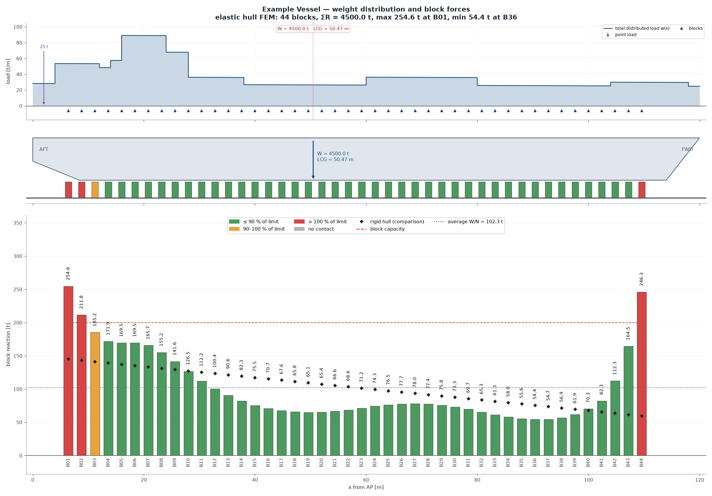
<figcaption aria-hidden="true"><p>Figure 4.2: Block-force chart produced by the program for the example vessel (elastic hull FEM). Top: weight distribution w(x) with W, LCG and the block positions; middle: hull schematic with the blocks; bottom: force on every block, bars coloured by utilisation, diamonds showing the rigid-hull result for comparison.</p></figcaption>
</figure>

## 4.12 Command-line interface

The command-line interface is invoked as `shipsupport run CASE.yaml`, or as `python -m shipsupport run CASE.yaml` without installation. Its options are given in Table 4.11. It prints the text summary to the console and writes the files of Table 4.10 to the output directory.

| Option | Effect |
|----|----|
| `-o OUT`, `--out OUT` | output directory (default: `<case name>_results` next to the case file) |
| `--methods {rigid,fem} …` | override the methods selected in the case file |
| `--no-plots` | skip the PNG charts |
| `--strict` | return exit code 2 if any check of any support solution fails or the spacing design does not fit |

Table 4.11 – Options of the command-line interface.

The exit code makes the program usable in scripts and automated workflows. It is 0 after a successful run, 1 if the input could not be read or was invalid, or if the solver failed, and 2 if `--strict` was given and the result is not acceptable. Under `--strict` the result is not acceptable if any support solution — including the solutions on the given plan — has a failed check, or if a requested spacing design does not fit. A designed spacing that passes all checks therefore does not mask a given plan that fails: the user is told that the plan in the file must be replaced by the designed one. The behaviour was confirmed on the example cases:

- **Example vessel:** a normal run returned 0 and wrote six files. A run with `--strict` returned 2, because the FEM block bearing pressure and block strength checks fail. A run with `--strict --methods rigid` returned 0, because all rigid-hull checks pass. A run with a non-existent input file returned 1.
- **Spacing and weight-curve examples:** a normal run returned 0 and wrote ten files, among them `spacing.csv`, `spacing_history.csv`, `spacing_design.png` and `curves_fem_spacing.csv`. With `--strict` the spacing example returned 2, because the given plan fails the block checks, although the summary reports “ALL CHECKS PASSED” for the designed spacing `fem+spacing`.
- **Welded hull and survey case:** a normal run returned 0 and wrote seven files, including `welding_data.png`; with `--strict` the welded hull returned 2.

## 4.13 Graphical user interface

### 4.13.1 Overall design

The graphical user interface was built with PyQt5 ([Riverbank Computing, n.d.](#ref-pyqt5)). The main window is divided by a movable splitter: the left side holds the input editor, the right side the results. Its appearance is defined in one place, the module `style.py`. It provides a light palette with one accent colour, an application stylesheet (tabs, group boxes, tables with alternating rows and bold headers, rounded inputs, and primary buttons for the two analysis commands), the program icon drawn in code, and the colours of the verdict badge in the status bar. The charts share one Matplotlib style, set in the reporting module, so that the GUI, the exported PNG files and the figures of this thesis look alike. They use Matplotlib’s constrained layout, which is recomputed whenever the canvas is resized; below a readable minimum size, a chart scrolls instead of being squeezed. A menu and a toolbar provide the file operations (new, open, save, save as, export results) and the two analysis commands: **Run analysis** (F5) analyses the case as it is, and **Auto-calculate spacing** (Ctrl+F5) runs the analysis with the spacing design and writes the designed spacing into the block plan. An *Open example* submenu loads any of the five supplied cases as an untitled copy, so that a shipped example cannot be overwritten by accident. The action *Add sample welding data* fills the welding input of the current case with the sample deformation of the welded hull, mapped onto the extent of the current hull, and runs the analysis. In the same way, *Add sample weight distribution curve* (also a button *Load sample curve* on the Weights tab) replaces the weights, after a confirmation, by a sample lightship curve of 18 points with five jumps and three deadweight items given by their moments (the data of `weight_curve_case.yaml`, 4643.0 t at LCG 56.639 m), mapped onto the current hull with the intensities scaled so that every weight is kept; it also sets the declared weight and LCG to the new totals and runs the analysis. The weight distribution is drawn as the top panel of the Block forces and Spacing design charts: the total distributed load w(x), the weight curve on its own (dashed), point loads, W and LCG, and the block positions (the given and the designed ones in the spacing chart). The status bar shows the overall verdict after each run, extended by the outcome of the spacing design when it ran, and reports when the results no longer match the input. For the example vessel it reads “CHECKS FAILED — max R 254.6 t at x = 6.40 m (fem); 0 warning(s)” (Figure 4.4).

### 4.13.2 Input editor

The input editor (class `CaseEditor`) is a set of tabs that corresponds to the sections of the YAML file (Table 4.12). It has two methods. `load_dict` fills all widgets from a case dictionary, and `to_dict` collects a case dictionary from the widgets. The GUI therefore works with exactly the same data structure as the file format: saving a case writes this dictionary as YAML, and running an analysis passes it to the calculation core.

| Tab | Content |
|----|----|
| Ship | name, $`L_{pp}`$, hull extent, declared weight and LCG |
| Weights | weight items with LCG or moment and optional extent; weight curve (name and points); live total weight and LCG of items and curve together (Figure 4.3) |
| Hull sections | hull girder sections ($`I`$, $`E`$, shear area, $`G`$, section moduli, optional $`EI`$ and $`\kappa GA`$) |
| Blocks | block types (layers written as `thickness@E_MPa; …`) and the block plan editor with the *Auto-calculate spacing* button (Figure 4.4) |
| Structure & limits | positions of transverse structure (start plus two of end, spacing, count, or an explicit list); permissible bending moment and shear force tables |
| Welding deformation | erection joints, construction-block shrinkage, surveyed keel line with an *Import CSV…* button, interpolation and identification options (Figure 4.7) |
| Settings | methods, mesh size, shear deformation, allowable stresses, tolerances, iteration limit |

Table 4.12 – Tabs of the input editor.

Two reusable widget classes were developed for the editor. `RecordTable` edits a list of records, such as weight items, curve points, erection joints or survey points, in a table with buttons to add, duplicate and remove rows. Its table supports copying and pasting tab-separated blocks with Ctrl+C and Ctrl+V, so that data can be pasted directly from a spreadsheet, which is how weight lists, block lists and keel surveys are usually available. Empty cells are omitted from the records, so the loader’s default values apply. `FormEditor` edits single values and shows each default value as greyed placeholder text. Unreadable entries are reported with their table, row and column.

The Weights tab (Figure 4.3) shows the weight items and the weight curve one above the other, and below them a live summary, for example “Σ weight = 4643.0 t, LCG = 56.639 m (3 items; curve 4343.0 t, LCG 55.670 m (18 points))” for the weight-curve example. The summary is computed exactly for the trapezoidal segments of the curve (function `curve_totals`), and an item given by its moment contributes that moment, so the user sees the effect of every edit on the docking weight and LCG before running an analysis.

<figure>
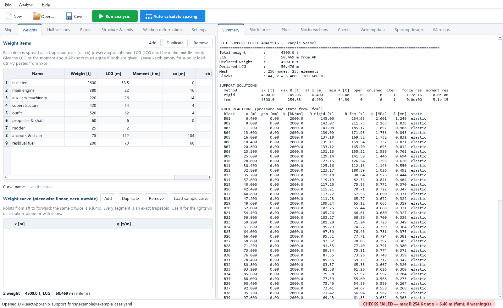
<figcaption aria-hidden="true"><p>Figure 4.3: Weights tab of the input editor with the example vessel’s weight items, the (empty) weight curve and the live total weight and LCG.</p></figcaption>
</figure>

### 4.13.3 Block plan editor and the automatic spacing design

The Blocks tab holds the block types and, below them, the block plan editor (class `BlockPlanEditor`, module `plan_panel.py`; Figure 4.4). It has a spin box for the number of blocks, a field for the position of the first block, a selector for the block type, and fields with buttons that set all spacings or all strengths at once. The table has one row per block with the columns Block, x, Spacing to next, Strength, Gap, Reaction and Reaction / strength. The spacing, the strength and the gap are edited directly or pasted from a spreadsheet; an empty strength means the capacity of the type. The label, the position — the cumulative sum of the spacings — and the two result columns are read-only and shaded. Changing the count adds rows at the forward end, which copy the last spacing and strength, or removes rows there. A line below the table summarises the plan, for example “44 blocks, block line 6.40 – 109.60 m (103.20 m), spacing 2.40 – 2.40 m, 44 block(s) with the type capacity as strength”. The method `plan` returns the `blocks.plan` dictionary of Section 4.7.2, with a single value instead of a list where all values are equal.

The table is also the main view of the result. After every analysis the window passes the positions, reactions and ratios of reaction to strength to `show_reactions`, which fills the two result columns, coloured green, orange or red at 90 % and 100 % of the target, provided the result belongs to the plan as it is in the table. A result of an older plan is therefore never shown next to a changed plan.

<figure>
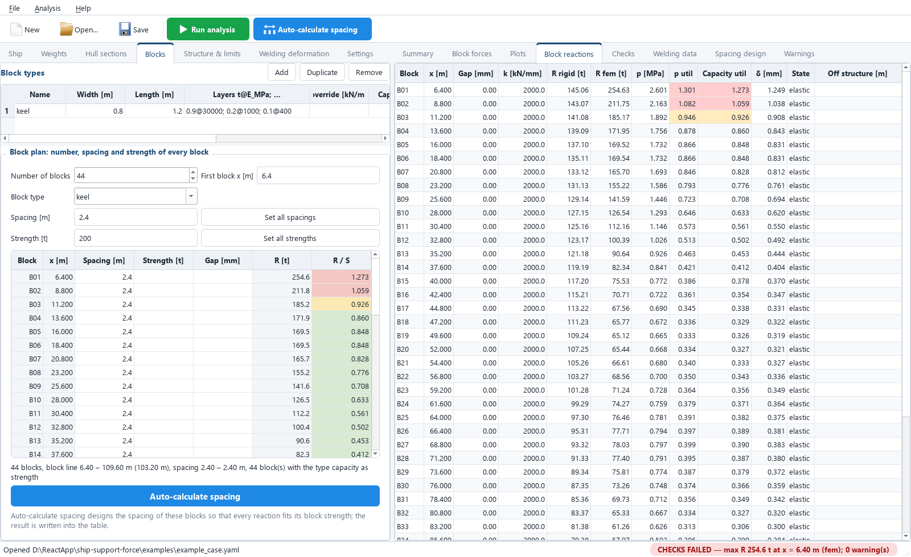
<figcaption aria-hidden="true"><p>Figure 4.4: Blocks tab with the block type and the block plan editor (left), showing the reaction and the ratio of reaction to strength of every block of the example vessel, and the Block reactions result tab (right).</p></figcaption>
</figure>

The **Auto-calculate spacing** button, the toolbar button and Ctrl+F5 all call `MainWindow.auto_spacing`, which carries out the following sequence:

1.  The Blocks tab is shown and the status line under the button reports that the spacing is being designed.
2.  `run_analysis(spacing_design=True)` collects the case dictionary from the editor, removes any `spacing_design` section and inserts the settings returned by `CaseEditor.auto_spacing_design` (Listing 4.18): the settings of the loaded case, always enabled, or — if the case has none — default settings with the floor spacing of the Structure tab as the minimum spacing.
3.  Both analysis commands and the button are disabled, and the analysis runs in the background thread of Section 4.13.4.
4.  When the result arrives, `show_result` displays it in all result tabs, and `_apply_spacing` writes the designed blocks back into the plan: the first position, the $`N - 1`$ designed spacings, and the unchanged type, strengths and gaps. The status line reports “Fits” or “Does not fit”, the largest ratio of reaction to strength before and after, the range of the designed spacing and the number of analyses, and, if the design does not fit, the diagnosis.
5.  The designed plan is an ordinary input: it can be edited further, analysed with F5 and saved.

**Listing 4.18 – Settings of the spacing design for the Auto-calculate button (**`shipsupport_gui/input_panels.py`**).**

```python
    def auto_spacing_design(self) -> dict:
        """spacing_design for the Auto-calculate spacing button: the loaded settings, or
        defaults with the floor spacing as the minimum spacing; always enabled."""
        if self.spacing_design is not None:
            return {**self.spacing_design, "enabled": True}
        design = {"enabled": True}
        floor = self.structure_spacing()
        if floor is not None:
            design["min_spacing"] = floor
        return design
```

The spacing-design settings of a loaded case are not edited in the GUI; they are kept by the editor and written back unchanged when the case is saved. F5 deliberately runs the analysis *without* the spacing design, even if the loaded case contains an enabled `spacing_design` section. This separates the two questions that the user asks — “what are the reactions of my plan?” and “what spacing should the plan have?” — and prevents a plain analysis from rewriting the plan.

### 4.13.4 Background analysis

The analysis runs in a background thread so that the window remains responsive, which matters for the spacing design, which takes up to a few seconds. The class `AnalysisThread` (Listing 4.19) receives the case dictionary and runs the same pipeline as the command-line interface. It reports the result or an error message to the main window through Qt signals. Signals emitted from a worker thread are delivered to the main thread through Qt’s event loop, so all widget updates take place in the main thread, as Qt requires.

**Listing 4.19 – Background analysis thread of the GUI (**`shipsupport_gui/worker.py`**).**

```python
class AnalysisThread(QThread):
    succeeded = pyqtSignal(object)   # AnalysisResult
    failed = pyqtSignal(str)

    def __init__(self, data: dict, parent=None):
        super().__init__(parent)
        self.data = data

    def run(self):
        try:
            self.succeeded.emit(run_analysis(self.data))
        except (InputError, ContactError) as exc:
            self.failed.emit(str(exc))
        except Exception:  # unexpected: show the traceback rather than crash the GUI
            self.failed.emit("Unexpected error:\n\n" + traceback.format_exc())
```

### 4.13.5 Result views

The results side has the eight tabs of Table 4.13. The plots are embedded Matplotlib canvases with a navigation toolbar for zooming, panning and saving. In the tables, utilisations above 1.0 are highlighted in red, utilisations between 0.9 and 1.0 in orange, and blocks without contact in grey. If a case contains no welding deformation or no spacing design, the corresponding tab explains this and offers a button that adds the sample welding data, or starts the automatic spacing design, respectively.

| Tab | Content |
|----|----|
| Summary | the text summary of Section 4.11.2 |
| Block forces | the chart of Figure 4.2: weight distribution on top, then the force on every block (Figure 4.5) |
| Plots | load and reactions, settlement, shear force, bending moment |
| Block reactions | one row per block of the given plan, with a welding-gap column when present (Figure 4.4) |
| Checks | all checks of all support solutions, including `fem+spacing` (Figure 4.6) |
| Welding data | the welding data chart (Figure 4.7) |
| Spacing design | the spacing design chart (Section 6.8) |
| Warnings | the warnings, with their number in the tab title |

Table 4.13 – Tabs of the result view.

<figure>
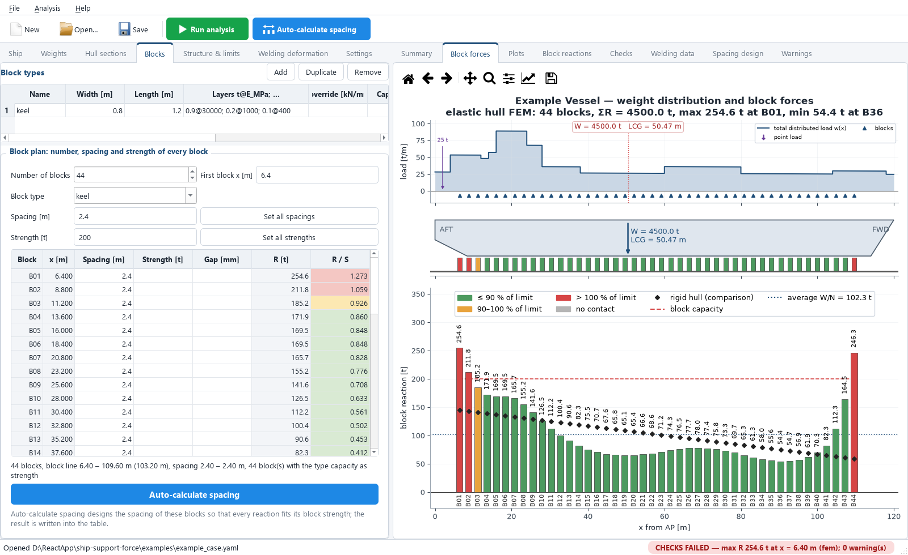
<figcaption aria-hidden="true"><p>Figure 4.5: Main window after an analysis of the example vessel, with the Blocks input tab on the left and the Block forces result tab on the right.</p></figcaption>
</figure>

<figure>
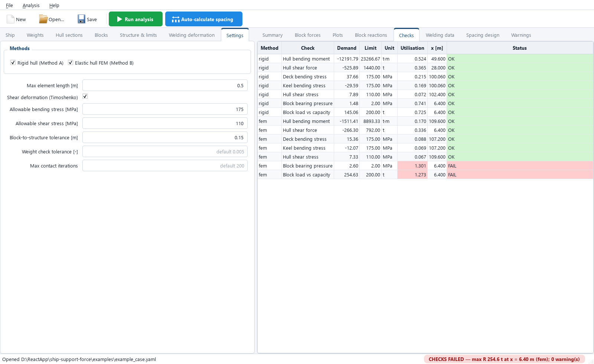
<figcaption aria-hidden="true"><p>Figure 4.6: Settings input tab (left) and Checks result tab (right), listing every hull girder and block check for each support solution with utilisation and status.</p></figcaption>
</figure>

<figure>
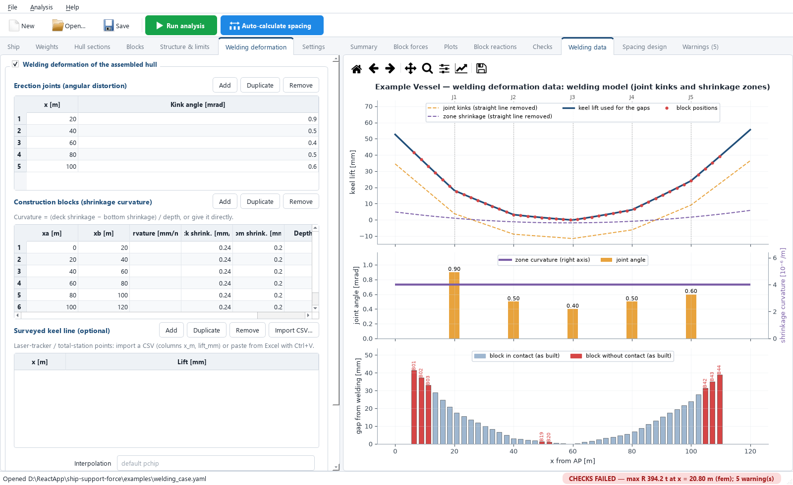
<figcaption aria-hidden="true"><p>Figure 4.7: Welding deformation input tab (left) and Welding data result tab (right) for the welded-hull example.</p></figcaption>
</figure>

## 4.14 Requirements traceability

Table 4.14 traces every requirement of Table 4.1 to the modules that realise it and to the test modules that verify it (requirement N9). The test modules are described in Chapter 5.

| Requirement | Realised by | Verified by |
|----|----|----|
| F1 weight items with LCG or moment | `model.WeightItem`, `loader._weight`, `weights.py` | `test_weights.py`, `test_loader.py` |
| F2 weight curve | `model.WeightCurve`, `loader._weight_curve` | `test_weights.py`, `test_loader.py`, `test_example_case.py` |
| F3 block plan | `loader._blocks`, `model.Block` | `test_loader.py`, `test_gui.py` |
| F4 rigid-hull method | `solvers/rigid.py` | `test_rigid.py`, `test_fem.py` (rigid limit) |
| F5 elastic-hull FEM | `solvers/fem.py` | `test_fem.py` |
| F6 compression-only, crushable blocks; large gaps | `solvers/contact.py` | `test_rigid.py`, `test_fem.py`, `test_deformation.py` |
| F7 hull girder checks | `strength.py` | `test_strength.py` |
| F8 block checks against block strength | `strength.py`, `model.Block.effective_strength` | `test_strength.py`, `test_example_case.py`, `test_spacing.py` |
| F9 welding-deformation model | `deformation.py`, `analysis._springs` | `test_deformation.py` |
| F10 survey import, interpolation, identification | `deformation.py`, `loader.read_survey_csv`, GUI import | `test_deformation.py`, `test_example_case.py`, `test_gui.py` |
| F11 automatic spacing design | `spacing.py`, `analysis.spacing_evaluator`, `analysis.run_case` | `test_spacing.py` |
| F12 reporting | `report.py` | `test_example_case.py`, `test_spacing.py` |
| F13 command-line interface | `cli.py` | `test_example_case.py`, `test_spacing.py` |
| F14 GUI with block plan editor and Auto-calculate spacing | `shipsupport_gui` (`plan_panel.py`, `main_window.py`) | `test_gui.py` |
| N1 SI units | `units.py`, `loader.py` | `test_loader.py`, `test_deformation.py` (unit conversion), all benchmarks |
| N2 input validation | `model.py`, `loader.py` | `test_weights.py`, `test_loader.py`, `test_deformation.py`, `test_spacing.py`, `test_gui.py` |
| N3 core independent of GUI | package structure | `test_gui.py` (identical results) |
| N4 run-time self-checks | `solvers/result.py`, `strength.py` | `test_example_case.py`, `test_spacing.py` |
| N5 automated tests | `tests/` | 131 tests |
| N6 performance | sparse solvers, vectorised assembly, analysis count of the design | measured (Section 5.9) |
| N7 portability | Python ecosystem | — |
| N8 designed spacing from full analyses | `spacing._Counter`, `analysis.spacing_evaluator` | `test_spacing.py` (designed layout re-analysed from scratch) |
| N9 traceability | this table | — |
| N10 maintainability | module structure | code metrics (Section 4.15) |
| N11 testability of the design | injected `evaluate` | `test_spacing.py` (substitute analyses) |

Table 4.14 – Requirements traceability matrix: requirements, realising modules and verifying tests.

## 4.15 Code metrics

Table 4.15 lists the size of each module, measured as total lines and as lines that are neither blank nor full-line comments (docstrings are counted as code). The calculation core comprises 3283 lines, of which 2736 are non-blank, non-comment lines. The GUI comprises 2161 lines (1876). The test suite comprises 1552 lines (1236) in ten files — nine test modules and a helper module — and contains 131 tests (Chapter 5).

| Package / module | Lines | Non-blank, non-comment |
|----|---:|---:|
| `shipsupport/report.py` | 713 | 628 |
| `shipsupport/spacing.py` | 509 | 429 |
| `shipsupport/model.py` | 461 | 352 |
| `shipsupport/loader.py` | 420 | 367 |
| `shipsupport/strength.py` | 205 | 176 |
| `shipsupport/analysis.py` | 195 | 158 |
| `shipsupport/deformation.py` | 169 | 137 |
| `shipsupport/solvers/contact.py` | 169 | 134 |
| `shipsupport/weights.py` | 118 | 92 |
| `shipsupport/solvers/fem.py` | 116 | 97 |
| `shipsupport/cli.py` | 71 | 57 |
| `shipsupport/solvers/rigid.py` | 54 | 44 |
| `shipsupport/solvers/result.py` | 42 | 33 |
| `shipsupport/units.py` | 14 | 10 |
| other (`__init__`, `__main__`, `solvers/__init__`) | 27 | 22 |
| **Calculation core total** | **3283** | **2736** |
| `shipsupport_gui/input_panels.py` | 601 | 524 |
| `shipsupport_gui/main_window.py` | 444 | 389 |
| `shipsupport_gui/plan_panel.py` | 343 | 305 |
| `shipsupport_gui/widgets.py` | 296 | 256 |
| `shipsupport_gui/results_panels.py` | 252 | 220 |
| `shipsupport_gui/style.py` | 156 | 133 |
| `shipsupport_gui/worker.py` | 34 | 24 |
| `shipsupport_gui/app.py` | 31 | 22 |
| other (`__init__`, `__main__`) | 4 | 3 |
| **GUI total** | **2161** | **1876** |
| `tests/test_gui.py` | 418 | 348 |
| `tests/test_spacing.py` | 239 | 192 |
| `tests/test_loader.py` | 196 | 153 |
| `tests/test_deformation.py` | 184 | 144 |
| `tests/test_example_case.py` | 129 | 103 |
| `tests/test_fem.py` | 118 | 89 |
| `tests/test_weights.py` | 114 | 90 |
| `tests/test_rigid.py` | 68 | 51 |
| `tests/test_strength.py` | 51 | 42 |
| `tests/helpers.py` | 35 | 24 |
| **Tests total** (10 files, 131 tests) | **1552** | **1236** |

Table 4.15 – Size of the modules of the program.

The numerical heart of the program is small. The two solvers with the contact iteration and the gap continuation amount to 381 lines, the welding-deformation model to 169 lines and the load model to 118 lines. The spacing design, the final result of the program, is with 509 lines the largest numerical module; its module docstring states the problem and the three phases, so that the code can be read against Section 3.12. The largest module is the reporting module, and the data model and the loader together account for 881 lines, reflecting the effort spent on clear presentation of results and on input validation with precise messages. The test code amounts to 47 % of the core, and the 239 lines of `test_spacing.py` verify a module of 509 lines.

## 4.16 Summary

The models of Chapter 3 were implemented in Python as a layered calculation package and a separate PyQt5 user interface, developed in tested increments. The calculation core uses validated data classes with SI units, frozen for all physical objects, and validates all input once, at the boundary. Weight items given by their LCG or their moment and a weight-distribution curve, whose segments are converted exactly into trapezoidal items, feed one load model on a mesh that contains every key point, so that the load integration is exact. The blocks are defined by a block plan with the number of blocks and the spacing, strength and initial gap of every block. Sparse finite element assembly is vectorised, and one active-set iteration for compression-only, optionally crushing blocks, with a gap continuation for large welding gaps, is shared by the rigid-hull and the elastic-hull methods through a common `linear_solve` interface.

The module `spacing.py` designs the spacing of the blocks of the plan from their strengths. It combines strength-weighted equidistribution, sequential linear programming with a trust region and a smoothing term, and an admissible rounding to the floors with a best-improvement local search, and it diagnoses why a plan cannot fit. The analysis of a candidate layout is injected as a function; in the program this function rebuilds the mesh and recomputes the welding gaps at the candidate positions, so that every designed spacing is the result of a full analysis and welding deformation acts as a constraint, while in the tests a substitute analysis with a known optimum takes its place.

The command-line interface supports scripted use through meaningful exit codes. The GUI offers spreadsheet-compatible tables, a live weight summary, a block plan editor that also shows the reaction and the ratio of reaction to strength of every block, and an *Auto-calculate spacing* button that runs the design in a background thread and writes the designed spacing back into the plan. A traceability matrix links every requirement to its modules and tests. The correctness of the implementation is examined in the next chapter.

# 5 Verification

A numerical program is useful only if its results can be trusted, and a design program even more so: its final result, the spacing of the keel blocks, is laid out in the dock without the engineer having seen the hundreds of analyses behind it. This chapter documents the evidence that the program described in Chapter 4 solves the equations of Chapter 3 correctly. It first defines the verification strategy and gives an overview of the automated test suite. It then presents the analytical benchmark cases for the load, support and strength models, including the weight curve and weight items given by their moment, followed by convergence studies. Separate sections verify the welding-deformation model with the identification from a survey, and the automatic spacing design. The run-time self-checks built into every analysis, the consistency between the graphical user interface and the calculation core, and the performance of the program follow. The chapter closes with the limitations of the verification, in particular the absence of validation against measurements.

## 5.1 Verification strategy

Following Oberkampf and Roy ([2010](#ref-oberkampf2010)), three activities that are often confused are distinguished:

- **Code verification** establishes that the software implements the chosen mathematical model without programming errors. Its main tool is comparison with exact analytical solutions of problems that exercise the relevant parts of the code.
- **Solution verification** estimates the numerical error of a particular computed solution, for example discretisation and round-off error, and confirms that the solution has converged.
- **Validation** establishes to what extent the mathematical model represents physical reality, by comparison with experimental or full-scale measurements.

This chapter deals with the first two activities. The models of Chapter 3 contain assumptions — the hull treated as a one-dimensional beam, linear-elastic or bilinear block behaviour, a kinematic description of welding deformation and no transverse load sharing — whose adequacy can only be assessed by validation. No measured block loads or keel surveys were available for this work, so validation remains outside its scope (Section 5.10).

The verification strategy had six elements:

1.  **Analytical benchmarks.** Small problems with known closed-form solutions were solved with the program and the results compared with the closed form. Together, the benchmarks exercise every computational module: load integration from weight items and from the weight curve, the rigid-hull solver, the FEM solver with Euler–Bernoulli and Timoshenko elements, the contact iteration with gaps and crushing, the shear-force and bending-moment integration, and the shape functions of the welding-deformation model.
2.  **Convergence and limit behaviour.** Properties that follow from the theory were tested: the FEM solution must approach the rigid-hull solution as the hull bending stiffness tends to infinity; the reactions must not depend on the mesh density; the contact solution for large gaps must satisfy the complementarity conditions whichever path the iteration takes.
3.  **Invariance and equivalence tests.** Properties that must hold exactly were tested where no closed form exists: the invariance of the reactions to a straight-line tilt of the keel, the equivalence of a block with an unclosable gap and a removed block, and the equivalence of the example’s weight items with the piecewise-linear curve that is their sum.
4.  **Verification of the design algorithm against known optima.** The spacing design was tested with substitute analyses whose optimal layout is known in closed form, and it was checked on the full model that the designed layout, analysed again from scratch, gives the same reactions — the designed spacing is never the output of a surrogate.
5.  **Run-time self-checks.** Every analysis computes equilibrium residuals and the closure error of the shear and moment curves, and reports them with the results.
6.  **Automation.** All benchmarks and consistency checks were coded as automated tests with pytest ([Krekel et al., n.d.](#ref-pytest)). They are repeated after every change to the program, which protects the verified state against regressions.

The accuracy of a result $`y`$ compared with an exact reference value $`y_{\text{ref}}`$ is expressed throughout as the relative error

``` math
\varepsilon = \frac{\left| y - y_{\text{ref}} \right|}{\left| y_{\text{ref}} \right|}\quad\quad\quad\quad(5.1)
```

For calculations in IEEE double precision, the machine epsilon is approximately $`2.2 \times 10^{- 16}`$. A relative error of order $`10^{- 16}`$ to $`10^{- 12}`$ therefore means agreement to the limits of floating-point arithmetic. All numbers in this chapter were computed with the final version of the program.

## 5.2 Test suite overview

The test suite consists of nine test modules and a helper module, and contains 131 tests in total. The count was determined with `pytest --collect-only`; parametrised tests count once per parameter set. Table 5.1 summarises what each module verifies. All 131 tests passed on the final version of the program. The GUI tests run Qt in its off-screen mode, so they need no display; if PyQt5 is not installed, they are skipped automatically.

| Test module | Tests | What is verified |
|----|---:|----|
| `test_weights.py` | 12 | trapezoid end intensities preserving weight and LCG; triangle limits; rejection of an LCG outside the middle third; exact integration of 31 random items; mesh construction and node lookup; weight-curve segments as exact trapezoids (weight, LCG, $`\int q\, dx`$, $`\int xq\, dx`$ and the intensity itself); a curve with a jump; five invalid curves, each reported with the offending point |
| `test_loader.py` | 33 | structure positions by the three rules and by an explicit list, five invalid specifications; block plan with lists and single values (positions, labels, strength default and override, gaps); count taken from a list; nine invalid plans, each with a specific message; rejection of the former block groups; reactions after changing count and spacing; LCG from the moment of an item and of a point load; moment and LCG must agree; four invalid weight items; weight curve read as items (also as a plain list and without items); four invalid curve points named in the message; rejection of a case without any weights |
| `test_rigid.py` | 6 | two-block determinate case; equal blocks under symmetric load; eccentric closed form; lift-off equivalence; crushing closed form; instability detection |
| `test_fem.py` | 10 | Euler–Bernoulli and Timoshenko midspan deflection; shear-deformation switch; two-span reactions; convergence to the rigid method; load concentration of a flexible hull; gap equivalence; partially closed gap; mesh independence; section coverage check |
| `test_strength.py` | 3 | simply supported shear and moment; hogging over supports with overhangs; stresses and utilisations of all hull girder checks |
| `test_deformation.py` | 18 | kink slope change; zone curvature; gaps and reactions invariant to a keel tilt; end lift unloading the first and last blocks; continuation with large gaps; exact and noisy identification of joint angles; interpolation through the survey points (three methods); unit conversion of shrinkage; invalid input; survey CSV and the sample survey case; identification with known zone shrinkage subtracted; survey used directly as the total shape; rejection of a malformed survey file; welding example with end lift |
| `test_spacing.py` | 13 | closed-form minimax optimum for a uniform load; smaller spacing for weaker blocks with the order of strengths kept; equidistribution step towards a load peak; spacing limits, extent and grid; fixed end blocks; report when the strength is not enough; invalid problems; spacing example within strength, under floors, in equilibrium, with command-line outputs; initial gaps moving with their blocks; welding gaps recomputed at the designed positions and the designed layout re-analysed from scratch; outcome on the welded hull; moderate welding deformation absorbed; severe welding deformation diagnosed as gap-governed |
| `test_example_case.py` | 8 | equilibrium, non-negative reactions and closure for the example vessel; summary and command-line run with exactly the expected output files; command-line runs of the welded hull and the survey case with the welding data chart; weight-curve example; the example’s items as one weight curve giving identical reactions; labelling of blocks created in code; rejection of a negative weight tolerance |
| `test_gui.py` | 28 | layer text format; input and result tabs exactly as built; every example round-tripping through the editor (5 cases); identical results via the editor; Weights tab with moments and the weight curve, live Σ; Blocks tab with plan editing (count, set all, single cells, empty strength, gap, read-only x, bad cell); spacing-design settings kept and saved; F5 not running the spacing design; *Auto-calculate spacing* writing the design into the plan; default minimum spacing from the floors; survey case with its CSV points; sample welding data and its mapping onto the hull; unresolved survey file; error location; point-load rule; result display and save; every example opened and run; background thread and its error reporting; sample weight curve identical to `weight_curve_case.yaml`, loaded and analysed with the same reactions, and mapped onto a 150 m hull with the weights kept; weight-distribution panel on top of the Block forces and Spacing design charts |
| **Total** | **131** |  |

Table 5.1 – Modules of the automated test suite, number of tests and verified properties.

The complete test suite ran in 33 s on the workstation of Section 5.9.1, much of it spent in the tests that perform complete spacing designs, directly and through the GUI’s background thread. It was run after every change during development, and the benchmarks of the following sections are part of it.

## 5.3 Analytical benchmark cases

The benchmark results are collected in Table 5.2 at the end of this section. The individual cases are described first.

### 5.3.1 Trapezoidal load integration

A single weight item of 1000 N spread over $`\lbrack 2,8\rbrack`$ m with its centre at 4.5 m was converted into a trapezoid. With $`L = 6`$ m and $`\bar{x} = 2.5`$ m, the end intensities of Section 3.3.2,

``` math
w_{a} = \frac{2W}{L}\left( 2 - \frac{3\bar{x}}{L} \right),\quad\quad w_{b} = \frac{2W}{L}\left( \frac{3\bar{x}}{L} - 1 \right)\quad\quad\quad\quad(5.2)
```

give $`w_{a} = 250`$ N/m and $`w_{b} = 83.333`$ N/m. The program returned exactly these values, and integrating the trapezoid reproduced the weight and the centre of 4.5 m. Items with their centre at $`L/3`$ and $`2L/3`$ gave triangles with one end intensity zero to $`10^{- 12}`$. In a more demanding test, 31 items (30 random trapezoids and one point load) were superimposed on a common mesh of 212 nodes. The total load and its first moment computed from the mesh agreed with the sums over the items to relative errors of $`1.3 \times 10^{- 16}`$ and $`1.5 \times 10^{- 16}`$. This confirms that integration on a mesh containing every item boundary is exact.

### 5.3.2 Weight curve and weight items given by their moment

**Curve segments.** A curve through $`(0,5)`$, $`(10,20)`$, $`(25,0)`$ and $`(40,12)`$ kN/m was converted into three items. The closed forms of the weight and the first moment of a piecewise-linear curve are

``` math
W = \sum_{k}^{}\frac{(q_{k} + q_{k + 1})\, L_{k}}{2},\quad\quad M = \sum_{k}^{}\frac{L_{k}\left\lbrack q_{k}\,(2x_{k} + x_{k + 1}) + q_{k + 1}\,(x_{k} + 2x_{k + 1}) \right\rbrack}{6}\quad\quad\quad\quad(5.3)
```

which give $`W = 365`$ kN and $`M = 6150`$ kN·m. The three items had the weights 125, 150 and 90 kN with the centres 6.0, 15.0 and 35.0 m expected from Equation (4.1); the second and third segments are triangles with their centres at one third and two thirds of their length. The load model built from the items reproduced $`W`$ and $`M`$ with a relative error of zero, and its intensity at six probe points — including points outside the curve, where it must vanish — equalled the curve with an absolute error of zero. A curve with a jump from 10 to 30 kN/m at 20 m gave two items (the zero-length segment is skipped), the exact weight of 500 and the exact centre of 19.0 m, and the intensity on the two elements adjacent to the jump was 10 and 30.

**Equivalence with weight items.** The sum of the eight distributed items of the example vessel is itself a piecewise-linear curve with jumps. A test builds this curve (26 points) and analyses the example with the curve and the remaining point load instead of the items. The total weight and the LCG agreed with the item input exactly, and the block reactions agreed to $`0`$ for the rigid hull and $`1.1 \times 10^{- 14}`$ of the largest reaction for the FEM. Both input forms therefore lead to the same load model, as intended by the design of Section 4.6.

**Moments.** An item of 400 t over $`\lbrack 40,70\rbrack`$ m with a moment of 22 000 t·m was given the LCG of 55.0 m, and a point load of 100 t with 3000 t·m was placed at 30.0 m; the same items given with `lcg` and `x` produced identical items. A moment that disagrees with a given LCG, or a weight of zero (which makes the LCG undefined), was rejected with a message naming the item. For the weight-curve example, the loader produced the documented totals: 4343.0 t for the curve (12 loaded segments, LCG 55.670 m) and 4643.0 t at an LCG of 56.639 m in total.

### 5.3.3 Two blocks: the statically determinate case

With exactly two blocks the reactions follow from equilibrium alone and do not depend on any stiffness. A uniform load of 1 kN/m over a 20 m hull was supported by blocks at 2 m and 15 m. Taking moments about each block gives $`R_{1} = 20 \cdot 5/13 = 7.6923`$ kN and $`R_{2} = 20 \cdot 8/13 = 12.3077`$ kN. The rigid-hull solver reproduced these values with relative errors of $`1.2 \times 10^{- 16}`$ and $`1.5 \times 10^{- 16}`$.

### 5.3.4 Equal blocks under an eccentric load

For $`N`$ blocks of equal stiffness under a rigid hull, the reactions have the closed form

``` math
R_{i} = \frac{W}{N} + \frac{We\,(x_{i} - \bar{x})}{\sum_{j}^{}(x_{j} - \bar{x})^{2}},\quad\quad e = x_{G} - \bar{x}\quad\quad\quad\quad(5.4)
```

where $`\bar{x}`$ is the block centroid. Nine equal blocks between 2 m and 18 m were loaded with 1 kN/m over 20 m and a point load of 40 kN at 14 m, giving $`W = 60`$ kN and $`x_{G} = 12.667`$ m. The reactions ranged from 1.333 kN to 12.000 kN. The largest relative deviation from Equation (5.4) over all nine blocks was $`1.4 \times 10^{- 15}`$.

### 5.3.5 Simply supported beam: Euler–Bernoulli and Timoshenko deflection

The FEM solver was tested on a beam of length $`L = 10`$ m with uniform load $`q = 1`$ kN/m, supported at both ends by very stiff springs ($`k = 10^{15}`$ N/m) and with $`EI = 10^{8}`$ N·m². The midspan deflection relative to the supports has the classical value ([Gere and Goodno 2013](#ref-gere2013))

``` math
v_{\text{mid}} = \frac{5qL^{4}}{384\, EI}\quad\quad\quad\quad(5.5)
```

which equals 1.302083 mm. The program returned this value with a relative error of $`1.7 \times 10^{- 13}`$. When the shear stiffness $`\kappa GA = 10^{6}`$ N was included, the Timoshenko solution ([Timoshenko 1921](#ref-timoshenko1921)) adds a shear deflection:

``` math
v_{\text{mid}} = \frac{5qL^{4}}{384\, EI} + \frac{qL^{2}}{8\,\kappa GA}\quad\quad\quad\quad(5.6)
```

which equals 13.802083 mm. The program agreed to $`1.8 \times 10^{- 15}`$. A separate test confirmed that switching shear deformation off restores Equation (5.5), with the same error of $`1.7 \times 10^{- 13}`$, even when $`\kappa GA`$ is given.

These results are exact to round-off, although the beam was divided into twenty elements of 0.5 m. This is expected: for cubic Hermite elements with consistent load vectors, the nodal displacements of a beam under polynomial loading are exact ([Cook et al. 2002](#ref-cook2002)). The benchmark therefore checks the element stiffness matrix, the consistent load vector and the assembly together.

### 5.3.6 Two-span continuous beam

A beam of 20 m under 1 kN/m on three equally spaced supports (at 0, 10 and 20 m) is statically indeterminate to the first degree. Its exact reactions are $`3/16`$, $`10/16`$ and $`3/16`$ of the total load ([Gere and Goodno 2013](#ref-gere2013)), that is 3.75 kN, 12.5 kN and 3.75 kN. The program, with springs of $`10^{15}`$ N/m and $`EI = 10^{8}`$ N·m², returned 3750.0000026 N, 12499.999995 N and 3750.0000026 N. The relative deviations of $`4`$–$`7 \times 10^{- 10}`$ are not a numerical error. They are the physically correct effect of the very small, but finite, compression of the supporting springs; with truly rigid supports the deviation would vanish.

### 5.3.7 Shear force and bending moment

The integration of $`V(x)`$ and $`M(x)`$ was checked on two cases.

- **Simply supported beam** with $`L = 10`$ m and $`q = 2`$ kN/m. The maximum moment is $`qL^{2}/8 = 25,000`$ N·m at midspan ([Gere and Goodno 2013](#ref-gere2013)). The program returned this value at $`x = 5`$ m with a relative error of $`1.7 \times 10^{- 12}`$, and with a positive sign, confirming the sagging-positive convention. The largest shear force $`qL/2`$ agreed to $`8.4 \times 10^{- 13}`$.
- **Beam with overhangs.** A beam of 10 m under $`q = 1`$ kN/m rests on supports at $`a = 2`$ m from each end. Over the supports the cantilevers produce the hogging moment

``` math
M_{\text{support}} = - \frac{qa^{2}}{2}\quad\quad\quad\quad(5.7)
```

which equals $`- 2000`$ N·m. At midspan the moment is $`R(L/2 - a) - q(L/2)^{2}/2 = 2500`$ N·m. The program reproduced the support moment exactly (relative error zero) and the midspan moment with a relative error of $`1.1 \times 10^{- 12}`$.

In both cases the shear force and bending moment returned to zero at the free end, to within $`3.3 \times 10^{- 8}`$ N and $`8.4 \times 10^{- 8}`$ N·m, about $`10^{- 12}`$ of the largest values. A third test checked the stresses and utilisations of all hull girder checks of a section with given moduli and envelopes against hand calculation, including the sign of the deck stress (compression in sagging) and the failed verdict when a limit is exceeded.

### 5.3.8 Block crushing

Two identical blocks with stiffness $`k = 10^{9}`$ N/m, crush force $`F_{y} = 3 \times 10^{5}`$ N and post-crush stiffness ratio $`0.1`$ carry a symmetric load of $`W = 10^{6}`$ N. Each block carries $`W/2 = 5 \times 10^{5}`$ N, which exceeds $`F_{y}`$. The bilinear block law of Section 3.4.2 then gives the compression

``` math
\delta = \frac{F_{y}}{k} + \frac{W/2 - F_{y}}{k_{2}},\quad\quad k_{2} = 0.1\, k\quad\quad\quad\quad(5.8)
```

which equals 2.3 mm. The program identified both blocks as crushed and returned exactly 2.3 mm and $`5 \times 10^{5}`$ N per block. This test exercises the crushed branch of the block law, the constant term $`c_{i}`$ of the linearisation and the state iteration.

### 5.3.9 Gaps and lift-off

For gaps no simple closed form exists, but an exact equivalence can be tested. A block whose gap is too large to close carries no load, so the solution must equal that of the same case with the block removed. In the test, a gap of 50 mm was applied to the middle block of five. The program returned zero load on that block, and the other four reactions agreed with the four-block solution to round-off (the test tolerance is $`10^{- 9}`$). The same equivalence was tested for a block that lifts off under an eccentric load in the rigid-hull method. A further test confirmed that a gap of 0.2 mm, which closes partially, gives a reaction $`0 < R = 375.2`$ kN $`< R_{\text{neighbour}} = 398.5`$ kN that is consistent with $`R = k\,\delta`$ to round-off.

### 5.3.10 Summary of the benchmarks

| Benchmark | Quantity | Exact value | Program | Relative error |
|----|----|----|----|----|
| Trapezoid integration (31 items) | total load / first moment | sums over items | — | $`1.3 \times 10^{- 16}`$ / $`1.5 \times 10^{- 16}`$ |
| Weight curve (Eq. 5.3) | $`W`$, $`M`$, intensity | 365 kN, 6150 kN·m, $`q(x)`$ | same | 0 |
| Weight curve with a jump | $`W`$, LCG | 500, 19.0 m | same | 0 |
| Items as one curve (example vessel) | reactions | item input | same | 0 (rigid), $`1.1 \times 10^{- 14}`$ (FEM) |
| Moment input | LCG $`= M/W`$ | 55.0 m, 30.0 m | same | round-off |
| Two blocks | $`R_{1}`$, $`R_{2}`$ | 7692.31 N, 12307.69 N | 7692.31 N, 12307.69 N | $`1.2 \times 10^{- 16}`$, $`1.5 \times 10^{- 16}`$ |
| Eccentric, 9 equal blocks | all $`R_{i}`$ (Eq. 5.4) | 1333.3 … 12000 N | 1333.3 … 12000 N | $`\leq 1.4 \times 10^{- 15}`$ |
| Simply supported, Euler–Bernoulli | $`v_{\text{mid}}`$ (Eq. 5.5) | 1.302083 mm | 1.302083 mm | $`1.7 \times 10^{- 13}`$ |
| Simply supported, Timoshenko | $`v_{\text{mid}}`$ (Eq. 5.6) | 13.802083 mm | 13.802083 mm | $`1.8 \times 10^{- 15}`$ |
| Two-span beam | $`R`$ (3/16, 10/16, 3/16) | 3750, 12500, 3750 N | 3750.0000026, 12499.999995, 3750.0000026 N | $`4`$–$`7 \times 10^{- 10}`$ (finite spring stiffness) |
| Simply supported moment | $`M_{\max} = qL^{2}/8`$ | 25 000 N·m | 25 000 N·m | $`1.7 \times 10^{- 12}`$ |
| Overhang moment | $`M`$ at support (Eq. 5.7) / midspan | −2000 / 2500 N·m | −2000 / 2500 N·m | 0 / $`1.1 \times 10^{- 12}`$ |
| Crushing | $`\delta`$ (Eq. 5.8) | 2.3 mm | 2.3 mm | 0 |
| Unclosable gap | reactions vs block removed | equal | equal | round-off |

Table 5.2 – Analytical benchmark cases: exact values, program results and relative errors.

Every benchmark was reproduced to the limit of double-precision arithmetic, apart from the two-span case, whose small deviation is explained by the finite support stiffness used in the model, not by any error in the program.

## 5.4 Convergence studies

### 5.4.1 Convergence to the rigid-hull method

The rigid-hull method (Method A) is the limit of the elastic-hull method (Method B) as the hull bending stiffness tends to infinity. Comparing the two methods for increasing $`EI`$ therefore tests both solvers against each other, under loading that neither closed form above covers. The test case was a 100 m hull on 38 equal blocks of $`k = 2 \times 10^{9}`$ N/m at 2.5 m spacing. It carried a uniform load of 40 kN/m, a 2 MN item over 20–30 m and a 0.5 MN point load at 80 m, giving a total weight of 6.5 MN. The difference between the methods, listed in Table 5.3, was measured as

``` math
\Delta = \frac{\max_{i}\left| R_{i}^{\text{FEM}} - R_{i}^{\text{rigid}} \right|}{\max_{i}R_{i}^{\text{rigid}}}\quad\quad\quad\quad(5.9)
```

| $`EI`$ \[N·m²\] | $`\Delta`$                |
|-----------------|---------------------------|
| $`10^{13}`$     | $`3.548 \times 10^{- 1}`$ |
| $`10^{14}`$     | $`8.765 \times 10^{- 2}`$ |
| $`10^{15}`$     | $`1.397 \times 10^{- 2}`$ |
| $`10^{16}`$     | $`1.506 \times 10^{- 3}`$ |
| $`10^{17}`$     | $`1.517 \times 10^{- 4}`$ |
| $`10^{18}`$     | $`1.569 \times 10^{- 5}`$ |
| $`10^{19}`$     | $`3.569 \times 10^{- 5}`$ |
| $`10^{20}`$     | $`3.095 \times 10^{- 4}`$ |

Table 5.3 – Difference between FEM and rigid-hull reactions as a function of the hull bending stiffness.

From $`EI = 10^{15}`$ to $`10^{18}`$ N·m², the difference decreases by a factor of very nearly ten for each tenfold increase in $`EI`$. This is the first-order behaviour $`\Delta \propto 1/EI`$ expected from a perturbation of the rigid solution, and it is strong evidence that both solvers are correct. Above $`10^{18}`$ N·m², the difference rises again. This is not a discretisation effect but round-off error: the ratio between the element bending stiffness, of order $`12EI/L_{e}^{3}`$, and the spring stiffness becomes so large that the springs’ contribution to the system matrix is lost in the last digits of double-precision arithmetic. The realistic range of hull stiffness, around $`10^{12}`$–$`10^{13}`$ N·m² for the example vessel, lies far below this round-off floor. An automated test checks the factor-of-ten reduction between $`10^{16}`$, $`10^{17}`$ and $`10^{18}`$ N·m², and requires $`\Delta < 5 \times 10^{- 5}`$ at $`10^{18}`$ N·m².

### 5.4.2 Mesh independence

For the Euler–Bernoulli beam with consistent loads, the finite element solution is nodally exact for piecewise-polynomial loads, as noted in Section 5.3.5. Because every block and every load discontinuity is a node, the block reactions should not depend on the element size at all. This was tested on a 60 m hull on 19 blocks at 3 m spacing ($`k = 10^{9}`$ N/m, $`EI = 2 \times 10^{11}`$ N·m²), loaded with 20 kN/m and a 1 MN item over 10–20 m. Table 5.4 compares the reactions for maximum element lengths from 3.0 m to 0.25 m with a reference solution with 0.1 m elements and 601 nodes.

| Maximum element length \[m\] | Nodes | Max. relative difference from reference |
|------------------------------|------:|-----------------------------------------|
| 3.0                          |    23 | $`7.873 \times 10^{- 9}`$               |
| 1.5                          |    43 | $`7.873 \times 10^{- 9}`$               |
| 0.5                          |   121 | $`7.873 \times 10^{- 9}`$               |
| 0.25                         |   241 | $`7.885 \times 10^{- 9}`$               |

Table 5.4 – Block reactions for different mesh densities compared with a 0.1 m reference mesh.

All meshes, including the coarsest, in which each element spans the full block spacing, gave the same reactions to within $`8 \times 10^{- 9}`$. The difference from the reference is practically identical for all meshes, so it originates in the reference solution: the finest mesh, with the most unknowns, accumulates the most round-off. The mesh therefore affects only the resolution of the displacement and moment curves between nodes, not the computed reactions. This property matters for the spacing design: each candidate layout has its own mesh (Section 4.8.1), and a mesh-dependent reaction would add numerical noise to the comparison of layouts.

### 5.4.3 Contact solution for large gaps

For large, uneven gaps there is no closed form, but every converged contact solution must satisfy the complementarity conditions of Section 3.7: blocks reported as open have non-positive compression and zero reaction, loaded blocks have positive compression, and the reactions balance the weight and its moment. Two cases were examined (Table 5.5).

- **Rigid hull, 40 mm parabolic end lift.** The 100 m test hull of Section 5.4.1, with the uniform load only, was given gaps of $`0.04\,((x - 50)/47)^{2}`$ m, rising to 40 mm at the end blocks. This case is part of the automated test suite.
- **Rigid hull, example vessel with joint kinks.** The example vessel was given kinks of 0.2 mrad at five erection joints (20, 40, 60, 80 and 100 m), which lifts the ends of the block line by 13.7 mm. For this case the direct state iteration did *not* converge: it cycled until the limit of 200 iterations. This was the failure that led to the gap continuation of Section 4.8.5.

| Case | Direct iteration | Iterations (total) | Open blocks | Max. $`\delta`$ of open blocks | Min. $`\delta`$ of loaded blocks | Force / moment residual |
|----|----|---:|---:|----|----|----|
| Rigid, 40 mm parabolic lift (38 blocks) | converged | 6 | 33 | $`- 0.272`$ mm | $`+ 0.094`$ mm | $`1.2 \times 10^{- 16}`$ / 0 |
| Rigid, example vessel, 0.2 mrad kinks (44 blocks) | failed (cycling) | 11 (continuation) | 28 | $`- 0.217`$ mm | $`+ 0.161`$ mm | $`3.4 \times 10^{- 16}`$ / $`1.8 \times 10^{- 16}`$ |

Table 5.5 – Contact solutions for large gaps: convergence, complementarity and equilibrium.

In both cases the complementarity conditions are satisfied with clear margins: the open blocks would need a further 0.2–0.3 mm of settlement to touch, and every loaded block is compressed. The residuals are at round-off level. The elastic-hull solution of the second case converged directly in one iteration with all 44 blocks loaded, because the flexible hull closes gaps of this size (Chapter 6). The continuation changes only the path to the solution and, because it accepts a solution only when it is consistent with the full gap vector, it has no effect on the result.

## 5.5 Verification of the welding-deformation model and the identification

### 5.5.1 Shape functions

A kink $`\varphi`$ at an erection joint $`x_{j}`$ must change the slope of the keel line by exactly $`\varphi`$:

``` math
z'(x_{j}^{+}) - z'(x_{j}^{-}) = \varphi\quad\quad\quad\quad(5.10)
```

With $`\varphi = 2`$ mrad at $`x_{j} = 10`$ m, the difference quotients on either side of the joint gave a slope change equal to $`\varphi`$ with a relative error of zero. For a construction block from 0 to 20 m with unit curvature, the numerical second derivative of the zone shape function was 1 inside the block and 0 outside it, with deviations of $`2.5 \times 10^{- 10}`$ and $`2.8 \times 10^{- 10}`$ (the accuracy of the repeated difference quotient), and the shape function at the forward end of the zone equalled its closed form $`(x_{b} - x_{a})^{2}/2 = 200`$ m² exactly.

### 5.5.2 Invariance to a straight-line tilt of the keel

The keel lift is defined only up to a straight line, because a straight line is a rigid tilt that the support solvers absorb (Section 4.9). This was verified at two levels:

- **Gaps.** Adding $`0.4 + 0.003\, x`$ m to a parabolic lift changed the gaps of Equation (4.5) by at most $`1.6 \times 10^{- 16}`$ m.
- **Reactions.** The elastic-hull solution for a 10 mm concave-up gap distribution was compared with the solution for the same gaps plus $`0.01 + 2 \times 10^{- 4}\, x`$ m. The reactions agreed to a relative difference of $`3.1 \times 10^{- 7}`$. This is larger than machine precision because the added rigid-body displacement (10–30 mm) is about a hundred times the elastic deformation, so its round-off is amplified by the condition number of the system matrix. The difference is nevertheless negligible for engineering purposes; the automated test uses a tolerance of $`10^{- 8}`$ relative plus $`10^{- 6}W`$ absolute.

### 5.5.3 End lift and lift-off of the end blocks

The phenomenon that motivates the welding model — the first and last blocks carrying no load because the hull ends have lifted — was reproduced in a controlled test. A 100 m hull of $`EI = 4 \times 10^{12}`$ N·m² on 38 blocks was given kinks of 1.5 mrad at four erection joints, which lifts the end blocks by 78.9 mm. The elastic-hull solution showed both end blocks open with zero reaction (30 open blocks in total). All open blocks had $`\delta \leq 0`$, all loaded blocks $`\delta > 0`$, and the equilibrium residuals were $`1.7 \times 10^{- 9}`$ and $`1.2 \times 10^{- 9}`$. The residual is larger than usual because the largest gap term $`k\, g`$ is about forty times the ship weight here. For the welded-hull example, the same behaviour was confirmed on the full vessel: with welding gaps of up to 41.4 mm the first and last blocks carry no load as built, and the welding gaps are the only gaps of the case.

### 5.5.4 Identification of joint angles from a survey

**Noise-free survey.** A synthetic keel survey was generated from known joint angles (0.8, 0.4, 0.5 and 0.7 mrad at 20, 45, 70 and 95 m) at 25 stations over 120 m. An arbitrary datum offset of 0.123 m and a tilt of $`- 4 \times 10^{- 4}`$ were added. The identification recovered all four angles with a largest relative error of $`3.8 \times 10^{- 13}`$ and an rms residual of $`7.5 \times 10^{- 16}`$ m. This confirms that the least-squares formulation, including the straight-line terms for the survey datum, is implemented correctly.

**Noisy survey.** With noise the identification is an ill-posed inverse problem ([Hansen 1998](#ref-hansen1998)), and its accuracy depends on the survey. With 0.5 mm noise at 49 stations and a regularisation weight of $`10^{- 6}`$, the angles were recovered to within 0.048 mrad, and the rms residual of 0.525 mm matched the noise level.

**Known zone shrinkage.** When the shrinkage curvature of the construction blocks is known, it is subtracted from the survey before the joint angles are fitted (Section 3.10). A noise-free survey was generated from two joint kinks (0.6 and 0.3 mrad) and two shrinkage zones with different curvatures ($`8 \times 10^{- 6}`$ and $`3 \times 10^{- 6}`$ m⁻¹), plus a datum offset. The two angles were recovered with a relative error of $`2.3 \times 10^{- 15}`$ and a residual of $`1.2 \times 10^{- 17}`$ m. Without the subtraction the zone curvature would be absorbed into the angles; this test guards against that double counting.

**Sample survey file.** The sample survey supplied with the program (`examples/welding_survey.csv`, 25 stations, 0.5 mm noise) was read from its CSV file and the five joint angles were identified as 0.938, 0.477, 0.384, 0.497 and 0.670 mrad, within 0.070 mrad of the values 0.9, 0.5, 0.4, 0.5 and 0.6 mrad used to generate it, with an rms residual of 0.295 mm and a largest residual of 0.698 mm. The zones of the case were kept unchanged. A survey file without the required columns was rejected with an error message naming the header, and a survey used without identification was confirmed to replace the joints and zones as the total keel shape.

The surveyed keel line itself is reproduced exactly by all three interpolation methods (PCHIP, linear and natural spline): the interpolant passes through every survey point with zero error. These results show that the implementation is correct and that the identified angles are as accurate as the survey allows.

## 5.6 Verification of the spacing design

The spacing design is the final result of the program, and its verification has two parts. The algorithm of Section 3.12 is first verified in isolation with substitute analyses whose optimum is known (Sections 5.6.1–5.6.5); this is possible because the analysis is injected (Section 4.5). The integration with the full support model, the welding deformation and the GUI is then verified on the example cases (Sections 5.6.6–5.6.8). The results are summarised in Table 5.6.

### 5.6.1 Substitute analysis

The substitute analysis represents a hull from $`a`$ to $`b`$ (by default 0 to 30 in the units of the test) in which every block carries the load $`q(x)`$ of its tributary cell — from the midpoint to its aft neighbour to the midpoint to its forward neighbour — and the end blocks also carry the overhangs. The load is integrated numerically on 40 000 intervals and is conserved exactly. Under this model a block’s reaction depends only on its own and its neighbours’ positions, which makes the optimum computable by hand, while the design algorithm sees the same interface as with the FEM: a function from blocks to reactions.

### 5.6.2 Closed-form optimum for a uniform load

For a uniform load $`q`$ on a hull of length $`L`$ carried by $`N`$ blocks of equal strength $`S`$, every block can carry exactly $`qL/N`$ if it stands at the centre of its cell, $`x_{i} = (i - \frac{1}{2})L/N`$. No layout can do better, because the reactions sum to $`qL`$, so the smallest possible largest utilisation is (Section 3.12.7)

``` math
U^{*} = \frac{qL}{NS},\quad\quad U_{i} = U^{*}\text{ for all }i\quad\quad\quad\quad(5.11)
```

The test uses $`N = 11`$, $`L = 30`$, $`qL = 950`$ and $`S = 100`$, so that $`U^{*} = 0.8636`$, and starts from eleven random positions with a largest utilisation of 1.305. The design reached a largest utilisation of 0.8638 after 82 analyses, a relative deviation of $`1.8 \times 10^{- 4}`$ from $`U^{*}`$; the spread of the utilisations was $`2.8 \times 10^{- 4}\, U^{*}`$, and every block was within 0.73 mm of its optimal position. Phase 1 (equidistribution) brought the largest utilisation from 1.305 to 0.950 and phase 2 (sequential linear programming) from 0.950 to 0.8638. The remaining deviation is of the order of the finite-difference step of 0.05 m and the stopping tolerances of the trust region, not a systematic error. This test verifies that the method finds the global optimum where it is known, and that the minimax formulation equalises the governing utilisations.

### 5.6.3 Weak blocks get a smaller spacing

Sixteen blocks, eight of strength 50 aft and eight of strength 150 forward, carry a uniform load of 40 over 30 (total 1200; total strength 1600). For equal utilisation the load per block must be proportional to its strength, so the spacing of the weak blocks should be one third of that of the strong blocks, and the best possible utilisation is $`1200/1600 = 0.75`$. The design fitted with a largest utilisation of 0.766, down from 1.547 for the evenly spaced plan. The mean spacing of the interior weak blocks was 0.952 and that of the interior strong blocks 2.862, a ratio of 0.333, and fifteen of the sixteen blocks had utilisations between 0.759 and 0.766; only the first strong block next to the weak group, at 0.629, did not govern. The strengths stayed in their order, confirming that the design changes only the positions.

### 5.6.4 Equidistribution step

A single call of `equidistribution_step` with eleven blocks at 2 m spacing on $`\lbrack 0,20\rbrack`$, reactions of 300 for $`x < 5`$ and 50 elsewhere, and equal strengths kept the end blocks at 0 and 20, kept the order, and moved the blocks towards the load peak: the first five interior blocks moved to 0.433, 0.867, 1.600, 2.467 and 3.333 m, and the forward spacing grew to 5.2 m. This verifies the inversion of the cumulative load of Section 3.12.3.

### 5.6.5 Limits, grid, fixed ends, infeasibility and invalid input

**Limits and grid.** Sixteen blocks of strength 100 under a load of 120 on the first 6 m and 15 elsewhere were designed with $`s_{\min} = 0.8`$, $`s_{\max} = 3.0`$, an extent of $`- 2`$ to 34 and a grid of 0.4 without structure. The result fitted with a largest utilisation of 0.960 (from 2.400): every spacing lay between 0.800 and 2.400, the line from 0.4 to 24.8 within the extent, and every position on the 0.4 grid to $`7 \times 10^{- 15}`$. The history started with the phase *start* and ended with *grid*; the rounding and the local search of phase 3 improved the largest utilisation from 0.974 after phase 2 to 0.960.

**Fixed ends.** With `fix_end_blocks`, a line of five blocks with its end blocks at 1 and 13 kept both end blocks exactly in place while the interior blocks were moved.

**Infeasibility.** Six blocks of strength 30 under a load of 600 (total strength 180) were reported as `does_not_fit`, with the best largest utilisation of 6.83, the message that the total strength is less than the load, and a suggested count of 42 blocks, $`\lceil 6 \times 6.83\rceil`$.

**Invalid input.** Blocks without strength (message naming B01 and B02), six blocks at a minimum spacing of 1 m on a 4 m line (“need 5.00 m, but the block line is only 4.00 m long”), and a maximum spacing below the minimum spacing were rejected with an `InputError`.

### 5.6.6 The spacing example with the full support model

The spacing example (`examples/spacing_case.yaml`: 44 blocks with 190 t and 160 t strengths, FEM) was designed with the full support model. The given plan has a largest ratio of reaction to strength of 1.340; the designed spacing fits with 0.761 after 193 analyses. The test confirms that the designed layout has 44 blocks with the strengths in their original order, that every spacing lies between 0.8 and 4.8 m, that every block stands at a floor (multiples of 0.8 m) to $`10^{- 6}`$ m, that all hull girder and block checks of `fem+spacing` pass, and that the force and moment residuals of the designed solution are below $`10^{- 9}`$ (they were $`- 9.6 \times 10^{- 15}`$ and $`- 2.3 \times 10^{- 15}`$). The command-line program wrote `spacing.csv` with a header and 44 rows, `spacing_history.csv`, `spacing_design.png` and a summary with the section *Block spacing design*.

**Gaps move with their blocks.** An initial gap of 0.4 mm was given to block B31 of the plan. After the design, B31 had moved from 78.4 m to 72.0 m and still had its gap of 0.4 mm, the springs of the final evaluation contained exactly one non-zero gap — that of B31 — and the design fitted (0.745). This verifies that the design moves blocks, not gaps, as required by Section 3.4.4.

### 5.6.7 Welded hull: welding gaps recomputed at every candidate

The welded-hull example was analysed with the spacing design switched on. The test verifies the property that makes welding deformation a constraint of the design (Section 3.12.2):

- the gaps of the final evaluation equal the welding gaps of Equation (4.5) evaluated at the *designed* positions, with an absolute difference of zero, and those of the initial evaluation equal the as-built welding gaps of the given plan;
- the two gap vectors differ (by up to 9.2 mm), so the gaps did move with the blocks;
- the designed blocks, analysed again from scratch by `run_case` as an ordinary plan, give the same reactions as the design reported (relative difference zero) and the same welding gaps.

The outcome is also verified. With the full deformation (end lift 41.4 mm) the design improved the largest ratio of reaction to strength from 1.971 to 1.350 but did not fit: five blocks carry no load in the best layout, the governing block B06 stands at 20.8 m next to the erection joint at 20 m, and the message states that the gaps rather than the spacing govern and that more blocks may not help, with a suggested count of 60 blocks if the load spread. The warning appears in the analysis and the summary reports the recomputed gaps (up to 40.3 mm in the designed layout). With half the deformation (end lift 20.7 mm), the given plan is overloaded (1.547), and the design fitted with 0.917 after 104 analyses, with every hull girder and block check of the designed layout passed. These two tests together verify both branches of the diagnosis on the full model: a moderate welding deformation is absorbed by the spacing, a severe one is identified as gap-governed.

### 5.6.8 GUI round trip

The *Auto-calculate spacing* button was pressed on the spacing example in the main window, and the analysis ran in the background thread. The tests confirm that the designed positions and the unchanged strengths were written into the block plan (to $`10^{- 6}`$ m), so that collecting the case from the editor reproduces the designed blocks; that the status line reports “Fits”; that the ratio of reaction to strength shown in the plan table equals that of the result to $`10^{- 3}`$ and is at most 1; and that the spacing-design settings of the case are kept unchanged. Running the same dictionary through the core directly gave the same 193 analyses, identical positions and reactions identical to the command-line result (relative difference zero). A plain F5 analysis of the same case did not run the spacing design but filled the result columns of the plan. For the example vessel, which has no spacing-design settings, changed to 30 blocks at 3.2 m, the button used the floor spacing of 0.8 m as the minimum spacing; every designed spacing respected it. This case did not fit (2.005 to 1.256), and the diagnosis named the forward end block at the limit of the block line, 99.2 m, as governing and recommended a longer line — an example of the end-block branch of the diagnosis.

### 5.6.9 Summary of the spacing-design verification

| Verification case | Quantity | Expected | Program |
|----|----|----|----|
| Uniform load, 11 equal blocks (Eq. 5.11) | largest utilisation, spread | $`U^{*} = 0.8636`$, 0 | 0.8638 ($`1.8 \times 10^{- 4}`$), spread $`2.8 \times 10^{- 4}U^{*}`$ |
| 8 weak + 8 strong blocks | spacing ratio weak/strong; $`U`$ | 1/3; $`\geq 0.75`$ | 0.333; 0.766 (from 1.547) |
| Equidistribution step | ends, order, density at peak | kept, kept, higher | as expected |
| Limits and 0.4 grid | spacing, extent, grid | within 0.8–3.0, −2–34, on grid | 0.8–2.4, 0.4–24.8, $`7 \times 10^{- 15}`$ |
| Fixed ends | end positions | 1, 13 | 1, 13 |
| Strength \< load | status, suggested count | does not fit, $`> N`$ | does not fit, 42 |
| Spacing example (FEM, 44 blocks) | $`\max R_{i}/S_{i}`$, floors, checks, residuals | $`\leq 1`$, all, pass, $`< 10^{- 9}`$ | 0.761, all, pass, $`\leq 9.6 \times 10^{- 15}`$ |
| Initial gap of B31 | gap after the design | moves with B31 | 0.4 mm at 72.0 m |
| Welded hull, gaps at the design | gap difference; re-analysis | 0; identical | 0; 0 |
| Welded hull, half deformation | status | fits | 0.917, all checks pass |
| Welded hull, full deformation | status, diagnosis | does not fit, gap-governed | 1.350, 5 open blocks, gap-governed |
| GUI *Auto-calculate spacing* | plan, status, design | design in plan, “Fits”, as CLI | as expected, identical |

Table 5.6 – Verification of the spacing design.

## 5.7 Run-time self-checks

The benchmarks verify the program on simple cases. To give confidence in every individual analysis, the program also checks its own results at run time. Each support solution reports two equilibrium residuals: the force residual $`(\sum R_{i} - W)/W`$, and the moment residual $`(\sum R_{i}x_{i} - Wx_{G})/(W \cdot \text{span})`$. Each strength result reports the closure error of the shear force and bending moment at the forward end of the hull, relative to their maximum values, and a warning is issued if a closure error exceeds $`10^{- 6}`$. Table 5.7 lists the values for the example cases of Chapter 6, including the designed spacings.

| Case and method | Force residual | Moment residual | Shear closure | Moment closure | Iterations |
|----|----|----|----|----|---:|
| Example vessel, rigid | $`- 1.7 \times 10^{- 16}`$ | 0 | $`9.2 \times 10^{- 16}`$ | $`2.3 \times 10^{- 15}`$ | 1 |
| Example vessel, FEM | 0 | $`5.1 \times 10^{- 15}`$ | $`2.7 \times 10^{- 15}`$ | $`- 1.6 \times 10^{- 12}`$ | 1 |
| Spacing example, `fem+spacing` | $`- 9.6 \times 10^{- 15}`$ | $`- 2.3 \times 10^{- 15}`$ | $`- 1.5 \times 10^{- 13}`$ | $`- 2.5 \times 10^{- 12}`$ | 1 |
| Weight-curve example, rigid | $`1.6 \times 10^{- 16}`$ | 0 | $`2.2 \times 10^{- 16}`$ | $`1.5 \times 10^{- 14}`$ | 1 |
| Weight-curve example, FEM | $`8.2 \times 10^{- 16}`$ | $`- 1.7 \times 10^{- 16}`$ | $`1.6 \times 10^{- 14}`$ | $`5.3 \times 10^{- 13}`$ | 1 |
| Weight-curve example, `fem+spacing` | $`- 1.5 \times 10^{- 14}`$ | $`- 7.2 \times 10^{- 15}`$ | $`- 2.9 \times 10^{- 13}`$ | $`- 3.7 \times 10^{- 12}`$ | 1 |
| Welded hull, rigid | 0 | $`- 9.0 \times 10^{- 17}`$ | $`7.1 \times 10^{- 16}`$ | $`9.5 \times 10^{- 16}`$ | 5 |
| Welded hull, FEM | $`6.3 \times 10^{- 14}`$ | $`9.2 \times 10^{- 14}`$ | $`3.5 \times 10^{- 13}`$ | $`- 1.2 \times 10^{- 12}`$ | 3 |
| Welded hull, `fem+spacing` | $`- 2.2 \times 10^{- 13}`$ | $`- 2.6 \times 10^{- 14}`$ | $`- 1.0 \times 10^{- 12}`$ | $`- 8.0 \times 10^{- 12}`$ | 3 |
| Welded hull (half deformation), `fem+spacing` | $`- 3.2 \times 10^{- 14}`$ | $`- 2.0 \times 10^{- 14}`$ | $`- 2.6 \times 10^{- 13}`$ | $`- 1.0 \times 10^{- 12}`$ | 1 |
| Survey case, rigid | 0 | $`9.0 \times 10^{- 17}`$ | $`8.9 \times 10^{- 16}`$ | $`1.8 \times 10^{- 15}`$ | 5 |
| Survey case, FEM | $`- 8.1 \times 10^{- 15}`$ | $`9.3 \times 10^{- 14}`$ | $`- 4.4 \times 10^{- 14}`$ | $`- 4.3 \times 10^{- 12}`$ | 4 |

Table 5.7 – Run-time self-checks for the example cases, including the designed spacings.

All residuals are at the level of round-off. For the rigid method, global equilibrium is satisfied exactly by construction, because the two equilibrium equations are solved directly. For the FEM, equilibrium is a consequence of solving the global system, so a small residual confirms that the system was solved accurately. The welded-hull residuals are somewhat larger than those of the example because the gap terms are large compared with the weight, but they remain below $`10^{- 11}`$. The designed spacings are solved with the same accuracy as the given plans, which is expected because they are ordinary analyses. The self-checks do not prove that the input is correct, but they do show that the reactions printed for any case balance the weight and its moment, the first property an engineer would check by hand.

Additional run-time checks guard against invalid model states rather than numerical error. Before every solve, the program verifies that at least two separated blocks are in contact, and raises an error if not. Before the analysis it verifies that the LCG lies within the block line, and that the load model reproduces the total weight and LCG of the weight items to $`10^{- 9}`$; a failure of the latter would be an internal error and stops the analysis.

## 5.8 Consistency of the graphical user interface and the core

Because the GUI converts its widgets into a dictionary and calls the same functions as the command-line interface (Section 4.4), its results can differ from those of the core only if this conversion loses or alters information. The tests of `test_gui.py` address this risk:

1.  **Every example through the editor.** Each of the five examples was loaded into the input editor and collected again with `to_dict`. The resulting case had the same block positions and strengths, the same weight items (name, weight, LCG and extent, including the segments of the weight curve) and the same presence or absence of a spacing design as the case read directly from the file.
2.  **Identical results.** The example vessel collected from the editor, the case saved from the main window and analysed with the command-line loader, and the case analysed through `AnalysisThread` with a Qt event loop all gave reactions identical to the direct analysis to a relative tolerance of $`10^{- 12}`$. The survey case, opened with its 25 survey points from the CSV file in the table, did the same.
3.  **Weights tab.** For the weight-curve example the editor showed the 18 curve points and the summary “Σ weight = 4643.0 t, LCG = 56.639 m” with “curve 4343.0 t”; the items kept their moments and no LCG was added. Replacing the LCG of the main engine of the example vessel by its moment of $`380 \times 22`$ t·m left the summary at 4500.0 t and 50.469 m and the item’s LCG at 22.0 m; a disagreeing LCG was reported.
4.  **Blocks tab.** Increasing the count of the spacing example to 46 added rows that copied the last spacing and strength; reducing it to 10, setting all spacings to 3.0 m and all strengths to 250 t, editing one spacing to 1.6 m, one gap to 0.5 mm and clearing one strength gave exactly these blocks, with the cleared strength equal to the type capacity of 200 t. The computed x column matched the case and was read-only, and an unreadable spacing was reported as “B04 spacing”.
5.  **Spacing design.** The settings of a loaded spacing design were written back unchanged on saving, F5 did not run the design, and *Auto-calculate spacing* wrote the design into the plan (Section 5.6.8).
6.  **Sample welding data.** The example vessel, which has no welding data, was opened and the sample welding data were added through the editor, as the *Add sample welding data* action does; the welding chart was then shown, and the reactions agreed with a direct analysis of the welded-hull example. For a hull from $`- 5`$ to 115 m the sample joints were mapped to 15, 35, 55, 75 and 95 m.
7.  **Structure of the interface.** The input tabs (Ship, Weights, Hull sections, Blocks, Structure & limits, Welding deformation, Settings) and result tabs (Summary, Block forces, Plots, Block reactions, Checks, Welding data, Spacing design, Warnings) are exactly those described in Section 4.13, and every example can be opened and analysed from the menu with as many rows in the block table as blocks in the case.

Further tests concern input handling: an unreadable cell is reported with its row, a weight item with only one end of its extent is rejected, a case that refers to an unresolved survey file is reported, and an invalid input in the background thread (an LCG outside the middle third) is shown as an error message instead of crashing the application.

## 5.9 Performance and scalability

The complexity analysis of Section 3.13 predicts how the run time grows with the size of the problem. This section checks the prediction for one analysis by measurement and reports the cost of the spacing design, both in seconds and in the machine-independent number of analyses.

### 5.9.1 Measurement set-up

All measurements were made on one workstation (Intel64 Family 6 Model 158 processor, 8 logical CPUs, Windows 11, Python 3.14.6, NumPy 2.4.6, SciPy 1.18.0). The wall-clock time of each operation was measured with `time.perf_counter`, and the median of repeated runs is reported (21 runs for the contact solution, 11 for the strength post-processing and the complete analysis of the mesh study, 3 to 5 for the example cases, a single run for the welded-hull designs). The measurements are summarised by fitting a power law

``` math
t = c\, x^{\alpha}\quad\quad\quad\quad(5.12)
```

to the run time $`t`$ as a function of the problem size $`x`$ by least squares on a log–log scale.

### 5.9.2 Mesh refinement

The example vessel was analysed with the elastic hull only and maximum element lengths of 2.0, 1.0, 0.5, 0.25, 0.1 and 0.05 m, which gives between 96 and 2400 elements with the 44 blocks unchanged (Table 5.8, Figure 5.1). The contact solution grew from 1.3 ms to 6.3 ms while the number of elements grew 25-fold. The fitted exponent is 0.50 over the whole range and 0.67 for 504 or more elements. Both are below the linear complexity of a banded sparse solve (Section 3.13), because a fixed overhead of about 1 ms — creating the arrays, converting the sparse matrix and calling the solver from Python — dominates for small meshes. The strength post-processing grew with an exponent of 0.94 (0.99 for 504 or more elements), in close agreement with its linear complexity; it is the most expensive part of the analysis for fine meshes, because the element-wise integration of shear force and bending moment is a loop over the nodes in Python. A complete analysis took 5.4 ms with the coarsest and 68 ms with the finest mesh (exponent 0.92 for 504 or more elements). The default element length of 0.5 m, with 10 ms per complete analysis, is far from any performance limit.

| Max. element length \[m\] | $`n_{e}`$ | Unknowns $`n`$ | Contact solution \[ms\] | Strength \[ms\] | Complete analysis \[ms\] |
|----|---:|---:|---:|---:|---:|
| 2.0 | 96 | 194 | 1.32 | 2.84 | 5.36 |
| 1.0 | 147 | 296 | 1.34 | 4.03 | 6.81 |
| 0.5 | 255 | 512 | 1.68 | 7.63 | 10.02 |
| 0.25 | 504 | 1010 | 2.22 | 12.68 | 16.13 |
| 0.1 | 1200 | 2402 | 3.85 | 29.26 | 34.56 |
| 0.05 | 2400 | 4802 | 6.32 | 60.03 | 67.54 |

Table 5.8 – Run times for mesh refinement of the example vessel (elastic hull only, one contact iteration in every case).

<figure>
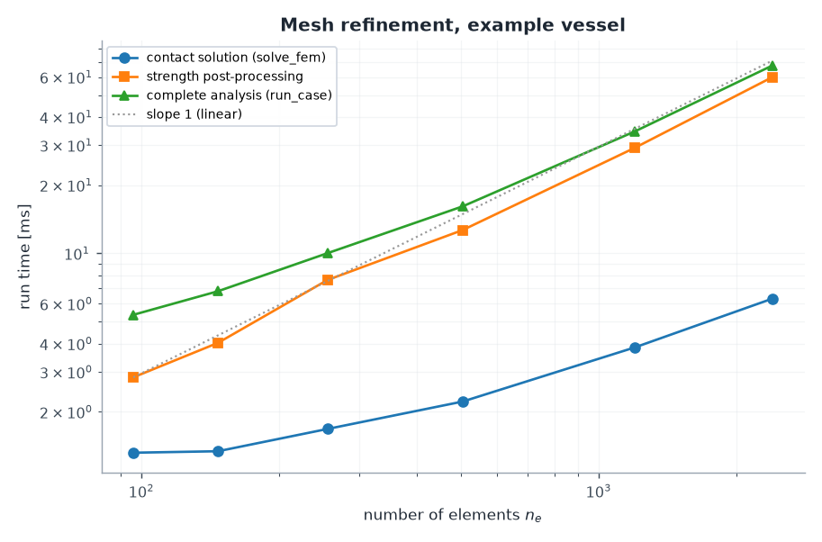
<figcaption aria-hidden="true"><p>Figure 5.1: Measured run times of the contact solution, the strength post-processing and the complete analysis as functions of the number of elements for the example vessel (log–log scale). The dotted line shows slope 1 for reference.</p></figcaption>
</figure>

### 5.9.3 Run time and analysis count of the spacing design

The cost of the spacing design is the number of analyses times the cost of one analysis (Section 4.10.6). The number of analyses depends only on the algorithm and the case, not on the computer, and is therefore the primary measure; Table 5.9 gives it per phase for the four designs of Chapter 6, together with the measured run time of `run_case`.

| Case (44 blocks, FEM) | Phase 1 | Phase 2 (accepted steps, Jacobians) | Phase 3 | Total analyses | $`\max R_{i}/S_{i}`$ | `run_case` \[s\] | per analysis \[ms\] |
|----|---:|---:|---:|---:|---:|---:|---:|
| Spacing example | 17 | 171 (4, 5) | 5 | 193 | 1.340 → 0.761 | 0.76 | 3.9 |
| Weight-curve example | 17 | 275 (6, 7) | 209 | 501 | 1.064 → 0.568 | 1.97 | 3.9 |
| Welded hull, half deformation | 17 | 81 (1, 2) | 6 | 104 | 1.547 → 0.917 | 0.52 | 5.0 |
| Welded hull, full deformation | 17 | 53 (1, 2) | 8 | 78 | 1.971 → 1.350 | 0.63 | 7.8 |

Table 5.9 – Analyses per phase, result and run time of the spacing design (phase 1 includes the analyses of the given plan and of the starting layout; phase 3 includes the rounding).

Phase 1 always costs $`2 + 15 = 17`$ analyses: the given plan, the starting layout and fifteen equidistribution steps. It brings most of the improvement — for the spacing example from 1.340 to 0.788 — at a small fraction of the cost. Phase 2 is the most expensive phase, because each Jacobian costs up to $`N`$ analyses; the measured Jacobians cost between 22 and 40 analyses, fewer than 44, because blocks that are held between two neighbours at the minimum spacing cannot move in either direction and need no difference quotient. The weight-curve example needed six accepted steps and the longest local search (209 analyses, within the budget of $`25N = 1100`$). On the welded hull, an analysis costs more (5.0 and 7.8 ms instead of 3.9 ms) because the contact iteration needs up to three iterations when blocks are open, and phase 2 ended after one accepted step; with open blocks the utilisation is only piecewise smooth in the positions, which limits the range in which the linearisation predicts improvements.

All designs completed within two seconds, in line with requirement N6; the analysis of the given plan alone, with both methods, took 0.016–0.021 s for these cases. Because the number of analyses per phase is bounded — 17 in phase 1, at most $`I_{S}(N + 1)`$ in phase 2 with the iteration limit $`I_{S} = 20`$, and at most $`1 + 25N`$ in phase 3 — the cost of the design is bounded by $`O(N^{2})`$ analyses for any case, each of cost $`O(n)`$, which agrees with the complexity analysis of Section 3.13. In the examples the actual counts were far below these bounds.

### 5.9.4 Limits of scale

For the problem sizes of dry docking — a few tens to about a hundred keel blocks and a few hundred elements — one analysis takes milliseconds and the spacing design a few seconds. The analysis scales linearly with the mesh size and could handle meshes far finer than necessary. The design scales with the number of analyses, which grows at most quadratically with the number of blocks through the finite-difference Jacobian. Should larger problems arise, the analyses of one Jacobian and of one local-search neighbourhood are independent and could be evaluated in parallel, and the Jacobian could be computed from one factorisation of the system matrix instead of by finite differences while the contact states do not change; Section 7.5 lists these as future work.

## 5.10 Limitations of the verification

The verification described in this chapter has the following limitations:

- **No validation.** All comparisons were made with analytical solutions of the same mathematical model, between the program’s methods, or between the program and a substitute model. Whether the model predicts real block loads could not be assessed, given the idealisation of the hull as a beam, the block law, the kinematic welding model and the neglect of transverse effects. No measured block loads or keel surveys of a real hull were available. Validation against measurements, for example from load cells under instrumented blocks combined with a laser survey of the keel, would be the most valuable continuation of this work.
- **Simple benchmark geometries.** The benchmarks use uniform or simply varying loads and a few supports. The example cases of Chapter 6 are far more complex; for them, the program can only be checked through the self-checks of Section 5.7, the re-analysis of the designed layouts and engineering plausibility.
- **Contact iteration.** Convergence of the state iteration, with the gap continuation as a fallback, was demonstrated for all cases tested, including lift-off, crushing, welding gaps of several centimetres and every candidate layout of the spacing designs. No formal proof of termination was given for arbitrary combinations of gaps and crushing. The program therefore enforces an iteration limit and a minimum continuation step, and reports non-convergence as an error.
- **Optimality of the spacing design.** The minimax problem is non-convex and, with the floors, discrete. Sequential linear programming finds a local optimum, and the local search on the floors a local optimum with respect to its neighbourhood; neither is guaranteed to be global. The closed-form cases confirm that the method reaches the global optimum where it is known, but not in general. A status *does not fit* is therefore a statement about the best layout found, not a proof that no layout fits; the diagnosis of the reason (total strength, end block at the limit, gaps) makes this statement checkable by the engineer. Every designed layout, in contrast, is verified: it is the result of a full analysis and is checked like any given plan.
- **Design criterion.** The design minimises the largest ratio of reaction to block strength. The hull girder checks and the block bearing pressure are applied to the designed layout afterwards and are not constraints of the design; in the examples they were all satisfied (Chapter 6).
- **Synthetic survey data.** The identification was verified with synthetic surveys generated from the model itself. Real surveys contain systematic errors, such as datum and temperature effects, and deformation that the kink model does not represent. Their effect could not be assessed.
- **Graphical user interface.** The GUI tests cover the data path between the widgets and the core and the main interactive sequences, but not the visual layout. This was checked by inspection of screenshots.
- **Input data.** No program can detect input that is valid but wrong, such as a mistyped weight or a block strength from the wrong certificate. The cross-check of the summed weights against the declared weight and LCG reduces, but does not remove, this risk.

## 5.11 Summary

The program was verified by 131 automated tests.

- **Load, support and strength models.** The analytical benchmarks covered trapezoidal load integration, the weight curve with jumps, weight items given by their moment, determinate and indeterminate block arrangements, Euler–Bernoulli and Timoshenko beam deflection, continuous beams, shear and moment integration, block crushing and gap equivalence. They were reproduced to relative errors between zero and about $`10^{- 12}`$; the one exception, at about $`10^{- 9}`$, is explained physically by the finite support stiffness. The example’s weight items expressed as one weight curve gave the same reactions to $`10^{- 14}`$. The elastic-hull solution converged to the rigid-hull solution at the theoretically expected rate of $`1/EI`$, and the block reactions were independent of the mesh density.
- **Contact for large gaps.** Solutions with welding gaps of several centimetres satisfied the complementarity conditions and equilibrium to round-off, including a case in which only the gap continuation led to convergence.
- **Welding deformation and identification.** The kink and shrinkage shape functions matched their closed forms, the gaps and reactions were invariant to a straight-line tilt of the keel, and the end blocks were correctly unloaded by an end lift. Joint angles were recovered exactly from a noise-free survey, also with known zone shrinkage subtracted, and to within the accuracy the noise allows from a noisy one (0.070 mrad for the sample survey).
- **Spacing design.** With substitute analyses, the design reached the closed-form optimum for a uniform load to $`2 \times 10^{- 4}`$, gave weak blocks one third of the spacing of three times stronger blocks, and respected the spacing limits, the extent, the grid and fixed ends; an insufficient total strength was diagnosed with a suggested number of blocks. With the full model, the spacing example was brought from 1.340 to 0.761 with every block under a floor and all checks passed; initial gaps moved with their blocks; on the welded hull the welding gaps were recomputed exactly at the designed positions, and a re-analysis from scratch reproduced the design; a moderate welding deformation was absorbed by the spacing and a severe one was diagnosed as gap-governed. The GUI produced the same design as the command-line program and wrote it into the block plan.
- **Run-time checks and interfaces.** Every analysis reports its equilibrium residuals and closure errors, which were of order $`10^{- 17}`$ to $`10^{- 11}`$ for all example cases, including the designed spacings. The GUI produced results identical to the command-line program for all examples.
- **Performance.** One analysis scaled linearly with the mesh size and took about 10 ms with the default mesh. The spacing designs of the examples needed between 78 and 501 analyses and took between 0.5 and 2 s.

The implementation is therefore considered verified with respect to the mathematical model of Chapter 3. Validation of that model against measured block loads and keel surveys remains to be done.

# 6 Results and Discussion

This chapter applies the methods of Chapter 3 and the software of Chapter 4 to an illustrative docking case and its variants. Section 6.1 describes the vessel and the case files. Sections 6.2 to 6.5 report the analysis of a given block plan: the weight distribution, built from weight items and from a weight-distribution curve; the block reactions of the rigid-hull method (Method A) and of the elastic finite element model (Method B); the hull girder loads; and the block checks against the strength of every block. Section 6.6 quantifies, by five parametric studies, how the reactions depend on the block spacing and number, the extent of the block line, the hull and block stiffnesses and initial gaps. Section 6.7 treats the welded hull as built and the identification of the welding deformation from a keel survey. Section 6.8 presents the final result of the thesis, the automatic design of the block spacing from the block strengths: for the example block plan, for variants of the plan, for the weight-curve case and for the welded hull, where the welding deformation acts as a constraint. Section 6.9 discusses the results with respect to the research questions RQ1–RQ5 and states their limitations, and Section 6.10 summarises the chapter.

All numerical values in this chapter were produced with the current version of the `shipsupport` package, either by running the case files in `examples/` or by small scripts that build variants of these files (a changed block plan, stiffness, gap or design setting) and pass them to `case_from_dict` and `run_case`. Results are given in tonnes (t), tonne-metres (t·m), megapascals (MPa) and millimetres (mm). The sign conventions are those of Section 3.2: $`x`$ is measured from the aft perpendicular (AP), positive forward; the hull displacement $`v`$ is positive downward; a block reaction $`R`$ is positive upward on the hull; the shear force $`V(x)`$ is the sum of upward forces minus downward loads aft of $`x`$; the bending moment $`M(x) = \int V\, dx`$ is positive in sagging; and stresses are positive in tension. Blocks are labelled B01, B02, … from aft to forward. Run times refer to the development machine described in Section 5.9.

## 6.1 Case description

### 6.1.1 Status of the data

The vessel is a fictitious general-purpose ship of 120 m length. Its weights, section properties, block properties, strengths, permissible limits and welding parameters were chosen to be mutually consistent and of realistic magnitude, but they **are illustrative placeholders and do not describe any real ship or dock** (Section 1.4). The results therefore demonstrate the behaviour of the methods and the relative importance of the parameters; they are not design values. A real docking analysis requires the ship’s docking plan and loading manual, the dock’s block data and the limits of the governing standard ([U.S. Department of Defense, n.d.-a](#ref-milstd1625); [Naval Sea Systems Command, n.d.](#ref-nstm997)).

### 6.1.2 Principal particulars and block plan

Table 6.1 lists the principal particulars of the example vessel and its given block plan. The block plan is the only definition of the blocks in the program (Section 3.4.4): a block type, the position of the first block, the number of blocks, and the spacing, strength and initial gap of every block.

| Quantity | Value |
|----|----|
| Length between perpendiculars $`L_{pp}`$ | 120.0 m |
| Hull extent (AP to forward end) | 0.0 – 120.0 m |
| Docking weight $`W`$ (declared / computed) | 4500.0 t / 4500.0 t |
| Longitudinal centre of gravity (declared / computed) | 50.470 m / 50.469 m |
| Block plan (given) | 44 keel blocks from $`x`$ = 6.4 m, spacing 2.4 m (line 6.4 – 109.6 m), no initial gaps |
| Block strength | 200 t (type capacity) in `example_case.yaml`; individual strengths in `spacing_case.yaml` (Section 6.1.6) |
| Transverse structure (floors) | every 0.8 m from 0.0 to 120.0 m |

Table 6.1 – Principal particulars and given block plan of the example vessel (illustrative data).

### 6.1.3 Weight items

The docking weight is described by nine weight items (Table 6.2). Eight are spread as trapezoids over their longitudinal extent; the rudder is a point load. Each trapezoid preserves the weight and the longitudinal centre of gravity of its item (Section 3.3.2), which is possible because every LCG lies in the middle third of its extent (Section 3.3.3).

| Item                | Weight \[t\] |  LCG \[m\] | Extent \[m\]  |
|---------------------|-------------:|-----------:|---------------|
| Hull steel          |         2600 |       58.5 | 0.0 – 120.0   |
| Main engine         |          380 |       22.0 | 16.0 – 28.0   |
| Auxiliary machinery |          220 |       26.0 | 14.0 – 38.0   |
| Superstructure      |          420 |       14.0 | 4.0 – 24.0    |
| Outfit              |          520 |       62.0 | 4.0 – 118.0   |
| Propeller and shaft |           60 |        6.0 | 0.0 – 12.0    |
| Rudder              |           25 |        2.0 | point load    |
| Anchors and chain   |           75 |      112.0 | 104.0 – 120.0 |
| Residual fuel       |          200 |       70.0 | 60.0 – 80.0   |
| **Total**           |     **4500** | **50.469** |               |

Table 6.2 – Weight items of the example vessel.

### 6.1.4 Hull girder properties

The hull girder is represented by three prismatic regions (Table 6.3). The bending stiffness $`EI`$ follows from the second moment of area with $`E = 206`$ GPa, and the shear stiffness $`\kappa GA`$ from the effective shear area with $`G = 79.3`$ GPa. The midship region is 2.5 times stiffer in bending than the aft region and 3.3 times stiffer than the forward region.

| Region \[m\] | $`I`$ \[m⁴\] | $`EI`$ \[N·m²\] | $`A_{s}`$ \[m²\] | $`\kappa GA`$ \[N\] | $`Z_{deck}`$ \[m³\] | $`Z_{keel}`$ \[m³\] |
|----|---:|---:|---:|---:|---:|---:|
| 0 – 20 | 8.0 | 1.648 × 10¹² | 0.5 | 3.965 × 10¹⁰ | 1.4 | 1.8 |
| 20 – 100 | 20.0 | 4.120 × 10¹² | 0.9 | 7.137 × 10¹⁰ | 3.6 | 4.4 |
| 100 – 120 | 6.0 | 1.236 × 10¹² | 0.4 | 3.172 × 10¹⁰ | 1.1 | 1.4 |

Table 6.3 – Hull girder section properties.

The permissible still-water bending moment rises from 3000 t·m at the ends to 20 000 t·m at 30 m and 90 m and 25 000 t·m at 60 m (equal for sagging and hogging). The permissible shear force rises from 600 t at the ends to 1500 t between 30 m and 90 m. The allowable hull stresses are 175 MPa in bending and 110 MPa in shear.

### 6.1.5 Block type

All blocks are of one type (Table 6.4). The stiffness follows from three layers acting as springs in series over the contact area (Section 3.4.1); the softwood cap contributes 52 % of the compliance. The block follows the bilinear law of Section 3.4.2: linear up to the crush force, then 5 % of the initial stiffness.

| Property | Value |
|----|----|
| Layers (thickness, modulus) | concrete 0.90 m, 30 000 MPa; hardwood 0.20 m, 1 000 MPa; softwood cap 0.10 m, 400 MPa |
| Contact area | 0.8 m × 1.2 m = 0.96 m² |
| Initial stiffness $`k`$ | 2000 kN/mm |
| Capacity (default strength of every block) | 200 t |
| Allowable bearing pressure | 2.0 MPa (196 t over the contact area) |
| Crush stress / crush force | 4.0 MPa / 391.6 t |
| Compression at the onset of crushing | 1.92 mm |
| Post-crush stiffness ratio | 0.05 |

Table 6.4 – Keel block type.

### 6.1.6 Case files

Table 6.5 lists the case files used in this chapter. They share the hull, the block type and the floors; they differ in the weight description, the block strengths, the welding deformation and whether the spacing design is enabled.

| Case file | Weights | Block plan and strengths | Welding | Spacing design | Sections |
|----|----|----|----|----|----|
| `example_case.yaml` | 9 items (LCG) | 44 × 200 t, 2.4 m | – | off | 6.2–6.6 |
| `weight_curve_case.yaml` | curve (18 points) + 3 items (moment) | 44 × 200 t, 2.4 m | – | on | 6.2, 6.8.3 |
| `spacing_case.yaml` | 9 items (LCG) | 44 blocks, 2.4 m; 160 t for B04–B12, 190 t otherwise (Σ S = 8090 t) | – | on | 6.5, 6.8.1–6.8.2 |
| `welding_case.yaml` | 9 items (LCG) | 44 × 200 t, 2.4 m | prescribed joints and zones | off (switched on in Section 6.8.4) | 6.7, 6.8.4 |
| `welding_survey_case.yaml` | 9 items (LCG) | 44 × 200 t, 2.4 m | survey `welding_survey.csv`, joint angles identified | off | 6.7.4 |

Table 6.5 – Case files of the example vessel.

The block plan of `spacing_case.yaml` represents a realistic situation in a dock: the blocks available are not all equal, and the nine older blocks B04–B12, which in the given plan lie under the engine room, have a lower strength of 160 t. Both strengths are below the 196 t at which the bearing pressure reaches its allowable value, so that the block strength, and not the bearing pressure, is the binding block limit. The settings of the spacing design are those of Section 4.7.4: target utilisation 1.0, minimum spacing $`s_{\min}`$ = 0.8 m (the floor spacing), maximum spacing $`s_{\max}`$ = 4.8 m (twice the given spacing), block line within 6.4–109.6 m, final positions at the floors, at most 20 sequential-LP iterations.

## 6.2 Weight distribution

### 6.2.1 Weight items

Figure 6.1 shows the longitudinal weight distribution assembled from the nine items of Table 6.2. It is strongly non-uniform. Its maximum of 89.06 t/m lies just forward of $`x`$ = 16 m, where the main engine, auxiliary machinery, superstructure, outfit and hull steel overlap; forward of about 38 m the intensity is roughly 25–36 t/m. The mesh of the example has 256 nodes. Its node set includes every item boundary, section boundary and block position (Section 3.3.5), so every element carries an exactly linear load and the integrals of Section 3.3.6 are exact.

<figure>
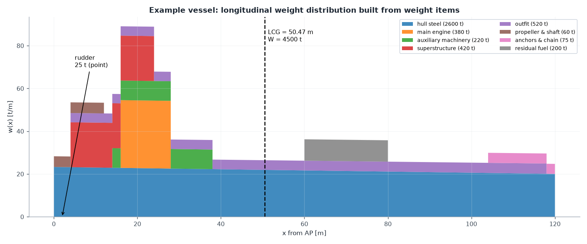
<figcaption aria-hidden="true"><p>Figure 6.1: Longitudinal weight distribution of the example vessel, built from the weight items of Table 6.2; the rudder is a point load at x = 2.0 m.</p></figcaption>
</figure>

The distributed load integrates to $`W`$ = 4500.0 t with LCG = 50.469 m, which reproduces the sum of the items to machine precision, as the run-time weight check of the program requires (Section 5.7). The declared LCG of 50.470 m differs from the computed value by 0.001 m, well within the tolerance, so no weight warning is raised.

Two features of the distribution decide the block reactions. First, the LCG at 50.47 m lies aft of the centre of the block line at 58.0 m, so the aft blocks must carry more than the forward blocks. Second, a considerable part of the weight lies outside the block line: the hull aft of B01 ($`x`$ = 6.4 m) carries 266.3 t, and the hull forward of B44 ($`x`$ = 109.6 m) carries 298.8 t. These overhangs are cantilevered from the end blocks, and Section 6.3 shows that they control the end-block reactions.

### 6.2.2 Weight-distribution curve and items given by moment

In the weight-curve case the lightship is given as a piecewise-linear weight-distribution curve of 18 points with jumps at $`x`$ = 4, 16, 28, 38 and 104 m, and three deadweight items are given by their longitudinal moment about the AP instead of their LCG (Section 3.3.1). Each of the 12 segments of non-zero length of the curve is converted into an exact trapezoidal item (Section 3.3.4), so that the program treats curve and items in the same way. Table 6.6 lists the totals and Figure 6.2 shows the curve, the items and the total distribution.

| Component | Weight \[t\] | Moment about AP \[t·m\] | LCG \[m\] |
|----|---:|---:|---:|
| Lightship curve (18 points, 12 trapezoids) | 4343.0 | 241 775 | 55.670 |
| Residual fuel (60–80 m) | 200.0 | 14 000 | 70.000 |
| Fresh water (94–106 m) | 60.0 | 6 000 | 100.000 |
| Stores (point load) | 40.0 | 1 200 | 30.000 |
| Deadweight items together | 300.0 | 21 200 | 70.667 |
| **Total** | **4643.0** | **262 975** | **56.639** |

Table 6.6 – Weight-curve case: lightship curve and deadweight items given by their moments. The moment of the curve is $`W \cdot`$ LCG from the program; the item LCGs follow from LCG = moment / weight.

<figure>
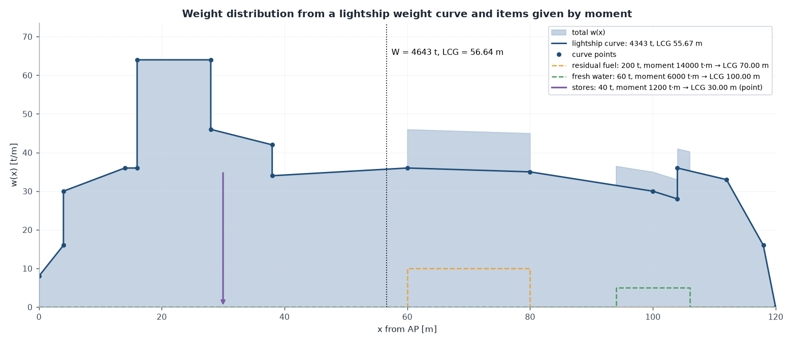
<figcaption aria-hidden="true"><p>Figure 6.2: Weight distribution of the weight-curve case: lightship curve with its points and jumps, deadweight items given by their moments (dashed; the stores as a point load) and the total distribution w(x).</p></figcaption>
</figure>

The computed total of 4643.0 t at LCG 56.639 m agrees with the declared values, and the curve alone integrates to 4343.0 t at 55.670 m, as the label of Figure 6.2 shows. The largest intensity is the 64 t/m of the engine room (16–28 m); the jumps appear as vertical steps in the total. Compared with the item description of the example, this distribution is smoother and its LCG lies 6.2 m further forward, close to the centre of the block line. The overhangs carry 121.7 t aft of B01 and 243.3 t forward of B44.

## 6.3 Block reactions: rigid versus elastic hull

### 6.3.1 Overview

Figure 6.3 shows the force on each of the 44 blocks of `example_case.yaml` predicted by the elastic model (bars), with the rigid-hull results as markers, and Figure 6.4 shows the weight distribution and the reactions together with the settlement, shear force and bending moment of both methods. Both solutions satisfy global equilibrium: the reactions sum to 4500.0 t, and the relative force and moment residuals of the elastic solution were below $`10^{- 14}`$. The contact iteration converged in one iteration in both methods, because no block lifted off or crushed.

<figure>

<figcaption aria-hidden="true"><p>Figure 6.3: Weight distribution (top) and force on every block of the example vessel. Bars: elastic hull (Method B), coloured by utilisation of the block limit; diamonds: rigid hull (Method A); dashed line: block capacity of 200 t; dotted line: average load W/N = 102.3 t.</p></figcaption>
</figure>

<figure>
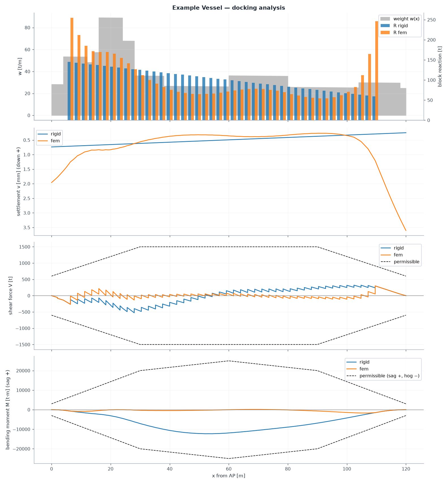
<figcaption aria-hidden="true"><p>Figure 6.4: Example vessel. From top: weight distribution and block reactions; hull settlement; shear force; bending moment. Both methods are shown with the permissible envelopes.</p></figcaption>
</figure>

### 6.3.2 Selected block reactions

Table 6.7 compares the two methods for the five aftmost blocks, a midship block and the five foremost blocks.

| Block | $`x`$ \[m\] | Rigid $`R`$ \[t\] | Elastic $`R`$ \[t\] | Elastic / rigid | Elastic $`\delta`$ \[mm\] | Elastic $`p`$ \[MPa\] |
|----|---:|---:|---:|---:|---:|---:|
| B01 | 6.4 | 145.06 | 254.63 | 1.76 | 1.249 | 2.601 |
| B02 | 8.8 | 143.07 | 211.75 | 1.48 | 1.038 | 2.163 |
| B03 | 11.2 | 141.08 | 185.17 | 1.31 | 0.908 | 1.892 |
| B04 | 13.6 | 139.09 | 171.95 | 1.24 | 0.843 | 1.756 |
| B05 | 16.0 | 137.10 | 169.52 | 1.24 | 0.831 | 1.732 |
| B21 | 54.4 | 105.26 | 66.61 | 0.63 | 0.327 | 0.680 |
| B40 | 100.0 | 67.44 | 70.28 | 1.04 | 0.345 | 0.718 |
| B41 | 102.4 | 65.45 | 82.34 | 1.26 | 0.404 | 0.841 |
| B42 | 104.8 | 63.46 | 112.31 | 1.77 | 0.551 | 1.147 |
| B43 | 107.2 | 61.47 | 164.47 | 2.68 | 0.806 | 1.680 |
| B44 | 109.6 | 59.48 | 246.26 | 4.14 | 1.207 | 2.516 |

Table 6.7 – Reactions, compressions and bearing pressures of selected blocks (`example_case.yaml`).

The rigid method gives a linear distribution, from 145.06 t at B01 to 59.48 t at B44. The elastic model gives a markedly different one. The largest reaction is 254.63 t at B01, 76 % above the rigid value; the reaction at B44 is 246.26 t, 4.1 times the rigid value. Between about 30 m and 100 m the elastic reactions are lower than the rigid ones and follow the local weight intensity; the smallest is 54.39 t at B36 ($`x`$ = 90.4 m).

### 6.3.3 Physical explanation

The difference has two causes.

**Overhang cantilevers.** In the elastic model the 266.3 t of hull aft of B01 and the 298.8 t forward of B44 act as cantilevers. Their weight enters the hull girder near the end blocks and, because the hull can bend, it is carried mainly by the end blocks and their neighbours. In the rigid model the same weight enters only through the global force and moment balance and is spread over all 44 blocks by the planar displacement $`v = a + bx`$, which cannot represent a local concentration of load.

**Local load following.** A flexible hull settles more where it is heavily loaded. The elastic reactions therefore track the weight distribution: about 166–172 t under the machinery space (13.6–20.8 m) and about 65–68 t under the light midbody (45–50 m). A rigid hull forces all blocks into one plane, so its reactions are linear whatever the weight distribution.

The distance over which the hull spreads a concentrated load is governed by the characteristic parameter of a beam on an elastic foundation ([Hetényi 1946](#ref-hetenyi1946)) (Section 2.6):

``` math
\lambda = \left( \frac{k_{f}}{4\, EI} \right)^{1/4},\quad\quad k_{f} = \frac{k}{s}\quad\quad\quad\quad(6.1)
```

where $`k_{f}`$ is the foundation modulus obtained by smearing the block stiffness $`k`$ over the spacing $`s`$. For the midship region ($`EI = 4.12 \times 10^{12}`$ N·m², $`k = 2.0 \times 10^{9}`$ N/m, $`s`$ = 2.4 m), Equation (6.1) gives $`\lambda = 0.0843`$ m⁻¹, a characteristic length $`1/\lambda`$ = 11.86 m and a half-wavelength $`\pi/\lambda`$ = 37.3 m. A load is therefore spread over about 15 blocks on each side, much less than the 103.2 m of the block line, and the hull behaves as a long beam on an elastic foundation rather than as a rigid body. The end regions are more flexible still, since their $`EI`$ is 2.5–3.3 times smaller.

The settlement curves of Figure 6.4 confirm this. The rigid solution is a straight line from 0.74 mm at the stern to 0.25 mm at the bow. The elastic hull settles by 1.96 mm at the aft tip and 3.60 mm at the forward tip: both overhangs sag onto the end blocks.

### 6.3.4 Weight-curve case

For the smoother weight distribution of the weight-curve case (Section 6.2.2), the rigid method gives reactions between 113.50 t (B01) and 97.54 t (B44), and every block passes. The elastic model again concentrates the load at the ends: 128.14 t at B01 and 212.80 t at B44, which exceeds the block capacity of 200 t by 6.4 % and fails the block checks (utilisation 1.064 against strength, 1.087 in bearing pressure). The forward end governs here because the forward overhang (243.3 t) is twice the aft one (121.7 t). The same qualitative difference between the two methods appears with a different weight description, which shows that it is a property of the support problem and not of a particular load case.

## 6.4 Hull girder loads and stresses

### 6.4.1 Shear force and bending moment

The shear force and bending moment are obtained by exact integration of the linear element loads, point loads and reactions (Section 3.8). In both methods the curves close to zero at the forward end within round-off, which confirms global equilibrium.

The two methods give fundamentally different bending moments (Figure 6.4, bottom). With the rigid hull, the moment is hogging over almost the whole length and reaches −12 298.9 t·m near $`x`$ = 54 m. With the elastic hull, the largest moment in magnitude is −1 723.4 t·m at $`x`$ = 107.2 m, in the forward overhang region, and the largest sagging moment is +143.1 t·m at $`x`$ = 69.9 m. The largest shear forces are 525.9 t (rigid) and 298.8 t (elastic).

### 6.4.2 Governing checks

Table 6.8 lists the governing hull girder checks of both methods. The governing location is where the ratio of demand to capacity is largest, which is not necessarily where the demand is largest, because the permissible envelopes vary along the length. The utilisation of a check is

``` math
\eta = \frac{|D|}{C}\quad\quad\quad\quad(6.2)
```

where $`D`$ is the demand and $`C`$ the capacity at the same location; for the bending moment, $`C`$ is the sagging limit where $`M \geq 0`$ and the hogging limit where $`M < 0`$.

| Check | Rigid: demand | Rigid: limit | Rigid: $`\eta`$ | Elastic: demand | Elastic: limit | Elastic: $`\eta`$ |
|----|---:|---:|---:|---:|---:|---:|
| Bending moment \[t·m\] | −12 191.8 (49.6 m) | 23 266.7 | 0.524 | −1 511.4 (109.6 m) | 8 893.3 | 0.170 |
| Shear force \[t\] | −525.9 (28.0 m) | 1 440.0 | 0.365 | −266.3 (6.4 m) | 792.0 | 0.336 |
| Deck stress \[MPa\] | 37.66 (100.06 m) | 175 | 0.215 | 15.36 (107.2 m) | 175 | 0.088 |
| Keel stress \[MPa\] | −29.59 (100.06 m) | 175 | 0.169 | −12.07 (107.2 m) | 175 | 0.069 |
| Shear stress \[MPa\] | 7.89 (102.4 m) | 110 | 0.072 | 7.33 (109.6 m) | 110 | 0.067 |

Table 6.8 – Governing hull girder checks of `example_case.yaml` (location of the governing value in brackets).

All hull girder checks pass with both methods; the highest utilisation is 0.524, for the bending moment of the rigid method. The deck stresses are tensile because the hull is in hogging.

### 6.4.3 Why the rigid method overstates hogging

The rigid method overstates the largest bending moment by a factor of 7.1 (12 298.9 / 1 723.4). This follows from equilibrium. The bending moment at a section is the moment of the net load $`w - R`$ on one side of it. In the rigid solution the reactions are linear in $`x`$, while the weight is concentrated aft (machinery, superstructure) and in the overhangs; integrating this mismatch over half the length produces a large hogging moment amidships. In the elastic solution the reactions follow the weight locally (Section 6.3.3), so the net load on every segment is small and so is the moment. The remaining elastic moments lie in the overhangs, where they are statically determined by the cantilevered weight: the governing value of −1 511.4 t·m at $`x`$ = 109.6 m is the moment of the forward overhang about the last block.

For the hull girder, the rigid method is therefore conservative in this example. For the blocks it is not: it underestimates the most critical block load by 43 % (145.06 t instead of 254.63 t). A method that is conservative for one quantity is not necessarily conservative for another; this is the central practical finding of the comparison, and it is the reason why the spacing design of Section 6.8 uses the elastic model.

## 6.5 Block checks against block strength

The block checks compare the bearing pressure $`p = R/A`$ with the allowable pressure and the reaction with the strength $`S_{i}`$ of each block (Section 3.8). Table 6.9 lists, for the elastic solution of both block plans, every block whose utilisation exceeds 0.9.

| Case | Block | $`x`$ \[m\] | $`R`$ \[t\] | $`S_{i}`$ \[t\] | $`R/S_{i}`$ | $`p`$ \[MPa\] | $`p/p_{allow}`$ |
|----|----|---:|---:|---:|---:|---:|---:|
| `example_case` | B01 | 6.4 | 254.63 | 200 | 1.273 | 2.601 | 1.301 |
|  | B02 | 8.8 | 211.75 | 200 | 1.059 | 2.163 | 1.082 |
|  | B03 | 11.2 | 185.17 | 200 | 0.926 | 1.892 | 0.946 |
|  | B44 | 109.6 | 246.26 | 200 | 1.231 | 2.516 | 1.258 |
| `spacing_case` | B01 | 6.4 | 254.63 | 190 | 1.340 | 2.601 | 1.301 |
|  | B02 | 8.8 | 211.75 | 190 | 1.114 | 2.163 | 1.082 |
|  | B03 | 11.2 | 185.17 | 190 | 0.975 | 1.892 | 0.946 |
|  | B04 – B07 | 13.6 – 20.8 | 165.7 – 171.9 | 160 | 1.036 – 1.075 | 1.69 – 1.76 | 0.85 – 0.88 |
|  | B08 | 23.2 | 155.2 | 160 | 0.970 | 1.585 | 0.793 |
|  | B43 | 107.2 | 164.47 | 190 | 0.866 | 1.680 | 0.840 |
|  | B44 | 109.6 | 246.26 | 190 | 1.296 | 2.516 | 1.258 |

Table 6.9 – Highly utilised blocks in the elastic solution of the given block plans (2.4 m spacing). B43 of `spacing_case` is listed for comparison.

With the uniform capacity of 200 t (`example_case.yaml`), three blocks fail: B01, B02 and B44, with a largest utilisation of 1.301 (bearing pressure at B01). No block reaches the crush force of 391.6 t. With the rigid method the largest utilisations are 0.741 (pressure) and 0.725 (strength), both at B01, and every check passes. **The rigid method thus fails to identify three overloaded blocks**, and the overall verdict of the case changes from “passed” to “failed” when the hull is modelled as elastic.

With the individual strengths of `spacing_case.yaml`, seven blocks are loaded beyond their strength: the end blocks B01 and B44, B02, and four of the 160 t blocks under the engine room (B04–B07), where the elastic hull follows the heavy machinery weight. The largest ratio of reaction to strength is 1.340 at B01. The rigid method gives a largest ratio of 0.869, at B04 (139.1 t on a 160 t block), and again passes every check. The given block plan is therefore not acceptable, although the total strength of its blocks (8090 t) is 1.8 times the docking weight: the problem is not the amount of strength but its distribution along the hull. This is the situation that the spacing design of Section 6.8 resolves.

All blocks of the given plans lie at floors, because 6.4 m and the spacing of 2.4 m are multiples of the floor spacing of 0.8 m, so no off-structure warning is raised.

## 6.6 Parametric studies

The parametric studies quantify how the reactions of the given block plan depend on the main design and modelling parameters. They use `example_case.yaml` (44 blocks of 200 t, no initial gaps, both methods) and change one group of parameters at a time. Its baseline elastic solution has a largest reaction of 254.63 t at B01, 246.26 t at B44 and a smallest reaction of 54.39 t; the rigid baseline has a largest reaction of 145.06 t and a largest bending moment of 12 298.9 t·m. In all tables “failing blocks” is the number of blocks with a pressure or strength utilisation above 1.0 in the elastic solution. The studies motivate the spacing design: they show which changes of the block plan relieve the governing blocks, and by how much.

### 6.6.1 Block spacing and number of blocks

In the first study the block line starts at 6.4 m, the spacing is varied from 1.6 m to 4.8 m, and the number of blocks is the largest that keeps the last block at or before 109.6 m (Table 6.10 and Figure 6.5).

| Spacing \[m\] | Blocks | Last block \[m\] | Max. $`R`$ \[t\] | Aft end $`R`$ \[t\] | Fwd end $`R`$ \[t\] | Min. $`R`$ \[t\] | Rigid max. $`R`$ \[t\] | Failing blocks |
|---:|---:|---:|---:|---:|---:|---:|---:|---:|
| 1.6 | 65 | 108.8 | 216.54 | 195.37 | 216.54 | 33.06 | 97.28 | 1 |
| 2.0 | 52 | 108.4 | 248.70 | 226.03 | 248.70 | 42.45 | 120.49 | 2 |
| 2.4 | 44 | 109.6 | 254.63 | 254.63 | 246.26 | 54.39 | 145.06 | 3 |
| 2.8 | 37 | 107.2 | 315.41 | 281.42 | 315.41 | 61.67 | 165.04 | 7 |
| 3.2 | 33 | 108.8 | 306.90 | 306.90 | 299.64 | 74.76 | 189.99 | 7 |
| 3.6 | 29 | 107.2 | 352.17 | 330.93 | 352.17 | 83.94 | 209.75 | 8 |
| 4.0 | 26 | 106.4 | 386.32 | 354.11 | 386.32 | 93.28 | 230.11 | 8 |
| 4.8 | 22 | 107.2 | 392.23 | 392.20 | 392.23 | 118.02 | 274.93 | 8 |

Table 6.10 – Effect of a uniform block spacing (block line from 6.4 m, ending at or before 109.6 m).

<figure>
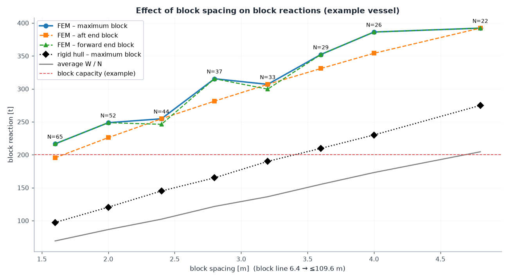
<figcaption aria-hidden="true"><p>Figure 6.5: Effect of a uniform block spacing on the largest and end-block reactions of the elastic model and on the largest reaction of the rigid model; N is the number of blocks.</p></figcaption>
</figure>

The largest reaction grows with the spacing from 216.5 t to 392.2 t. Even the closest spacing of 1.6 m (65 blocks) leaves one block above its capacity. The growth is not monotonic: 2.8 m gives a higher maximum than 3.2 m, because the last block then lies at 107.2 m instead of 108.8 m and the forward overhang is 1.6 m longer. At 4.8 m both end blocks crush. The ratio of the largest elastic to the largest rigid reaction falls from 2.23 at 1.6 m to 1.43 at 4.8 m, but the absolute discrepancy stays large. Spacings of 2.0, 2.8 and 3.6 m are not multiples of the floor spacing and place 26, 18 and 14 blocks off the floors.

Table 6.11 prescribes the number of blocks on the fixed line 6.4–109.6 m. Reducing the count from 60 to 20 nearly doubles the largest reaction.

| Blocks | Spacing \[m\] | Max. $`R`$ \[t\] | Min. $`R`$ \[t\] | Rigid max. $`R`$ \[t\] | Crushed | Failing blocks | Off floors |
|---:|---:|---:|---:|---:|---:|---:|---:|
| 20 | 5.432 | 397.18 | 138.54 | 314.13 | 2 | 8 | 12 |
| 30 | 3.559 | 328.46 | 86.22 | 211.44 | 0 | 7 | 18 |
| 44 | 2.400 | 254.63 | 54.39 | 145.06 | 0 | 3 | 0 |
| 60 | 1.749 | 211.40 | 37.72 | 106.76 | 0 | 2 | 36 |

Table 6.11 – Effect of the number of blocks on the fixed block line 6.4 – 109.6 m (uniform spacing).

Both tables show the limitation of a *uniform* spacing: more blocks reduce the largest reaction only slowly, because the end blocks always carry the overhangs, while the least loaded blocks, amidships, use only 17–27 % of their capacity when 44 or more blocks are used. A uniform plan cannot fit the reactions to the strengths; a designed, non-uniform spacing can (Section 6.8).

### 6.6.2 Extent of the block line

The second study varies the extent of the block line at a constant spacing of 2.4 m (Table 6.12), which directly changes the overhangs.

| Block line \[m\] | Blocks | Max. $`R`$ \[t\] (block) | Aft end $`R`$ \[t\] | Fwd end $`R`$ \[t\] | Max. \|M\| elastic \[t·m\] | Max. \|M\| rigid \[t·m\] | Failing blocks | All checks |
|----|---:|----|---:|---:|---:|---:|---:|----|
| 6.4 – 109.6 (baseline) | 44 | 254.63 (B01) | 254.63 | 246.26 | 1 723.4 | 12 298.9 | 3 | fail |
| 4.0 – 109.6 | 45 | 246.26 (B45) | 174.24 | 246.26 | 1 723.4 | 10 322.5 | 1 | fail |
| 6.4 – 114.4 | 46 | 254.63 (B01) | 254.63 | 146.05 | 943.0 | 11 112.1 | 2 | fail |
| 4.0 – 114.4 | 47 | 174.25 (B01) | 174.25 | 146.05 | 539.2 | 8 844.8 | 0 | **pass** |
| 6.4 – 100.0 | 40 | 393.49 (B40) | 254.66 | 393.49 | 6 207.5 | 16 060.4 | 5 | fail |
| 10.0 – 108.4 | 42 | 391.78 (B01) | 391.78 | 270.87 | 2 379.5 | 15 911.9 | 5 | fail |

Table 6.12 – Effect of the extent of the block line (uniform spacing 2.4 m).

The extent has the strongest influence of all parameters studied. Extending the line by 2.4 m aft and 4.8 m forward (4.0–114.4 m, three more blocks) reduces the largest reaction by 32 %, from 254.63 t to 174.25 t, and the largest elastic bending moment by 69 %, to 539.2 t·m. It is the only configuration of this study in which every check passes, with largest utilisations of 0.890 (bearing pressure) and 0.871 (strength) at the new aft end block. Each extension acts locally: extending only aft relieves the aft end block but leaves the forward end unchanged, and vice versa. Shortening the line forward to 100.0 m raises the forward end-block reaction to 393.49 t, crushes that block and raises the elastic bending moment to 6 207.5 t·m because of the 20 m cantilever. Starting the line at 10.0 m has the same effect at the aft end (391.78 t) and, since 10.0 m is not a multiple of 0.8 m, places all 42 blocks off the floors.

### 6.6.3 Hull bending stiffness

In the third study the second moments of area of all regions are scaled by a common factor, with unchanged shear areas (Table 6.13 and Figure 6.6). The rigid solution does not depend on $`EI`$ and stays at 145.06 t (aft end) and 59.48 t (forward end).

| $`EI`$ factor | Max. $`R`$ \[t\] (block) | Aft end $`R`$ \[t\] | Fwd end $`R`$ \[t\] | Min. $`R`$ \[t\] | Max. \|M\| \[t·m\] | Failing blocks |
|---:|----|---:|---:|---:|---:|---:|
| 0.1 | 394.68 (B44) | 322.38 | 394.68 | 14.65 | 1 511.4 | 3 |
| 0.25 | 336.55 (B44) | 287.75 | 336.55 | 38.06 | 1 511.4 | 3 |
| 0.5 | 286.44 (B44) | 269.04 | 286.44 | 47.82 | 1 627.0 | 3 |
| 1 | 254.63 (B01) | 254.63 | 246.26 | 54.39 | 1 723.4 | 3 |
| 2 | 242.96 (B01) | 242.96 | 216.16 | 59.37 | 1 879.2 | 3 |
| 5 | 230.04 (B01) | 230.04 | 188.94 | 63.95 | 2 104.2 | 2 |
| 10 | 221.41 (B01) | 221.41 | 174.78 | 66.29 | 2 294.1 | 2 |
| 100 | 203.73 (B01) | 203.73 | 152.07 | 69.52 | 3 470.7 | 1 |
| 1000 | 200.34 (B01) | 200.34 | 148.24 | 69.96 | 3 829.9 | 1 |

Table 6.13 – Effect of the hull bending stiffness (second moments of area of all regions scaled; shear areas unchanged).

<figure>
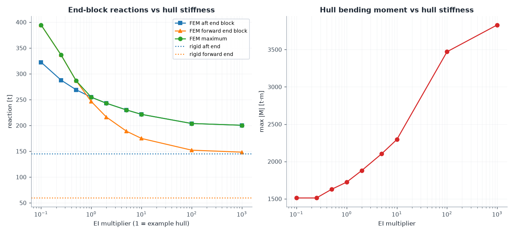
<figcaption aria-hidden="true"><p>Figure 6.6: Effect of the hull bending stiffness on the end-block and largest reactions (left) and on the largest bending moment (right); dotted lines show the rigid-hull end-block reactions.</p></figcaption>
</figure>

A stiffer hull spreads the overhang loads over more blocks: the largest reaction falls from 394.68 t at a tenth of the baseline stiffness to 200.34 t at a thousandfold stiffness, and the bending moment rises from 1 511.4 t·m to 3 829.9 t·m. Even at a thousandfold bending stiffness the aft end-block reaction is 38 % above the rigid value and the moment is less than a third of the rigid one. The reason is the shear flexibility, which was not scaled: the rigid method is the limit of the elastic model when both $`EI`$ and $`\kappa GA`$ tend to infinity (verified in Section 5.4 for a hull without shear deformation), and real hulls are far from that limit. For the most flexible variants the largest moment equals the statically determined moment of the forward overhang about the last block (1 511.4 t·m), because the interior moments are smaller still.

### 6.6.4 Block stiffness

In the fourth study the block stiffness is prescribed directly between 500 and 8000 kN/mm; in a second variant only the modulus of the softwood cap is changed (Table 6.14).

| $`k`$ \[kN/mm\] | Max. $`R`$ \[t\] (block) | Aft end $`R`$ \[t\] | Fwd end $`R`$ \[t\] | Min. $`R`$ \[t\] | Max. \|M\| \[t·m\] | Failing blocks |
|---:|----|---:|---:|---:|---:|---:|
| 500 | 229.25 (B01) | 229.25 | 176.64 | 63.84 | 2 177.0 | 2 |
| 1000 | 240.46 (B01) | 240.46 | 207.81 | 59.64 | 1 917.1 | 3 |
| 2000 | 254.63 (B01) | 254.63 | 246.26 | 54.39 | 1 723.4 | 3 |
| 4000 | 290.97 (B44) | 274.14 | 290.97 | 50.07 | 1 616.1 | 3 |
| 8000 | 339.68 (B44) | 299.72 | 339.68 | 47.79 | 1 511.4 | 3 |
| 1315 (cap 200 MPa) | 245.57 (B01) | 245.57 | 222.16 | 57.67 | 1 838.9 | 3 |
| 2704 (cap 800 MPa) | 265.05 (B44) | 262.36 | 265.05 | 52.19 | 1 678.3 | 3 |
| 3282 (cap 1600 MPa) | 277.67 (B44) | 267.93 | 277.67 | 50.98 | 1 648.0 | 3 |

Table 6.14 – Effect of the block stiffness (upper part: prescribed stiffness; lower part: modulus of the softwood cap varied, stiffness from the layers).

Stiffer blocks raise the end-block reactions; softer blocks act like a stiffer hull, because both reduce $`\lambda`$ in Equation (6.1). The equivalence holds quantitatively: quadrupling the block stiffness (8000 kN/mm) gives a largest reaction of 339.68 t, within 1 % of the 336.55 t obtained by quartering $`EI`$; the small difference arises because the shear stiffness is not scaled. Doubling the cap modulus raises the block stiffness by only 35 % (from 2000 to 2704 kN/mm), because the other layers then dominate the compliance. Soft caps are a means of spreading load, but over the tested range they do not remove the overload of the end blocks.

### 6.6.5 Initial gaps

The fifth study gives a single block an initial gap through the `gap_mm` entry of the block plan (Section 3.4.4), which moves with its block (Table 6.15).

| Gapped block | Gap \[mm\] | $`R`$ of gapped block \[t\] | Neighbour reactions \[t\] | Max. $`R`$ \[t\] (block) | State |
|----|---:|---:|----|----|----|
| B21 (54.4 m) | 0.0 | 66.61 | 65.44 / 68.56 | 254.63 (B01) | elastic |
| B21 (54.4 m) | 0.3 | 14.85 | 72.94 / 76.06 | 254.50 (B01) | elastic |
| B21 (54.4 m) | 0.5, 1.0 or 2.0 | 0.00 | 75.09 / 78.21 | 254.46 (B01) | open |
| B08 (23.2 m) | 1.0 | 0.00 | 190.98 / 165.55 | 254.50 (B01) | open |
| B11 (30.4 m) | 1.0 | 0.00 | 143.13 / 116.91 | 253.01 (B01) | open |
| B01 (6.4 m) | 0.5 | 198.16 | 241.41 (B02) | 246.26 (B44) | elastic |
| B01 (6.4 m) | 1.0 | 141.70 | 271.06 (B02) | 271.06 (B02) | elastic |
| B44 (109.6 m) | 1.0 | 135.58 | 222.78 (B43) | 254.63 (B01) | elastic |

Table 6.15 – Effect of a single initial gap.

A gap in the midbody reduces the load of the gapped block, and once it exceeds the local elastic compression (0.33 mm at B21) the block carries nothing. Its load moves mainly to the two neighbours, which gain about 10 t each; the effect stays within roughly one characteristic length, and the largest reaction changes by less than 0.1 %. Near the ends the behaviour differs. A 1.0 mm gap at B01 reduces its reaction from 254.63 t to 141.70 t but shifts the load to B02, which then carries 271.06 t, more than B01 carried without the gap: a gap at the most loaded block moves the peak inwards and can increase it. A 1.0 mm gap at B44 shifts load to B43 and raises the largest bending moment from 1 723.4 to 2 103.8 t·m, because the effective forward overhang becomes longer. A 1.0 mm gap at B08, under the machinery, raises its aft neighbour to 190.98 t, close to the block capacity. Height deviations of the order of one millimetre are thus significant compared with the elastic compressions of 0.3–1.2 mm (Table 6.7). This sensitivity is the key to the welded hull of Section 6.7, whose keel deviates by tens of millimetres.

### 6.6.6 Ranking of the parameters

Table 6.16 ranks the parameters by their influence on the largest block reaction over the ranges studied.

| Rank | Parameter | Range studied | Max. $`R`$ range \[t\] | Character of the effect |
|---:|----|----|----|----|
| 1 | Extent of the block line (overhangs) | ends at 4.0 / 6.4 / 10.0 m and 100.0 / 108.4 – 109.6 / 114.4 m | 174.3 – 393.5 | dominant, local to each end |
| 2 | Uniform spacing / number of blocks | 1.6 – 5.4 m (65 – 20 blocks) | 211.4 – 397.2 | global, roughly proportional to the spacing |
| 3 | Block stiffness | 500 – 8000 kN/mm | 229.3 – 339.7 | through $`\lambda`$; stiffer blocks concentrate load |
| 4 | Hull bending stiffness | 0.25 – 100 × baseline | 203.7 – 336.6 | through $`\lambda`$; a stiffer hull spreads load |
| 5 | Single initial gap | 0 – 2 mm at various blocks | 246.3 – 271.1 | local; significant near the ends only |

Table 6.16 – Ranking of the parameters by their influence on the largest block reaction (straight hull, uniform spacing).

The parameters that can be chosen in the docking plan — the extent of the block line and the positions of the blocks — are more effective than the structural parameters, which cannot be changed. Because $`EI`$ and $`k`$ enter mainly through $`k/(s\, EI)`$, an uncertainty in one of them can be expressed as an equivalent uncertainty in the other; quartering the hull stiffness or quadrupling the block stiffness raised the largest reaction by about one third. Welding deformation, a distributed gap, is treated in Section 6.7.

## 6.7 Welded hull: as-built reactions and identification from a survey

### 6.7.1 Case description

In `welding_case.yaml` the ship of Section 6.1 is assembled from six construction blocks of 20 m length, with erection joints at $`x`$ = 20, 40, 60, 80 and 100 m. Two welding-deformation mechanisms are prescribed (Section 3.9): angular distortion at the joints of 0.9, 0.5, 0.4, 0.5 and 0.6 mrad (aft to forward), positive values making the keel concave upwards; and a uniform shrinkage curvature in every construction block from a deck shrinkage of 0.24 mm/m, a bottom shrinkage of 0.20 mm/m and a depth of 10 m, i.e. $`\kappa = 4 \times 10^{- 6}`$ m⁻¹. These values are placeholders of plausible magnitude, not measurements. The block plan is that of `example_case.yaml` (44 blocks of 200 t, 2.4 m). The keel lift is referred to the least-squares line through the block positions and shifted so that the lowest block point has zero gap (Section 3.9). The resulting gap is 41.4 mm at B01 and 39.0 mm at B44 and vanishes at B23 ($`x`$ = 59.2 m).

### 6.7.2 As-built block reactions

Table 6.17 lists the reactions of selected blocks.

| Block | $`x`$ \[m\] | Gap \[mm\] | Rigid $`R`$ \[t\] | Elastic $`R`$ \[t\] |
|-------|------------:|-----------:|------------------:|--------------------:|
| B01   |         6.4 |      41.42 |              0.00 |                0.00 |
| B02   |         8.8 |      37.26 |              0.00 |                0.00 |
| B03   |        11.2 |      33.12 |              0.00 |                0.00 |
| B04   |        13.6 |      29.00 |              0.00 |                9.20 |
| B06   |        18.4 |      20.83 |              0.00 |              338.80 |
| B07   |        20.8 |      17.50 |              0.00 |    394.25 (crushed) |
| B08   |        23.2 |      15.63 |              0.00 |              317.06 |
| B09   |        25.6 |      13.79 |              0.00 |              219.40 |
| B18   |        47.2 |       1.83 |  401.69 (crushed) |               16.62 |
| B19   |        49.6 |       1.42 |  401.89 (crushed) |                0.00 |
| B20   |        52.0 |       1.03 |  401.85 (crushed) |                0.00 |
| B21   |        54.4 |       0.66 |  401.57 (crushed) |               21.93 |
| B41   |       102.4 |      27.76 |              0.00 |               32.80 |
| B42   |       104.8 |      31.48 |              0.00 |                0.00 |
| B43   |       107.2 |      35.22 |              0.00 |                0.00 |
| B44   |       109.6 |      38.98 |              0.00 |                0.00 |

Table 6.17 – Selected block reactions of the welded hull as built (`welding_case.yaml`, given block plan).

With the elastic model, the welding deformation unloads eight blocks completely: the three aftmost (B01–B03), the three foremost (B42–B44) and two midship blocks (B19 and B20), where the kinks at 40 m and 60 m leave the keel locally high relative to its neighbours. The load moves to the quarter regions. B07 ($`x`$ = 20.8 m), just forward of the joint at 20 m and under the machinery, carries 394.25 t, exceeds its crush force and is the only crushed block; B06 and B08 carry 338.8 t and 317.1 t. The largest ratio of reaction to strength is 1.971 and the largest bearing-pressure utilisation 2.014, against 1.273 and 1.301 for the straight hull. The contact iteration needed three iterations, and the equilibrium residuals stayed below $`10^{- 13}`$.

The rigid-hull model gives a qualitatively different and physically meaningless picture. A rigid hull cannot bend to follow a concave keel, so it rests on the lowest part of the line only: 31 blocks are unloaded, the remaining 13 blocks between 35.2 m and 64.0 m carry the whole ship, 10 of them crush and the largest reaction is 401.9 t at B19, a block that the elastic model finds unloaded. The corresponding hogging moment of −54 211.8 t·m (bending-moment utilisation 2.314) is an artefact of the rigid assumption; the elastic model gives −13 119.9 t·m at $`x`$ = 40.0 m, with a governing bending-moment utilisation of 0.611 and a shear-force utilisation of 0.715. For a keel deviation of several centimetres, the support problem can only be analysed with a flexible hull girder: the elastic settlement of the overhangs under their own weight, of the same order as the welding lift, decides which blocks touch.

### 6.7.3 Identification of the joint angles from a synthetic survey

The welding deformation is normally measured rather than predicted. To test the identification of Section 3.10, a synthetic survey was generated from the joint kinks of Section 6.7.1 with stations every 5 m from 0 to 120 m (25 points), an arbitrary datum and tilt and normally distributed noise with a standard deviation of 1 mm; the five joint angles and the straight-line terms were fitted by linear least squares. The survey is synthetic and does not originate from a real ship. Figure 6.7 shows the fit and the identified angles, and Table 6.18 summarises variants of the survey. Each row of the table uses the same random seed as Figure 6.7; the standard deviations were obtained from 200 further noise realisations per row.

<figure>
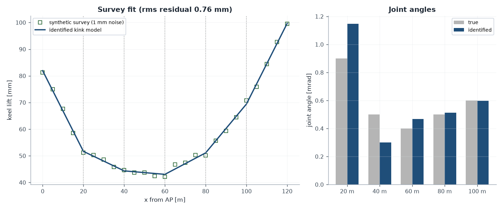
<figcaption aria-hidden="true"><p>Figure 6.7: Identification of the joint angles from a synthetic keel survey (stations every 5 m, 1 mm noise). Left: survey points with the fitted straight line removed and the identified kink model; right: true and identified joint angles.</p></figcaption>
</figure>

| Stations \[m\] | Points | Noise \[mm\] | Regularisation | Identified angles \[mrad\] (true 0.9 / 0.5 / 0.4 / 0.5 / 0.6) | Max. error \[mrad\] | RMS residual \[mm\] | Std. dev. (200 runs) \[mrad\] |
|---:|---:|---:|---:|----|---:|---:|----|
| 5.0 | 25 | 1.0 | 0 | 1.148 / 0.301 / 0.468 / 0.512 / 0.598 | 0.248 | 0.756 | 0.087 – 0.098 |
| 2.5 | 49 | 1.0 | 0 | 0.843 / 0.552 / 0.456 / 0.380 / 0.704 | 0.120 | 0.900 | 0.062 – 0.076 |
| 1.0 | 121 | 1.0 | 0 | 0.972 / 0.477 / 0.420 / 0.454 / 0.637 | 0.072 | 0.895 | 0.039 – 0.049 |
| 5.0 | 25 | 0.5 | 0 | 1.024 / 0.400 / 0.434 / 0.506 / 0.599 | 0.124 | 0.378 | 0.044 – 0.049 |
| 5.0 | 25 | 1.0 | 10⁻³ | 1.032 / 0.374 / 0.439 / 0.533 / 0.558 | 0.132 | 0.799 | 0.069 – 0.081 |
| 5.0 | 25 | 1.0 | 10⁻² | 0.640 / 0.518 / 0.463 / 0.529 / 0.405 | 0.260 | 1.486 | 0.030 – 0.037 |

Table 6.18 – Identification of the joint angles from synthetic keel surveys (`identify_joint_angles`; one realisation shown per row, standard deviations over 200 realisations).

The fit reproduces the survey with an RMS residual of 0.76 mm, at the level of the noise, but the individual angles of this realisation deviate by up to 0.25 mrad, most at the joints at 20 m and 40 m. The realisation of Figure 6.7 is an unfavourable one: over 200 realisations the standard deviation is about 0.09 mrad per angle for 5 m stations, falling to 0.06–0.08 mrad for 2.5 m and 0.04–0.05 mrad for 1 m stations, and the mean error (bias) is below 0.01 mrad. Halving the noise halves the scatter, as expected for a linear estimator. The problem is moderately ill-conditioned ([Hansen 1998](#ref-hansen1998)): noise near a joint can be explained either by that joint or by its neighbour. The sum of the angles, which governs the end lift, is better determined (3.03 mrad identified against 2.90 mrad true). Tikhonov regularisation trades scatter for bias: $`10^{- 3}`$ reduces the scatter slightly and halves the largest error of this realisation, while $`10^{- 2}`$ biases the outer angles towards zero (by −0.34 mrad at 20 m) and doubles the residual, the usual trade-off between noise suppression and bias ([Hansen 1998](#ref-hansen1998)). For the support problem the identified model is used only to compute the gaps at the blocks, whose error is of the order of the survey noise.

### 6.7.4 Survey-based welding case

`welding_survey_case.yaml` demonstrates the complete data path from a survey file to the block reactions. The survey `welding_survey.csv` contains 25 keel heights every 5 m. It was generated from the welding model of Section 6.7.1, shifted by an arbitrary instrument datum and tilt, disturbed by noise with a standard deviation of 0.5 mm and rounded to 0.1 mm. The case gives the joint positions and the zone shrinkage and requests the identification of the joint angles; the known shrinkage part is subtracted from the survey before the fit (Section 3.10).

The identified angles are 0.938, 0.477, 0.384, 0.497 and 0.670 mrad, against 0.9, 0.5, 0.4, 0.5 and 0.6 mrad used to generate the data, i.e. within 0.07 mrad. The survey is reproduced with an RMS residual of 0.295 mm and a largest residual of 0.698 mm, consistent with the noise. The gaps at the end blocks become 41.04 mm aft and 38.89 mm forward, against 41.42 mm and 38.98 mm for the prescribed model. The elastic as-built state is practically the same as in Section 6.7.2: nine blocks carry no load (B01–B04, B19, B20, B42–B44), B07 is crushed with 395.10 t, and the largest ratio of reaction to strength is 1.975 (1.971 with the prescribed model).

Figure 6.8 shows the welding data figure that the program produces for every case with welding deformation (file `welding_data.png`, GUI result tab “Welding data”). The top panel shows the keel lift used for the gaps, its components — the joint kinks and the zone shrinkage, each with its straight-line part removed — the 25 survey points and the block positions. The middle panel shows the identified joint angles (0.94, 0.48, 0.38, 0.50 and 0.67 mrad) and the uniform zone curvature of $`4 \times 10^{- 6}`$ m⁻¹. The bottom panel shows the gap from welding at every block, with the nine blocks without contact as built highlighted. The figure makes the cause of the lift-off directly visible: the joint kinks dominate the keel shape, and the end blocks lie 28–41 mm below the keel.

<figure>
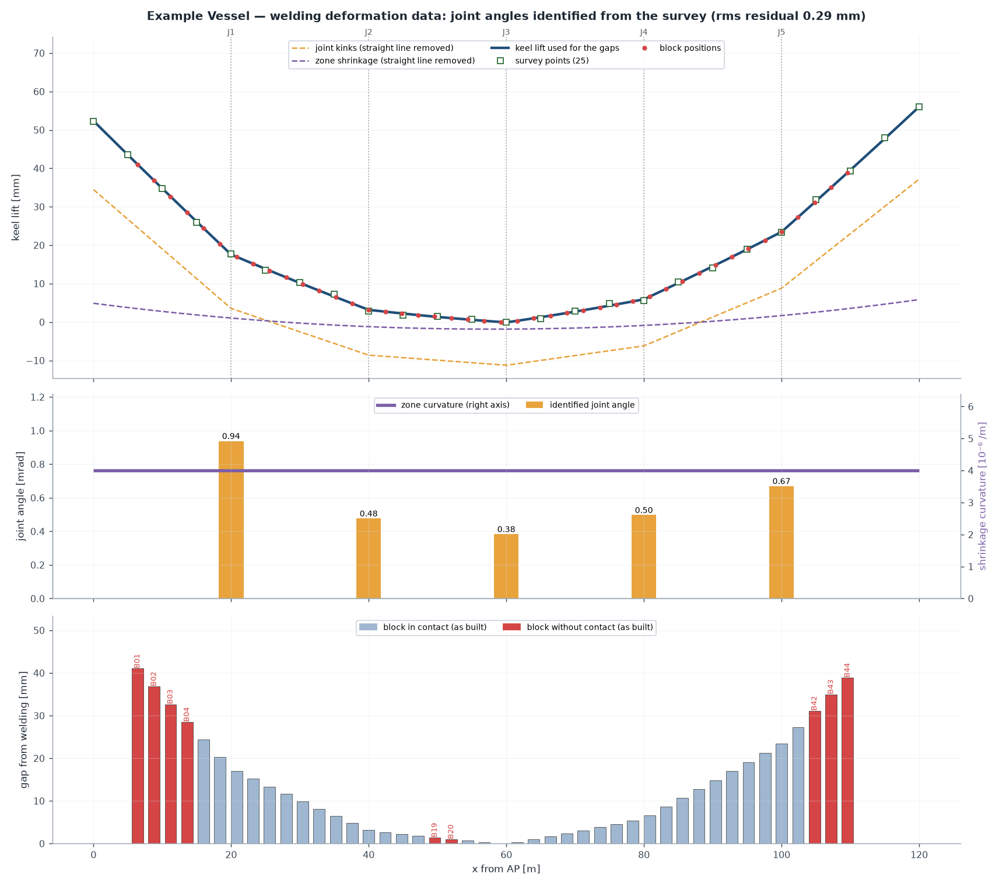
<figcaption aria-hidden="true"><p>Figure 6.8: Welding deformation data of the survey-based case (synthetic survey). Top: keel lift with its components, the survey points and the block positions; middle: identified joint angles and zone shrinkage curvature; bottom: gap from welding at every block, blocks without contact as built highlighted.</p></figcaption>
</figure>

## 6.8 Automatic spacing design from block strengths

This section presents the final result of the thesis. For a block plan with a given number of blocks and a given strength of every block, the program computes the spacing of the blocks at which every reaction is within the strength of its block, by the three-phase method of Section 3.12: strength-weighted equidistribution (phase 1) ([Huang and Russell 2011](#ref-huang2011)), sequential linear programming on the minimax problem with a trust region (phase 2) ([Griffith and Stewart 1961](#ref-griffith1961); [Conn et al. 2000](#ref-conn2000)), and rounding to the floors with a local search (phase 3). Every candidate layout is analysed with the full support model, including, for a welded hull, the welding gaps at the candidate block positions (Section 3.12.2). The quantity minimised is the largest utilisation

``` math
U(\mathbf{x}) = \max_{i}\frac{R_{i}(\mathbf{x})}{S_{i}}\quad\quad\quad\quad(6.3)
```

Before the results, a simple bound is useful for judging them. Since every reaction satisfies $`R_{i} \leq US_{i}`$ and the reactions sum to the weight, $`W = \sum_{i}^{}R_{i} \leq U\sum_{i}^{}S_{i}`$, so that for *any* spacing

``` math
U(\mathbf{x})\mspace{6mu} \geq \mspace{6mu}\bar{u} \equiv \frac{W}{\sum_{i = 1}^{N}S_{i}},\quad\quad\quad\quad(6.4)
```

with equality only if every block is used to the same fraction of its strength. The bound $`\bar{u}`$ is also the mean utilisation $`\sum R_{i}/\sum S_{i}`$. A plan can fit only if $`\bar{u} \leq u_{target}`$; for $`N`$ blocks of equal strength $`S`$ this gives the smallest possible number of blocks

``` math
N_{\min} = \left\lceil \frac{W}{u_{target}\, S} \right\rceil.\quad\quad\quad\quad(6.5)
```

The bound is not attainable in general, because the overhangs, the extent of the block line and the spacing limits prevent an equal utilisation; the closed-form case of Section 3.12.7, in which it is attained, was used for verification (Section 5.6). The ratio $`U/\bar{u}`$ is used below as a measure of how evenly a design uses its blocks.

### 6.8.1 Spacing design of the example block plan

The block plan of `spacing_case.yaml` has 44 blocks with $`\sum S_{i}`$ = 8090 t, so $`\bar{u}`$ = 4500/8090 = 0.556. On the given uniform spacing of 2.4 m the elastic model loads B01 to 1.340 times its strength and seven blocks beyond their strength (Section 6.5). Figure 6.9 shows the design, and Table 6.19 its progress by phase.

<figure>

<figcaption aria-hidden="true"><p>Figure 6.9: Spacing design for the block plan of <code>spacing_case.yaml</code> (44 blocks, strengths 190 t and 160 t, elastic hull). Top: weight distribution with the given (light) and designed (dark) block positions; second: given and designed spacing to the next block along the hull; third: block reactions of the designed spacing (bars) against the block strengths (dashed), with the reactions at the given spacing as markers; bottom: largest ratio of reaction to strength over the number of analyses in the three phases.</p></figcaption>
</figure>

| Phase | Step | Analyses (cumulative) | Largest $`R_{i}/S_{i}`$ |
|----|----|---:|---:|
| start | given plan | 1 | 1.340 |
| 1 – equidistribution | iteration 1 | 3 | 1.041 |
|  | iteration 2 | 4 | 0.881 |
|  | iteration 3 | 5 | 0.807 |
|  | iteration 4 | 6 | 0.788 |
|  | best (iteration 5); iterations 6–15 stationary at 0.788 | 7 (17) | 0.787 |
| 2 – sequential LP | accepted step 1 | 50 | 0.778 |
|  | accepted step 2 | 87 | 0.770 |
|  | accepted step 3 | 122 | 0.762 |
|  | accepted step 5 (step 4 rejected) | 156 | 0.761 |
| 3 – floors and local search | final | 193 | 0.761 |

Table 6.19 – Convergence of the spacing design of `spacing_case.yaml` by phase.

**Convergence.** Phase 1 does most of the work: four fixed-point steps reduce the largest ratio from 1.340 to 0.788 — below the target already after the second step (analysis 4) — and the iteration then becomes stationary. Its fixed point is not the minimax optimum, because equidistribution balances an estimated load density between neighbours and not the reactions of the elastic hull themselves (Section 3.12.3). Phase 2 removes the remaining 3.5 % in four accepted steps; each sequential-LP iteration costs up to one finite-difference analysis per block plus one trial analysis, 33–37 analyses here, which is why phase 2 accounts for most of the 193 analyses. Phase 3 rounds the positions to the floors and searches the neighbouring floor positions of the governing blocks; here it confirmed the continuous result (0.761) with 37 analyses. The whole run, including the rigid and elastic analyses of the given plan and the post-processing, took about 0.7 s.

**Designed spacing.** The designed spacing follows the load and the strengths (Figure 6.9, top). Aft of 14.4 m, under the stern overhang, the superstructure and the start of the engine room, nine blocks are set at spacings of 0.8 and 1.6 m; the nine 160 t blocks B04–B12 now lie between 9.6 m and 20.0 m. Between 14.4 m and 40.8 m, under the engine room, the spacing is 1.6–2.4 m. Amidships it opens to 3.2 m (40.8–63.2 m), then 4.0 m and 4.8 m up to 105.6 m, where the elastic hull spreads the load most evenly; and the six foremost blocks are set at 0.8 m to share the bow overhang. The pattern alternates between 0.8 and 1.6 m in the aft part because the positions must lie at floors 0.8 m apart; without rounding (Table 6.21) the same design consists of smooth runs of 1.045, 1.84, 3.185 and 4.8 m with the same largest ratio, the effect of the smoothing term in the objective of phase 2 (Section 3.12.4).

**Reactions versus strength.** The designed reactions lie between 73.8 t and 144.6 t (Figure 6.9, middle). Five blocks are within 2.5 % of the largest ratio: B44 (0.761), B01 (0.760), B32 at 72.0 m (0.750), B12 at 20.0 m (0.745, a 160 t block) and B33 (0.744). Several active peaks of nearly equal height are the characteristic signature of a minimax optimum: moving any block to relieve one of them loads another. The least used block is B22 at 38.4 m (0.388). The end blocks are among the governing ones because they sit at the limits of the allowed line (6.4 and 109.6 m) and must carry the overhangs; this is why the design stays at $`U/\bar{u}`$ = 1.37 and why a longer line helps (Section 6.8.2).

**All checks.** Table 6.20 compares the checks of the elastic model for the given and the designed spacing.

| Check                  | Given spacing: $`\eta`$ | Designed spacing: $`\eta`$ |
|------------------------|------------------------:|---------------------------:|
| Hull bending moment    |                   0.170 |                      0.176 |
| Hull shear force       |                   0.336 |                      0.336 |
| Deck bending stress    |                   0.088 |                      0.087 |
| Keel bending stress    |                   0.069 |                      0.068 |
| Hull shear stress      |                   0.067 |                      0.067 |
| Block bearing pressure |                   1.301 |                      0.738 |
| Block load vs strength |                   1.340 |                      0.761 |
| All checks             |                  failed |                 **passed** |

Table 6.20 – Checks of the elastic model for the given and the designed spacing of `spacing_case.yaml`.

Every block of the designed plan is within its strength, the largest bearing pressure is 1.477 MPa, no block is open or crushed, and all hull girder checks pass. The hull girder loads hardly change (largest moment 1 700.8 t·m instead of 1 723.4 t·m), because they are governed by the overhangs, which the design does not change. Every block lies at a floor, so no off-structure warning is raised. The designed spacings are written to `spacing.csv` and, in the GUI, back into the block plan.

### 6.8.2 Variants of the block plan and the settings

Table 6.21 shows how the result depends on the settings and on the block plan. All variants were computed with the current program from `spacing_case.yaml` with the changes listed; the given plans have a uniform spacing of 2.4 m from $`x`$ = 6.4 m, so that the “given” ratio of the variants with fewer blocks refers to a block line that ends well before 109.6 m.

| Variant | Blocks × strength | Extent \[m\] | $`s_{\max}`$ \[m\] | Analyses | $`U`$ given → designed | Mean $`= \bar{u}`$ / min. $`R_{i}/S_{i}`$ | Designed spacing \[m\] | Result |
|----|----|----|---:|---:|----|----|----|----|
| example (floors) | 44, 190 / 160 | 6.4–109.6 | 4.8 | 193 | 1.340 → 0.761 | 0.558 / 0.388 | 0.8–4.8 | fits |
| without rounding to floors | 44, 190 / 160 | 6.4–109.6 | 4.8 | 188 | 1.340 → 0.761 | 0.558 / 0.382 | 0.8–4.8 | fits |
| smaller $`s_{\max}`$ | 44, 190 / 160 | 6.4–109.6 | 3.2 | 251 | 1.340 → 0.760 | 0.562 / 0.296 | 0.8–3.2 | fits |
| $`s_{\max}`$ = given spacing | 44, 190 / 160 | 6.4–109.6 | 2.4 | 29 | 1.340 → 1.310 | 0.567 / 0.274 | 0.8–2.4 | does not fit |
| longer line | 44, 190 / 160 | 4.0–114.4 | 4.8 | 502 | 1.340 → 0.575 | 0.557 / 0.493 | 0.8–4.8 | fits |
| rigid hull model | 44, 190 / 160 | 6.4–109.6 | 4.8 | 242 | 0.869 → 0.600 | 0.558 / 0.497 | 0.8–4.0 | fits |
| fewer blocks | 40 × 190 | 6.4–109.6 | 4.8 | 407 | 2.071 → 0.749 | 0.592 / 0.365 | 0.8–4.8 | fits |
| fewer blocks, longer line | 32 × 190 | 4.0–114.4 | 6.4 | 402 | 2.585 → 0.751 | 0.740 / 0.721 | 0.8–6.4 | fits |
| minimum number | 29 × 160 | 4.0–114.4 | 6.4 | 220 | 3.547 → 0.984 | 0.970 / 0.933 | 0.8–6.4 | fits |
| one block fewer | 28 × 160 | 4.0–114.4 | 6.4 | 421 | 3.725 → 1.019 | 1.004 / 0.968 | 0.8–6.4 | does not fit (Σ S = 4480 t \< W) |
| three blocks fewer | 26 × 160 | 4.0–114.4 | 6.4 | 198 | 4.115 → 1.114 | 1.082 / 1.007 | 1.6–6.4 | does not fit (Σ S = 4160 t \< W) |

Table 6.21 – Spacing design for variants of the block plan of the example vessel (elastic hull unless stated; $`s_{\min}`$ = 0.8 m; positions at the floors unless stated). “Mean” is the mean ratio of reaction to strength of the designed plan, which equals the bound $`\bar{u}`$ of Equation (6.4) up to round-off.

The variants support five conclusions.

1.  **Rounding to the floors costs nothing here.** With and without rounding the largest ratio is 0.761; the floors restrict where the blocks may stand but not the quality of the design, because the floor spacing (0.8 m) is small compared with the designed spacings.

2.  **The maximum spacing must leave freedom, but not much.** With $`s_{\max}`$ = 3.2 m the design reaches the same largest ratio (0.760) by a different pattern: it cannot open the midbody as far, so it places more blocks there (25 spacings of 3.2 m) and uses the least loaded block less (0.296). With $`s_{\max}`$ equal to the given spacing of 2.4 m, the 43 spacings of at most 2.4 m exactly span the line, no redistribution is possible, and phases 1 and 2 cannot move; only the local search shifts the end blocks inwards by two floors, which reduces the ratio to 1.310. The program reports that the plan does not fit, that the aft end block at the limit of the line governs, and suggests a longer line or about 58 blocks.

3.  **The extent matters as much as the spacing.** With the line extended to 4.0–114.4 m, as in Section 6.6.2, the same 44 blocks reach 0.575, only 3.4 % above the bound $`\bar{u}`$ = 0.556, and the least used block carries 0.493 of its strength: the blocks are used almost evenly. The remaining distance to the bound in the example plan (0.761 against 0.556) is therefore due to the extent of the block line, a physical constraint, and not to the algorithm. This run needed 502 analyses because the local search of phase 3 found several improving moves after rounding (0.568 continuous, 0.575 at the floors).

4.  **The number of blocks can be reduced to the minimum of Equation (6.5).** 40 blocks of 190 t fit on the original line (0.749), and 32 blocks of 190 t on the longer line with $`s_{\max}`$ = 6.4 m (0.751, only 1.5 % above $`\bar{u}`$ = 0.740). For blocks of 160 t, Equation (6.5) gives $`N_{\min} = \lceil 4500/160\rceil = 29`$. The design found a spacing for exactly 29 blocks with a largest ratio of 0.984, 1.5 % above the bound $`\bar{u}`$ = 4500/4640 = 0.970, and with every block used to between 93 % and 98 % of its strength: a nearly uniform utilisation, the ideal of a support fitted to its blocks. With 28 blocks the total strength of 4480 t is less than the load, no spacing can fit, and the program says so, gives the reason (Σ S \< W) and suggests 29 blocks; the same holds for 26 blocks. The design thus brackets the minimum: 29 fits and 28 provably cannot.

5.  **The model matters.** The rigid-hull model, which spreads the load more evenly (Section 6.3), gives a lower ratio for the given plan (0.869) and a different design (0.600), with a dense spacing of 0.8 m over the aft 10 m of the line. Analysed with the elastic model, this rigid-designed layout gives a largest ratio of 0.967 at B44 instead of the 0.600 predicted: it still fits, by a margin of 3 %, but far less than the elastic design’s 0.761. Since the end-block loads are the main effect of hull flexibility, design decisions should be based on the elastic model.

### 6.8.3 Weight-curve case

The spacing design of `weight_curve_case.yaml` uses 44 blocks of 200 t ($`\sum S_{i}`$ = 8800 t, $`\bar{u}`$ = 4643/8800 = 0.528) with the same settings as the example. On the given plan the elastic model loads B44 to 1.064 of its strength (Section 6.3.4). The design brings the largest ratio to 0.568 in 501 analyses (about 1.9 s for the complete run): phase 1 reaches 0.629 in 15 iterations, phase 2 0.567 in six accepted steps, and rounding to the floors with the local search ends at 0.568. All checks pass (bending moment 0.118, shear force 0.267, bearing pressure 0.580, strength 0.568).

The designed spacing is 0.8–4.8 m. Over 34 blocks from 6.4 m to 92.0 m, where the weight curve is smooth and nearly level, the utilisation is almost constant (0.543–0.568) at spacings of mostly 1.6–3.2 m, with closer spacing (0.8–2.4 m) under the engine room (16–28 m), where the curve reaches 64 t/m. The eight foremost blocks are packed at the minimum spacing of 0.8 m between 104.0 m and 109.6 m to carry the forward overhang of 243.3 t. Their utilisation falls from 0.568 at B44 to about 0.33 four to five blocks aft of it, because the end block at the line limit carries most of the overhang and its neighbours cannot be moved closer than $`s_{\min}`$; the forward end, constrained by the extent and the minimum spacing, therefore keeps the design 7.6 % above $`\bar{u}`$. The case confirms that the spacing design works unchanged with a weight curve and items given by moment, because both are converted into the same load model (Section 3.3).

### 6.8.4 Welding deformation as a constraint

For a welded hull, every candidate layout of the spacing design is analysed with the welding gaps recomputed at its own block positions (Section 3.12.2). The deformation is therefore a constraint of the design: a block moved along the hull also moves along the curved keel and changes its gap. To find how much deformation the spacing alone can compensate, the welding deformation of `welding_case.yaml` was scaled by a factor (all joint angles and the difference of deck and bottom shrinkage), and the spacing design was run for each factor with 44 blocks of 200 t, given spacing 2.4 m, $`s_{\min}`$ = 0.8 m, $`s_{\max}`$ = 4.8 m and the line 6.4–109.6 m. Table 6.22 and Figure 6.10 show the result. The column “continuous” gives the result of the same design without rounding to the floors.

| Factor | End lift \[mm\] | $`U`$ given | $`U`$ designed (floors) | $`U`$ designed (continuous) | Result (floors) |
|---:|---:|---:|---:|---:|----|
| 0.00 | 0.0 | 1.273 | 0.701 | 0.699 | fits |
| 0.10 | 4.1 | 1.081 | 0.611 | 0.602 | fits |
| 0.25 | 10.4 | 1.188 | 0.710 | 0.657 | fits |
| 0.40 | 16.6 | 1.404 | 0.892 | 0.816 | fits |
| 0.50 | 20.7 | 1.547 | 0.917 | 0.915 | fits |
| 0.55 | 22.8 | 1.619 | 1.045 | 0.950 | does not fit |
| 0.60 | 24.9 | 1.691 | 1.111 | 0.997 | does not fit |
| 0.75 | 31.1 | 1.904 | 1.266 | 1.155 | does not fit (1 block open) |
| 1.00 | 41.4 | 1.971 | 1.350 | 1.306 | does not fit (5 blocks open) |

Table 6.22 – Spacing design under scaled welding deformation (44 blocks of 200 t, elastic hull).

<figure>
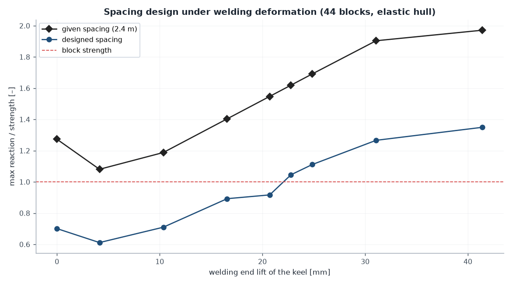
<figcaption aria-hidden="true"><p>Figure 6.10: Largest ratio of reaction to strength at the given spacing (2.4 m) and at the designed spacing (at the floors) as a function of the welding end lift of the keel (44 blocks of 200 t, elastic hull).</p></figcaption>
</figure>

A small end lift helps: at 4.1 mm the given plan improves from 1.273 to 1.081 and the design reaches 0.611, better than for the straight hull (0.701), because a slightly concave keel counteracts the load concentration at the overhangs found in Section 6.3. Beyond about 5 mm the lift works against the design, and the designed ratio rises steadily. **With the positions at the floors, the spacing design fits up to an end lift of about 21 mm (factor 0.5, ratio 0.917) and not beyond** (22.8 mm: 1.045). Without the floor constraint the threshold lies at about 25 mm (factor 0.6, 0.997). The rounding, which cost nothing for the straight hull, costs up to 0.11 here (0.950 against 1.045 at factor 0.55): with large gaps the reactions depend on the positions in a strongly non-smooth way, so that a shift of one floor can bring a block into or out of contact.

**The full deformation.** Figure 6.11 shows the design for the full deformation of `welding_case.yaml` (end lift 41.4 mm). The run took 78 analyses and 0.5 s. Phase 1 reduced the ratio from 1.971 to 1.309 within six analyses, but the fixed-point iteration then diverged to about 1.59 (Figure 6.11, bottom): with gaps the reactions are not a smooth function of the positions, and the load-density estimate on which equidistribution relies no longer describes the redistribution; the best layout found was kept, as the algorithm prescribes. Phase 2 reached 1.306 in one accepted step, after five trial steps had been rejected and the trust region reduced, and rounding to the floors gave 1.350. In the designed layout five blocks carry no load (B01 at 6.4 m, B02 at 11.2 m, B26 at 50.4 m, B43 at 104.8 m and B44 at 109.6 m), and six blocks exceed their strength, all of them at or next to an erection joint: 269.9 t at 20.8 m (the governing block, 1.350), 241.0 t at 19.2 m, 225.3 t at 21.6 m, 210.7 t at 60.0 m, 216.7 t at 80.0 m and 236.9 t at 100.0 m. The design has moved blocks towards the joints — dense groups at 0.8 m around 18.4–29.6 m and 79.2–83.2 m — but the governing block stays at the joint at 20 m.

<figure>
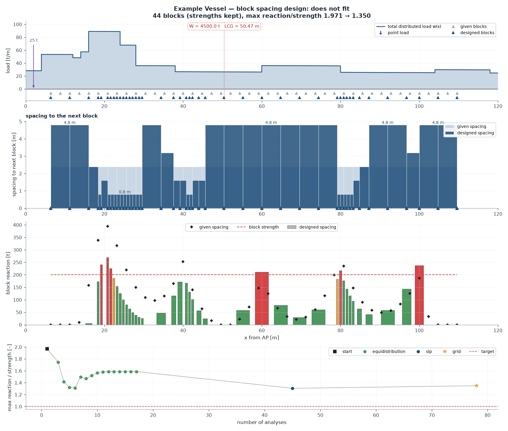
<figcaption aria-hidden="true"><p>Figure 6.11: Spacing design of the welded hull with the full welding deformation (<code>welding_case.yaml</code> with the spacing design enabled; end lift 41.4 mm). Top: weight distribution with the given and designed block positions; second: given and designed spacing; third: reactions of the designed spacing against the strength of 200 t (red: above strength), with the reactions at the given spacing as markers; bottom: largest ratio of reaction to strength over the analyses.</p></figcaption>
</figure>

**More blocks do not help.** Repeating the design with more blocks on the same line gives 1.350 for 44 blocks, 1.382 for 52, 1.385 for 60, 1.340 for 68 and 1.351 for 76 blocks (Table 6.23). In every case the governing block lies at the 20 m joint, and between 5 and 14 blocks are out of contact. Adding blocks does not reduce the governing reaction, unlike for the straight hull (Table 6.11).

| Blocks         |    44 |    52 |    60 |    68 |    76 |
|----------------|------:|------:|------:|------:|------:|
| $`U`$ designed | 1.350 | 1.382 | 1.385 | 1.340 | 1.351 |

Table 6.23 – Spacing design for the full welding deformation with more blocks on the line 6.4–109.6 m (governing block always at the erection joint at 20 m; 5–14 blocks open).

**The program’s diagnosis.** The program reports the case as “does not fit” and explains why (Section 3.12.6): the best spacing gives a largest ratio of 1.350, five blocks carry no load because of gaps under the keel, “so the gaps rather than the spacing govern and more blocks may not help”, and it recommends adjusting the block heights to the keel line or using stronger blocks where the keel bears. The suggested number of blocks (about 60, from $`\lceil NU/u_{target}\rceil`$) is explicitly qualified as valid only “if the load spread”, which the study of Table 6.23 confirms it does not.

**Physical interpretation.** A concave-up kink makes the keel at an erection joint a local low point: on both sides the keel rises linearly away from the joint. The block under the joint is therefore compressed first, and a neighbouring block at a distance $`d`$ comes into contact only when the hull has bent, or the joint block has been compressed, by the additional gap of order $`\theta d`$, where $`\theta`$ is the local change of slope. A block reaches its strength at the compression

``` math
\delta_{S} = \frac{S}{k} = \frac{200 \times 9.80665\ \text{kN}}{2000\ \text{kN/mm}} \approx 0.98\ \text{mm},\quad\quad\quad\quad(6.6)
```

while a joint angle of 0.9 mrad opens an extra gap of $`\theta d`$ ≈ 0.7 mm over a single floor spacing ($`d`$ = 0.8 m) — of the same order. Only blocks within one or two floor spacings of the joint can therefore share the load before the joint block reaches its strength, and how much load collects at the joint is determined by the bending of the hull between the joints, not by the number of blocks. The joint acts as a *hard point*: blocks placed beside it stand in a gap and stay idle, and blocks placed on it overload. Spacing changes the positions of the supports, but it cannot change the shape of the keel relative to the block tops. Beyond an end lift of about 21 mm, therefore, the spacing design must be combined with an adjustment of the block heights (shims, wedges or adjustable blocks) to the surveyed keel line; this combination is outside the scope of the thesis and is recommended as future work (Section 7.5).

## 6.9 Discussion

This section discusses the results with respect to the research questions of Section 1.5 and states their limitations.

### 6.9.1 RQ1 – Rigid versus elastic reactions

For the straight hull, hull flexibility changes the results qualitatively. The rigid-hull method underestimated the most heavily loaded block by 43 % (145.06 t instead of 254.63 t) and the forward end block by a factor of 4.1; it passed all block checks where the elastic model found three overloaded blocks (seven with the individual strengths of the spacing case); and it overestimated the largest bending moment by a factor of 7.1. The same pattern appeared for the weight-curve case (113.50 t against 212.80 t at the forward end block). The characteristic length of 11.9 m (Equation 6.1) is short compared with the 103 m block line, which explains why the hull behaves as a beam on an elastic foundation ([Hetényi 1946](#ref-hetenyi1946)) and why the linear distribution of the rigid method ([Naval Sea Systems Command, n.d.](#ref-nstm997)) cannot capture the load concentration at the overhangs. The difference occurs at the ends of the block line and, to a lesser extent, under concentrated weights such as the machinery. Even with a hundredfold bending stiffness the end-block reaction remained 40 % above the rigid value, because the shear flexibility remains. The rigid method remains useful as an independent equilibrium check and quick estimate, but not for verifying block loads where overhangs exist — and, consequently, not as the model of the spacing design (Section 6.8.2, item 5).

### 6.9.2 RQ2 – Effect of welding deformation; identification

The welding deformation of a block-built hull acts as a smooth, concave-up distribution of initial gaps of tens of millimetres, an order of magnitude larger than the elastic block compressions (about 1 mm). Small end lifts (about 4–10 mm) are absorbed by the settlement of the overhangs and even relieve the end blocks. Larger lifts unload the end blocks and then further blocks, and concentrate the load at the erection joints in the quarter regions: at 41 mm end lift, eight blocks carried no load, one crushed, and the largest ratio of reaction to strength rose from 1.273 to 1.971. Which blocks lose contact depends on the keel shape, the weight distribution and the hull stiffness together; two midship blocks were unloaded because of the local shape of the kinked keel, which no simple rule would predict. The rigid model is meaningless for such a hull. The joint angles can be identified from a keel survey by linear least squares: with 1 mm noise the residual equalled the noise and the angles had a standard deviation of 0.04–0.09 mrad depending on the station spacing; for the sample survey with 0.5 mm noise the angles were recovered within 0.07 mrad and the as-built results matched those of the prescribed model (largest ratio 1.975 against 1.971).

### 6.9.3 RQ3 – Automatic spacing design: feasibility, optimality, efficiency, impossibility

**Feasibility.** Yes, the spacing can be computed automatically such that every reaction is within its block strength whenever such a spacing exists within the limits. For the example plan the design turned a layout that overloaded seven blocks (largest ratio 1.340) into one in which every block uses at most 76.1 % of its strength, by changing only the positions, with all blocks at floors and all hull girder and block checks passed. The same held for the weight-curve case (1.064 → 0.568) and for all variants of Table 6.21 whose total strength exceeds the load and whose spacing limits leave freedom.

**Closeness to the optimum.** The design problem is non-convex and non-smooth, so the method cannot prove global optimality (Section 1.4). Three observations indicate that it comes close. First, where the extent of the line does not bind, the result lies within 1.5–3.4 % of the lower bound $`\bar{u}`$ of Equation (6.4), which no spacing can beat: 0.575 against 0.556 for the longer line, 0.751 against 0.740 for 32 blocks, 0.984 against 0.970 for 29 blocks. Second, the designed layouts show several active peaks of nearly equal height, the signature of a minimax optimum. Third, the method reproduced the closed-form optimum of Section 3.12.7 in the verification (Section 5.6). Where the result lies far above the bound (0.761 against 0.556), the cause is a binding physical constraint — the end blocks at the limits of the line carrying the overhangs — as the longer-line variant demonstrates.

**Efficiency.** A design needed 193–502 analyses for the example vessel, and between 0.7 s and about 2 s, which is interactive speed. The cost is dominated by the finite-difference sensitivities of phase 2 (one analysis per block and iteration), each analysis being a sparse banded solution linear in the number of elements (Section 3.13). Phase 1 is cheap — one analysis per iteration — and brought the largest ratio below the target within four analyses in the example. Phase 3 is bounded by its budget of $`25N`$ analyses.

**Impossibility.** The design fails, and says why, in three situations, all of which occurred: the total strength is less than the load (28 and 26 blocks of 160 t; Equation 6.4 shows that no spacing can then fit); the spacing limits leave no freedom and an end block at the limit of the line governs ($`s_{\max}`$ = 2.4 m; the remedy is a longer line or more blocks); and blocks are out of contact because of gaps (the welded hull; more blocks do not help). In each case the program’s message names the cause and a remedy, which turns a failed design into information for the docking engineer.

### 6.9.4 RQ4 – Welding deformation as a constraint of the spacing design

Because every candidate is analysed with the welding gaps at its own positions, the designed layout is valid for the welded hull and not only for an idealised straight one. For the example, the spacing alone compensated the welding deformation up to an end lift of about 21 mm (about half of the modelled deformation) with the blocks at the floors, and about 25 mm without the floor constraint. Beyond that limit no spacing fits, and more blocks do not help (1.340–1.385 for 44–76 blocks), because the erection joints act as hard points: the keel rises away from a kink faster than a block can be compressed before reaching its strength (Equation 6.6), so that load collects at the joint whatever the block count. The spacing design recognises this situation and reports that the gaps rather than the spacing govern. Two further effects were observed under large gaps: the fixed-point iteration of phase 1 can diverge (the best iterate is kept), and rounding to the floors matters more, because the reactions are no longer smooth functions of the positions. Practically, the welding limit means that a hull whose surveyed keel deviates by more than about 20 mm at the ends (for this ship and block type) needs an adjustment of the block heights in addition to the designed spacing.

### 6.9.5 RQ5 – Trustworthiness through verification and architecture

The results of this chapter are trustworthy to the extent that the program solves its equations correctly, and this was established in Chapter 5 by 131 automated tests against closed-form solutions, limiting cases and independent computations, including the closed-form optimum of the spacing design. The results also carry their own evidence: every analysis reports its equilibrium residuals (below $`10^{- 13}`$ throughout this chapter) and the closure of shear force and bending moment; the weight check confirmed the load model to machine precision (Section 6.2); and the designed spacing is not accepted from the optimiser’s linear model but verified by a full analysis of the final layout, whose checks are reported like those of the given plan (Table 6.20). The architecture contributes in two ways. Because the spacing design receives the analysis as an injected `evaluate()` function (Section 4.10), the layouts it designs are analysed by exactly the code that analyses a given plan, including the welding gaps; and because the command-line program and the GUI use the same core, the numbers in this chapter are reproduced by either interface. All results were obtained from plain-text case files and short scripts, so they can be reproduced exactly. Verification does not establish validity, however ([Oberkampf and Roy 2010](#ref-oberkampf2010)).

### 6.9.6 Limitations

- **Illustrative data.** All input data are placeholders, including the strengths and the welding parameters, and the keel surveys are synthetic. The magnitudes are realistic, but statements about specific blocks, and the welding limit of about 21 mm, apply only to the example. The trends — end-block concentration, the effect of the extent, near-uniform utilisation of a designed spacing, the hard-point effect of joint kinks — are expected to be general for ships with overhangs and block-built hulls.
- **Two-dimensional model.** The hull girder is a beam in the vertical-longitudinal plane; transverse load sharing with side blocks, local bottom deformation and heel are not represented.
- **Simplified welding model.** The deformation is described by joint kinks and uniform zone curvatures and treated as a stress-free initial shape; thermo-mechanical effects, residual stresses and the erection sequence are not modelled.
- **Fully docked condition; fixed block heights.** The landing phase and any adjustment of block heights are outside the scope (Section 1.4). The spacing design therefore assumes block tops at the nominal line plus the given gaps.
- **Deterministic design.** The design assumes exact gaps, stiffnesses and weights. Survey errors and block height tolerances of the order found in Section 6.6.5 would change the reactions; a robust or probabilistic design was not attempted. The margin of a design ($`u_{target} - U`$) is the only protection against such scatter.
- **Local optimum and cost.** The method finds a good local optimum; Equation (6.4) bounds the remaining gap but does not close it. The finite-difference sensitivities cost one analysis per block and iteration, acceptable for keel block lines but limiting for much larger problems.
- **Linear-elastic hull, simplified block law, rigid dock floor.** Hull plasticity, timber creep, load history and the flexibility of a floating dock are not modelled.
- **No validation.** The software was verified (Chapter 5), but no comparison with measured block loads was possible ([Oberkampf and Roy 2010](#ref-oberkampf2010)).

## 6.10 Summary

- The weight distribution integrated exactly to 4500.0 t at LCG 50.469 m (items) and to 4643.0 t at 56.639 m (lightship curve of 4343.0 t and deadweight items of 300.0 t given by moment). In the example, 266.3 t lie aft and 298.8 t forward of the block line.
- The elastic model predicted end-block reactions of 254.63 t (B01) and 246.26 t (B44), against 145.06 t and 59.48 t with the rigid method; three blocks of 200 t, or seven blocks of the individual-strength plan (largest ratio 1.340), were overloaded, whereas the rigid method found none. The rigid method overestimated the largest bending moment by a factor of 7.1. The characteristic length of 11.9 m explains the difference.
- The extent of the block line was the most influential parameter (4.0–114.4 m: −32 % largest reaction, all checks passed), followed by the uniform spacing, the block stiffness and the hull stiffness; single gaps of about 1 mm matter near the ends. A uniform spacing cannot fit the reactions to the strengths.
- A welding end lift of 41.4 mm unloaded eight blocks, crushed one (394.25 t) and raised the largest ratio of reaction to strength to 1.971; the rigid model was meaningless for this case. Joint angles were identified from a synthetic survey within 0.07 mrad (0.5 mm noise), with a scatter of 0.04–0.09 mrad for 1 mm noise.
- **Final result.** For the 44-block plan (190 t, nine blocks of 160 t), the spacing design reduced the largest ratio of reaction to strength from 1.340 to 0.761 in 193 analyses (about 0.7 s), with a spacing of 0.8–4.8 m at the floors and all checks passed; most of the reduction came from phase 1, the last 3.5 % from phase 2.
- On a line of 4.0–114.4 m the same blocks reached 0.575, 3.4 % above the bound $`W/\sum S_{i}`$ = 0.556. With blocks of 160 t, the minimum number $`\lceil 4500/160\rceil`$ = 29 fitted with every block used to 93–98 % of its strength (0.984 against the bound 0.970), and 28 and 26 blocks were correctly reported as impossible (Σ S \< W). For the weight-curve case the design gave 1.064 → 0.568.
- Under welding deformation as a constraint, the spacing design fitted up to an end lift of about 21 mm (25 mm without the floor constraint) and not beyond. For the full 41 mm the best spacing gave 1.350 (1.306 before rounding), more blocks (44–76) did not help, the governing block stayed at the erection joint at 20 m, and the program correctly diagnosed that the gaps rather than the spacing govern. Beyond this limit the block heights must be adjusted to the keel line.

These results form the basis for the conclusions and recommendations in Chapter 7.

# 7 Conclusions and Recommendations

## 7.1 Summary of the work

This thesis developed, analysed, implemented and verified the methods and the software needed to compute automatically the spacing of the keel blocks under a ship in dry dock from the strengths of the blocks, such that no block reaction exceeds the strength of its block, also for hulls whose keel is distorted by welding. The problem combines ship engineering and computer science. Its engineering core is the support problem: a ship on many blocks is statically indeterminate, the blocks act only in compression, and the reactions depend on the weight distribution, the bending and shear stiffness of the hull girder, the block stiffnesses and the fit between the keel and the block tops, which in a block-built hull is disturbed by welding deformation ([Ueda et al. 2012](#ref-ueda2012); [Storch et al. 1995](#ref-storch1995)). Its computational core is a design problem on top of the support problem: a non-smooth, non-convex minimax problem whose every function evaluation is a nonlinear contact analysis.

On the ship engineering side, the docking weight was modelled by weight items given with their LCG or their longitudinal moment and by a piecewise-linear weight-distribution curve, both converted exactly into trapezoidal loads. The block reactions were computed with the classical rigid-hull method generalised to unequal blocks, gaps, lift-off and crushing (Method A) and with a Timoshenko beam model of the hull girder on compression-only, crushable block springs (Method B) ([Timoshenko 1921](#ref-timoshenko1921); [Hetényi 1946](#ref-hetenyi1946)). From the reactions the program computes the shear force, bending moment and stresses of the hull girder and checks them, together with the bearing pressure and the load of every block against its own strength. The welding deformation was modelled by angular distortion at the erection joints and shrinkage curvature within the construction blocks, or taken from a keel survey, from which the joint angles were identified by regularised least squares ([Hansen 1998](#ref-hansen1998)).

On the computer-science side, the hull girder was discretised with sparse banded finite element systems solved by sparse direct factorisation ([Davis 2006](#ref-davis2006); [Li 2005](#ref-li2005superlu)); the unilateral contact problem was solved exactly by an active-set iteration with cycle detection and gap continuation ([Cottle et al. 1992](#ref-cottle1992); [Wriggers 2006](#ref-wriggers2006)). The spacing design — the final result of the work — was formulated as a minimax problem over the block positions with the block count, order and strengths fixed, and solved in three phases: a strength-weighted equidistribution fixed point adapted from moving-mesh methods ([Huang and Russell 2011](#ref-huang2011)), sequential linear programming with a trust region and finite-difference sensitivities solved with HiGHS ([Griffith and Stewart 1961](#ref-griffith1961); [Conn et al. 2000](#ref-conn2000); [Huangfu and Hall 2018](#ref-huangfu2018)), and rounding to the floors with a best-improvement local search. Every candidate layout is analysed with the full support model, including the welding gaps at its own positions, so that welding deformation acts as a constraint. When no spacing fits, the program diagnoses the reason and suggests a number of blocks. The complexity of every algorithm was analysed (Section 3.13).

On the software side, the methods were implemented as a Python package with a layered architecture ([Martin 2017](#ref-martin2017)) — a calculation core, a command-line interface and a PyQt5 graphical interface ([Riverbank Computing, n.d.](#ref-pyqt5)) — with validated immutable data structures, a YAML input format, a dependency-injected analysis for the spacing design, and reports in text, CSV and graphics; it uses NumPy, SciPy and Matplotlib ([Harris et al. 2020](#ref-harris2020numpy); [Virtanen et al. 2020](#ref-virtanen2020scipy); [Hunter 2007](#ref-hunter2007matplotlib)). The implementation was verified by 131 automated tests ([Krekel et al., n.d.](#ref-pytest)) against closed-form solutions, limiting cases and independent computations, including a closed-form optimum of the spacing design. The methods were applied to an illustrative 120 m, 4500 t vessel with 44 keel blocks: as a straight hull with five parametric studies, with a weight-distribution curve, with a block plan of individual strengths whose spacing was designed, and as a welded hull with predicted and surveyed deformation.

## 7.2 Conclusions

The conclusions are grouped into computer-science and software conclusions and ship engineering conclusions. Each refers to the objectives O1–O7 of Section 1.3.

### 7.2.1 Computer-science and software conclusions

1.  **Exact and robust contact solution (O2).** Because the block law is piecewise linear, the support problem is linear for every fixed set of block states, and the active-set iteration finds the exact solution of the complementarity problem without penalty or tolerance parameters that influence the result. Equilibrium residuals stayed below $`10^{- 13}`$ in all cases of Chapter 6, also for the welded hull with keel gaps above 40 mm, where the gap continuation made the iteration robust.

2.  **Automatic spacing design (O4).** The three-phase method computes a spacing at which every block is within its strength whenever such a spacing exists within the limits. For the example plan of 44 blocks (190 t, nine of 160 t) it reduced the largest ratio of reaction to strength from 1.340 to 0.761 in 193 analyses and about 0.7 s, with every block at a floor and all checks passed. The phases are complementary: the equidistribution fixed point is cheap (one analysis per iteration) and did most of the work, bringing the ratio to 0.788 within six analyses; the sequential linear programme, whose cost is dominated by one finite-difference analysis per block and iteration, removed the remaining 3.5 % and produced the characteristic minimax pattern of several equal peaks; and the floor rounding with local search made the result buildable without loss in this case.

3.  **Near-optimality and a certificate (O4, O6).** The simple bound $`U \geq W/\sum S_{i}`$ (Section 6.8) gives every design a certificate of quality. Where the extent of the block line did not bind, the designs lay within 1.5–3.4 % of this bound; for blocks of 160 t, the design found a spacing for the theoretical minimum of $`\lceil 4500/160\rceil`$ = 29 blocks, with every block used to 93–98 % of its strength, while 28 blocks were proved impossible by the same bound. The method also reproduced the closed-form optimum for a uniform load in the verification.

4.  **Diagnosis instead of silent failure (O4).** When no spacing fits, the program reports why — total strength below the load, an end block governing at the limit of the line, or blocks out of contact because of gaps — and suggests a remedy. All three situations occurred in the case studies and were diagnosed correctly; in particular, for the fully welded hull the program reported that the gaps rather than the spacing govern and that more blocks may not help, which a study with 44–76 blocks confirmed.

5.  **Inverse identification (O3).** Regularised linear least squares identified the welding joint angles from a keel survey with an arbitrary datum and tilt. For the sample survey with 0.5 mm noise, the angles were recovered within 0.07 mrad and the as-built reactions matched those of the prescribed model; for 1 mm noise the scatter of the angles was 0.04–0.09 mrad, depending on the station spacing. The problem is moderately ill-conditioned for the individual angles, but well determined for the gaps at the blocks, which is what the support problem needs.

6.  **Software architecture (O5).** Separating the calculation core from its interfaces, and injecting the analysis into the spacing design as an `evaluate()` function, has three consequences that were essential for the results: the designed layouts are analysed by exactly the code that analyses a given plan, including the welding gaps; the design could be developed and tested against substitute analyses; and the command line and the GUI produce identical results. In the GUI the user enters the block plan — number of blocks, spacing and strength of every block — and presses *Auto-calculate spacing*; the designed spacing is written back into the plan.

7.  **Verification and complexity (O6).** The 131 automated tests reproduced closed-form results to round-off accuracy, and every analysis reports its own equilibrium residuals and closure errors. The finite element solution is linear in the number of elements because the system matrix is banded, so the cost of a spacing design is essentially the number of analyses times a few milliseconds; a design takes between about 0.5 s and 2 s for the cases studied.

### 7.2.2 Ship engineering conclusions

8.  **Load model (O1).** Weight items given by LCG or by moment and a weight-distribution curve with jumps are converted into one exact trapezoidal load model; the docking weights and LCGs were reproduced to machine precision (4500.0 t at 50.469 m; 4643.0 t at 56.639 m, of which the curve 4343.0 t and the items 300.0 t).

9.  **Rigid versus elastic hull (O2).** For the straight hull the elastic model gave end-block reactions of 254.63 t and 246.26 t, against 145.06 t and 59.48 t with the rigid method, and found overloaded blocks where the rigid method found none; the rigid method overestimated the largest bending moment by a factor of 7.1. The cause is the overhanging weight, which a hull with a characteristic length of about 12 m transfers mainly to the end blocks. The rigid method is conservative for the hull girder but not for the blocks, and it is not a suitable model for the spacing design: a layout designed with it reached 0.967 instead of the predicted 0.600 when analysed with the elastic model.

10. **What governs the block loads (O7).** The extent of the block line, i.e. the length of the overhangs, was the most influential parameter, followed by the spacing, the block stiffness and the hull stiffness; a uniform spacing cannot fit the reactions to the strengths. A designed, non-uniform spacing can: dense under the stern overhang and the machinery, wide amidships, dense again at the bow.

11. **Welding deformation (O3).** A welding end lift of 41.4 mm unloaded eight blocks, crushed one and raised the largest ratio of reaction to strength from 1.273 to 1.971. Small lifts (about 4–10 mm) slightly relieved the end blocks. For a welded hull the rigid model is meaningless, and the flexible hull girder decides which blocks touch.

12. **Welding deformation as a constraint of the spacing (O4, O7).** The spacing alone compensated the welding deformation of the example up to an end lift of about 21 mm with the blocks at the floors (about 25 mm without the floor constraint). Beyond this limit no spacing fits: for the full deformation the best spacing gave 1.350, more blocks did not help (1.340–1.385 for 44–76 blocks), and the governing block stayed at the erection joint at 20 m. The joints act as hard points: the keel rises away from a kink by about 0.7 mm per floor spacing, comparable to the 0.98 mm compression at which a block reaches its strength, so that the load collects at the joint whatever the number of blocks.

## 7.3 Answers to the research questions

**RQ1 – How large is the difference between the block reactions predicted by the classical rigid-hull method and by an elastic hull girder model with compression-only supports, and where along the block line does it occur?** The difference is large and qualitative, and it occurs at the ends of the block line and, to a lesser extent, under concentrated weights. For the example the elastic model gave a largest reaction 76 % above the rigid one (254.63 t against 145.06 t) and a forward end-block reaction 4.1 times the rigid value (246.26 t against 59.48 t); it found three overloaded blocks of 200 t, or seven of the individual-strength plan, where the rigid method found none. Amidships the elastic reactions were lower than the rigid ones and followed the local weight. Even a hundredfold bending stiffness left the end-block reaction 40 % above the rigid value. For the welded hull the difference was fundamental: the rigid model supported the ship on 13 midship blocks and crushed 10 of them.

**RQ2 – How does the welding deformation of a block-built hull change the block reactions, and can its parameters be identified from a keel survey?** The welding deformation acts as a concave-up distribution of gaps of tens of millimetres, far larger than the elastic block compressions of about 1 mm. Lifts up to about 10 mm are absorbed by the settlement of the overhangs; larger lifts unload the end blocks and some midship blocks and concentrate the load at the erection joints. At 41.4 mm end lift eight blocks carried no load, one crushed, and the largest ratio of reaction to strength rose from 1.273 to 1.971. The joint angles can be identified from a survey by linear least squares: within 0.07 mrad for the sample survey with 0.5 mm noise, with a scatter of 0.04–0.09 mrad for 1 mm noise depending on the station spacing, and with gaps at the blocks reproduced to the accuracy of the survey.

**RQ3 – Can the spacing of a given set of blocks be computed automatically such that every block reaction is within the strength of its block? How close to the optimum does the computed spacing come, how efficient is the computation, and when is the task impossible?** Yes. For the example plan the largest ratio fell from 1.340 to 0.761 (all checks passed), for the weight-curve case from 1.064 to 0.568, and every variant whose total strength exceeds the load and whose spacing limits leave freedom was fitted. Where the extent of the line did not bind, the designs came within 1.5–3.4 % of the lower bound $`W/\sum S_{i}`$, which no spacing can beat; 29 blocks of 160 t — the theoretical minimum — fitted with utilisations of 0.93–0.98. A design needed 193–502 analyses and 0.7–2 s. The task is impossible when the total strength is less than the load (28 and 26 blocks of 160 t), when the spacing limits leave no freedom and an end block at the limit of the line governs ($`s_{\max}`$ equal to the given spacing), and when gaps keep blocks out of contact (the fully welded hull); the program identifies each of these cases and suggests a remedy.

**RQ4 – How does the welding deformation constrain the spacing design, and up to which deformation can it be compensated by the spacing alone?** Because every candidate is analysed with the welding gaps at its own positions, the deformation constrains which layouts fit. For the example, a small lift (4.1 mm) even improved the design (0.611 against 0.701 for the straight hull); beyond that the designed ratio rose steadily, and the spacing alone compensated the deformation up to an end lift of about 21 mm (ratio 0.917) at the floors and about 25 mm without the floor constraint. For the full deformation of 41.4 mm the best spacing gave 1.350 (1.306 before rounding), more blocks did not help, and the governing block remained at the erection joint at 20 m, where the kink forms a hard point. Beyond this limit the block heights must be adjusted to the keel line.

**RQ5 – How do the verification strategy and the software architecture ensure that the results are trustworthy, reproducible and usable through both a scriptable and a graphical interface?** Every component was verified against an independent result — closed-form solutions, limiting cases, finite-difference and invariance checks, and the closed-form optimum of the spacing design — by 131 automated tests. At run time, every analysis reports its equilibrium residuals and closure errors, the load model is checked against the weight items, and a designed spacing is accepted only after a full analysis of the final layout with all checks. The layered architecture with an injected analysis guarantees that designed and given layouts are analysed by the same code, including the welding gaps, and that the command-line program and the GUI produce identical results from the same plain-text case file. Verification shows that the equations are solved correctly; validation against measured block loads remains to be done ([Oberkampf and Roy 2010](#ref-oberkampf2010)).

## 7.4 Recommendations for practice

1.  **Use an elastic hull model for block loads and for the spacing design.** The rigid-hull method should serve only as a global equilibrium check and a first estimate. Block loads near overhangs and under concentrated weights, and always for welded hulls, should be computed with an elastic hull girder model with compression-only blocks.
2.  **Give every block its own strength and let the spacing follow.** Enter the blocks that are actually available, with their individual strengths, as a block plan and let the program design the spacing. Choose the strength not higher than the load at which another block limit — in particular the allowable bearing pressure — is reached, because the design targets the strength.
3.  **Check the total strength first.** The bound $`\sum S_{i} \geq W/u_{target}`$, i.e. at least $`\lceil W/(u_{target}S)\rceil`$ blocks of strength $`S`$, is necessary for any spacing to fit; a plan should have a margin above it, since overhangs and spacing limits prevent a perfectly even use of the blocks.
4.  **Extend the block line and allow freedom in the spacing.** Allow the block line to extend as far under the overhangs as the hull form permits, and set the maximum spacing well above the mean spacing (the default of twice the given mean spacing worked well); the minimum spacing should be the floor spacing so that every block stands under a floor.
5.  **Keep a margin below the strength.** The design assumes exact data. A target utilisation below 1.0 (for example 0.85–0.9) protects against scatter in block heights, stiffnesses and weights, whose effect is of the order shown in Section 6.6.
6.  **Survey the keel of a welded hull before docking.** Measure the keel line after erection welding at a station spacing of a few metres with millimetre accuracy, and include the survey (or the identified joint angles) in the case, so that the spacing design accounts for the actual gaps.
7.  **Respect the limit of spacing under welding deformation.** If the designed spacing does not fit and the program reports blocks out of contact because of gaps, adding blocks will not help. For the example ship this happened above an end lift of about 21 mm. In that case adjust the block heights to the surveyed keel line (shims, wedges or adjustable blocks), use stronger blocks where the keel bears — in particular at the erection joints — and repeat the spacing design with the adjusted gaps.
8.  **Verify the final arrangement.** Use the checks of the designed layout (hull girder and blocks), mark the designed positions at the floors as reported in `spacing.csv`, and re-run the analysis whenever the weights, the survey or the block data change.

## 7.5 Recommendations for future work

1.  **Block-height adjustment combined with spacing.** The main limitation found is the welding limit of the spacing design. A combined design in which the block positions and the block heights (shim or wedge heights, in practical increments) are optimised together would extend the design to hulls with large welding deformation. The structure of the present method allows this: the heights enter the support model as gaps, and the minimax problem can be extended by height variables with bounds and resolution constraints.
2.  **Landing phase.** The transition from floating to fully docked, with the knuckle reaction at the first-contact block and the loss of stability, should be coupled with the spacing design, so that the designed layout is also checked for landing and the line can be laid with a declivity where needed ([Barrass and Derrett 2012](#ref-barrass2012)).
3.  **Three-dimensional and side-block models.** A model with keel and side blocks in the transverse plane, or a grillage or shell model of the bottom structure, would capture load sharing between keel and bilge blocks, local bottom deformation, transverse welding distortion and heel, and would allow the design of side-block positions.
4.  **Robust and probabilistic design.** Survey errors, block height tolerances, stiffness scatter and weight uncertainty could be treated probabilistically, to design a spacing that remains within strength with a given probability or for a set of scenarios (robust minimax) ([Boyd and Vandenberghe 2004](#ref-boyd2004)).
5.  **Faster sensitivities.** The finite-difference sensitivities cost one analysis per block and iteration. Analytical sensitivities of the reactions with respect to the block positions, obtained with an adjoint or direct differentiation of the finite element system for a fixed active set from the existing factorisation, would reduce the cost of phase 2 by about a factor of the number of blocks and make much larger problems tractable ([Haftka and Gürdal 1992](#ref-haftka1992)).
6.  **Global optimisation.** The method finds a good local optimum with a quality certificate from the lower bound. Multi-start strategies, branch-and-bound over the floor positions, or metaheuristics could search for better optima, and mixed-integer formulations could treat the floor positions exactly; the bound could be tightened by accounting for the overhangs.
7.  **Physics-based welding prediction.** The prescribed kinks and curvatures could be replaced by deformations predicted with the inherent-strain method or a thermo-mechanical welding simulation ([Ueda et al. 2012](#ref-ueda2012)), and the erection sequence could be followed stage by stage.
8.  **Validation against measurements.** Keel surveys and block loads should be measured in real dockings, for example with load cells, to validate the model and calibrate block stiffnesses and welding parameters.
9.  **Floating docks and timber behaviour.** The dock could be modelled as a second elastic beam coupled through the blocks, and timber creep, unloading behaviour and the variability of timber properties could be included in the block law.

# References

<a id="ref-barrass2012"></a>Barrass, Bryan, and D. R. Derrett. 2012. *Ship Stability for Masters and Mates*. 7th ed. Butterworth-Heinemann.

<a id="ref-bathe2014"></a>Bathe, Klaus-Jürgen. 2014. *Finite Element Procedures*. 2nd ed. Klaus-Jürgen Bathe.

<a id="ref-deboor1974"></a>Boor, Carl de. 1974. “Good Approximation by Splines with Variable Knots. II.” In *Conference on the Numerical Solution of Differential Equations*, edited by G. A. Watson, vol. 363. Lecture Notes in Mathematics. Springer.

<a id="ref-boyd2004"></a>Boyd, Stephen, and Lieven Vandenberghe. 2004. *Convex Optimization*. Cambridge University Press.

<a id="ref-conn2000"></a>Conn, Andrew R., Nicholas I. M. Gould, and Philippe L. Toint. 2000. *Trust-Region Methods*. MPS-SIAM Series on Optimization. SIAM.

<a id="ref-cook2002"></a>Cook, Robert D., David S. Malkus, Michael E. Plesha, and Robert J. Witt. 2002. *Concepts and Applications of Finite Element Analysis*. 4th ed. John Wiley & Sons.

<a id="ref-cottle1992"></a>Cottle, Richard W., Jong-Shi Pang, and Richard E. Stone. 1992. *The Linear Complementarity Problem*. Academic Press.

<a id="ref-davis2006"></a>Davis, Timothy A. 2006. *Direct Methods for Sparse Linear Systems*. SIAM.

<a id="ref-fletcher1987"></a>Fletcher, Roger. 1987. *Practical Methods of Optimization*. 2nd ed. John Wiley & Sons.

<a id="ref-fritsch1980"></a>Fritsch, F. N., and R. E. Carlson. 1980. “Monotone Piecewise Cubic Interpolation.” *SIAM Journal on Numerical Analysis* 17 (2): 238–46.

<a id="ref-gere2013"></a>Gere, James M., and Barry J. Goodno. 2013. *Mechanics of Materials*. 8th ed. Cengage Learning.

<a id="ref-griffith1961"></a>Griffith, R. E., and R. A. Stewart. 1961. “A Nonlinear Programming Technique for the Optimization of Continuous Processing Systems.” *Management Science* 7 (4): 379–92.

<a id="ref-haftka1992"></a>Haftka, Raphael T., and Zafer Gürdal. 1992. *Elements of Structural Optimization*. 3rd ed. Kluwer Academic Publishers.

<a id="ref-hansen1998"></a>Hansen, Per Christian. 1998. *Rank-Deficient and Discrete Ill-Posed Problems: Numerical Aspects of Linear Inversion*. SIAM.

<a id="ref-harris2020numpy"></a>Harris, Charles R., K. Jarrod Millman, Stéfan J. van der Walt, et al. 2020. “Array Programming with NumPy.” *Nature* 585: 357–62.

<a id="ref-hetenyi1946"></a>Hetényi, Miklós. 1946. *Beams on Elastic Foundation: Theory with Applications in the Fields of Civil and Mechanical Engineering*. University of Michigan Press.

<a id="ref-huang2011"></a>Huang, Weizhang, and Robert D. Russell. 2011. *Adaptive Moving Mesh Methods*. Vol. 174. Applied Mathematical Sciences. Springer.

<a id="ref-huangfu2018"></a>Huangfu, Qi, and J. A. Julian Hall. 2018. “Parallelizing the Dual Revised Simplex Method.” *Mathematical Programming Computation* 10 (1): 119–42.

<a id="ref-hughes2010"></a>Hughes, Owen F., and Jeom Kee Paik. 2010. *Ship Structural Analysis and Design*. Society of Naval Architects and Marine Engineers.

<a id="ref-hunter2007matplotlib"></a>Hunter, John D. 2007. “Matplotlib: A 2D Graphics Environment.” *Computing in Science & Engineering* 9 (3): 90–95.

<a id="ref-iacss11"></a>International Association of Classification Societies. n.d. *Unified Requirement S11: Longitudinal Strength Standard*. IACS Unified Requirement.

<a id="ref-pytest"></a>Krekel, Holger et al. n.d. *pytest: Helps You Write Better Programs*. Software.

<a id="ref-lewis1988"></a>Lewis, Edward V., ed. 1988. *Principles of Naval Architecture, Second Revision, Volume I: Stability and Strength*. Society of Naval Architects and Marine Engineers.

<a id="ref-li2005superlu"></a>Li, Xiaoye S. 2005. “An Overview of SuperLU: Algorithms, Implementation, and User Interface.” *ACM Transactions on Mathematical Software* 31 (3): 302–25.

<a id="ref-martin2017"></a>Martin, Robert C. 2017. *Clean Architecture: A Craftsman’s Guide to Software Structure and Design*. Prentice Hall.

<a id="ref-mazurkiewicz1980"></a>Mazurkiewicz, B. K. 1980. *Design and Construction of Dry Docks*. Trans Tech Publications.

<a id="ref-mroz1975"></a>Mróz, Z., and G. I. N. Rozvany. 1975. “Optimal Design of Structures with Variable Support Conditions.” *Journal of Optimization Theory and Applications* 15 (1): 85–101.

<a id="ref-nstm997"></a>Naval Sea Systems Command. n.d. *Naval Ships’ Technical Manual, Chapter 997: Docking Instructions and Routine Work in Drydock (S9086-7G-STM-010)*. Technical manual.

<a id="ref-nocedal2006"></a>Nocedal, Jorge, and Stephen J. Wright. 2006. *Numerical Optimization*. 2nd ed. Springer.

<a id="ref-oberkampf2010"></a>Oberkampf, William L., and Christopher J. Roy. 2010. *Verification and Validation in Scientific Computing*. Cambridge University Press.

<a id="ref-okumoto2009"></a>Okumoto, Yasuhisa, Yu Takeda, Masaki Mano, and Tetsuo Okada. 2009. *Design of Ship Hull Structures: A Practical Guide for Engineers*. Springer.

<a id="ref-przemieniecki1968"></a>Przemieniecki, J. S. 1968. *Theory of Matrix Structural Analysis*. McGraw-Hill.

<a id="ref-pyqt5"></a>Riverbank Computing. n.d. *PyQt5: Python Bindings for the Qt Application Framework*. Software.

<a id="ref-sommerville2016"></a>Sommerville, Ian. 2016. *Software Engineering*. 10th ed. Pearson.

<a id="ref-storch1995"></a>Storch, Richard Lee, Colin P. Hammon, Howard M. Bunch, and Richard C. Moore. 1995. *Ship Production*. 2nd ed. Cornell Maritime Press.

<a id="ref-pyyaml"></a>The YAML Project. n.d. *PyYAML: YAML Parser and Emitter for Python*. Software.

<a id="ref-timoshenko1921"></a>Timoshenko, Stephen P. 1921. “On the Correction for Shear of the Differential Equation for Transverse Vibrations of Prismatic Bars.” *Philosophical Magazine*, 6th series, vol. 41 (245): 744–46.

<a id="ref-ueda2012"></a>Ueda, Yukio, Hidekazu Murakawa, and Ninshu Ma. 2012. *Welding Deformation and Residual Stress Prevention*. Butterworth-Heinemann.

<a id="ref-milstd1625"></a>U.S. Department of Defense. n.d.-a. *MIL-STD-1625: Safety Certification Program for Drydocking Facilities and Shipbuilding Ways for U.S. Navy Ships*. Military standard.

<a id="ref-ufc421310"></a>U.S. Department of Defense. n.d.-b. *UFC 4-213-10: Design: Graving Drydocks*. Unified Facilities Criteria.

<a id="ref-virtanen2020scipy"></a>Virtanen, Pauli, Ralf Gommers, Travis E. Oliphant, et al. 2020. “SciPy 1.0: Fundamental Algorithms for Scientific Computing in Python.” *Nature Methods* 17: 261–72.

<a id="ref-wang2004"></a>Wang, D., J. S. Jiang, and W. H. Zhang. 2004. “Optimization of Support Positions to Maximize the Fundamental Frequency of Structures.” *International Journal for Numerical Methods in Engineering* 61 (10): 1584–602.

<a id="ref-wriggers2006"></a>Wriggers, Peter. 2006. *Computational Contact Mechanics*. 2nd ed. Springer.

# Appendix A – Example Input Files

All values in these files are illustrative placeholders chosen to demonstrate the methods; they are not data of a real ship. Lengths are in metres from the aft perpendicular, weights in tonnes, moments in tonne-metres, stresses in MPa and gaps in millimetres, as indicated by the key suffixes.

## A.1 Example vessel (`examples/example_case.yaml`)

```yaml
# Example docking case: block reactions of the example vessel on its block plan.
# ALL NUMBERS ARE ILLUSTRATIVE PLACEHOLDERS showing the input format —
# they are not design values. Use the ship's docking plan, loading manual
# and the yard's block data for real work.
#
# Units: lengths m (x measured from AP, positive forward), weights t,
# moments t·m, distributed weights t/m, stresses MPa, moduli as suffixed, gaps mm.
#
# Totals: 4500 t, LCG 50.47 m (nine weight items); 44 keel blocks of 200 t.

ship:
  name: Example Vessel
  lpp: 120.0
  x_aft: 0.0          # aft end of hull (may be negative if the hull extends aft of AP)
  x_fwd: 120.0        # forward end of hull
  weight_t: 4500.0    # declared docking weight, cross-checked against the items below
  lcg: 50.47          # declared LCG

# Each item is spread as a trapezoid over [xa, xb] preserving its weight and LCG
# (LCG must lie in the middle third of the extent). Give the LCG as `lcg` or the
# longitudinal moment about AP as `moment_tm` (LCG = moment / weight).
# Use `x:` (or no extent) for a point load. A weight-distribution curve can be given
# instead of or in addition to the items (see weight_curve_case.yaml).
weights:
  - {name: hull steel,        weight_t: 2600, lcg: 58.5,  xa: 0.0,   xb: 120.0}
  - {name: main engine,       weight_t: 380,  lcg: 22.0,  xa: 16.0,  xb: 28.0}
  - {name: auxiliary machinery, weight_t: 220, lcg: 26.0, xa: 14.0,  xb: 38.0}
  - {name: superstructure,    weight_t: 420,  lcg: 14.0,  xa: 4.0,   xb: 24.0}
  - {name: outfit,            weight_t: 520,  lcg: 62.0,  xa: 4.0,   xb: 118.0}
  - {name: propeller & shaft, weight_t: 60,   lcg: 6.0,   xa: 0.0,   xb: 12.0}
  - {name: rudder,            weight_t: 25,   x: 2.0}
  - {name: anchors & chain,   weight_t: 75,   lcg: 112.0, xa: 104.0, xb: 120.0}
  - {name: residual fuel,     weight_t: 200,  lcg: 70.0,  xa: 60.0,  xb: 80.0}

# Hull girder: EI from I_m4 and E_GPa (default 206), or give EI_Nm2 directly.
# shear_area_m2 enables Timoshenko shear deformation (G_GPa default 79.3) and τ = V / As.
sections:
  - {xa: 0.0,   xb: 20.0,  I_m4: 8.0,  shear_area_m2: 0.5, z_deck_m3: 1.4, z_keel_m3: 1.8}
  - {xa: 20.0,  xb: 100.0, I_m4: 20.0, shear_area_m2: 0.9, z_deck_m3: 3.6, z_keel_m3: 4.4}
  - {xa: 100.0, xb: 120.0, I_m4: 6.0,  shear_area_m2: 0.4, z_deck_m3: 1.1, z_keel_m3: 1.4}

blocks:
  types:
    keel:
      contact_width: 0.8        # m
      contact_length: 1.2       # m
      layers:                   # in series, E in loading direction (timber: perpendicular to grain)
        - {thickness: 0.90, E_MPa: 30000}   # concrete
        - {thickness: 0.20, E_MPa: 1000}    # hardwood
        - {thickness: 0.10, E_MPa: 400}     # softwood cap
      capacity_t: 200           # default strength of every block of this type
      allowable_pressure_MPa: 2.0
      crush_stress_MPa: 4.0     # optional bilinear crushing
      post_crush_ratio: 0.05
      # stiffness_kN_per_mm: 2000   # optional: overrides the layer calculation
  # Block plan: the blocks B01 … B44 from aft to forward.
  #   spacing:    one value for every gap, or a list of count-1 values [m]
  #   strength_t: optional; one value or a list of count values (default: type capacity)
  #   gap_mm:     optional initial gap of every block (block top below the keel line);
  #               one value or a list of count values; it moves with its block
  plan:
    type: keel
    start_x: 6.4                # m, first block
    count: 44
    spacing: 2.4                # m, distance to the next block

# Floors / bulkheads / web frames that blocks should sit under:
# start plus two of end / spacing / count, or an explicit list x: [...].
structure: {start: 0.0, end: 120.0, spacing: 0.8}

permissible:
  bm:
    - {x: 0.0,   sag_tm: 3000,  hog_tm: 3000}
    - {x: 30.0,  sag_tm: 20000, hog_tm: 20000}
    - {x: 60.0,  sag_tm: 25000, hog_tm: 25000}
    - {x: 90.0,  sag_tm: 20000, hog_tm: 20000}
    - {x: 120.0, sag_tm: 3000,  hog_tm: 3000}
  sf:
    - {x: 0.0,   sf_t: 600}
    - {x: 30.0,  sf_t: 1500}
    - {x: 90.0,  sf_t: 1500}
    - {x: 120.0, sf_t: 600}

settings:
  methods: [rigid, fem]
  max_element_length: 0.5       # m
  shear_deformation: true
  allowable_bending_MPa: 175
  allowable_shear_MPa: 110
  structure_tolerance: 0.15     # m
```

## A.2 Welded-hull case (`examples/welding_case.yaml`)

The welded-hull case uses the same ship, blocks and settings as A.1 and adds the following sections.

```yaml
# ---------------------------------------------------------------------------
# Welding deformation of the assembled hull (placeholder values).
# After the construction blocks are welded together the keel is no longer
# straight: angular distortion at the erection joints and differential
# shrinkage of deck and bottom bend the hull so that its ends lift.
# Positive angles / curvatures lift the ends (concave-up keel).
welding_deformation:
  joints:                       # erection butt joints between construction blocks
    - {x: 20.0,  angle_mrad: 0.9}
    - {x: 40.0,  angle_mrad: 0.5}
    - {x: 60.0,  angle_mrad: 0.4}
    - {x: 80.0,  angle_mrad: 0.5}
    - {x: 100.0, angle_mrad: 0.6}
  zones:                        # curvature inside each construction block
    # curvature = (deck shrinkage − bottom shrinkage) / depth; or give curvature_mm_per_m2
    - {xa: 0.0,   xb: 20.0,  deck_shrinkage_mm_per_m: 0.24, bottom_shrinkage_mm_per_m: 0.20, depth: 10.0}
    - {xa: 20.0,  xb: 40.0,  deck_shrinkage_mm_per_m: 0.24, bottom_shrinkage_mm_per_m: 0.20, depth: 10.0}
    - {xa: 40.0,  xb: 60.0,  deck_shrinkage_mm_per_m: 0.24, bottom_shrinkage_mm_per_m: 0.20, depth: 10.0}
    - {xa: 60.0,  xb: 80.0,  deck_shrinkage_mm_per_m: 0.24, bottom_shrinkage_mm_per_m: 0.20, depth: 10.0}
    - {xa: 80.0,  xb: 100.0, deck_shrinkage_mm_per_m: 0.24, bottom_shrinkage_mm_per_m: 0.20, depth: 10.0}
    - {xa: 100.0, xb: 120.0, deck_shrinkage_mm_per_m: 0.24, bottom_shrinkage_mm_per_m: 0.20, depth: 10.0}
  # Alternatively (or additionally) a surveyed keel line, e.g. from a laser tracker:
  # measured:
  #   x: [0, 10, 20, ...]          # m from AP
  #   lift_mm: [41.0, 33.2, ...]   # upward, any datum (a straight-line part is ignored)
  #   interpolation: pchip         # pchip | linear | spline
  #   identify_joint_angles: false # true: fit the joint angles above to the survey
  #   regularization: 0.0

# ---------------------------------------------------------------------------
# Spacing design on the welded hull (switched off here): the spacing of the 44 blocks
# (count and strengths kept) at which no reaction exceeds its block strength.
spacing_design:
  enabled: false                # true: design the spacing in every run
  method: fem                   # fem | rigid
  target_utilisation: 1.0       # reaction / strength must not exceed this
  min_spacing: 0.8              # m (the floor spacing)
  max_spacing: 4.8              # m (default: twice the given mean spacing)
  x_min: 6.4                    # m, aft limit of the block line (default: first block)
  x_max: 109.6                  # m, forward limit (default: last block)
  snap_to_structure: true       # final positions under floors
```

## A.3 Spacing design for a block plan (`examples/spacing_case.yaml`)

The block plan and the spacing-design settings of the main design example; the ship, weights, sections, structure and limits are those of A.1.

```yaml
blocks:
  types:
    keel:
      contact_width: 0.8        # m
      contact_length: 1.2       # m
      layers:                   # in series, E in loading direction (timber: perpendicular to grain)
        - {thickness: 0.90, E_MPa: 30000}   # concrete
        - {thickness: 0.20, E_MPa: 1000}    # hardwood
        - {thickness: 0.10, E_MPa: 400}     # softwood cap
      capacity_t: 200
      allowable_pressure_MPa: 2.0
      crush_stress_MPa: 4.0     # optional bilinear crushing
      post_crush_ratio: 0.05
      # stiffness_kN_per_mm: 2000   # optional: overrides the layer calculation
  # Block plan: one spacing for all gaps or a list of count-1 values; one strength for all
  # blocks or a list of count values (aft to forward); optional gap_mm likewise.
  plan:
    type: keel
    start_x: 6.4                # m, first block
    count: 44
    spacing: 2.4                # m, distance to the next block
    strength_t: [               # t, strength of every block, B01 ... B44
      190, 190, 190, 160, 160, 160, 160, 160, 160, 160, 160,
      160, 190, 190, 190, 190, 190, 190, 190, 190, 190, 190,
      190, 190, 190, 190, 190, 190, 190, 190, 190, 190, 190,
      190, 190, 190, 190, 190, 190, 190, 190, 190, 190, 190]

# Floors / bulkheads / web frames that blocks should sit under.
spacing_design:
  enabled: true
  method: fem
  target_utilisation: 1.0       # reaction / strength must not exceed this
  min_spacing: 0.8              # m
  max_spacing: 4.8              # m (default: twice the given mean spacing)
  x_min: 6.4                    # m, aft limit of the block line (default: first block)
  x_max: 109.6                  # m, forward limit (default: last block)
  fix_end_blocks: false
  snap_to_structure: true       # final positions under floors (structure positions)
  max_iterations: 20            # sequential-LP iterations
```

## A.4 Weight-distribution curve (`examples/weight_curve_case.yaml`)

The lightship weight given as a piecewise-linear curve and deadweight items given with their longitudinal moments.

```yaml
weight_curve:
  name: lightship curve
  points:
    - {x: 0.0,   q_t_per_m: 8.0}
    - {x: 4.0,   q_t_per_m: 16.0}
    - {x: 4.0,   q_t_per_m: 30.0}    # jump: aft peak bulkhead, superstructure starts
    - {x: 14.0,  q_t_per_m: 36.0}
    - {x: 16.0,  q_t_per_m: 36.0}
    - {x: 16.0,  q_t_per_m: 64.0}    # jump: engine room (main engine, auxiliaries)
    - {x: 28.0,  q_t_per_m: 64.0}
    - {x: 28.0,  q_t_per_m: 46.0}    # jump: forward end of the main engine
    - {x: 38.0,  q_t_per_m: 42.0}
    - {x: 38.0,  q_t_per_m: 34.0}    # jump: engine-room forward bulkhead
    - {x: 60.0,  q_t_per_m: 36.0}
    - {x: 80.0,  q_t_per_m: 35.0}
    - {x: 100.0, q_t_per_m: 30.0}
    - {x: 104.0, q_t_per_m: 28.0}
    - {x: 104.0, q_t_per_m: 36.0}    # jump: anchors, chain locker
    - {x: 112.0, q_t_per_m: 33.0}
    - {x: 118.0, q_t_per_m: 16.0}
    - {x: 120.0, q_t_per_m: 0.0}

# Deadweight items with the longitudinal moment about AP instead of the LCG
# (LCG = moment_tm / weight_t; giving lcg as well is allowed if it agrees).
weights:
  - {name: residual fuel, weight_t: 200, moment_tm: 14000, xa: 60.0, xb: 80.0}    # LCG 70 m
  - {name: fresh water,   weight_t: 60,  moment_tm: 6000,  xa: 94.0, xb: 106.0}   # LCG 100 m
  - {name: stores,        weight_t: 40,  moment_tm: 1200}                         # point load at 30 m
```

---

Continued in [Part 3](THESIS-part3.md) – Appendix B (source code).
