# Implementation of a Simulation System for Predicting Keel-Block Reaction Forces and Optimizing Support Spacing During Ship Construction

*Weight Distribution, Contact Algorithms, Welding Deformation and Minimax Spacing Optimisation in a Verified Python Application*

> Markdown copy of [thesis/output/thesis.docx](thesis/output/thesis.docx); the typeset version is [thesis/output/thesis.pdf](thesis/output/thesis.pdf).

**\[University Name\]**  
\[Department / Faculty\]

A thesis submitted in partial fulfilment of the requirements for the degree of  
**Bachelor of Science in Computer Science and Ship Engineering**

by **\[Student Full Name\]** (\[Student ID\])

Supervisor: \[Supervisor Name, Title\]  
Co-supervisor: \[Co-supervisor Name, Title — delete this line if none\]

\[City\], \[Month Year\]

# Declaration of Authorship

I, **\[Student Full Name\]**, declare that this thesis, titled *“Implementation of a Simulation System for Predicting Keel-Block Reaction Forces and Optimizing Support Spacing During Ship Construction”*, and the work presented in it are my own, except where otherwise acknowledged. I confirm that:

1.  This work was done wholly or mainly while in candidature for a bachelor’s degree at **\[University Name\]**.
2.  No part of this thesis has previously been submitted for a degree or any other qualification at this or any other institution.
3.  Where I have consulted the published work of others, this is always clearly attributed.
4.  Where I have quoted from the work of others, the source is always given.
5.  I have acknowledged all main sources of help.
6.  The software developed for this thesis, its test suite and all numerical results reported here were produced by the work described in Chapters 3–6.
7.  **Use of generative AI tools:** \[State here, in line with your university’s regulations, whether and how generative AI tools were used — for example for drafting text, writing or reviewing code, or producing figures — and confirm that you have checked and take responsibility for all content.\]

 

Signed: \_\_\_\_\_\_\_\_\_\_\_\_\_\_\_\_\_\_\_\_\_\_\_\_\_\_\_\_\_\_

Date: \_\_\_\_\_\_\_\_\_\_\_\_\_\_\_\_\_\_\_\_\_\_\_\_\_\_\_\_\_\_

# Abstract

A ship in dry dock rests on keel blocks of limited strength. The statically indeterminate, compression-only block reactions depend on the weight distribution, the stiffness of hull and blocks and the fit between keel and blocks, which welding deformation disturbs in block-built hulls. This thesis develops, implements and verifies methods and software that compute the reaction of every block and, as the final result, the spacing of given blocks at which no reaction exceeds the strength of its block.

Weight items, given with their centre of gravity or moment, and weight-distribution curves are converted exactly into trapezoidal loads. The reactions are computed with a rigid-hull method and a sparse Timoshenko finite element model on compression-only, crushable block springs, solved exactly by an active-set iteration with gap continuation, followed by hull girder and block checks. Welding deformation is represented by joint kinks and shrinkage curvature, identified from a keel survey by regularised least squares. The spacing design minimises the largest ratio of reaction to strength by strength-weighted equidistribution, sequential linear programming with a trust region, and rounding to the floors with a local search; every candidate is analysed with the welding gaps at its own block positions, and infeasible plans are diagnosed. The layered software has command-line and PyQt5 interfaces and passes 131 automated tests.

For an illustrative 120 m, 4500 t vessel, the elastic model predicted an end-block reaction of 254.6 t where the rigid method gave 145.1 t. For 44 blocks of 190 t and 160 t, the spacing design reduced the largest ratio of reaction to strength from 1.340 to 0.761 in 193 analyses (0.7 s), with all checks passed; with 160 t blocks it fitted the theoretical minimum of 29 blocks, each used to 93–98 % of its strength. Under welding deformation the spacing alone sufficed up to an end lift of about 21 mm; beyond it the erection joints act as hard points, more blocks do not help, and block heights must be adjusted. Verified algorithms thus turn block strengths and a keel survey into a buildable spacing and reveal its limits.

**Keywords:** dry docking; keel block reactions; block spacing design; minimax optimisation; sequential linear programming; equidistribution; finite element method; unilateral contact; welding deformation; inverse identification; software engineering; Python

# Acknowledgements

\[Replace this text with your own acknowledgements.\]

I would like to thank my supervisor, **\[Supervisor Name\]**, for guidance throughout this project, and **\[Co-supervisor / Other Persons\]** for helpful discussions on dry-docking practice and structural analysis.

I also thank the developers of the open-source scientific Python ecosystem — NumPy, SciPy, Matplotlib, PyYAML, PyQt5 and pytest — on which the software of this thesis is built.

# Table of Contents

- [Declaration of Authorship](#declaration-of-authorship)
- [Abstract](#abstract)
- [Acknowledgements](#acknowledgements)
- [List of Figures](#list-of-figures)
- [List of Tables](#list-of-tables)
- [Nomenclature](#nomenclature)
- [1 Introduction](#1-introduction)
  - [1.1 Background and motivation](#11-background-and-motivation)
  - [1.2 Problem statement](#12-problem-statement)
  - [1.3 Aim and objectives](#13-aim-and-objectives)
  - [1.4 Scope and limitations](#14-scope-and-limitations)
  - [1.5 Research questions](#15-research-questions)
  - [1.6 Contributions](#16-contributions)
  - [1.7 Thesis structure](#17-thesis-structure)
  - [1.8 Summary](#18-summary)
- [2 Theoretical Background and Literature Review](#2-theoretical-background-and-literature-review)
  - [2.1 Dry docking practice](#21-dry-docking-practice)
  - [2.2 Block construction and welding distortion in shipbuilding](#22-block-construction-and-welding-distortion-in-shipbuilding)
  - [2.3 Hull girder longitudinal strength](#23-hull-girder-longitudinal-strength)
  - [2.4 Classical docking calculations](#24-classical-docking-calculations)
  - [2.5 Beam theory](#25-beam-theory)
  - [2.6 Beams on elastic foundations](#26-beams-on-elastic-foundations)
  - [2.7 Matrix structural analysis and the finite element method](#27-matrix-structural-analysis-and-the-finite-element-method)
  - [2.8 Unilateral contact and complementarity](#28-unilateral-contact-and-complementarity)
  - [2.9 Optimisation for design](#29-optimisation-for-design)
  - [2.10 Algorithms and complexity in computational mechanics](#210-algorithms-and-complexity-in-computational-mechanics)
  - [2.11 Interpolation and inverse problems](#211-interpolation-and-inverse-problems)
  - [2.12 Software engineering for engineering applications](#212-software-engineering-for-engineering-applications)
  - [2.13 Verification and validation](#213-verification-and-validation)
  - [2.14 Research gap and positioning of this work](#214-research-gap-and-positioning-of-this-work)
  - [2.15 Summary](#215-summary)
- [3 Methodology](#3-methodology)
  - [3.1 Overview of the approach](#31-overview-of-the-approach)
  - [3.2 Coordinate system, sign conventions and units](#32-coordinate-system-sign-conventions-and-units)
  - [3.3 Longitudinal weight distribution](#33-longitudinal-weight-distribution)
  - [3.4 Block model and block plan](#34-block-model-and-block-plan)
  - [3.5 Method A: rigid hull on elastic blocks](#35-method-a-rigid-hull-on-elastic-blocks)
  - [3.6 Method B: elastic hull girder FEM](#36-method-b-elastic-hull-girder-fem)
  - [3.7 Contact and crushing iteration](#37-contact-and-crushing-iteration)
  - [3.8 Hull girder loads and checks; block strength and utilisation](#38-hull-girder-loads-and-checks-block-strength-and-utilisation)
  - [3.9 Welding deformation of the assembled hull](#39-welding-deformation-of-the-assembled-hull)
  - [3.10 Identification of joint angles from a keel survey](#310-identification-of-joint-angles-from-a-keel-survey)
  - [3.11 Robust contact solution for large gaps](#311-robust-contact-solution-for-large-gaps)
  - [3.12 Automatic spacing design from block strengths](#312-automatic-spacing-design-from-block-strengths)
  - [3.13 Computational complexity](#313-computational-complexity)
  - [3.14 Summary](#314-summary)
- [4 Software Implementation](#4-software-implementation)
  - [4.1 Development process](#41-development-process)
  - [4.2 Requirements](#42-requirements)
  - [4.3 Technology choices](#43-technology-choices)
  - [4.4 Architecture](#44-architecture)
  - [4.5 Design decisions](#45-design-decisions)
  - [4.6 Data model and input validation](#46-data-model-and-input-validation)
  - [4.7 Input format](#47-input-format)
  - [4.8 Solver implementation](#48-solver-implementation)
  - [4.9 Welding-deformation module](#49-welding-deformation-module)
  - [4.10 Spacing-design module](#410-spacing-design-module)
  - [4.11 Post-processing and reporting](#411-post-processing-and-reporting)
  - [4.12 Command-line interface](#412-command-line-interface)
  - [4.13 Graphical user interface](#413-graphical-user-interface)
  - [4.14 Requirements traceability](#414-requirements-traceability)
  - [4.15 Code metrics](#415-code-metrics)
  - [4.16 Summary](#416-summary)
- [5 Verification](#5-verification)
  - [5.1 Verification strategy](#51-verification-strategy)
  - [5.2 Test suite overview](#52-test-suite-overview)
  - [5.3 Analytical benchmark cases](#53-analytical-benchmark-cases)
  - [5.4 Convergence studies](#54-convergence-studies)
  - [5.5 Verification of the welding-deformation model and the identification](#55-verification-of-the-welding-deformation-model-and-the-identification)
  - [5.6 Verification of the spacing design](#56-verification-of-the-spacing-design)
  - [5.7 Run-time self-checks](#57-run-time-self-checks)
  - [5.8 Consistency of the graphical user interface and the core](#58-consistency-of-the-graphical-user-interface-and-the-core)
  - [5.9 Performance and scalability](#59-performance-and-scalability)
  - [5.10 Limitations of the verification](#510-limitations-of-the-verification)
  - [5.11 Summary](#511-summary)
- [6 Results and Discussion](#6-results-and-discussion)
  - [6.1 Case description](#61-case-description)
  - [6.2 Weight distribution](#62-weight-distribution)
  - [6.3 Block reactions: rigid versus elastic hull](#63-block-reactions-rigid-versus-elastic-hull)
  - [6.4 Hull girder loads and stresses](#64-hull-girder-loads-and-stresses)
  - [6.5 Block checks against block strength](#65-block-checks-against-block-strength)
  - [6.6 Parametric studies](#66-parametric-studies)
  - [6.7 Welded hull: as-built reactions and identification from a survey](#67-welded-hull-as-built-reactions-and-identification-from-a-survey)
  - [6.8 Automatic spacing design from block strengths](#68-automatic-spacing-design-from-block-strengths)
  - [6.9 Discussion](#69-discussion)
  - [6.10 Summary](#610-summary)
- [7 Conclusions and Recommendations](#7-conclusions-and-recommendations)
  - [7.1 Summary of the work](#71-summary-of-the-work)
  - [7.2 Conclusions](#72-conclusions)
  - [7.3 Answers to the research questions](#73-answers-to-the-research-questions)
  - [7.4 Recommendations for practice](#74-recommendations-for-practice)
  - [7.5 Recommendations for future work](#75-recommendations-for-future-work)
- [References](#references)
- [Appendix A – Example Input Files](#appendix-a--example-input-files)
  - [A.1 Example vessel (`examples/example_case.yaml`)](#a1-example-vessel-examplesexample_caseyaml)
  - [A.2 Welded-hull case (`examples/welding_case.yaml`)](#a2-welded-hull-case-exampleswelding_caseyaml)
  - [A.3 Spacing design for a block plan (`examples/spacing_case.yaml`)](#a3-spacing-design-for-a-block-plan-examplesspacing_caseyaml)
  - [A.4 Weight-distribution curve (`examples/weight_curve_case.yaml`)](#a4-weight-distribution-curve-examplesweight_curve_caseyaml)
- [Appendix B – Source Code](#appendix-b--source-code)
  - [B.1 Folder Structure](#b1-folder-structure)
  - [B.2 Project configuration](#b2-project-configuration)
  - [B.3 Calculation package](#b3-calculation-package)
  - [B.4 Graphical user interface](#b4-graphical-user-interface)
  - [B.5 Automated tests](#b5-automated-tests)

# List of Figures

- Figure 3.1: Overall calculation procedure: input data, validation, load model and welding gaps, the two support models, the contact iteration, the block reactions and the spacing design, the hull girder and block checks, the verdict and the report.
- Figure 3.2: Trapezoidal spreading of a 100 t item over 12 m with the LCG at L/3, inside the middle third and at 2L/3. The grey band marks the admissible middle third.
- Figure 3.3: Weight distribution of the weight-curve example: lightship weight curve with jumps (line and points), deadweight items entered with their longitudinal moments (dashed, the point weight as an arrow) and the total intensity (shaded).
- Figure 3.4: Longitudinal weight distribution of the example vessel built from nine weight items (placeholder data). The rudder is a point weight.
- Figure 3.5: Bilinear compression-only force law of the example keel block (placeholder properties).
- Figure 3.6: Hermite cubic shape functions of the two-node beam element; N₂ and N₄ are shown divided by the element length.
- Figure 4.1: Layered architecture of the program. The numerical core contains the weight model, the welding-deformation model, the solvers, the spacing design and the strength checks. The calculation package has no dependency on the graphical user interface.
- Figure 4.2: Block-force chart produced by the program for the example vessel (elastic hull FEM). Top: weight distribution w(x) with W, LCG and the block positions; middle: hull schematic with the blocks; bottom: force on every block, bars coloured by utilisation, diamonds showing the rigid-hull result for comparison.
- Figure 4.3: Weights tab of the input editor with the example vessel’s weight items, the (empty) weight curve and the live total weight and LCG.
- Figure 4.4: Blocks tab with the block type and the block plan editor (left), showing the reaction and the ratio of reaction to strength of every block of the example vessel, and the Block reactions result tab (right).
- Figure 4.5: Main window after an analysis of the example vessel, with the Blocks input tab on the left and the Block forces result tab on the right.
- Figure 4.6: Settings input tab (left) and Checks result tab (right), listing every hull girder and block check for each support solution with utilisation and status.
- Figure 4.7: Welding deformation input tab (left) and Welding data result tab (right) for the welded-hull example.
- Figure 5.1: Measured run times of the contact solution, the strength post-processing and the complete analysis as functions of the number of elements for the example vessel (log–log scale). The dotted line shows slope 1 for reference.
- Figure 6.1: Longitudinal weight distribution of the example vessel, built from the weight items of Table 6.2; the rudder is a point load at x = 2.0 m.
- Figure 6.2: Weight distribution of the weight-curve case: lightship curve with its points and jumps, deadweight items given by their moments (dashed; the stores as a point load) and the total distribution w(x).
- Figure 6.3: Weight distribution (top) and force on every block of the example vessel. Bars: elastic hull (Method B), coloured by utilisation of the block limit; diamonds: rigid hull (Method A); dashed line: block capacity of 200 t; dotted line: average load W/N = 102.3 t.
- Figure 6.4: Example vessel. From top: weight distribution and block reactions; hull settlement; shear force; bending moment. Both methods are shown with the permissible envelopes.
- Figure 6.5: Effect of a uniform block spacing on the largest and end-block reactions of the elastic model and on the largest reaction of the rigid model; N is the number of blocks.
- Figure 6.6: Effect of the hull bending stiffness on the end-block and largest reactions (left) and on the largest bending moment (right); dotted lines show the rigid-hull end-block reactions.
- Figure 6.7: Identification of the joint angles from a synthetic keel survey (stations every 5 m, 1 mm noise). Left: survey points with the fitted straight line removed and the identified kink model; right: true and identified joint angles.
- Figure 6.8: Welding deformation data of the survey-based case (synthetic survey). Top: keel lift with its components, the survey points and the block positions; middle: identified joint angles and zone shrinkage curvature; bottom: gap from welding at every block, blocks without contact as built highlighted.
- Figure 6.9: Spacing design for the block plan of `spacing_case.yaml` (44 blocks, strengths 190 t and 160 t, elastic hull). Top: weight distribution with the given (light) and designed (dark) block positions; second: given and designed spacing to the next block along the hull; third: block reactions of the designed spacing (bars) against the block strengths (dashed), with the reactions at the given spacing as markers; bottom: largest ratio of reaction to strength over the number of analyses in the three phases.
- Figure 6.10: Largest ratio of reaction to strength at the given spacing (2.4 m) and at the designed spacing (at the floors) as a function of the welding end lift of the keel (44 blocks of 200 t, elastic hull).
- Figure 6.11: Spacing design of the welded hull with the full welding deformation (`welding_case.yaml` with the spacing design enabled; end lift 41.4 mm). Top: weight distribution with the given and designed block positions; second: given and designed spacing; third: reactions of the designed spacing against the strength of 200 t (red: above strength), with the reactions at the given spacing as markers; bottom: largest ratio of reaction to strength over the analyses.

# List of Tables

- Table 2.1 – Approaches to the determination of block loads and block arrangements.
- Table 3.1 – Sign conventions used throughout the methodology.
- Table 3.2 – Linearisation of the block law for each contact state.
- Table 3.3 – Parameters of the spacing design and their default values.
- Table 3.4 – Time and memory complexity of the algorithms and their dominant terms for the examples.
- Table 4.1 – Functional (F) and non-functional (N) requirements.
- Table 4.2 – Libraries used and the reasons for their selection.
- Table 4.3 – Data classes of the calculation core, their main fields with internal units, and the validation performed.
- Table 4.4 – Top-level sections of the YAML case file.
- Table 4.5 – Input keys of the weights and the weight curve.
- Table 4.6 – Input keys of the block types and the block plan.
- Table 4.7 – Input keys of the welding-deformation section.
- Table 4.8 – Input keys of the spacing design.
- Table 4.9 – Structure of the module `spacing.py`.
- Table 4.10 – Files written by the command-line interface.
- Table 4.11 – Options of the command-line interface.
- Table 4.12 – Tabs of the input editor.
- Table 4.13 – Tabs of the result view.
- Table 4.14 – Requirements traceability matrix: requirements, realising modules and verifying tests.
- Table 4.15 – Size of the modules of the program.
- Table 5.1 – Modules of the automated test suite, number of tests and verified properties.
- Table 5.2 – Analytical benchmark cases: exact values, program results and relative errors.
- Table 5.3 – Difference between FEM and rigid-hull reactions as a function of the hull bending stiffness.
- Table 5.4 – Block reactions for different mesh densities compared with a 0.1 m reference mesh.
- Table 5.5 – Contact solutions for large gaps: convergence, complementarity and equilibrium.
- Table 5.6 – Verification of the spacing design.
- Table 5.7 – Run-time self-checks for the example cases, including the designed spacings.
- Table 5.8 – Run times for mesh refinement of the example vessel (elastic hull only, one contact iteration in every case).
- Table 5.9 – Analyses per phase, result and run time of the spacing design (phase 1 includes the analyses of the given plan and of the starting layout; phase 3 includes the rounding).
- Table 6.1 – Principal particulars and given block plan of the example vessel (illustrative data).
- Table 6.2 – Weight items of the example vessel.
- Table 6.3 – Hull girder section properties.
- Table 6.4 – Keel block type.
- Table 6.5 – Case files of the example vessel.
- Table 6.6 – Weight-curve case: lightship curve and deadweight items given by their moments. The moment of the curve is $`W \cdot`$ LCG from the program; the item LCGs follow from LCG = moment / weight.
- Table 6.7 – Reactions, compressions and bearing pressures of selected blocks (`example_case.yaml`).
- Table 6.8 – Governing hull girder checks of `example_case.yaml` (location of the governing value in brackets).
- Table 6.9 – Highly utilised blocks in the elastic solution of the given block plans (2.4 m spacing). B43 of `spacing_case` is listed for comparison.
- Table 6.10 – Effect of a uniform block spacing (block line from 6.4 m, ending at or before 109.6 m).
- Table 6.11 – Effect of the number of blocks on the fixed block line 6.4 – 109.6 m (uniform spacing).
- Table 6.12 – Effect of the extent of the block line (uniform spacing 2.4 m).
- Table 6.13 – Effect of the hull bending stiffness (second moments of area of all regions scaled; shear areas unchanged).
- Table 6.14 – Effect of the block stiffness (upper part: prescribed stiffness; lower part: modulus of the softwood cap varied, stiffness from the layers).
- Table 6.15 – Effect of a single initial gap.
- Table 6.16 – Ranking of the parameters by their influence on the largest block reaction (straight hull, uniform spacing).
- Table 6.17 – Selected block reactions of the welded hull as built (`welding_case.yaml`, given block plan).
- Table 6.18 – Identification of the joint angles from synthetic keel surveys (`identify_joint_angles`; one realisation shown per row, standard deviations over 200 realisations).
- Table 6.19 – Convergence of the spacing design of `spacing_case.yaml` by phase.
- Table 6.20 – Checks of the elastic model for the given and the designed spacing of `spacing_case.yaml`.
- Table 6.21 – Spacing design for variants of the block plan of the example vessel (elastic hull unless stated; $`s_{\min}`$ = 0.8 m; positions at the floors unless stated). “Mean” is the mean ratio of reaction to strength of the designed plan, which equals the bound $`\bar{u}`$ of Equation (6.4) up to round-off.
- Table 6.22 – Spacing design under scaled welding deformation (44 blocks of 200 t, elastic hull).
- Table 6.23 – Spacing design for the full welding deformation with more blocks on the line 6.4–109.6 m (governing block always at the erection joint at 20 m; 5–14 blocks open).

# Nomenclature

## Latin symbols

| Symbol | Description | Unit |
|----|----|----|
| $`A`$ | contact area of a block, $`A = b\,\ell`$ | m² |
| $`A_{s}`$ | effective shear area of the hull girder | m² |
| $`a,\ b`$ | rigid-body translation and rotation parameters of Method A | m, rad |
| $`b,\ \ell`$ | contact width and contact length of a block | m |
| $`c`$ | constant term of the linearised block law $`R = k_{t}\delta + c`$ | N |
| $`E,\ G`$ | Young’s modulus, shear modulus | Pa |
| $`e`$ | eccentricity of the LCG from the centroid of the block line | m |
| $`EI`$ | bending stiffness of the hull girder | N·m² |
| $`F_{y}`$ | crush force of a block, $`F_{y} = \sigma_{c}A`$ | N |
| $`\mathbf{F}`$ | global load vector | N, N·m |
| $`g_{i}`$ | initial gap between keel line and top of block $`i`$ (plan gap plus welding gap at $`x_{i}`$) | m |
| $`h_{\max}`$ | maximum element length of the mesh | m |
| $`I`$ | second moment of area of the hull girder section | m⁴ |
| $`I_{S}`$ | maximum number of sequential-LP iterations of the spacing design | – |
| $`J_{ik}`$ | sensitivity of the utilisation of block $`i`$ to the position of block $`k`$, $`\partial u_{i}/\partial x_{k}`$ | 1/m |
| $`\mathbf{K}`$, $`\mathbf{K}_{e}`$ | global and element stiffness matrices | N/m, … |
| $`k_{i}`$ | initial stiffness of block $`i`$ | N/m |
| $`k_{2}`$ | post-crush stiffness of a block, $`k_{2} = \rho\, k`$ | N/m |
| $`k_{f}`$ | equivalent foundation modulus of a block line, $`k/s`$ | N/m² |
| $`k_{t}`$ | tangent stiffness of a block in its current state | N/m |
| $`L`$ | element length; length of a weight item | m |
| $`L_{pp}`$ | length between perpendiculars | m |
| $`LCG`$, $`{LCG}_{j}`$ | longitudinal centre of gravity of the ship, of weight item $`j`$ (from AP) | m |
| $`M(x)`$ | hull girder bending moment, sagging positive | N·m |
| $`M_{j}`$ | longitudinal moment of weight item $`j`$ about the AP, $`M_{j} = W_{j}\,{LCG}_{j}`$ (input: t·m) | N·m |
| $`N`$ | number of blocks of the block plan | – |
| $`N_{\text{sug}}`$ | suggested number of blocks when a plan does not fit, $`\lceil N\, U/u_{\text{target}}\rceil`$ | – |
| $`N_{1}\ldots N_{4}`$ | Hermite shape functions | – |
| $`n,\ n_{e}`$ | number of degrees of freedom, number of beam elements | – |
| $`P_{j}`$ | point weight | N |
| $`p`$ | block bearing pressure, $`R/A`$; (Section 3.13) number of survey stations | Pa; – |
| $`Q(x)`$ | cumulative load along the block line used by the equidistribution step | N |
| $`q(x),\ w(x)`$ | load intensity (weight per unit length), downward positive; $`q(x)`$ also the input weight-distribution curve | N/m |
| $`(x_{k},\ q_{k})`$ | points of the piecewise-linear weight-distribution curve | m, N/m |
| $`R_{i}`$ | reaction of block $`i`$, upward on the hull | N |
| $`S_{i}`$ | strength of block $`i`$: the force it may carry (block-plan value, else capacity of its type) | N |
| $`s`$ | block spacing (generic); local coordinate in an element | m |
| $`s_{i}`$ | spacing between block $`i`$ and block $`i + 1`$, $`s_{i} = x_{i + 1} - x_{i}`$ (result of the spacing design) | m |
| $`\bar{s}`$ | mean spacing of the block line | m |
| $`s_{\min},\ s_{\max}`$ | minimum and maximum spacing between neighbouring blocks (default $`s_{\max}`$: twice the given mean spacing) | m |
| $`t`$ | epigraph variable of the minimax problem (bound on all utilisations) | – |
| $`U`$ | largest utilisation of the block line, $`U = \max_{i}u_{i}`$ (objective of the spacing design) | – |
| $`U^{*}`$ | optimal largest utilisation; closed form $`qL/(NS)`$ for a uniform load on $`N`$ equal blocks | – |
| $`u_{i}`$ | utilisation of block $`i`$, $`u_{i} = R_{i}/S_{i}`$ | – |
| $`u_{\text{target}}`$ | target utilisation; a plan fits when $`U \leq u_{\text{target}}`$ (default 1) | – |
| $`\mathbf{u}`$ | global displacement vector | m, rad |
| $`V(x)`$ | hull girder shear force | N |
| $`v(x)`$ | vertical hull displacement, downward positive | m |
| $`W`$, $`W_{j}`$ | ship weight; weight of item $`j`$ | N |
| $`w_{a},\ w_{b}`$ | end intensities of a trapezoidal weight item | N/m |
| $`w_{i}`$ | strength weight of the interval between blocks $`i`$ and $`i + 1`$, $`\frac{1}{2}(S_{i} + S_{i + 1})`$ | N |
| $`x`$ | longitudinal coordinate from the aft perpendicular, forward positive | m |
| $`x_{i}`$ | position of block $`i`$ | m |
| $`x_{a,j},\ x_{b,j}`$ | aft and forward end of the extent of weight item $`j`$ | m |
| $`x_{\text{lo}},\ x_{\text{hi}}`$ | aft and forward limit of the allowed extent of the block line in the spacing design | m |
| $`x_{j}`$ | (Sections 3.9–3.10) position of erection joint $`j`$ | m |
| $`z(x)`$ | upward keel lift of the welded hull | m |
| $`Z_{\text{deck}},\ Z_{\text{keel}}`$ | section moduli at deck and keel | m³ |

## Greek symbols

| Symbol | Description | Unit |
|----|----|----|
| $`\alpha`$ | Tikhonov regularisation parameter (Section 2.11) | – |
| $`\Delta_{k}`$ | step of the position of block $`k`$ in a sequential-LP iteration | m |
| $`\Delta^{2}x_{i}`$ | second difference of the block positions, $`x_{i + 2} - 2x_{i + 1} + x_{i}`$ | m |
| $`\delta_{i}`$ | compression of block $`i`$, $`\delta_{i} = v_{i} - g_{i}`$ | m |
| $`\delta`$ | trust radius of the sequential linear programming (spacing design) | m |
| $`\delta_{y}`$ | compression at which crushing starts, $`F_{y}/k`$ | m |
| $`\varepsilon_{\text{deck}},\ \varepsilon_{\text{bottom}}`$ | welding shrinkage strain of deck and bottom | – |
| $`\eta_{i}`$ | violation of the assumed state of block $`i`$ (contact iteration) | m |
| $`\theta`$ | rotation of the hull girder axis, $`dv/dx`$ | rad |
| $`\kappa`$ | welding-shrinkage curvature of a construction block; shear correction factor in $`\kappa GA`$ | 1/m; – |
| $`\kappa GA`$ | shear stiffness of the hull girder | N |
| $`\lambda`$ | characteristic parameter of a beam on elastic foundation, $`(k_{f}/4EI)^{1/4}`$; continuation parameter of the gap homotopy | 1/m; – |
| $`\lambda_{R}`$ | Tikhonov weight of the joint-angle identification from a keel survey (Section 3.10) | – |
| $`\mu`$ | smoothing weight of the spacing variation in the sequential LP, $`0.002/\bar{s}`$ (Section 3.12.4) | 1/m |
| $`\xi`$ | normalised element coordinate, $`s/L`$; integration variable | –; m |
| $`\Pi`$ | potential energy of the hull–block system | J |
| $`\rho`$ | post-crush stiffness ratio $`k_{2}/k`$; (Section 2.9.4) monitor function | –; – |
| $`\sigma`$ | normal stress, tension positive | Pa |
| $`\sigma_{c}`$ | crush stress of a block | Pa |
| $`\tau`$ | shear stress | Pa |
| $`\Phi`$ | shear-deformation parameter, $`12EI/(\kappa GAL^{2})`$ | – |
| $`\varphi_{j}`$ | angular distortion (kink) at erection joint $`j`$ | rad |
| $`\psi`$ | section rotation of the Timoshenko beam | rad |
| $`\psi(x)`$ | unit-curvature shape function of a construction block | m² |
| $`\omega`$ | under-relaxation factor of the equidistribution fixed-point iteration (0.5) | – |

## Abbreviations

| Abbreviation | Meaning                                           |
|--------------|---------------------------------------------------|
| AP / FP      | aft / forward perpendicular                       |
| BM / SF      | bending moment / shear force                      |
| CLI          | command-line interface                            |
| COO / CSR    | coordinate / compressed sparse row matrix formats |
| CSV          | comma-separated values                            |
| EB           | Euler–Bernoulli (beam theory)                     |
| FD           | finite differences                                |
| FEM          | finite element method                             |
| GUI          | graphical user interface                          |
| HiGHS        | high-performance linear optimisation solver       |
| LCP          | linear complementarity problem                    |
| LP           | linear programme                                  |
| PCHIP        | piecewise cubic Hermite interpolating polynomial  |
| SLP          | sequential linear programming                     |
| SWBM / SWSF  | still-water bending moment / shear force          |
| YAML         | YAML Ain’t Markup Language (input file format)    |

# 1 Introduction

## 1.1 Background and motivation

Every ship rests on keel blocks at least twice in its life cycle: on the building berth or in the building dock while it is constructed, and in a dry dock during its regular periods out of the water. Hull plating has to be inspected and recoated, sea chests and valves overhauled, propellers and rudders examined, and the underwater hull surveyed for classification. In both situations the ship is supported by a row of prepared supports, usually stacks of concrete, steel and timber called *keel blocks*. They are placed along the centreline under the keel and are sometimes supplemented by *side blocks* or bilge blocks further outboard ([Mazurkiewicz 1980](#ref-mazurkiewicz1980); [Naval Sea Systems Command, n.d.](#ref-nstm997)).

A ship on blocks is supported very differently from a floating ship. Afloat, the weight of the ship is balanced by buoyancy distributed continuously along the hull. On blocks, the same weight is carried by a finite number of discrete supports, each of a limited size and strength. The hull girder, which was designed mainly for still-water and wave loading, must then carry concentrated reactions at the block positions. The blocks themselves must carry their share of the weight without the timber caps crushing and without excessive local pressure on the bottom structure.

Modern ships are not built as a single piece. They are assembled from prefabricated *construction blocks* (also called hull blocks or sections), which are outfitted, transported to the building dock or berth, positioned on the keel blocks and joined by welding at the *erection joints* ([Storch et al. 1995](#ref-storch1995); [Okumoto et al. 2009](#ref-okumoto2009)). Welding introduces shrinkage and angular distortion ([Ueda et al. 2012](#ref-ueda2012)). At an erection butt the weld metal shrinks on cooling, and because the deck and the bottom structure are welded with different amounts of weld metal and at different times, the shrinkage is not uniform over the depth of the hull. The accumulated effect is that the welded hull is no longer straight. Typically its keel line becomes slightly concave upward, so that the ends of the hull *lift*. When the hull is supported on keel blocks whose tops lie on a straight line, the blocks near the ends may no longer touch the keel. They then carry no load, the load moves to the remaining blocks, and individual blocks can be overloaded well beyond the values predicted for a straight hull.

The consequences of an unsuitable support arrangement range from costly to dangerous. An overloaded block can crush its timber cap, which transfers load to its neighbours and may start a progressive overload of the block line. Concentrated reactions under a stiff keel or at the end of a long overhang can dent bottom plating, buckle floors or overstress the hull girder. For these reasons docking practice requires block-load calculations before a ship is docked, and docking facilities are subject to formal certification ([U.S. Department of Defense, n.d.-a](#ref-milstd1625), [n.d.-b](#ref-ufc421310); [Naval Sea Systems Command, n.d.](#ref-nstm997)).

Each block that a yard or dock uses has a limited *strength*: the force it may carry, given by its rated capacity or, for older or differently built blocks, by a lower value fixed by the dock master. The decisive design decision of a docking plan is therefore not only *how large* the block reactions are, but *where* the blocks must be placed so that every block carries no more than its own strength. In practice the block line is laid out from rules of thumb — a uniform spacing, blocks under floors and bulkheads, closer spacing under machinery — and checked afterwards by a calculation. If the check fails, the layout is changed by hand and checked again. This trial-and-error loop is slow, it does not tell the engineer how much margin the given blocks could provide, and it gives no answer to the question whether a satisfactory spacing exists at all.

The engineering tools used for the calculation vary widely. At one end are hand calculations and spreadsheet versions of the classical *trapezoidal method*, which treats the hull as rigid and assumes the block load varies linearly along the block line ([Naval Sea Systems Command, n.d.](#ref-nstm997)). At the other end are detailed three-dimensional finite element models of the ship and dock, which are expensive to build and rarely available at the time a docking plan is prepared. Neither end of this range treats the initial shape of the welded hull, and neither designs the block positions. There is a useful middle ground: a longitudinal beam model of the hull on discrete, compression-only elastic supports whose initial gaps follow the as-built keel line. It represents the main mechanisms that the rigid method ignores, namely that a flexible hull concentrates load under heavy items, at the ends of the block line and wherever the keel and the block tops do not fit. It needs only data that are normally available: the weight distribution, approximate hull girder properties, the block construction and strengths, the positions of the floors, and either estimates of the welding distortion or a survey of the keel line. And it is fast enough to be evaluated hundreds of times, which is what an automatic design of the block spacing requires.

Seen from computer science, the task is a compact but demanding computational problem with two nested levels. The inner level is the *analysis*: a statically indeterminate structure with supports that can only push is a *nonlinear complementarity problem* — each block is either in contact with a non-negative reaction or open with a non-negative gap, and which of the two holds is not known in advance ([Cottle et al. 1992](#ref-cottle1992)). Its solution requires a sparse linear-algebra kernel for the hull girder and an algorithm that finds the correct set of contacts exactly and terminates reliably even when the welding gaps are large. The outer level is the *design*: the positions of the blocks are to be chosen so that the largest ratio of reaction to strength is as small as possible. This is a non-smooth (minimax) and non-convex optimisation problem whose every function evaluation is a complete contact analysis, subject to spacing limits, the extent of the block line and the discrete positions of the floors. Finally, the whole chain has to be delivered as software whose results can be trusted by engineers who did not write it ([Sommerville 2016](#ref-sommerville2016); [Martin 2017](#ref-martin2017)).

This thesis therefore treats the work as a combined computer science and ship engineering task. Its computer science core consists of the algorithms, data structures and software engineering needed to analyse and design the support exactly, efficiently and verifiably: an exact load model, sparse finite element assembly and solution, an exact contact algorithm with continuation for large gaps, regularised identification from survey data, a three-phase minimax optimisation of the block spacing, and a layered, tested Python application. The ship engineering side supplies the mechanical models, the engineering checks, the welding deformation of block-built hulls and the interpretation of the results.

## 1.2 Problem statement

The total weight $`W`$ and the longitudinal centre of gravity (LCG) of a ship on blocks are usually known from the docking plan or the loading condition. They are not, however, sufficient to determine the force on each block. For a ship resting on $`N`$ blocks in a single line, the vertical equilibrium of the rigid body supplies only two independent equations: equilibrium of vertical forces and equilibrium of moments about any transverse axis.

``` math
\sum_{i = 1}^{N}R_{i} = W\quad\quad\quad\quad(1.1)
```

``` math
\sum_{i = 1}^{N}R_{i}\, x_{i} = W \cdot LCG\quad\quad\quad\quad(1.2)
```

Here $`R_{i}`$ is the upward reaction of block $`i`$ and $`x_{i}`$ its position measured from the aft perpendicular (AP), positive forward. With more than two blocks the system is statically indeterminate of degree $`N - 2`$. In practical docking arrangements $`N`$ is often several tens, so the degree of indeterminacy is high.

The missing $`N - 2`$ equations come from *compatibility*: the deflected hull and the compressed tops of all loaded blocks must coincide. If $`v_{i}`$ denotes the downward displacement of the hull at block $`i`$ and $`g_{i}`$ the initial gap between the undeformed keel line and the top of that block, the compression of the block is $`\delta_{i} = v_{i} - g_{i}`$. A block can only push; it cannot pull the hull down. Its reaction is therefore a non-negative function of $`\delta_{i}`$, linear for an elastic block:

``` math
R_{i} = \left\{ \begin{matrix}
k_{i}\,\delta_{i}, & \delta_{i} > 0 \\
0, & \delta_{i} \leq 0
\end{matrix} \right.\ \quad\quad\quad\quad(1.3)
```

where $`k_{i}`$ is the vertical stiffness of the block. The displacements $`v_{i}`$ depend in turn on the bending and shear stiffness of the hull girder and on the distribution of the load along it. The block reactions are thus governed by a coupled problem whose inputs include the longitudinal weight distribution $`q(x)`$ (not just $`W`$ and LCG), the positions $`x_{i}`$ of the blocks and the extent of the block line, the stiffness $`k_{i}`$ of each block, the bending stiffness $`EI(x)`$ and shear stiffness $`\kappa GA(x)`$ of the hull girder, and the initial gaps $`g_{i}`$. For a hull built from welded construction blocks the gaps are dominated by the **welding deformation** of the keel line. They are then not small tolerances but can amount to several centimetres at the hull ends, and they must either be predicted from the angular distortion at the erection joints and the shrinkage of the construction blocks, or obtained from a survey of the keel line, which is noisy and has an arbitrary datum.

The task addressed in this thesis consists of three consecutive steps:

1.  **Weight distribution.** From the ship information, build the longitudinal weight distribution $`q(x)`$ exactly from the data in which it is normally available: weight items with their extent and either their LCG or their longitudinal moment $`M_{j} = W_{j}\,{LCG}_{j}`$ about the AP, point loads, and/or a weight-distribution curve $`q(x)`$ given point by point.

2.  **Reaction of every block.** For a given block plan — block type, number of blocks, spacing, and the strength and gap of every block — compute the reaction $`R_{i}`$ of every keel block, with a rigid-hull model (Method A) and with an elastic hull girder model on compression-only, crushable block springs (Method B), including the welding deformation of the assembled hull, and check the hull girder and the blocks against their limits.

3.  **Automatic spacing design.** The user defines the strength $`S_{i}`$ of every block. The program then computes the spacing $`s_{i} = x_{i + 1} - x_{i}`$ between the blocks automatically, keeping the number and the order of the blocks (and so the strength of each block), such that no block reaction exceeds its own strength:

``` math
\min_{x_{1} < \ldots < x_{N}}\ U(\mathbf{x}) = \max_{i}\frac{R_{i}(\mathbf{x})}{S_{i}}\quad\text{subject to}\quad s_{\min} \leq x_{i + 1} - x_{i} \leq s_{\max},\quad\quad x_{\text{lo}} \leq x_{1},\ \ x_{N} \leq x_{\text{hi}},\quad\quad\quad\quad(1.4)
```

- with the block positions restricted finally to the floors (transverse structure) of the hull. The layout *fits* when $`U \leq u_{\text{target}}`$, normally $`u_{\text{target}} = 1`$. **The designed spacing is the final result of the procedure.**

The third step is the central one, and it is coupled to the first two in an essential way. The reactions $`R_{i}(\mathbf{x})`$ in Equation (1.4) are those of the complete support model, so every candidate layout must be analysed with the full contact solution. Moreover, the welding gaps are a property of the *position* along the keel: a block moved to another position meets a different keel lift. The welding deformation is therefore a **constraint** of the design — every candidate layout is analysed with the gaps recomputed at its own block positions — and it can make the problem infeasible: if the keel bears only on part of the block line, the blocks under the lifted ends carry no load wherever they are placed. The method must recognise this situation and say why no spacing fits.

Two features make the analysis nonlinear even when the hull and blocks are linearly elastic. The unilateral nature of Equation (1.3) means that the set of blocks in contact is itself an unknown, and large initial gaps make this set very different from the “all blocks in contact” state in which a simple iteration would start. Timber caps also crush beyond a certain stress, which gives a piecewise-linear block law. The design problem (1.4) inherits this non-smoothness: the objective is a maximum of functions, each of which changes its slope whenever a block opens, closes or crushes.

The problem addressed in this thesis is therefore the following: *to formulate, implement and verify a computational method that builds the weight distribution of a ship from weight items, moments and a weight curve; that determines the reaction on every keel block from this weight distribution, the block plan, the block construction, the hull girder stiffness and the as-built keel shape of the welded hull; that evaluates the hull girder loads and the utilisation of every block against its strength; that computes automatically, as its final result, the spacing of a given set of blocks of given strengths at which every reaction is within the strength of its block, with the welding deformation as a constraint, or reports why no such spacing exists; and that is implemented as transparent, tested software usable by engineers and students.*

## 1.3 Aim and objectives

The aim of this work was to design, implement and verify the algorithms and the software that design the spacing of the keel blocks of a ship from the strength of every block, on the basis of an exact weight distribution and of a reaction analysis that includes the elastic hull girder, unilateral and crushable block contact and the welding deformation of the assembled hull, and to apply them to ship engineering cases.

The aim was pursued through seven objectives:

- **O1 – Load model.** Build the longitudinal weight distribution exactly from weight items given with their LCG or their longitudinal moment, point loads and a piecewise-linear weight-distribution curve (with jumps), by trapezoidal spreading under the middle-third condition and an exact conversion of every curve segment into a trapezoid, with exact integration and weight checks.
- **O2 – Reaction models.** Compute the reaction of every block with the rigid-hull method (Method A), generalised to blocks of unequal stiffness, gaps, crushing and lift-off, and with an elastic Timoshenko hull girder finite element model (Method B) on compression-only, bilinear crushable block springs, with an exact contact iteration that is robust also for large gaps; and check the hull girder (shear force, bending moment, stresses) and the blocks (bearing pressure, load against strength, crushing, position under structure).
- **O3 – Welding deformation.** Model the welding deformation of block-built hulls by angular distortion at the erection joints and shrinkage curvature of the construction blocks, convert it into block gaps at any block position, and identify the joint angles from a keel survey by regularised least squares.
- **O4 – Automatic spacing design.** For a block plan with a given number of blocks and a given strength of every block, compute the spacing of the blocks that minimises the largest ratio of reaction to strength, within minimum and maximum spacing, the extent of the block line and the positions of the floors, with every candidate analysed by the full support model including the welding gaps at its block positions; diagnose infeasibility and suggest a number of blocks.
- **O5 – Software engineering.** Engineer the software with a layered architecture that separates the calculation core from the user interfaces, validated immutable data structures, a plain-text input format, a command-line interface with tabular and graphical reports, and a PyQt5 graphical user interface (GUI) with an editor for the block plan and an automatic spacing calculation.
- **O6 – Verification and complexity.** Verify all components against closed-form solutions, limiting cases and independent computations by an automated test suite — including a closed-form optimum of the spacing design — and analyse and measure the computational complexity of the algorithms.
- **O7 – Application.** Apply the methods to case studies of an illustrative vessel: a straight hull with weight items, a weight-curve case, a block plan with individual strengths whose spacing is designed, and a welded hull with predicted and surveyed welding deformation, including parametric studies and a study of welding deformation as a constraint of the spacing design.

## 1.4 Scope and limitations

The scope of the work was deliberately limited so that every part of the model could be derived, implemented and verified in full. The main limitations are the following.

**Two-dimensional longitudinal model.** The hull is represented as a single beam along its length, and all blocks act on that beam. Transverse load sharing between keel blocks and side blocks, the transverse flexibility of the bottom structure, transverse welding distortion and heel are not modelled.

**Fully docked condition only.** The block reactions, hull girder loads and the spacing design are computed for the condition in which the ship is supported only by the blocks. The landing phase of a docking, in which the ship is still partly afloat, and the adjustment of the block heights (shims, wedges) to the keel line are outside the scope of this thesis and are recommended as future work (Section 7.5).

**Spacing design within a given block plan.** The spacing design keeps the number of blocks, their order and their strengths, and it changes only their positions. The strengths are limits, not design variables. The design problem is non-convex, so the method finds a good local optimum with a verified closed-form benchmark (Section 3.12.7), not a proof of global optimality. Where no spacing fits, the program diagnoses the reason and suggests a number of blocks, but it does not change the block plan itself.

**Reduced kinematic welding model.** The welding deformation is described by a kink (angular distortion) at each erection joint and a uniform curvature within each construction block, the latter derived from the difference between deck and bottom shrinkage. The model describes the resulting shape of the keel line; it is *not* a thermo-mechanical welding simulation and does not predict the distortion from welding procedures, heat input or sequence. Its parameters must be estimated from experience or identified from a survey. The welding deformation is treated as a stress-free initial shape of the hull girder; residual stresses are not considered.

**Synthetic survey data.** No measured keel surveys were available. The identification of the joint angles was therefore demonstrated with a sample survey generated from the model with added measurement noise.

**No coupling with the dock structure.** The dock floor or building berth is assumed rigid. The flexibility of a floating dock can be included only approximately, by adding it in series to the block stiffness.

**Hull girder properties.** The hull is described by piecewise-constant section properties ($`EI`$, shear area and section moduli) over a few longitudinal zones. Local stiffening, openings and the three-dimensional distribution of stiffness are not represented.

**Material behaviour.** Blocks are linear-elastic up to an optional crushing threshold and follow a reduced stiffness beyond it. Time-dependent behaviour such as creep of the timber, unloading and reloading paths, and friction are not modelled.

**Illustrative case data.** The example vessel used throughout this thesis has a length between perpendiculars of 120 m and a weight of 4500.0 t, supported on 44 keel blocks. Its variants — a weight-curve case, a block plan with individual strengths, and the same vessel built from six construction blocks with welding deformation — use the same hull. All data of all examples — weights, hull properties, block construction and strengths, welding distortion and permissible limits — are **illustrative placeholders** chosen to demonstrate the methods. They do not describe a real ship and must not be used as design values.

**Verification, not validation.** The implementation was verified against analytical solutions, limiting cases and independent computations. A validation against full-scale measurements of block loads or keel shapes was outside the scope of this work. The distinction between the two activities is discussed in Section 2.13 and Chapter 5.

**Standards.** The program follows the general approach of established docking practice ([Naval Sea Systems Command, n.d.](#ref-nstm997); [U.S. Department of Defense, n.d.-a](#ref-milstd1625)) but does not reproduce the specific factors, limits or procedures of any standard. Real docking calculations must apply the governing standard and the ship-specific documents.

## 1.5 Research questions

The work was guided by the following research questions:

- **RQ1.** How large is the difference between the block reactions predicted by the classical rigid-hull method and by an elastic hull girder model with compression-only supports, and where along the block line does it occur?
- **RQ2.** How does the welding deformation of a block-built hull change the block reactions, and can its parameters be identified from a keel survey?
- **RQ3.** Can the spacing of a given set of blocks be computed automatically such that every block reaction is within the strength of its block? How close to the optimum does the computed spacing come, how efficient is the computation, and when is the task impossible?
- **RQ4.** How does the welding deformation constrain the spacing design, and up to which deformation can it be compensated by the spacing alone?
- **RQ5.** How do the verification strategy and the software architecture ensure that the results are trustworthy, reproducible and usable through both a scriptable and a graphical interface?

A first indication of the answers is the following; Chapter 6 analyses the results in detail. For the straight-hull example vessel, the elastic model predicts a reaction of 254.63 t on the aftmost block (B01) against 145.06 t from the rigid-hull method, and 246.26 t against 59.48 t on the foremost block (B44): at the forward end the two methods differ by a factor of about four (RQ1). For the welded hull (placeholder data) the keel lifts by 41.4 mm at the aft end block and 39.0 mm at the forward end block relative to the block line; the elastic model then predicts that eight blocks carry no load, one block crushes, and the largest ratio of block load to capacity reaches 1.971 (RQ2). For the block plan of 44 blocks with individual strengths of 160 t and 190 t, the given uniform spacing of 2.4 m loads the most heavily used block to 1.340 times its strength; the spacing design reduces this to 0.761 after 193 analyses, with spacings between 0.80 m and 4.80 m and all blocks under floors (RQ3). With the welding deformation as a constraint, a spacing that fits exists up to about half of the modelled deformation (an end lift of 20.7 mm); for the full deformation no spacing fits and more blocks do not help, because the gaps rather than the spacing govern (RQ4).

## 1.6 Contributions

The thesis makes contributions in computer science, which form its methodological core, and in ship engineering, which is the application domain and supplies the models and their interpretation.

**Computer science — algorithms, data structures and software:**

1.  **Exact load model.** A load model that accepts weight items with an LCG or a longitudinal moment, point loads and a piecewise-linear weight curve with jumps; every curve segment is converted exactly into a trapezoidal item, and a key-point mesh makes all load integrals and weight checks exact to machine precision.
2.  **Sparse finite element kernel.** Vectorised assembly of Timoshenko (and, as a limit, Euler–Bernoulli) beam elements in coordinate format with conversion to compressed sparse row storage, and sparse direct solution of the banded system, with the block springs and gaps added as diagonal and load terms; the cost is linear in the number of nodes.
3.  **Exact unilateral contact algorithm.** An active-set (state) iteration that solves the piecewise-linear complementarity problem of compression-only, crushable supports exactly, without penalty parameters, with cycle detection, a one-at-a-time fallback and a gap-continuation (homotopy) strategy that makes it robust for the large gaps caused by welding deformation.
4.  **Inverse identification from measurement data.** Regularised linear least-squares identification of the welding joint angles from a keel survey with an arbitrary datum, monotone (PCHIP) interpolation for directly used surveys, and import of survey files in CSV format.
5.  **Minimax spacing-design algorithm.** A three-phase algorithm for the non-smooth, non-convex design problem (1.4): a strength-weighted equidistribution fixed-point iteration adapted from adaptive mesh methods ([Huang and Russell 2011](#ref-huang2011)); sequential linear programming on the epigraph form of the minimax problem with finite-difference sensitivities, a trust region and a small smoothing term, solved with HiGHS ([Huangfu and Hall 2018](#ref-huangfu2018)); and rounding to the floor positions by an admissible sweep followed by a best-improvement local search. Every candidate is analysed with the full contact model, including the welding gaps at its own block positions. The algorithm diagnoses infeasibility (insufficient total strength, a governing end block at the limit of the extent, blocks kept out of contact by gaps) and suggests a number of blocks. Its result is checked against a closed-form optimum.
6.  **Complexity analysis.** An analysis of the time and memory cost of every algorithm, with the number of support analyses as the cost measure of the design, compared with measured run times.
7.  **Software engineering.** A layered architecture in which the calculation core is independent of the user interfaces, validated immutable data structures with a single error type for input errors, a plain-text (YAML) input format, a dependency-injected analysis function that decouples the spacing design from the support models, a command-line interface and a PyQt5 graphical interface that share one calculation path (with the design running in a worker thread), reports in text, CSV and PNG form, test-driven verification with 131 automated tests, static checking with a linter, and a reproducible build of this document whose figures and source-code appendix are generated from the program itself.

**Ship engineering — application and findings:**

1.  A load model that uses the weight data of docking practice directly, including longitudinal moments and weight-distribution curves.
2.  A quantitative comparison of the rigid-hull and the elastic hull girder support models, showing where and why their block reactions differ.
3.  A model of the welding deformation of block-built hulls, its identification from a keel survey, and its effect on the block reactions, including the loss of contact at the hull ends.
4.  A design method that turns the block-load calculation into a design tool: it computes the spacing of blocks of given strengths so that every block carries at most its strength, keeps the blocks under the floors, treats the welding deformation as a constraint, and determines the limit beyond which the welding deformation cannot be compensated by the spacing.
5.  Practical recommendations for the arrangement of keel blocks under welded hulls on the building berth and in dry dock.

## 1.7 Thesis structure

The remainder of the thesis is organised as follows.

**Chapter 2 – Theoretical background and literature review** describes dry-docking practice, block construction and welding distortion in shipbuilding, hull girder longitudinal strength and the classical docking calculations. It reviews beam theory, beams on elastic foundations, the finite element method and unilateral contact; optimisation for design, including linear programming, minimax problems, sequential linear programming with trust regions and equidistribution in adaptive mesh methods; algorithms and complexity in computational mechanics; interpolation and inverse problems; software engineering for engineering applications; and verification and validation. It ends by identifying the research gap: no existing tool designs the block spacing from the block strengths with the welding deformation as a constraint.

**Chapter 3 – Methodology** presents the models and algorithms in the order of the calculation pipeline: the longitudinal weight distribution from items, moments and a weight curve; the block model and the block plan; the rigid-hull method and the elastic hull girder finite element model; the contact and crushing iteration; the hull girder and block checks with the block strength and utilisation; the welding deformation of the assembled hull and the identification of joint angles from a keel survey; the robust contact solution for large gaps; and, as the culmination, the automatic spacing design from the block strengths (Section 3.12), with its three phases, the welding deformation as a constraint, the infeasibility diagnosis and a closed-form optimum. Section 3.13 analyses the computational complexity of all algorithms.

**Chapter 4 – Software implementation** describes how the methodology was engineered as a Python application ([Harris et al. 2020](#ref-harris2020numpy); [Virtanen et al. 2020](#ref-virtanen2020scipy)). It covers the development process, the requirements, the technology choices, the layered architecture and the design decisions, the data model and input validation, the input format (weights, block plan, welding deformation and spacing design), the solver, welding-deformation and spacing-design modules, the reporting, the command-line interface, the desktop GUI built with PyQt5 ([Riverbank Computing, n.d.](#ref-pyqt5)), the traceability of the requirements and the code metrics.

**Chapter 5 – Verification** presents the evidence that the implementation solves the model equations correctly: analytical benchmark cases (including the weight curve and the moment input), convergence studies, the verification of the welding-deformation model and the identification, the verification of the spacing design (including its closed-form optimum), run-time self-checks, the consistency of the GUI and the core, and measured performance and scalability compared with the complexity analysis. The verification is automated in a suite of 131 tests run with pytest ([Krekel et al., n.d.](#ref-pytest)).

**Chapter 6 – Results and discussion** applies the methods to the illustrative vessel: the straight hull with weight items (`examples/example_case.yaml`), the weight-curve case (`examples/weight_curve_case.yaml`), the block plan with individual strengths whose spacing is designed (`examples/spacing_case.yaml`), and the welded hull with predicted welding deformation (`examples/welding_case.yaml`) and with joint angles identified from a sample keel survey (`examples/welding_survey_case.yaml` with `examples/welding_survey.csv`). It compares the rigid-hull and elastic reactions, evaluates the hull girder and block checks, presents parametric studies, analyses the welded hull, and presents the automatic spacing design as the final result, including the study of the welding deformation as a constraint. It discusses the results by research question.

**Chapter 7 – Conclusions and recommendations** summarises the work, answers the research questions, and gives recommendations for practice and for future work.

**Appendix A** reproduces the input files of the example cases. **Appendix B** contains the folder structure of the software and the complete source code listing.

## 1.8 Summary

Ships are supported on discrete keel blocks both during construction and in dry dock. Because the problem is statically indeterminate, the force on each block depends on the weight distribution, the block arrangement and construction, the hull girder stiffness and the initial fit between keel and blocks, not merely on the total weight and LCG. For hulls assembled from welded construction blocks the fit is disturbed by welding deformation, which lifts the hull ends so that end blocks lose contact and other blocks are overloaded. Every block has a limited strength, and the key decision of a docking plan is where to place the blocks so that none of them is overloaded. This thesis set out to solve this task in three steps: to build the weight distribution exactly from weight items, moments and a weight curve; to compute the reaction of every block with a rigid-hull and an elastic hull girder model with exact unilateral, crushable contact and the welding deformation; and to compute automatically, as the final result, the spacing of the given blocks at which every reaction is within the strength of its block, with the welding deformation as a constraint. Seven objectives and five research questions were defined, and the contributions were listed in computer science — an exact load model, a sparse finite element kernel, an exact contact algorithm with continuation, inverse identification, a three-phase minimax spacing-design algorithm, complexity analysis and a layered, tested application — and in ship engineering. The scope was limited to a longitudinal model of the fully docked condition, a spacing design within a given block plan, a reduced kinematic welding model, illustrative and synthetic data, and verification rather than full-scale validation.

# 2 Theoretical Background and Literature Review

This chapter reviews the engineering practice and the theory on which the present work is built. It draws on two disciplines. The ship engineering background supplies the application domain: dry-docking practice (Section 2.1), block construction and welding distortion in shipbuilding (Section 2.2), hull girder longitudinal strength (Section 2.3), the classical docking calculations (Section 2.4) and the structural mechanics used to go beyond them: beam theory, beams on elastic foundations, the finite element method and unilateral contact (Sections 2.5 to 2.8). The computer science background — optimisation for design, including minimax problems, sequential linear programming and equidistribution (Section 2.9), algorithms and complexity in computational mechanics (Section 2.10), interpolation and inverse problems (Section 2.11), software engineering for engineering applications (Section 2.12) and verification and validation (Section 2.13) — supplies the algorithmic and software methods that form the core of the work. Section 2.14 identifies the gap that this thesis addresses.

## 2.1 Dry docking practice

### 2.1.1 Types of docking facility

Three principal types of facility are used to take ships out of the water: graving docks, floating docks and ship lifts or slipways ([Mazurkiewicz 1980](#ref-mazurkiewicz1980)). A **graving dock** is a basin built into the shore and closed by a gate or caisson. The ship is floated in, the gate is closed and the water is pumped out, so that the ship settles onto supports laid on the dock floor. The floor of a graving dock is a massive structure and is normally treated as rigid in block-load calculations. Design criteria for such docks, including the floor and the loads it must sustain, are the subject of facility design standards such as U.S. Department of Defense ([n.d.-b](#ref-ufc421310)). Graving docks are also widely used as **building docks**, in which a new ship is assembled on keel blocks and floated out on completion ([Storch et al. 1995](#ref-storch1995)).

A **floating dock** is a pontoon structure with side walls that is ballasted down to receive the ship and then deballasted to lift it. Its pontoon deck is itself a flexible structure. The distribution of block loads therefore depends not only on the ship and the blocks but also on the stiffness of the dock and on how its ballast is distributed. **Ship lifts and slipways** transfer the ship onto cradles or platforms on land and raise similar questions of support distribution.

The present work is concerned with the support of the ship on its blocks. It treats the dock floor as rigid, which is appropriate for graving docks and building docks. For floating docks this is an idealisation, and the limitation was stated in Section 1.4.

### 2.1.2 The docking plan and the docking sequence

Each ship has a **docking plan**: a drawing that gives the ship’s profile and bottom contours, the positions where blocks may and may not be placed, the locations of hull openings, appendages, sonar domes and docking keels, and the docking weight and centre of gravity. Docking practice uses this plan to lay out the blocks in advance of the docking ([Naval Sea Systems Command, n.d.](#ref-nstm997)). Naval docking practice is codified in technical manuals such as the U.S. Navy’s *Naval Ships’ Technical Manual*, Chapter 997 ([Naval Sea Systems Command, n.d.](#ref-nstm997)). The certification of the facilities and procedures used to dock naval ships is governed by U.S. Department of Defense ([n.d.-a](#ref-milstd1625)).

A docking proceeds in stages. The ship is brought over the block line and aligned with it, the water level is lowered, and the ship settles onto the blocks, first at one end and then along its full length. Once the water has been removed, the full weight is carried by the blocks. This fully docked condition, which also describes a hull standing on its building blocks, is the condition considered in this thesis (Section 1.4).

### 2.1.3 Keel blocks, side blocks and timber caps

Keel blocks are placed along the centreline under the keel or flat keel plate. They typically consist of a base of concrete or steel, intermediate layers of hardwood, and a softwood **cap** that bears on the hull ([Mazurkiewicz 1980](#ref-mazurkiewicz1980); [Naval Sea Systems Command, n.d.](#ref-nstm997)). The cap has two functions. It conforms to small irregularities of the hull surface and so spreads the contact pressure. It is also the most flexible layer of the stack and therefore governs the vertical stiffness of the block. Timber loaded perpendicular to its grain is much less stiff and much weaker than timber loaded along the grain. Beyond a certain stress it deforms progressively and permanently, which is referred to as **crushing**.

Side blocks, or bilge blocks, are placed outboard of the centreline under the bottom or the turn of the bilge. They increase the support area, reduce the load on the keel line and provide transverse support. Their share of the load depends on the transverse stiffness of the bottom structure and on how closely they fit the hull. That share is a three-dimensional effect, which lies outside the longitudinal model of the present work.

Blocks are preferably positioned under transverse structure such as floors, transverse bulkheads and web frames. The concentrated reaction is then introduced into structure able to carry it, rather than into unsupported plating ([Naval Sea Systems Command, n.d.](#ref-nstm997)). The admissible block positions therefore form a discrete set — in a typical hull, the floors at a regular frame spacing — and any design of the block spacing must end at positions of that set.

### 2.1.4 Why block loads must be calculated

Block loads must be known for three reasons. First, each block has a limited **capacity**, both as a whole and as an allowable **bearing pressure** on its contact area. Overloading a block crushes the cap and can transfer load progressively to neighbouring blocks. Second, the **hull girder** must carry the concentrated reactions together with its own weight distribution, and the resulting shear forces and bending moments must not exceed permissible values. Third, the **local structure** at each block, meaning the keel, floors and bottom plating, must be able to carry the reaction. Docking standards therefore require block-load calculations as part of the preparation of a docking ([U.S. Department of Defense, n.d.-a](#ref-milstd1625); [Naval Sea Systems Command, n.d.](#ref-nstm997)).

The blocks of a dock or yard are not all alike. Their capacity depends on their construction and their condition, so that the force a block may carry — its **strength** in the sense of this thesis — can differ from block to block along the line. Because the block loads depend on the block positions, the calculation is not only a check of a given arrangement: it is the basis for *choosing* the arrangement. The traditional practice of laying out the blocks by rules of thumb — a uniform spacing, closer spacing under heavy machinery and at the ends of the block line — and checking the result afterwards ([Naval Sea Systems Command, n.d.](#ref-nstm997); [Mazurkiewicz 1980](#ref-mazurkiewicz1980)) leaves this choice to trial and error.

## 2.2 Block construction and welding distortion in shipbuilding

### 2.2.1 Block construction

Modern merchant and naval ships are built by **block construction**. The hull is divided into construction blocks (also called units, sections or grand blocks) that are fabricated, and to a large extent outfitted, in workshops and on assembly areas before being transported to the building dock or berth ([Storch et al. 1995](#ref-storch1995); [Okumoto et al. 2009](#ref-okumoto2009)). There the blocks are positioned on keel blocks, aligned and joined by welding at the **erection joints**, usually transverse butts through the bottom, side shell, decks and longitudinal members. Block construction shortens the building time and moves much of the welding to controlled workshop conditions, but it places high demands on dimensional accuracy, because each block must fit its neighbours at the erection joints ([Storch et al. 1995](#ref-storch1995)).

### 2.2.2 Welding distortion

Fusion welding heats the material locally to above its melting point. As the weld and the surrounding metal cool, they contract, but the contraction is restrained by the colder material around them. The result is a combination of residual stresses and permanent deformation, known as **welding distortion** ([Ueda et al. 2012](#ref-ueda2012)). The principal forms relevant to a ship hull are:

- **longitudinal shrinkage** along a weld line, which shortens the welded members;
- **transverse shrinkage** across a weld line, which shortens the structure in the direction normal to the weld;
- **angular distortion**, a rotation of the plates on either side of a weld caused by a variation of transverse shrinkage through the plate thickness; and
- **bending distortion** of members whose welds lie eccentrically to their neutral axis.

A widely used way of predicting such distortion in large structures is the concept of **inherent strain**: the permanent strains left in and near the weld are treated as an initial strain field, which is applied to an elastic model of the structure to compute the resulting deformation ([Ueda et al. 2012](#ref-ueda2012)). The present work does not compute the inherent strains themselves. It adopts the idea that, once the welding is complete, its effect on the global shape of the hull can be represented by equivalent kinematic quantities.

### 2.2.3 Consequences for the keel line

At the scale of the hull girder, two effects of welding are important for the support on keel blocks. First, the welding of an erection joint produces a small **angular distortion** of the hull girder at that joint: the two adjoining blocks are no longer exactly in line, and the keel line acquires a kink. Second, if the upper part of the hull (decks and upper side shell) shrinks more than the bottom, for example because it contains more weld metal per unit length, each construction block **bends** so that its keel becomes concave upward. With a girder depth $`D`$ and longitudinal shrinkage strains $`\varepsilon_{\text{deck}}`$ and $`\varepsilon_{\text{bottom}}`$, simple beam kinematics gives the corresponding curvature

``` math
\kappa = \frac{\varepsilon_{\text{deck}} - \varepsilon_{\text{bottom}}}{D}\quad\quad\quad\quad(2.1)
```

which is positive (concave upward) when the deck shrinks more than the bottom.

Both effects accumulate along the hull. Even small kink angles of the order of a fraction of a milliradian at each of several joints, and small curvatures in each block, add up to deviations of the keel line of several centimetres at the ends of a long hull. If the hull is then supported on keel blocks whose tops lie on a straight line, the hull ends lift off the end blocks. Shipbuilding practice therefore pays considerable attention to accuracy control and to the measurement of the keel line ([Storch et al. 1995](#ref-storch1995); [Okumoto et al. 2009](#ref-okumoto2009)). For the calculation of block loads, the welding distortion appears as a set of **initial gaps** between the keel and the block tops, which can be large compared with the elastic deflections of the hull. Because the gap at a block is the keel lift *at the position of that block*, the gaps change whenever the blocks are moved. For a design of the block positions the welding deformation is therefore not a fixed input of the analysis but a function of the design variables.

## 2.3 Hull girder longitudinal strength

### 2.3.1 The ship as a beam

For the analysis of overall (primary) strength, a ship’s hull is idealised as a thin-walled box girder, the **hull girder**, that bends in the vertical plane under the difference between the distributed weight and the distributed support ([Hughes and Paik 2010](#ref-hughes2010); [Lewis 1988](#ref-lewis1988)). In still water the support is buoyancy, and the net load per unit length is $`q(x) = w(x) - b(x)`$, where $`w(x)`$ is the weight distribution and $`b(x)`$ the buoyancy distribution. The shear force $`V(x)`$ and bending moment $`M(x)`$ follow by integration along the length. They are the **still-water shear force** and **still-water bending moment**. In waves, the wave-induced components are added to them. A bending moment that makes the hull concave upward is called **sagging**, and one that makes it convex upward **hogging**.

The weight distribution $`w(x)`$ is traditionally built from grouped weights — hull structure, machinery, outfit, tank contents — each spread over its extent so that its weight and its centre of gravity are preserved, or it is taken directly from the weight curve of the loading manual ([Hughes and Paik 2010](#ref-hughes2010); [Lewis 1988](#ref-lewis1988)). Weight lists commonly state the longitudinal moment of each item about a reference point instead of its centre of gravity, from which the centre follows by division by the weight.

On blocks the buoyancy is replaced by the block reactions, so the net load becomes the weight distribution minus a series of concentrated upward forces. The same integration then gives the hull girder loads on the blocks. The shear-force diagram is therefore saw-toothed, with a jump at every block, and the bending moment is governed by how closely the reaction distribution follows the weight distribution.

### 2.3.2 Bending stress and section modulus

Under the assumptions of simple beam theory (Section 2.5), the longitudinal bending stress at a distance $`z`$ from the neutral axis of the hull girder cross-section is

``` math
\sigma = \frac{M\, z}{I}\quad\quad\quad\quad(2.2)
```

where $`I`$ is the second moment of area of the effective longitudinal material about the neutral axis ([Hughes and Paik 2010](#ref-hughes2010)). The extreme stresses occur at the deck and at the keel. They are conveniently expressed through the **section moduli** $`Z_{\text{deck}} = I/z_{\text{deck}}`$ and $`Z_{\text{keel}} = I/z_{\text{keel}}`$. In sagging the deck is in compression and the keel in tension, and in hogging the reverse holds. The shear stress in the side shell and longitudinal bulkheads is governed by the shear force. To a first approximation it can be estimated by dividing the shear force by an effective shear area.

### 2.3.3 Permissible values

Classification societies set minimum requirements for hull girder strength. The common requirements for longitudinal strength of seagoing ships are laid down in the IACS Unified Requirement S11 ([International Association of Classification Societies, n.d.](#ref-iacss11)). For each ship, the approved **loading manual** gives permissible still-water bending moments and shear forces, usually as envelopes along the length with separate limits for hogging and sagging and, for some ships, separate harbour and seagoing values. In a docking calculation, the hull girder loads caused by the block reactions are compared with these permissible values. The comparison is meaningful only if the reactions themselves are realistic. A method that misrepresents how the reactions are distributed misrepresents the bending moment as well, as the results of this thesis show (Chapter 6). The same envelopes apply to any redesigned block arrangement, because moving the blocks redistributes the reactions and therefore changes the bending moment.

## 2.4 Classical docking calculations

### 2.4.1 The rigid-hull (trapezoidal) method

The traditional method for estimating keel-block loads treats the ship as a **rigid body** resting on a continuous, uniformly elastic block line ([Naval Sea Systems Command, n.d.](#ref-nstm997)). Because the hull is rigid, the compression of the block line, and therefore the load per unit length on it, varies linearly along its length. The two unknowns of the linear distribution are fixed by the two equilibrium equations, Equations (1.1) and (1.2). For a continuous block line of length $`L_{b}`$ whose centroid lies a distance $`e`$ aft or forward of the ship’s LCG, the load per unit length at the two ends of the block line is

``` math
q_{\text{end}} = \frac{W}{L_{b}}\left( 1 \pm \frac{6e}{L_{b}} \right)\quad\quad\quad\quad(2.3)
```

provided $`|e| \leq L_{b}/6`$. If the eccentricity exceeds one sixth of the block-line length, the formula would give a negative load at one end, which blocks cannot provide. The distribution then becomes triangular over only part of the block line, and the remainder of the blocks lifts off. This is the same “middle-third” result that governs the bearing pressure under a rigid footing.

The method is attractive because it requires only the weight, the LCG and the block-line geometry, and it can be evaluated by hand. Its essential limitation follows from its rigid-hull assumption: it cannot represent the redistribution of load that occurs when the hull bends. A real hull deflects more under heavy concentrated weights such as machinery and at the ends of the block line, where the overhanging bow and stern act as cantilevers. In practice such effects have to be covered by additional allowances or by engineering judgement. The method also has no means of representing a keel line that is not straight: a rigid hull with a curved keel touches only a few blocks, which is a poor description of a real, flexible hull. For the design of the block spacing the rigid method is of limited use for the same reason: the reactions it predicts depend on the block positions only through two parameters, so it cannot show where along the line a closer or wider spacing is needed. The present work addresses these effects directly by modelling the hull as an elastic beam with initial gaps.

### 2.4.2 Discrete blocks of unequal stiffness

The rigid-hull idea generalises readily to discrete blocks of unequal stiffness. If the hull displacement is $`v(x) = a + bx`$ and block $`i`$ has stiffness $`k_{i}`$, the two equilibrium equations become two linear equations in $`a`$ and $`b`$, and each reaction follows as $`R_{i} = k_{i}(a + bx_{i})`$. With equal stiffnesses this reduces to the familiar result that the reaction varies linearly with the distance of the block from the centroid of the block line. The method is still a two-parameter model of the support distribution, however detailed the block data. Chapter 3 develops it fully, including gaps and crushing (Section 3.5).

## 2.5 Beam theory

### 2.5.1 Euler–Bernoulli beam

The classical theory of bending, attributed to Euler and Bernoulli, assumes that plane cross-sections remain plane and perpendicular to the deformed axis, and that deflections and rotations are small ([Gere and Goodno 2013](#ref-gere2013)). For a beam of bending stiffness $`EI(x)`$ under a distributed transverse load $`q(x)`$, the deflection $`v(x)`$ satisfies the fourth-order equation

``` math
\frac{d^{2}}{dx^{2}}\left( EI\,\frac{d^{2}v}{dx^{2}} \right) = q(x)\quad\quad\quad\quad(2.4)
```

and the bending moment is related to the curvature by $`M = - EI\, v''`$ for the conventions of this thesis (downward displacement and sagging moment positive, Section 3.2). The shear force is the derivative of the bending moment. These relations underlie the hull girder idealisation of Section 2.3.

### 2.5.2 Timoshenko beam

For beams that are short or deep relative to their span, or in which the shear stiffness is low compared with the bending stiffness, the deformation caused by shear is no longer negligible. Timoshenko’s theory ([Timoshenko 1921](#ref-timoshenko1921)) relaxes the assumption that cross-sections remain perpendicular to the deformed axis. It introduces the cross-section rotation $`\psi`$ as an independent field, with the shear strain given by the difference between the slope of the axis and the rotation. The shear force is then proportional to this strain through the shear stiffness $`\kappa GA`$, where $`G`$ is the shear modulus, $`A`$ the cross-sectional area and $`\kappa`$ a shear correction factor accounting for the non-uniform distribution of shear stress. For a ship hull girder the effective shear area is essentially that of the side shell and longitudinal bulkheads ([Hughes and Paik 2010](#ref-hughes2010)). The relative importance of shear deformation over an element of length $`L`$ is measured by the dimensionless parameter

``` math
\Phi = \frac{12\, EI}{\kappa GA\, L^{2}}\quad\quad\quad\quad(2.5)
```

which vanishes in the Euler–Bernoulli limit. For a whole ship hull the parameter is small, but over the short distance between neighbouring blocks it is not. Shear deformation therefore influences how load is shared between adjacent blocks.

## 2.6 Beams on elastic foundations

A beam supported continuously by a medium whose reaction is proportional to the local deflection is called a **beam on an elastic (Winkler) foundation**. The classical treatment is that of Hetényi ([1946](#ref-hetenyi1946)). With a foundation modulus $`k_{f}`$ (force per unit length per unit deflection) and constant $`EI`$, the governing equation becomes

``` math
EI\,\frac{d^{4}v}{dx^{4}} + k_{f}\, v = q(x)\quad\quad\quad\quad(2.6)
```

Its solutions are characterised by the parameter

``` math
\lambda = \left( \frac{k_{f}}{4\, EI} \right)^{1/4}\quad\quad\quad\quad(2.7)
```

which has the dimension of an inverse length. A concentrated load on such a beam produces a deflection that decays and oscillates with distance, and the load is spread over a length of the order of $`\pi/\lambda`$ on each side of its point of application ([Hetényi 1946](#ref-hetenyi1946)). Two limits follow. If $`1/\lambda`$ is large compared with the length of the beam, the beam behaves as rigid on its foundation, which is the rigid-hull method of Section 2.4.1. If $`1/\lambda`$ is small, the foundation reaction follows the applied load closely and each load is carried locally.

A line of closely spaced keel blocks of stiffness $`k`$ at spacing $`s`$ approximates a Winkler foundation with $`k_{f} \approx k/s`$. Equation (2.7) therefore gives a direct physical measure of whether the hull of a docked ship behaves rigidly or flexibly relative to its blocks. For the illustrative example vessel of this thesis, the load-spreading length $`\pi/\lambda`$ is about 37 m, roughly one third of the block line. This explains why the rigid-hull method and the elastic model give markedly different results (Chapter 6). The relation $`k_{f} \approx k/s`$ also shows why the spacing is an effective design variable: a locally closer spacing makes the foundation locally stiffer and draws load to that region, but it spreads the load over more blocks, so that each block carries less. It also means that the hull can bend far enough under its own weight to close part of an initial gap at its ends, so that the effect of a welding-induced end lift cannot be judged from the gap alone. The continuous-foundation idealisation does not, however, represent individual blocks, gaps, block crushing or lift-off. These are represented exactly in a discrete model with block springs, which this thesis adopts.

## 2.7 Matrix structural analysis and the finite element method

The **displacement (stiffness) method** of matrix structural analysis expresses the equilibrium of a structure discretised into elements in the form

``` math
\mathbf{K}\,\mathbf{u} = \mathbf{F}\quad\quad\quad\quad(2.8)
```

where $`\mathbf{u}`$ is the vector of nodal displacements, $`\mathbf{F}`$ the vector of nodal loads and $`\mathbf{K}`$ the global stiffness matrix assembled from element stiffness matrices ([Przemieniecki 1968](#ref-przemieniecki1968)). For a plane beam element with a transverse displacement and a rotation at each of its two nodes, the element stiffness matrix can be derived exactly from beam theory. This holds for both Euler–Bernoulli and Timoshenko assumptions ([Przemieniecki 1968](#ref-przemieniecki1968); [Cook et al. 2002](#ref-cook2002)).

The **finite element method** generalises this approach by approximating the displacement field within each element with shape functions and deriving the element matrices from a variational principle ([Cook et al. 2002](#ref-cook2002); [Bathe 2014](#ref-bathe2014)). For the Euler–Bernoulli beam, the cubic Hermite shape functions reproduce the exact homogeneous solution of the beam equation. When distributed loads are converted into **consistent nodal loads** using the same shape functions, the nodal displacements of a beam with prismatic elements are then exact, independent of the number of elements ([Cook et al. 2002](#ref-cook2002)). This property is relevant to the present work. It means that, for piecewise-linear loads on piecewise-prismatic hulls, mesh refinement serves only to resolve the deflected shape between nodes and does not change the nodal results.

Supports modelled as springs add their stiffness to the diagonal of $`\mathbf{K}`$. A beam that is held only by springs, as a docked hull is, has two rigid-body modes (vertical translation and rotation). It is therefore only stably supported if at least two springs at different positions are active. Because the stiffness matrix of a beam is banded and sparse, Equation (2.8) is solved efficiently by sparse direct methods ([Davis 2006](#ref-davis2006)). The SciPy library ([Virtanen et al. 2020](#ref-virtanen2020scipy)) provides such solvers, based on the SuperLU package ([Li 2005](#ref-li2005superlu)). The low cost of one solution is essential for the present work, because the design of the block spacing requires hundreds of complete analyses, each with a new mesh and new block positions.

## 2.8 Unilateral contact and complementarity

A block can push on the hull but cannot pull it. Its reaction is therefore subject to a **unilateral constraint**: either the block is in contact and its reaction is compressive, or it is out of contact and its reaction is zero. For rigid supports with an initial gap $`g_{i}`$, the conditions take the form of a **complementarity problem**:

``` math
R_{i} \geq 0,\quad\quad g_{i} - v_{i} \geq 0,\quad\quad R_{i}\,(g_{i} - v_{i}) = 0\quad\quad\quad\quad(2.9)
```

that is, at each support either the reaction or the remaining gap is zero. When the structure is linear elastic, the problem of finding displacements and reactions that satisfy equilibrium together with Equation (2.9) is a **linear complementarity problem** (LCP). The mathematical theory of the LCP, including existence and uniqueness of solutions and pivoting and iterative solution algorithms, is treated comprehensively by Cottle et al. ([1992](#ref-cottle1992)). For elastic supports, the reaction is a piecewise-linear function of the compression $`\delta_{i} = v_{i} - g_{i}`$, as in Equation (1.3). The same structure appears, with the springs regularising the contact.

In computational contact mechanics more generally, unilateral constraints are enforced by **penalty**, **Lagrange multiplier** or **augmented Lagrangian** methods, often combined with an **active-set strategy** that iterates on which constraints are in contact ([Wriggers 2006](#ref-wriggers2006)). For the docking problem the block springs are physical, not numerical penalties. Their stiffness is a property of the block, so a penalty-type formulation is in this case exact rather than approximate. Because the block law is piecewise linear, an active-set iteration on the state of every block (open, elastic or crushed) solves a linear problem for each trial set of states. It terminates with a solution that satisfies the block law exactly once the assumed states are consistent with the computed compressions. Simple active-set iterations are, however, known to be sensitive to the starting point and can cycle when many constraints change state at once ([Wriggers 2006](#ref-wriggers2006)). This is precisely the situation created by large initial gaps, and Chapter 3 therefore combines the iteration with a continuation in the gaps (Section 3.11).

A consequence for design is that the block reactions are continuous but only piecewise smooth functions of the block positions: their derivatives jump whenever a block changes its state. Any optimisation of the positions must cope with this non-smoothness.

## 2.9 Optimisation for design

Structural optimisation seeks the values of design variables — member sizes, shapes, or the positions of supports — that minimise an objective subject to constraints on stresses, displacements and geometry, with every evaluation requiring a structural analysis ([Haftka and Gürdal 1992](#ref-haftka1992)). The optimal positioning of supports is a classical branch of this field: the support positions of beams and frames have been optimised for minimum bending moment, minimum compliance or maximum fundamental frequency ([Mróz and Rozvany 1975](#ref-mroz1975); [Wang et al. 2004](#ref-wang2004)). Two features of such problems recur. The objective is often the largest of many local responses, which leads to minimax problems (Section 2.9.2), and the responses are available only through an analysis, which leads to methods that solve a sequence of approximate subproblems (Section 2.9.3). A third, independent line of work — the equidistribution principle of adaptive mesh methods — addresses the closely related problem of placing a given number of points along a line so that each carries an equal share of a density (Section 2.9.4). All three are building blocks of the spacing design of Section 3.12; their common computational tool is linear programming.

### 2.9.1 Linear programming

A **linear programme** (LP) minimises a linear objective subject to linear equality and inequality constraints and bounds on the variables ([Nocedal and Wright 2006](#ref-nocedal2006); [Boyd and Vandenberghe 2004](#ref-boyd2004)):

``` math
\min_{\mathbf{x}}\ \mathbf{c}^{\mathsf{T}}\mathbf{x}\quad\text{subject to}\quad\mathbf{A}\,\mathbf{x} \leq \mathbf{b},\quad\quad\mathbf{l} \leq \mathbf{x} \leq \mathbf{u}\quad\quad\quad\quad(2.10)
```

The feasible set of an LP is a convex polyhedron, every local minimum is a global minimum, and if an optimum exists it is attained at a vertex of the polyhedron. LPs with thousands of variables and constraints are solved reliably by **simplex** and **interior-point** methods ([Nocedal and Wright 2006](#ref-nocedal2006)). LP problems are convex optimisation problems, and their optimality conditions and duality theory are well established ([Boyd and Vandenberghe 2004](#ref-boyd2004)). **HiGHS** is an open-source solver for large-scale LP problems; its dual revised simplex implementation is described by Huangfu and Hall ([2018](#ref-huangfu2018)). HiGHS is accessible from Python through the optimisation module of SciPy ([Virtanen et al. 2020](#ref-virtanen2020scipy)), which is how it was used in the present work.

### 2.9.2 Minimax problems

Many engineering design criteria are of the **minimax** type: the largest of several quantities, for example the largest utilisation of a set of components, is to be made as small as possible,

``` math
\min_{\mathbf{x}}\ F(\mathbf{x}),\quad\quad F(\mathbf{x}) = \max_{i = 1,\ldots,N}f_{i}(\mathbf{x})\quad\quad\quad\quad(2.11)
```

Even when every $`f_{i}`$ is smooth, $`F`$ is not differentiable wherever two or more of the $`f_{i}`$ attain the maximum, and at a minimax optimum this is typically the case: several functions are *active* and equal, and no direction lowers all of them at once ([Fletcher 1987](#ref-fletcher1987)). Gradient methods for smooth problems applied directly to $`F`$ therefore stall or zig-zag. The standard remedy is the **epigraph formulation**, which introduces an auxiliary variable $`t`$ as an upper bound of all functions ([Boyd and Vandenberghe 2004](#ref-boyd2004)):

``` math
\min_{\mathbf{x},\, t}\ t\quad\text{subject to}\quad f_{i}(\mathbf{x}) \leq t,\quad i = 1,\ldots,N\quad\quad\quad\quad(2.12)
```

This problem has a smooth objective and smooth constraints; when every $`f_{i}`$ is affine it is an LP of the form (2.10). An objective based on absolute values, $`\sum_{i}^{}|f_{i}(\mathbf{x})|`$, is linearised in a similar way by bounding each absolute value by an auxiliary variable from above and below.

The characterisation of the optimum by several equal active functions has a familiar structural counterpart. A **fully stressed design**, in which every member of a structure is loaded to its allowable stress, is a classical design criterion and the basis of simple resizing algorithms ([Haftka and Gürdal 1992](#ref-haftka1992)). For the docking problem the analogue is a block arrangement in which every block uses the same share of its strength. Where such a layout is attainable, it minimises the largest utilisation; where constraints such as a minimum or maximum spacing prevent it, the optimum equalises the utilisation of the blocks that govern. Both views are used in Section 3.12.

### 2.9.3 Sequential linear programming and trust regions

When the functions $`f_{i}`$ are nonlinear, the epigraph problem (2.12) can be solved by **sequential linear programming** (SLP), introduced by Griffith and Stewart ([1961](#ref-griffith1961)) for process design and widely used in structural optimisation ([Haftka and Gürdal 1992](#ref-haftka1992)). At the current point $`\mathbf{x}_{k}`$ each function is replaced by its first-order Taylor expansion, and the step $`\mathbf{\Delta}`$ is obtained from the linear programme

``` math
\min_{\mathbf{\Delta},\, t}\ t\quad\text{subject to}\quad f_{i}(\mathbf{x}_{k}) + \nabla f_{i}(\mathbf{x}_{k})^{\mathsf{T}}\mathbf{\Delta} \leq t,\quad\quad\mathbf{A}(\mathbf{x}_{k} + \mathbf{\Delta}) \leq \mathbf{b},\quad\quad \parallel \mathbf{\Delta} \parallel_{\infty} \leq \delta_{k}\quad\quad\quad\quad(2.13)
```

in which linear constraints of the original problem are kept exactly. The last condition is essential. Without it the linearised problem is often unbounded or produces steps far outside the region in which the linearisation is valid, and the iteration oscillates. In structural optimisation such bounds are known as **move limits** ([Haftka and Gürdal 1992](#ref-haftka1992)); in the theory of nonlinear optimisation they define a **trust region** of radius $`\delta_{k}`$ ([Conn et al. 2000](#ref-conn2000); [Nocedal and Wright 2006](#ref-nocedal2006)). The trust radius is adapted from the agreement between the decrease predicted by the linear model, $`F(\mathbf{x}_{k}) - t_{k}`$, and the actual decrease $`F(\mathbf{x}_{k}) - F(\mathbf{x}_{k} + \mathbf{\Delta})`$: the step is accepted and the radius enlarged if the actual decrease is satisfactory, and the step is rejected and the radius reduced otherwise. For minimax problems this combination of an LP subproblem in the epigraph form with an $`\ell_{\infty}`$ trust region is a well-established method with global convergence properties ([Fletcher 1987](#ref-fletcher1987); [Conn et al. 2000](#ref-conn2000)).

The gradients $`\nabla f_{i}`$ are rarely available in closed form when each $`f_{i}`$ is the output of a nonlinear analysis. They can be approximated by **finite differences**, at the cost of one additional analysis per design variable ([Nocedal and Wright 2006](#ref-nocedal2006); [Haftka and Gürdal 1992](#ref-haftka1992)). The step size is a compromise between truncation error and round-off error and, for piecewise-smooth responses such as contact reactions, between capturing the local slope and stepping across a change of contact state. The cost of an SLP iteration is thus dominated by the analyses for the sensitivities, which makes the number of analyses the natural measure of the efficiency of the method.

SLP converges to a local optimum. For non-convex problems a good starting point is therefore important, both for the quality of the result and for the number of iterations, and SLP is commonly preceded by a fast heuristic that brings the design into the neighbourhood of the optimum.

### 2.9.4 Equidistribution in adaptive mesh methods

The **equidistribution principle** was introduced by Boor ([1974](#ref-deboor1974)) for the choice of the knots of spline approximations and has become the basis of adaptive moving-mesh methods ([Huang and Russell 2011](#ref-huang2011)). Given a positive **monitor function** $`\rho(x)`$ that measures where resolution is needed, the nodes $`x_{1} < x_{2} < \ldots < x_{N}`$ of a one-dimensional mesh on $`\lbrack x_{1},x_{N}\rbrack`$ are placed so that every cell contains the same share of its integral:

``` math
\int_{x_{i}}^{x_{i + 1}}\rho(\xi)\, d\xi = \frac{1}{N - 1}\int_{x_{1}}^{x_{N}}\rho(\xi)\, d\xi,\quad\quad i = 1,\ldots,N - 1\quad\quad\quad\quad(2.14)
```

With the cumulative function $`P(x) = \int_{x_{1}}^{x}\rho\, d\xi`$, which is increasing, the nodes follow by inverting $`P`$ at equally spaced values. The mesh is dense where $`\rho`$ is large and coarse where it is small. When the monitor function depends on the solution, and the solution on the mesh, equidistribution becomes a **fixed-point iteration**: compute the solution on the current mesh, evaluate the monitor function, redistribute the nodes, and repeat. Practical moving-mesh methods stabilise this iteration by smoothing the monitor function over neighbouring cells and by under-relaxing the node movement, and they impose bounds on the ratio of neighbouring cell sizes ([Huang and Russell 2011](#ref-huang2011)). The analogy with the support problem is direct: the blocks play the role of the mesh nodes, the load to be carried plays the role of the monitor function, and equal shares of the load per cell correspond to equal utilisations of equal blocks. For blocks of different strength the shares are weighted by the strengths (Section 3.12.3). The fixed-point iteration is not an optimisation method and offers no guarantee of optimality, but it is global, cheap and robust, which makes it a natural starting point for the SLP refinement of Section 2.9.3.

## 2.10 Algorithms and complexity in computational mechanics

The models reviewed above become useful only through algorithms whose cost and reliability are understood. Computer science judges an algorithm by its correctness, its time and memory complexity as a function of the problem size, and its behaviour on the inputs that occur in practice. This section summarises the results that are relevant to the algorithms of Chapter 3; their complexity in the present application is analysed in Section 3.13.

### 2.10.1 Sparse direct solution of banded systems

The stiffness matrix of a beam discretised into elements couples each node only with its neighbours. It is therefore **banded**: all non-zero entries lie within a narrow band around the diagonal, whose width does not grow with the number of elements. Gaussian elimination (LU or Cholesky factorisation) of a banded matrix produces no fill-in outside the band. For a matrix of dimension $`n`$ and half-bandwidth $`b`$ the factorisation costs of the order of $`n\, b^{2}`$ operations and $`n\, b`$ words of storage, and every subsequent solution with a new right-hand side costs of the order of $`n\, b`$ operations ([Davis 2006](#ref-davis2006)). For a one-dimensional beam model, where $`b`$ is a small constant, both factorisation and solution are thus linear in the number of nodes. General sparse direct solvers such as SuperLU ([Li 2005](#ref-li2005superlu)) do not assume a band structure; they reduce fill-in by reordering the unknowns and gain efficiency by operating on dense blocks of columns (supernodes). For matrices that are already banded they retain the linear behaviour. Because every change of the block states changes the diagonal of the system, each step of the contact iteration requires a new factorisation; its linear cost is what makes the complete analysis, and hence the hundreds of analyses of a spacing design, affordable.

### 2.10.2 Complexity of linear programming

The **simplex method** moves from vertex to vertex of the feasible polyhedron. Its worst-case number of iterations grows exponentially with the problem size, but on practical problems it typically needs a number of iterations of the order of the number of constraints, and it is the method of choice for many medium-sized problems ([Nocedal and Wright 2006](#ref-nocedal2006)). **Interior-point methods** have polynomial worst-case complexity and are competitive for large problems ([Nocedal and Wright 2006](#ref-nocedal2006); [Boyd and Vandenberghe 2004](#ref-boyd2004)). Modern solvers such as HiGHS combine carefully engineered implementations of the dual revised simplex method with presolve techniques that reduce the problem before solving it ([Huangfu and Hall 2018](#ref-huangfu2018)). The linear programmes of the spacing design have of the order of $`3N`$ variables and $`5N`$ constraints for $`N`$ blocks, that is, some hundreds for a typical block line, and such solvers return their solution in a small fraction of the time needed for the analyses that produce their data.

### 2.10.3 Active-set methods and continuation

Active-set methods for complementarity problems guess which constraints are active, solve the resulting linear system, and update the guess ([Cottle et al. 1992](#ref-cottle1992); [Wriggers 2006](#ref-wriggers2006)). Each iteration is cheap, but the number of possible active sets grows exponentially with the number of constraints, and a naive update rule can cycle between sets. Termination therefore has to be ensured by the update rule itself, for example by changing one constraint at a time once cycling is detected. **Continuation** (or homotopy) methods address the dependence on the starting point in a different way: they embed the difficult problem in a family of problems controlled by a parameter, start from a member whose solution is easy, and follow the solution as the parameter is changed in small steps, so that each step needs only a few iterations from a good starting point. Chapter 3 combines both techniques for the contact problem with large welding gaps (Sections 3.7 and 3.11). For the spacing design their robustness is a precondition: an analysis that fails for some candidate layout would make the objective undefined there and break the optimisation.

## 2.11 Interpolation and inverse problems

### 2.11.1 Interpolation of measured profiles

A surveyed keel line consists of heights measured at discrete stations. To evaluate it at the block positions it must be interpolated. Piecewise-linear interpolation is robust but has kinks at every station. Cubic splines are smooth but can overshoot between data points, producing artificial waves that the measured shape does not contain. **Monotone piecewise cubic Hermite interpolation** (PCHIP) chooses the derivatives at the data points so that the interpolant is monotone wherever the data are monotone ([Fritsch and Carlson 1980](#ref-fritsch1980)). It is therefore well suited to measured shapes in which spurious oscillations would be misinterpreted as physical deviations. For a design that moves the blocks, the interpolant must be evaluated at arbitrary positions, not only at the surveyed stations or at the blocks of the given plan.

### 2.11.2 Least squares and regularisation

Instead of interpolating a survey, one can fit the parameters of a physical model to it. If the model is linear in its parameters $`\mathbf{p}`$ — as a sum of kinks at known joint positions is — the fit is a **linear least-squares problem**. When the data are noisy and the columns of the model matrix are nearly dependent, the problem is **ill-conditioned**: small measurement errors produce large errors in the estimated parameters. **Tikhonov regularisation** stabilises the estimate by adding a penalty on the size of the parameters ([Hansen 1998](#ref-hansen1998)):

``` math
\min_{\mathbf{p}}\ \left. \parallel\mathbf{A}\,\mathbf{p} - \mathbf{d} \right.\parallel_{2}^{2} + \alpha\,\left. \parallel\mathbf{p} \right.\parallel_{2}^{2}\quad\quad\quad\quad(2.15)
```

where $`\mathbf{d}`$ is the vector of measured values and $`\alpha \geq 0`$ the regularisation parameter, which trades the fit to the data against the stability of the solution ([Hansen 1998](#ref-hansen1998)). The identification of welding parameters from a keel survey in Chapter 3 (Section 3.10) is such an inverse problem. Its reliability depends on the number and spacing of survey stations relative to the joint positions and on the measurement noise. An identified model has the further advantage over a direct interpolation that it describes the keel line by a few physical parameters, which can be evaluated at any candidate block position.

## 2.12 Software engineering for engineering applications

### 2.12.1 Requirements and architecture

Software engineering is concerned with the systematic specification, design, implementation, verification and evolution of software ([Sommerville 2016](#ref-sommerville2016)). A first step is the formulation of **requirements**, usually divided into functional requirements (what the system must compute or do) and non-functional requirements such as accuracy, performance, usability, maintainability and portability ([Sommerville 2016](#ref-sommerville2016)). For engineering calculation software, traceability of every result to its inputs and to the documented method is a further essential requirement.

The **architecture** of a system describes its decomposition into components and their dependencies. A **layered architecture** organises the components so that each layer uses only the services of the layers below it ([Sommerville 2016](#ref-sommerville2016)). Martin ([2017](#ref-martin2017)) formulates the related **dependency rule**: source-code dependencies should point from the details — user interfaces, file formats, frameworks — towards the policies that embody the essential logic of the application, and never the reverse. Applied to an engineering application, the calculation core is then independent of the graphical interface and of the input format. It can be tested in isolation, reused from scripts, and given new interfaces without being changed. The same principle applies inside the core: an optimisation algorithm that receives the analysis as a function argument (**dependency injection**) does not depend on the structural model it optimises, and it can be tested with a simple substitute analysis whose optimum is known ([Martin 2017](#ref-martin2017)).

### 2.12.2 Testing and maintainability

Testing is the main technique for demonstrating that a program does what it is intended to do and for discovering defects ([Sommerville 2016](#ref-sommerville2016)). **Unit tests** check individual components, **integration tests** check their interaction, and **regression tests** — usually the whole automated suite — are re-run after every change to ensure that it has not broken existing behaviour. For numerical software, meaningful tests compare computed results with analytical solutions, limiting cases or independent computations, with tolerances chosen to reflect round-off rather than to hide errors. For optimisation software, tests additionally check that the result satisfies all constraints and that it reaches a known optimum on problems constructed to have one. Frameworks such as pytest ([Krekel et al., n.d.](#ref-pytest)) make such suites easy to write and run. Readable code, explicit units and conventions, input validation at the boundary and a documented data model contribute to maintainability, which matters particularly for software that will be extended by others, as is the case for academic engineering tools.

## 2.13 Verification and validation

The credibility of results from a computational model rests on two distinct activities ([Oberkampf and Roy 2010](#ref-oberkampf2010)). **Verification** establishes that the computer program solves the equations of the mathematical model correctly. It covers code verification, by comparison with analytical or manufactured solutions, and solution verification, by estimation of numerical errors such as discretisation and round-off. **Validation** establishes how accurately the mathematical model represents the physical reality it is meant to describe, by comparison with experimental or full-scale measurements.

The two activities answer different questions, and neither substitutes for the other. A program can be perfectly verified and yet represent reality poorly. A model can capture reality well and yet be implemented incorrectly. Systematic verification is a prerequisite for meaningful validation, because without it a disagreement with measurements cannot be attributed to the model rather than to the code ([Oberkampf and Roy 2010](#ref-oberkampf2010)). For a design method a third question arises: whether the design algorithm actually finds a good solution of the design problem. It is answered, as far as possible, by benchmark problems with a known optimum.

In software practice, verification is supported by **automated tests** that check computed results against known solutions every time the code changes (Section 2.12.2). In the present work such tests were written with the pytest framework ([Krekel et al., n.d.](#ref-pytest)). As stated in Section 1.4, this thesis addresses verification. Validation against measured block loads and keel shapes remains a subject for future work.

## 2.14 Research gap and positioning of this work

The literature and practice reviewed in this chapter provide all the theoretical ingredients for the analysis and the design of the support of a ship on keel blocks: the hull girder idealisation and its strength criteria ([Hughes and Paik 2010](#ref-hughes2010); [Lewis 1988](#ref-lewis1988); [International Association of Classification Societies, n.d.](#ref-iacss11)), the classical docking calculations ([Naval Sea Systems Command, n.d.](#ref-nstm997); [Mazurkiewicz 1980](#ref-mazurkiewicz1980)), beam theory including shear deformation ([Gere and Goodno 2013](#ref-gere2013); [Timoshenko 1921](#ref-timoshenko1921)), beams on elastic foundations ([Hetényi 1946](#ref-hetenyi1946)), the finite element method ([Przemieniecki 1968](#ref-przemieniecki1968); [Cook et al. 2002](#ref-cook2002); [Bathe 2014](#ref-bathe2014)), the treatment of unilateral contact ([Cottle et al. 1992](#ref-cottle1992); [Wriggers 2006](#ref-wriggers2006)), the understanding of welding distortion in block-built hulls ([Ueda et al. 2012](#ref-ueda2012); [Storch et al. 1995](#ref-storch1995); [Okumoto et al. 2009](#ref-okumoto2009)), optimisation for design, including minimax problems, sequential linear programming with trust regions, support-position optimisation and equidistribution ([Haftka and Gürdal 1992](#ref-haftka1992); [Fletcher 1987](#ref-fletcher1987); [Conn et al. 2000](#ref-conn2000); [Boyd and Vandenberghe 2004](#ref-boyd2004); [Nocedal and Wright 2006](#ref-nocedal2006); [Huangfu and Hall 2018](#ref-huangfu2018); [Boor 1974](#ref-deboor1974); [Huang and Russell 2011](#ref-huang2011)), the treatment of inverse problems ([Fritsch and Carlson 1980](#ref-fritsch1980); [Hansen 1998](#ref-hansen1998)) and the principles of software engineering and verification ([Sommerville 2016](#ref-sommerville2016); [Martin 2017](#ref-martin2017); [Oberkampf and Roy 2010](#ref-oberkampf2010)). These ingredients are, however, usually encountered separately. Table 2.1 compares the typical approaches to determining block loads and block arrangements.

| Approach | Hull stiffness | Discrete blocks, gaps, lift-off | Block crushing | Welded (curved) keel line | Block spacing | Effort and transparency |
|----|----|----|----|----|----|----|
| Rigid-hull (trapezoidal) hand calculation | rigid | continuous line; lift-off by triangle rule | no | no | rules of thumb, checked afterwards | low effort; fully transparent |
| Beam on continuous elastic foundation | elastic | smeared; no individual blocks | no | no | no | moderate; analytical insight |
| Elastic beam on discrete contact springs | elastic, incl. shear | yes | yes (piecewise-linear) | if gaps are supplied | by trial and error | moderate; transparent if documented |
| 3-D finite element model of ship and dock | full 3-D | yes | possible | possible, with detailed data | by trial and error | high effort; requires detailed model |
| This work | elastic, incl. shear | yes, robust for large gaps | yes | kink and curvature model, or survey | designed automatically from the block strengths (minimax), welding gaps at every candidate position | moderate; open, verified software |

Table 2.1 – Approaches to the determination of block loads and block arrangements.

The table shows the gap. Existing approaches *analyse* a given block arrangement; the spacing itself is chosen by rules of thumb and corrected by trial and error. **No existing tool designs the block spacing from the strengths of the individual blocks, with the reactions of an elastic hull on unilateral, crushable supports and with the welding deformation of the hull as a constraint.** The general literature on structural optimisation treats support positions, but for continuous structures with bilateral supports and smooth responses ([Mróz and Rozvany 1975](#ref-mroz1975); [Wang et al. 2004](#ref-wang2004)), not for a free–free hull resting on compression-only blocks whose initial gaps follow a welded keel line and change with every move of a block.

From the point of view of computer science, the gap is not a missing physical theory but a missing **computational solution**: the algorithms, data structures and software that turn the theory into exact, robust, efficient and verifiable results for the problems that arise in practice. It lies at the intersection of four topics that are usually treated separately: **exact algorithms for unilateral contact** on a sparse elastic model of the hull girder, robust also for the large gaps of welded hulls; **data processing and inverse identification** of the as-built keel shape from survey data; **non-smooth design optimisation** of the block positions, in which every function evaluation is a complete contact analysis and the welding gaps move with the design; and **software engineering** that makes the combination verified, maintainable and usable. The ship engineering topics — the weight distribution, the elastic support model, the welding deformation of block-built hulls and the hull girder and block checks — define the problems these methods must solve. More specifically, what is missing is an implementation that is simultaneously

- **algorithmically exact and robust**, solving the piecewise-linear complementarity problem of the block law without artificial penalty or tolerance parameters that influence the result, with cycle detection and a continuation strategy for the large gaps caused by welding deformation, so that every candidate layout of a design can be analysed;
- **prescriptive**, computing the spacing of a given set of blocks of given strengths so that the largest ratio of reaction to strength is minimised, within spacing limits, the extent of the block line and the floor positions, by a combination of equidistribution, sequential linear programming with a trust region and a discrete local search;
- **constraint-aware**, treating the welding deformation as a constraint of the design by recomputing the gaps at every candidate block position, and diagnosing why a plan cannot be made to fit;
- **efficient**, exploiting the sparse, banded structure of the hull girder model, with a cost that is analysed and measured in terms of the number of analyses;
- **data-aware**, able to build the load from weight items, moments and a weight curve, and to use either a parametric welding model or a keel survey from which interpretable welding parameters are identified by regularised least squares;
- **verified**, with every major component, including the spacing design, tested against closed-form solutions, limiting cases and independent computations in an automated test suite, and with equilibrium checks evaluated at run time;
- **engineered**, with a layered architecture in which the calculation core is independent of its interfaces, and usable through a scriptable command-line interface and a graphical user interface; and
- **transparent and open**, with the derivations, the source code and the input format fully documented so that every number can be traced and reproduced.

The present work develops and documents such an implementation. Its models and algorithms, including their complexity, are derived in Chapter 3, its software engineering is described in Chapter 4, its verification and performance are presented in Chapter 5, and its application to the illustrative vessel — straight and welded, with a designed block spacing as the final result — is reported in Chapter 6.

## 2.15 Summary

Ships rest on keel blocks whose construction, especially the timber cap, governs their stiffness and their resistance to crushing, both in dry dock and in the building dock. Every block has a limited strength, and the blocks should stand under the floors of the hull. Block construction and welding leave the hull with angular distortion at the erection joints and shrinkage curvature within the blocks, which together lift the hull ends and create large initial gaps that depend on the position of each block. The hull girder must carry the concentrated reactions within permissible bending-moment and shear-force limits. The classical rigid-hull method gives a simple linear estimate of the block loads but cannot show where the spacing should change. Beam theory, beams on elastic foundations and the finite element method represent the flexibility of the hull, while complementarity and contact-mechanics theory describe the unilateral behaviour of the blocks, which makes the reactions piecewise-smooth functions of the block positions. Optimisation for design supplies the tools for choosing the positions: linear programming, the epigraph reformulation of minimax objectives and the analogy with fully stressed design, sequential linear programming with trust regions and finite-difference sensitivities, and the equidistribution principle of adaptive mesh methods as a fast global start. Banded sparse factorisation makes each analysis linear in cost with respect to the number of nodes, which makes the hundreds of analyses of a design affordable, and active-set iterations combined with continuation give a robust route to the exact solution of the contact problem. Monotone interpolation and regularised least squares provide the means to use keel surveys. Software engineering principles — requirements, layered architecture with an independent calculation core, dependency injection and automated testing — together with the distinction between verification and validation, govern how such a tool should be built and assessed. The chapter identified the research gap: no existing tool designs the block spacing from the block strengths with the welding deformation as a constraint. Closing it is the subject of the remainder of this thesis.

# 3 Methodology

This chapter sets out the mathematical models and numerical procedures developed in this thesis. Their purpose is a single result: the spacing of a given set of keel blocks, each with its own strength, such that no block reaction exceeds the strength of its block while the ship rests in dry dock. To obtain this result the chapter first builds the load model of the ship, the model of the blocks and two models for the block reactions, together with the hull girder checks and the welding deformation of the assembled hull. It then formulates the spacing design as an optimisation problem and solves it by a three-phase algorithm. Each model is derived from first principles to the level of detail needed for implementation. The software realisation is described in Chapter 4 and the verification in Chapter 5.

## 3.1 Overview of the approach

A ship supported on $`N`$ blocks is a statically indeterminate system whenever $`N > 2`$. Vertical force and moment equilibrium give only two equations for $`N`$ unknown reactions. The remaining $`N - 2`$ conditions follow from compatibility: the deflected keel line and the compressed block tops must coincide at every block that is in contact. The block reactions therefore depend on:

- the longitudinal weight distribution;
- the block positions, that is, the spacing;
- the block stiffness;
- the initial fit between the block tops and the keel, which for a hull assembled from welded construction blocks is governed by the welding deformation of the hull;
- the bending and shear stiffness of the hull girder.

Of these quantities, the spacing is the one that the docking engineer can choose freely within practical limits. The methodology is therefore organised as a pipeline that ends in a design step for the spacing, shown in Figure 3.1.

<figure>
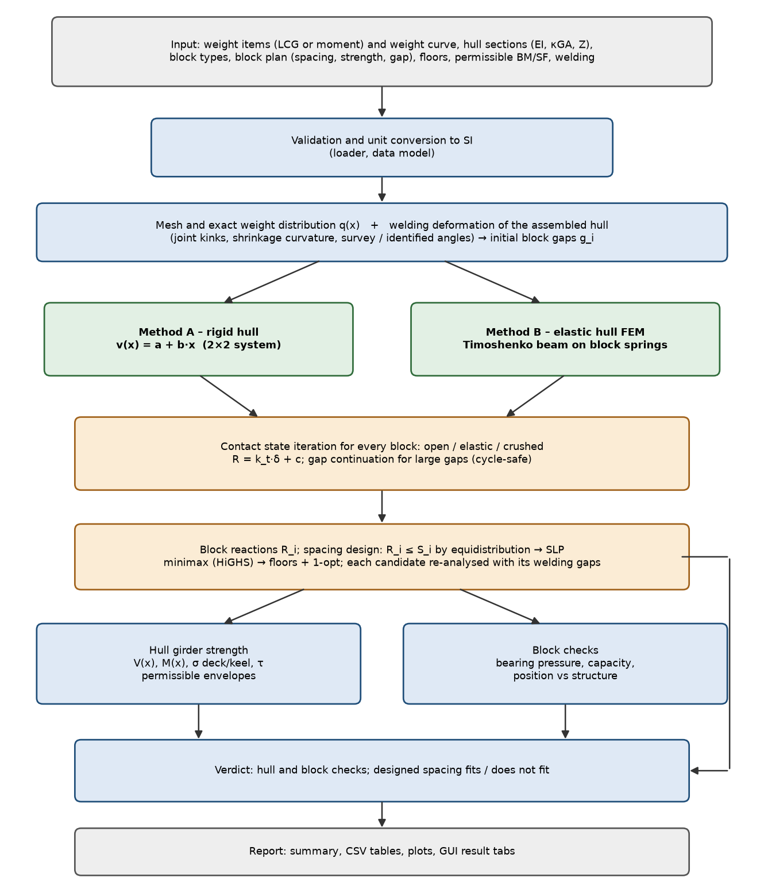
<figcaption aria-hidden="true"><p>Figure 3.1: Overall calculation procedure: input data, validation, load model and welding gaps, the two support models, the contact iteration, the block reactions and the spacing design, the hull girder and block checks, the verdict and the report.</p></figcaption>
</figure>

The boxes of Figure 3.1 correspond to the following steps:

1.  **Input (Section 3.4.4 and Chapter 4).** Weight items with an LCG or a longitudinal moment and a weight-distribution curve, hull sections with bending stiffness $`EI`$, shear stiffness $`\kappa GA`$ and section moduli $`Z`$, block types, the block plan (spacing, strength and gap of every block), the floors, the permissible bending moment and shear force, and the welding deformation.
2.  **Validation and unit conversion (Section 3.2.3).** The input is checked and converted to SI units by the loader and the data model of the program.
3.  **Load model and welding gaps (Sections 3.3 and 3.9–3.10).** Weight items and the weight curve are converted into a piecewise-linear load intensity $`q(x)`$ on a mesh that makes all load integrals exact. In parallel, the welding deformation of the assembled hull (joint kinks, shrinkage curvature and, optionally, a survey or identified joint angles) is converted into initial block gaps $`g_{i}`$.
4.  **Support models (Sections 3.4–3.6).** Each block is a compression-only, possibly crushable spring. Method A treats the hull as rigid, so that its displacement is the straight line $`v(x) = a + b\, x`$ and the problem reduces to a $`2 \times 2`$ system. Method B models the hull as a Timoshenko beam on the block springs, discretised by finite elements.
5.  **Contact iteration (Sections 3.7 and 3.11).** For both models the contact state of every block (open, elastic or crushed) is found by an active-set iteration on the affine block law $`R = k_{t}\,\delta + c`$, protected against cycling and embedded in a gap continuation when the gaps are large.
6.  **Block reactions and spacing design (Section 3.12).** The converged reactions $`R_{i}`$ are compared with the block strengths $`S_{i}`$. The spacing design then moves the blocks so that $`R_{i} \leq S_{i}`$ for every block, by a strength-weighted equidistribution, a sequential linear programme for the minimax problem (solved with HiGHS) and a final rounding to the floors with a local search (labelled 1-opt in the figure). Every candidate layout is re-analysed with the support model, including the welding gaps at its own block positions.
7.  **Checks (Section 3.8).** For the given and for the designed layout, the shear force, bending moment and stresses of the hull girder are compared with the permissible envelopes, and every block is checked for bearing pressure, load against its strength and position relative to the floors.
8.  **Verdict and report (Chapter 4).** The hull and block checks are combined with the outcome of the spacing design (the designed spacing fits or does not fit, with the reason), and the results are written as a summary, CSV tables, plots and the result tabs of the graphical user interface.

The analysis assumes that the dock is dry, that the ship is supported only by the keel block line, and that the problem is two-dimensional in the longitudinal–vertical plane.

## 3.2 Coordinate system, sign conventions and units

### 3.2.1 Coordinates and kinematics

The longitudinal coordinate $`x`$ is measured from the aft perpendicular (AP), positive forward. The hull extends from $`x_{\text{aft}}`$ to $`x_{\text{fwd}}`$; these normally coincide with $`0`$ and $`L_{pp}`$, but either end may lie outside the perpendiculars. The vertical displacement of the hull girder is $`v(x)`$, taken **positive downward**, that is, into the blocks. The rotation is $`\theta = dv/dx`$.

The block at position $`x_{i}`$ has an initial gap $`g_{i}`$, defined as the vertical distance between the undeformed keel line and the top of the block. A positive gap means the block top lies below the keel, so the hull must settle by $`g_{i}`$ before contact is made. The compression of block $`i`$ is

``` math
\delta_{i} = v_{i} - g_{i},\quad\quad v_{i} = v(x_{i})\quad\quad\quad\quad(3.1)
```

A block is in contact only when $`\delta_{i} > 0`$.

### 3.2.2 Forces and stress resultants

The load intensity $`q(x)`$ (weight per unit length) is positive downward. The block reaction $`R_{i}`$ is positive upward on the hull, which corresponds to compression in the block. The shear force at a section $`x`$ is defined as the sum of upward forces minus the sum of downward forces acting on the part of the hull aft of $`x`$:

``` math
V(x) = \sum_{x_{i} < x}^{}R_{i} - \int_{x_{\text{aft}}}^{x}q(\xi)\, d\xi - \sum_{x_{j} < x}^{}P_{j}\quad\quad\quad\quad(3.2)
```

where $`P_{j}`$ are concentrated (point) weights. The bending moment is the integral of the shear force:

``` math
M(x) = \int_{x_{\text{aft}}}^{x}V(\xi)\, d\xi\quad\quad\quad\quad(3.3)
```

With these definitions a simply supported beam under a uniform downward load has a positive mid-span moment. Hence **sagging is positive** and hogging negative. Normal stresses are taken positive in tension, so a sagging moment produces compression in the deck and tension in the keel.

The conventions are collected in Table 3.1.

| Quantity | Symbol | Positive sense |
|----|----|----|
| Longitudinal coordinate | $`x`$ | forward, origin at AP |
| Vertical displacement | $`v`$ | downward |
| Rotation | $`\theta = dv/dx`$ | bow moves down relative to stern |
| Load intensity, point weight | $`q`$, $`P`$ | downward |
| Longitudinal moment of a weight | $`M_{j} = W_{j}\,\text{LCG}_{j}`$ | weight forward of AP |
| Block reaction | $`R_{i}`$ | upward on hull (block in compression) |
| Block gap | $`g_{i}`$ | block top below keel line |
| Block compression | $`\delta_{i} = v_{i} - g_{i}`$ | block compressed |
| Keel lift from welding | $`z`$ | upward, away from the blocks |
| Shear force | $`V`$ | net upward force aft of the section |
| Bending moment | $`M`$ | sagging |
| Normal and shear stress | $`\sigma`$, $`\tau`$ | tension; same sign as $`V`$ |

Table 3.1 – Sign conventions used throughout the methodology.

### 3.2.3 Units

All internal calculations use SI units (N, m, Pa). Input and output use the units customary in docking practice, converted at the boundary of the program:

- weights and block strengths in tonnes, with $`1\ \text{t} = 9.80665\ \text{kN}`$;
- longitudinal moments in t·m and weight-curve intensities in t/m;
- stresses and pressures in MPa, layer moduli in MPa and block stiffnesses in kN/mm;
- block gaps and keel lifts in millimetres, joint angles in mrad and shrinkage strains in mm/m.

## 3.3 Longitudinal weight distribution

The load model has to reproduce the total weight and its longitudinal centre exactly, because the block reactions are in equilibrium with them, and it has to keep the local distribution, because the elastic hull transfers local weights mainly to nearby blocks. Two forms of input are supported, which can be combined: discrete weight items and a weight-distribution curve.

### 3.3.1 Weight items with LCG or moment

The ship’s docking weight is described by a list of weight items. Each item $`j`$ has a weight $`W_{j}`$, a longitudinal position of its centre of gravity and an extent $`\lbrack x_{a,j},\, x_{b,j}\rbrack`$. Hull structure, machinery, superstructure, outfit, tank contents and similar groups are entered in this way. This representation follows the usual practice of building the longitudinal weight curve from grouped weights for still-water strength calculations ([Hughes and Paik 2010](#ref-hughes2010); [Lewis 1988](#ref-lewis1988)).

Weight tables in practice often list the longitudinal moment of each group about the aft perpendicular instead of its LCG, because moments can be added directly. The program therefore accepts the position either as $`\text{LCG}_{j}`$ or as the moment $`M_{j}`$ \[t·m\]; in the latter case

``` math
\text{LCG}_{j} = \frac{M_{j}}{W_{j}}\quad\quad\quad\quad(3.4)
```

If both are given, they must agree. The check uses a combined relative and absolute tolerance,

``` math
\left| \frac{M_{j}}{W_{j}} - \text{LCG}_{j} \right| \leq \max\left( 10^{- 6}\max\left( \left| \frac{M_{j}}{W_{j}} \right|,|\text{LCG}_{j}| \right),\ 10^{- 6}\ \text{m} \right)\quad\quad\quad\quad(3.5)
```

and an item that violates it is rejected with an error that names both values. Accepting redundant but inconsistent data silently would hide input errors that shift the centre of gravity and thus every reaction. An item without an extent, or with a single position $`x`$, is a point weight at its LCG. The weight $`W_{j}`$ must be non-zero; negative values are allowed for deductions.

### 3.3.2 Trapezoidal spreading

Over its extent, each distributed item is replaced by a linearly varying load intensity, that is, a trapezoid. With $`L = x_{b} - x_{a}`$, local coordinate $`s = x - x_{a}`$ and end intensities $`w_{a}`$ and $`w_{b}`$, the intensity is

``` math
w(s) = w_{a} + (w_{b} - w_{a})\,\frac{s}{L},\quad\quad 0 \leq s \leq L\quad\quad\quad\quad(3.6)
```

The two end intensities are fixed by requiring the trapezoid to reproduce the item’s weight and its centre of gravity. The resultant gives

``` math
W_{j} = \int_{0}^{L}w(s)\, ds = \frac{L}{2}\,(w_{a} + w_{b})\quad\quad\quad\quad(3.7)
```

and the first moment about the aft end of the item, with $`\bar{x} = \text{LCG}_{j} - x_{a}`$, gives

``` math
W_{j}\,\bar{x} = \int_{0}^{L}w(s)\, s\, ds = \frac{L^{2}}{6}\,(w_{a} + 2w_{b})\quad\quad\quad\quad(3.8)
```

Solving Equations (3.7) and (3.8) for the end intensities yields

``` math
w_{a} = \frac{2W_{j}}{L}\left( 2 - \frac{3\bar{x}}{L} \right),\quad\quad w_{b} = \frac{2W_{j}}{L}\left( \frac{3\bar{x}}{L} - 1 \right)\quad\quad\quad\quad(3.9)
```

The linear system of Equations (3.7)–(3.8) in the unknowns $`(w_{a},w_{b})`$ has the determinant $`\frac{L}{2} \cdot \frac{2L^{2}}{6} - \frac{L}{2} \cdot \frac{L^{2}}{6} = \frac{L^{3}}{12} > 0`$, so the trapezoid with a prescribed weight and centre of gravity is unique. For an item with its LCG at mid-length, $`\bar{x} = L/2`$, Equation (3.9) gives $`w_{a} = w_{b} = W_{j}/L`$, a uniform load as expected.

### 3.3.3 Middle-third condition

A physically meaningful weight distribution must not contain negative intensities (for a positive item weight). Requiring $`w_{a} \geq 0`$ and $`w_{b} \geq 0`$ in Equation (3.9) gives

``` math
\frac{L}{3} \leq \bar{x} \leq \frac{2L}{3}\quad\quad\quad\quad(3.10)
```

so the LCG of each item must lie in the middle third of its extent. At the limits $`\bar{x} = L/3`$ and $`\bar{x} = 2L/3`$ the trapezoid degenerates into a triangle with its peak at the aft or forward end respectively. Figure 3.2 shows the three cases for an item of 100 t spread over 12 m.

If the condition is violated, the program rejects the item. A balancing distribution with a negative end would be mathematically valid but physically meaningless; the item must instead be split, or its extent changed.

<figure>
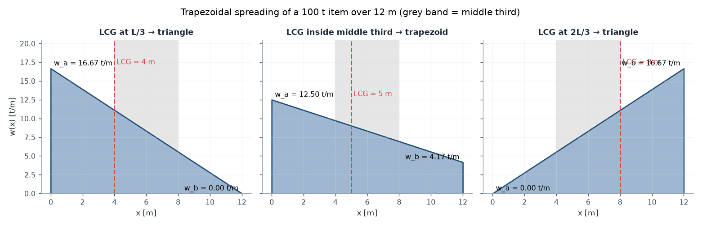
<figcaption aria-hidden="true"><p>Figure 3.2: Trapezoidal spreading of a 100 t item over 12 m with the LCG at L/3, inside the middle third and at 2L/3. The grey band marks the admissible middle third.</p></figcaption>
</figure>

### 3.3.4 Weight-distribution curve as exact trapezoids

When a detailed weight distribution is available, for example the lightship weight curve of the loading manual, it is entered directly as a curve: a sequence of points $`(x_{k},q_{k})`$, $`k = 0,\ldots,n`$, with $`x_{0} \leq x_{1} \leq \ldots \leq x_{n}`$ and $`q_{k} \geq 0`$ \[t/m\]. The curve defines the piecewise-linear intensity

``` math
q_{c}(x) = q_{k} + (q_{k + 1} - q_{k})\,\frac{x - x_{k}}{x_{k + 1} - x_{k}},\quad\quad x_{k} \leq x \leq x_{k + 1},\quad\quad q_{c}(x) = 0\ \text{outside}\ \lbrack x_{0},x_{n}\rbrack\quad\quad\quad\quad(3.11)
```

Two consecutive points with the same $`x`$ define a jump of the intensity, for example at the end of a superstructure or of a cargo hold. The points must be given from aft to forward, every intensity must be finite and non-negative, and the curve must carry a positive weight; otherwise it is rejected.

Instead of adding a second kind of load to the program, every segment $`k`$ of length $`L_{k} = x_{k + 1} - x_{k} > 0`$ with $`q_{k} + q_{k + 1} > 0`$ is converted into one trapezoidal weight item with the extent $`\lbrack x_{k},x_{k + 1}\rbrack`$, the weight and the LCG

``` math
W_{k} = \frac{(q_{k} + q_{k + 1})\, L_{k}}{2},\quad\quad\text{LCG}_{k} = x_{k} + L_{k}\,\frac{q_{k} + 2\, q_{k + 1}}{3\,(q_{k} + q_{k + 1})}\quad\quad\quad\quad(3.12)
```

Segments of zero length (jumps) and unloaded segments ($`q_{k} = q_{k + 1} = 0`$) carry no weight and are skipped. The conversion has three properties, which together show that it is exact.

*The item satisfies the middle-third condition automatically.* With $`{\bar{x}}_{k} = \text{LCG}_{k} - x_{k}`$, Equation (3.12) gives

``` math
\frac{{\bar{x}}_{k}}{L_{k}} - \frac{1}{3} = \frac{q_{k + 1}}{3\,(q_{k} + q_{k + 1})} \geq 0,\quad\quad\frac{2}{3} - \frac{{\bar{x}}_{k}}{L_{k}} = \frac{q_{k}}{3\,(q_{k} + q_{k + 1})} \geq 0\quad\quad\quad\quad(3.13)
```

because $`q_{k},q_{k + 1} \geq 0`$, so Equation (3.10) holds and the item is always accepted.

*The trapezoid reproduces the segment exactly.* Substituting Equation (3.12) into Equation (3.9), with $`2W_{k}/L_{k} = q_{k} + q_{k + 1}`$ and $`3{\bar{x}}_{k}/L_{k} = (q_{k} + 2q_{k + 1})/(q_{k} + q_{k + 1})`$, gives

``` math
w_{a} = (q_{k} + q_{k + 1}) \cdot 2 - (q_{k} + 2\, q_{k + 1}) = q_{k},\quad\quad w_{b} = (q_{k} + 2\, q_{k + 1}) - (q_{k} + q_{k + 1}) = q_{k + 1}\quad\quad\quad\quad(3.14)
```

A linear function on an interval is determined by its two end values, so the spread item coincides with $`q_{c}`$ on $`\lbrack x_{k},x_{k + 1}\rbrack`$ pointwise, not only in its weight and centre. Equivalently, since the trapezoid with a given weight and LCG is unique (Section 3.3.2) and the segment itself is such a trapezoid, the conversion cannot produce anything else.

*Weight and moment are preserved.* Summing over the loaded segments $`\mathcal{K}`$,

``` math
W_{c} = \sum_{k \in \mathcal{K}}^{}\frac{(q_{k} + q_{k + 1})\, L_{k}}{2},\quad\quad M_{c} = \sum_{k \in \mathcal{K}}^{}W_{k}\,\text{LCG}_{k} = \sum_{k \in \mathcal{K}}^{}\frac{L_{k}}{6}\left\lbrack q_{k}\,(2x_{k} + x_{k + 1}) + q_{k + 1}\,(x_{k} + 2x_{k + 1}) \right\rbrack\quad\quad\quad\quad(3.15)
```

which are the exact integrals $`\int q_{c}\, dx`$ and $`\int q_{c}\, x\, dx`$ of Equation (3.11); the second form follows from $`W_{k}\,\text{LCG}_{k} = W_{k}\, x_{k} + L_{k}^{2}\,(q_{k} + 2q_{k + 1})/6`$. The centre of the curve is $`\text{LCG}_{c} = M_{c}/W_{c}`$.

Because the segments become ordinary items, the mesh, the load model, the exact integration of Section 3.3.6 and all later steps apply unchanged; the curve needs no special treatment anywhere else in the program. Its segment ends become key points of the mesh (Section 3.3.5), so a jump is represented exactly as a discontinuity between two elements. Figure 3.3 shows the weight-curve example used in Chapter 6: a lightship curve of 18 points with five jumps, converted into 12 trapezoidal items of 4343.0 t in total at LCG 55.67 m, and three deadweight items entered with their moments (200 t with 14 000 t·m, 60 t with 6000 t·m, and a point weight of 40 t with 1200 t·m), which give 4643.0 t at LCG 56.639 m.

<figure>
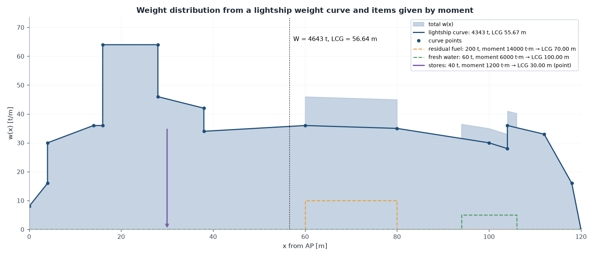
<figcaption aria-hidden="true"><p>Figure 3.3: Weight distribution of the weight-curve example: lightship weight curve with jumps (line and points), deadweight items entered with their longitudinal moments (dashed, the point weight as an arrow) and the total intensity (shaded).</p></figcaption>
</figure>

### 3.3.5 Superposition and mesh construction

The load intensities of all items, including the items obtained from the curve, are superposed. The resulting $`q(x)`$ is piecewise linear, with discontinuities wherever an item starts or ends. To represent it without approximation, the one-dimensional mesh used by all subsequent calculations is built from a set of *key points*:

- the hull ends;
- every item boundary $`x_{a,j}`$ and $`x_{b,j}`$;
- every boundary of a hull girder section;
- every block position $`x_{i}`$.

The key points are sorted, and points closer than $`10^{- 6}`$ m are merged. Each interval of length $`\Delta x`$ between consecutive key points is then divided uniformly into $`\lceil\Delta x/h_{\max}\rceil`$ elements, where $`h_{\max}`$ is a user-defined maximum element length (0.5 m by default).

Because no element straddles an item boundary, the load on every element $`e`$ between nodes $`x_{1}`$ and $`x_{2}`$ is exactly linear. It is stored by its end values $`q_{1}^{(e)}`$ and $`q_{2}^{(e)}`$. Point weights are stored as nodal loads $`P_{n}`$ at the node coinciding with their position. Because the block positions are key points, the mesh depends on the layout; the spacing design of Section 3.12 therefore rebuilds the mesh and the load model for every candidate layout.

Figure 3.4 shows the distribution obtained for the example vessel used in Chapter 6. Its data are placeholder values chosen for illustration.

<figure>
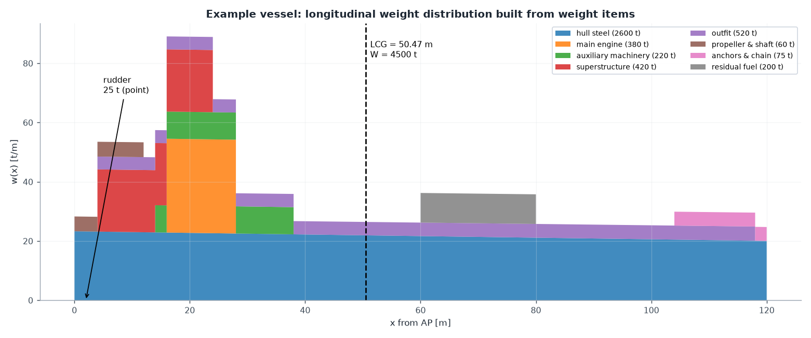
<figcaption aria-hidden="true"><p>Figure 3.4: Longitudinal weight distribution of the example vessel built from nine weight items (placeholder data). The rudder is a point weight.</p></figcaption>
</figure>

### 3.3.6 Exact integration and weight checks

For a linear load on an element of length $`L_{e} = x_{2} - x_{1}`$, the resultant is

``` math
F^{(e)} = \frac{L_{e}}{2}\left( q_{1}^{(e)} + q_{2}^{(e)} \right)\quad\quad\quad\quad(3.16)
```

The first moment about $`x = 0`$ is obtained by writing the load in terms of the linear interpolation functions $`(x_{2} - x)/L_{e}`$ and $`(x - x_{1})/L_{e}`$ and integrating:

``` math
\int_{x_{1}}^{x_{2}}q(x)\, x\, dx = \frac{L_{e}}{6}\left\lbrack q_{1}^{(e)}\,(2x_{1} + x_{2}) + q_{2}^{(e)}\,(x_{1} + 2x_{2}) \right\rbrack\quad\quad\quad\quad(3.17)
```

The total weight and its LCG then follow from

``` math
W = \sum_{e}^{}F^{(e)} + \sum_{n}^{}P_{n},\quad\quad\text{LCG} = \frac{1}{W}\left( \sum_{e}^{}{\int_{x_{1}}^{x_{2}}q}\, x\, dx + \sum_{n}^{}P_{n}x_{n} \right)\quad\quad\quad\quad(3.18)
```

Because the integration is exact, $`W`$ and LCG from Equation (3.18) agree with the sums over the input items, and with Equation (3.15) for the curve, to machine precision. The program uses this agreement as an internal consistency check. A separate, user-controlled tolerance (0.5 % by default) compares the computed weight and LCG with the declared docking weight and LCG from the docking plan, and a warning is issued if they differ.

For the example vessel the mesh contains 256 nodes. The computed weight is 4500.0 t at LCG = 50.469 m, against a declared 4500.0 t at 50.47 m.

## 3.4 Block model and block plan

### 3.4.1 Stiffness of a layered block

A keel block typically consists of a concrete or steel base, one or more hardwood layers and a softwood cap that conforms to the hull. The layers carry the same force and their compressions add, so they act as springs in series. For layer $`m`$ with thickness $`t_{m}`$ and modulus $`E_{m}`$ in the loading direction (perpendicular to the grain for timber), loaded over the contact area $`A`$, the block stiffness is

``` math
\frac{1}{k_{i}} = \sum_{m}^{}\frac{t_{m}}{E_{m}\, A}\quad\quad\quad\quad(3.19)
```

The contact area is the product of the transverse contact width $`b`$ (keel or flat-bottom width resting on the block) and the longitudinal block length $`\ell`$:

``` math
A = b\,\ell\quad\quad\quad\quad(3.20)
```

The softest layer, usually the softwood cap, dominates the sum in Equation (3.19), so the block stiffness is sensitive to the cap material and thickness. The program also accepts a measured or prescribed stiffness, which overrides Equation (3.19).

For the example keel block the layers are 0.90 m of concrete ($`E`$ = 30 GPa), 0.20 m of hardwood ($`E`$ = 1.0 GPa) and 0.10 m of softwood ($`E`$ = 0.4 GPa), with $`b`$ = 0.8 m and $`\ell`$ = 1.2 m. These give $`A = 0.96\ \text{m}^{2}`$ and $`k = 2.0 \times 10^{9}`$ N/m (2000 kN/mm). These values are placeholders, not recommended design data.

### 3.4.2 Compression-only bilinear law

A block can push on the hull but cannot pull it down. Beyond a certain stress, the timber cap crushes, that is, it deforms permanently with a much reduced tangent stiffness. Both effects are captured by the piecewise-linear law

``` math
R_{i}(\delta_{i}) = \left\{ \begin{matrix}
0, & \delta_{i} \leq 0\quad\text{(open)} \\
k_{i}\,\delta_{i}, & 0 < \delta_{i} \leq \delta_{y,i}\quad\text{(elastic)} \\
k_{2,i}\,\delta_{i} + (k_{i} - k_{2,i})\,\delta_{y,i}, & \delta_{i} > \delta_{y,i}\quad\text{(crushed)}
\end{matrix} \right.\ \quad\quad\quad\quad(3.21)
```

with the crush force, the compression at which crushing starts, and the post-crush stiffness

``` math
F_{y,i} = \sigma_{c,i}\, A_{i},\quad\quad\delta_{y,i} = \frac{F_{y,i}}{k_{i}},\quad\quad k_{2,i} = \rho_{i}\, k_{i}\quad\quad\quad\quad(3.22)
```

Here $`\sigma_{c}`$ is the crush stress of the block and $`\rho \in \lbrack 0,1\rbrack`$ is the post-crush stiffness ratio (default 0.05). If no crush stress is specified, $`\delta_{y,i} = \infty`$ and the law reduces to a linear compression-only spring. The law is continuous and monotonically non-decreasing in $`\delta_{i}`$, a property used in Sections 3.7 and 3.11.

Figure 3.5 shows the law for the example block with $`\sigma_{c}`$ = 4.0 MPa. The crush force is then $`F_{y}`$ = 3.84 MN (391.6 t), reached at $`\delta_{y}`$ = 1.92 mm, and the post-crush stiffness is $`k_{2} = 1.0 \times 10^{8}`$ N/m.

<figure>
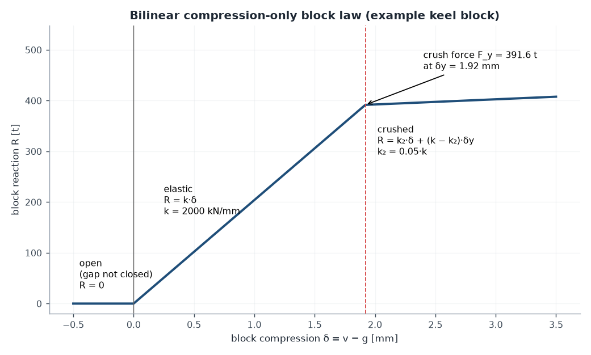
<figcaption aria-hidden="true"><p>Figure 3.5: Bilinear compression-only force law of the example keel block (placeholder properties).</p></figcaption>
</figure>

### 3.4.3 State-wise linearisation

Within each branch of Equation (3.21) the force is an affine function of the compression. Introducing a block state $`s_{i} \in \{\text{open},\text{elastic},\text{crushed}\}`$, the law can be written uniformly as

``` math
R_{i} = k_{t,i}(s_{i})\,\delta_{i} + c_{i}(s_{i})\quad\quad\quad\quad(3.23)
```

with the tangent stiffness $`k_{t,i}`$ and offset $`c_{i}`$ listed in Table 3.2. For a fixed set of states, every support model in this thesis becomes linear in the unknowns. Section 3.7 describes how the correct states are found.

| State $`s_{i}`$ | Range of $`\delta_{i}`$ | $`k_{t,i}`$ | $`c_{i}`$ |
|----|----|----|----|
| open | $`\delta_{i} \leq 0`$ | $`0`$ | $`0`$ |
| elastic | $`0 < \delta_{i} \leq \delta_{y,i}`$ | $`k_{i}`$ | $`0`$ |
| crushed | $`\delta_{i} > \delta_{y,i}`$ | $`k_{2,i}`$ | $`(k_{i} - k_{2,i})\,\delta_{y,i}`$ |

Table 3.2 – Linearisation of the block law for each contact state.

Substituting Equation (3.1) into Equation (3.23) expresses the reaction in terms of the hull displacement:

``` math
R_{i} = k_{t,i}\, v_{i} - \left( k_{t,i}\, g_{i} - c_{i} \right) = k_{t,i}\, v_{i} - r_{i},\quad\quad r_{i} = k_{t,i}\, g_{i} - c_{i}\quad\quad\quad\quad(3.24)
```

The term $`r_{i}`$ collects the effect of the gap and the crushing offset. In both support models it appears as a known load.

### 3.4.4 Block plan: number, spacing, strength and gap of every block

The blocks are defined by a single *block plan*, which is the object of the spacing design. A plan names one block type (Section 3.4.1–3.4.2), the position $`x_{1}`$ of the first (aftmost) block, the number of blocks $`N \geq 2`$, and three per-block quantities, each given either as one value for all blocks or as a list:

- the spacings $`s_{1},\ldots,s_{N - 1} > 0`$, where $`s_{i}`$ is the distance from block $`i`$ to block $`i + 1`$;
- the strengths $`S_{1},\ldots,S_{N} > 0`$ \[t\], the force that each block may carry;
- the initial gaps $`g_{1}^{0},\ldots,g_{N}^{0}`$ \[mm\], for example from uneven block heights.

If the number is omitted it is inferred from the length of a list. The block positions follow by accumulating the spacings:

``` math
x_{1} = x_{\text{start}},\quad\quad x_{i + 1} = x_{i} + s_{i},\quad\quad i = 1,\ldots,N - 1\quad\quad\quad\quad(3.25)
```

so the positions are strictly increasing by construction. The blocks are labelled $`B01,B02,\ldots`$ from aft to forward. The strength of block $`i`$ is

``` math
S_{i} = \left\{ \begin{matrix}
S_{i}^{\text{plan}}, & \text{if given in the plan} \\
R_{\text{cap}}, & \text{otherwise (capacity of the block type)}
\end{matrix} \right.\ \quad\quad\quad\quad(3.26)
```

The strength and the initial gap belong to the block, not to a position: when the spacing design moves block $`i`$, its strength $`S_{i}`$ and its gap $`g_{i}^{0}`$ move with it. The design keeps the number and the order of the blocks, so every block keeps its strength. This reflects the practical situation in the dock, where a known set of blocks, possibly of different condition or rating, is available and only their positions are to be chosen.

The strength is a limit, not a stiffness: it does not enter the support models. The reactions therefore do not depend on the strengths, which enter only the block checks (Section 3.8.5) and the objective of the spacing design (Section 3.12).

## 3.5 Method A: rigid hull on elastic blocks

### 3.5.1 Formulation

If the hull girder is much stiffer than the block line, its deflection can be neglected relative to the block compressions, and the hull moves as a rigid body. To improve the numerical conditioning, positions are measured from the centroid of the block positions, $`x_{0} = \frac{1}{N}\sum_{i}^{}x_{i}`$, so that $`x_{c,i} = x_{i} - x_{0}`$. The displacement is then linear:

``` math
v(x) = a + b\,(x - x_{0}),\quad\quad v_{i} = a + b\, x_{c,i}\quad\quad\quad\quad(3.27)
```

where $`a`$ is the settlement at $`x_{0}`$ and $`b`$ the rotation. The reactions follow from Equation (3.24) as $`R_{i} = k_{t,i}(a + b\, x_{c,i}) - r_{i}`$. Vertical force equilibrium and moment equilibrium about $`x_{0}`$ require

``` math
\sum_{i}^{}R_{i} = W,\quad\quad\sum_{i}^{}R_{i}\, x_{c,i} = M_{0}\quad\quad\quad\quad(3.28)
```

where $`M_{0} = M_{W} - Wx_{0}`$ is the first moment of the load about $`x_{0}`$ and $`M_{W} = W \cdot \text{LCG}`$ is the first moment about the origin from Equation (3.18). Substitution gives the $`2 \times 2`$ linear system

``` math
\begin{bmatrix}
\sum k_{t,i} & \sum k_{t,i}\, x_{c,i} \\
\sum k_{t,i}\, x_{c,i} & \sum k_{t,i}\, x_{c,i}^{2}
\end{bmatrix}\begin{bmatrix}
a \\
b
\end{bmatrix} = \begin{bmatrix}
W + \sum r_{i} \\
M_{0} + \sum r_{i}\, x_{c,i}
\end{bmatrix}\quad\quad\quad\quad(3.29)
```

The coefficient matrix is symmetric. It is non-singular if and only if at least two blocks with $`k_{t,i} > 0`$ are in contact at distinct positions, which is the same support condition that applies to the elastic model (Section 3.6.6).

Centring does not change the solution, but it reduces the condition number of the matrix. Without centring, the off-diagonal terms grow with the distance of the block line from the origin, while with centring they vanish for a symmetric block arrangement of equal stiffness.

### 3.5.2 Closed form for equal stiffness

For $`N`$ blocks of equal stiffness $`k`$, no gaps and no crushing, $`\sum x_{c,i} = 0`$ and Equation (3.29) decouples. The solution is the familiar “P/A ± Mc/I” form:

``` math
R_{i} = \frac{W}{N} + \frac{W\, e\,(x_{i} - \bar{x})}{\sum_{m}^{}(x_{m} - \bar{x})^{2}},\quad\quad e = \text{LCG} - \bar{x}\quad\quad\quad\quad(3.30)
```

where $`\bar{x} = x_{0}`$ is the block centroid and $`e`$ the eccentricity of the weight relative to it. The reactions therefore vary linearly along the block line, increasing towards the side on which the centre of gravity lies. In particular, all reactions are equal to $`W/N`$ when the block centroid lies under the centre of gravity, a fact used in Section 3.12.7.

### 3.5.3 Continuous block line: trapezoidal and triangular distributions

When the blocks are closely and evenly spaced, the line can be idealised as a continuous elastic support of length $`L_{b}`$, and the reaction becomes a load per unit length $`p(x)`$. Applying Equation (3.30) in continuous form, the end values of the trapezoidal reaction distribution are

``` math
p_{\text{end}} = \frac{W}{L_{b}}\left( 1 \pm \frac{6e}{L_{b}} \right),\quad\quad|e| \leq \frac{L_{b}}{6}\quad\quad\quad\quad(3.31)
```

This is the classical trapezoidal method of docking calculations ([Naval Sea Systems Command, n.d.](#ref-nstm997); [U.S. Department of Defense, n.d.-a](#ref-milstd1625)). If $`|e| > L_{b}/6`$, Equation (3.31) would give a negative end value, which a compression-only support cannot provide. Contact is then lost over part of the line, and the reaction becomes triangular. Its length $`c`$ and peak value follow from force and moment equilibrium of a triangle whose centroid lies at the LCG:

``` math
c = 3\left( \frac{L_{b}}{2} - |e| \right),\quad\quad p_{\text{peak}} = \frac{2W}{c}\quad\quad\quad\quad(3.32)
```

Equations (3.31) and (3.32) are not used directly by the program. They are the continuous limit of the discrete formulation, and they explain the lift-off behaviour that the contact iteration reproduces for discrete blocks.

### 3.5.4 Limitations

Method A satisfies equilibrium exactly but ignores the deformation of the hull. It therefore cannot represent:

- the concentration of reactions under heavy local weights;
- the additional load attracted by the end blocks from unsupported overhangs;
- the redistribution caused by gaps between the keel and individual blocks.

It does, however, provide an important reference. It is the limit that the elastic model must approach as the hull stiffness tends to infinity (Chapter 5), and it is the basis of established docking practice.

## 3.6 Method B: elastic hull girder FEM

### 3.6.1 Governing equations

The hull girder is idealised as a beam with bending stiffness $`EI(x)`$ and, optionally, effective shear stiffness $`\kappa GA(x)`$ ([Hughes and Paik 2010](#ref-hughes2010)). In Euler–Bernoulli theory ([Gere and Goodno 2013](#ref-gere2013)), plane sections remain plane and normal to the deflected axis, and the deflection under the net load $`q_{\text{net}}(x)`$ satisfies

``` math
\frac{d^{2}}{dx^{2}}\left( EI\,\frac{d^{2}v}{dx^{2}} \right) = q_{\text{net}}(x)\quad\quad\quad\quad(3.33)
```

where $`q_{\text{net}}`$ is the weight intensity minus the block reactions, the latter acting as concentrated forces.

The Timoshenko theory ([Timoshenko 1921](#ref-timoshenko1921)) relaxes the normality assumption. It introduces the section rotation $`\psi`$ as an independent field, so that the shear strain is $`\gamma = dv/dx - \psi`$, and the equations become

``` math
\frac{d}{dx}\left( EI\,\frac{d\psi}{dx} \right) + \kappa GA\left( \frac{dv}{dx} - \psi \right) = 0,\quad\quad\frac{d}{dx}\left\lbrack \kappa GA\left( \frac{dv}{dx} - \psi \right) \right\rbrack = - q_{\text{net}}\quad\quad\quad\quad(3.34)
```

In the limit $`\kappa GA \rightarrow \infty`$ the shear strain vanishes, $`\psi \rightarrow dv/dx`$, and eliminating the shear force between the two equations recovers Equation (3.33). Shear deformation is significant for short, deep girders and for the short spans between closely spaced blocks. The relative importance of shear over an element of length $`L`$ is measured by the dimensionless parameter

``` math
\Phi = \frac{12\, EI}{\kappa GA\, L^{2}}\quad\quad\quad\quad(3.35)
```

For the example hull ($`EI = 4.12 \times 10^{12}`$ N·m², $`\kappa GA = 7.14 \times 10^{10}`$ N amidships), $`\Phi`$ is 0.048 for the full length of 120 m but 120 for a block spacing of 2.4 m. At the scale of individual block spans, shear deformation therefore dominates the local flexibility.

### 3.6.2 Finite element discretisation

The beam is divided into two-node elements on the mesh of Section 3.3.5, with two degrees of freedom per node, $`v`$ and $`\theta`$. For node $`n`$ the global degrees of freedom are numbered $`2n`$ (displacement) and $`2n + 1`$ (rotation). Within an element of length $`L`$, with local coordinate $`\xi = s/L \in \lbrack 0,1\rbrack`$, the Euler–Bernoulli displacement is interpolated by the Hermite cubic shape functions ([Przemieniecki 1968](#ref-przemieniecki1968); [Cook et al. 2002](#ref-cook2002)):

``` math
N_{1} = 1 - 3\xi^{2} + 2\xi^{3},\quad N_{2} = L\,(\xi - 2\xi^{2} + \xi^{3}),\quad N_{3} = 3\xi^{2} - 2\xi^{3},\quad N_{4} = L\,( - \xi^{2} + \xi^{3})\quad\quad\quad\quad(3.36)
```

so that $`v(\xi) = N_{1}v_{1} + N_{2}\theta_{1} + N_{3}v_{2} + N_{4}\theta_{2}`$. The functions are plotted in Figure 3.6. Each takes the value one for its own degree of freedom and zero for the other three, in both displacement and slope.

<figure>
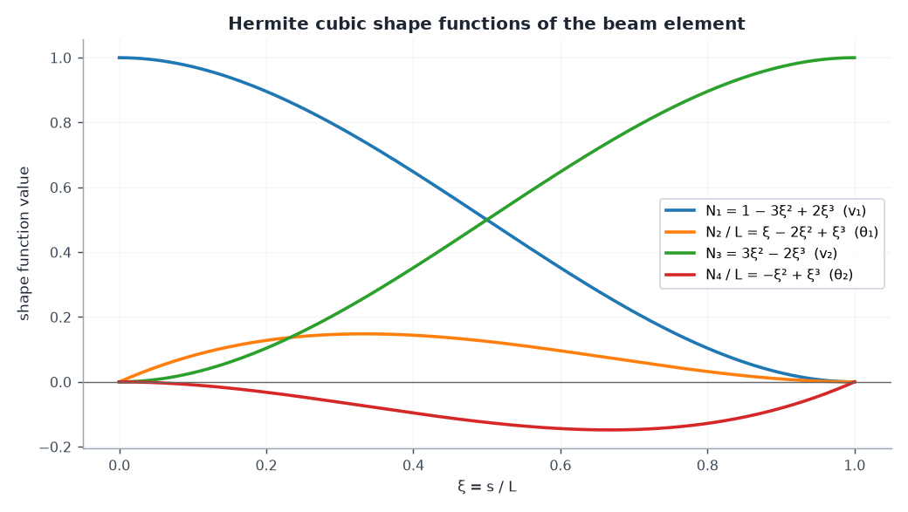
<figcaption aria-hidden="true"><p>Figure 3.6: Hermite cubic shape functions of the two-node beam element; N₂ and N₄ are shown divided by the element length.</p></figcaption>
</figure>

### 3.6.3 Element stiffness matrix

For the Euler–Bernoulli element, the stiffness matrix follows from the strain energy $`U = \frac{1}{2}\int_{0}^{L}EI\,(v'')^{2}\, ds`$:

``` math
\mathbf{K}_{e} = \int_{0}^{L}EI\,\mathbf{B}^{\mathsf{T}}\mathbf{B}\, ds,\quad\quad\mathbf{B} = \frac{d^{2}}{ds^{2}}\begin{bmatrix}
N_{1} & N_{2} & N_{3} & N_{4}
\end{bmatrix}\quad\quad\quad\quad(3.37)
```

Evaluating Equation (3.37) for constant $`EI`$ gives the classical matrix. If the Timoshenko element is formulated with interdependent interpolation of $`v`$ and $`\psi`$, which reproduces the exact homogeneous solution of Equation (3.34) ([Przemieniecki 1968](#ref-przemieniecki1968); [Bathe 2014](#ref-bathe2014)), the stiffness matrix becomes

``` math
\mathbf{K}_{e} = \frac{EI}{L^{3}\,(1 + \Phi)}\begin{bmatrix}
12 & 6L & - 12 & 6L \\
6L & (4 + \Phi)L^{2} & - 6L & (2 - \Phi)L^{2} \\
 - 12 & - 6L & 12 & - 6L \\
6L & (2 - \Phi)L^{2} & - 6L & (4 + \Phi)L^{2}
\end{bmatrix}\quad\quad\quad\quad(3.38)
```

with $`\Phi`$ from Equation (3.35). Setting $`\Phi = 0`$ recovers the Euler–Bernoulli matrix exactly. The program therefore uses Equation (3.38) for every element and sets $`\Phi = 0`$ wherever no shear stiffness is given, or where shear deformation is switched off by the user.

### 3.6.4 Consistent load vector

The distributed load is transferred to the nodes as work-equivalent (consistent) nodal forces and moments, $`\mathbf{f}_{e} = \int_{0}^{L}\mathbf{N}^{\mathsf{T}}q(s)\, ds`$. For the linear load $`q(\xi) = q_{1}(1 - \xi) + q_{2}\,\xi`$, integration of the products of the Hermite functions with the two linear functions gives

``` math
\mathbf{f}_{e} = \begin{bmatrix}
\frac{L\,(7q_{1} + 3q_{2})}{20} & \frac{L^{2}\,(3q_{1} + 2q_{2})}{60} & \frac{L\,(3q_{1} + 7q_{2})}{20} & - \frac{L^{2}\,(2q_{1} + 3q_{2})}{60}
\end{bmatrix}^{\mathsf{T}}\quad\quad\quad\quad(3.39)
```

For a uniform load $`q_{1} = q_{2} = q`$ this reduces to the familiar fixed-end values $`qL/2`$ and $`\pm qL^{2}/12`$. Point weights $`P_{n}`$ are added directly to the displacement degree of freedom of their node.

### 3.6.5 Assembly and support springs

The global stiffness matrix $`\mathbf{K}_{0}`$ and load vector $`\mathbf{F}_{0}`$ are assembled by adding each element contribution to the rows and columns of its four degrees of freedom $`(2e,2e + 1,2e + 2,2e + 3)`$:

``` math
\mathbf{K}_{0} = \sum_{e}^{}\mathbf{A}_{e}^{\mathsf{T}}\,\mathbf{K}_{e}\,\mathbf{A}_{e},\quad\quad\mathbf{F}_{0} = \sum_{e}^{}\mathbf{A}_{e}^{\mathsf{T}}\,\mathbf{f}_{e} + \sum_{n}^{}P_{n}\,\mathbf{e}_{2n}\quad\quad\quad\quad(3.40)
```

where $`\mathbf{A}_{e}`$ is the Boolean gather matrix of element $`e`$ and $`\mathbf{e}_{2n}`$ is the unit vector of the displacement degree of freedom of node $`n`$. In the implementation the assembly is performed in coordinate (COO) sparse format, and duplicate entries are summed.

The blocks enter through Equation (3.24). Moving the stiffness term to the left-hand side, each block in state $`s_{i}`$, located at node $`n_{i}`$, contributes

``` math
K_{2n_{i},\, 2n_{i}} + = k_{t,i},\quad\quad F_{2n_{i}} + = r_{i} = k_{t,i}\, g_{i} - c_{i}\quad\quad\quad\quad(3.41)
```

and the linear system for a given set of block states is

``` math
\left( \mathbf{K}_{0} + \mathbf{K}_{s} \right)\mathbf{u} = \mathbf{F}_{0} + \mathbf{F}_{s}\quad\quad\quad\quad(3.42)
```

where $`\mathbf{u}`$ contains all nodal displacements and rotations, $`\mathbf{K}_{s}`$ is the diagonal spring matrix and $`\mathbf{F}_{s}`$ the vector of spring loads. After solution, the block compressions follow from Equation (3.1) and the reactions from Equation (3.23).

### 3.6.6 Free–free support condition

No displacement boundary conditions are imposed: the ship is held only by the blocks. The unsupported stiffness matrix $`\mathbf{K}_{0}`$ is therefore singular. Its null space is spanned by the two rigid-body modes, vertical translation ($`v = 1`$, $`\theta = 0`$ at every node) and rotation ($`v = x`$, $`\theta = 1`$). The spring matrix $`\mathbf{K}_{s}`$ removes both modes only if at least two blocks with $`k_{t,i} > 0`$ are in contact at distinct longitudinal positions.

The program checks this condition before every solve. If it is not met, the support is reported as unstable instead of attempting to solve a singular system. The usual physical cause is a centre of gravity outside the block line, for which no compression-only support can provide moment equilibrium. A preliminary check rejects such cases before the analysis starts.

### 3.6.7 Solution of the linear system

The matrix in Equation (3.42) is symmetric, sparse and banded (each row has at most six non-zeros), and it is positive definite whenever the support condition of Section 3.6.6 holds. It is solved with a sparse direct method ([Davis 2006](#ref-davis2006)), using the SuperLU-based solver ([Li 2005](#ref-li2005superlu)) provided by SciPy ([Virtanen et al. 2020](#ref-virtanen2020scipy)). For the meshes of interest, with a few hundred to a few thousand degrees of freedom, a solve takes milliseconds. This matters for the spacing design, which analyses hundreds of candidate layouts (Section 3.13).

### 3.6.8 Accuracy of the discretisation

For the Euler–Bernoulli beam with Hermite cubic elements and consistent loads, the nodal displacements are exact for any load that is polynomial within each element. This is because the element Green’s functions lie in the space of cubic polynomials ([Cook et al. 2002](#ref-cook2002)). Since the mesh of Section 3.3.5 makes the load exactly linear within each element, and blocks act only at nodes, the computed reactions do not depend on the element size. Refining the mesh only increases the resolution of the plotted displacement, shear force and moment curves. The Timoshenko element of Equation (3.38) is likewise exact for uniform loads. Chapter 5 confirms both properties numerically. For the spacing design, this property has a further consequence: the reactions of a candidate layout do not contain a discretisation error that changes with the mesh, which would otherwise appear as noise in the finite-difference sensitivities of Section 3.12.4.

### 3.6.9 Beam on elastic foundation: characteristic length

Insight into the elastic model is obtained by smearing closely spaced blocks of stiffness $`k`$ at spacing $`s`$ into a continuous foundation of modulus $`k_{f} = k/s`$. The governing equation becomes that of a beam on an elastic foundation ([Hetényi 1946](#ref-hetenyi1946)):

``` math
EI\,\frac{d^{4}v}{dx^{4}} + k_{f}\, v = q(x)\quad\quad\quad\quad(3.43)
```

Its homogeneous solutions decay with the characteristic parameter

``` math
\lambda = \left( \frac{k_{f}}{4\, EI} \right)^{1/4}\quad\quad\quad\quad(3.44)
```

A concentrated load is effectively spread over a length of the order of $`\pi/\lambda`$ on either side of its point of application. If this length is large compared with the block line, the hull behaves almost rigidly and Method A is adequate. If it is short, reactions are dominated by the local weight distribution and overhangs.

For the example vessel, $`k_{f} = 2.0 \times 10^{9}/2.4 = 8.33 \times 10^{8}`$ N/m² and $`EI = 4.12 \times 10^{12}`$ N·m². These give $`\lambda = 0.0843`$ m⁻¹, $`1/\lambda = 11.86`$ m and $`\pi/\lambda = 37.3`$ m. This is substantially shorter than the 103.2 m block line, so significant differences between Methods A and B are to be expected (Section 6.3). Equation (3.44) also shows why the spacing is an effective design variable for the elastic hull: a local reduction of the spacing raises the local foundation modulus $`k_{f}`$ and draws load to that region, while a larger spacing sheds load to the neighbours.

## 3.7 Contact and crushing iteration

### 3.7.1 Complementarity formulation

Without crushing, the compression-only block law of Equation (3.21) is a set of complementarity conditions ([Cottle et al. 1992](#ref-cottle1992); [Wriggers 2006](#ref-wriggers2006)). For each block,

``` math
R_{i} \geq 0,\quad\quad k_{i}\,\delta_{i} - R_{i} \leq 0,\quad\quad R_{i}\,\left( k_{i}\,\delta_{i} - R_{i} \right) = 0\quad\quad\quad\quad(3.45)
```

In words: the reaction is non-negative, it is not smaller than the elastic spring force $`k_{i}\,\delta_{i}`$ (which is negative for an open gap), and at least one of the two inequalities holds with equality. Either the block is open with $`R_{i} = 0`$ and $`\delta_{i} \leq 0`$, or it is in contact with $`R_{i} = k_{i}\,\delta_{i} > 0`$. Together with the linear equilibrium equations (3.29) or (3.42), this forms a linear complementarity problem. Crushing adds a third linear branch, so the problem becomes a piecewise-linear system with three possible states per block.

### 3.7.2 State iteration

Because each branch is linear, the problem is solved by iterating on the block states. This is an active-set strategy. Each iteration solves one linear system (Equation (3.29) or (3.42)) for the assumed states and updates the states from the computed compressions. The algorithm used for both support models is given as Algorithm 3.1.

**Algorithm 3.1 – Block-state iteration for compression-only, crushing supports.**

```text
input : block data (x_i, k_i, g_i, δy_i, k2_i), linear solver S(kt, c) -> δ
output: compressions δ_i, states s_i, reactions R_i

 1  s_i <- elastic for all blocks                  (assume full contact)
 2  seen <- {} ; one_at_a_time <- false
 3  for iteration = 1, 2, ..., max_iterations
 4      (kt_i, c_i) <- linearisation of s_i       (Table 3.2)
 5      check that >= 2 blocks with kt_i > 0 at distinct x   (else: unstable)
 6      δ <- S(kt, c)                              (solve Eq. 3.29 or 3.42)
 7      s'_i <- state implied by δ_i              (Eq. 3.21 ranges)
 8      if s' = s then return δ, s, R_i = kt_i δ_i + c_i
 9      add s to seen
10      if one_at_a_time or s' in seen or s' leaves < 2 supports then
11          one_at_a_time <- true
12          j <- block with largest violation η_j among changed blocks
13          s'' <- s ; s''_j <- s'_j ; s' <- s''
14      s <- s'
15  error: no convergence within max_iterations
```

### 3.7.3 Cycle detection and fallback

In the standard mode (line 14), all inconsistent states are updated simultaneously. This usually converges in very few iterations: for the example vessel a single solve suffices with the initial all-elastic assumption, and for the welded hull of Chapter 6 three (elastic hull) and five (rigid hull) iterations were needed. For some configurations, however, simultaneous updates can cycle between sets of states. To prevent such cycling, every visited state set is recorded. If a state set is about to be revisited — or if the simultaneous update would leave fewer than two separated blocks in contact, which can happen with large initial gaps — the algorithm switches permanently to a one-at-a-time mode, in which only the block with the largest violation of its assumed state is changed per iteration. The violation measure is

``` math
\eta_{i} = \left\{ \begin{matrix}
\max(\delta_{i},0), & s_{i} = \text{open} \\
\max( - \delta_{i},0) + \max(\delta_{i} - \delta_{y,i},0), & s_{i} = \text{elastic} \\
\max(\delta_{y,i} - \delta_{i},0), & s_{i} = \text{crushed}
\end{matrix} \right.\ \quad\quad\quad\quad(3.46)
```

that is, the distance of the computed compression from the admissible range of the assumed state. Changing a single block at a time corresponds to a classical pivoting step and avoids the oscillation of simultaneous updates. Because the force law is monotone, this procedure terminates in practice. A maximum iteration count (200 by default) is nevertheless retained as a safeguard, and Section 3.11 provides a robust fallback when it is reached.

### 3.7.4 Support stability check

At line 5 of Algorithm 3.1 the algorithm verifies the free–free support condition of Section 3.6.6 for the current state set: at least two blocks with positive tangent stiffness at distinct positions. Crushed blocks with $`\rho = 0`$ carry a constant force but no stiffness, so they do not count towards this condition. If it fails, the iteration stops with an instability error. Before any iteration, the analysis also verifies that the LCG lies within the extent of the block line. This is a necessary condition for any compression-only equilibrium.

### 3.7.5 Equilibrium residuals

After convergence, the global equilibrium residuals

``` math
\varepsilon_{F} = \frac{\sum_{i}^{}R_{i} - W}{W},\quad\quad\varepsilon_{M} = \frac{\sum_{i}^{}R_{i}\, x_{i} - W \cdot \text{LCG}}{W\,(x_{\text{fwd}} - x_{\text{aft}})}\quad\quad\quad\quad(3.47)
```

are evaluated and reported. For the example vessel they were $`1.7 \times 10^{- 16}`$ and $`0`$ for Method A and $`0`$ and $`5.1 \times 10^{- 15}`$ for Method B, that is, at the level of round-off. Force equilibrium, $`\sum_{i}^{}R_{i} = W`$, is also the basis of the lower bound on the achievable utilisation in Section 3.12.6.

## 3.8 Hull girder loads and checks; block strength and utilisation

### 3.8.1 Exact piecewise integration

Once the reactions are known, the shear force and bending moment follow from Equations (3.2) and (3.3). Because the load is linear within each element and all concentrated forces (point weights and block reactions) act at nodes, both curves can be integrated exactly.

Let $`V_{j}^{+}`$ and $`M_{j}`$ denote the shear force just forward of node $`j`$ and the bending moment at node $`j`$. Within element $`j`$, at distance $`s \in \lbrack 0,L\rbrack`$ from its aft node and with $`\Delta q = q_{2} - q_{1}`$,

``` math
V(s) = V_{j}^{+} - \left( q_{1}\, s + \frac{\Delta q\, s^{2}}{2L} \right)\quad\quad\quad\quad(3.48)
```

``` math
M(s) = M_{j} + V_{j}^{+}\, s - \left( \frac{q_{1}\, s^{2}}{2} + \frac{\Delta q\, s^{3}}{6L} \right)\quad\quad\quad\quad(3.49)
```

Thus $`V`$ is quadratic and $`M`$ cubic within each element. At node $`j + 1`$ the shear force jumps by the net concentrated force applied there, while the bending moment is continuous:

``` math
V_{j + 1}^{+} = V(L) + \sum_{i \in j + 1}^{}R_{i} - P_{j + 1},\quad\quad M_{j + 1} = M(L)\quad\quad\quad\quad(3.50)
```

Starting from $`V = M = 0`$ at the aft end of the hull, Equations (3.48)–(3.50) are applied element by element. Several interior sample points per element are retained for plotting and for locating maxima. Each node is stored twice, with the shear values on either side of the jump, so that the stepped shape of the shear force curve is represented exactly.

### 3.8.2 Closure check

At the forward end of the hull, both $`V`$ and $`M`$ must return to zero, because the reactions are in equilibrium with the weight. The normalised closure errors

``` math
\varepsilon_{V} = \frac{V(x_{\text{fwd}})}{\max|V|},\quad\quad\varepsilon_{M} = \frac{M(x_{\text{fwd}})}{\max|M|}\quad\quad\quad\quad(3.51)
```

provide an independent check on the combined weight, reaction and integration procedures. Values above $`10^{- 6}`$ are reported as warnings. For the example vessel the largest of them was $`1.6 \times 10^{- 12}`$.

### 3.8.3 Hull girder stresses

With section moduli $`Z_{\text{deck}}`$ and $`Z_{\text{keel}}`$ and the tension-positive convention, the longitudinal bending stresses at deck and keel are

``` math
\sigma_{\text{deck}} = - \frac{M}{Z_{\text{deck}}},\quad\quad\sigma_{\text{keel}} = \frac{M}{Z_{\text{keel}}}\quad\quad\quad\quad(3.52)
```

so a sagging moment compresses the deck and stretches the keel. The mean shear stress over the effective shear area $`A_{s}`$ is

``` math
\tau = \frac{V}{A_{s}}\quad\quad\quad\quad(3.53)
```

Equation (3.53) is a simplification of the shear flow distribution in thin-walled sections ([Hughes and Paik 2010](#ref-hughes2010)). It is adequate for a screening check of the docked condition. Section properties are taken piecewise constant along the hull, as defined in the input.

### 3.8.4 Permissible envelopes and utilisation

The loading manual of a ship defines permissible still-water bending moments, with separate sagging and hogging limits, and permissible shear forces as functions of $`x`$ ([International Association of Classification Societies, n.d.](#ref-iacss11)). These are interpolated linearly to every sample point. The utilisation of the bending moment selects the limit corresponding to the sign of the moment:

``` math
u_{M}(x) = \left\{ \begin{matrix}
M(x)/M_{\text{sag}}(x), & M(x) \geq 0 \\
 - M(x)/M_{\text{hog}}(x), & M(x) < 0
\end{matrix} \right.\ ,\quad\quad u_{V}(x) = \frac{|V(x)|}{V_{\text{perm}}(x)}\quad\quad\quad\quad(3.54)
```

The stresses of Equations (3.52) and (3.53) are compared in the same way with allowable bending and shear stresses. For every check the program reports the *governing* value: the location of maximum utilisation, together with the demand and limit there. A check passes when $`u \leq 1`$. If no limit is defined for a quantity, its maximum absolute value is reported for information only. The hull girder checks are not constraints of the spacing design; they are evaluated for the given and for the designed layout, so that the effect of the new spacing on the hull girder is reported (Chapter 6).

### 3.8.5 Block strength and utilisation

The central quantity of this thesis is the utilisation of a block with respect to its own strength $`S_{i}`$ from Equation (3.26),

``` math
u_{i} = \frac{R_{i}}{S_{i}},\quad\quad U = \max_{i = 1,\ldots,N}u_{i}\quad\quad\quad\quad(3.55)
```

A layout is acceptable when $`U \leq u_{\text{target}}`$, with a target utilisation $`u_{\text{target}}`$ that is normally 1; a smaller target provides an additional margin. $`U`$ is the objective of the spacing design (Section 3.12), and the same $`u_{i}`$ is reported as the block check “block load vs capacity”. Two further block checks are evaluated. The bearing pressure on the contact area and its utilisation against the allowable pressure of the block type are

``` math
p_{i} = \frac{R_{i}}{A_{i}},\quad\quad u_{p,i} = \frac{p_{i}}{p_{\text{allow},i}}\quad\quad\quad\quad(3.56)
```

and blocks in the crushed state of Equation (3.21) are reported separately, because they indicate permanent deformation even where the strength check passes. For every category the governing block, with the largest utilisation, is reported.

### 3.8.6 Position relative to the floors

Blocks should be located under transverse structure (floors, bulkheads, web frames), so that the reaction is carried into the hull without local overload of the bottom plating. Given the positions $`x_{k}^{s}`$ of such structure, the offset of block $`i`$ is

``` math
d_{i} = \min_{k}\left| x_{i} - x_{k}^{s} \right|\quad\quad\quad\quad(3.57)
```

A warning is issued if $`d_{i}`$ exceeds a user-defined tolerance (0.15 m by default). This is a positional check only; the local strength of the bottom structure is outside the scope of the present model. In the spacing design, the same structure positions serve as the admissible final block positions (Section 3.12.5), so that a designed layout satisfies $`d_{i} = 0`$.

## 3.9 Welding deformation of the assembled hull

### 3.9.1 Origin of the initial keel shape

In block construction the hull is assembled from prefabricated construction blocks that are erected on the building berth or in the dock and joined by erection butt welds ([Storch et al. 1995](#ref-storch1995); [Okumoto et al. 2009](#ref-okumoto2009)). The weld metal and the heat-affected zone shrink on cooling. Two effects of this shrinkage are important for the global keel shape ([Ueda et al. 2012](#ref-ueda2012)):

- **angular distortion at the erection joints**, which makes the keel line kink at each joint;
- **differential longitudinal shrinkage** within a construction block, where the deck and upper structure, with their larger weld volume, shorten more than the bottom. This bends the block as a whole.

Both effects commonly make the keel concave upwards, so that the ends of the completed hull lift away from the block line. The first and last blocks can then lose contact, and their load is transferred to the remaining blocks. The model below describes this initial, stress-free keel shape kinematically. It does not attempt to compute welding distortion from the welding process; the distortion parameters are inputs, obtained from experience, from welding simulation ([Ueda et al. 2012](#ref-ueda2012)) or from a survey of the hull (Section 3.10). The implementation is in `src/shipsupport/deformation.py`.

### 3.9.2 Kinematic model

Let $`z(x)`$ denote the upward lift of the keel relative to a straight line. An angular distortion $`\varphi_{j}`$ at an erection joint at $`x_{j}`$ is represented by the symmetric kink function

``` math
z_{j}(x) = \frac{\varphi_{j}}{2}\,\left| x - x_{j} \right|\quad\quad\quad\quad(3.58)
```

whose slope jumps by exactly the joint angle:

``` math
z_{j'}\left( x_{j}^{+} \right) - z_{j'}\left( x_{j}^{-} \right) = \varphi_{j}\quad\quad\quad\quad(3.59)
```

The symmetric form lifts both hull ends equally; any other choice differs from it only by a straight line, which, as shown in Section 3.9.4, has no influence on the reactions.

A uniform shrinkage curvature $`\kappa`$ over a construction block $`\lbrack x_{a},x_{b}\rbrack`$ is represented by $`\kappa\,\psi(x)`$, where $`\psi`$ has unit curvature inside the block and is straight outside it:

``` math
\psi(x) = \left\{ \begin{matrix}
0, & x < x_{a} \\
\frac{1}{2}\,(x - x_{a})^{2}, & x_{a} \leq x \leq x_{b} \\
(x_{b} - x_{a})\left( x - \frac{1}{2}(x_{a} + x_{b}) \right), & x > x_{b}
\end{matrix} \right.\ \quad\quad\quad\quad(3.60)
```

$`\psi`$ and its slope are continuous at $`x_{a}`$ and $`x_{b}`$. If the deck and bottom shrinkage strains of the block are $`\varepsilon_{\text{deck}}`$ and $`\varepsilon_{\text{bottom}}`$ (shortening positive) and $`D`$ is the depth between them, plane sections give the curvature

``` math
\kappa = \frac{\varepsilon_{\text{deck}} - \varepsilon_{\text{bottom}}}{D}\quad\quad\quad\quad(3.61)
```

A positive $`\varphi_{j}`$ or $`\kappa`$ makes the keel concave upwards and lifts the hull ends. In the welding example of Chapter 6, a deck shrinkage of 0.24 mm/m, a bottom shrinkage of 0.20 mm/m and $`D`$ = 10 m give $`\kappa = 4.0 \times 10^{- 6}`$ m⁻¹ (placeholder values).

When a survey of the keel line is available, its measured lifts $`z_{m}`$ at stations $`x_{m}`$ are interpolated to give a third contribution $`z_{s}(x)`$. Three interpolants are offered: shape-preserving piecewise cubic Hermite interpolation (PCHIP), which avoids overshoot between stations ([Fritsch and Carlson 1980](#ref-fritsch1980)); piecewise linear interpolation; and a natural cubic spline. All three pass exactly through the survey points and are extrapolated beyond the outermost stations. A survey measures the complete keel shape. When it is used directly, it therefore replaces the model terms: joints or zones given in addition are not added to it, and the program issues a warning. When it is used to identify the joint angles (Section 3.10), the zone curvatures are treated as known and only the joint angles are fitted. Formally, the keel lift is

``` math
z(x) = \sum_{j}^{}\frac{\varphi_{j}}{2}\,\left| x - x_{j} \right| + \sum_{z}^{}\kappa_{z}\,\psi_{z}(x)\quad\text{(model)},\quad\quad z(x) = z_{s}(x)\quad\text{(survey used directly)}\quad\quad\quad\quad(3.62)
```

### 3.9.3 Conversion to block gaps

A lift of the keel above the block tops increases the gap of the block below it. Because the absolute datum and inclination of $`z`$ are arbitrary, the straight line that best fits the lift at the block positions is first removed:

``` math
(a^{*},b^{*}) = \arg\min_{a,\, b}\sum_{i = 1}^{N}\left( z(x_{i}) - a - b\, x_{i} \right)^{2}\quad\quad\quad\quad(3.63)
```

The welding gap of block $`i`$ is then the remaining lift, shifted so that the lowest block point has zero gap:

``` math
g_{i}^{w} = {\widetilde{z}}_{i} - \min_{k}{\widetilde{z}}_{k},\quad\quad{\widetilde{z}}_{i} = z(x_{i}) - a^{*} - b^{*}x_{i}\quad\quad\quad\quad(3.64)
```

It is added to the initial gap $`g_{i}^{0}`$ of the block plan (Section 3.4.4), so the effective gap used by both support models is

``` math
g_{i} = g_{i}^{0} + g_{i}^{w}\quad\quad\quad\quad(3.65)
```

For the welding example, Equations (3.58)–(3.64) give gaps of 41.4 mm at the aft end block and 39.0 mm at the forward end block. Equations (3.63)–(3.64) depend on the block positions; Section 3.12.2 uses this dependence to make the welding deformation a constraint of the spacing design.

### 3.9.4 Invariance to a straight-line part

The normalisation of Equations (3.63)–(3.64) is admissible because a change of all gaps by a straight line, $`\Delta g_{i} = \alpha + \beta\, x_{i}`$, does not change any reaction or block state in either support model.

In the rigid-hull model (Section 3.5) the block compressions are $`\delta_{i} = a + b\, x_{c,i} - g_{i}`$. Replacing $`g_{i}`$ by $`g_{i} + \alpha + \beta x_{i}`$ and $`(a,b)`$ by $`(a + \alpha + \beta x_{0},\, b + \beta)`$ leaves every $`\delta_{i}`$ unchanged. The equilibrium equations (3.28) contain only the reactions, so the shifted pair is the solution of the shifted problem.

In the elastic model (Section 3.6) the same argument applies to the rigid-body modes of the free–free beam. The displacement field $`v(x) + \alpha + \beta x`$, $`\theta(x) + \beta`$ produces no strain, so $`\mathbf{K}_{0}`$ of Equation (3.42) annihilates it, and the consistent load vector is unchanged:

``` math
\mathbf{K}_{0}\,\mathbf{u}_{\text{rb}} = \mathbf{0},\quad\quad\mathbf{u}_{\text{rb}} = \left\lbrack \ \alpha + \beta x_{n},\ \beta\  \right\rbrack_{n}\quad\quad\quad\quad(3.66)
```

Adding $`\mathbf{u}_{\text{rb}}`$ to the solution therefore satisfies the shifted equations with unchanged compressions and reactions. The automated tests of Chapter 5 confirm this numerically: the reactions with and without an added tilt and offset agreed to a relative tolerance of $`10^{- 8}`$.

## 3.10 Identification of joint angles from a keel survey

A raw survey contains measurement noise and an unknown datum. When the erection joint positions are known, the survey can instead be used to estimate the joint angles, which gives a smooth, physically interpretable keel shape. The shrinkage curvature of the construction blocks is usually estimated separately, from the welding procedure, and is contained in the survey. Its contribution is therefore subtracted from the measured lifts before the fit; otherwise it would be counted twice, once in the identified angles and once in the zone term of Equation (3.62). The corrected survey lifts are modelled as

``` math
z_{m} - \sum_{z}^{}\kappa_{z}\,\psi_{z}(x_{m}) \approx c_{0} + c_{1}\,\frac{x_{m}}{L_{s}} + \sum_{j = 1}^{J}\varphi_{j}\,\frac{\left| x_{m} - x_{j} \right|}{2},\quad\quad m = 1,\ldots,p\quad\quad\quad\quad(3.67)
```

where $`c_{0}`$ and $`c_{1}`$ absorb the survey datum and tilt and $`L_{s}`$ is the length of the surveyed range, which scales the second column. In matrix form $`\mathbf{z} \approx \mathbf{A}\,\mathbf{p}`$, where $`\mathbf{z}`$ now denotes the corrected lifts, with $`\mathbf{p} = \lbrack c_{0},c_{1},\varphi_{1},\ldots,\varphi_{J}\rbrack^{\mathsf{T}}`$. The parameters minimise the regularised least-squares functional ([Hansen 1998](#ref-hansen1998))

``` math
\min_{\mathbf{p}}\ \left. \parallel\mathbf{A}\,\mathbf{p} - \mathbf{z} \right.\parallel_{2}^{2} + \lambda_{R}\, L_{s}^{2}\sum_{j = 1}^{J}\varphi_{j}^{2}\quad\quad\quad\quad(3.68)
```

with Tikhonov weight $`\lambda_{R} \geq 0`$. Only the joint angles are penalised, not the datum terms. The minimiser satisfies the normal equations

``` math
\left( \mathbf{A}^{\mathsf{T}}\mathbf{A} + \lambda_{R}\, L_{s}^{2}\,\mathbf{D} \right)\mathbf{p} = \mathbf{A}^{\mathsf{T}}\mathbf{z},\quad\quad\mathbf{D} = diag(0,0,1,\ldots,1)\quad\quad\quad\quad(3.69)
```

In the implementation the problem is solved as an augmented least-squares problem by an orthogonal factorisation, which avoids forming $`\mathbf{A}^{\mathsf{T}}\mathbf{A}`$.

Between two consecutive joints each kink column of $`\mathbf{A}`$ is linear in $`x`$, so it is locally indistinguishable from the datum columns. A joint angle is therefore identifiable only through the change of slope across the joint, and at least one station is needed in every segment between joints. Sparse stations and survey noise make the problem ill-conditioned. For the welding example with stations every 5 m and Gaussian noise of 1 mm standard deviation, the condition number of $`\mathbf{A}`$ was about $`1.2 \times 10^{3}`$. The fit residual was 0.76 mm rms and the largest error of an identified angle was 0.25 mrad; halving the station spacing to 2.5 m reduced the largest angle error to 0.12 mrad. For the sample survey supplied with the program (Section 6.7: 25 stations, 0.5 mm noise, known zone shrinkage), the angles were recovered within 0.07 mrad with a residual of 0.295 mm rms. The regularisation term stabilises the estimate when stations are sparse or the joint spacing is small, at the cost of a bias towards zero angles. The identified angles define the keel lift $`z(x)`$ by Equation (3.62), which can then be evaluated at any block position, including the candidate positions of the spacing design.

## 3.11 Robust contact solution for large gaps

### 3.11.1 Failure of the direct state iteration

The state iteration of Algorithm 3.1 starts with all blocks elastic. For gaps of the order of the elastic settlement this start is close to the solution. Welding gaps are often an order of magnitude larger. The first linear solution then predicts tension in most blocks, and a simultaneous update of all states either leaves fewer than two supporting blocks or starts a cycle. The fallback of Section 3.7.3 then changes one state per iteration; on its own, however, it does not guarantee convergence within the iteration limit. For the example vessel with joint angles of 0.2 mrad only (end lifts of 13.6 and 13.7 mm), the direct iteration of the rigid-hull model did not converge in 200 iterations.

### 3.11.2 Gap continuation

The solution of the contact problem depends continuously on the gaps. For linear or bilinear monotone block laws it is the unique minimiser of the convex potential energy

``` math
\Pi(\mathbf{u}) = \frac{1}{2}\,\mathbf{u}^{\mathsf{T}}\mathbf{K}_{0}\,\mathbf{u} - \mathbf{F}_{0}^{\mathsf{T}}\mathbf{u} + \sum_{i = 1}^{N}{\int_{0}^{\max(0,\,\delta_{i}(\mathbf{u}))}R_{i}}(\delta)\, d\delta\quad\quad\quad\quad(3.70)
```

provided that at least two separated blocks are in contact ([Cottle et al. 1992](#ref-cottle1992); [Wriggers 2006](#ref-wriggers2006)). Small changes of the gaps therefore change only a few block states. This motivates a continuation (homotopy) in the gaps:

``` math
\mathbf{g}(\lambda) = g_{\min}\,\mathbf{1} + \lambda\left( \mathbf{g} - g_{\min}\,\mathbf{1} \right),\quad\quad 0 \leq \lambda \leq 1\quad\quad\quad\quad(3.71)
```

At $`\lambda = 0`$ all gaps are equal to the smallest gap, which is a rigid shift of the block line; every block is in contact and the direct iteration converges as in the ordinary docking problem. The continuation parameter is then increased in steps, each started from the converged states of the previous step. A failed step is halved, a successful step is doubled up to 0.5. The procedure is given as Algorithm 3.2.

**Algorithm 3.2 – Gap continuation for the block-state iteration.**

```text
input : springs (k, crush law), gaps g, linear solver, iteration limit n_max
output: compressions δ, states S, total iterations
 1  try Algorithm 3.1 with gaps g, all states elastic           -> return if converged
 2  g_min <- min(g)
 3  (δ, S) <- Algorithm 3.1 with gaps g_min·1, all states elastic
 4  λ <- 0 ; Δλ <- 0.25
 5  while λ < 1:
 6      λ' <- min(1, λ + Δλ)
 7      try (δ', S') <- Algorithm 3.1 with gaps g(λ') of Eq. (3.71), starting from S
 8      if failed:   Δλ <- Δλ / 2 ;  stop with error if Δλ < 1/4096
 9      else:        λ <- λ' ; S <- S' ; Δλ <- min(2 Δλ, 0.5)
10  return δ', S, total iterations
```

For the 0.2 mrad case of Section 3.11.1, Algorithm 3.2 converged with one solve at $`\lambda = 0`$ and three continuation steps (11 state iterations in total). The final state had 28 open blocks, as expected for a rigid hull on a concave keel line. The continuation is used only when the direct iteration fails, so the results of ordinary cases are unaffected. For the spacing design the robustness of the contact solution is essential: every candidate layout on a welded hull has its own, large and uneven gaps, and a single failed analysis would stop the design.

## 3.12 Automatic spacing design from block strengths

The methods of Sections 3.3–3.11 analyse a given layout. This section turns them into a design method. The blocks are given by the block plan: their number $`N`$, their order and the strength $`S_{i}`$ of every block are fixed. The method computes the positions $`x_{1} < \ldots < x_{N}`$, and thus the spacing $`x_{i + 1} - x_{i}`$ of every block, such that no block reaction exceeds the strength of its block. This spacing is the final result of the program. The implementation is in `src/shipsupport/spacing.py` (Section 4.10). The problem belongs to the class of support-position optimisation problems of structural optimisation ([Mróz and Rozvany 1975](#ref-mroz1975); [Wang et al. 2004](#ref-wang2004); [Haftka and Gürdal 1992](#ref-haftka1992)), here with unilateral, crushable supports, a rigid or elastic hull, an individual strength for every support and an initial deformation of the supported structure.

### 3.12.1 Problem statement

Let $`\mathbf{x} = (x_{1},\ldots,x_{N})`$ denote the block positions, and let $`R_{i}(\mathbf{x})`$ be the reaction of block $`i`$ computed by one of the support models (Method A or B, Sections 3.5–3.7 and 3.11) for the layout $`\mathbf{x}`$, with the gaps of Section 3.12.2. With the utilisations of Equation (3.55), the objective is

``` math
U(\mathbf{x}) = \max_{i = 1,\ldots,N}u_{i}(\mathbf{x}),\quad\quad u_{i}(\mathbf{x}) = \frac{\max\left( R_{i}(\mathbf{x}),\, 0 \right)}{S_{i}}\quad\quad\quad\quad(3.72)
```

and the spacing design problem is the minimax problem

``` math
\begin{aligned}
\min_{\mathbf{x} \in \mathbb{R}^{N}}\quad & U(\mathbf{x}) \\
\text{s.t.}\quad & s_{\min} \leq x_{i + 1} - x_{i} \leq s_{\max},\quad\quad i = 1,\ldots,N - 1, \\
 & x_{\text{lo}} \leq x_{1},\quad\quad x_{N} \leq x_{\text{hi}}, \\
 & x_{i} \in \mathcal{G}\quad\text{(admissible final positions, if given)}.
\end{aligned}\quad\quad\quad\quad(3.73)
```

The layout *fits* when its value satisfies $`U \leq u_{\text{target}}`$. The constraints have the following meaning and defaults:

- $`s_{\min}`$ (default 1 m; in the examples the floor spacing of 0.8 m) is the smallest practicable distance between two blocks.
- $`s_{\max}`$ is the largest admissible span. By default it is twice the mean spacing of the given plan, $`s_{\max} = 2\,(x_{N}^{0} - x_{1}^{0})/(N - 1)`$. A maximum spacing is necessary: without it, the minimax optimum leaves very long unsupported spans amidships, where the reactions are small, which is unacceptable in practice and would load the hull girder locally.
- $`\lbrack x_{\text{lo}},x_{\text{hi}}\rbrack`$ is the allowed extent of the block line, by default the extent of the given plan, limited to the hull. With the option *fix end blocks*, $`x_{1}`$ and $`x_{N}`$ stay at their given positions and only the interior blocks move.
- $`\mathcal{G}`$ is the set of structure (floor) positions, or a regular grid, at which blocks may stand (Section 3.12.5).

The order constraint $`x_{1} < \ldots < x_{N}`$ is implied by $`s_{\min} > 0`$. The problem has feasible continuous solutions if and only if

``` math
(N - 1)\, s_{\min} \leq x_{\text{hi}} - x_{\text{lo}}\quad\text{and, with fixed ends,}\quad x_{\text{hi}} - x_{\text{lo}} \leq (N - 1)\, s_{\max}\quad\quad\quad\quad(3.74)
```

and the program rejects the problem with an explanatory error otherwise. With free ends, if $`(N - 1)\, s_{\max} < x_{\text{hi}} - x_{\text{lo}}`$, the blocks cannot span the whole extent, and the extent is shortened to $`x_{\text{hi}} = x_{\text{lo}} + (N - 1)\, s_{\max}`$.

Minimising $`U`$, rather than merely finding some layout with $`U \leq u_{\text{target}}`$, gives the most even safety margin that the given blocks allow, and it gives a meaningful answer also when the plan does not fit: the smallest achievable utilisation, which quantifies how far the plan is from being feasible.

Problem (3.73) is difficult for three reasons. It is *non-smooth*: $`U`$ is the maximum of $`N`$ functions and is not differentiable where the maximising block changes; the reactions are only piecewise smooth, because block states change with the positions (Section 3.7) and the welding gaps have kinks (Section 3.12.2). It is *non-convex*. And every evaluation of $`U`$ is a complete nonlinear support analysis, with no analytical derivatives. The method therefore treats the analysis as a black box, `evaluate(blocks)`, which is passed to the design procedure (dependency injection, Section 4.10), and solves Problem (3.73) in three phases: a fast global heuristic (Section 3.12.3), a local minimax refinement (Section 3.12.4) and a discrete phase for the admissible positions (Section 3.12.5). Throughout, layouts are compared by the lexicographic score

``` math
score(\mathbf{x}) = \left( round\left( U(\mathbf{x}),\, 10^{- 9} \right),\ \sum_{i = 1}^{N}u_{i}(\mathbf{x})^{8} \right)\quad\quad\quad\quad(3.75)
```

The first component is the objective. The second, a smooth measure dominated by the highest utilisations, breaks ties between layouts with practically the same maximum, so that a step that lowers the second-highest utilisations without changing the maximum still counts as progress. This matters for minimax problems, where several blocks are typically at the maximum at the optimum.

### 3.12.2 Welding deformation as a constraint

The welding deformation of the assembled hull (Section 3.9) is not a property of a layout but of the hull: the keel lift $`z(x)`$ is fixed, and the gap that a block sees depends on where it stands. Every candidate layout $`\mathbf{x}`$ is therefore analysed with the gaps recomputed at its own block positions, by Equations (3.63)–(3.65):

``` math
g_{i}(\mathbf{x}) = g_{i}^{0} + g_{i}^{w}(\mathbf{x}),\quad\quad g_{i}^{w}(\mathbf{x}) = {\widetilde{z}}_{i}(\mathbf{x}) - \min_{k}{\widetilde{z}}_{k}(\mathbf{x}),\quad\quad{\widetilde{z}}_{i}(\mathbf{x}) = z(x_{i}) - a^{*}(\mathbf{x}) - b^{*}(\mathbf{x})\, x_{i}\quad\quad\quad\quad(3.76)
```

where $`a^{*}(\mathbf{x})`$ and $`b^{*}(\mathbf{x})`$ are the least-squares line of Equation (3.63) through the candidate positions and $`g_{i}^{0}`$ is the plan gap that moves with block $`i`$. The reactions of a candidate are thus

``` math
R_{i}(\mathbf{x}) = \mathcal{R}_{i}\left( \mathbf{x},\ \mathbf{g}(\mathbf{x}) \right)\quad\quad\quad\quad(3.77)
```

where $`\mathcal{R}`$ denotes the solution of the contact problem (Algorithms 3.1 and 3.2) for given positions and gaps. In this sense the welding deformation is a constraint of the design: a layout is acceptable only if it satisfies $`U \leq u_{\text{target}}`$ on the actual, deformed hull. Optimising the spacing for a straight keel and checking the welded hull afterwards would ignore that a block moved by the design also changes its gap.

The least-squares line in Equation (3.76) couples all blocks, but by the invariance of Section 3.9.4 it does not affect the reactions: $`\mathbf{g}(\mathbf{x})`$ and $`\mathbf{g}^{0} + \left( z(x_{1}),\ldots,z(x_{N}) \right)`$ differ only by a straight line in $`x_{i}`$, so that

``` math
\mathcal{R}\left( \mathbf{x},\ \mathbf{g}(\mathbf{x}) \right) = \mathcal{R}\left( \mathbf{x},\ \mathbf{g}^{0} + z(\mathbf{x}) \right)\quad\quad\quad\quad(3.78)
```

The welding deformation therefore acts on block $`i`$ only through the value of the keel lift $`z(x_{i})`$ at its own position. Moving block $`i`$ by $`\Delta`$ changes its gap by approximately $`z'(x_{i})\,\Delta`$, relative to a straight line. This has two consequences.

First, the effect of the deformation on the reactions is not smooth in $`\mathbf{x}`$: by Equation (3.59), $`z'`$ jumps by $`\varphi_{j}`$ at every erection joint. When a block crosses a joint, the sensitivity of its gap to its position changes abruptly. This is one of the sources of non-smoothness of Problem (3.73) noted in Section 3.12.1.

Second, an erection joint acts as a *hard point* that spacing alone can relieve only partly. For a positive joint angle the kink of Equation (3.58) points towards the blocks, so near the joint the keel is lowest at the joint itself. Relative to the tangent of the smooth part of $`z`$ at the joint, a block at the distance $`d`$ from the joint sees the additional gap $`\varphi_{j}\, d/2`$. The hull can close this gap only by bending over the short distance $`d`$, which requires a large local bending moment, so the block nearest to the joint tends to carry a disproportionate share of the load. A scale comparison shows when this governs. The compression of a block that carries exactly its strength is

``` math
\delta_{S,i} = \frac{S_{i}}{k_{i}}\quad\quad\quad\quad(3.79)
```

For the welded example (blocks of 200 t at 2000 kN/mm) $`\delta_{S} = 0.98`$ mm, while the largest joint angle, $`\varphi = 0.9`$ mrad at $`x = 20`$ m, gives $`\varphi\, d/2 = 1.08`$ mm at the given spacing $`d = 2.4`$ m. A neighbour at the given spacing therefore starts with an additional gap larger than the compression at which the joint block reaches its strength. Reducing the distance to one floor spacing (0.8 m) reduces the additional gap to 0.36 mm, which explains why moderate deformations can be absorbed by the spacing design. The neighbours cannot, however, come closer than $`s_{\min}`$, and blocks that stand on the lifted parts of the keel near the hull ends remain out of contact whatever their spacing. Beyond a certain deformation, adding blocks or moving them no longer lowers $`U`$, and the gaps rather than the spacing govern. In the welded example of Chapter 6 the design fits for deformations up to half of the full welding deformation and does not fit for the full deformation, with the governing block at the 20 m joint for every number of blocks tried (Section 6.8). The diagnosis of Section 3.12.6 detects this situation.

### 3.12.3 Phase 1: strength-weighted equidistribution

The first phase computes a good global layout with few analyses. It adapts the equidistribution principle of adaptive mesh generation ([Boor 1974](#ref-deboor1974); [Huang and Russell 2011](#ref-huang2011)) to the block line: the blocks play the role of mesh nodes, the load carried by the blocks plays the role of the monitor function, and the strengths play the role of the target cell weights.

*Start layout.* Unless the end blocks are fixed, the end blocks are placed at the limits of the extent, $`x_{1} = x_{\text{lo}}`$ and $`x_{N} = x_{\text{hi}}`$, which shortens the overhangs as far as allowed, and the interior blocks are mapped affinely from the given layout onto $`\lbrack x_{\text{lo}},x_{\text{hi}}\rbrack`$. The layout is then made admissible by the sweep of Equation (3.83) below.

*Load density.* From the reactions $`R_{i}`$ of the current layout, the tributary cell of block $`i`$ is $`\lbrack e_{i - 1},e_{i}\rbrack`$ with

``` math
e_{0} = x_{1},\quad\quad e_{i} = \frac{1}{2}\,(x_{i} + x_{i + 1}),\quad i = 1,\ldots,N - 1,\quad\quad e_{N} = x_{N}\quad\quad\quad\quad(3.80)
```

and the load $`\ell_{i} = \max(R_{i},0)`$, raised to at least $`5\,\%`$ of the mean of the $`\ell_{i}`$, is spread uniformly over the cell. The floor keeps the density positive where blocks are lifted off, for example by welding gaps, so that the cumulative load is strictly increasing and can be inverted. The cumulative load $`Q(x)`$ is the piecewise-linear function through the points

``` math
Q(e_{0}) = 0,\quad\quad Q(e_{i}) = \sum_{k = 1}^{i}\ell_{k},\quad i = 1,\ldots,N\quad\quad\quad\quad(3.81)
```

*Equidistribution map.* The new positions divide the total load in proportion to the mean strength of neighbouring blocks:

``` math
y_{j} = Q^{- 1}\left( F_{j}\, Q(e_{N}) \right),\quad\quad F_{j} = \frac{\sum_{i < j}^{}w_{i}}{\sum_{i = 1}^{N - 1}w_{i}},\quad\quad w_{i} = \frac{1}{2}\,(S_{i} + S_{i + 1}),\quad\quad j = 1,\ldots,N\quad\quad\quad\quad(3.82)
```

with $`y_{1} = x_{1}`$ and $`y_{N} = x_{N}`$ (since $`F_{1} = 0`$, $`F_{N} = 1`$). Because $`Q`$ is strictly increasing and the $`F_{j}`$ are strictly increasing, the $`y_{j}`$ are strictly increasing. The load between two neighbouring new positions is $`(F_{j + 1} - F_{j})\, Q(e_{N}) \propto w_{j}`$, that is, proportional to the mean strength of the two blocks that share it. Where the hull presses hard or the blocks are weak, the spacing becomes small; where the load is small or the blocks are strong, it becomes large. For equal strengths, Equation (3.82) is the classical equidistribution of the load. At a fixed point with locally uniform spacing, the load between interior neighbours, $`(R_{j} + R_{j + 1})/2`$, is proportional to $`(S_{j} + S_{j + 1})/2`$, which is satisfied by $`R_{j} = c\, S_{j}`$, that is, by equal utilisations. The map is a heuristic, not an exact optimality condition: the end blocks also carry the overhang loads, which the tributary view assigns to the end intervals only approximately, and the elastic hull redistributes load when blocks move. Phase 2 corrects both effects.

*Admissible sweep.* The proposed positions are made admissible by one sweep from aft to forward with fixed end blocks. With $`x_{1}`$ and $`x_{N}`$ fixed, block $`j = 2,\ldots,N - 1`$ is kept in the window

``` math
\max\left( x_{j - 1} + s_{\min},\ x_{N} - (N - j)\, s_{\max} \right)\mspace{6mu} \leq \mspace{6mu} x_{j}\mspace{6mu} \leq \mspace{6mu}\min\left( x_{j - 1} + s_{\max},\ x_{N} - (N - j)\, s_{\min} \right)\quad\quad\quad\quad(3.83)
```

that is, it keeps the spacing limits to its (already placed) predecessor and leaves room for the $`N - j`$ remaining spacings. Without admissible positions, $`x_{j}`$ is the proposed position clipped to the window; with admissible positions (Section 3.12.5), it is the admissible position in the window nearest to the proposed one. Finally the last spacing $`x_{N} - x_{N - 1}`$ is checked.

*Lemma (the continuous sweep never fails).* If $`(N - 1)\, s_{\min} \leq x_{N} - x_{1} \leq (N - 1)\, s_{\max}`$ and $`s_{\min} \leq s_{\max}`$, the window (3.83) is non-empty for every $`j`$, and the sweep returns a layout that satisfies all spacing limits.

*Proof.* Consider the invariant

``` math
x_{N} - (N - j + 1)\, s_{\max}\mspace{6mu} \leq \mspace{6mu} x_{j - 1}\mspace{6mu} \leq \mspace{6mu} x_{N} - (N - j + 1)\, s_{\min}\quad\quad\quad\quad(3.84)
```

For $`j = 2`$ it is the precondition. If it holds, the four inequalities that make the window non-empty are satisfied: $`x_{j - 1} + s_{\min} \leq x_{j - 1} + s_{\max}`$ because $`s_{\min} \leq s_{\max}`$; $`x_{j - 1} + s_{\min} \leq x_{N} - (N - j)\, s_{\min}`$ by the right inequality of (3.84); $`x_{N} - (N - j)\, s_{\max} \leq x_{j - 1} + s_{\max}`$ by the left inequality; and $`x_{N} - (N - j)\, s_{\max} \leq x_{N} - (N - j)\, s_{\min}`$. Any $`x_{j}`$ in the window satisfies (3.84) with $`j`$ replaced by $`j + 1`$, by the second terms of the max and min in (3.83). By induction, the window is non-empty up to $`j = N - 1`$, and for $`j = N - 1`$ it gives $`s_{\min} \leq x_{N} - x_{N - 1} \leq s_{\max}`$. Every spacing $`x_{j} - x_{j - 1}`$ lies in $`\lbrack s_{\min},s_{\max}\rbrack`$ by the first terms. $`▫`$

The sweep is also idempotent: a layout that already satisfies the limits lies in every window and is returned unchanged, so it acts as a projection onto the admissible layouts that changes the positions only where necessary. With a discrete set of admissible positions the sweep is greedy and can fail even when an admissible layout exists; this case is treated in Section 3.12.5.

*Fixed-point iteration.* Because the reactions depend on the positions, the map is applied repeatedly: analyse, re-space, analyse again. The full step of Equation (3.82) tends to overshoot, because blocks moved towards a load peak attract more load in the next analysis, which makes the iteration oscillate. The update is therefore under-relaxed,

``` math
\mathbf{x} \leftarrow \mathcal{A}\left( \mathbf{x} + \omega\,(\mathbf{y} - \mathbf{x}) \right),\quad\quad\omega = 0.5\quad\quad\quad\quad(3.85)
```

where $`\mathcal{A}`$ is the admissible sweep. Convergence of the fixed-point iteration is not guaranteed in general. The phase is therefore protected in three ways: it performs at most 15 iterations, it stops when the largest move is below 1 mm or the sweep fails, and it keeps the best layout found according to the score (3.75), not the last one. For the spacing example of Chapter 6 the phase lowered $`U`$ from 1.340 (given plan) to 0.787 within its 17 analyses, for the weight-curve example from 1.064 to 0.629 (Section 6.8).

### 3.12.4 Phase 2: sequential linear programming with a trust region

The second phase refines the layout by solving the minimax problem locally. The classical approach for non-smooth minimax problems is to keep the individual functions $`u_{i}`$, which are piecewise smooth, rather than the non-smooth maximum, to linearise each of them, and to solve the resulting linear minimax problem as a linear programme in epigraph form ([Boyd and Vandenberghe 2004](#ref-boyd2004); [Fletcher 1987](#ref-fletcher1987)). This sequential linear programming goes back to Griffith and Stewart ([Griffith and Stewart 1961](#ref-griffith1961)) and is widely used in structural optimisation ([Haftka and Gürdal 1992](#ref-haftka1992)). The linear programme chooses the active (governing) blocks itself, so the non-differentiability of the maximum causes no difficulty. A trust region bounds the step, because the linearisation is valid only near the current layout ([Nocedal and Wright 2006](#ref-nocedal2006); [Conn et al. 2000](#ref-conn2000)).

*Linearisation.* At the current layout $`\mathbf{x}`$, with utilisations $`u_{i}`$, the utilisations of the moved layout $`\mathbf{x} + \mathbf{\Delta}`$ are approximated by

``` math
u_{i}(\mathbf{x} + \mathbf{\Delta}) \approx u_{i}(\mathbf{x}) + \sum_{k}^{}J_{ik}\,\Delta_{k},\quad\quad J_{ik} \approx \frac{\partial u_{i}}{\partial x_{k}}\quad\quad\quad\quad(3.86)
```

The sensitivities are computed by one-sided finite differences, one column per movable block,

``` math
J_{ik} = \frac{u_{i}(\mathbf{x} + h\,\mathbf{e}_{k}) - u_{i}(\mathbf{x})}{h}\quad\text{or, if }\mathbf{x} + h\,\mathbf{e}_{k}\text{ is not admissible,}\quad J_{ik} = \frac{u_{i}(\mathbf{x} - h\,\mathbf{e}_{k}) - u_{i}(\mathbf{x})}{- h}\quad\quad\quad\quad(3.87)
```

with $`h = 0.05`$ m; if neither perturbation is admissible, the column is zero. Each column costs one complete analysis, including the welding gaps at the perturbed position, so the sensitivities contain the effect of the gap change of Section 3.12.2. The step $`h`$ is large compared with the precision of the positions (1 µm) and of the analysis, and small compared with the floor spacing. Because the reactions are only piecewise smooth, a finite difference over a few centimetres is a secant slope that averages over small kinks, which is preferable here to an exact but local derivative.

*Linear programme.* With the movable blocks $`\mathcal{M}`$ (all blocks, or the interior blocks when the end blocks are fixed), the step $`\mathbf{\Delta}`$ ($`\Delta_{k} = 0`$ for $`k \notin \mathcal{M}`$), the new positions $`{x'}_{i} = x_{i} + \Delta_{i}`$, their spacings $`\Delta{x'}_{i} = {x'}_{i + 1} - {x'}_{i}`$ and second differences $`\Delta^{2}{x'}_{i} = {x'}_{i + 2} - 2{x'}_{i + 1} + {x'}_{i}`$, the linearised subproblem is

``` math
\begin{aligned}
\min_{\mathbf{\Delta},\, t}\quad & t + \mu\sum_{i = 1}^{N - 2}\left| \Delta^{2}{x'}_{i} \right| + \varepsilon\sum_{k \in \mathcal{M}}^{}|\Delta_{k}| \\
\text{s.t.}\quad & u_{i} + \sum_{k \in \mathcal{M}}^{}J_{ik}\,\Delta_{k} \leq t, & & i = 1,\ldots,N, \\
 & s_{\min} \leq \Delta{x'}_{i} \leq s_{\max}, & & i = 1,\ldots,N - 1, \\
 & {x'}_{1} \geq x_{\text{lo}},\quad{x'}_{N} \leq x_{\text{hi}}, \\
 & |\Delta_{k}| \leq \delta, & & k \in \mathcal{M}.
\end{aligned}\quad\quad\quad\quad(3.88)
```

The variable $`t`$ is the predicted largest utilisation (epigraph variable of the maximum). The trust radius $`\delta`$ bounds the step. The second term, with $`\mu = 0.002/\bar{s}`$ per metre and $`\bar{s} = (x_{\text{hi}} - x_{\text{lo}})/(N - 1)`$ the mean spacing, prefers a spacing that changes gradually: it trades $`0.002`$ of utilisation for one mean spacing of total variation in the spacing, which is negligible for the objective but selects, among layouts with practically the same largest utilisation, the one that is easiest to set out in the dock. The third term, with $`\varepsilon = 10^{- 6}`$, avoids needless moves.

Problem (3.88) becomes a linear programme by the standard reformulation of absolute values ([Boyd and Vandenberghe 2004](#ref-boyd2004)). The step is split into its positive and negative parts, $`\Delta_{k} = \Delta_{k}^{+} - \Delta_{k}^{-}`$ with $`\Delta_{k}^{\pm} \geq 0`$, and every absolute second difference is replaced by an auxiliary variable $`a_{i}`$ with two inequalities:

``` math
\begin{aligned}
\min\quad & t + \mu\sum_{i}^{}a_{i} + \varepsilon\sum_{k}^{}\left( \Delta_{k}^{+} + \Delta_{k}^{-} \right) \\
\text{s.t.}\quad & \sum_{k}^{}J_{ik}\,(\Delta_{k}^{+} - \Delta_{k}^{-}) - t \leq - u_{i}, \\
 & - (\Delta_{i + 1} - \Delta_{i}) \leq (x_{i + 1} - x_{i}) - s_{\min},\quad\quad(\Delta_{i + 1} - \Delta_{i}) \leq s_{\max} - (x_{i + 1} - x_{i}), \\
 & \pm \left( \Delta^{2}x_{i} + \Delta_{i + 2} - 2\Delta_{i + 1} + \Delta_{i} \right) - a_{i} \leq 0, \\
 & 0 \leq \Delta_{k}^{+} \leq \delta_{k}^{+},\quad 0 \leq \Delta_{k}^{-} \leq \delta_{k}^{-},\quad a_{i} \geq 0,\quad t\ \text{free},
\end{aligned}\quad\quad\quad\quad(3.89)
```

with $`\Delta^{2}x_{i}`$ the second difference of the current positions, $`\delta_{k}^{\pm} = \delta`$ for interior blocks, and $`\delta_{1}^{-} = \min(\delta,x_{1} - x_{\text{lo}})`$, $`\delta_{N}^{+} = \min(\delta,x_{\text{hi}} - x_{N})`$ for the end blocks, which are the only blocks that can reach the limits of the extent. At an optimum, $`a_{i} = |\Delta^{2}{x'}_{i}|`$ because $`\mu > 0`$, and at most one of $`\Delta_{k}^{\pm}`$ is non-zero because $`\varepsilon > 0`$, so Problem (3.89) is equivalent to Problem (3.88). With $`m = |\mathcal{M}|`$ movable blocks it has $`2m + (N - 2) + 1`$ variables and at most $`N + 2(N - 1) + 2(N - 2) = 5N - 6`$ inequality rows. The programme is always feasible, because the current layout ($`\mathbf{\Delta} = \mathbf{0}`$, $`t = \max_{i}u_{i}`$) satisfies all constraints, and bounded, because the step is boxed and $`t`$ is bounded below by the first rows. It is solved with the HiGHS solver ([Huangfu and Hall 2018](#ref-huangfu2018)).

*Acceptance and trust-region update.* Let $`t^{*}`$ be the optimal $`t`$. If the predicted improvement $`U(\mathbf{x}) - t^{*}`$ is below $`10^{- 5}`$, the linearised optimum is reached and the phase ends. Otherwise the trial layout $`\mathbf{x} + \mathbf{\Delta}`$ is formed, the end blocks are clipped to the extent, and, if round-off makes a spacing smaller than $`s_{\min}`$, the layout is repaired by the admissible sweep (3.83); if the repair fails, the radius is halved without an analysis. The trial is then analysed with the full model and accepted only if it improves the score (3.75):

``` math
\text{accept if }score(\mathbf{x} + \mathbf{\Delta}) < score(\mathbf{x}):\quad\delta \leftarrow \min(2\delta,\ \bar{s}),\quad\quad\text{otherwise}:\quad\delta \leftarrow \delta/2\quad\quad\quad\quad(3.90)
```

The initial radius is $`\delta = \bar{s}/4`$. After an accepted step the sensitivities are recomputed at the new layout; after a rejected step they are reused, and only the linear programme is solved again with the smaller radius, which costs no analyses. The phase stops when $`\delta < 5`$ mm, when the predicted improvement is below $`10^{- 5}`$, when the linear programme fails, or after $`I_{S}`$ iterations (20 by default). Equation (3.90) is the simple-decrease variant of the trust-region method: instead of comparing the actual with the predicted reduction, every actual decrease is accepted. Since the score decreases strictly with every accepted step and the radius halves with every rejected one, the phase cannot cycle, and the number of analyses is bounded by $`I_{S}\,(m + 1)`$.

### 3.12.5 Phase 3: admissible positions at the floors and local search

Blocks must stand under transverse structure. The admissible positions $`\mathcal{G}`$ are therefore the structure (floor) positions of the input, sorted, when snapping to structure is enabled (the default); otherwise, if a grid step $`\Delta_{g}`$ is given, they are the multiples of $`\Delta_{g}`$ within the extent,

``` math
\mathcal{G} = \left\{ m\,\Delta_{g}\ :\ m \in \mathbb{Z},\ x_{\text{lo}} \leq m\,\Delta_{g} \leq x_{\text{hi}} \right\}\quad\quad\quad\quad(3.91)
```

and without either the continuous layout of phase 2 is the result.

*Rounding.* If the end blocks are free, each is moved to the nearest admissible position within the extent. The interior blocks are then rounded by the admissible sweep (3.83), each to the admissible position in its window nearest to its continuous position. A rounded layout satisfies all constraints of Problem (3.73) by construction. If the sweep finds no admissible position in some window, phase 3 is skipped and the continuous layout is kept; the position check of Section 3.8.6 then reports the blocks that are off the floors.

*Local search.* Rounding to floors spaced 0.8 m apart can raise $`U`$ noticeably, because a single block moved by up to 0.4 m changes its share of the load. The rounded layout is therefore improved by a best-improvement local search on $`\mathcal{G}`$. Its neighbourhood $`\mathcal{N}(\mathbf{x})`$ is built around the governing blocks:

``` math
\mathcal{H} = \left\{ i \in \text{three largest }u_{i}\ :\ u_{i} \geq 0.98\, U(\mathbf{x}) \right\},\quad\quad\mathcal{K} = \left\{ i - 1,\ i,\ i + 1\ :\ i \in \mathcal{H} \right\} \cap \mathcal{M}\quad\quad\quad\quad(3.92)
```

For every block $`k \in \mathcal{K}`$, every direction (aft or forward), every step size (one or two admissible positions) and every group, either block $`k`$ alone or blocks $`k`$ and $`k + 1`$ together (if both are movable), a trial layout is formed by moving each block of the group by the given number of admissible positions from its own current position. A trial is discarded if a block runs off $`\mathcal{G}`$, if it leaves the extent or violates the spacing limits, or if it repeats an earlier trial. Hence $`|\mathcal{N}(\mathbf{x})| \leq 8\,|\mathcal{K}| \leq 72`$. The design of this neighbourhood follows from the minimax structure: only moves near the governing blocks can lower the maximum, so moving other blocks would spend analyses without effect on the objective. Moves of two positions allow a block to pass a position that is blocked by the spacing limits, and moving a block together with its forward neighbour shifts load along the line without changing the spacing between the two.

All trials of the neighbourhood are analysed, and the best is accepted if it improves the score (3.75); otherwise the layout is a local optimum with respect to $`\mathcal{N}`$ and the search ends. The search also ends when its budget of $`25N`$ analyses is used up. Because the score decreases strictly with every accepted move and $`\mathcal{G}`$ is finite, the search terminates even without the budget, which bounds the cost in the worst case. Section 6.8 reports the effect of this phase for the examples.

### 3.12.6 Infeasibility diagnosis and suggested number of blocks

When the final layout has $`U > u_{\text{target}}`$, the plan does not fit, and the result must say why, because the remedy depends on the cause. The diagnosis rests on a lower bound that holds for every support model and every layout.

*Lemma (strength bound).* For any layout in equilibrium with $`\sum_{i}^{}R_{i} = W`$ and $`R_{i} \geq 0`$,

``` math
U(\mathbf{x})\mspace{6mu} \geq \mspace{6mu}\frac{\sum_{i}^{}R_{i}}{\sum_{i}^{}S_{i}}\mspace{6mu} = \mspace{6mu}\frac{W}{\sum_{i = 1}^{N}S_{i}}\quad\quad\quad\quad(3.93)
```

with equality if and only if all utilisations are equal.

*Proof.* By the definition of $`U`$, $`R_{i} = u_{i}\, S_{i} \leq U\, S_{i}`$ for every $`i`$. Summing gives $`W = \sum_{i}^{}R_{i} \leq U\sum_{i}^{}S_{i}`$. Equality requires $`u_{i} = U`$ for every block with $`S_{i} > 0`$, that is, for all blocks. $`▫`$

Equation (3.93) is the discrete form of the obvious requirement that the blocks together must be able to carry the ship. It also shows that equal utilisations are the ideal that the design aims at. For the spacing example of Chapter 6 the bound is $`4500/8090 = 0.556`$ and the design reached 0.761; for the weight-curve example the bound is $`4643/8800 = 0.528`$ and the design reached 0.568. The difference is caused by the end blocks, which also carry the overhangs, by the minimum spacing, which limits how densely blocks can be placed under heavy regions, and by the elastic hull.

The program distinguishes three causes and formulates the message accordingly:

1.  **Total strength too small.** If $`u_{\text{target}}\sum_{i}^{}S_{i} < \sum_{i}^{}\max(R_{i},0)`$, Equation (3.93) proves that no spacing can satisfy the target. The message states the total strength and the load.
2.  **End block at the limit of the extent.** If the governing block is the first or the last block and the end blocks are not fixed, the end block stands at the limit $`x_{\text{lo}}`$ or $`x_{\text{hi}}`$ (phase 1 placed it there), and its load is dominated by the overhang. The message recommends a longer block line, that is, a smaller $`x_{\text{lo}}`$ or a larger $`x_{\text{hi}}`$, to shorten the overhang.
3.  **Blocks out of contact.** If blocks of the final layout carry no load ($`R_{i} \leq 0`$), they are held off the keel by gaps, typically by the welding deformation. The gaps rather than the spacing then govern (Section 3.12.2), and more blocks may not help. The message recommends adjusting the block heights to the keel line, which is outside the scope of the present program, or using stronger blocks where the keel bears.

Causes 1 and 2 are combined in one reason text; cause 3 selects the wording of the recommendation. In every case of a failed design the number of blocks probably needed is suggested,

``` math
N_{\text{sug}} = \max\left( N + 1,\ \left\lceil \frac{N\, U}{u_{\text{target}}} \right\rceil \right)\quad\quad\quad\quad(3.94)
```

The estimate assumes that the load shared by the blocks scales inversely with their number, $`U' \approx NU/N_{\text{sug}}`$, so that $`N_{\text{sug}}`$ blocks of the same kind would bring $`U'`$ to the target. It is an estimate, not a guarantee: overhangs and gaps do not scale with $`N`$, which is why the message for cause 3 qualifies it (“if the load spread”). If the plan fits, the message states that all blocks are within strength, the value of $`U`$ and the number of analyses.

### 3.12.7 Closed-form optimum for a uniform load

A case with a known optimum shows what the method should achieve and serves as a verification benchmark (Section 5.6).

*Proposition.* Let a hull of length $`L`$ carry the uniform load $`q`$ on $`\lbrack 0,L\rbrack`$, and let $`N`$ blocks of equal strength $`S`$ support it. Then for every layout and every support model in equilibrium

``` math
U(\mathbf{x})\mspace{6mu} \geq \mspace{6mu} U^{*} = \frac{q\, L}{N\, S}\quad\quad\quad\quad(3.95)
```

The bound is attained by the layout with equal spacing and half-spacing overhangs,

``` math
x_{i}^{*} = \left( i - \frac{1}{2} \right)\frac{L}{N},\quad\quad x_{i + 1}^{*} - x_{i}^{*} = \frac{L}{N},\quad\quad i = 1,\ldots,N\quad\quad\quad\quad(3.96)
```

in which every block carries exactly $`qL/N`$, both for the rigid hull and for the tributary-area model in which every block carries the load of its cell between the midpoints to its neighbours, the end blocks including the overhangs. All utilisations are then equal to $`U^{*}`$.

*Proof.* The lower bound is Equation (3.93) with $`W = qL`$ and $`\sum_{i}^{}S_{i} = NS`$. For the tributary model, the cell of block $`i`$ in the layout (3.96) is $`\lbrack(i - 1)L/N,\ iL/N\rbrack`$, with the overhangs $`\lbrack 0,L/(2N)\rbrack`$ and $`\lbrack L - L/(2N),L\rbrack`$ included in the first and last cells, so every cell has the length $`L/N`$ and carries $`qL/N`$. For the rigid hull, the block centroid of the layout (3.96) is $`L/2`$, which coincides with the LCG of the uniform load, so $`e = 0`$ in Equation (3.30) and every block carries $`W/N = qL/N`$ (equal stiffness, no gaps). In both cases $`U = qL/(NS) = U^{*}`$. $`▫`$

The layout (3.96) is feasible for Problem (3.73) if $`s_{\min} \leq L/N \leq s_{\max}`$ and the extent contains $`\lbrack L/(2N),\ L - L/(2N)\rbrack`$. For the elastic hull, the bound (3.95) still holds, but equal reactions are attained only approximately, because the hull redistributes load near its free ends. The proposition shows in particular that the optimum is not the layout with the end blocks at the hull ends: each end block must stand half a spacing inboard so that its cell, including the overhang, has the same length as the others. The automated test of Section 5.6 starts from a random layout of 11 blocks and confirms that the method reaches $`U^{*}`$ within 1 % with all utilisations within 2 % of each other.

### 3.12.8 Algorithm

The complete method is summarised in Algorithm 3.3. The function `analyse` is the injected analysis: mesh and load model for the candidate positions, welding gaps by Equation (3.76), and the contact solution of the selected support model (Algorithms 3.1 and 3.2). Every call is counted. The default parameters are listed in Table 3.3.

**Algorithm 3.3 – Spacing design from block strengths.**

```text
input : blocks 1..N in order with strengths S_i and plan gaps g0_i, given positions x0,
        extent [x_lo, x_hi], s_min, s_max (default 2 × mean given spacing), u_target,
        fix_end_blocks, admissible positions G (floors or grid, optional), I_S
output: positions x, spacing x_{i+1} − x_i, status, message, history
 1  reject if (N−1) s_min > x_hi − x_lo, or fixed ends and (N−1) s_max < x_hi − x_lo
 2  if (N−1) s_max < x_hi − x_lo: x_hi ← x_lo + (N−1) s_max            (free ends)
 3  U(x0) ← analyse(x0)                                     (given plan, for reference)
 4  x ← x0; unless fix_end_blocks: x_1 ← x_lo, x_N ← x_hi, interior mapped affinely
 5  x ← A(x) (Eq. 3.83); analyse(x); best ← x
    — phase 1: strength-weighted equidistribution —
 6  repeat at most 15 times
 7      y ← equidistribution map of the reactions of x (Eqs. 3.80–3.82)
 8      y ← A(x + 0.5 (y − x)); stop if A fails or max|y − x| < 1 mm
 9      x ← y; analyse(x); if score(x) < score(best): best ← x        (Eq. 3.75)
10  x ← best
    — phase 2: sequential linear programming with trust region —
11  s̄ ← (x_hi − x_lo)/(N−1); δ ← s̄/4; μ ← 0.002/s̄; J ← none
12  for it = 1 … I_S
13      if J is none: J ← finite differences (Eq. 3.87)       (≤ m analyses)
14      (Δ, t*) ← solve LP (Eq. 3.89) with radius δ; stop if it fails
15      stop if U(x) − t* < 1e-5
16      y ← x + Δ; clip end blocks to the extent; if a spacing < s_min: y ← A(y)
17      if A failed: δ ← δ/2; continue
18      analyse(y)
19      if score(y) < score(x): x ← y; δ ← min(2δ, s̄); J ← none
20      else: δ ← δ/2; stop if δ < 5 mm
    — phase 3: admissible positions and local search —
21  if G is given:
22      y ← end blocks to nearest position of G in the extent (unless fixed); y ← A_G(y)
23      if y exists:
24          x ← y; analyse(x); budget ← 25 N
25          repeat
26              T ← neighbourhood of x (Eq. 3.92: governing blocks ± 1, moves of 1 or 2
                    positions, alone or with the next block, admissible only)
27              analyse every z in T while the budget lasts; z* ← best score
28              if z* is none or score(z*) ≥ score(x): stop
29              x ← z*
30  U ← max_i R_i(x)/S_i
31  if U ≤ u_target: status ← fits
32  else: status ← does not fit; N_sug ← max(N+1, ⌈N U/u_target⌉);
          reason ← total strength (Eq. 3.93) / end block at the extent limit / open blocks
33  return x, spacing, status, message, history of all phases
```

| Parameter | Symbol | Default | Purpose |
|----|----|----|----|
| Target utilisation | $`u_{\text{target}}`$ | 1.0 | acceptance of the layout |
| Minimum spacing | $`s_{\min}`$ | 1.0 m | practicable block distance |
| Maximum spacing | $`s_{\max}`$ | $`2 \times`$ mean given spacing | no long unsupported spans |
| Extent | $`\lbrack x_{\text{lo}},x_{\text{hi}}\rbrack`$ | given block line | limits of the block line |
| Equidistribution iterations, relaxation | –, $`\omega`$ | 15, 0.5 | phase 1 |
| Finite-difference step | $`h`$ | 0.05 m | sensitivities, phase 2 |
| Trust radius: initial, maximum, minimum | $`\delta`$ | $`\bar{s}/4`$, $`\bar{s}`$, 5 mm | phase 2 |
| Smoothing weight, move penalty | $`\mu`$, $`\varepsilon`$ | $`0.002/\bar{s}`$, $`10^{- 6}`$ | phase 2 |
| SLP iterations | $`I_{S}`$ | 20 | phase 2 |
| Governing tolerance, number of governing blocks | – | 2 %, 3 | phase 3 neighbourhood |
| Local-search budget | – | $`25N`$ analyses | phase 3 |

Table 3.3 – Parameters of the spacing design and their default values.

## 3.13 Computational complexity

This section analyses the time and memory requirements of the algorithms of Sections 3.3–3.12 as they are implemented in the program (Chapter 4). The analysis uses the following symbols:

- $`n_{e}`$ number of beam elements and $`n = 2(n_{e} + 1)`$ number of degrees of freedom;
- $`n_{w}`$ number of weight items (including the items obtained from a weight curve) and $`n_{s}`$ number of hull sections;
- $`N`$ number of blocks and $`m \leq N`$ number of movable blocks in the spacing design;
- $`I`$ number of iterations of the block-state iteration;
- $`p`$ number of survey stations and $`q`$ number of identified parameters;
- $`T_{A}`$ the cost of one complete support analysis of a layout.

For the example vessel, $`n_{e} = 255`$, $`n = 512`$, $`N = m = 44`$, $`n_{w} = 9`$ and $`n_{s} = 3`$. The measured run times that confirm the predictions of this section are reported in Section 5.9.

### 3.13.1 Load model, assembly and factorisation

**Mesh and weight distribution.** A weight curve of $`n_{c}`$ points is converted into at most $`n_{c} - 1`$ items by Equation (3.12) in $`O(n_{c})`$. The mesh generator sorts the key points and subdivides the intervals between them, which costs $`O(n_{e} + n_{p}\log n_{p})`$ for $`n_{p}`$ key points. Each weight item is then spread over the elements it covers with vectorised array operations over all elements, so the load model costs $`O(n_{w}\, n_{e})`$ time and $`O(n_{e})`$ memory. The exact integrals of Equations (3.16)–(3.18) used in the weight check are single passes over the elements, $`O(n_{e})`$.

**Assembly.** The element matrices of Equation (3.38) are computed for all elements at once as an array of shape $`n_{e} \times 4 \times 4`$. The $`16\, n_{e}`$ entries are written in coordinate (COO) format and converted to compressed sparse row (CSR) format, which sums the overlapping entries of neighbouring elements. Both steps are linear, $`O(n_{e})`$ in time and memory. The consistent load vector is accumulated in the same way.

**Factorisation.** The global matrix of the free–free beam couples only the two nodes of each element. With the degrees of freedom numbered node by node, every row has at most six non-zero entries, and all of them lie within a distance of three from the diagonal. The matrix is therefore banded with half-bandwidth $`b = 3`$, and the block springs only add to diagonal entries. LU factorisation of a banded matrix creates fill-in only inside the band ([Davis 2006](#ref-davis2006)). The sparse direct solver SuperLU used by SciPy ([Li 2005](#ref-li2005superlu)) does not exploit the band explicitly: it applies a fill-reducing column ordering and threshold partial pivoting. For a matrix of this one-dimensional structure, the factors remain of order $`O(n)`$ in size, so that both factorisation and solution cost

``` math
T_{\text{LU}} = O(n\, b^{2}) = O(n),\quad\quad M_{\text{LU}} = O(n\, b) = O(n)\quad\quad\quad\quad(3.97)
```

operations and memory. Section 5.9 confirms the near-linear growth by measurement.

### 3.13.2 Contact iteration and gap continuation

Every iteration of Algorithm 3.1 linearises the $`N`$ block laws ($`O(N)`$), adds the tangent stiffnesses to the diagonal and solves one sparse system. In the implementation, the matrix is factorised anew in each iteration, because the tangent stiffnesses change. One iteration of the elastic model therefore costs $`O(n + N) = O(n)`$, and $`I`$ iterations cost $`O(I\, n)`$. The rigid-hull model needs only the sums of Equation (3.29) and a $`2 \times 2`$ solve, $`O(N)`$ per iteration.

The number of iterations is bounded, but not by a small polynomial in general. Each block can be open, elastic or crushed, so there are at most $`3^{N}`$ state sets. Cycle detection prevents the simultaneous update from revisiting a state set, and the one-at-a-time fallback changes one block per iteration. In the implementation, a hard limit of $`I_{\max} = 200`$ iterations per solve is applied; if it is reached, or if the support becomes unstable, the gap continuation of Algorithm 3.2 is used. The continuation repeats the state iteration for a sequence of gap vectors; its cost is the sum of the iterations over all continuation steps. In practice the counts are small: the example vessel converged in one iteration, the welded hull in three (elastic) and five (rigid) iterations, and the hardest case found, a rigid hull with uniform 0.2 mrad joint kinks, in 11 iterations over one plus three continuation steps (Section 3.11).

**One analysis.** A complete support analysis of a layout, as performed for every candidate of the spacing design, rebuilds the mesh and the load model (the block positions are mesh nodes), evaluates the keel lift at the $`N`$ block positions with $`J`$ joints and $`n_{z}`$ shrinkage zones and fits the line of Equation (3.63), and solves the contact problem:

``` math
T_{A} = O\left( n_{w}\, n_{e} + N\,(J + n_{z}) + I\, n \right)\quad\quad\quad\quad(3.98)
```

which is linear in the mesh size for a bounded number of contact iterations.

### 3.13.3 Spacing design

The spacing design is dominated by the number of analyses. Counting the calls of `analyse` in Algorithm 3.3:

- the given plan and the start layout: 2 analyses;
- phase 1: at most 15 analyses;
- phase 2: per iteration at most $`m`$ analyses for the sensitivities (only after an accepted step) and one for the trial, so at most $`I_{S}\,(m + 1)`$ analyses;
- phase 3: one analysis of the rounded layout and at most $`25N`$ analyses in the local search, each step evaluating at most 72 trials.

The total number of analyses is therefore bounded by

``` math
n_{A}\mspace{6mu} \leq \mspace{6mu} 17 + I_{S}\,(m + 1) + 1 + 25\, N\quad\quad\quad\quad(3.99)
```

which is linear in $`N`$ for a fixed iteration limit; for $`N = m = 44`$ and $`I_{S} = 20`$ the bound is 2018 analyses. In practice far fewer are needed, because the trust region converges before the iteration limit, columns of $`\mathbf{J}`$ are skipped where a block cannot move, and the local search stops at a local optimum: the spacing example of Chapter 6 used 193 analyses and the weight-curve example 501 (Section 6.8).

Every SLP iteration also solves one linear programme (3.89) with

``` math
n_{\text{var}} = 2m + (N - 2) + 1 \leq 3N - 1,\quad\quad n_{\text{row}} \leq 5N - 6\quad\quad\quad\quad(3.100)
```

which is 131 variables and 214 rows for the example. The constraint matrix is assembled densely, $`O(N^{2})`$ entries. The programme is solved by HiGHS, by default with the dual revised simplex method ([Huangfu and Hall 2018](#ref-huangfu2018)). The simplex method has exponential worst-case complexity, but on practical problems the number of iterations typically grows roughly linearly with the number of rows and columns; at this size a solve takes milliseconds and is negligible compared with the analyses for the sensitivities. The finite-difference sensitivities cost $`O(m\, T_{A})`$ per Jacobian, which is the dominant term of phase 2. Together, the spacing design costs

``` math
T_{\text{spacing}} = O\left( n_{A}\, T_{A} + I_{S}\, T_{\text{LP}}(3N,5N) \right),\quad\quad n_{A} = O(I_{S}\, N)\quad\quad\quad\quad(3.101)
```

with memory $`O(N^{2})`$ for the sensitivities and the linear programme, in addition to the $`O(n)`$ of one analysis. Because the analyses are independent, the finite-difference columns and the trials of the local search could be evaluated in parallel; the present implementation evaluates them sequentially.

### 3.13.4 Identification and post-processing

**Identification.** The least-squares problem of Equation (3.68) has $`p`$ survey stations and $`q = J + 2`$ unknowns ($`J`$ joint angles and the two straight-line coefficients), plus $`J`$ rows when regularisation is used. It is solved by an orthogonal factorisation in $`O(p\, q^{2})`$ time and $`O(p\, q)`$ memory. For the sample survey, this is $`25 \times 7`$, which is negligible. The identification is performed once per case, not per candidate layout.

**Strength post-processing.** Shear force and bending moment are integrated element by element with a fixed number of sample points per element (eight in the implementation, with both one-sided values at every node), $`O(n_{e})`$. The section properties and envelope limits are evaluated at all sample points, $`O(n_{s}\, n_{e})`$. The distance of every block to the nearest transverse structure is computed with a dense $`N \times n_{\text{st}}`$ comparison for $`n_{\text{st}}`$ structure positions (151 floors in the example). The post-processing is performed for the given and for the designed layout, not for the candidates of the spacing design.

### 3.13.5 Summary of the complexity

Table 3.4 summarises the analysis. Every step of a single analysis is linear in the size of the mesh, apart from the number of contact iterations, which is small in practice. The spacing design multiplies this cost by the number of analyses, which grows linearly with the number of blocks.

| Algorithm | Time | Memory | Dominant term for the examples |
|----|----|----|----|
| Weight curve to items | $`O(n_{c})`$ | $`O(n_{c})`$ | 18 points, 12 items |
| Mesh and load model | $`O(n_{w}\, n_{e})`$ | $`O(n_{e})`$ | $`9 \times 255`$ element updates |
| Assembly (COO → CSR) | $`O(n_{e})`$ | $`O(n_{e})`$ | $`16 \times 255`$ matrix entries |
| Sparse LU and solve | $`O(n)`$ | $`O(n)`$ | $`n = 512`$, half-bandwidth 3 |
| Contact iteration | $`O(I\, n)`$ | $`O(n)`$ | $`I = 1`$ (example), $`I = 3`$ (welded hull) |
| Rigid-hull iteration | $`O(I\, N)`$ | $`O(N)`$ | $`N = 44`$ |
| One complete analysis | $`T_{A}`$, Eq. (3.98) | $`O(n)`$ | mesh, welding gaps, contact |
| Spacing design, phase 1 | $`\leq 17\, T_{A}`$ | $`O(N)`$ | 17 analyses |
| Spacing design, phase 2 | $`\leq I_{S}\,(m + 1)\, T_{A} + I_{S}\, T_{\text{LP}}`$ | $`O(N^{2})`$ | LP 131 variables × 214 rows |
| Spacing design, phase 3 | $`\leq (1 + 25N)\, T_{A}`$ | $`O(N)`$ | ≤ 72 trials per step |
| Spacing design, total | $`n_{A} \leq 17 + I_{S}(m + 1) + 1 + 25N`$ analyses | $`O(N^{2} + n)`$ | 193 and 501 analyses |
| Survey identification | $`O(p\, q^{2})`$ | $`O(p\, q)`$ | $`25 \times 7`$ |
| Strength post-processing | $`O(n_{s}n_{e} + Nn_{\text{st}})`$ | $`O(n_{e})`$ | 2297 sample points |

Table 3.4 – Time and memory complexity of the algorithms and their dominant terms for the examples.

## 3.14 Summary

This chapter has established the methodology used in this thesis:

- The ship’s weight is represented by trapezoidally spread items, which preserve each item’s weight and centre of gravity, subject to the middle-third condition. An item can be positioned by its LCG or by its longitudinal moment, with a consistency check when both are given. A weight-distribution curve with jumps is converted segment by segment into trapezoidal items; the conversion is exact and satisfies the middle-third condition automatically. On a mesh containing every item boundary, all load integrals are exact (Equations (3.4)–(3.18)).
- Each block is a compression-only spring whose stiffness follows from its layers in series, with an optional bilinear crushing branch; for a fixed contact state the block law is affine. The blocks are defined by a block plan that gives the number of blocks and the spacing, strength and gap of every block (Equations (3.19)–(3.26)).
- Method A treats the hull as rigid and reduces the problem to a $`2 \times 2`$ system; for equal stiffness and continuous block lines it reproduces the classical trapezoidal and triangular distributions (Equations (3.27)–(3.32)).
- Method B models the hull as a free–free Timoshenko or Euler–Bernoulli beam on block springs, discretised with Hermite elements and consistent loads and solved by a sparse direct method. Its nodal results are independent of mesh density (Equations (3.33)–(3.44)).
- The nonlinear support conditions are resolved by an active-set state iteration with cycle detection, a one-at-a-time fallback and a support-stability check (Algorithm 3.1, Equations (3.45)–(3.47)), and large, uneven gaps by a continuation in the gaps (Algorithm 3.2, Equations (3.70)–(3.71)).
- Shear force and bending moment are integrated exactly element by element, with a closure check. Stresses, envelope utilisations, the utilisation of every block with respect to its own strength, bearing pressures and positions relative to the floors are then evaluated (Equations (3.48)–(3.57)).
- The welding deformation of the hull is described by joint kinks, block shrinkage curvatures and an interpolated survey, and converted into block gaps; a straight-line part has no influence on the reactions. Joint angles can be identified from a keel survey by regularised least squares (Equations (3.58)–(3.69)).
- The spacing design computes the positions of the given blocks that minimise the largest ratio of reaction to strength, subject to spacing limits, the extent of the block line and the floor positions (Problem (3.73)). Every candidate is analysed with the full support model and the welding gaps at its own positions, so the welding deformation is a constraint of the design; erection joints act as hard points that limit what spacing can achieve (Equations (3.76)–(3.79)). The problem is solved by a strength-weighted equidistribution with a provably admissible sweep, a sequential linear programme with a trust region, and rounding to the floors with a best-improvement local search (Algorithm 3.3, Equations (3.80)–(3.92)). If the plan does not fit, a lower bound and the state of the final layout identify the cause, and a block count is suggested (Equations (3.93)–(3.94)). For a uniform load the optimum is known in closed form (Equations (3.95)–(3.96)).
- The time and memory cost of every algorithm was analysed; a single analysis is linear in the mesh size, and the number of analyses of the spacing design is linear in the number of blocks (Section 3.13, Table 3.4).

Chapter 4 describes how these models were implemented in software, and Chapter 5 how they were verified.

# 4 Software Implementation

This chapter describes how the models and algorithms of Chapter 3 were turned into a maintainable and verifiable program. The program consists of two Python packages. The calculation package `shipsupport` contains the data model, the input reader, the weight-distribution model, the welding-deformation model, the two support solvers with the shared contact iteration, the hull girder and block checks, the automatic spacing design and the reporting functions. The package `shipsupport_gui` is a desktop front end built on PyQt5.

The chapter treats the program as a software-engineering artefact in its own right (objective O5). It first describes the development process and the requirements, then justifies the technology choices, the architecture and the principal design decisions. The data model, the input format and the implementation of the solvers, the welding-deformation module and the spacing-design module follow. The chapter closes with the reporting functions, the two user interfaces, a requirements traceability matrix and code metrics.

## 4.1 Development process

The program was developed iteratively and incrementally ([Sommerville 2016](#ref-sommerville2016)). Each increment added one capability on top of a working, tested core:

1.  the longitudinal weight distribution from weight items and the rigid-hull method (Method A);
2.  the elastic-hull finite element method (Method B) with compression-only, crushable blocks;
3.  the hull girder and block checks;
4.  reporting, the command-line interface and the graphical user interface;
5.  the welding-deformation model of the assembled hull, including the identification of joint angles from a keel survey;
6.  a robust contact solution for large gaps (gap continuation);
7.  the block plan, in which the number, spacing, strength and initial gap of every block are given directly;
8.  the automatic spacing design from the block strengths, developed test-first against a substitute analysis (Section 4.10);
9.  weight items given by their longitudinal moment and the weight-distribution curve.

Within each increment the work followed a test-first discipline where this was practical. Before a numerical module was considered complete, at least one test compared it with an analytical solution or with an independent computation (Chapter 5). The complete test suite was run after every change, so that a later increment could not silently break an earlier one. Several defects were found in this way; for example, the first version of the contact iteration lost all support when large welding gaps were applied, which led to the gap continuation of Section 4.8.5. The static analyser ruff was used to keep the code free of unused names, shadowed variables and similar defects that tests do not reveal.

## 4.2 Requirements

The requirements were derived from the problem statement of Section 1.2 and from the intended use of the program: a transparent design tool for students and engineers, whose final result is the spacing of the keel blocks, and which a reader can check line by line against the theory. They are listed in Table 4.1. Functional requirements (F) describe what the program must calculate or provide; non-functional requirements (N) describe properties of the software itself.

| ID | Requirement |
|----|----|
| F1 | Build the longitudinal weight distribution from weight items given with their LCG or their longitudinal moment about AP (distributed as trapezoids, or as point loads), preserving the total weight and the LCG exactly |
| F2 | Accept a weight-distribution curve (piecewise-linear $`q(x)`$ with jumps), alone or together with weight items, and integrate it exactly |
| F3 | Define the blocks by a block plan: number of blocks, position of the first block, spacing to the next block, strength of every block (default: capacity of the block type) and initial gap of every block |
| F4 | Compute the block reactions with a rigid-hull model (Method A) |
| F5 | Compute the block reactions with an elastic hull girder model including shear deformation (Method B) |
| F6 | Treat blocks as compression-only springs with initial gaps and optional bilinear crushing, and solve the contact problem reliably also for gaps of several centimetres |
| F7 | Compute shear force, bending moment and hull girder stresses, and check them against permissible values |
| F8 | Check block bearing pressure, block load against the strength of each block, crushing, and the block position relative to the transverse structure |
| F9 | Model the welding deformation of the assembled hull from erection-joint kinks and construction-block shrinkage, and convert it into block gaps |
| F10 | Accept a surveyed keel line (inline or as a CSV file), interpolate it, and optionally identify the joint kink angles from it |
| F11 | Compute the spacing of the blocks of the plan (number and order of the blocks kept) at which no block reaction exceeds the strength of its block, within the spacing limits, the allowed extent and the floor positions, with the welding gaps recomputed for every candidate layout; diagnose the cause when no such spacing exists |
| F12 | Produce a text summary, CSV tables and charts, including the force on every block and the designed spacing |
| F13 | Offer a command-line interface with exit codes suitable for scripts |
| F14 | Offer a graphical user interface with a block plan editor and a one-click automatic spacing design that writes the designed spacing back into the plan |
| N1 | Use SI units internally and convert only at the input/output boundary |
| N2 | Reject invalid or inconsistent input with a message that names the offending item |
| N3 | Keep the calculation core independent of the user interfaces |
| N4 | Make results verifiable: equilibrium residuals and closure errors reported at run time |
| N5 | Provide an automated test suite with analytical benchmarks |
| N6 | Analyse a typical case in well under one second, and design its spacing in a few seconds, on a personal computer |
| N7 | Run on Windows, Linux and macOS with freely available libraries |
| N8 | Correctness of the design: every designed spacing is the result of a full analysis with the support model, not of a surrogate |
| N9 | Traceability: every requirement realised by identifiable modules and covered by tests |
| N10 | Maintainability: small modules with one responsibility each, readable against the theory |
| N11 | Testability of the design algorithm independently of the solvers |

Table 4.1 – Functional (F) and non-functional (N) requirements.

The modules that realise each requirement and the tests that cover it are given in the traceability matrix of Section 4.14. Requirement N6 was checked by timing: a complete analysis of the example vessel with both methods took 0.017 s, and the analysis including the spacing design took 0.76 s for the spacing example and 1.97 s for the weight-curve example (Section 5.9).

## 4.3 Technology choices

Python was chosen as the implementation language. It is widely taught in engineering curricula, its syntax is close to the mathematical notation of Chapter 3, and it has mature, open-source libraries for every task required. The libraries and the reasons for choosing them are summarised in Table 4.2.

| Component | Library | Purpose in the program | Reason for the choice |
|----|----|----|----|
| Arrays and dense linear algebra | NumPy ([Harris et al. 2020](#ref-harris2020numpy)) | load arrays, element matrices, rigid-hull 2×2 solve, least-squares identification, sensitivities | de facto standard; vectorised operations avoid slow Python loops |
| Sparse linear algebra | SciPy ([Virtanen et al. 2020](#ref-virtanen2020scipy)) | assembly in coordinate format; sparse direct solution of the FEM system | provides `scipy.sparse` and `spsolve`, based on SuperLU ([Li 2005](#ref-li2005superlu)) |
| Linear programming | SciPy `optimize.linprog` with HiGHS ([Huangfu and Hall 2018](#ref-huangfu2018)) | linearised minimax subproblem of the spacing design | high-performance open-source LP solver bundled with SciPy |
| Interpolation | SciPy `interpolate` | surveyed keel line (PCHIP ([Fritsch and Carlson 1980](#ref-fritsch1980)), natural cubic spline) | shape-preserving interpolation without overshoot |
| Input files | PyYAML ([The YAML Project, n.d.](#ref-pyyaml)) | reading and writing case files | human-readable, supports comments, maps directly to dictionaries |
| Plotting | Matplotlib ([Hunter 2007](#ref-hunter2007matplotlib)) | result plots, block-force chart, welding data chart, spacing design chart | publication-quality output; embeddable in Qt |
| Graphical interface | PyQt5 ([Riverbank Computing, n.d.](#ref-pyqt5)) | desktop application | mature cross-platform toolkit with table widgets and threading |
| Testing | pytest ([Krekel et al., n.d.](#ref-pytest)) | automated verification suite | concise tests, fixtures, parametrisation |

Table 4.2 – Libraries used and the reasons for their selection.

Several alternatives were considered. A spreadsheet implementation would have been easier to distribute, but it cannot reasonably handle a sparse finite element system with a contact iteration, let alone a design loop that performs hundreds of such analyses. A compiled language such as C++ or Fortran would run faster, but one analysis of the example vessel takes about 4 ms, so speed was not a deciding factor, and the code would be much less readable for the intended audience. A commercial optimisation package was not needed: the linearised subproblem of the spacing design is a linear programme with about $`3N`$ variables that HiGHS solves in milliseconds. A web front end was rejected in favour of a desktop application because docking plans and yard survey data are often confidential, and a local program does not transmit them anywhere.

## 4.4 Architecture

The program follows a layered architecture (Figure 4.1). Each layer uses only the layers below it, and the user interfaces sit at the top.

<figure>
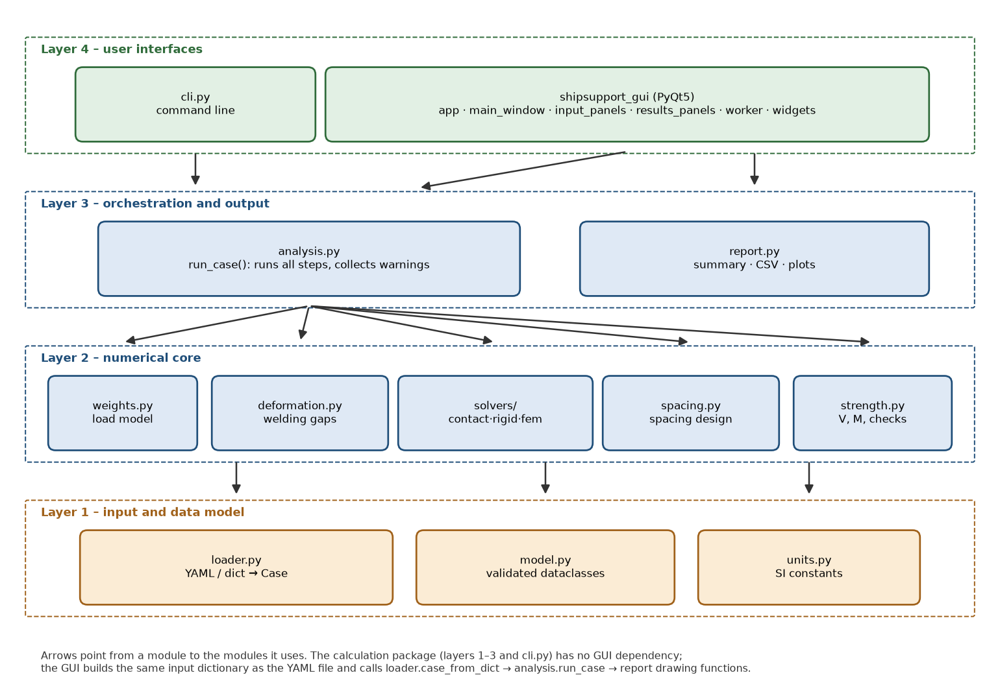
<figcaption aria-hidden="true"><p>Figure 4.1: Layered architecture of the program. The numerical core contains the weight model, the welding-deformation model, the solvers, the spacing design and the strength checks. The calculation package has no dependency on the graphical user interface.</p></figcaption>
</figure>

The layers are:

1.  **Input and data model** (`model.py`, `loader.py`, `units.py`). Validated data classes describe the ship, its weight items and weight curve, hull sections, block types and blocks, permissible envelopes, welding deformation, the settings of the spacing design and the analysis settings. The loader converts a YAML file, or an equivalent dictionary, into these classes and converts all quantities to SI units.
2.  **Numerical core.**
    - `weights.py` builds the finite element mesh and the piecewise-linear load intensity.
    - `deformation.py` evaluates the keel lift of the welded hull, identifies joint angles from a survey and converts the lift into block gaps.
    - `solvers/` contains the compression-only block springs with the contact iteration (`contact.py`), the rigid-hull solver (`rigid.py`), the FEM solver (`fem.py`) and the common result type (`result.py`).
    - `strength.py` computes shear force, bending moment, stresses and all checks.
    - `spacing.py` designs the spacing of the blocks of the plan. It does not import the solvers; the analysis of a candidate layout is passed to it as a function (Section 4.5).
3.  **Orchestration and output** (`analysis.py`, `report.py`). The function `run_case` performs the complete analysis of a case in a fixed sequence, runs the spacing design when it is requested and collects warnings. It also creates the analysis function for the spacing design. The report module produces the text summary, the CSV files and the charts.
4.  **User interfaces** (`cli.py`, `shipsupport_gui`). The command-line program and the desktop application.

The architecture follows the dependency rule of clean architecture ([Martin 2017](#ref-martin2017)): source-code dependencies point only inwards, from the interfaces towards the numerical core and the data model. The numerical modules do not know how they are called, and in particular they import nothing from the GUI (requirement N3). Within the core, the spacing design sits beside the solvers rather than above them: it depends only on the data model, and the composition of the design algorithm with a concrete support model takes place in the orchestration layer.

The most important consequence of this structure is that the GUI never performs calculations of its own. It assembles a dictionary with exactly the schema of the YAML input file and passes it to the same function chain as the command-line interface: `case_from_dict` followed by `run_case`. The GUI and the command-line program therefore produce identical results for identical input, which was verified by automated tests (Section 5.8). The core can also be used from scripts, for example for the parameter studies of Chapter 6, without any graphical dependency.

## 4.5 Design decisions

The following design decisions shaped the implementation. Each was taken to support one or more non-functional requirements.

- **Validated data classes, frozen where they describe physical objects (N2, N10).** All input is represented by data classes that check their own consistency at construction. The classes of physical objects — weight items, weight curve, sections, layers, block types, blocks, envelopes, joints, zones and the survey — are declared `frozen`, so an object cannot change after it has been validated; a modified copy must be made explicitly with `dataclasses.replace`. The spacing design relies on this: a candidate layout is a list of copies of the given blocks with new positions, so a block keeps its type, strength and gap, and neither the user’s input nor an earlier candidate can be altered by the design.
- **Validation at the boundary (N2).** Every check of the input happens once, when the data classes are constructed by the loader. Code inside the core can rely on consistent input, which keeps the numerical modules short; the core raises errors only for conditions that depend on the solution, such as a support that becomes unstable.
- **SI units only inside the core (N1).** Conversion happens in the loader and in the report. No numerical function has to know about tonnes, millimetres or MPa, which removes a frequent source of errors in engineering software.
- **Pure functions.** The numerical functions take arrays and data objects and return new objects. They hold no hidden state, which makes them easy to test in isolation and to call repeatedly, as the spacing design does hundreds of times.
- **A shared contact strategy (N10).** The contact iteration receives the support model as a function `linear_solve(kt, c, gap)`, which solves the linear problem for given tangent stiffnesses, constant terms and gaps. The rigid-hull and FEM solvers supply different implementations of this function, a form of the Strategy pattern. Gaps, lift-off, crushing and gap continuation are therefore implemented once and behave identically in both methods.
- **Dependency-injected analysis for the spacing design (N8, N11).** The design algorithm `design_spacing` receives a function `evaluate(blocks)` that returns an object with the block reactions of a candidate layout. In the program this function is created by `analysis.spacing_evaluator`, which rebuilds the mesh around the candidate block positions, recomputes the welding gaps at these positions and calls the chosen solver — exactly the analysis that `run_case` performs for the given plan. Every candidate is therefore judged with the full support model (N8). In the tests the function is replaced by a substitute analysis whose optimum is known in closed form, so the algorithm could be developed and tested before it was connected to the solvers, in milliseconds per test (N11).
- **Layered core, CLI and GUI (N3).** The user interfaces are thin: they translate between the user and the case dictionary and display the result objects. All logic that both interfaces need — reading survey files, computing structure positions, drawing charts — lives in the core and is called by both.
- **Verification built into the product (N4).** Every support solution reports its equilibrium residuals and every strength result the closure error of its shear and moment curves. The designed spacing is stored as an ordinary support solution and checked like any other.

## 4.6 Data model and input validation

All input data are represented by Python data classes defined in `model.py`. Table 4.3 lists the classes, their main fields with the units used internally, and the validation performed at construction.

| Class | Main fields (internal units) | Validation performed at construction |
|----|----|----|
| `WeightItem` | `name`, `weight` \[N\], `lcg`, `xa`, `xb` \[m\] | non-zero, finite weight; `xb ≥ xa`; LCG in the middle third of the extent; a point load requires `lcg = xa = xb` |
| `WeightCurve` | `name`, `x` \[m\], `q` \[N/m\] | at least two points of equal number; finite values; $`q \geq 0`$; `x` not decreasing (equal `x` = jump); at least one loaded segment |
| `Section` | `xa`, `xb` \[m\], `EI` \[N·m²\], `kGA` \[N\], `z_deck`, `z_keel` \[m³\], `shear_area` \[m²\] | `xb > xa`; positive stiffness and section properties |
| `Layer` | `thickness` \[m\], `E` \[Pa\] | positive values |
| `BlockType` | contact width and length \[m\], `layers`, stiffness override \[N/m\], capacity \[N\], allowable pressure, crush stress \[Pa\], post-crush ratio \[–\] | positive dimensions; layers or override required; post-crush ratio in \[0, 1\] |
| `Block` | `x` \[m\], `type`, `gap` \[m\], `label`, `strength` \[N\] (optional; default: capacity of the type) | positive strength if given |
| `BendingEnvelope`, `ShearEnvelope` | `x` \[m\], limits \[N·m\] or \[N\] | equal lengths; strictly increasing `x`; positive limits |
| `WeldJoint` | `x` \[m\], `angle` \[rad\] | finite values |
| `ShrinkageZone` | `xa`, `xb` \[m\], `curvature` \[1/m\] | `xb > xa`; finite curvature |
| `MeasuredProfile` | `x` \[m\], `lift` \[m\], interpolation, identification flag, regularisation | equal lengths (at least 2); strictly increasing `x`; known interpolation; regularisation ≥ 0 |
| `WeldingDeformation` | joints, zones, measured profile | at least one source; identification requires joint positions |
| `Ship` | name, $`L_{pp}`$, hull extent, weights, sections, declared weight and LCG, structure positions, envelopes, weight curve | positive $`L_{pp}`$; valid extent; at least one weight item and one section; positive total weight |
| `Settings` | methods, maximum element length, shear deformation flag, allowable stresses, tolerances, iteration limit | positive values; non-negative tolerances |
| `SpacingDesign` | support method, target utilisation \[–\], minimum and maximum spacing \[m\], allowed extent \[m\], fixed-end flag, snap-to-structure flag, rounding grid \[m\], SLP iteration limit | known method; positive target and minimum spacing; `max_spacing ≥ min_spacing`; `x_max > x_min`; positive grid |
| `Case` | ship, blocks, settings, welding deformation, spacing design | at least two blocks |

Table 4.3 – Data classes of the calculation core, their main fields with internal units, and the validation performed.

The weight curve is not a separate load type inside the core. Its method `items` converts every loaded segment into one exact trapezoidal `WeightItem` (Section 4.7.1), and the loader appends these items to the weight items of the ship. The load model, the solvers and the checks are therefore unchanged by the curve; the `Ship` keeps a reference to the curve only for the report.

Two exception classes carry error information to the user. `InputError` (a subclass of Python’s `ValueError`) is raised whenever input data are invalid or inconsistent. The message always identifies the item concerned, for example “Weight item ‘main engine’: LCG … must lie in the middle third of its extent”, “weights\[1\] (‘main engine’): moment_tm / weight_t = 23 m does not agree with lcg = 22 m”, “Weight curve ‘lightship curve’, point 3 (x = 5 m): x must not be smaller than at point 2” or “blocks.plan.spacing: 2 values given, 3 expected”. `ContactError` is raised when the block state iteration fails to converge, even with gap continuation. Its subclass `UnstableSupportError` is raised when fewer than two separated blocks remain in contact, which would leave the beam with a rigid-body mode (Section 3.7). Both interfaces catch these exceptions: the command-line program prints the message and exits with code 1, and the GUI shows it in a dialog box and in the summary pane.

## 4.7 Input format

A case is stored as a YAML file. Its top-level sections are listed in Table 4.4. Lengths are given in metres. Quantities in other units carry a suffix in the key name, such as `weight_t` (tonnes), `moment_tm` (tonne-metres), `q_t_per_m`, `E_MPa`, `capacity_t`, `strength_t`, `gap_mm` or `angle_mrad`. The suffix tells the user which unit to enter and tells the loader which conversion to apply. Five example cases are supplied (`examples/`): the example vessel, the spacing example with individual block strengths, the weight-curve example, the welded hull and the welded hull with a keel survey; they are analysed in Chapter 6.

| Section | Content | Required |
|----|----|----|
| `ship` | name, $`L_{pp}`$, hull extent, declared weight and LCG | yes |
| `weights` | weight items (distributed or point), with LCG or moment | yes, unless `weight_curve` is given |
| `weight_curve` | piecewise-linear weight distribution | no |
| `sections` | hull girder properties by longitudinal range | yes |
| `blocks` | block types and the block plan | yes |
| `structure` | positions of floors, bulkheads and web frames | no |
| `permissible` | permissible bending moment and shear force envelopes | no |
| `welding_deformation` | erection-joint kinks, construction-block shrinkage, surveyed keel line | no |
| `spacing_design` | settings of the automatic spacing design | no |
| `settings` | methods, mesh size, allowable stresses, tolerances | no |

Table 4.4 – Top-level sections of the YAML case file.

### 4.7.1 Weights: items, moments and the weight curve

A weight item gives its weight and either its LCG (`lcg`) or its longitudinal moment about AP (`moment_tm`), from which the loader computes the LCG as $`M/W`$ (Section 3.3.1). Moments are what a weight list in a loading manual often provides, and adding moments is how the total LCG is obtained, so the program accepts them directly. If both are given they must agree to a relative tolerance of $`10^{- 6}`$; otherwise an `InputError` names both values. An item with an extent `xa`, `xb` is distributed as a trapezoid that preserves its weight and LCG (Section 3.3.2); an item with `x`, or without an extent, is a point load. The keys are summarised in Table 4.5.

The weight curve is a list of points $`(x_{k},q_{k})`$ with $`q`$ in tonnes per metre, linear between the points and zero outside the first and last point; the same $`x`$ twice is a jump of $`q`$ (Section 3.3.4). Each segment $`\lbrack x_{k},x_{k + 1}\rbrack`$ of length $`L_{k}`$ is an exact trapezoid, and `WeightCurve.items` converts it into a weight item with

``` math
W_{k} = \frac{1}{2}\,(q_{k} + q_{k + 1})\, L_{k},\quad\quad{\bar{x}}_{k} = x_{k} + \frac{L_{k}\,(q_{k} + 2\, q_{k + 1})}{3\,(q_{k} + q_{k + 1})}\quad\quad\quad\quad(4.1)
```

Zero-length segments (jumps) and unloaded segments are skipped. Because $`q_{k},q_{k + 1} \geq 0`$, the centre $`{\bar{x}}_{k}`$ always lies in the middle third of the segment, so the middle-third condition of the trapezoidal spreading is satisfied automatically and the trapezoid of the item is the segment of the curve itself. Listing 4.1 shows the conversion, and Listing 4.2 the weight input of the weight-curve example, a lightship curve of 18 points with five jumps plus three deadweight items given by their moments.

**Listing 4.1 – Conversion of the weight curve into exact trapezoidal items (**`model.py`**, class** `WeightCurve`**).**

```python
    def items(self) -> list[WeightItem]:
        """One exact trapezoidal item per segment with load: weight (q_k + q_k+1) L / 2 and
        LCG x_k + L (q_k + 2 q_k+1) / (3 (q_k + q_k+1)). Jumps and unloaded segments are skipped."""
        out = []
        n = self.x.size - 1
        for k in range(n):
            xa, xb, qa, qb = self.x[k], self.x[k + 1], self.q[k], self.q[k + 1]
            length = xb - xa
            if length <= 1e-9 or qa + qb <= 0:
                continue
            lcg = xa + length * (qa + 2.0 * qb) / (3.0 * (qa + qb))
            out.append(WeightItem(f"{self.name} {k + 1}/{n}", 0.5 * (qa + qb) * length,
                                  float(lcg), float(xa), float(xb)))
        return out
```

**Listing 4.2 – Weight curve and items with moments in the weight-curve example (**`examples/weight_curve_case.yaml`**).**

```yaml
weight_curve:
  name: lightship curve
  points:
    - {x: 0.0,   q_t_per_m: 8.0}
    - {x: 4.0,   q_t_per_m: 16.0}
    - {x: 4.0,   q_t_per_m: 30.0}    # jump: aft peak bulkhead, superstructure starts
    - {x: 14.0,  q_t_per_m: 36.0}
    - {x: 16.0,  q_t_per_m: 36.0}
    - {x: 16.0,  q_t_per_m: 64.0}    # jump: engine room (main engine, auxiliaries)
    - {x: 28.0,  q_t_per_m: 64.0}
    - {x: 28.0,  q_t_per_m: 46.0}    # jump: forward end of the main engine
    - {x: 38.0,  q_t_per_m: 42.0}
    - {x: 38.0,  q_t_per_m: 34.0}    # jump: engine-room forward bulkhead
    - {x: 60.0,  q_t_per_m: 36.0}
    - {x: 80.0,  q_t_per_m: 35.0}
    - {x: 100.0, q_t_per_m: 30.0}
    - {x: 104.0, q_t_per_m: 28.0}
    - {x: 104.0, q_t_per_m: 36.0}    # jump: anchors, chain locker
    - {x: 112.0, q_t_per_m: 33.0}
    - {x: 118.0, q_t_per_m: 16.0}
    - {x: 120.0, q_t_per_m: 0.0}

# Deadweight items with the longitudinal moment about AP instead of the LCG
# (LCG = moment_tm / weight_t; giving lcg as well is allowed if it agrees).
weights:
  - {name: residual fuel, weight_t: 200, moment_tm: 14000, xa: 60.0, xb: 80.0}    # LCG 70 m
  - {name: fresh water,   weight_t: 60,  moment_tm: 6000,  xa: 94.0, xb: 106.0}   # LCG 100 m
  - {name: stores,        weight_t: 40,  moment_tm: 1200}                         # point load at 30 m
```

The curve of Listing 4.2 is converted into 12 trapezoidal items with a total of 4343.0 t and an LCG of 55.670 m; with the three items the docking weight is 4643.0 t at an LCG of 56.639 m, which the loader cross-checks against the declared values of the `ship` section.

| Key | Meaning | Unit |
|----|----|----|
| `weights[].name`, `weight_t` | name and weight of an item (negative for a deduction) | —, t |
| `weights[].lcg` or `moment_tm` | LCG, or moment about AP (LCG = moment / weight); both allowed if they agree | m, t·m |
| `weights[].xa`, `xb` | extent of a distributed item (both or neither) | m |
| `weights[].x` | position of a point load | m |
| `weight_curve.name`, `points[].x`, `points[].q_t_per_m` | piecewise-linear curve; a plain list of points is also accepted | —, m, t/m |

Table 4.5 – Input keys of the weights and the weight curve.

### 4.7.2 Block plan

The blocks are defined only by the block plan `blocks.plan` (Section 3.4.4), because the number of blocks, their spacing and their individual strengths are exactly what a dock’s block list provides and what the spacing design keeps or changes. The plan gives the block type, the position of the first block, the number of blocks and the spacing to the next block; optionally the strength and the initial gap of every block. A single spacing, strength or gap applies to all blocks, and a list gives one value per gap ($`N - 1`$ values) or per block ($`N`$ values). An empty strength means the capacity of the block type. If `count` is omitted, it is taken from the length of a list. The function `loader._blocks` checks that the lists have exactly the required length, that every spacing is positive and that the count is a whole number of at least two, and labels the blocks B01, B02, … from aft to forward; an input with the former block groups is rejected with a message that points to `blocks.plan`. Table 4.6 lists the keys and Listing 4.3 the plan of the spacing example, with 190 t standard blocks and nine older blocks of 160 t under the engine room.

| Key | Meaning | Unit (default) |
|----|----|----|
| `blocks.types.<name>` | block type: contact width and length, layers (`thickness`, `E_MPa`) or `stiffness_kN_per_mm`, `capacity_t`, `allowable_pressure_MPa`, `crush_stress_MPa`, `post_crush_ratio` | m, MPa, t (ratio 0.05) |
| `blocks.plan.type` | block type of the blocks | — |
| `blocks.plan.start_x` | position of the first (aftmost) block | m |
| `blocks.plan.count` | number of blocks $`N`$ | — (length of a list) |
| `blocks.plan.spacing` | distance to the next block: one value or $`N - 1`$ values | m |
| `blocks.plan.strength_t` | strength of every block: one value or $`N`$ values | t (type capacity) |
| `blocks.plan.gap_mm` | initial gap of every block (block top below the keel line): one value or $`N`$ values | mm (0) |

Table 4.6 – Input keys of the block types and the block plan.

**Listing 4.3 – Block plan of the spacing example (**`examples/spacing_case.yaml`**).**

```yaml
  # Block plan: one spacing for all gaps or a list of count-1 values; one strength for all
  # blocks or a list of count values (aft to forward); optional gap_mm likewise.
  plan:
    type: keel
    start_x: 6.4                # m, first block
    count: 44
    spacing: 2.4                # m, distance to the next block
    strength_t: [               # t, strength of every block, B01 ... B44
      190, 190, 190, 160, 160, 160, 160, 160, 160, 160, 160,
      160, 190, 190, 190, 190, 190, 190, 190, 190, 190, 190,
      190, 190, 190, 190, 190, 190, 190, 190, 190, 190, 190,
      190, 190, 190, 190, 190, 190, 190, 190, 190, 190, 190]
```

The loader evaluates the layer build-up of the block type as springs in series (Section 3.4.1); for the keel block of the examples this gives a stiffness of 2000 kN/mm. An initial gap belongs to its block, not to a position: when the spacing design moves a block, its gap moves with it.

### 4.7.3 Welding deformation

The keys of the welding-deformation section are summarised in Table 4.7 and Listing 4.4 shows the section of the welded-hull example (`examples/welding_case.yaml`), a hull built from six 20 m construction blocks.

| Key | Meaning | Unit |
|----|----|----|
| `welding_deformation.joints[].x`, `angle_mrad` | position and kink angle of an erection joint; positive lifts the hull ends (the angle may be omitted when it is identified) | m, mrad |
| `…zones[].xa`, `xb` | extent of a construction block | m |
| `…zones[].curvature_mm_per_m2` | shrinkage curvature given directly | mm/m² |
| `…zones[].deck_shrinkage_mm_per_m`, `bottom_shrinkage_mm_per_m`, `depth` | alternative: curvature $`= (\varepsilon_{\text{deck}} - \varepsilon_{\text{bottom}})/D`$ | mm/m, m |
| `…measured.x`, `lift_mm` | surveyed keel line, upward, arbitrary datum | m, mm |
| `…measured.file` | alternative: CSV file with columns `x_m`, `lift_mm` (path relative to the case file) | — |
| `…measured.interpolation` | `pchip`, `linear` or `spline` | — |
| `…measured.identify_joint_angles`, `regularization` | fit the joint angles to the survey; Tikhonov weight | —, — |

Table 4.7 – Input keys of the welding-deformation section.

**Listing 4.4 – Welding deformation of the assembled hull in the welded-hull example (**`examples/welding_case.yaml`**).**

```yaml
welding_deformation:
  joints:                       # erection butt joints between construction blocks
    - {x: 20.0,  angle_mrad: 0.9}
    - {x: 40.0,  angle_mrad: 0.5}
    - {x: 60.0,  angle_mrad: 0.4}
    - {x: 80.0,  angle_mrad: 0.5}
    - {x: 100.0, angle_mrad: 0.6}
  zones:                        # curvature inside each construction block
    # curvature = (deck shrinkage − bottom shrinkage) / depth; or give curvature_mm_per_m2
    - {xa: 0.0,   xb: 20.0,  deck_shrinkage_mm_per_m: 0.24, bottom_shrinkage_mm_per_m: 0.20, depth: 10.0}
    - {xa: 20.0,  xb: 40.0,  deck_shrinkage_mm_per_m: 0.24, bottom_shrinkage_mm_per_m: 0.20, depth: 10.0}
    - {xa: 40.0,  xb: 60.0,  deck_shrinkage_mm_per_m: 0.24, bottom_shrinkage_mm_per_m: 0.20, depth: 10.0}
    - {xa: 60.0,  xb: 80.0,  deck_shrinkage_mm_per_m: 0.24, bottom_shrinkage_mm_per_m: 0.20, depth: 10.0}
    - {xa: 80.0,  xb: 100.0, deck_shrinkage_mm_per_m: 0.24, bottom_shrinkage_mm_per_m: 0.20, depth: 10.0}
    - {xa: 100.0, xb: 120.0, deck_shrinkage_mm_per_m: 0.24, bottom_shrinkage_mm_per_m: 0.20, depth: 10.0}
```

Keel surveys are normally delivered as a list of stations, for example from a total station or a laser tracker. The loader therefore also reads the survey from a CSV file (`read_survey_csv`): a header row must contain an `x_m` (or `x`) and a `lift_mm` (or `lift`) column, lines beginning with `#` are comments, and malformed lines are reported with their line number. The function `inline_data_files` replaces the `file` key by the lists it contains before the case is built, so that the rest of the program, and the GUI, work with the same in-memory structure as for an inline survey; the core itself never reads files. A sample survey (`examples/welding_survey.csv`, 25 synthetic stations every 5 m) and a case that identifies the joint angles from it (`examples/welding_survey_case.yaml`) are supplied. A survey used without identification is taken as the complete keel shape: joints or zones given as well are then ignored with a warning. When the joint angles are identified, the known zone-shrinkage part is subtracted from the survey before the fit (Section 3.10).

### 4.7.4 Spacing design

The section `spacing_design` requests the automatic spacing design and holds its settings (Table 4.8). If the section is present and not disabled with `enabled: false`, `run_case` designs the spacing of the blocks of the plan. Listing 4.5 shows the settings of the spacing example. In the welded-hull example the same section is present but disabled, so that the as-built condition is analysed by default.

| Key | Meaning | Unit (default) |
|----|----|----|
| `enabled` | run the spacing design | — (true if the section is present) |
| `method` | support model of the design: `fem` or `rigid` | — (`fem`) |
| `target_utilisation` | largest admissible ratio $`u`$ of reaction to strength | — (1.0) |
| `min_spacing`, `max_spacing` | limits $`s_{\min}`$, $`s_{\max}`$ of the distance between neighbouring blocks | m (1.0; twice the mean spacing of the given plan) |
| `x_min`, `x_max` | allowed extent of the block line | m (first and last block of the plan) |
| `fix_end_blocks` | keep the first and last block in place | — (false) |
| `snap_to_structure` | final positions at the structure positions (floors) | — (true) |
| `grid` | rounding step when not snapping to structure | m (none) |
| `max_iterations` | iteration limit of the sequential linear programming | — (20) |

Table 4.8 – Input keys of the spacing design.

**Listing 4.5 – Spacing-design settings of the spacing example (**`examples/spacing_case.yaml`**).**

```yaml
spacing_design:
  enabled: true
  method: fem
  target_utilisation: 1.0       # reaction / strength must not exceed this
  min_spacing: 0.8              # m
  max_spacing: 4.8              # m (default: twice the given mean spacing)
  x_min: 6.4                    # m, aft limit of the block line (default: first block)
  x_max: 109.6                  # m, forward limit (default: last block)
  fix_end_blocks: false
  snap_to_structure: true       # final positions under floors (structure positions)
  max_iterations: 20            # sequential-LP iterations
```

## 4.8 Solver implementation

### 4.8.1 Mesh and load model

The mesh is built by `weights.build_nodes`. Every *key point* becomes a node: weight-item boundaries (including the segment ends of the weight curve), hull-section boundaries, block positions and the hull ends. The intervals between key points are then subdivided so that no element is longer than the user-specified maximum (0.5 m by default). Because every item boundary is a node, the load on every element is exactly linear, and the consistent load vector integrates it without approximation (Section 3.3.6). Because every block is a node, its spring acts directly on a vertical degree of freedom. The example vessel produced 256 nodes, 255 elements and 512 degrees of freedom. Since block positions are key points, a new mesh is built for every candidate layout of the spacing design; this costs well under a millisecond and keeps the load integration exact for every candidate.

### 4.8.2 Vectorised assembly

The element stiffness matrices of all elements are computed at once as a three-dimensional NumPy array of shape (number of elements, 4, 4), using the Timoshenko element of Section 3.6. Euler–Bernoulli elements follow as the special case $`\Phi = 0`$. The global matrix is then assembled without a Python loop over elements (Listing 4.6). For element $`e`$ the global degrees of freedom are $`2e,2e + 1,2e + 2,2e + 3`$. Repeating and tiling this index array produces the row and column index of every one of the 16 entries per element. The entries are passed to SciPy in coordinate (COO) format, and converting to compressed sparse row (CSR) format sums the duplicate entries at shared nodes, which is exactly the assembly operation of the direct stiffness method ([Przemieniecki 1968](#ref-przemieniecki1968); [Cook et al. 2002](#ref-cook2002)).

**Listing 4.6 – Vectorised assembly of the global stiffness matrix and load vector (**`solvers/fem.py`**).**

```python
    e = np.arange(L.size)
    dofs = np.column_stack([2 * e, 2 * e + 1, 2 * e + 2, 2 * e + 3])

    ke = element_stiffness(L, EI, kGA)
    rows = np.repeat(dofs, 4, axis=1).ravel()
    cols = np.tile(dofs, (1, 4)).ravel()
    K = sp.coo_matrix((ke.ravel(), (rows, cols)), shape=(ndof, ndof)).tocsr()

    F = np.zeros(ndof)
    np.add.at(F, dofs, element_loads(L, load.q1, load.q2))
    F[0::2] += load.point
    return K, F
```

The function `np.add.at` is used for the load vector instead of ordinary fancy-index addition because it accumulates repeated indices correctly.

### 4.8.3 Springs, gaps and the linear solve

For a given set of block states, each block force is written in the linearised form

``` math
R_{i} = k_{t,i}\,\delta_{i} + c_{i},\quad\quad\delta_{i} = v_{i} - g_{i}\quad\quad\quad\quad(4.2)
```

where $`(k_{t,i},c_{i})`$ equals $`(0,0)`$ for an open block, $`(k_{i},0)`$ for an elastic block and $`(k_{2,i},(k_{i} - k_{2,i})\,\delta_{y,i})`$ for a crushed block (Section 3.4.3). Moving the terms that depend on the unknown displacement to the left-hand side gives the system that is solved in each iteration:

``` math
\left( \mathbf{K}_{0} + diag(k_{t,i}) \right)\mathbf{u} = \mathbf{F}_{0} + \sum_{i}^{}\left( k_{t,i}\, g_{i} - c_{i} \right)\mathbf{e}_{v,i}\quad\quad\quad\quad(4.3)
```

where $`\mathbf{K}_{0}`$ and $`\mathbf{F}_{0}`$ are the hull stiffness matrix and load vector from Listing 4.6, and $`\mathbf{e}_{v,i}`$ is the unit vector of the vertical degree of freedom at block $`i`$. The beam itself is free–free: without springs $`\mathbf{K}_{0}`$ is singular, with the two rigid-body modes as its null space. Listing 4.7 shows the implementation of Equation (4.3). The matrix is symmetric and banded, and it is solved with SciPy’s sparse direct solver, which is based on SuperLU ([Li 2005](#ref-li2005superlu); [Davis 2006](#ref-davis2006)).

**Listing 4.7 – Insertion of block springs and gaps and the sparse solve (**`solvers/fem.py`**).**

```python
    def linear_solve(kt, c, gap):
        kdiag = np.zeros(ndof)
        np.add.at(kdiag, vdofs, kt)
        F = F0.copy()
        np.add.at(F, vdofs, kt * gap - c)
        u = spla.spsolve((K0 + sp.diags(kdiag)).tocsc(), F)
        if not np.all(np.isfinite(u)):
            raise UnstableSupportError("FEM system is singular")
        return u[vdofs] - gap, u
```

The function returns the block compressions $`\delta_{i}`$ and the full displacement vector. The hull matrix $`\mathbf{K}_{0}`$ is assembled only once per analysis, and each contact iteration merely adds a diagonal matrix. The gap vector is an explicit argument because the gap continuation of Section 4.8.5 must solve the same support model for a sequence of intermediate gap vectors.

### 4.8.4 State iteration

The linearisation of Equation (4.2) is computed by the method `BlockSprings.linearize` (Listing 4.8). The states are integer codes (open, elastic, crushed). For blocks without a crush limit, the crush deflection is infinite, and it is replaced by zero before the multiplication to avoid the undefined product $`0 \cdot \infty`$.

**Listing 4.8 – Linearisation of the piecewise-linear block law (**`solvers/contact.py`**).**

```python
    def linearize(self, states: np.ndarray) -> tuple[np.ndarray, np.ndarray]:
        """(kt, c) such that R = kt·δ + c for the given states."""
        dy = np.where(np.isfinite(self.crush_deflection), self.crush_deflection, 0.0)
        kt = np.select([states == ELASTIC, states == CRUSHED], [self.k, self.k_crushed], 0.0)
        c = np.where(states == CRUSHED, (self.k - self.k_crushed) * dy, 0.0)
        return kt, c
```

The iteration (Listing 4.9) starts from given block states, normally all elastic. It solves the linear system, determines the state that each block’s compression actually implies, and repeats until the assumed and implied states agree. A converged solution then satisfies equilibrium, compatibility and the block law exactly. The iteration is an active-set method for the complementarity problem formed by compression-only supports ([Cottle et al. 1992](#ref-cottle1992); [Wriggers 2006](#ref-wriggers2006)) (Section 3.7). Three safeguards were implemented:

1.  Before every solve, `check_support` verifies that at least two separated blocks have positive stiffness, and raises `UnstableSupportError` otherwise.
2.  Every visited set of states is recorded. If a set would be visited again, which indicates cycling, the method switches to changing only the block with the largest violation of its assumed state per iteration.
3.  The same one-at-a-time update is used if a full update would leave fewer than two separated blocks in contact. This happens with large, uneven gaps: from an all-elastic start, the first solution may show negative compression at almost every block.

**Listing 4.9 – Main loop of the block state iteration (**`solvers/contact.py`**, function** `_iterate`**).**

```python
    for iteration in range(1, max_iterations + 1):
        kt, c = springs.linearize(states)
        check_support(springs.x, kt)
        delta, extra = linear_solve(kt, c, gap)
        new_states = springs.states(delta)
        changed = new_states != states
        if not changed.any():
            return delta, states, iteration, extra

        seen.add(states.tobytes())
        unsupported = not is_supported(springs.x, springs.linearize(new_states)[0])
        if one_at_a_time or unsupported or new_states.tobytes() in seen:
            one_at_a_time = True
            worst = np.where(changed, springs.violation(delta, states), -np.inf)
            i = int(np.argmax(worst))
            new_states = states.copy()
            new_states[i] = springs.states(delta)[i]
        states = new_states
```

The rigid-hull solver (`solvers/rigid.py`) passes a different `linear_solve` function to the same loop. It solves the $`2 \times 2`$ system of Section 3.5 in coordinates centred on the block centroid, which improves its conditioning. Sharing the state iteration means that lift-off, gaps, crushing and the continuation of the next section are handled identically in both methods, and that the two methods can be compared directly, as in Chapter 6.

### 4.8.5 Gap continuation

The safeguards of Section 4.8.4 did not suffice for all welding cases. The one-at-a-time update can itself cycle, which is a known weakness of simple active-set methods. During development this occurred for the rigid-hull method of the example vessel with joint kinks of 0.2 mrad at five erection joints: the direct iteration did not converge within 200 iterations (Section 5.4.3). The function `solve_contact` was therefore extended with a gap continuation (homotopy, Section 3.11), shown in Listing 4.10.

If the direct iteration fails, the problem is first solved with all gaps equal to the smallest gap $`g_{0}`$. This is a rigid shift of the block line, so every block starts in contact and the iteration converges as for a straight keel. The gaps are then increased along

``` math
\mathbf{g}(\lambda) = g_{0} + \lambda\,(\mathbf{g} - g_{0}),\quad\quad 0 \leq \lambda \leq 1\quad\quad\quad\quad(4.4)
```

in steps of $`\lambda`$. Each step starts from the contact states of the previous one, so only a few blocks change state per step. A failed step is halved; a successful one doubles the next step, up to 0.5. If the step falls below $`1/4096`$, the original error is reported.

**Listing 4.10 – Gap continuation in** `solve_contact` **(**`solvers/contact.py`**).**

```python
    lam, step = 0.0, 0.25
    while lam < 1.0:
        nxt = min(1.0, lam + step)
        gap = g0 + nxt * (target - g0)
        try:
            delta, states_next, iterations, extra = _iterate(springs, linear_solve, gap, states,
                                                             max_iterations)
        except ContactError:
            step /= 2.0
            if step < 1.0 / 4096:
                raise first_error
            continue
        total += iterations
        lam, states = nxt, states_next
        step = min(2.0 * step, 0.5)
```

The continuation is a fallback. The direct iteration is always tried first, and for the welded-hull example it converged by itself, in 5 iterations for the rigid hull and 3 for the FEM. The continuation changes only the path to the solution: the final state set is accepted only when it is consistent with the full gap vector, so the result satisfies the same complementarity conditions as a directly converged solution. For the spacing design this robustness is essential, because the design analyses hundreds of layouts with welding gaps at positions that the user never chose, and a single failed analysis would abort the design.

### 4.8.6 Results

Both solvers return a `SupportResult` object. It contains the block positions, the reactions, the compressions, the final states, the number of iterations and the nodal displacements and rotations. It also provides two derived properties, the relative force residual $`(\sum R_{i} - W)/W`$ and the relative moment residual, which are reported in every summary (requirement N4).

## 4.9 Welding-deformation module

The module `deformation.py` implements the model of Section 3.9 for the initial keel shape of the welded hull. The two shape functions are given in Listing 4.11. A kink $`\varphi_{j}`$ at an erection joint contributes $`\varphi_{j}\,|x - x_{j}|/2`$ to the keel lift. A construction block $`\lbrack x_{a},x_{b}\rbrack`$ with shrinkage curvature $`\kappa`$ contributes $`\kappa\,\psi(x)`$, where $`\psi`$ has unit second derivative inside the block, is zero aft of it and is straight forward of it.

**Listing 4.11 – Shape functions of a joint kink and of a shrinkage zone (**`deformation.py`**).**

```python
def kink_shape(x: np.ndarray, xj: float) -> np.ndarray:
    """Lift per radian of a joint kink at xj (symmetric form)."""
    return 0.5 * np.abs(np.asarray(x, dtype=float) - xj)


def zone_shape(x: np.ndarray, xa: float, xb: float) -> np.ndarray:
    """Lift per unit curvature of a zone [xa, xb]: z'' = 1 inside, 0 outside."""
    x = np.asarray(x, dtype=float)
    inside = (x - xa) ** 2 / 2.0
    after = (xb - xa) * (x - 0.5 * (xa + xb))
    return np.where(x < xa, 0.0, np.where(x <= xb, inside, after))
```

A surveyed keel line is interpolated with a monotonicity-preserving piecewise cubic Hermite interpolant (PCHIP) ([Fritsch and Carlson 1980](#ref-fritsch1980)) by default; linear interpolation and a natural cubic spline are available as alternatives. Optionally the survey is not interpolated but used to identify the joint angles: `identify_joint_angles` solves the linear least-squares problem of Section 3.10 with NumPy, including a straight line for the unknown survey datum and an optional Tikhonov term ([Hansen 1998](#ref-hansen1998)). The function `effective_model` decides which model is used for the gaps — the given joints and zones, the survey as the total shape, or the zones plus the identified joint angles — and returns the identification with its rms and largest residual for the report.

The keel lift $`z(x)`$ is defined only up to a straight line, because a straight line is a rigid tilt that both support solvers absorb. The function `gaps_from_lift` converts the lift at the blocks into gaps by subtracting the least-squares line through the block positions and shifting the result so that the lowest point has zero gap:

``` math
g_{i}^{\text{weld}} = z(x_{i}) - (\alpha + \beta x_{i}) - \min_{j}\left\lbrack z(x_{j}) - (\alpha + \beta x_{j}) \right\rbrack\quad\quad\quad\quad(4.5)
```

where $`\alpha + \beta x`$ is the least-squares line. The normalisation makes the reported gaps easy to interpret (“end lift relative to the block line”) but has no effect on the reactions (Section 5.5). The gaps depend on the block positions through $`z(x_{i})`$ and through the line $`\alpha + \beta x`$. This is why the deformation model, not a list of gaps, is passed to the analysis: the function `analysis._springs` adds the welding gaps of the current block positions to the initial gaps of the blocks with `dataclasses.replace`, both for the given plan and for every candidate layout of the spacing design (Section 4.10.5). The welding deformation is thereby a constraint of the design, as required by Section 3.12.2.

## 4.10 Spacing-design module

The module `spacing.py` implements the automatic spacing design of Section 3.12 — the final result of the program. Given $`N`$ blocks in a fixed order with strengths $`S_{i}`$, it finds positions $`x_{1} < \ldots < x_{N}`$ within the allowed extent and the spacing limits that minimise the largest utilisation $`U(\mathbf{x}) = \max_{i}R_{i}(\mathbf{x})/S_{i}`$, and reports whether $`U \leq u`$, the target utilisation. This section describes how the method was engineered; its algorithm is given in Section 3.12.8.

### 4.10.1 Structure of the module

The module has 509 lines and is organised by the phases of the method (Table 4.9). It imports only the data model and SciPy’s `linprog`; in particular it imports no solver, which is the precondition for testing it with a substitute analysis.

| Part | Function or class | Responsibility |
|----|----|----|
| helpers | `utilisation`, `relabel` | $`R_{i}/S_{i}`$ (NaN without strength); sort and label B01, B02, … |
|  | `_admissible` | one aft-to-forward sweep that enforces $`s_{\min}`$, $`s_{\max}`$, fixed ends and, optionally, a set of admissible positions |
|  | `_Counter` | wraps the injected `evaluate`, counts analyses, returns $`(\text{evaluation},U_{i})`$ |
|  | `_score` | ordering of layouts: largest utilisation, then $`\sum_{i}^{}U_{i}^{8}`$ as tie-break |
| results | `SpacingStep`, `SpacingResult` | frozen record of one recorded step; result with initial and final blocks and evaluations, history, analysis count, diagnosis |
| phase 1 | `equidistribution_step` | strength-weighted equidistribution of the estimated load density (Section 3.12.3) |
| phase 2 | `_sensitivities`, `_slp_step` | finite-difference Jacobian $`\partial U_{i}/\partial x_{k}`$; assembly and solution of the linearised minimax LP (Section 3.12.4) |
| phase 3 | `_grid_neighbour`, `_round_to_grid`, `_local_moves` | rounding to admissible positions; neighbourhood of the local search (Section 3.12.5) |
| driver | `design_spacing` | input checks, limits, the three phases, diagnosis (Section 3.12.6) |

Table 4.9 – Structure of the module `spacing.py`.

The interface is the single function

```text
design_spacing(blocks, evaluate, design, x_bounds, structure=None,
               equidistribution_iterations=15, fd_step=0.05, local_search_evaluations=None)
```

in which `evaluate(blocks)` is any function that returns an object with an attribute `reactions`. The type of `evaluate` is declared as `Evaluate = Callable[[Sequence[Block]], object]`; Python’s structural typing makes the substitute analysis of the tests and the `SpacingEvaluation` of the program interchangeable without a common base class.

The wrapper `_Counter` (Listing 4.12) isolates the design from the representation of blocks. The phases work on a plain position vector $`\mathbf{x}`$; `_Counter` turns it into blocks by copying the given blocks with new positions, which preserves the order, the type, the strength and the initial gap of every block. It also counts the analyses, which is the machine-independent measure of the cost of the design (Section 5.9), and clips negative reactions, which cannot occur in a converged contact solution but may occur in a substitute analysis.

**Listing 4.12 – Wrapper of the injected analysis (**`spacing.py`**).**

```python
class _Counter:
    """Wraps evaluate(): counts the analyses and returns (evaluation, U_i)."""

    def __init__(self, evaluate: Evaluate, blocks: Sequence[Block], strength: np.ndarray):
        self.evaluate, self.blocks, self.strength = evaluate, list(blocks), strength
        self.count = 0

    def blocks_at(self, x: np.ndarray) -> list[Block]:
        return [dataclasses.replace(b, x=round(float(v), 6)) for b, v in zip(self.blocks, x, strict=True)]

    def __call__(self, x: np.ndarray):
        self.count += 1
        evaluation = self.evaluate(self.blocks_at(x))
        return evaluation, np.maximum(np.asarray(evaluation.reactions, dtype=float), 0.0) / self.strength
```

Positions are rounded to 1 µm, so that a block position is always a reproducible mesh node.

### 4.10.2 Limits and the admissible sweep

Before the phases start, `design_spacing` checks that every block has a strength and fixes the limits. The extent $`\lbrack x_{lo},x_{hi}\rbrack`$ is taken from the design settings, from the given block line, or from the given end blocks if they are fixed. The maximum spacing defaults to twice the mean spacing of the given plan; an unlimited spacing would let the minimax optimum leave long unsupported spans amidships, where the block reactions are small but the hull girder spans long. Two infeasible combinations are rejected with an `InputError`: more blocks than fit into the extent at $`s_{\min}`$, and, with fixed end blocks, an extent that $`N - 1`$ spacings of $`s_{\max}`$ cannot span. With free ends, the second case shortens the line instead.

All three phases need to map an arbitrary position vector to an admissible one. The function `_admissible` does this in one sweep from aft to forward with the end blocks fixed: block $`i`$ is kept in the window

``` math
\max\left( x_{i - 1} + s_{\min},\mspace{6mu} x_{N} - (N - i)\, s_{\max} \right)\mspace{6mu} \leq \mspace{6mu} x_{i}\mspace{6mu} \leq \mspace{6mu}\min\left( x_{i - 1} + s_{\max},\mspace{6mu} x_{N} - (N - i)\, s_{\min} \right)\quad\quad\quad\quad(4.6)
```

that its predecessor and the room needed by the remaining blocks leave for it, and moved to the nearest point of the window, or to the nearest admissible position in it when a set of positions (floors or a grid) is given. The window is never empty if the line length lies between $`(N - 1)s_{\min}`$ and $`(N - 1)s_{\max}`$, so the sweep succeeds in $`O(N)`$ operations without a search; with a discrete set of positions it may fail, and returns `None`.

### 4.10.3 Phases 1 and 2

Phase 1 starts from the given plan mapped proportionally onto the extent and applies the under-relaxed fixed-point iteration of `equidistribution_step` (Listing 4.13) up to 15 times. The reactions of the current layout are spread uniformly over the tributary cells of the blocks, which gives a piecewise-constant load density with cumulative $`Q(x)`$; inverting $`Q`$ at the cumulative interval weights $`(S_{i} + S_{i + 1})/2`$ places the blocks so that the load between two neighbours is proportional to their mean strength (Section 3.12.3). Blocks that are out of contact are given 5 % of the mean load, so that the density never vanishes and $`Q`$ remains invertible. Each new layout is moved halfway towards the equidistributed one, made admissible and analysed; the best layout found is kept.

**Listing 4.13 – Strength-weighted equidistribution step (**`spacing.py`**).**

```python
def equidistribution_step(x: np.ndarray, reactions: np.ndarray, strength: np.ndarray) -> np.ndarray:
    """New positions with the ends fixed: the load between two neighbouring blocks is made
    proportional to their mean strength.

    The reactions spread uniformly over the tributary cells give a load density; its
    cumulative Q(x) is inverted at the cumulative interval weights (S_i + S_{i+1}) / 2.
    """
    edges = np.concatenate([[x[0]], 0.5 * (x[1:] + x[:-1]), [x[-1]]])
    load = np.maximum(reactions, 0.0)
    load = np.maximum(load, 0.05 * max(float(np.mean(load)), 1e-12))     # lifted-off blocks
    Q = np.concatenate([[0.0], np.cumsum(load)])
    w = 0.5 * (strength[:-1] + strength[1:])
    F = np.concatenate([[0.0], np.cumsum(w)]) / np.sum(w)
    y = np.interp(F * Q[-1], Q, edges)
    y[0], y[-1] = x[0], x[-1]
    return y
```

Phase 2 is sequential linear programming with a trust region (Section 3.12.4). The function `_sensitivities` computes the Jacobian $`J_{ik} = \partial U_{i}/\partial x_{k}`$ by one-sided finite differences with a step of $`h = 0.05`$ m. For each free block the forward step is tried first and the backward step if the forward one would violate a limit; a block that cannot move in either direction keeps a zero column. One Jacobian therefore costs at most $`N`$ analyses. The function `_slp_step` assembles the linearised minimax problem as a dense linear programme in the variables $`\Delta^{+},\Delta^{-} \geq 0`$ (the move of each free block, $`\Delta = \Delta^{+} - \Delta^{-}`$), $`a_{i} \geq 0`$ (the magnitude of the second difference of the new positions) and $`t`$:

``` math
\begin{aligned}
\min\mspace{6mu} & t + \mu\sum_{i = 1}^{N - 2}a_{i} + \varepsilon\sum_{k}^{}\left( \Delta_{k}^{+} + \Delta_{k}^{-} \right) \\
\text{s.t.}\mspace{6mu} & U_{i} + \mathbf{J}_{i}\,\mathbf{\Delta} \leq t,\quad\quad s_{\min} \leq {x'}_{i + 1} - {x'}_{i} \leq s_{\max}, \\
 & \left| {x'}_{i + 2} - 2{x'}_{i + 1} + {x'}_{i} \right| \leq a_{i},\quad\quad 0 \leq \Delta_{k}^{\pm} \leq \rho,\quad\quad{x'}_{1} \geq x_{lo},\mspace{6mu}{x'}_{N} \leq x_{hi}
\end{aligned}\quad\quad\quad\quad(4.7)
```

with $`\mathbf{x}' = \mathbf{x} + \mathbf{\Delta}`$. The trust radius $`\rho`$ enters as a bound on the variables, and the extent only as a bound on the moves of the two end blocks, which keeps the constraint matrix small. The smoothing weight $`\mu = 0.002/\bar{s}`$, with $`\bar{s}`$ the mean spacing, trades a utilisation of 0.002 for one metre of spacing variation; it selects, among layouts with practically the same largest utilisation, the one whose spacing changes gradually, which is easier to lay out in the dock. The tiny weight $`\varepsilon = 10^{- 6}`$ suppresses needless moves. For $`N = 44`$ the LP has 131 variables and 214 inequality rows and is solved by HiGHS through `scipy.optimize.linprog`.

The driver accepts a step only if the analysed layout has a better score than the current one; the trust radius then doubles, up to the mean spacing, and the Jacobian is recomputed. Otherwise the radius is halved, and the iteration stops when it falls below 5 mm, when the LP predicts an improvement of less than $`10^{- 5}`$, or after `max_iterations` iterations (Listing 4.14). Because every accepted layout was analysed with the full support model, the linearisation affects only the efficiency of the search, never the correctness of its result (requirement N8).

**Listing 4.14 – Sequential linear programming with trust region (**`spacing.py`**, function** `design_spacing`**).**

```python
    for it in range(1, design.max_iterations + 1):
        if J is None:
            J = _sensitivities(run, x, u, free, lo, hi, s_min, s_max, fd_step)
        step = _slp_step(x, u, J, free, lo, hi, s_min, s_max, radius, smoothing)
        if step is None:
            break
        delta, predicted = step
        if _peak(u) - predicted < 1e-5:
            break                                          # linearised optimum reached
        y = x + delta
        y[0], y[-1] = max(y[0], lo), min(y[-1], hi)
        if np.any(np.diff(y) < s_min - 1e-6):
            y = _admissible(y, s_min, s_max)
            if y is None:
                radius *= 0.5
                continue
        ev, uy = run(y)
        if _score(uy) < _score(u):
            x, evaluation, u = y, ev, uy
            record("slp", it, u)
            radius = min(2.0 * radius, radius_max)
            J = None
        else:
            radius *= 0.5
            if radius < radius_min:
                break
```

### 4.10.4 Phase 3: admissible positions and local search

Blocks must stand under floors (Section 3.12.5). The admissible positions are the structure positions when `snap_to_structure` is set, otherwise the multiples of `grid`, if given; without either, phase 3 is skipped. `_round_to_grid` moves free end blocks to the nearest admissible position inside the extent and places the interior blocks by the admissible sweep of Equation (4.6). Rounding a continuous optimum independently block by block could violate the minimum spacing; the sweep cannot.

The rounded layout is then improved by a best-improvement local search on the grid (Listing 4.15). The neighbourhood is generated by `_local_moves`: the governing blocks — those within 2 % of the largest utilisation, at most three — and their neighbours are each moved by one or two grid positions forward or backward, either alone or together with the next block. Only admissible layouts are returned, and duplicates are removed. All trials are analysed, the best one is accepted if it improves the score, and the search stops at a local optimum on the grid or when its budget of $`25N`$ analyses is used. Moving pairs of blocks matters because, at the minimum spacing, a single block often cannot move without violating $`s_{\min}`$, whereas a block and its neighbour can.

**Listing 4.15 – Best-improvement local search on the admissible positions (**`spacing.py`**, function** `design_spacing`**).**

```python
    if grid is not None:
        y = _round_to_grid(x, grid, design.fix_end_blocks, lo, hi, s_min, s_max)
        if y is not None:
            x, (evaluation, u) = y, run(y)
            budget = local_search_evaluations if local_search_evaluations is not None else 25 * n
            start = run.count
            while run.count - start < budget:
                trials = _local_moves(x, u, grid, free, lo, hi, s_min, s_max)
                best_trial = None
                for z in trials:
                    if run.count - start >= budget:
                        break
                    ev, uz = run(z)
                    if best_trial is None or _score(uz) < _score(best_trial[2]):
                        best_trial = (z, ev, uz)
                if best_trial is None or not _score(best_trial[2]) < _score(u):
                    break                                  # local optimum on the grid
                x, evaluation, u = best_trial
            record("grid", 0, u)
```

### 4.10.5 Result object and diagnosis

`design_spacing` returns a `SpacingResult` with the status `fits` or `does_not_fit`, a message, the initial and final blocks with their evaluations, the history of `SpacingStep` records (phase, iteration, largest and smallest utilisation, analyses so far), the number of analyses, the target, and the total strength and load. Its properties give the initial and final utilisations and the given and designed spacing ($`N - 1`$ values). When the layout does not fit, the result carries the diagnosis of Section 3.12.6: the suggested number of blocks $`\max(N + 1,\lceil NU/u\rceil)`$; whether the total strength is less than the load; whether an end block at the limit of the line governs, with the advice to allow a longer line; and, if blocks carry no load in the best layout, the statement that the gaps rather than the spacing govern and that more blocks may not help.

### 4.10.6 Integration into the analysis

`run_case` runs the spacing design after the analysis of the given plan (Listing 4.16). The extent defaults to the given block line and is always limited to the hull. The injected analysis is created by `spacing_evaluator` (Listing 4.17), a closure over the case, the welding-deformation model actually used (after identification) and the support method. For every candidate it builds the mesh and the load model, computes the springs with the welding gaps at the candidate positions, and solves the contact problem — exactly as `run_case` does for the given plan. The result is a frozen `SpacingEvaluation` that keeps the load model, the support result and the springs, so that the final layout needs no further analysis. The designed blocks are then stored as the additional support solution `fem+spacing` (or `rigid+spacing`) and checked by the strength module like any other solution, so that all hull girder and block checks are applied to the designed spacing. If the design does not fit, its message is added to the warnings.

**Listing 4.16 – Spacing design in** `run_case` **(**`analysis.py`**).**

```python
    spacing = None
    if case.spacing is not None:
        sd = case.spacing
        x_lo = max(ship.x_aft, sd.x_min if sd.x_min is not None else blocks[0].x)
        x_hi = min(ship.x_fwd, sd.x_max if sd.x_max is not None else blocks[-1].x)
        spacing = design_spacing(blocks, spacing_evaluator(case, deformation, sd.method),
                                 dataclasses.replace(sd, x_min=x_lo, x_max=x_hi), (x_lo, x_hi),
                                 ship.structure_positions)
        key = f"{sd.method}+spacing"
        supports[key] = dataclasses.replace(spacing.final_evaluation.support, method=key)
        strength[key] = compute_strength(spacing.final_evaluation.load, supports[key],
                                         spacing.final_blocks, ship, settings)
        if not spacing.fits:
            warnings.append(f"Spacing design: {spacing.message}")
```

**Listing 4.17 – The analysis injected into the spacing design (**`analysis.py`**).**

```python
def spacing_evaluator(case: Case, deformation: WeldingDeformation | None, method: str):
    """evaluate(blocks) for the spacing design: mesh, welding gaps at the candidate block
    positions and support solution of a candidate layout, exactly as run_case does for the
    given layout."""
    ship, settings = case.ship, case.settings

    def evaluate(blocks: list[Block]) -> SpacingEvaluation:
        load = _load_model(ship, blocks, settings.max_element_length)
        springs = _springs(blocks, deformation)
        if method == "rigid":
            support = solve_rigid(load, springs, settings.max_iterations)
        else:
            support = solve_fem(load, ship.sections, springs, settings.shear_deformation,
                                settings.max_iterations)
        return SpacingEvaluation(load, support, springs)

    return evaluate
```

Because the designed layout has the same number of blocks as the plan but different positions, the report must not mix it with the solutions on the given plan. The property `AnalysisResult.block_supports` returns only the solutions on the given plan, which the block table of the summary, `blocks.csv` and the GUI’s block table show; the designed spacing is reported separately (Section 4.11).

The cost of the design is the number of analyses times the cost of one analysis. For the 44-block examples one analysis — mesh, load model and FEM contact solution — took about 3.9 ms, and the designs needed between 78 and 501 analyses (Section 5.9). Every analysis is independent, so the finite differences of phase 2 and the trials of phase 3 could be evaluated in parallel; this was not necessary at the present problem sizes.

## 4.11 Post-processing and reporting

### 4.11.1 Strength curves and checks

The function `strength.compute_strength` converts a support result into shear force and bending moment curves. Because the load on each element is linear, $`V(x)`$ is quadratic and $`M(x)`$ cubic within each element, and both are evaluated exactly at eight points per element (Section 3.8). At every node the curves are stored twice, once just aft and once just forward of the node, so that the jumps caused by block reactions and point loads appear as vertical steps in the plots. The deck and keel stresses, the shear stress and the utilisation against the permissible envelopes are evaluated at the same points.

The checks are represented uniformly by a `Check` object with a name, a demand, a capacity, a utilisation and a location. A single helper function, `governing`, finds the location of highest utilisation for any combination of demand and capacity arrays; where no limit is defined, it reports the largest absolute demand with the status “no limit”. Seven checks are produced for each support solution: hull bending moment, hull shear force, deck stress, keel stress, hull shear stress, block bearing pressure, and block load against the strength of each block (`Block.effective_strength`, the block’s own strength or else the capacity of its type). Crushing appears as the block state and in the warnings. The function `run_case` issues warnings for:

- a sum of the weight items or an LCG that differs from the declared values by more than the tolerance;
- blocks that carry no load, listed by name (with a note when welding deformation is present);
- blocks that have crushed;
- blocks positioned away from transverse structure;
- closure errors of the shear and moment curves;
- a survey used as the total shape while joints or zones are also given;
- the welding end lift at both ends of the block line;
- a spacing design that does not fit, with its diagnosis.

### 4.11.2 Output files

The reporting module writes the files listed in Table 4.10; the command-line interface and the GUI’s *Export results* command call the same functions. The text summary contains, in this order: the weight check (total weight and LCG, and with a weight curve its share and the number of items), the mesh and block line; a table of all support solutions with the sum, maximum and minimum of the reactions, open and crushed blocks, iterations and the two residuals; the block table of the given plan; the hull girder and block checks of every support solution with an overall verdict; the section **Welding deformation of the assembled hull** (model sources, identified angles with their fit residual, end lift and the blocks without contact as built) when welding deformation is present; the section **Block spacing design** when the spacing design ran; and the warnings. The spacing section gives the status and message, the block line and the range of the spacing before and after, the largest and mean ratio of reaction to strength before and after, the total strength against the load, the phases with their largest utilisation and the number of analyses, one row per block (position, spacing to the next block, strength, reaction and ratio), and, for a welded hull, the largest recomputed welding gap and the blocks without contact in the designed layout.

| File | Content | Written |
|----|----|----|
| `summary.txt` | text summary described above | always |
| `blocks.csv` | per block of the given plan: position, total and welding gap, stiffness, strength, reaction for each solution, pressure, utilisations, compression, state, offset from structure | always |
| `curves_rigid.csv`, `curves_fem.csv`, `curves_fem_spacing.csv` | $`x`$, $`V`$, $`M`$, deck, keel and shear stress, utilisations — one file per support solution | per solution |
| `spacing.csv` | per block: designed position and spacing to the next block, given position and spacing, strength, reaction and utilisation designed and given | with spacing design |
| `spacing_history.csv` | per recorded step: phase, iteration, analyses so far, largest and smallest utilisation | with spacing design |
| `results.png` | load and reactions, settlement, shear force, bending moment | unless `--no-plots` |
| `block_forces.png` | weight distribution and force on every block (Figure 4.2) | unless `--no-plots` |
| `welding_data.png` | keel shape with its components and survey points, joint angles and zone curvature, gap at every block (Section 6.7) | with welding deformation |
| `spacing_design.png` | given and designed spacing along the hull, reactions against strengths, convergence over the analyses (Section 6.8) | with spacing design |

Table 4.10 – Files written by the command-line interface.

All plots are drawn into Matplotlib `Figure` objects without the `pyplot` state machine. The same drawing functions (`draw_results`, `draw_block_forces`, `draw_welding_data`, `draw_spacing`) therefore save PNG files from the command line and draw into the GUI’s embedded canvases.

The block-force chart (Figure 4.2) answers the most common practical question, “what is the force on each block?”, in a single picture. The upper panel shows a schematic hull with the blocks, the total weight and the LCG. The lower panel shows one bar per block, labelled with its force in tonnes and its block number. The bars are coloured by utilisation (green up to 90 %, orange from 90 % to 100 %, red above 100 % of the governing limit, grey for blocks without contact). The other support method is shown as markers for comparison, together with the block strength and the average load $`W/N`$. The spacing-design chart has three panels: the given and the designed spacing as bars along the block line, labelled where runs of equal spacing are long enough; the reactions of the designed layout as bars coloured by $`R_{i}/S_{i}`$ against the stepped strength line, with the reactions of the given plan as markers; and the largest utilisation over the number of analyses, coloured by phase, with the target.

<figure>
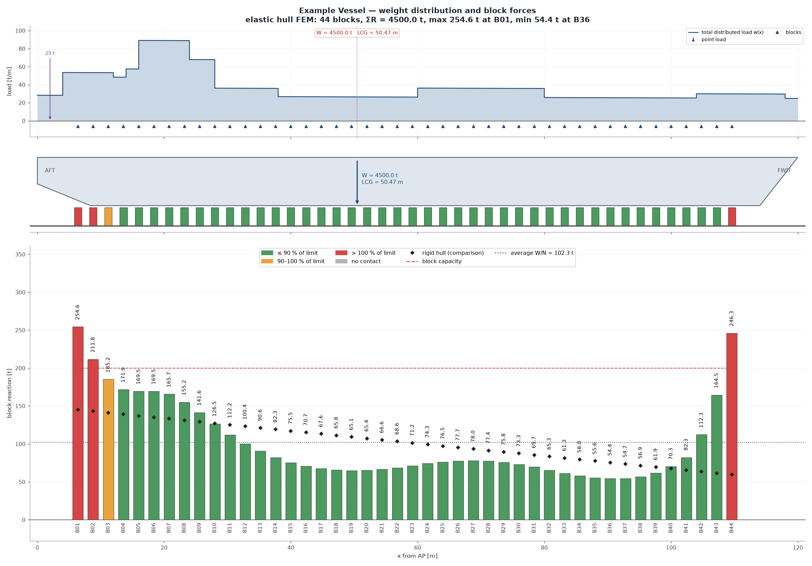
<figcaption aria-hidden="true"><p>Figure 4.2: Block-force chart produced by the program for the example vessel (elastic hull FEM). Top: weight distribution w(x) with W, LCG and the block positions; middle: hull schematic with the blocks; bottom: force on every block, bars coloured by utilisation, diamonds showing the rigid-hull result for comparison.</p></figcaption>
</figure>

## 4.12 Command-line interface

The command-line interface is invoked as `shipsupport run CASE.yaml`, or as `python -m shipsupport run CASE.yaml` without installation. Its options are given in Table 4.11. It prints the text summary to the console and writes the files of Table 4.10 to the output directory.

| Option | Effect |
|----|----|
| `-o OUT`, `--out OUT` | output directory (default: `<case name>_results` next to the case file) |
| `--methods {rigid,fem} …` | override the methods selected in the case file |
| `--no-plots` | skip the PNG charts |
| `--strict` | return exit code 2 if any check of any support solution fails or the spacing design does not fit |

Table 4.11 – Options of the command-line interface.

The exit code makes the program usable in scripts and automated workflows. It is 0 after a successful run, 1 if the input could not be read or was invalid, or if the solver failed, and 2 if `--strict` was given and the result is not acceptable. Under `--strict` the result is not acceptable if any support solution — including the solutions on the given plan — has a failed check, or if a requested spacing design does not fit. A designed spacing that passes all checks therefore does not mask a given plan that fails: the user is told that the plan in the file must be replaced by the designed one. The behaviour was confirmed on the example cases:

- **Example vessel:** a normal run returned 0 and wrote six files. A run with `--strict` returned 2, because the FEM block bearing pressure and block strength checks fail. A run with `--strict --methods rigid` returned 0, because all rigid-hull checks pass. A run with a non-existent input file returned 1.
- **Spacing and weight-curve examples:** a normal run returned 0 and wrote ten files, among them `spacing.csv`, `spacing_history.csv`, `spacing_design.png` and `curves_fem_spacing.csv`. With `--strict` the spacing example returned 2, because the given plan fails the block checks, although the summary reports “ALL CHECKS PASSED” for the designed spacing `fem+spacing`.
- **Welded hull and survey case:** a normal run returned 0 and wrote seven files, including `welding_data.png`; with `--strict` the welded hull returned 2.

## 4.13 Graphical user interface

### 4.13.1 Overall design

The graphical user interface was built with PyQt5 ([Riverbank Computing, n.d.](#ref-pyqt5)). The main window is divided by a movable splitter: the left side holds the input editor, the right side the results. Its appearance is defined in one place, the module `style.py`. It provides a light palette with one accent colour, an application stylesheet (tabs, group boxes, tables with alternating rows and bold headers, rounded inputs, and primary buttons for the two analysis commands), the program icon drawn in code, and the colours of the verdict badge in the status bar. The charts share one Matplotlib style, set in the reporting module, so that the GUI, the exported PNG files and the figures of this thesis look alike. They use Matplotlib’s constrained layout, which is recomputed whenever the canvas is resized; below a readable minimum size, a chart scrolls instead of being squeezed. A menu and a toolbar provide the file operations (new, open, save, save as, export results) and the two analysis commands: **Run analysis** (F5) analyses the case as it is, and **Auto-calculate spacing** (Ctrl+F5) runs the analysis with the spacing design and writes the designed spacing into the block plan. An *Open example* submenu loads any of the five supplied cases as an untitled copy, so that a shipped example cannot be overwritten by accident. The action *Add sample welding data* fills the welding input of the current case with the sample deformation of the welded hull, mapped onto the extent of the current hull, and runs the analysis. In the same way, *Add sample weight distribution curve* (also a button *Load sample curve* on the Weights tab) replaces the weights, after a confirmation, by a sample lightship curve of 18 points with five jumps and three deadweight items given by their moments (the data of `weight_curve_case.yaml`, 4643.0 t at LCG 56.639 m), mapped onto the current hull with the intensities scaled so that every weight is kept; it also sets the declared weight and LCG to the new totals and runs the analysis. The weight distribution is drawn as the top panel of the Block forces and Spacing design charts: the total distributed load w(x), the weight curve on its own (dashed), point loads, W and LCG, and the block positions (the given and the designed ones in the spacing chart). The status bar shows the overall verdict after each run, extended by the outcome of the spacing design when it ran, and reports when the results no longer match the input. For the example vessel it reads “CHECKS FAILED — max R 254.6 t at x = 6.40 m (fem); 0 warning(s)” (Figure 4.4).

### 4.13.2 Input editor

The input editor (class `CaseEditor`) is a set of tabs that corresponds to the sections of the YAML file (Table 4.12). It has two methods. `load_dict` fills all widgets from a case dictionary, and `to_dict` collects a case dictionary from the widgets. The GUI therefore works with exactly the same data structure as the file format: saving a case writes this dictionary as YAML, and running an analysis passes it to the calculation core.

| Tab | Content |
|----|----|
| Ship | name, $`L_{pp}`$, hull extent, declared weight and LCG |
| Weights | weight items with LCG or moment and optional extent; weight curve (name and points); live total weight and LCG of items and curve together (Figure 4.3) |
| Hull sections | hull girder sections ($`I`$, $`E`$, shear area, $`G`$, section moduli, optional $`EI`$ and $`\kappa GA`$) |
| Blocks | block types (layers written as `thickness@E_MPa; …`) and the block plan editor with the *Auto-calculate spacing* button (Figure 4.4) |
| Structure & limits | positions of transverse structure (start plus two of end, spacing, count, or an explicit list); permissible bending moment and shear force tables |
| Welding deformation | erection joints, construction-block shrinkage, surveyed keel line with an *Import CSV…* button, interpolation and identification options (Figure 4.7) |
| Settings | methods, mesh size, shear deformation, allowable stresses, tolerances, iteration limit |

Table 4.12 – Tabs of the input editor.

Two reusable widget classes were developed for the editor. `RecordTable` edits a list of records, such as weight items, curve points, erection joints or survey points, in a table with buttons to add, duplicate and remove rows. Its table supports copying and pasting tab-separated blocks with Ctrl+C and Ctrl+V, so that data can be pasted directly from a spreadsheet, which is how weight lists, block lists and keel surveys are usually available. Empty cells are omitted from the records, so the loader’s default values apply. `FormEditor` edits single values and shows each default value as greyed placeholder text. Unreadable entries are reported with their table, row and column.

The Weights tab (Figure 4.3) shows the weight items and the weight curve one above the other, and below them a live summary, for example “Σ weight = 4643.0 t, LCG = 56.639 m (3 items; curve 4343.0 t, LCG 55.670 m (18 points))” for the weight-curve example. The summary is computed exactly for the trapezoidal segments of the curve (function `curve_totals`), and an item given by its moment contributes that moment, so the user sees the effect of every edit on the docking weight and LCG before running an analysis.

<figure>
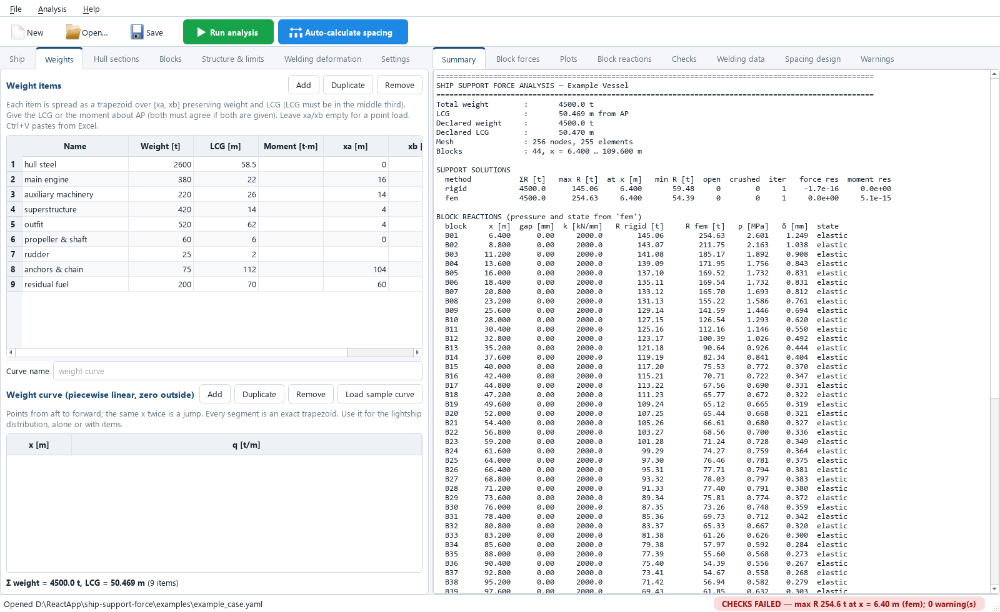
<figcaption aria-hidden="true"><p>Figure 4.3: Weights tab of the input editor with the example vessel’s weight items, the (empty) weight curve and the live total weight and LCG.</p></figcaption>
</figure>

### 4.13.3 Block plan editor and the automatic spacing design

The Blocks tab holds the block types and, below them, the block plan editor (class `BlockPlanEditor`, module `plan_panel.py`; Figure 4.4). It has a spin box for the number of blocks, a field for the position of the first block, a selector for the block type, and fields with buttons that set all spacings or all strengths at once. The table has one row per block with the columns Block, x, Spacing to next, Strength, Gap, Reaction and Reaction / strength. The spacing, the strength and the gap are edited directly or pasted from a spreadsheet; an empty strength means the capacity of the type. The label, the position — the cumulative sum of the spacings — and the two result columns are read-only and shaded. Changing the count adds rows at the forward end, which copy the last spacing and strength, or removes rows there. A line below the table summarises the plan, for example “44 blocks, block line 6.40 – 109.60 m (103.20 m), spacing 2.40 – 2.40 m, 44 block(s) with the type capacity as strength”. The method `plan` returns the `blocks.plan` dictionary of Section 4.7.2, with a single value instead of a list where all values are equal.

The table is also the main view of the result. After every analysis the window passes the positions, reactions and ratios of reaction to strength to `show_reactions`, which fills the two result columns, coloured green, orange or red at 90 % and 100 % of the target, provided the result belongs to the plan as it is in the table. A result of an older plan is therefore never shown next to a changed plan.

<figure>
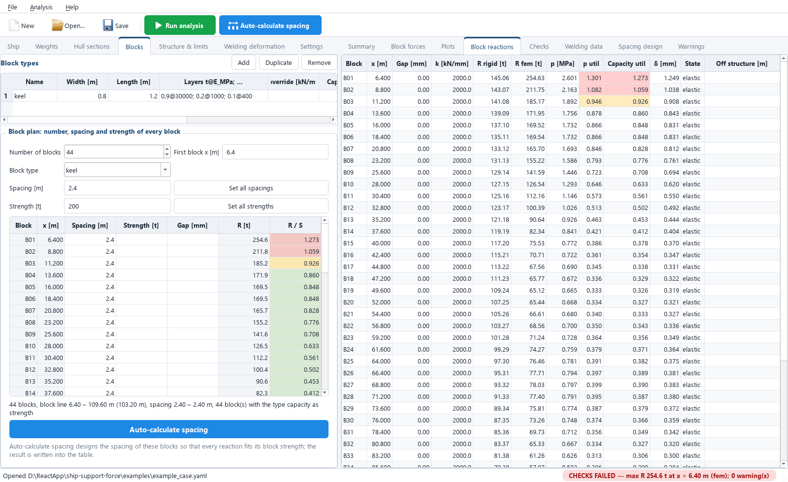
<figcaption aria-hidden="true"><p>Figure 4.4: Blocks tab with the block type and the block plan editor (left), showing the reaction and the ratio of reaction to strength of every block of the example vessel, and the Block reactions result tab (right).</p></figcaption>
</figure>

The **Auto-calculate spacing** button, the toolbar button and Ctrl+F5 all call `MainWindow.auto_spacing`, which carries out the following sequence:

1.  The Blocks tab is shown and the status line under the button reports that the spacing is being designed.
2.  `run_analysis(spacing_design=True)` collects the case dictionary from the editor, removes any `spacing_design` section and inserts the settings returned by `CaseEditor.auto_spacing_design` (Listing 4.18): the settings of the loaded case, always enabled, or — if the case has none — default settings with the floor spacing of the Structure tab as the minimum spacing.
3.  Both analysis commands and the button are disabled, and the analysis runs in the background thread of Section 4.13.4.
4.  When the result arrives, `show_result` displays it in all result tabs, and `_apply_spacing` writes the designed blocks back into the plan: the first position, the $`N - 1`$ designed spacings, and the unchanged type, strengths and gaps. The status line reports “Fits” or “Does not fit”, the largest ratio of reaction to strength before and after, the range of the designed spacing and the number of analyses, and, if the design does not fit, the diagnosis.
5.  The designed plan is an ordinary input: it can be edited further, analysed with F5 and saved.

**Listing 4.18 – Settings of the spacing design for the Auto-calculate button (**`shipsupport_gui/input_panels.py`**).**

```python
    def auto_spacing_design(self) -> dict:
        """spacing_design for the Auto-calculate spacing button: the loaded settings, or
        defaults with the floor spacing as the minimum spacing; always enabled."""
        if self.spacing_design is not None:
            return {**self.spacing_design, "enabled": True}
        design = {"enabled": True}
        floor = self.structure_spacing()
        if floor is not None:
            design["min_spacing"] = floor
        return design
```

The spacing-design settings of a loaded case are not edited in the GUI; they are kept by the editor and written back unchanged when the case is saved. F5 deliberately runs the analysis *without* the spacing design, even if the loaded case contains an enabled `spacing_design` section. This separates the two questions that the user asks — “what are the reactions of my plan?” and “what spacing should the plan have?” — and prevents a plain analysis from rewriting the plan.

### 4.13.4 Background analysis

The analysis runs in a background thread so that the window remains responsive, which matters for the spacing design, which takes up to a few seconds. The class `AnalysisThread` (Listing 4.19) receives the case dictionary and runs the same pipeline as the command-line interface. It reports the result or an error message to the main window through Qt signals. Signals emitted from a worker thread are delivered to the main thread through Qt’s event loop, so all widget updates take place in the main thread, as Qt requires.

**Listing 4.19 – Background analysis thread of the GUI (**`shipsupport_gui/worker.py`**).**

```python
class AnalysisThread(QThread):
    succeeded = pyqtSignal(object)   # AnalysisResult
    failed = pyqtSignal(str)

    def __init__(self, data: dict, parent=None):
        super().__init__(parent)
        self.data = data

    def run(self):
        try:
            self.succeeded.emit(run_analysis(self.data))
        except (InputError, ContactError) as exc:
            self.failed.emit(str(exc))
        except Exception:  # unexpected: show the traceback rather than crash the GUI
            self.failed.emit("Unexpected error:\n\n" + traceback.format_exc())
```

### 4.13.5 Result views

The results side has the eight tabs of Table 4.13. The plots are embedded Matplotlib canvases with a navigation toolbar for zooming, panning and saving. In the tables, utilisations above 1.0 are highlighted in red, utilisations between 0.9 and 1.0 in orange, and blocks without contact in grey. If a case contains no welding deformation or no spacing design, the corresponding tab explains this and offers a button that adds the sample welding data, or starts the automatic spacing design, respectively.

| Tab | Content |
|----|----|
| Summary | the text summary of Section 4.11.2 |
| Block forces | the chart of Figure 4.2: weight distribution on top, then the force on every block (Figure 4.5) |
| Plots | load and reactions, settlement, shear force, bending moment |
| Block reactions | one row per block of the given plan, with a welding-gap column when present (Figure 4.4) |
| Checks | all checks of all support solutions, including `fem+spacing` (Figure 4.6) |
| Welding data | the welding data chart (Figure 4.7) |
| Spacing design | the spacing design chart (Section 6.8) |
| Warnings | the warnings, with their number in the tab title |

Table 4.13 – Tabs of the result view.

<figure>
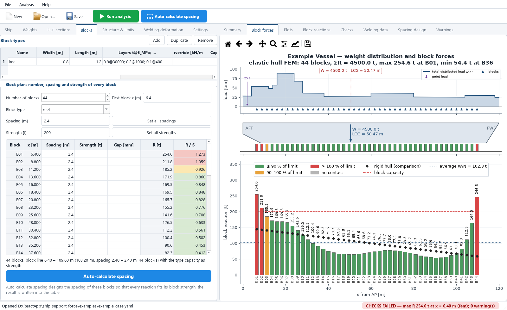
<figcaption aria-hidden="true"><p>Figure 4.5: Main window after an analysis of the example vessel, with the Blocks input tab on the left and the Block forces result tab on the right.</p></figcaption>
</figure>

<figure>
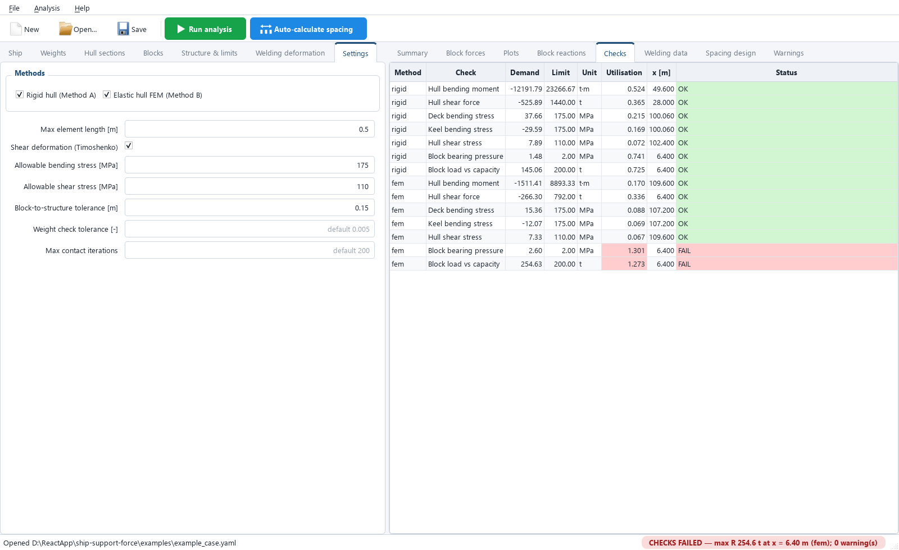
<figcaption aria-hidden="true"><p>Figure 4.6: Settings input tab (left) and Checks result tab (right), listing every hull girder and block check for each support solution with utilisation and status.</p></figcaption>
</figure>

<figure>
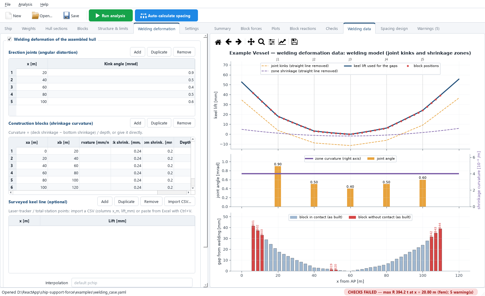
<figcaption aria-hidden="true"><p>Figure 4.7: Welding deformation input tab (left) and Welding data result tab (right) for the welded-hull example.</p></figcaption>
</figure>

## 4.14 Requirements traceability

Table 4.14 traces every requirement of Table 4.1 to the modules that realise it and to the test modules that verify it (requirement N9). The test modules are described in Chapter 5.

| Requirement | Realised by | Verified by |
|----|----|----|
| F1 weight items with LCG or moment | `model.WeightItem`, `loader._weight`, `weights.py` | `test_weights.py`, `test_loader.py` |
| F2 weight curve | `model.WeightCurve`, `loader._weight_curve` | `test_weights.py`, `test_loader.py`, `test_example_case.py` |
| F3 block plan | `loader._blocks`, `model.Block` | `test_loader.py`, `test_gui.py` |
| F4 rigid-hull method | `solvers/rigid.py` | `test_rigid.py`, `test_fem.py` (rigid limit) |
| F5 elastic-hull FEM | `solvers/fem.py` | `test_fem.py` |
| F6 compression-only, crushable blocks; large gaps | `solvers/contact.py` | `test_rigid.py`, `test_fem.py`, `test_deformation.py` |
| F7 hull girder checks | `strength.py` | `test_strength.py` |
| F8 block checks against block strength | `strength.py`, `model.Block.effective_strength` | `test_strength.py`, `test_example_case.py`, `test_spacing.py` |
| F9 welding-deformation model | `deformation.py`, `analysis._springs` | `test_deformation.py` |
| F10 survey import, interpolation, identification | `deformation.py`, `loader.read_survey_csv`, GUI import | `test_deformation.py`, `test_example_case.py`, `test_gui.py` |
| F11 automatic spacing design | `spacing.py`, `analysis.spacing_evaluator`, `analysis.run_case` | `test_spacing.py` |
| F12 reporting | `report.py` | `test_example_case.py`, `test_spacing.py` |
| F13 command-line interface | `cli.py` | `test_example_case.py`, `test_spacing.py` |
| F14 GUI with block plan editor and Auto-calculate spacing | `shipsupport_gui` (`plan_panel.py`, `main_window.py`) | `test_gui.py` |
| N1 SI units | `units.py`, `loader.py` | `test_loader.py`, `test_deformation.py` (unit conversion), all benchmarks |
| N2 input validation | `model.py`, `loader.py` | `test_weights.py`, `test_loader.py`, `test_deformation.py`, `test_spacing.py`, `test_gui.py` |
| N3 core independent of GUI | package structure | `test_gui.py` (identical results) |
| N4 run-time self-checks | `solvers/result.py`, `strength.py` | `test_example_case.py`, `test_spacing.py` |
| N5 automated tests | `tests/` | 131 tests |
| N6 performance | sparse solvers, vectorised assembly, analysis count of the design | measured (Section 5.9) |
| N7 portability | Python ecosystem | — |
| N8 designed spacing from full analyses | `spacing._Counter`, `analysis.spacing_evaluator` | `test_spacing.py` (designed layout re-analysed from scratch) |
| N9 traceability | this table | — |
| N10 maintainability | module structure | code metrics (Section 4.15) |
| N11 testability of the design | injected `evaluate` | `test_spacing.py` (substitute analyses) |

Table 4.14 – Requirements traceability matrix: requirements, realising modules and verifying tests.

## 4.15 Code metrics

Table 4.15 lists the size of each module, measured as total lines and as lines that are neither blank nor full-line comments (docstrings are counted as code). The calculation core comprises 3283 lines, of which 2736 are non-blank, non-comment lines. The GUI comprises 2161 lines (1876). The test suite comprises 1552 lines (1236) in ten files — nine test modules and a helper module — and contains 131 tests (Chapter 5).

| Package / module | Lines | Non-blank, non-comment |
|----|---:|---:|
| `shipsupport/report.py` | 713 | 628 |
| `shipsupport/spacing.py` | 509 | 429 |
| `shipsupport/model.py` | 461 | 352 |
| `shipsupport/loader.py` | 420 | 367 |
| `shipsupport/strength.py` | 205 | 176 |
| `shipsupport/analysis.py` | 195 | 158 |
| `shipsupport/deformation.py` | 169 | 137 |
| `shipsupport/solvers/contact.py` | 169 | 134 |
| `shipsupport/weights.py` | 118 | 92 |
| `shipsupport/solvers/fem.py` | 116 | 97 |
| `shipsupport/cli.py` | 71 | 57 |
| `shipsupport/solvers/rigid.py` | 54 | 44 |
| `shipsupport/solvers/result.py` | 42 | 33 |
| `shipsupport/units.py` | 14 | 10 |
| other (`__init__`, `__main__`, `solvers/__init__`) | 27 | 22 |
| **Calculation core total** | **3283** | **2736** |
| `shipsupport_gui/input_panels.py` | 601 | 524 |
| `shipsupport_gui/main_window.py` | 444 | 389 |
| `shipsupport_gui/plan_panel.py` | 343 | 305 |
| `shipsupport_gui/widgets.py` | 296 | 256 |
| `shipsupport_gui/results_panels.py` | 252 | 220 |
| `shipsupport_gui/style.py` | 156 | 133 |
| `shipsupport_gui/worker.py` | 34 | 24 |
| `shipsupport_gui/app.py` | 31 | 22 |
| other (`__init__`, `__main__`) | 4 | 3 |
| **GUI total** | **2161** | **1876** |
| `tests/test_gui.py` | 418 | 348 |
| `tests/test_spacing.py` | 239 | 192 |
| `tests/test_loader.py` | 196 | 153 |
| `tests/test_deformation.py` | 184 | 144 |
| `tests/test_example_case.py` | 129 | 103 |
| `tests/test_fem.py` | 118 | 89 |
| `tests/test_weights.py` | 114 | 90 |
| `tests/test_rigid.py` | 68 | 51 |
| `tests/test_strength.py` | 51 | 42 |
| `tests/helpers.py` | 35 | 24 |
| **Tests total** (10 files, 131 tests) | **1552** | **1236** |

Table 4.15 – Size of the modules of the program.

The numerical heart of the program is small. The two solvers with the contact iteration and the gap continuation amount to 381 lines, the welding-deformation model to 169 lines and the load model to 118 lines. The spacing design, the final result of the program, is with 509 lines the largest numerical module; its module docstring states the problem and the three phases, so that the code can be read against Section 3.12. The largest module is the reporting module, and the data model and the loader together account for 881 lines, reflecting the effort spent on clear presentation of results and on input validation with precise messages. The test code amounts to 47 % of the core, and the 239 lines of `test_spacing.py` verify a module of 509 lines.

## 4.16 Summary

The models of Chapter 3 were implemented in Python as a layered calculation package and a separate PyQt5 user interface, developed in tested increments. The calculation core uses validated data classes with SI units, frozen for all physical objects, and validates all input once, at the boundary. Weight items given by their LCG or their moment and a weight-distribution curve, whose segments are converted exactly into trapezoidal items, feed one load model on a mesh that contains every key point, so that the load integration is exact. The blocks are defined by a block plan with the number of blocks and the spacing, strength and initial gap of every block. Sparse finite element assembly is vectorised, and one active-set iteration for compression-only, optionally crushing blocks, with a gap continuation for large welding gaps, is shared by the rigid-hull and the elastic-hull methods through a common `linear_solve` interface.

The module `spacing.py` designs the spacing of the blocks of the plan from their strengths. It combines strength-weighted equidistribution, sequential linear programming with a trust region and a smoothing term, and an admissible rounding to the floors with a best-improvement local search, and it diagnoses why a plan cannot fit. The analysis of a candidate layout is injected as a function; in the program this function rebuilds the mesh and recomputes the welding gaps at the candidate positions, so that every designed spacing is the result of a full analysis and welding deformation acts as a constraint, while in the tests a substitute analysis with a known optimum takes its place.

The command-line interface supports scripted use through meaningful exit codes. The GUI offers spreadsheet-compatible tables, a live weight summary, a block plan editor that also shows the reaction and the ratio of reaction to strength of every block, and an *Auto-calculate spacing* button that runs the design in a background thread and writes the designed spacing back into the plan. A traceability matrix links every requirement to its modules and tests. The correctness of the implementation is examined in the next chapter.

# 5 Verification

A numerical program is useful only if its results can be trusted, and a design program even more so: its final result, the spacing of the keel blocks, is laid out in the dock without the engineer having seen the hundreds of analyses behind it. This chapter documents the evidence that the program described in Chapter 4 solves the equations of Chapter 3 correctly. It first defines the verification strategy and gives an overview of the automated test suite. It then presents the analytical benchmark cases for the load, support and strength models, including the weight curve and weight items given by their moment, followed by convergence studies. Separate sections verify the welding-deformation model with the identification from a survey, and the automatic spacing design. The run-time self-checks built into every analysis, the consistency between the graphical user interface and the calculation core, and the performance of the program follow. The chapter closes with the limitations of the verification, in particular the absence of validation against measurements.

## 5.1 Verification strategy

Following Oberkampf and Roy ([2010](#ref-oberkampf2010)), three activities that are often confused are distinguished:

- **Code verification** establishes that the software implements the chosen mathematical model without programming errors. Its main tool is comparison with exact analytical solutions of problems that exercise the relevant parts of the code.
- **Solution verification** estimates the numerical error of a particular computed solution, for example discretisation and round-off error, and confirms that the solution has converged.
- **Validation** establishes to what extent the mathematical model represents physical reality, by comparison with experimental or full-scale measurements.

This chapter deals with the first two activities. The models of Chapter 3 contain assumptions — the hull treated as a one-dimensional beam, linear-elastic or bilinear block behaviour, a kinematic description of welding deformation and no transverse load sharing — whose adequacy can only be assessed by validation. No measured block loads or keel surveys were available for this work, so validation remains outside its scope (Section 5.10).

The verification strategy had six elements:

1.  **Analytical benchmarks.** Small problems with known closed-form solutions were solved with the program and the results compared with the closed form. Together, the benchmarks exercise every computational module: load integration from weight items and from the weight curve, the rigid-hull solver, the FEM solver with Euler–Bernoulli and Timoshenko elements, the contact iteration with gaps and crushing, the shear-force and bending-moment integration, and the shape functions of the welding-deformation model.
2.  **Convergence and limit behaviour.** Properties that follow from the theory were tested: the FEM solution must approach the rigid-hull solution as the hull bending stiffness tends to infinity; the reactions must not depend on the mesh density; the contact solution for large gaps must satisfy the complementarity conditions whichever path the iteration takes.
3.  **Invariance and equivalence tests.** Properties that must hold exactly were tested where no closed form exists: the invariance of the reactions to a straight-line tilt of the keel, the equivalence of a block with an unclosable gap and a removed block, and the equivalence of the example’s weight items with the piecewise-linear curve that is their sum.
4.  **Verification of the design algorithm against known optima.** The spacing design was tested with substitute analyses whose optimal layout is known in closed form, and it was checked on the full model that the designed layout, analysed again from scratch, gives the same reactions — the designed spacing is never the output of a surrogate.
5.  **Run-time self-checks.** Every analysis computes equilibrium residuals and the closure error of the shear and moment curves, and reports them with the results.
6.  **Automation.** All benchmarks and consistency checks were coded as automated tests with pytest ([Krekel et al., n.d.](#ref-pytest)). They are repeated after every change to the program, which protects the verified state against regressions.

The accuracy of a result $`y`$ compared with an exact reference value $`y_{\text{ref}}`$ is expressed throughout as the relative error

``` math
\varepsilon = \frac{\left| y - y_{\text{ref}} \right|}{\left| y_{\text{ref}} \right|}\quad\quad\quad\quad(5.1)
```

For calculations in IEEE double precision, the machine epsilon is approximately $`2.2 \times 10^{- 16}`$. A relative error of order $`10^{- 16}`$ to $`10^{- 12}`$ therefore means agreement to the limits of floating-point arithmetic. All numbers in this chapter were computed with the final version of the program.

## 5.2 Test suite overview

The test suite consists of nine test modules and a helper module, and contains 131 tests in total. The count was determined with `pytest --collect-only`; parametrised tests count once per parameter set. Table 5.1 summarises what each module verifies. All 131 tests passed on the final version of the program. The GUI tests run Qt in its off-screen mode, so they need no display; if PyQt5 is not installed, they are skipped automatically.

| Test module | Tests | What is verified |
|----|---:|----|
| `test_weights.py` | 12 | trapezoid end intensities preserving weight and LCG; triangle limits; rejection of an LCG outside the middle third; exact integration of 31 random items; mesh construction and node lookup; weight-curve segments as exact trapezoids (weight, LCG, $`\int q\, dx`$, $`\int xq\, dx`$ and the intensity itself); a curve with a jump; five invalid curves, each reported with the offending point |
| `test_loader.py` | 33 | structure positions by the three rules and by an explicit list, five invalid specifications; block plan with lists and single values (positions, labels, strength default and override, gaps); count taken from a list; nine invalid plans, each with a specific message; rejection of the former block groups; reactions after changing count and spacing; LCG from the moment of an item and of a point load; moment and LCG must agree; four invalid weight items; weight curve read as items (also as a plain list and without items); four invalid curve points named in the message; rejection of a case without any weights |
| `test_rigid.py` | 6 | two-block determinate case; equal blocks under symmetric load; eccentric closed form; lift-off equivalence; crushing closed form; instability detection |
| `test_fem.py` | 10 | Euler–Bernoulli and Timoshenko midspan deflection; shear-deformation switch; two-span reactions; convergence to the rigid method; load concentration of a flexible hull; gap equivalence; partially closed gap; mesh independence; section coverage check |
| `test_strength.py` | 3 | simply supported shear and moment; hogging over supports with overhangs; stresses and utilisations of all hull girder checks |
| `test_deformation.py` | 18 | kink slope change; zone curvature; gaps and reactions invariant to a keel tilt; end lift unloading the first and last blocks; continuation with large gaps; exact and noisy identification of joint angles; interpolation through the survey points (three methods); unit conversion of shrinkage; invalid input; survey CSV and the sample survey case; identification with known zone shrinkage subtracted; survey used directly as the total shape; rejection of a malformed survey file; welding example with end lift |
| `test_spacing.py` | 13 | closed-form minimax optimum for a uniform load; smaller spacing for weaker blocks with the order of strengths kept; equidistribution step towards a load peak; spacing limits, extent and grid; fixed end blocks; report when the strength is not enough; invalid problems; spacing example within strength, under floors, in equilibrium, with command-line outputs; initial gaps moving with their blocks; welding gaps recomputed at the designed positions and the designed layout re-analysed from scratch; outcome on the welded hull; moderate welding deformation absorbed; severe welding deformation diagnosed as gap-governed |
| `test_example_case.py` | 8 | equilibrium, non-negative reactions and closure for the example vessel; summary and command-line run with exactly the expected output files; command-line runs of the welded hull and the survey case with the welding data chart; weight-curve example; the example’s items as one weight curve giving identical reactions; labelling of blocks created in code; rejection of a negative weight tolerance |
| `test_gui.py` | 28 | layer text format; input and result tabs exactly as built; every example round-tripping through the editor (5 cases); identical results via the editor; Weights tab with moments and the weight curve, live Σ; Blocks tab with plan editing (count, set all, single cells, empty strength, gap, read-only x, bad cell); spacing-design settings kept and saved; F5 not running the spacing design; *Auto-calculate spacing* writing the design into the plan; default minimum spacing from the floors; survey case with its CSV points; sample welding data and its mapping onto the hull; unresolved survey file; error location; point-load rule; result display and save; every example opened and run; background thread and its error reporting; sample weight curve identical to `weight_curve_case.yaml`, loaded and analysed with the same reactions, and mapped onto a 150 m hull with the weights kept; weight-distribution panel on top of the Block forces and Spacing design charts |
| **Total** | **131** |  |

Table 5.1 – Modules of the automated test suite, number of tests and verified properties.

The complete test suite ran in 33 s on the workstation of Section 5.9.1, much of it spent in the tests that perform complete spacing designs, directly and through the GUI’s background thread. It was run after every change during development, and the benchmarks of the following sections are part of it.

## 5.3 Analytical benchmark cases

The benchmark results are collected in Table 5.2 at the end of this section. The individual cases are described first.

### 5.3.1 Trapezoidal load integration

A single weight item of 1000 N spread over $`\lbrack 2,8\rbrack`$ m with its centre at 4.5 m was converted into a trapezoid. With $`L = 6`$ m and $`\bar{x} = 2.5`$ m, the end intensities of Section 3.3.2,

``` math
w_{a} = \frac{2W}{L}\left( 2 - \frac{3\bar{x}}{L} \right),\quad\quad w_{b} = \frac{2W}{L}\left( \frac{3\bar{x}}{L} - 1 \right)\quad\quad\quad\quad(5.2)
```

give $`w_{a} = 250`$ N/m and $`w_{b} = 83.333`$ N/m. The program returned exactly these values, and integrating the trapezoid reproduced the weight and the centre of 4.5 m. Items with their centre at $`L/3`$ and $`2L/3`$ gave triangles with one end intensity zero to $`10^{- 12}`$. In a more demanding test, 31 items (30 random trapezoids and one point load) were superimposed on a common mesh of 212 nodes. The total load and its first moment computed from the mesh agreed with the sums over the items to relative errors of $`1.3 \times 10^{- 16}`$ and $`1.5 \times 10^{- 16}`$. This confirms that integration on a mesh containing every item boundary is exact.

### 5.3.2 Weight curve and weight items given by their moment

**Curve segments.** A curve through $`(0,5)`$, $`(10,20)`$, $`(25,0)`$ and $`(40,12)`$ kN/m was converted into three items. The closed forms of the weight and the first moment of a piecewise-linear curve are

``` math
W = \sum_{k}^{}\frac{(q_{k} + q_{k + 1})\, L_{k}}{2},\quad\quad M = \sum_{k}^{}\frac{L_{k}\left\lbrack q_{k}\,(2x_{k} + x_{k + 1}) + q_{k + 1}\,(x_{k} + 2x_{k + 1}) \right\rbrack}{6}\quad\quad\quad\quad(5.3)
```

which give $`W = 365`$ kN and $`M = 6150`$ kN·m. The three items had the weights 125, 150 and 90 kN with the centres 6.0, 15.0 and 35.0 m expected from Equation (4.1); the second and third segments are triangles with their centres at one third and two thirds of their length. The load model built from the items reproduced $`W`$ and $`M`$ with a relative error of zero, and its intensity at six probe points — including points outside the curve, where it must vanish — equalled the curve with an absolute error of zero. A curve with a jump from 10 to 30 kN/m at 20 m gave two items (the zero-length segment is skipped), the exact weight of 500 and the exact centre of 19.0 m, and the intensity on the two elements adjacent to the jump was 10 and 30.

**Equivalence with weight items.** The sum of the eight distributed items of the example vessel is itself a piecewise-linear curve with jumps. A test builds this curve (26 points) and analyses the example with the curve and the remaining point load instead of the items. The total weight and the LCG agreed with the item input exactly, and the block reactions agreed to $`0`$ for the rigid hull and $`1.1 \times 10^{- 14}`$ of the largest reaction for the FEM. Both input forms therefore lead to the same load model, as intended by the design of Section 4.6.

**Moments.** An item of 400 t over $`\lbrack 40,70\rbrack`$ m with a moment of 22 000 t·m was given the LCG of 55.0 m, and a point load of 100 t with 3000 t·m was placed at 30.0 m; the same items given with `lcg` and `x` produced identical items. A moment that disagrees with a given LCG, or a weight of zero (which makes the LCG undefined), was rejected with a message naming the item. For the weight-curve example, the loader produced the documented totals: 4343.0 t for the curve (12 loaded segments, LCG 55.670 m) and 4643.0 t at an LCG of 56.639 m in total.

### 5.3.3 Two blocks: the statically determinate case

With exactly two blocks the reactions follow from equilibrium alone and do not depend on any stiffness. A uniform load of 1 kN/m over a 20 m hull was supported by blocks at 2 m and 15 m. Taking moments about each block gives $`R_{1} = 20 \cdot 5/13 = 7.6923`$ kN and $`R_{2} = 20 \cdot 8/13 = 12.3077`$ kN. The rigid-hull solver reproduced these values with relative errors of $`1.2 \times 10^{- 16}`$ and $`1.5 \times 10^{- 16}`$.

### 5.3.4 Equal blocks under an eccentric load

For $`N`$ blocks of equal stiffness under a rigid hull, the reactions have the closed form

``` math
R_{i} = \frac{W}{N} + \frac{We\,(x_{i} - \bar{x})}{\sum_{j}^{}(x_{j} - \bar{x})^{2}},\quad\quad e = x_{G} - \bar{x}\quad\quad\quad\quad(5.4)
```

where $`\bar{x}`$ is the block centroid. Nine equal blocks between 2 m and 18 m were loaded with 1 kN/m over 20 m and a point load of 40 kN at 14 m, giving $`W = 60`$ kN and $`x_{G} = 12.667`$ m. The reactions ranged from 1.333 kN to 12.000 kN. The largest relative deviation from Equation (5.4) over all nine blocks was $`1.4 \times 10^{- 15}`$.

### 5.3.5 Simply supported beam: Euler–Bernoulli and Timoshenko deflection

The FEM solver was tested on a beam of length $`L = 10`$ m with uniform load $`q = 1`$ kN/m, supported at both ends by very stiff springs ($`k = 10^{15}`$ N/m) and with $`EI = 10^{8}`$ N·m². The midspan deflection relative to the supports has the classical value ([Gere and Goodno 2013](#ref-gere2013))

``` math
v_{\text{mid}} = \frac{5qL^{4}}{384\, EI}\quad\quad\quad\quad(5.5)
```

which equals 1.302083 mm. The program returned this value with a relative error of $`1.7 \times 10^{- 13}`$. When the shear stiffness $`\kappa GA = 10^{6}`$ N was included, the Timoshenko solution ([Timoshenko 1921](#ref-timoshenko1921)) adds a shear deflection:

``` math
v_{\text{mid}} = \frac{5qL^{4}}{384\, EI} + \frac{qL^{2}}{8\,\kappa GA}\quad\quad\quad\quad(5.6)
```

which equals 13.802083 mm. The program agreed to $`1.8 \times 10^{- 15}`$. A separate test confirmed that switching shear deformation off restores Equation (5.5), with the same error of $`1.7 \times 10^{- 13}`$, even when $`\kappa GA`$ is given.

These results are exact to round-off, although the beam was divided into twenty elements of 0.5 m. This is expected: for cubic Hermite elements with consistent load vectors, the nodal displacements of a beam under polynomial loading are exact ([Cook et al. 2002](#ref-cook2002)). The benchmark therefore checks the element stiffness matrix, the consistent load vector and the assembly together.

### 5.3.6 Two-span continuous beam

A beam of 20 m under 1 kN/m on three equally spaced supports (at 0, 10 and 20 m) is statically indeterminate to the first degree. Its exact reactions are $`3/16`$, $`10/16`$ and $`3/16`$ of the total load ([Gere and Goodno 2013](#ref-gere2013)), that is 3.75 kN, 12.5 kN and 3.75 kN. The program, with springs of $`10^{15}`$ N/m and $`EI = 10^{8}`$ N·m², returned 3750.0000026 N, 12499.999995 N and 3750.0000026 N. The relative deviations of $`4`$–$`7 \times 10^{- 10}`$ are not a numerical error. They are the physically correct effect of the very small, but finite, compression of the supporting springs; with truly rigid supports the deviation would vanish.

### 5.3.7 Shear force and bending moment

The integration of $`V(x)`$ and $`M(x)`$ was checked on two cases.

- **Simply supported beam** with $`L = 10`$ m and $`q = 2`$ kN/m. The maximum moment is $`qL^{2}/8 = 25,000`$ N·m at midspan ([Gere and Goodno 2013](#ref-gere2013)). The program returned this value at $`x = 5`$ m with a relative error of $`1.7 \times 10^{- 12}`$, and with a positive sign, confirming the sagging-positive convention. The largest shear force $`qL/2`$ agreed to $`8.4 \times 10^{- 13}`$.
- **Beam with overhangs.** A beam of 10 m under $`q = 1`$ kN/m rests on supports at $`a = 2`$ m from each end. Over the supports the cantilevers produce the hogging moment

``` math
M_{\text{support}} = - \frac{qa^{2}}{2}\quad\quad\quad\quad(5.7)
```

which equals $`- 2000`$ N·m. At midspan the moment is $`R(L/2 - a) - q(L/2)^{2}/2 = 2500`$ N·m. The program reproduced the support moment exactly (relative error zero) and the midspan moment with a relative error of $`1.1 \times 10^{- 12}`$.

In both cases the shear force and bending moment returned to zero at the free end, to within $`3.3 \times 10^{- 8}`$ N and $`8.4 \times 10^{- 8}`$ N·m, about $`10^{- 12}`$ of the largest values. A third test checked the stresses and utilisations of all hull girder checks of a section with given moduli and envelopes against hand calculation, including the sign of the deck stress (compression in sagging) and the failed verdict when a limit is exceeded.

### 5.3.8 Block crushing

Two identical blocks with stiffness $`k = 10^{9}`$ N/m, crush force $`F_{y} = 3 \times 10^{5}`$ N and post-crush stiffness ratio $`0.1`$ carry a symmetric load of $`W = 10^{6}`$ N. Each block carries $`W/2 = 5 \times 10^{5}`$ N, which exceeds $`F_{y}`$. The bilinear block law of Section 3.4.2 then gives the compression

``` math
\delta = \frac{F_{y}}{k} + \frac{W/2 - F_{y}}{k_{2}},\quad\quad k_{2} = 0.1\, k\quad\quad\quad\quad(5.8)
```

which equals 2.3 mm. The program identified both blocks as crushed and returned exactly 2.3 mm and $`5 \times 10^{5}`$ N per block. This test exercises the crushed branch of the block law, the constant term $`c_{i}`$ of the linearisation and the state iteration.

### 5.3.9 Gaps and lift-off

For gaps no simple closed form exists, but an exact equivalence can be tested. A block whose gap is too large to close carries no load, so the solution must equal that of the same case with the block removed. In the test, a gap of 50 mm was applied to the middle block of five. The program returned zero load on that block, and the other four reactions agreed with the four-block solution to round-off (the test tolerance is $`10^{- 9}`$). The same equivalence was tested for a block that lifts off under an eccentric load in the rigid-hull method. A further test confirmed that a gap of 0.2 mm, which closes partially, gives a reaction $`0 < R = 375.2`$ kN $`< R_{\text{neighbour}} = 398.5`$ kN that is consistent with $`R = k\,\delta`$ to round-off.

### 5.3.10 Summary of the benchmarks

| Benchmark | Quantity | Exact value | Program | Relative error |
|----|----|----|----|----|
| Trapezoid integration (31 items) | total load / first moment | sums over items | — | $`1.3 \times 10^{- 16}`$ / $`1.5 \times 10^{- 16}`$ |
| Weight curve (Eq. 5.3) | $`W`$, $`M`$, intensity | 365 kN, 6150 kN·m, $`q(x)`$ | same | 0 |
| Weight curve with a jump | $`W`$, LCG | 500, 19.0 m | same | 0 |
| Items as one curve (example vessel) | reactions | item input | same | 0 (rigid), $`1.1 \times 10^{- 14}`$ (FEM) |
| Moment input | LCG $`= M/W`$ | 55.0 m, 30.0 m | same | round-off |
| Two blocks | $`R_{1}`$, $`R_{2}`$ | 7692.31 N, 12307.69 N | 7692.31 N, 12307.69 N | $`1.2 \times 10^{- 16}`$, $`1.5 \times 10^{- 16}`$ |
| Eccentric, 9 equal blocks | all $`R_{i}`$ (Eq. 5.4) | 1333.3 … 12000 N | 1333.3 … 12000 N | $`\leq 1.4 \times 10^{- 15}`$ |
| Simply supported, Euler–Bernoulli | $`v_{\text{mid}}`$ (Eq. 5.5) | 1.302083 mm | 1.302083 mm | $`1.7 \times 10^{- 13}`$ |
| Simply supported, Timoshenko | $`v_{\text{mid}}`$ (Eq. 5.6) | 13.802083 mm | 13.802083 mm | $`1.8 \times 10^{- 15}`$ |
| Two-span beam | $`R`$ (3/16, 10/16, 3/16) | 3750, 12500, 3750 N | 3750.0000026, 12499.999995, 3750.0000026 N | $`4`$–$`7 \times 10^{- 10}`$ (finite spring stiffness) |
| Simply supported moment | $`M_{\max} = qL^{2}/8`$ | 25 000 N·m | 25 000 N·m | $`1.7 \times 10^{- 12}`$ |
| Overhang moment | $`M`$ at support (Eq. 5.7) / midspan | −2000 / 2500 N·m | −2000 / 2500 N·m | 0 / $`1.1 \times 10^{- 12}`$ |
| Crushing | $`\delta`$ (Eq. 5.8) | 2.3 mm | 2.3 mm | 0 |
| Unclosable gap | reactions vs block removed | equal | equal | round-off |

Table 5.2 – Analytical benchmark cases: exact values, program results and relative errors.

Every benchmark was reproduced to the limit of double-precision arithmetic, apart from the two-span case, whose small deviation is explained by the finite support stiffness used in the model, not by any error in the program.

## 5.4 Convergence studies

### 5.4.1 Convergence to the rigid-hull method

The rigid-hull method (Method A) is the limit of the elastic-hull method (Method B) as the hull bending stiffness tends to infinity. Comparing the two methods for increasing $`EI`$ therefore tests both solvers against each other, under loading that neither closed form above covers. The test case was a 100 m hull on 38 equal blocks of $`k = 2 \times 10^{9}`$ N/m at 2.5 m spacing. It carried a uniform load of 40 kN/m, a 2 MN item over 20–30 m and a 0.5 MN point load at 80 m, giving a total weight of 6.5 MN. The difference between the methods, listed in Table 5.3, was measured as

``` math
\Delta = \frac{\max_{i}\left| R_{i}^{\text{FEM}} - R_{i}^{\text{rigid}} \right|}{\max_{i}R_{i}^{\text{rigid}}}\quad\quad\quad\quad(5.9)
```

| $`EI`$ \[N·m²\] | $`\Delta`$                |
|-----------------|---------------------------|
| $`10^{13}`$     | $`3.548 \times 10^{- 1}`$ |
| $`10^{14}`$     | $`8.765 \times 10^{- 2}`$ |
| $`10^{15}`$     | $`1.397 \times 10^{- 2}`$ |
| $`10^{16}`$     | $`1.506 \times 10^{- 3}`$ |
| $`10^{17}`$     | $`1.517 \times 10^{- 4}`$ |
| $`10^{18}`$     | $`1.569 \times 10^{- 5}`$ |
| $`10^{19}`$     | $`3.569 \times 10^{- 5}`$ |
| $`10^{20}`$     | $`3.095 \times 10^{- 4}`$ |

Table 5.3 – Difference between FEM and rigid-hull reactions as a function of the hull bending stiffness.

From $`EI = 10^{15}`$ to $`10^{18}`$ N·m², the difference decreases by a factor of very nearly ten for each tenfold increase in $`EI`$. This is the first-order behaviour $`\Delta \propto 1/EI`$ expected from a perturbation of the rigid solution, and it is strong evidence that both solvers are correct. Above $`10^{18}`$ N·m², the difference rises again. This is not a discretisation effect but round-off error: the ratio between the element bending stiffness, of order $`12EI/L_{e}^{3}`$, and the spring stiffness becomes so large that the springs’ contribution to the system matrix is lost in the last digits of double-precision arithmetic. The realistic range of hull stiffness, around $`10^{12}`$–$`10^{13}`$ N·m² for the example vessel, lies far below this round-off floor. An automated test checks the factor-of-ten reduction between $`10^{16}`$, $`10^{17}`$ and $`10^{18}`$ N·m², and requires $`\Delta < 5 \times 10^{- 5}`$ at $`10^{18}`$ N·m².

### 5.4.2 Mesh independence

For the Euler–Bernoulli beam with consistent loads, the finite element solution is nodally exact for piecewise-polynomial loads, as noted in Section 5.3.5. Because every block and every load discontinuity is a node, the block reactions should not depend on the element size at all. This was tested on a 60 m hull on 19 blocks at 3 m spacing ($`k = 10^{9}`$ N/m, $`EI = 2 \times 10^{11}`$ N·m²), loaded with 20 kN/m and a 1 MN item over 10–20 m. Table 5.4 compares the reactions for maximum element lengths from 3.0 m to 0.25 m with a reference solution with 0.1 m elements and 601 nodes.

| Maximum element length \[m\] | Nodes | Max. relative difference from reference |
|------------------------------|------:|-----------------------------------------|
| 3.0                          |    23 | $`7.873 \times 10^{- 9}`$               |
| 1.5                          |    43 | $`7.873 \times 10^{- 9}`$               |
| 0.5                          |   121 | $`7.873 \times 10^{- 9}`$               |
| 0.25                         |   241 | $`7.885 \times 10^{- 9}`$               |

Table 5.4 – Block reactions for different mesh densities compared with a 0.1 m reference mesh.

All meshes, including the coarsest, in which each element spans the full block spacing, gave the same reactions to within $`8 \times 10^{- 9}`$. The difference from the reference is practically identical for all meshes, so it originates in the reference solution: the finest mesh, with the most unknowns, accumulates the most round-off. The mesh therefore affects only the resolution of the displacement and moment curves between nodes, not the computed reactions. This property matters for the spacing design: each candidate layout has its own mesh (Section 4.8.1), and a mesh-dependent reaction would add numerical noise to the comparison of layouts.

### 5.4.3 Contact solution for large gaps

For large, uneven gaps there is no closed form, but every converged contact solution must satisfy the complementarity conditions of Section 3.7: blocks reported as open have non-positive compression and zero reaction, loaded blocks have positive compression, and the reactions balance the weight and its moment. Two cases were examined (Table 5.5).

- **Rigid hull, 40 mm parabolic end lift.** The 100 m test hull of Section 5.4.1, with the uniform load only, was given gaps of $`0.04\,((x - 50)/47)^{2}`$ m, rising to 40 mm at the end blocks. This case is part of the automated test suite.
- **Rigid hull, example vessel with joint kinks.** The example vessel was given kinks of 0.2 mrad at five erection joints (20, 40, 60, 80 and 100 m), which lifts the ends of the block line by 13.7 mm. For this case the direct state iteration did *not* converge: it cycled until the limit of 200 iterations. This was the failure that led to the gap continuation of Section 4.8.5.

| Case | Direct iteration | Iterations (total) | Open blocks | Max. $`\delta`$ of open blocks | Min. $`\delta`$ of loaded blocks | Force / moment residual |
|----|----|---:|---:|----|----|----|
| Rigid, 40 mm parabolic lift (38 blocks) | converged | 6 | 33 | $`- 0.272`$ mm | $`+ 0.094`$ mm | $`1.2 \times 10^{- 16}`$ / 0 |
| Rigid, example vessel, 0.2 mrad kinks (44 blocks) | failed (cycling) | 11 (continuation) | 28 | $`- 0.217`$ mm | $`+ 0.161`$ mm | $`3.4 \times 10^{- 16}`$ / $`1.8 \times 10^{- 16}`$ |

Table 5.5 – Contact solutions for large gaps: convergence, complementarity and equilibrium.

In both cases the complementarity conditions are satisfied with clear margins: the open blocks would need a further 0.2–0.3 mm of settlement to touch, and every loaded block is compressed. The residuals are at round-off level. The elastic-hull solution of the second case converged directly in one iteration with all 44 blocks loaded, because the flexible hull closes gaps of this size (Chapter 6). The continuation changes only the path to the solution and, because it accepts a solution only when it is consistent with the full gap vector, it has no effect on the result.

## 5.5 Verification of the welding-deformation model and the identification

### 5.5.1 Shape functions

A kink $`\varphi`$ at an erection joint $`x_{j}`$ must change the slope of the keel line by exactly $`\varphi`$:

``` math
z'(x_{j}^{+}) - z'(x_{j}^{-}) = \varphi\quad\quad\quad\quad(5.10)
```

With $`\varphi = 2`$ mrad at $`x_{j} = 10`$ m, the difference quotients on either side of the joint gave a slope change equal to $`\varphi`$ with a relative error of zero. For a construction block from 0 to 20 m with unit curvature, the numerical second derivative of the zone shape function was 1 inside the block and 0 outside it, with deviations of $`2.5 \times 10^{- 10}`$ and $`2.8 \times 10^{- 10}`$ (the accuracy of the repeated difference quotient), and the shape function at the forward end of the zone equalled its closed form $`(x_{b} - x_{a})^{2}/2 = 200`$ m² exactly.

### 5.5.2 Invariance to a straight-line tilt of the keel

The keel lift is defined only up to a straight line, because a straight line is a rigid tilt that the support solvers absorb (Section 4.9). This was verified at two levels:

- **Gaps.** Adding $`0.4 + 0.003\, x`$ m to a parabolic lift changed the gaps of Equation (4.5) by at most $`1.6 \times 10^{- 16}`$ m.
- **Reactions.** The elastic-hull solution for a 10 mm concave-up gap distribution was compared with the solution for the same gaps plus $`0.01 + 2 \times 10^{- 4}\, x`$ m. The reactions agreed to a relative difference of $`3.1 \times 10^{- 7}`$. This is larger than machine precision because the added rigid-body displacement (10–30 mm) is about a hundred times the elastic deformation, so its round-off is amplified by the condition number of the system matrix. The difference is nevertheless negligible for engineering purposes; the automated test uses a tolerance of $`10^{- 8}`$ relative plus $`10^{- 6}W`$ absolute.

### 5.5.3 End lift and lift-off of the end blocks

The phenomenon that motivates the welding model — the first and last blocks carrying no load because the hull ends have lifted — was reproduced in a controlled test. A 100 m hull of $`EI = 4 \times 10^{12}`$ N·m² on 38 blocks was given kinks of 1.5 mrad at four erection joints, which lifts the end blocks by 78.9 mm. The elastic-hull solution showed both end blocks open with zero reaction (30 open blocks in total). All open blocks had $`\delta \leq 0`$, all loaded blocks $`\delta > 0`$, and the equilibrium residuals were $`1.7 \times 10^{- 9}`$ and $`1.2 \times 10^{- 9}`$. The residual is larger than usual because the largest gap term $`k\, g`$ is about forty times the ship weight here. For the welded-hull example, the same behaviour was confirmed on the full vessel: with welding gaps of up to 41.4 mm the first and last blocks carry no load as built, and the welding gaps are the only gaps of the case.

### 5.5.4 Identification of joint angles from a survey

**Noise-free survey.** A synthetic keel survey was generated from known joint angles (0.8, 0.4, 0.5 and 0.7 mrad at 20, 45, 70 and 95 m) at 25 stations over 120 m. An arbitrary datum offset of 0.123 m and a tilt of $`- 4 \times 10^{- 4}`$ were added. The identification recovered all four angles with a largest relative error of $`3.8 \times 10^{- 13}`$ and an rms residual of $`7.5 \times 10^{- 16}`$ m. This confirms that the least-squares formulation, including the straight-line terms for the survey datum, is implemented correctly.

**Noisy survey.** With noise the identification is an ill-posed inverse problem ([Hansen 1998](#ref-hansen1998)), and its accuracy depends on the survey. With 0.5 mm noise at 49 stations and a regularisation weight of $`10^{- 6}`$, the angles were recovered to within 0.048 mrad, and the rms residual of 0.525 mm matched the noise level.

**Known zone shrinkage.** When the shrinkage curvature of the construction blocks is known, it is subtracted from the survey before the joint angles are fitted (Section 3.10). A noise-free survey was generated from two joint kinks (0.6 and 0.3 mrad) and two shrinkage zones with different curvatures ($`8 \times 10^{- 6}`$ and $`3 \times 10^{- 6}`$ m⁻¹), plus a datum offset. The two angles were recovered with a relative error of $`2.3 \times 10^{- 15}`$ and a residual of $`1.2 \times 10^{- 17}`$ m. Without the subtraction the zone curvature would be absorbed into the angles; this test guards against that double counting.

**Sample survey file.** The sample survey supplied with the program (`examples/welding_survey.csv`, 25 stations, 0.5 mm noise) was read from its CSV file and the five joint angles were identified as 0.938, 0.477, 0.384, 0.497 and 0.670 mrad, within 0.070 mrad of the values 0.9, 0.5, 0.4, 0.5 and 0.6 mrad used to generate it, with an rms residual of 0.295 mm and a largest residual of 0.698 mm. The zones of the case were kept unchanged. A survey file without the required columns was rejected with an error message naming the header, and a survey used without identification was confirmed to replace the joints and zones as the total keel shape.

The surveyed keel line itself is reproduced exactly by all three interpolation methods (PCHIP, linear and natural spline): the interpolant passes through every survey point with zero error. These results show that the implementation is correct and that the identified angles are as accurate as the survey allows.

## 5.6 Verification of the spacing design

The spacing design is the final result of the program, and its verification has two parts. The algorithm of Section 3.12 is first verified in isolation with substitute analyses whose optimum is known (Sections 5.6.1–5.6.5); this is possible because the analysis is injected (Section 4.5). The integration with the full support model, the welding deformation and the GUI is then verified on the example cases (Sections 5.6.6–5.6.8). The results are summarised in Table 5.6.

### 5.6.1 Substitute analysis

The substitute analysis represents a hull from $`a`$ to $`b`$ (by default 0 to 30 in the units of the test) in which every block carries the load $`q(x)`$ of its tributary cell — from the midpoint to its aft neighbour to the midpoint to its forward neighbour — and the end blocks also carry the overhangs. The load is integrated numerically on 40 000 intervals and is conserved exactly. Under this model a block’s reaction depends only on its own and its neighbours’ positions, which makes the optimum computable by hand, while the design algorithm sees the same interface as with the FEM: a function from blocks to reactions.

### 5.6.2 Closed-form optimum for a uniform load

For a uniform load $`q`$ on a hull of length $`L`$ carried by $`N`$ blocks of equal strength $`S`$, every block can carry exactly $`qL/N`$ if it stands at the centre of its cell, $`x_{i} = (i - \frac{1}{2})L/N`$. No layout can do better, because the reactions sum to $`qL`$, so the smallest possible largest utilisation is (Section 3.12.7)

``` math
U^{*} = \frac{qL}{NS},\quad\quad U_{i} = U^{*}\text{ for all }i\quad\quad\quad\quad(5.11)
```

The test uses $`N = 11`$, $`L = 30`$, $`qL = 950`$ and $`S = 100`$, so that $`U^{*} = 0.8636`$, and starts from eleven random positions with a largest utilisation of 1.305. The design reached a largest utilisation of 0.8638 after 82 analyses, a relative deviation of $`1.8 \times 10^{- 4}`$ from $`U^{*}`$; the spread of the utilisations was $`2.8 \times 10^{- 4}\, U^{*}`$, and every block was within 0.73 mm of its optimal position. Phase 1 (equidistribution) brought the largest utilisation from 1.305 to 0.950 and phase 2 (sequential linear programming) from 0.950 to 0.8638. The remaining deviation is of the order of the finite-difference step of 0.05 m and the stopping tolerances of the trust region, not a systematic error. This test verifies that the method finds the global optimum where it is known, and that the minimax formulation equalises the governing utilisations.

### 5.6.3 Weak blocks get a smaller spacing

Sixteen blocks, eight of strength 50 aft and eight of strength 150 forward, carry a uniform load of 40 over 30 (total 1200; total strength 1600). For equal utilisation the load per block must be proportional to its strength, so the spacing of the weak blocks should be one third of that of the strong blocks, and the best possible utilisation is $`1200/1600 = 0.75`$. The design fitted with a largest utilisation of 0.766, down from 1.547 for the evenly spaced plan. The mean spacing of the interior weak blocks was 0.952 and that of the interior strong blocks 2.862, a ratio of 0.333, and fifteen of the sixteen blocks had utilisations between 0.759 and 0.766; only the first strong block next to the weak group, at 0.629, did not govern. The strengths stayed in their order, confirming that the design changes only the positions.

### 5.6.4 Equidistribution step

A single call of `equidistribution_step` with eleven blocks at 2 m spacing on $`\lbrack 0,20\rbrack`$, reactions of 300 for $`x < 5`$ and 50 elsewhere, and equal strengths kept the end blocks at 0 and 20, kept the order, and moved the blocks towards the load peak: the first five interior blocks moved to 0.433, 0.867, 1.600, 2.467 and 3.333 m, and the forward spacing grew to 5.2 m. This verifies the inversion of the cumulative load of Section 3.12.3.

### 5.6.5 Limits, grid, fixed ends, infeasibility and invalid input

**Limits and grid.** Sixteen blocks of strength 100 under a load of 120 on the first 6 m and 15 elsewhere were designed with $`s_{\min} = 0.8`$, $`s_{\max} = 3.0`$, an extent of $`- 2`$ to 34 and a grid of 0.4 without structure. The result fitted with a largest utilisation of 0.960 (from 2.400): every spacing lay between 0.800 and 2.400, the line from 0.4 to 24.8 within the extent, and every position on the 0.4 grid to $`7 \times 10^{- 15}`$. The history started with the phase *start* and ended with *grid*; the rounding and the local search of phase 3 improved the largest utilisation from 0.974 after phase 2 to 0.960.

**Fixed ends.** With `fix_end_blocks`, a line of five blocks with its end blocks at 1 and 13 kept both end blocks exactly in place while the interior blocks were moved.

**Infeasibility.** Six blocks of strength 30 under a load of 600 (total strength 180) were reported as `does_not_fit`, with the best largest utilisation of 6.83, the message that the total strength is less than the load, and a suggested count of 42 blocks, $`\lceil 6 \times 6.83\rceil`$.

**Invalid input.** Blocks without strength (message naming B01 and B02), six blocks at a minimum spacing of 1 m on a 4 m line (“need 5.00 m, but the block line is only 4.00 m long”), and a maximum spacing below the minimum spacing were rejected with an `InputError`.

### 5.6.6 The spacing example with the full support model

The spacing example (`examples/spacing_case.yaml`: 44 blocks with 190 t and 160 t strengths, FEM) was designed with the full support model. The given plan has a largest ratio of reaction to strength of 1.340; the designed spacing fits with 0.761 after 193 analyses. The test confirms that the designed layout has 44 blocks with the strengths in their original order, that every spacing lies between 0.8 and 4.8 m, that every block stands at a floor (multiples of 0.8 m) to $`10^{- 6}`$ m, that all hull girder and block checks of `fem+spacing` pass, and that the force and moment residuals of the designed solution are below $`10^{- 9}`$ (they were $`- 9.6 \times 10^{- 15}`$ and $`- 2.3 \times 10^{- 15}`$). The command-line program wrote `spacing.csv` with a header and 44 rows, `spacing_history.csv`, `spacing_design.png` and a summary with the section *Block spacing design*.

**Gaps move with their blocks.** An initial gap of 0.4 mm was given to block B31 of the plan. After the design, B31 had moved from 78.4 m to 72.0 m and still had its gap of 0.4 mm, the springs of the final evaluation contained exactly one non-zero gap — that of B31 — and the design fitted (0.745). This verifies that the design moves blocks, not gaps, as required by Section 3.4.4.

### 5.6.7 Welded hull: welding gaps recomputed at every candidate

The welded-hull example was analysed with the spacing design switched on. The test verifies the property that makes welding deformation a constraint of the design (Section 3.12.2):

- the gaps of the final evaluation equal the welding gaps of Equation (4.5) evaluated at the *designed* positions, with an absolute difference of zero, and those of the initial evaluation equal the as-built welding gaps of the given plan;
- the two gap vectors differ (by up to 9.2 mm), so the gaps did move with the blocks;
- the designed blocks, analysed again from scratch by `run_case` as an ordinary plan, give the same reactions as the design reported (relative difference zero) and the same welding gaps.

The outcome is also verified. With the full deformation (end lift 41.4 mm) the design improved the largest ratio of reaction to strength from 1.971 to 1.350 but did not fit: five blocks carry no load in the best layout, the governing block B06 stands at 20.8 m next to the erection joint at 20 m, and the message states that the gaps rather than the spacing govern and that more blocks may not help, with a suggested count of 60 blocks if the load spread. The warning appears in the analysis and the summary reports the recomputed gaps (up to 40.3 mm in the designed layout). With half the deformation (end lift 20.7 mm), the given plan is overloaded (1.547), and the design fitted with 0.917 after 104 analyses, with every hull girder and block check of the designed layout passed. These two tests together verify both branches of the diagnosis on the full model: a moderate welding deformation is absorbed by the spacing, a severe one is identified as gap-governed.

### 5.6.8 GUI round trip

The *Auto-calculate spacing* button was pressed on the spacing example in the main window, and the analysis ran in the background thread. The tests confirm that the designed positions and the unchanged strengths were written into the block plan (to $`10^{- 6}`$ m), so that collecting the case from the editor reproduces the designed blocks; that the status line reports “Fits”; that the ratio of reaction to strength shown in the plan table equals that of the result to $`10^{- 3}`$ and is at most 1; and that the spacing-design settings of the case are kept unchanged. Running the same dictionary through the core directly gave the same 193 analyses, identical positions and reactions identical to the command-line result (relative difference zero). A plain F5 analysis of the same case did not run the spacing design but filled the result columns of the plan. For the example vessel, which has no spacing-design settings, changed to 30 blocks at 3.2 m, the button used the floor spacing of 0.8 m as the minimum spacing; every designed spacing respected it. This case did not fit (2.005 to 1.256), and the diagnosis named the forward end block at the limit of the block line, 99.2 m, as governing and recommended a longer line — an example of the end-block branch of the diagnosis.

### 5.6.9 Summary of the spacing-design verification

| Verification case | Quantity | Expected | Program |
|----|----|----|----|
| Uniform load, 11 equal blocks (Eq. 5.11) | largest utilisation, spread | $`U^{*} = 0.8636`$, 0 | 0.8638 ($`1.8 \times 10^{- 4}`$), spread $`2.8 \times 10^{- 4}U^{*}`$ |
| 8 weak + 8 strong blocks | spacing ratio weak/strong; $`U`$ | 1/3; $`\geq 0.75`$ | 0.333; 0.766 (from 1.547) |
| Equidistribution step | ends, order, density at peak | kept, kept, higher | as expected |
| Limits and 0.4 grid | spacing, extent, grid | within 0.8–3.0, −2–34, on grid | 0.8–2.4, 0.4–24.8, $`7 \times 10^{- 15}`$ |
| Fixed ends | end positions | 1, 13 | 1, 13 |
| Strength \< load | status, suggested count | does not fit, $`> N`$ | does not fit, 42 |
| Spacing example (FEM, 44 blocks) | $`\max R_{i}/S_{i}`$, floors, checks, residuals | $`\leq 1`$, all, pass, $`< 10^{- 9}`$ | 0.761, all, pass, $`\leq 9.6 \times 10^{- 15}`$ |
| Initial gap of B31 | gap after the design | moves with B31 | 0.4 mm at 72.0 m |
| Welded hull, gaps at the design | gap difference; re-analysis | 0; identical | 0; 0 |
| Welded hull, half deformation | status | fits | 0.917, all checks pass |
| Welded hull, full deformation | status, diagnosis | does not fit, gap-governed | 1.350, 5 open blocks, gap-governed |
| GUI *Auto-calculate spacing* | plan, status, design | design in plan, “Fits”, as CLI | as expected, identical |

Table 5.6 – Verification of the spacing design.

## 5.7 Run-time self-checks

The benchmarks verify the program on simple cases. To give confidence in every individual analysis, the program also checks its own results at run time. Each support solution reports two equilibrium residuals: the force residual $`(\sum R_{i} - W)/W`$, and the moment residual $`(\sum R_{i}x_{i} - Wx_{G})/(W \cdot \text{span})`$. Each strength result reports the closure error of the shear force and bending moment at the forward end of the hull, relative to their maximum values, and a warning is issued if a closure error exceeds $`10^{- 6}`$. Table 5.7 lists the values for the example cases of Chapter 6, including the designed spacings.

| Case and method | Force residual | Moment residual | Shear closure | Moment closure | Iterations |
|----|----|----|----|----|---:|
| Example vessel, rigid | $`- 1.7 \times 10^{- 16}`$ | 0 | $`9.2 \times 10^{- 16}`$ | $`2.3 \times 10^{- 15}`$ | 1 |
| Example vessel, FEM | 0 | $`5.1 \times 10^{- 15}`$ | $`2.7 \times 10^{- 15}`$ | $`- 1.6 \times 10^{- 12}`$ | 1 |
| Spacing example, `fem+spacing` | $`- 9.6 \times 10^{- 15}`$ | $`- 2.3 \times 10^{- 15}`$ | $`- 1.5 \times 10^{- 13}`$ | $`- 2.5 \times 10^{- 12}`$ | 1 |
| Weight-curve example, rigid | $`1.6 \times 10^{- 16}`$ | 0 | $`2.2 \times 10^{- 16}`$ | $`1.5 \times 10^{- 14}`$ | 1 |
| Weight-curve example, FEM | $`8.2 \times 10^{- 16}`$ | $`- 1.7 \times 10^{- 16}`$ | $`1.6 \times 10^{- 14}`$ | $`5.3 \times 10^{- 13}`$ | 1 |
| Weight-curve example, `fem+spacing` | $`- 1.5 \times 10^{- 14}`$ | $`- 7.2 \times 10^{- 15}`$ | $`- 2.9 \times 10^{- 13}`$ | $`- 3.7 \times 10^{- 12}`$ | 1 |
| Welded hull, rigid | 0 | $`- 9.0 \times 10^{- 17}`$ | $`7.1 \times 10^{- 16}`$ | $`9.5 \times 10^{- 16}`$ | 5 |
| Welded hull, FEM | $`6.3 \times 10^{- 14}`$ | $`9.2 \times 10^{- 14}`$ | $`3.5 \times 10^{- 13}`$ | $`- 1.2 \times 10^{- 12}`$ | 3 |
| Welded hull, `fem+spacing` | $`- 2.2 \times 10^{- 13}`$ | $`- 2.6 \times 10^{- 14}`$ | $`- 1.0 \times 10^{- 12}`$ | $`- 8.0 \times 10^{- 12}`$ | 3 |
| Welded hull (half deformation), `fem+spacing` | $`- 3.2 \times 10^{- 14}`$ | $`- 2.0 \times 10^{- 14}`$ | $`- 2.6 \times 10^{- 13}`$ | $`- 1.0 \times 10^{- 12}`$ | 1 |
| Survey case, rigid | 0 | $`9.0 \times 10^{- 17}`$ | $`8.9 \times 10^{- 16}`$ | $`1.8 \times 10^{- 15}`$ | 5 |
| Survey case, FEM | $`- 8.1 \times 10^{- 15}`$ | $`9.3 \times 10^{- 14}`$ | $`- 4.4 \times 10^{- 14}`$ | $`- 4.3 \times 10^{- 12}`$ | 4 |

Table 5.7 – Run-time self-checks for the example cases, including the designed spacings.

All residuals are at the level of round-off. For the rigid method, global equilibrium is satisfied exactly by construction, because the two equilibrium equations are solved directly. For the FEM, equilibrium is a consequence of solving the global system, so a small residual confirms that the system was solved accurately. The welded-hull residuals are somewhat larger than those of the example because the gap terms are large compared with the weight, but they remain below $`10^{- 11}`$. The designed spacings are solved with the same accuracy as the given plans, which is expected because they are ordinary analyses. The self-checks do not prove that the input is correct, but they do show that the reactions printed for any case balance the weight and its moment, the first property an engineer would check by hand.

Additional run-time checks guard against invalid model states rather than numerical error. Before every solve, the program verifies that at least two separated blocks are in contact, and raises an error if not. Before the analysis it verifies that the LCG lies within the block line, and that the load model reproduces the total weight and LCG of the weight items to $`10^{- 9}`$; a failure of the latter would be an internal error and stops the analysis.

## 5.8 Consistency of the graphical user interface and the core

Because the GUI converts its widgets into a dictionary and calls the same functions as the command-line interface (Section 4.4), its results can differ from those of the core only if this conversion loses or alters information. The tests of `test_gui.py` address this risk:

1.  **Every example through the editor.** Each of the five examples was loaded into the input editor and collected again with `to_dict`. The resulting case had the same block positions and strengths, the same weight items (name, weight, LCG and extent, including the segments of the weight curve) and the same presence or absence of a spacing design as the case read directly from the file.
2.  **Identical results.** The example vessel collected from the editor, the case saved from the main window and analysed with the command-line loader, and the case analysed through `AnalysisThread` with a Qt event loop all gave reactions identical to the direct analysis to a relative tolerance of $`10^{- 12}`$. The survey case, opened with its 25 survey points from the CSV file in the table, did the same.
3.  **Weights tab.** For the weight-curve example the editor showed the 18 curve points and the summary “Σ weight = 4643.0 t, LCG = 56.639 m” with “curve 4343.0 t”; the items kept their moments and no LCG was added. Replacing the LCG of the main engine of the example vessel by its moment of $`380 \times 22`$ t·m left the summary at 4500.0 t and 50.469 m and the item’s LCG at 22.0 m; a disagreeing LCG was reported.
4.  **Blocks tab.** Increasing the count of the spacing example to 46 added rows that copied the last spacing and strength; reducing it to 10, setting all spacings to 3.0 m and all strengths to 250 t, editing one spacing to 1.6 m, one gap to 0.5 mm and clearing one strength gave exactly these blocks, with the cleared strength equal to the type capacity of 200 t. The computed x column matched the case and was read-only, and an unreadable spacing was reported as “B04 spacing”.
5.  **Spacing design.** The settings of a loaded spacing design were written back unchanged on saving, F5 did not run the design, and *Auto-calculate spacing* wrote the design into the plan (Section 5.6.8).
6.  **Sample welding data.** The example vessel, which has no welding data, was opened and the sample welding data were added through the editor, as the *Add sample welding data* action does; the welding chart was then shown, and the reactions agreed with a direct analysis of the welded-hull example. For a hull from $`- 5`$ to 115 m the sample joints were mapped to 15, 35, 55, 75 and 95 m.
7.  **Structure of the interface.** The input tabs (Ship, Weights, Hull sections, Blocks, Structure & limits, Welding deformation, Settings) and result tabs (Summary, Block forces, Plots, Block reactions, Checks, Welding data, Spacing design, Warnings) are exactly those described in Section 4.13, and every example can be opened and analysed from the menu with as many rows in the block table as blocks in the case.

Further tests concern input handling: an unreadable cell is reported with its row, a weight item with only one end of its extent is rejected, a case that refers to an unresolved survey file is reported, and an invalid input in the background thread (an LCG outside the middle third) is shown as an error message instead of crashing the application.

## 5.9 Performance and scalability

The complexity analysis of Section 3.13 predicts how the run time grows with the size of the problem. This section checks the prediction for one analysis by measurement and reports the cost of the spacing design, both in seconds and in the machine-independent number of analyses.

### 5.9.1 Measurement set-up

All measurements were made on one workstation (Intel64 Family 6 Model 158 processor, 8 logical CPUs, Windows 11, Python 3.14.6, NumPy 2.4.6, SciPy 1.18.0). The wall-clock time of each operation was measured with `time.perf_counter`, and the median of repeated runs is reported (21 runs for the contact solution, 11 for the strength post-processing and the complete analysis of the mesh study, 3 to 5 for the example cases, a single run for the welded-hull designs). The measurements are summarised by fitting a power law

``` math
t = c\, x^{\alpha}\quad\quad\quad\quad(5.12)
```

to the run time $`t`$ as a function of the problem size $`x`$ by least squares on a log–log scale.

### 5.9.2 Mesh refinement

The example vessel was analysed with the elastic hull only and maximum element lengths of 2.0, 1.0, 0.5, 0.25, 0.1 and 0.05 m, which gives between 96 and 2400 elements with the 44 blocks unchanged (Table 5.8, Figure 5.1). The contact solution grew from 1.3 ms to 6.3 ms while the number of elements grew 25-fold. The fitted exponent is 0.50 over the whole range and 0.67 for 504 or more elements. Both are below the linear complexity of a banded sparse solve (Section 3.13), because a fixed overhead of about 1 ms — creating the arrays, converting the sparse matrix and calling the solver from Python — dominates for small meshes. The strength post-processing grew with an exponent of 0.94 (0.99 for 504 or more elements), in close agreement with its linear complexity; it is the most expensive part of the analysis for fine meshes, because the element-wise integration of shear force and bending moment is a loop over the nodes in Python. A complete analysis took 5.4 ms with the coarsest and 68 ms with the finest mesh (exponent 0.92 for 504 or more elements). The default element length of 0.5 m, with 10 ms per complete analysis, is far from any performance limit.

| Max. element length \[m\] | $`n_{e}`$ | Unknowns $`n`$ | Contact solution \[ms\] | Strength \[ms\] | Complete analysis \[ms\] |
|----|---:|---:|---:|---:|---:|
| 2.0 | 96 | 194 | 1.32 | 2.84 | 5.36 |
| 1.0 | 147 | 296 | 1.34 | 4.03 | 6.81 |
| 0.5 | 255 | 512 | 1.68 | 7.63 | 10.02 |
| 0.25 | 504 | 1010 | 2.22 | 12.68 | 16.13 |
| 0.1 | 1200 | 2402 | 3.85 | 29.26 | 34.56 |
| 0.05 | 2400 | 4802 | 6.32 | 60.03 | 67.54 |

Table 5.8 – Run times for mesh refinement of the example vessel (elastic hull only, one contact iteration in every case).

<figure>
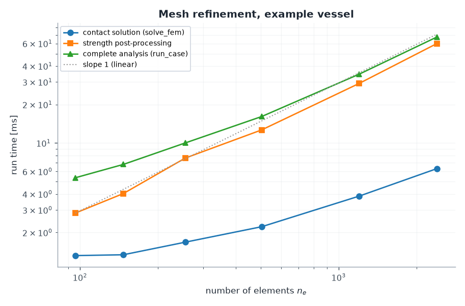
<figcaption aria-hidden="true"><p>Figure 5.1: Measured run times of the contact solution, the strength post-processing and the complete analysis as functions of the number of elements for the example vessel (log–log scale). The dotted line shows slope 1 for reference.</p></figcaption>
</figure>

### 5.9.3 Run time and analysis count of the spacing design

The cost of the spacing design is the number of analyses times the cost of one analysis (Section 4.10.6). The number of analyses depends only on the algorithm and the case, not on the computer, and is therefore the primary measure; Table 5.9 gives it per phase for the four designs of Chapter 6, together with the measured run time of `run_case`.

| Case (44 blocks, FEM) | Phase 1 | Phase 2 (accepted steps, Jacobians) | Phase 3 | Total analyses | $`\max R_{i}/S_{i}`$ | `run_case` \[s\] | per analysis \[ms\] |
|----|---:|---:|---:|---:|---:|---:|---:|
| Spacing example | 17 | 171 (4, 5) | 5 | 193 | 1.340 → 0.761 | 0.76 | 3.9 |
| Weight-curve example | 17 | 275 (6, 7) | 209 | 501 | 1.064 → 0.568 | 1.97 | 3.9 |
| Welded hull, half deformation | 17 | 81 (1, 2) | 6 | 104 | 1.547 → 0.917 | 0.52 | 5.0 |
| Welded hull, full deformation | 17 | 53 (1, 2) | 8 | 78 | 1.971 → 1.350 | 0.63 | 7.8 |

Table 5.9 – Analyses per phase, result and run time of the spacing design (phase 1 includes the analyses of the given plan and of the starting layout; phase 3 includes the rounding).

Phase 1 always costs $`2 + 15 = 17`$ analyses: the given plan, the starting layout and fifteen equidistribution steps. It brings most of the improvement — for the spacing example from 1.340 to 0.788 — at a small fraction of the cost. Phase 2 is the most expensive phase, because each Jacobian costs up to $`N`$ analyses; the measured Jacobians cost between 22 and 40 analyses, fewer than 44, because blocks that are held between two neighbours at the minimum spacing cannot move in either direction and need no difference quotient. The weight-curve example needed six accepted steps and the longest local search (209 analyses, within the budget of $`25N = 1100`$). On the welded hull, an analysis costs more (5.0 and 7.8 ms instead of 3.9 ms) because the contact iteration needs up to three iterations when blocks are open, and phase 2 ended after one accepted step; with open blocks the utilisation is only piecewise smooth in the positions, which limits the range in which the linearisation predicts improvements.

All designs completed within two seconds, in line with requirement N6; the analysis of the given plan alone, with both methods, took 0.016–0.021 s for these cases. Because the number of analyses per phase is bounded — 17 in phase 1, at most $`I_{S}(N + 1)`$ in phase 2 with the iteration limit $`I_{S} = 20`$, and at most $`1 + 25N`$ in phase 3 — the cost of the design is bounded by $`O(N^{2})`$ analyses for any case, each of cost $`O(n)`$, which agrees with the complexity analysis of Section 3.13. In the examples the actual counts were far below these bounds.

### 5.9.4 Limits of scale

For the problem sizes of dry docking — a few tens to about a hundred keel blocks and a few hundred elements — one analysis takes milliseconds and the spacing design a few seconds. The analysis scales linearly with the mesh size and could handle meshes far finer than necessary. The design scales with the number of analyses, which grows at most quadratically with the number of blocks through the finite-difference Jacobian. Should larger problems arise, the analyses of one Jacobian and of one local-search neighbourhood are independent and could be evaluated in parallel, and the Jacobian could be computed from one factorisation of the system matrix instead of by finite differences while the contact states do not change; Section 7.5 lists these as future work.

## 5.10 Limitations of the verification

The verification described in this chapter has the following limitations:

- **No validation.** All comparisons were made with analytical solutions of the same mathematical model, between the program’s methods, or between the program and a substitute model. Whether the model predicts real block loads could not be assessed, given the idealisation of the hull as a beam, the block law, the kinematic welding model and the neglect of transverse effects. No measured block loads or keel surveys of a real hull were available. Validation against measurements, for example from load cells under instrumented blocks combined with a laser survey of the keel, would be the most valuable continuation of this work.
- **Simple benchmark geometries.** The benchmarks use uniform or simply varying loads and a few supports. The example cases of Chapter 6 are far more complex; for them, the program can only be checked through the self-checks of Section 5.7, the re-analysis of the designed layouts and engineering plausibility.
- **Contact iteration.** Convergence of the state iteration, with the gap continuation as a fallback, was demonstrated for all cases tested, including lift-off, crushing, welding gaps of several centimetres and every candidate layout of the spacing designs. No formal proof of termination was given for arbitrary combinations of gaps and crushing. The program therefore enforces an iteration limit and a minimum continuation step, and reports non-convergence as an error.
- **Optimality of the spacing design.** The minimax problem is non-convex and, with the floors, discrete. Sequential linear programming finds a local optimum, and the local search on the floors a local optimum with respect to its neighbourhood; neither is guaranteed to be global. The closed-form cases confirm that the method reaches the global optimum where it is known, but not in general. A status *does not fit* is therefore a statement about the best layout found, not a proof that no layout fits; the diagnosis of the reason (total strength, end block at the limit, gaps) makes this statement checkable by the engineer. Every designed layout, in contrast, is verified: it is the result of a full analysis and is checked like any given plan.
- **Design criterion.** The design minimises the largest ratio of reaction to block strength. The hull girder checks and the block bearing pressure are applied to the designed layout afterwards and are not constraints of the design; in the examples they were all satisfied (Chapter 6).
- **Synthetic survey data.** The identification was verified with synthetic surveys generated from the model itself. Real surveys contain systematic errors, such as datum and temperature effects, and deformation that the kink model does not represent. Their effect could not be assessed.
- **Graphical user interface.** The GUI tests cover the data path between the widgets and the core and the main interactive sequences, but not the visual layout. This was checked by inspection of screenshots.
- **Input data.** No program can detect input that is valid but wrong, such as a mistyped weight or a block strength from the wrong certificate. The cross-check of the summed weights against the declared weight and LCG reduces, but does not remove, this risk.

## 5.11 Summary

The program was verified by 131 automated tests.

- **Load, support and strength models.** The analytical benchmarks covered trapezoidal load integration, the weight curve with jumps, weight items given by their moment, determinate and indeterminate block arrangements, Euler–Bernoulli and Timoshenko beam deflection, continuous beams, shear and moment integration, block crushing and gap equivalence. They were reproduced to relative errors between zero and about $`10^{- 12}`$; the one exception, at about $`10^{- 9}`$, is explained physically by the finite support stiffness. The example’s weight items expressed as one weight curve gave the same reactions to $`10^{- 14}`$. The elastic-hull solution converged to the rigid-hull solution at the theoretically expected rate of $`1/EI`$, and the block reactions were independent of the mesh density.
- **Contact for large gaps.** Solutions with welding gaps of several centimetres satisfied the complementarity conditions and equilibrium to round-off, including a case in which only the gap continuation led to convergence.
- **Welding deformation and identification.** The kink and shrinkage shape functions matched their closed forms, the gaps and reactions were invariant to a straight-line tilt of the keel, and the end blocks were correctly unloaded by an end lift. Joint angles were recovered exactly from a noise-free survey, also with known zone shrinkage subtracted, and to within the accuracy the noise allows from a noisy one (0.070 mrad for the sample survey).
- **Spacing design.** With substitute analyses, the design reached the closed-form optimum for a uniform load to $`2 \times 10^{- 4}`$, gave weak blocks one third of the spacing of three times stronger blocks, and respected the spacing limits, the extent, the grid and fixed ends; an insufficient total strength was diagnosed with a suggested number of blocks. With the full model, the spacing example was brought from 1.340 to 0.761 with every block under a floor and all checks passed; initial gaps moved with their blocks; on the welded hull the welding gaps were recomputed exactly at the designed positions, and a re-analysis from scratch reproduced the design; a moderate welding deformation was absorbed by the spacing and a severe one was diagnosed as gap-governed. The GUI produced the same design as the command-line program and wrote it into the block plan.
- **Run-time checks and interfaces.** Every analysis reports its equilibrium residuals and closure errors, which were of order $`10^{- 17}`$ to $`10^{- 11}`$ for all example cases, including the designed spacings. The GUI produced results identical to the command-line program for all examples.
- **Performance.** One analysis scaled linearly with the mesh size and took about 10 ms with the default mesh. The spacing designs of the examples needed between 78 and 501 analyses and took between 0.5 and 2 s.

The implementation is therefore considered verified with respect to the mathematical model of Chapter 3. Validation of that model against measured block loads and keel surveys remains to be done.

# 6 Results and Discussion

This chapter applies the methods of Chapter 3 and the software of Chapter 4 to an illustrative docking case and its variants. Section 6.1 describes the vessel and the case files. Sections 6.2 to 6.5 report the analysis of a given block plan: the weight distribution, built from weight items and from a weight-distribution curve; the block reactions of the rigid-hull method (Method A) and of the elastic finite element model (Method B); the hull girder loads; and the block checks against the strength of every block. Section 6.6 quantifies, by five parametric studies, how the reactions depend on the block spacing and number, the extent of the block line, the hull and block stiffnesses and initial gaps. Section 6.7 treats the welded hull as built and the identification of the welding deformation from a keel survey. Section 6.8 presents the final result of the thesis, the automatic design of the block spacing from the block strengths: for the example block plan, for variants of the plan, for the weight-curve case and for the welded hull, where the welding deformation acts as a constraint. Section 6.9 discusses the results with respect to the research questions RQ1–RQ5 and states their limitations, and Section 6.10 summarises the chapter.

All numerical values in this chapter were produced with the current version of the `shipsupport` package, either by running the case files in `examples/` or by small scripts that build variants of these files (a changed block plan, stiffness, gap or design setting) and pass them to `case_from_dict` and `run_case`. Results are given in tonnes (t), tonne-metres (t·m), megapascals (MPa) and millimetres (mm). The sign conventions are those of Section 3.2: $`x`$ is measured from the aft perpendicular (AP), positive forward; the hull displacement $`v`$ is positive downward; a block reaction $`R`$ is positive upward on the hull; the shear force $`V(x)`$ is the sum of upward forces minus downward loads aft of $`x`$; the bending moment $`M(x) = \int V\, dx`$ is positive in sagging; and stresses are positive in tension. Blocks are labelled B01, B02, … from aft to forward. Run times refer to the development machine described in Section 5.9.

## 6.1 Case description

### 6.1.1 Status of the data

The vessel is a fictitious general-purpose ship of 120 m length. Its weights, section properties, block properties, strengths, permissible limits and welding parameters were chosen to be mutually consistent and of realistic magnitude, but they **are illustrative placeholders and do not describe any real ship or dock** (Section 1.4). The results therefore demonstrate the behaviour of the methods and the relative importance of the parameters; they are not design values. A real docking analysis requires the ship’s docking plan and loading manual, the dock’s block data and the limits of the governing standard ([U.S. Department of Defense, n.d.-a](#ref-milstd1625); [Naval Sea Systems Command, n.d.](#ref-nstm997)).

### 6.1.2 Principal particulars and block plan

Table 6.1 lists the principal particulars of the example vessel and its given block plan. The block plan is the only definition of the blocks in the program (Section 3.4.4): a block type, the position of the first block, the number of blocks, and the spacing, strength and initial gap of every block.

| Quantity | Value |
|----|----|
| Length between perpendiculars $`L_{pp}`$ | 120.0 m |
| Hull extent (AP to forward end) | 0.0 – 120.0 m |
| Docking weight $`W`$ (declared / computed) | 4500.0 t / 4500.0 t |
| Longitudinal centre of gravity (declared / computed) | 50.470 m / 50.469 m |
| Block plan (given) | 44 keel blocks from $`x`$ = 6.4 m, spacing 2.4 m (line 6.4 – 109.6 m), no initial gaps |
| Block strength | 200 t (type capacity) in `example_case.yaml`; individual strengths in `spacing_case.yaml` (Section 6.1.6) |
| Transverse structure (floors) | every 0.8 m from 0.0 to 120.0 m |

Table 6.1 – Principal particulars and given block plan of the example vessel (illustrative data).

### 6.1.3 Weight items

The docking weight is described by nine weight items (Table 6.2). Eight are spread as trapezoids over their longitudinal extent; the rudder is a point load. Each trapezoid preserves the weight and the longitudinal centre of gravity of its item (Section 3.3.2), which is possible because every LCG lies in the middle third of its extent (Section 3.3.3).

| Item                | Weight \[t\] |  LCG \[m\] | Extent \[m\]  |
|---------------------|-------------:|-----------:|---------------|
| Hull steel          |         2600 |       58.5 | 0.0 – 120.0   |
| Main engine         |          380 |       22.0 | 16.0 – 28.0   |
| Auxiliary machinery |          220 |       26.0 | 14.0 – 38.0   |
| Superstructure      |          420 |       14.0 | 4.0 – 24.0    |
| Outfit              |          520 |       62.0 | 4.0 – 118.0   |
| Propeller and shaft |           60 |        6.0 | 0.0 – 12.0    |
| Rudder              |           25 |        2.0 | point load    |
| Anchors and chain   |           75 |      112.0 | 104.0 – 120.0 |
| Residual fuel       |          200 |       70.0 | 60.0 – 80.0   |
| **Total**           |     **4500** | **50.469** |               |

Table 6.2 – Weight items of the example vessel.

### 6.1.4 Hull girder properties

The hull girder is represented by three prismatic regions (Table 6.3). The bending stiffness $`EI`$ follows from the second moment of area with $`E = 206`$ GPa, and the shear stiffness $`\kappa GA`$ from the effective shear area with $`G = 79.3`$ GPa. The midship region is 2.5 times stiffer in bending than the aft region and 3.3 times stiffer than the forward region.

| Region \[m\] | $`I`$ \[m⁴\] | $`EI`$ \[N·m²\] | $`A_{s}`$ \[m²\] | $`\kappa GA`$ \[N\] | $`Z_{deck}`$ \[m³\] | $`Z_{keel}`$ \[m³\] |
|----|---:|---:|---:|---:|---:|---:|
| 0 – 20 | 8.0 | 1.648 × 10¹² | 0.5 | 3.965 × 10¹⁰ | 1.4 | 1.8 |
| 20 – 100 | 20.0 | 4.120 × 10¹² | 0.9 | 7.137 × 10¹⁰ | 3.6 | 4.4 |
| 100 – 120 | 6.0 | 1.236 × 10¹² | 0.4 | 3.172 × 10¹⁰ | 1.1 | 1.4 |

Table 6.3 – Hull girder section properties.

The permissible still-water bending moment rises from 3000 t·m at the ends to 20 000 t·m at 30 m and 90 m and 25 000 t·m at 60 m (equal for sagging and hogging). The permissible shear force rises from 600 t at the ends to 1500 t between 30 m and 90 m. The allowable hull stresses are 175 MPa in bending and 110 MPa in shear.

### 6.1.5 Block type

All blocks are of one type (Table 6.4). The stiffness follows from three layers acting as springs in series over the contact area (Section 3.4.1); the softwood cap contributes 52 % of the compliance. The block follows the bilinear law of Section 3.4.2: linear up to the crush force, then 5 % of the initial stiffness.

| Property | Value |
|----|----|
| Layers (thickness, modulus) | concrete 0.90 m, 30 000 MPa; hardwood 0.20 m, 1 000 MPa; softwood cap 0.10 m, 400 MPa |
| Contact area | 0.8 m × 1.2 m = 0.96 m² |
| Initial stiffness $`k`$ | 2000 kN/mm |
| Capacity (default strength of every block) | 200 t |
| Allowable bearing pressure | 2.0 MPa (196 t over the contact area) |
| Crush stress / crush force | 4.0 MPa / 391.6 t |
| Compression at the onset of crushing | 1.92 mm |
| Post-crush stiffness ratio | 0.05 |

Table 6.4 – Keel block type.

### 6.1.6 Case files

Table 6.5 lists the case files used in this chapter. They share the hull, the block type and the floors; they differ in the weight description, the block strengths, the welding deformation and whether the spacing design is enabled.

| Case file | Weights | Block plan and strengths | Welding | Spacing design | Sections |
|----|----|----|----|----|----|
| `example_case.yaml` | 9 items (LCG) | 44 × 200 t, 2.4 m | – | off | 6.2–6.6 |
| `weight_curve_case.yaml` | curve (18 points) + 3 items (moment) | 44 × 200 t, 2.4 m | – | on | 6.2, 6.8.3 |
| `spacing_case.yaml` | 9 items (LCG) | 44 blocks, 2.4 m; 160 t for B04–B12, 190 t otherwise (Σ S = 8090 t) | – | on | 6.5, 6.8.1–6.8.2 |
| `welding_case.yaml` | 9 items (LCG) | 44 × 200 t, 2.4 m | prescribed joints and zones | off (switched on in Section 6.8.4) | 6.7, 6.8.4 |
| `welding_survey_case.yaml` | 9 items (LCG) | 44 × 200 t, 2.4 m | survey `welding_survey.csv`, joint angles identified | off | 6.7.4 |

Table 6.5 – Case files of the example vessel.

The block plan of `spacing_case.yaml` represents a realistic situation in a dock: the blocks available are not all equal, and the nine older blocks B04–B12, which in the given plan lie under the engine room, have a lower strength of 160 t. Both strengths are below the 196 t at which the bearing pressure reaches its allowable value, so that the block strength, and not the bearing pressure, is the binding block limit. The settings of the spacing design are those of Section 4.7.4: target utilisation 1.0, minimum spacing $`s_{\min}`$ = 0.8 m (the floor spacing), maximum spacing $`s_{\max}`$ = 4.8 m (twice the given spacing), block line within 6.4–109.6 m, final positions at the floors, at most 20 sequential-LP iterations.

## 6.2 Weight distribution

### 6.2.1 Weight items

Figure 6.1 shows the longitudinal weight distribution assembled from the nine items of Table 6.2. It is strongly non-uniform. Its maximum of 89.06 t/m lies just forward of $`x`$ = 16 m, where the main engine, auxiliary machinery, superstructure, outfit and hull steel overlap; forward of about 38 m the intensity is roughly 25–36 t/m. The mesh of the example has 256 nodes. Its node set includes every item boundary, section boundary and block position (Section 3.3.5), so every element carries an exactly linear load and the integrals of Section 3.3.6 are exact.

<figure>

<figcaption aria-hidden="true"><p>Figure 6.1: Longitudinal weight distribution of the example vessel, built from the weight items of Table 6.2; the rudder is a point load at x = 2.0 m.</p></figcaption>
</figure>

The distributed load integrates to $`W`$ = 4500.0 t with LCG = 50.469 m, which reproduces the sum of the items to machine precision, as the run-time weight check of the program requires (Section 5.7). The declared LCG of 50.470 m differs from the computed value by 0.001 m, well within the tolerance, so no weight warning is raised.

Two features of the distribution decide the block reactions. First, the LCG at 50.47 m lies aft of the centre of the block line at 58.0 m, so the aft blocks must carry more than the forward blocks. Second, a considerable part of the weight lies outside the block line: the hull aft of B01 ($`x`$ = 6.4 m) carries 266.3 t, and the hull forward of B44 ($`x`$ = 109.6 m) carries 298.8 t. These overhangs are cantilevered from the end blocks, and Section 6.3 shows that they control the end-block reactions.

### 6.2.2 Weight-distribution curve and items given by moment

In the weight-curve case the lightship is given as a piecewise-linear weight-distribution curve of 18 points with jumps at $`x`$ = 4, 16, 28, 38 and 104 m, and three deadweight items are given by their longitudinal moment about the AP instead of their LCG (Section 3.3.1). Each of the 12 segments of non-zero length of the curve is converted into an exact trapezoidal item (Section 3.3.4), so that the program treats curve and items in the same way. Table 6.6 lists the totals and Figure 6.2 shows the curve, the items and the total distribution.

| Component | Weight \[t\] | Moment about AP \[t·m\] | LCG \[m\] |
|----|---:|---:|---:|
| Lightship curve (18 points, 12 trapezoids) | 4343.0 | 241 775 | 55.670 |
| Residual fuel (60–80 m) | 200.0 | 14 000 | 70.000 |
| Fresh water (94–106 m) | 60.0 | 6 000 | 100.000 |
| Stores (point load) | 40.0 | 1 200 | 30.000 |
| Deadweight items together | 300.0 | 21 200 | 70.667 |
| **Total** | **4643.0** | **262 975** | **56.639** |

Table 6.6 – Weight-curve case: lightship curve and deadweight items given by their moments. The moment of the curve is $`W \cdot`$ LCG from the program; the item LCGs follow from LCG = moment / weight.

<figure>

<figcaption aria-hidden="true"><p>Figure 6.2: Weight distribution of the weight-curve case: lightship curve with its points and jumps, deadweight items given by their moments (dashed; the stores as a point load) and the total distribution w(x).</p></figcaption>
</figure>

The computed total of 4643.0 t at LCG 56.639 m agrees with the declared values, and the curve alone integrates to 4343.0 t at 55.670 m, as the label of Figure 6.2 shows. The largest intensity is the 64 t/m of the engine room (16–28 m); the jumps appear as vertical steps in the total. Compared with the item description of the example, this distribution is smoother and its LCG lies 6.2 m further forward, close to the centre of the block line. The overhangs carry 121.7 t aft of B01 and 243.3 t forward of B44.

## 6.3 Block reactions: rigid versus elastic hull

### 6.3.1 Overview

Figure 6.3 shows the force on each of the 44 blocks of `example_case.yaml` predicted by the elastic model (bars), with the rigid-hull results as markers, and Figure 6.4 shows the weight distribution and the reactions together with the settlement, shear force and bending moment of both methods. Both solutions satisfy global equilibrium: the reactions sum to 4500.0 t, and the relative force and moment residuals of the elastic solution were below $`10^{- 14}`$. The contact iteration converged in one iteration in both methods, because no block lifted off or crushed.

<figure>

<figcaption aria-hidden="true"><p>Figure 6.3: Weight distribution (top) and force on every block of the example vessel. Bars: elastic hull (Method B), coloured by utilisation of the block limit; diamonds: rigid hull (Method A); dashed line: block capacity of 200 t; dotted line: average load W/N = 102.3 t.</p></figcaption>
</figure>

<figure>
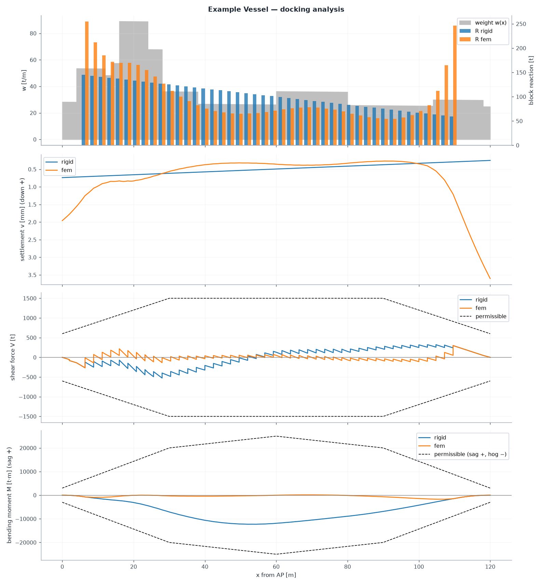
<figcaption aria-hidden="true"><p>Figure 6.4: Example vessel. From top: weight distribution and block reactions; hull settlement; shear force; bending moment. Both methods are shown with the permissible envelopes.</p></figcaption>
</figure>

### 6.3.2 Selected block reactions

Table 6.7 compares the two methods for the five aftmost blocks, a midship block and the five foremost blocks.

| Block | $`x`$ \[m\] | Rigid $`R`$ \[t\] | Elastic $`R`$ \[t\] | Elastic / rigid | Elastic $`\delta`$ \[mm\] | Elastic $`p`$ \[MPa\] |
|----|---:|---:|---:|---:|---:|---:|
| B01 | 6.4 | 145.06 | 254.63 | 1.76 | 1.249 | 2.601 |
| B02 | 8.8 | 143.07 | 211.75 | 1.48 | 1.038 | 2.163 |
| B03 | 11.2 | 141.08 | 185.17 | 1.31 | 0.908 | 1.892 |
| B04 | 13.6 | 139.09 | 171.95 | 1.24 | 0.843 | 1.756 |
| B05 | 16.0 | 137.10 | 169.52 | 1.24 | 0.831 | 1.732 |
| B21 | 54.4 | 105.26 | 66.61 | 0.63 | 0.327 | 0.680 |
| B40 | 100.0 | 67.44 | 70.28 | 1.04 | 0.345 | 0.718 |
| B41 | 102.4 | 65.45 | 82.34 | 1.26 | 0.404 | 0.841 |
| B42 | 104.8 | 63.46 | 112.31 | 1.77 | 0.551 | 1.147 |
| B43 | 107.2 | 61.47 | 164.47 | 2.68 | 0.806 | 1.680 |
| B44 | 109.6 | 59.48 | 246.26 | 4.14 | 1.207 | 2.516 |

Table 6.7 – Reactions, compressions and bearing pressures of selected blocks (`example_case.yaml`).

The rigid method gives a linear distribution, from 145.06 t at B01 to 59.48 t at B44. The elastic model gives a markedly different one. The largest reaction is 254.63 t at B01, 76 % above the rigid value; the reaction at B44 is 246.26 t, 4.1 times the rigid value. Between about 30 m and 100 m the elastic reactions are lower than the rigid ones and follow the local weight intensity; the smallest is 54.39 t at B36 ($`x`$ = 90.4 m).

### 6.3.3 Physical explanation

The difference has two causes.

**Overhang cantilevers.** In the elastic model the 266.3 t of hull aft of B01 and the 298.8 t forward of B44 act as cantilevers. Their weight enters the hull girder near the end blocks and, because the hull can bend, it is carried mainly by the end blocks and their neighbours. In the rigid model the same weight enters only through the global force and moment balance and is spread over all 44 blocks by the planar displacement $`v = a + bx`$, which cannot represent a local concentration of load.

**Local load following.** A flexible hull settles more where it is heavily loaded. The elastic reactions therefore track the weight distribution: about 166–172 t under the machinery space (13.6–20.8 m) and about 65–68 t under the light midbody (45–50 m). A rigid hull forces all blocks into one plane, so its reactions are linear whatever the weight distribution.

The distance over which the hull spreads a concentrated load is governed by the characteristic parameter of a beam on an elastic foundation ([Hetényi 1946](#ref-hetenyi1946)) (Section 2.6):

``` math
\lambda = \left( \frac{k_{f}}{4\, EI} \right)^{1/4},\quad\quad k_{f} = \frac{k}{s}\quad\quad\quad\quad(6.1)
```

where $`k_{f}`$ is the foundation modulus obtained by smearing the block stiffness $`k`$ over the spacing $`s`$. For the midship region ($`EI = 4.12 \times 10^{12}`$ N·m², $`k = 2.0 \times 10^{9}`$ N/m, $`s`$ = 2.4 m), Equation (6.1) gives $`\lambda = 0.0843`$ m⁻¹, a characteristic length $`1/\lambda`$ = 11.86 m and a half-wavelength $`\pi/\lambda`$ = 37.3 m. A load is therefore spread over about 15 blocks on each side, much less than the 103.2 m of the block line, and the hull behaves as a long beam on an elastic foundation rather than as a rigid body. The end regions are more flexible still, since their $`EI`$ is 2.5–3.3 times smaller.

The settlement curves of Figure 6.4 confirm this. The rigid solution is a straight line from 0.74 mm at the stern to 0.25 mm at the bow. The elastic hull settles by 1.96 mm at the aft tip and 3.60 mm at the forward tip: both overhangs sag onto the end blocks.

### 6.3.4 Weight-curve case

For the smoother weight distribution of the weight-curve case (Section 6.2.2), the rigid method gives reactions between 113.50 t (B01) and 97.54 t (B44), and every block passes. The elastic model again concentrates the load at the ends: 128.14 t at B01 and 212.80 t at B44, which exceeds the block capacity of 200 t by 6.4 % and fails the block checks (utilisation 1.064 against strength, 1.087 in bearing pressure). The forward end governs here because the forward overhang (243.3 t) is twice the aft one (121.7 t). The same qualitative difference between the two methods appears with a different weight description, which shows that it is a property of the support problem and not of a particular load case.

## 6.4 Hull girder loads and stresses

### 6.4.1 Shear force and bending moment

The shear force and bending moment are obtained by exact integration of the linear element loads, point loads and reactions (Section 3.8). In both methods the curves close to zero at the forward end within round-off, which confirms global equilibrium.

The two methods give fundamentally different bending moments (Figure 6.4, bottom). With the rigid hull, the moment is hogging over almost the whole length and reaches −12 298.9 t·m near $`x`$ = 54 m. With the elastic hull, the largest moment in magnitude is −1 723.4 t·m at $`x`$ = 107.2 m, in the forward overhang region, and the largest sagging moment is +143.1 t·m at $`x`$ = 69.9 m. The largest shear forces are 525.9 t (rigid) and 298.8 t (elastic).

### 6.4.2 Governing checks

Table 6.8 lists the governing hull girder checks of both methods. The governing location is where the ratio of demand to capacity is largest, which is not necessarily where the demand is largest, because the permissible envelopes vary along the length. The utilisation of a check is

``` math
\eta = \frac{|D|}{C}\quad\quad\quad\quad(6.2)
```

where $`D`$ is the demand and $`C`$ the capacity at the same location; for the bending moment, $`C`$ is the sagging limit where $`M \geq 0`$ and the hogging limit where $`M < 0`$.

| Check | Rigid: demand | Rigid: limit | Rigid: $`\eta`$ | Elastic: demand | Elastic: limit | Elastic: $`\eta`$ |
|----|---:|---:|---:|---:|---:|---:|
| Bending moment \[t·m\] | −12 191.8 (49.6 m) | 23 266.7 | 0.524 | −1 511.4 (109.6 m) | 8 893.3 | 0.170 |
| Shear force \[t\] | −525.9 (28.0 m) | 1 440.0 | 0.365 | −266.3 (6.4 m) | 792.0 | 0.336 |
| Deck stress \[MPa\] | 37.66 (100.06 m) | 175 | 0.215 | 15.36 (107.2 m) | 175 | 0.088 |
| Keel stress \[MPa\] | −29.59 (100.06 m) | 175 | 0.169 | −12.07 (107.2 m) | 175 | 0.069 |
| Shear stress \[MPa\] | 7.89 (102.4 m) | 110 | 0.072 | 7.33 (109.6 m) | 110 | 0.067 |

Table 6.8 – Governing hull girder checks of `example_case.yaml` (location of the governing value in brackets).

All hull girder checks pass with both methods; the highest utilisation is 0.524, for the bending moment of the rigid method. The deck stresses are tensile because the hull is in hogging.

### 6.4.3 Why the rigid method overstates hogging

The rigid method overstates the largest bending moment by a factor of 7.1 (12 298.9 / 1 723.4). This follows from equilibrium. The bending moment at a section is the moment of the net load $`w - R`$ on one side of it. In the rigid solution the reactions are linear in $`x`$, while the weight is concentrated aft (machinery, superstructure) and in the overhangs; integrating this mismatch over half the length produces a large hogging moment amidships. In the elastic solution the reactions follow the weight locally (Section 6.3.3), so the net load on every segment is small and so is the moment. The remaining elastic moments lie in the overhangs, where they are statically determined by the cantilevered weight: the governing value of −1 511.4 t·m at $`x`$ = 109.6 m is the moment of the forward overhang about the last block.

For the hull girder, the rigid method is therefore conservative in this example. For the blocks it is not: it underestimates the most critical block load by 43 % (145.06 t instead of 254.63 t). A method that is conservative for one quantity is not necessarily conservative for another; this is the central practical finding of the comparison, and it is the reason why the spacing design of Section 6.8 uses the elastic model.

## 6.5 Block checks against block strength

The block checks compare the bearing pressure $`p = R/A`$ with the allowable pressure and the reaction with the strength $`S_{i}`$ of each block (Section 3.8). Table 6.9 lists, for the elastic solution of both block plans, every block whose utilisation exceeds 0.9.

| Case | Block | $`x`$ \[m\] | $`R`$ \[t\] | $`S_{i}`$ \[t\] | $`R/S_{i}`$ | $`p`$ \[MPa\] | $`p/p_{allow}`$ |
|----|----|---:|---:|---:|---:|---:|---:|
| `example_case` | B01 | 6.4 | 254.63 | 200 | 1.273 | 2.601 | 1.301 |
|  | B02 | 8.8 | 211.75 | 200 | 1.059 | 2.163 | 1.082 |
|  | B03 | 11.2 | 185.17 | 200 | 0.926 | 1.892 | 0.946 |
|  | B44 | 109.6 | 246.26 | 200 | 1.231 | 2.516 | 1.258 |
| `spacing_case` | B01 | 6.4 | 254.63 | 190 | 1.340 | 2.601 | 1.301 |
|  | B02 | 8.8 | 211.75 | 190 | 1.114 | 2.163 | 1.082 |
|  | B03 | 11.2 | 185.17 | 190 | 0.975 | 1.892 | 0.946 |
|  | B04 – B07 | 13.6 – 20.8 | 165.7 – 171.9 | 160 | 1.036 – 1.075 | 1.69 – 1.76 | 0.85 – 0.88 |
|  | B08 | 23.2 | 155.2 | 160 | 0.970 | 1.585 | 0.793 |
|  | B43 | 107.2 | 164.47 | 190 | 0.866 | 1.680 | 0.840 |
|  | B44 | 109.6 | 246.26 | 190 | 1.296 | 2.516 | 1.258 |

Table 6.9 – Highly utilised blocks in the elastic solution of the given block plans (2.4 m spacing). B43 of `spacing_case` is listed for comparison.

With the uniform capacity of 200 t (`example_case.yaml`), three blocks fail: B01, B02 and B44, with a largest utilisation of 1.301 (bearing pressure at B01). No block reaches the crush force of 391.6 t. With the rigid method the largest utilisations are 0.741 (pressure) and 0.725 (strength), both at B01, and every check passes. **The rigid method thus fails to identify three overloaded blocks**, and the overall verdict of the case changes from “passed” to “failed” when the hull is modelled as elastic.

With the individual strengths of `spacing_case.yaml`, seven blocks are loaded beyond their strength: the end blocks B01 and B44, B02, and four of the 160 t blocks under the engine room (B04–B07), where the elastic hull follows the heavy machinery weight. The largest ratio of reaction to strength is 1.340 at B01. The rigid method gives a largest ratio of 0.869, at B04 (139.1 t on a 160 t block), and again passes every check. The given block plan is therefore not acceptable, although the total strength of its blocks (8090 t) is 1.8 times the docking weight: the problem is not the amount of strength but its distribution along the hull. This is the situation that the spacing design of Section 6.8 resolves.

All blocks of the given plans lie at floors, because 6.4 m and the spacing of 2.4 m are multiples of the floor spacing of 0.8 m, so no off-structure warning is raised.

## 6.6 Parametric studies

The parametric studies quantify how the reactions of the given block plan depend on the main design and modelling parameters. They use `example_case.yaml` (44 blocks of 200 t, no initial gaps, both methods) and change one group of parameters at a time. Its baseline elastic solution has a largest reaction of 254.63 t at B01, 246.26 t at B44 and a smallest reaction of 54.39 t; the rigid baseline has a largest reaction of 145.06 t and a largest bending moment of 12 298.9 t·m. In all tables “failing blocks” is the number of blocks with a pressure or strength utilisation above 1.0 in the elastic solution. The studies motivate the spacing design: they show which changes of the block plan relieve the governing blocks, and by how much.

### 6.6.1 Block spacing and number of blocks

In the first study the block line starts at 6.4 m, the spacing is varied from 1.6 m to 4.8 m, and the number of blocks is the largest that keeps the last block at or before 109.6 m (Table 6.10 and Figure 6.5).

| Spacing \[m\] | Blocks | Last block \[m\] | Max. $`R`$ \[t\] | Aft end $`R`$ \[t\] | Fwd end $`R`$ \[t\] | Min. $`R`$ \[t\] | Rigid max. $`R`$ \[t\] | Failing blocks |
|---:|---:|---:|---:|---:|---:|---:|---:|---:|
| 1.6 | 65 | 108.8 | 216.54 | 195.37 | 216.54 | 33.06 | 97.28 | 1 |
| 2.0 | 52 | 108.4 | 248.70 | 226.03 | 248.70 | 42.45 | 120.49 | 2 |
| 2.4 | 44 | 109.6 | 254.63 | 254.63 | 246.26 | 54.39 | 145.06 | 3 |
| 2.8 | 37 | 107.2 | 315.41 | 281.42 | 315.41 | 61.67 | 165.04 | 7 |
| 3.2 | 33 | 108.8 | 306.90 | 306.90 | 299.64 | 74.76 | 189.99 | 7 |
| 3.6 | 29 | 107.2 | 352.17 | 330.93 | 352.17 | 83.94 | 209.75 | 8 |
| 4.0 | 26 | 106.4 | 386.32 | 354.11 | 386.32 | 93.28 | 230.11 | 8 |
| 4.8 | 22 | 107.2 | 392.23 | 392.20 | 392.23 | 118.02 | 274.93 | 8 |

Table 6.10 – Effect of a uniform block spacing (block line from 6.4 m, ending at or before 109.6 m).

<figure>
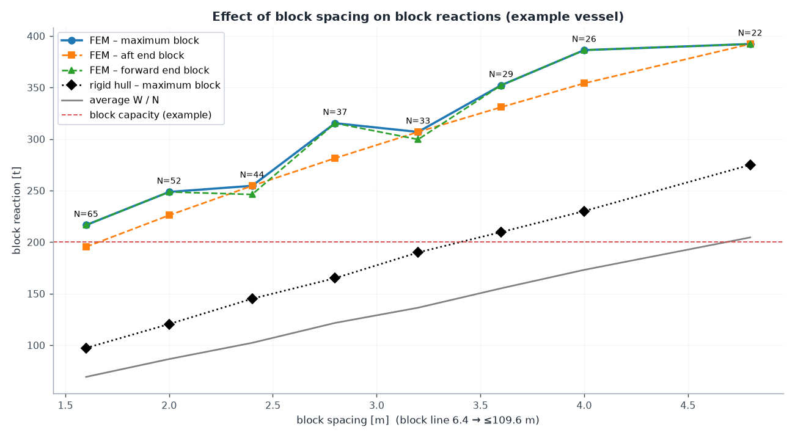
<figcaption aria-hidden="true"><p>Figure 6.5: Effect of a uniform block spacing on the largest and end-block reactions of the elastic model and on the largest reaction of the rigid model; N is the number of blocks.</p></figcaption>
</figure>

The largest reaction grows with the spacing from 216.5 t to 392.2 t. Even the closest spacing of 1.6 m (65 blocks) leaves one block above its capacity. The growth is not monotonic: 2.8 m gives a higher maximum than 3.2 m, because the last block then lies at 107.2 m instead of 108.8 m and the forward overhang is 1.6 m longer. At 4.8 m both end blocks crush. The ratio of the largest elastic to the largest rigid reaction falls from 2.23 at 1.6 m to 1.43 at 4.8 m, but the absolute discrepancy stays large. Spacings of 2.0, 2.8 and 3.6 m are not multiples of the floor spacing and place 26, 18 and 14 blocks off the floors.

Table 6.11 prescribes the number of blocks on the fixed line 6.4–109.6 m. Reducing the count from 60 to 20 nearly doubles the largest reaction.

| Blocks | Spacing \[m\] | Max. $`R`$ \[t\] | Min. $`R`$ \[t\] | Rigid max. $`R`$ \[t\] | Crushed | Failing blocks | Off floors |
|---:|---:|---:|---:|---:|---:|---:|---:|
| 20 | 5.432 | 397.18 | 138.54 | 314.13 | 2 | 8 | 12 |
| 30 | 3.559 | 328.46 | 86.22 | 211.44 | 0 | 7 | 18 |
| 44 | 2.400 | 254.63 | 54.39 | 145.06 | 0 | 3 | 0 |
| 60 | 1.749 | 211.40 | 37.72 | 106.76 | 0 | 2 | 36 |

Table 6.11 – Effect of the number of blocks on the fixed block line 6.4 – 109.6 m (uniform spacing).

Both tables show the limitation of a *uniform* spacing: more blocks reduce the largest reaction only slowly, because the end blocks always carry the overhangs, while the least loaded blocks, amidships, use only 17–27 % of their capacity when 44 or more blocks are used. A uniform plan cannot fit the reactions to the strengths; a designed, non-uniform spacing can (Section 6.8).

### 6.6.2 Extent of the block line

The second study varies the extent of the block line at a constant spacing of 2.4 m (Table 6.12), which directly changes the overhangs.

| Block line \[m\] | Blocks | Max. $`R`$ \[t\] (block) | Aft end $`R`$ \[t\] | Fwd end $`R`$ \[t\] | Max. \|M\| elastic \[t·m\] | Max. \|M\| rigid \[t·m\] | Failing blocks | All checks |
|----|---:|----|---:|---:|---:|---:|---:|----|
| 6.4 – 109.6 (baseline) | 44 | 254.63 (B01) | 254.63 | 246.26 | 1 723.4 | 12 298.9 | 3 | fail |
| 4.0 – 109.6 | 45 | 246.26 (B45) | 174.24 | 246.26 | 1 723.4 | 10 322.5 | 1 | fail |
| 6.4 – 114.4 | 46 | 254.63 (B01) | 254.63 | 146.05 | 943.0 | 11 112.1 | 2 | fail |
| 4.0 – 114.4 | 47 | 174.25 (B01) | 174.25 | 146.05 | 539.2 | 8 844.8 | 0 | **pass** |
| 6.4 – 100.0 | 40 | 393.49 (B40) | 254.66 | 393.49 | 6 207.5 | 16 060.4 | 5 | fail |
| 10.0 – 108.4 | 42 | 391.78 (B01) | 391.78 | 270.87 | 2 379.5 | 15 911.9 | 5 | fail |

Table 6.12 – Effect of the extent of the block line (uniform spacing 2.4 m).

The extent has the strongest influence of all parameters studied. Extending the line by 2.4 m aft and 4.8 m forward (4.0–114.4 m, three more blocks) reduces the largest reaction by 32 %, from 254.63 t to 174.25 t, and the largest elastic bending moment by 69 %, to 539.2 t·m. It is the only configuration of this study in which every check passes, with largest utilisations of 0.890 (bearing pressure) and 0.871 (strength) at the new aft end block. Each extension acts locally: extending only aft relieves the aft end block but leaves the forward end unchanged, and vice versa. Shortening the line forward to 100.0 m raises the forward end-block reaction to 393.49 t, crushes that block and raises the elastic bending moment to 6 207.5 t·m because of the 20 m cantilever. Starting the line at 10.0 m has the same effect at the aft end (391.78 t) and, since 10.0 m is not a multiple of 0.8 m, places all 42 blocks off the floors.

### 6.6.3 Hull bending stiffness

In the third study the second moments of area of all regions are scaled by a common factor, with unchanged shear areas (Table 6.13 and Figure 6.6). The rigid solution does not depend on $`EI`$ and stays at 145.06 t (aft end) and 59.48 t (forward end).

| $`EI`$ factor | Max. $`R`$ \[t\] (block) | Aft end $`R`$ \[t\] | Fwd end $`R`$ \[t\] | Min. $`R`$ \[t\] | Max. \|M\| \[t·m\] | Failing blocks |
|---:|----|---:|---:|---:|---:|---:|
| 0.1 | 394.68 (B44) | 322.38 | 394.68 | 14.65 | 1 511.4 | 3 |
| 0.25 | 336.55 (B44) | 287.75 | 336.55 | 38.06 | 1 511.4 | 3 |
| 0.5 | 286.44 (B44) | 269.04 | 286.44 | 47.82 | 1 627.0 | 3 |
| 1 | 254.63 (B01) | 254.63 | 246.26 | 54.39 | 1 723.4 | 3 |
| 2 | 242.96 (B01) | 242.96 | 216.16 | 59.37 | 1 879.2 | 3 |
| 5 | 230.04 (B01) | 230.04 | 188.94 | 63.95 | 2 104.2 | 2 |
| 10 | 221.41 (B01) | 221.41 | 174.78 | 66.29 | 2 294.1 | 2 |
| 100 | 203.73 (B01) | 203.73 | 152.07 | 69.52 | 3 470.7 | 1 |
| 1000 | 200.34 (B01) | 200.34 | 148.24 | 69.96 | 3 829.9 | 1 |

Table 6.13 – Effect of the hull bending stiffness (second moments of area of all regions scaled; shear areas unchanged).

<figure>
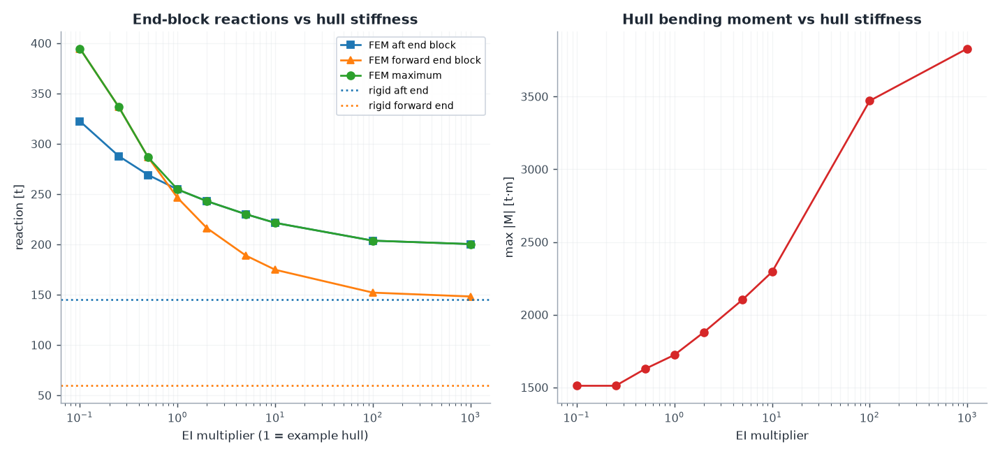
<figcaption aria-hidden="true"><p>Figure 6.6: Effect of the hull bending stiffness on the end-block and largest reactions (left) and on the largest bending moment (right); dotted lines show the rigid-hull end-block reactions.</p></figcaption>
</figure>

A stiffer hull spreads the overhang loads over more blocks: the largest reaction falls from 394.68 t at a tenth of the baseline stiffness to 200.34 t at a thousandfold stiffness, and the bending moment rises from 1 511.4 t·m to 3 829.9 t·m. Even at a thousandfold bending stiffness the aft end-block reaction is 38 % above the rigid value and the moment is less than a third of the rigid one. The reason is the shear flexibility, which was not scaled: the rigid method is the limit of the elastic model when both $`EI`$ and $`\kappa GA`$ tend to infinity (verified in Section 5.4 for a hull without shear deformation), and real hulls are far from that limit. For the most flexible variants the largest moment equals the statically determined moment of the forward overhang about the last block (1 511.4 t·m), because the interior moments are smaller still.

### 6.6.4 Block stiffness

In the fourth study the block stiffness is prescribed directly between 500 and 8000 kN/mm; in a second variant only the modulus of the softwood cap is changed (Table 6.14).

| $`k`$ \[kN/mm\] | Max. $`R`$ \[t\] (block) | Aft end $`R`$ \[t\] | Fwd end $`R`$ \[t\] | Min. $`R`$ \[t\] | Max. \|M\| \[t·m\] | Failing blocks |
|---:|----|---:|---:|---:|---:|---:|
| 500 | 229.25 (B01) | 229.25 | 176.64 | 63.84 | 2 177.0 | 2 |
| 1000 | 240.46 (B01) | 240.46 | 207.81 | 59.64 | 1 917.1 | 3 |
| 2000 | 254.63 (B01) | 254.63 | 246.26 | 54.39 | 1 723.4 | 3 |
| 4000 | 290.97 (B44) | 274.14 | 290.97 | 50.07 | 1 616.1 | 3 |
| 8000 | 339.68 (B44) | 299.72 | 339.68 | 47.79 | 1 511.4 | 3 |
| 1315 (cap 200 MPa) | 245.57 (B01) | 245.57 | 222.16 | 57.67 | 1 838.9 | 3 |
| 2704 (cap 800 MPa) | 265.05 (B44) | 262.36 | 265.05 | 52.19 | 1 678.3 | 3 |
| 3282 (cap 1600 MPa) | 277.67 (B44) | 267.93 | 277.67 | 50.98 | 1 648.0 | 3 |

Table 6.14 – Effect of the block stiffness (upper part: prescribed stiffness; lower part: modulus of the softwood cap varied, stiffness from the layers).

Stiffer blocks raise the end-block reactions; softer blocks act like a stiffer hull, because both reduce $`\lambda`$ in Equation (6.1). The equivalence holds quantitatively: quadrupling the block stiffness (8000 kN/mm) gives a largest reaction of 339.68 t, within 1 % of the 336.55 t obtained by quartering $`EI`$; the small difference arises because the shear stiffness is not scaled. Doubling the cap modulus raises the block stiffness by only 35 % (from 2000 to 2704 kN/mm), because the other layers then dominate the compliance. Soft caps are a means of spreading load, but over the tested range they do not remove the overload of the end blocks.

### 6.6.5 Initial gaps

The fifth study gives a single block an initial gap through the `gap_mm` entry of the block plan (Section 3.4.4), which moves with its block (Table 6.15).

| Gapped block | Gap \[mm\] | $`R`$ of gapped block \[t\] | Neighbour reactions \[t\] | Max. $`R`$ \[t\] (block) | State |
|----|---:|---:|----|----|----|
| B21 (54.4 m) | 0.0 | 66.61 | 65.44 / 68.56 | 254.63 (B01) | elastic |
| B21 (54.4 m) | 0.3 | 14.85 | 72.94 / 76.06 | 254.50 (B01) | elastic |
| B21 (54.4 m) | 0.5, 1.0 or 2.0 | 0.00 | 75.09 / 78.21 | 254.46 (B01) | open |
| B08 (23.2 m) | 1.0 | 0.00 | 190.98 / 165.55 | 254.50 (B01) | open |
| B11 (30.4 m) | 1.0 | 0.00 | 143.13 / 116.91 | 253.01 (B01) | open |
| B01 (6.4 m) | 0.5 | 198.16 | 241.41 (B02) | 246.26 (B44) | elastic |
| B01 (6.4 m) | 1.0 | 141.70 | 271.06 (B02) | 271.06 (B02) | elastic |
| B44 (109.6 m) | 1.0 | 135.58 | 222.78 (B43) | 254.63 (B01) | elastic |

Table 6.15 – Effect of a single initial gap.

A gap in the midbody reduces the load of the gapped block, and once it exceeds the local elastic compression (0.33 mm at B21) the block carries nothing. Its load moves mainly to the two neighbours, which gain about 10 t each; the effect stays within roughly one characteristic length, and the largest reaction changes by less than 0.1 %. Near the ends the behaviour differs. A 1.0 mm gap at B01 reduces its reaction from 254.63 t to 141.70 t but shifts the load to B02, which then carries 271.06 t, more than B01 carried without the gap: a gap at the most loaded block moves the peak inwards and can increase it. A 1.0 mm gap at B44 shifts load to B43 and raises the largest bending moment from 1 723.4 to 2 103.8 t·m, because the effective forward overhang becomes longer. A 1.0 mm gap at B08, under the machinery, raises its aft neighbour to 190.98 t, close to the block capacity. Height deviations of the order of one millimetre are thus significant compared with the elastic compressions of 0.3–1.2 mm (Table 6.7). This sensitivity is the key to the welded hull of Section 6.7, whose keel deviates by tens of millimetres.

### 6.6.6 Ranking of the parameters

Table 6.16 ranks the parameters by their influence on the largest block reaction over the ranges studied.

| Rank | Parameter | Range studied | Max. $`R`$ range \[t\] | Character of the effect |
|---:|----|----|----|----|
| 1 | Extent of the block line (overhangs) | ends at 4.0 / 6.4 / 10.0 m and 100.0 / 108.4 – 109.6 / 114.4 m | 174.3 – 393.5 | dominant, local to each end |
| 2 | Uniform spacing / number of blocks | 1.6 – 5.4 m (65 – 20 blocks) | 211.4 – 397.2 | global, roughly proportional to the spacing |
| 3 | Block stiffness | 500 – 8000 kN/mm | 229.3 – 339.7 | through $`\lambda`$; stiffer blocks concentrate load |
| 4 | Hull bending stiffness | 0.25 – 100 × baseline | 203.7 – 336.6 | through $`\lambda`$; a stiffer hull spreads load |
| 5 | Single initial gap | 0 – 2 mm at various blocks | 246.3 – 271.1 | local; significant near the ends only |

Table 6.16 – Ranking of the parameters by their influence on the largest block reaction (straight hull, uniform spacing).

The parameters that can be chosen in the docking plan — the extent of the block line and the positions of the blocks — are more effective than the structural parameters, which cannot be changed. Because $`EI`$ and $`k`$ enter mainly through $`k/(s\, EI)`$, an uncertainty in one of them can be expressed as an equivalent uncertainty in the other; quartering the hull stiffness or quadrupling the block stiffness raised the largest reaction by about one third. Welding deformation, a distributed gap, is treated in Section 6.7.

## 6.7 Welded hull: as-built reactions and identification from a survey

### 6.7.1 Case description

In `welding_case.yaml` the ship of Section 6.1 is assembled from six construction blocks of 20 m length, with erection joints at $`x`$ = 20, 40, 60, 80 and 100 m. Two welding-deformation mechanisms are prescribed (Section 3.9): angular distortion at the joints of 0.9, 0.5, 0.4, 0.5 and 0.6 mrad (aft to forward), positive values making the keel concave upwards; and a uniform shrinkage curvature in every construction block from a deck shrinkage of 0.24 mm/m, a bottom shrinkage of 0.20 mm/m and a depth of 10 m, i.e. $`\kappa = 4 \times 10^{- 6}`$ m⁻¹. These values are placeholders of plausible magnitude, not measurements. The block plan is that of `example_case.yaml` (44 blocks of 200 t, 2.4 m). The keel lift is referred to the least-squares line through the block positions and shifted so that the lowest block point has zero gap (Section 3.9). The resulting gap is 41.4 mm at B01 and 39.0 mm at B44 and vanishes at B23 ($`x`$ = 59.2 m).

### 6.7.2 As-built block reactions

Table 6.17 lists the reactions of selected blocks.

| Block | $`x`$ \[m\] | Gap \[mm\] | Rigid $`R`$ \[t\] | Elastic $`R`$ \[t\] |
|-------|------------:|-----------:|------------------:|--------------------:|
| B01   |         6.4 |      41.42 |              0.00 |                0.00 |
| B02   |         8.8 |      37.26 |              0.00 |                0.00 |
| B03   |        11.2 |      33.12 |              0.00 |                0.00 |
| B04   |        13.6 |      29.00 |              0.00 |                9.20 |
| B06   |        18.4 |      20.83 |              0.00 |              338.80 |
| B07   |        20.8 |      17.50 |              0.00 |    394.25 (crushed) |
| B08   |        23.2 |      15.63 |              0.00 |              317.06 |
| B09   |        25.6 |      13.79 |              0.00 |              219.40 |
| B18   |        47.2 |       1.83 |  401.69 (crushed) |               16.62 |
| B19   |        49.6 |       1.42 |  401.89 (crushed) |                0.00 |
| B20   |        52.0 |       1.03 |  401.85 (crushed) |                0.00 |
| B21   |        54.4 |       0.66 |  401.57 (crushed) |               21.93 |
| B41   |       102.4 |      27.76 |              0.00 |               32.80 |
| B42   |       104.8 |      31.48 |              0.00 |                0.00 |
| B43   |       107.2 |      35.22 |              0.00 |                0.00 |
| B44   |       109.6 |      38.98 |              0.00 |                0.00 |

Table 6.17 – Selected block reactions of the welded hull as built (`welding_case.yaml`, given block plan).

With the elastic model, the welding deformation unloads eight blocks completely: the three aftmost (B01–B03), the three foremost (B42–B44) and two midship blocks (B19 and B20), where the kinks at 40 m and 60 m leave the keel locally high relative to its neighbours. The load moves to the quarter regions. B07 ($`x`$ = 20.8 m), just forward of the joint at 20 m and under the machinery, carries 394.25 t, exceeds its crush force and is the only crushed block; B06 and B08 carry 338.8 t and 317.1 t. The largest ratio of reaction to strength is 1.971 and the largest bearing-pressure utilisation 2.014, against 1.273 and 1.301 for the straight hull. The contact iteration needed three iterations, and the equilibrium residuals stayed below $`10^{- 13}`$.

The rigid-hull model gives a qualitatively different and physically meaningless picture. A rigid hull cannot bend to follow a concave keel, so it rests on the lowest part of the line only: 31 blocks are unloaded, the remaining 13 blocks between 35.2 m and 64.0 m carry the whole ship, 10 of them crush and the largest reaction is 401.9 t at B19, a block that the elastic model finds unloaded. The corresponding hogging moment of −54 211.8 t·m (bending-moment utilisation 2.314) is an artefact of the rigid assumption; the elastic model gives −13 119.9 t·m at $`x`$ = 40.0 m, with a governing bending-moment utilisation of 0.611 and a shear-force utilisation of 0.715. For a keel deviation of several centimetres, the support problem can only be analysed with a flexible hull girder: the elastic settlement of the overhangs under their own weight, of the same order as the welding lift, decides which blocks touch.

### 6.7.3 Identification of the joint angles from a synthetic survey

The welding deformation is normally measured rather than predicted. To test the identification of Section 3.10, a synthetic survey was generated from the joint kinks of Section 6.7.1 with stations every 5 m from 0 to 120 m (25 points), an arbitrary datum and tilt and normally distributed noise with a standard deviation of 1 mm; the five joint angles and the straight-line terms were fitted by linear least squares. The survey is synthetic and does not originate from a real ship. Figure 6.7 shows the fit and the identified angles, and Table 6.18 summarises variants of the survey. Each row of the table uses the same random seed as Figure 6.7; the standard deviations were obtained from 200 further noise realisations per row.

<figure>
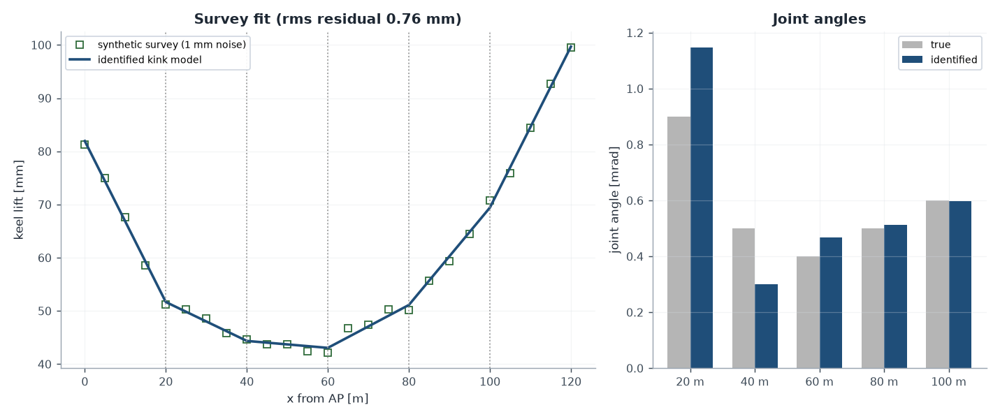
<figcaption aria-hidden="true"><p>Figure 6.7: Identification of the joint angles from a synthetic keel survey (stations every 5 m, 1 mm noise). Left: survey points with the fitted straight line removed and the identified kink model; right: true and identified joint angles.</p></figcaption>
</figure>

| Stations \[m\] | Points | Noise \[mm\] | Regularisation | Identified angles \[mrad\] (true 0.9 / 0.5 / 0.4 / 0.5 / 0.6) | Max. error \[mrad\] | RMS residual \[mm\] | Std. dev. (200 runs) \[mrad\] |
|---:|---:|---:|---:|----|---:|---:|----|
| 5.0 | 25 | 1.0 | 0 | 1.148 / 0.301 / 0.468 / 0.512 / 0.598 | 0.248 | 0.756 | 0.087 – 0.098 |
| 2.5 | 49 | 1.0 | 0 | 0.843 / 0.552 / 0.456 / 0.380 / 0.704 | 0.120 | 0.900 | 0.062 – 0.076 |
| 1.0 | 121 | 1.0 | 0 | 0.972 / 0.477 / 0.420 / 0.454 / 0.637 | 0.072 | 0.895 | 0.039 – 0.049 |
| 5.0 | 25 | 0.5 | 0 | 1.024 / 0.400 / 0.434 / 0.506 / 0.599 | 0.124 | 0.378 | 0.044 – 0.049 |
| 5.0 | 25 | 1.0 | 10⁻³ | 1.032 / 0.374 / 0.439 / 0.533 / 0.558 | 0.132 | 0.799 | 0.069 – 0.081 |
| 5.0 | 25 | 1.0 | 10⁻² | 0.640 / 0.518 / 0.463 / 0.529 / 0.405 | 0.260 | 1.486 | 0.030 – 0.037 |

Table 6.18 – Identification of the joint angles from synthetic keel surveys (`identify_joint_angles`; one realisation shown per row, standard deviations over 200 realisations).

The fit reproduces the survey with an RMS residual of 0.76 mm, at the level of the noise, but the individual angles of this realisation deviate by up to 0.25 mrad, most at the joints at 20 m and 40 m. The realisation of Figure 6.7 is an unfavourable one: over 200 realisations the standard deviation is about 0.09 mrad per angle for 5 m stations, falling to 0.06–0.08 mrad for 2.5 m and 0.04–0.05 mrad for 1 m stations, and the mean error (bias) is below 0.01 mrad. Halving the noise halves the scatter, as expected for a linear estimator. The problem is moderately ill-conditioned ([Hansen 1998](#ref-hansen1998)): noise near a joint can be explained either by that joint or by its neighbour. The sum of the angles, which governs the end lift, is better determined (3.03 mrad identified against 2.90 mrad true). Tikhonov regularisation trades scatter for bias: $`10^{- 3}`$ reduces the scatter slightly and halves the largest error of this realisation, while $`10^{- 2}`$ biases the outer angles towards zero (by −0.34 mrad at 20 m) and doubles the residual, the usual trade-off between noise suppression and bias ([Hansen 1998](#ref-hansen1998)). For the support problem the identified model is used only to compute the gaps at the blocks, whose error is of the order of the survey noise.

### 6.7.4 Survey-based welding case

`welding_survey_case.yaml` demonstrates the complete data path from a survey file to the block reactions. The survey `welding_survey.csv` contains 25 keel heights every 5 m. It was generated from the welding model of Section 6.7.1, shifted by an arbitrary instrument datum and tilt, disturbed by noise with a standard deviation of 0.5 mm and rounded to 0.1 mm. The case gives the joint positions and the zone shrinkage and requests the identification of the joint angles; the known shrinkage part is subtracted from the survey before the fit (Section 3.10).

The identified angles are 0.938, 0.477, 0.384, 0.497 and 0.670 mrad, against 0.9, 0.5, 0.4, 0.5 and 0.6 mrad used to generate the data, i.e. within 0.07 mrad. The survey is reproduced with an RMS residual of 0.295 mm and a largest residual of 0.698 mm, consistent with the noise. The gaps at the end blocks become 41.04 mm aft and 38.89 mm forward, against 41.42 mm and 38.98 mm for the prescribed model. The elastic as-built state is practically the same as in Section 6.7.2: nine blocks carry no load (B01–B04, B19, B20, B42–B44), B07 is crushed with 395.10 t, and the largest ratio of reaction to strength is 1.975 (1.971 with the prescribed model).

Figure 6.8 shows the welding data figure that the program produces for every case with welding deformation (file `welding_data.png`, GUI result tab “Welding data”). The top panel shows the keel lift used for the gaps, its components — the joint kinks and the zone shrinkage, each with its straight-line part removed — the 25 survey points and the block positions. The middle panel shows the identified joint angles (0.94, 0.48, 0.38, 0.50 and 0.67 mrad) and the uniform zone curvature of $`4 \times 10^{- 6}`$ m⁻¹. The bottom panel shows the gap from welding at every block, with the nine blocks without contact as built highlighted. The figure makes the cause of the lift-off directly visible: the joint kinks dominate the keel shape, and the end blocks lie 28–41 mm below the keel.

<figure>
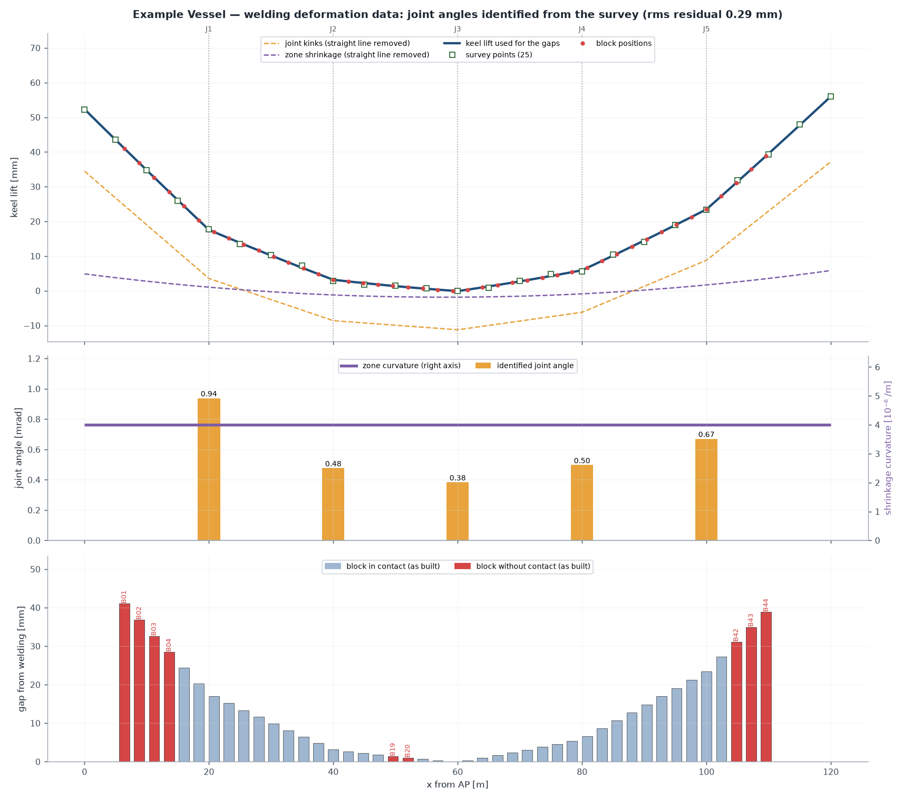
<figcaption aria-hidden="true"><p>Figure 6.8: Welding deformation data of the survey-based case (synthetic survey). Top: keel lift with its components, the survey points and the block positions; middle: identified joint angles and zone shrinkage curvature; bottom: gap from welding at every block, blocks without contact as built highlighted.</p></figcaption>
</figure>

## 6.8 Automatic spacing design from block strengths

This section presents the final result of the thesis. For a block plan with a given number of blocks and a given strength of every block, the program computes the spacing of the blocks at which every reaction is within the strength of its block, by the three-phase method of Section 3.12: strength-weighted equidistribution (phase 1) ([Huang and Russell 2011](#ref-huang2011)), sequential linear programming on the minimax problem with a trust region (phase 2) ([Griffith and Stewart 1961](#ref-griffith1961); [Conn et al. 2000](#ref-conn2000)), and rounding to the floors with a local search (phase 3). Every candidate layout is analysed with the full support model, including, for a welded hull, the welding gaps at the candidate block positions (Section 3.12.2). The quantity minimised is the largest utilisation

``` math
U(\mathbf{x}) = \max_{i}\frac{R_{i}(\mathbf{x})}{S_{i}}\quad\quad\quad\quad(6.3)
```

Before the results, a simple bound is useful for judging them. Since every reaction satisfies $`R_{i} \leq US_{i}`$ and the reactions sum to the weight, $`W = \sum_{i}^{}R_{i} \leq U\sum_{i}^{}S_{i}`$, so that for *any* spacing

``` math
U(\mathbf{x})\mspace{6mu} \geq \mspace{6mu}\bar{u} \equiv \frac{W}{\sum_{i = 1}^{N}S_{i}},\quad\quad\quad\quad(6.4)
```

with equality only if every block is used to the same fraction of its strength. The bound $`\bar{u}`$ is also the mean utilisation $`\sum R_{i}/\sum S_{i}`$. A plan can fit only if $`\bar{u} \leq u_{target}`$; for $`N`$ blocks of equal strength $`S`$ this gives the smallest possible number of blocks

``` math
N_{\min} = \left\lceil \frac{W}{u_{target}\, S} \right\rceil.\quad\quad\quad\quad(6.5)
```

The bound is not attainable in general, because the overhangs, the extent of the block line and the spacing limits prevent an equal utilisation; the closed-form case of Section 3.12.7, in which it is attained, was used for verification (Section 5.6). The ratio $`U/\bar{u}`$ is used below as a measure of how evenly a design uses its blocks.

### 6.8.1 Spacing design of the example block plan

The block plan of `spacing_case.yaml` has 44 blocks with $`\sum S_{i}`$ = 8090 t, so $`\bar{u}`$ = 4500/8090 = 0.556. On the given uniform spacing of 2.4 m the elastic model loads B01 to 1.340 times its strength and seven blocks beyond their strength (Section 6.5). Figure 6.9 shows the design, and Table 6.19 its progress by phase.

<figure>

<figcaption aria-hidden="true"><p>Figure 6.9: Spacing design for the block plan of <code>spacing_case.yaml</code> (44 blocks, strengths 190 t and 160 t, elastic hull). Top: weight distribution with the given (light) and designed (dark) block positions; second: given and designed spacing to the next block along the hull; third: block reactions of the designed spacing (bars) against the block strengths (dashed), with the reactions at the given spacing as markers; bottom: largest ratio of reaction to strength over the number of analyses in the three phases.</p></figcaption>
</figure>

| Phase | Step | Analyses (cumulative) | Largest $`R_{i}/S_{i}`$ |
|----|----|---:|---:|
| start | given plan | 1 | 1.340 |
| 1 – equidistribution | iteration 1 | 3 | 1.041 |
|  | iteration 2 | 4 | 0.881 |
|  | iteration 3 | 5 | 0.807 |
|  | iteration 4 | 6 | 0.788 |
|  | best (iteration 5); iterations 6–15 stationary at 0.788 | 7 (17) | 0.787 |
| 2 – sequential LP | accepted step 1 | 50 | 0.778 |
|  | accepted step 2 | 87 | 0.770 |
|  | accepted step 3 | 122 | 0.762 |
|  | accepted step 5 (step 4 rejected) | 156 | 0.761 |
| 3 – floors and local search | final | 193 | 0.761 |

Table 6.19 – Convergence of the spacing design of `spacing_case.yaml` by phase.

**Convergence.** Phase 1 does most of the work: four fixed-point steps reduce the largest ratio from 1.340 to 0.788 — below the target already after the second step (analysis 4) — and the iteration then becomes stationary. Its fixed point is not the minimax optimum, because equidistribution balances an estimated load density between neighbours and not the reactions of the elastic hull themselves (Section 3.12.3). Phase 2 removes the remaining 3.5 % in four accepted steps; each sequential-LP iteration costs up to one finite-difference analysis per block plus one trial analysis, 33–37 analyses here, which is why phase 2 accounts for most of the 193 analyses. Phase 3 rounds the positions to the floors and searches the neighbouring floor positions of the governing blocks; here it confirmed the continuous result (0.761) with 37 analyses. The whole run, including the rigid and elastic analyses of the given plan and the post-processing, took about 0.7 s.

**Designed spacing.** The designed spacing follows the load and the strengths (Figure 6.9, top). Aft of 14.4 m, under the stern overhang, the superstructure and the start of the engine room, nine blocks are set at spacings of 0.8 and 1.6 m; the nine 160 t blocks B04–B12 now lie between 9.6 m and 20.0 m. Between 14.4 m and 40.8 m, under the engine room, the spacing is 1.6–2.4 m. Amidships it opens to 3.2 m (40.8–63.2 m), then 4.0 m and 4.8 m up to 105.6 m, where the elastic hull spreads the load most evenly; and the six foremost blocks are set at 0.8 m to share the bow overhang. The pattern alternates between 0.8 and 1.6 m in the aft part because the positions must lie at floors 0.8 m apart; without rounding (Table 6.21) the same design consists of smooth runs of 1.045, 1.84, 3.185 and 4.8 m with the same largest ratio, the effect of the smoothing term in the objective of phase 2 (Section 3.12.4).

**Reactions versus strength.** The designed reactions lie between 73.8 t and 144.6 t (Figure 6.9, middle). Five blocks are within 2.5 % of the largest ratio: B44 (0.761), B01 (0.760), B32 at 72.0 m (0.750), B12 at 20.0 m (0.745, a 160 t block) and B33 (0.744). Several active peaks of nearly equal height are the characteristic signature of a minimax optimum: moving any block to relieve one of them loads another. The least used block is B22 at 38.4 m (0.388). The end blocks are among the governing ones because they sit at the limits of the allowed line (6.4 and 109.6 m) and must carry the overhangs; this is why the design stays at $`U/\bar{u}`$ = 1.37 and why a longer line helps (Section 6.8.2).

**All checks.** Table 6.20 compares the checks of the elastic model for the given and the designed spacing.

| Check                  | Given spacing: $`\eta`$ | Designed spacing: $`\eta`$ |
|------------------------|------------------------:|---------------------------:|
| Hull bending moment    |                   0.170 |                      0.176 |
| Hull shear force       |                   0.336 |                      0.336 |
| Deck bending stress    |                   0.088 |                      0.087 |
| Keel bending stress    |                   0.069 |                      0.068 |
| Hull shear stress      |                   0.067 |                      0.067 |
| Block bearing pressure |                   1.301 |                      0.738 |
| Block load vs strength |                   1.340 |                      0.761 |
| All checks             |                  failed |                 **passed** |

Table 6.20 – Checks of the elastic model for the given and the designed spacing of `spacing_case.yaml`.

Every block of the designed plan is within its strength, the largest bearing pressure is 1.477 MPa, no block is open or crushed, and all hull girder checks pass. The hull girder loads hardly change (largest moment 1 700.8 t·m instead of 1 723.4 t·m), because they are governed by the overhangs, which the design does not change. Every block lies at a floor, so no off-structure warning is raised. The designed spacings are written to `spacing.csv` and, in the GUI, back into the block plan.

### 6.8.2 Variants of the block plan and the settings

Table 6.21 shows how the result depends on the settings and on the block plan. All variants were computed with the current program from `spacing_case.yaml` with the changes listed; the given plans have a uniform spacing of 2.4 m from $`x`$ = 6.4 m, so that the “given” ratio of the variants with fewer blocks refers to a block line that ends well before 109.6 m.

| Variant | Blocks × strength | Extent \[m\] | $`s_{\max}`$ \[m\] | Analyses | $`U`$ given → designed | Mean $`= \bar{u}`$ / min. $`R_{i}/S_{i}`$ | Designed spacing \[m\] | Result |
|----|----|----|---:|---:|----|----|----|----|
| example (floors) | 44, 190 / 160 | 6.4–109.6 | 4.8 | 193 | 1.340 → 0.761 | 0.558 / 0.388 | 0.8–4.8 | fits |
| without rounding to floors | 44, 190 / 160 | 6.4–109.6 | 4.8 | 188 | 1.340 → 0.761 | 0.558 / 0.382 | 0.8–4.8 | fits |
| smaller $`s_{\max}`$ | 44, 190 / 160 | 6.4–109.6 | 3.2 | 251 | 1.340 → 0.760 | 0.562 / 0.296 | 0.8–3.2 | fits |
| $`s_{\max}`$ = given spacing | 44, 190 / 160 | 6.4–109.6 | 2.4 | 29 | 1.340 → 1.310 | 0.567 / 0.274 | 0.8–2.4 | does not fit |
| longer line | 44, 190 / 160 | 4.0–114.4 | 4.8 | 502 | 1.340 → 0.575 | 0.557 / 0.493 | 0.8–4.8 | fits |
| rigid hull model | 44, 190 / 160 | 6.4–109.6 | 4.8 | 242 | 0.869 → 0.600 | 0.558 / 0.497 | 0.8–4.0 | fits |
| fewer blocks | 40 × 190 | 6.4–109.6 | 4.8 | 407 | 2.071 → 0.749 | 0.592 / 0.365 | 0.8–4.8 | fits |
| fewer blocks, longer line | 32 × 190 | 4.0–114.4 | 6.4 | 402 | 2.585 → 0.751 | 0.740 / 0.721 | 0.8–6.4 | fits |
| minimum number | 29 × 160 | 4.0–114.4 | 6.4 | 220 | 3.547 → 0.984 | 0.970 / 0.933 | 0.8–6.4 | fits |
| one block fewer | 28 × 160 | 4.0–114.4 | 6.4 | 421 | 3.725 → 1.019 | 1.004 / 0.968 | 0.8–6.4 | does not fit (Σ S = 4480 t \< W) |
| three blocks fewer | 26 × 160 | 4.0–114.4 | 6.4 | 198 | 4.115 → 1.114 | 1.082 / 1.007 | 1.6–6.4 | does not fit (Σ S = 4160 t \< W) |

Table 6.21 – Spacing design for variants of the block plan of the example vessel (elastic hull unless stated; $`s_{\min}`$ = 0.8 m; positions at the floors unless stated). “Mean” is the mean ratio of reaction to strength of the designed plan, which equals the bound $`\bar{u}`$ of Equation (6.4) up to round-off.

The variants support five conclusions.

1.  **Rounding to the floors costs nothing here.** With and without rounding the largest ratio is 0.761; the floors restrict where the blocks may stand but not the quality of the design, because the floor spacing (0.8 m) is small compared with the designed spacings.

2.  **The maximum spacing must leave freedom, but not much.** With $`s_{\max}`$ = 3.2 m the design reaches the same largest ratio (0.760) by a different pattern: it cannot open the midbody as far, so it places more blocks there (25 spacings of 3.2 m) and uses the least loaded block less (0.296). With $`s_{\max}`$ equal to the given spacing of 2.4 m, the 43 spacings of at most 2.4 m exactly span the line, no redistribution is possible, and phases 1 and 2 cannot move; only the local search shifts the end blocks inwards by two floors, which reduces the ratio to 1.310. The program reports that the plan does not fit, that the aft end block at the limit of the line governs, and suggests a longer line or about 58 blocks.

3.  **The extent matters as much as the spacing.** With the line extended to 4.0–114.4 m, as in Section 6.6.2, the same 44 blocks reach 0.575, only 3.4 % above the bound $`\bar{u}`$ = 0.556, and the least used block carries 0.493 of its strength: the blocks are used almost evenly. The remaining distance to the bound in the example plan (0.761 against 0.556) is therefore due to the extent of the block line, a physical constraint, and not to the algorithm. This run needed 502 analyses because the local search of phase 3 found several improving moves after rounding (0.568 continuous, 0.575 at the floors).

4.  **The number of blocks can be reduced to the minimum of Equation (6.5).** 40 blocks of 190 t fit on the original line (0.749), and 32 blocks of 190 t on the longer line with $`s_{\max}`$ = 6.4 m (0.751, only 1.5 % above $`\bar{u}`$ = 0.740). For blocks of 160 t, Equation (6.5) gives $`N_{\min} = \lceil 4500/160\rceil = 29`$. The design found a spacing for exactly 29 blocks with a largest ratio of 0.984, 1.5 % above the bound $`\bar{u}`$ = 4500/4640 = 0.970, and with every block used to between 93 % and 98 % of its strength: a nearly uniform utilisation, the ideal of a support fitted to its blocks. With 28 blocks the total strength of 4480 t is less than the load, no spacing can fit, and the program says so, gives the reason (Σ S \< W) and suggests 29 blocks; the same holds for 26 blocks. The design thus brackets the minimum: 29 fits and 28 provably cannot.

5.  **The model matters.** The rigid-hull model, which spreads the load more evenly (Section 6.3), gives a lower ratio for the given plan (0.869) and a different design (0.600), with a dense spacing of 0.8 m over the aft 10 m of the line. Analysed with the elastic model, this rigid-designed layout gives a largest ratio of 0.967 at B44 instead of the 0.600 predicted: it still fits, by a margin of 3 %, but far less than the elastic design’s 0.761. Since the end-block loads are the main effect of hull flexibility, design decisions should be based on the elastic model.

### 6.8.3 Weight-curve case

The spacing design of `weight_curve_case.yaml` uses 44 blocks of 200 t ($`\sum S_{i}`$ = 8800 t, $`\bar{u}`$ = 4643/8800 = 0.528) with the same settings as the example. On the given plan the elastic model loads B44 to 1.064 of its strength (Section 6.3.4). The design brings the largest ratio to 0.568 in 501 analyses (about 1.9 s for the complete run): phase 1 reaches 0.629 in 15 iterations, phase 2 0.567 in six accepted steps, and rounding to the floors with the local search ends at 0.568. All checks pass (bending moment 0.118, shear force 0.267, bearing pressure 0.580, strength 0.568).

The designed spacing is 0.8–4.8 m. Over 34 blocks from 6.4 m to 92.0 m, where the weight curve is smooth and nearly level, the utilisation is almost constant (0.543–0.568) at spacings of mostly 1.6–3.2 m, with closer spacing (0.8–2.4 m) under the engine room (16–28 m), where the curve reaches 64 t/m. The eight foremost blocks are packed at the minimum spacing of 0.8 m between 104.0 m and 109.6 m to carry the forward overhang of 243.3 t. Their utilisation falls from 0.568 at B44 to about 0.33 four to five blocks aft of it, because the end block at the line limit carries most of the overhang and its neighbours cannot be moved closer than $`s_{\min}`$; the forward end, constrained by the extent and the minimum spacing, therefore keeps the design 7.6 % above $`\bar{u}`$. The case confirms that the spacing design works unchanged with a weight curve and items given by moment, because both are converted into the same load model (Section 3.3).

### 6.8.4 Welding deformation as a constraint

For a welded hull, every candidate layout of the spacing design is analysed with the welding gaps recomputed at its own block positions (Section 3.12.2). The deformation is therefore a constraint of the design: a block moved along the hull also moves along the curved keel and changes its gap. To find how much deformation the spacing alone can compensate, the welding deformation of `welding_case.yaml` was scaled by a factor (all joint angles and the difference of deck and bottom shrinkage), and the spacing design was run for each factor with 44 blocks of 200 t, given spacing 2.4 m, $`s_{\min}`$ = 0.8 m, $`s_{\max}`$ = 4.8 m and the line 6.4–109.6 m. Table 6.22 and Figure 6.10 show the result. The column “continuous” gives the result of the same design without rounding to the floors.

| Factor | End lift \[mm\] | $`U`$ given | $`U`$ designed (floors) | $`U`$ designed (continuous) | Result (floors) |
|---:|---:|---:|---:|---:|----|
| 0.00 | 0.0 | 1.273 | 0.701 | 0.699 | fits |
| 0.10 | 4.1 | 1.081 | 0.611 | 0.602 | fits |
| 0.25 | 10.4 | 1.188 | 0.710 | 0.657 | fits |
| 0.40 | 16.6 | 1.404 | 0.892 | 0.816 | fits |
| 0.50 | 20.7 | 1.547 | 0.917 | 0.915 | fits |
| 0.55 | 22.8 | 1.619 | 1.045 | 0.950 | does not fit |
| 0.60 | 24.9 | 1.691 | 1.111 | 0.997 | does not fit |
| 0.75 | 31.1 | 1.904 | 1.266 | 1.155 | does not fit (1 block open) |
| 1.00 | 41.4 | 1.971 | 1.350 | 1.306 | does not fit (5 blocks open) |

Table 6.22 – Spacing design under scaled welding deformation (44 blocks of 200 t, elastic hull).

<figure>
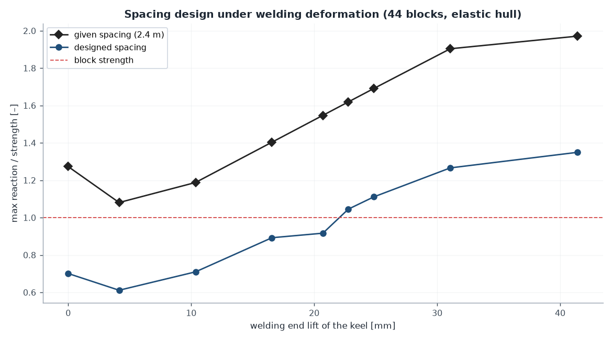
<figcaption aria-hidden="true"><p>Figure 6.10: Largest ratio of reaction to strength at the given spacing (2.4 m) and at the designed spacing (at the floors) as a function of the welding end lift of the keel (44 blocks of 200 t, elastic hull).</p></figcaption>
</figure>

A small end lift helps: at 4.1 mm the given plan improves from 1.273 to 1.081 and the design reaches 0.611, better than for the straight hull (0.701), because a slightly concave keel counteracts the load concentration at the overhangs found in Section 6.3. Beyond about 5 mm the lift works against the design, and the designed ratio rises steadily. **With the positions at the floors, the spacing design fits up to an end lift of about 21 mm (factor 0.5, ratio 0.917) and not beyond** (22.8 mm: 1.045). Without the floor constraint the threshold lies at about 25 mm (factor 0.6, 0.997). The rounding, which cost nothing for the straight hull, costs up to 0.11 here (0.950 against 1.045 at factor 0.55): with large gaps the reactions depend on the positions in a strongly non-smooth way, so that a shift of one floor can bring a block into or out of contact.

**The full deformation.** Figure 6.11 shows the design for the full deformation of `welding_case.yaml` (end lift 41.4 mm). The run took 78 analyses and 0.5 s. Phase 1 reduced the ratio from 1.971 to 1.309 within six analyses, but the fixed-point iteration then diverged to about 1.59 (Figure 6.11, bottom): with gaps the reactions are not a smooth function of the positions, and the load-density estimate on which equidistribution relies no longer describes the redistribution; the best layout found was kept, as the algorithm prescribes. Phase 2 reached 1.306 in one accepted step, after five trial steps had been rejected and the trust region reduced, and rounding to the floors gave 1.350. In the designed layout five blocks carry no load (B01 at 6.4 m, B02 at 11.2 m, B26 at 50.4 m, B43 at 104.8 m and B44 at 109.6 m), and six blocks exceed their strength, all of them at or next to an erection joint: 269.9 t at 20.8 m (the governing block, 1.350), 241.0 t at 19.2 m, 225.3 t at 21.6 m, 210.7 t at 60.0 m, 216.7 t at 80.0 m and 236.9 t at 100.0 m. The design has moved blocks towards the joints — dense groups at 0.8 m around 18.4–29.6 m and 79.2–83.2 m — but the governing block stays at the joint at 20 m.

<figure>
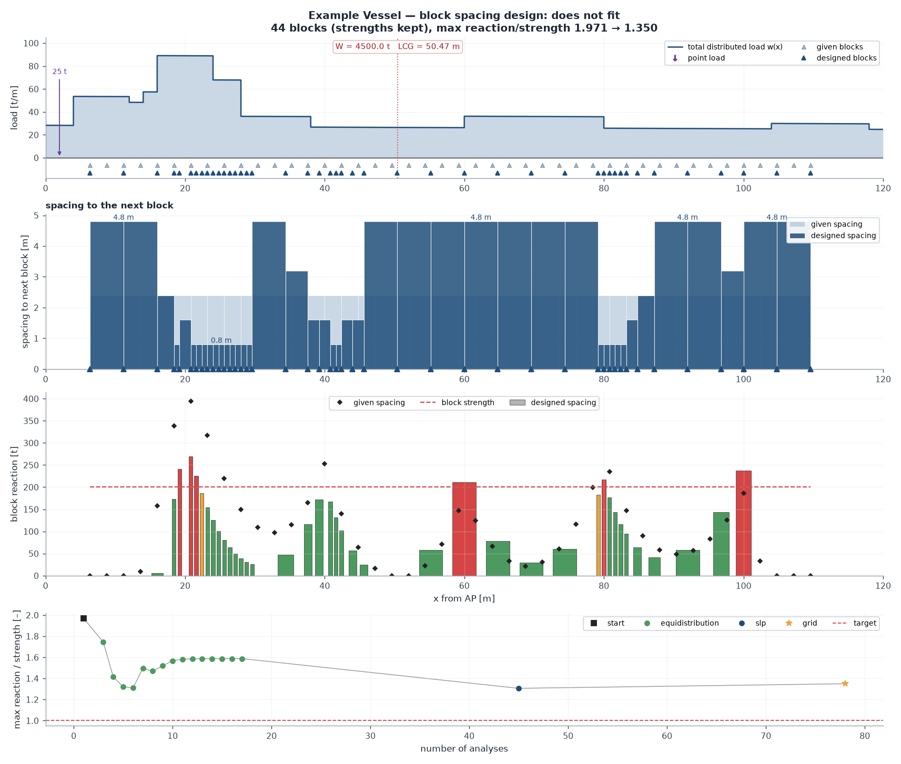
<figcaption aria-hidden="true"><p>Figure 6.11: Spacing design of the welded hull with the full welding deformation (<code>welding_case.yaml</code> with the spacing design enabled; end lift 41.4 mm). Top: weight distribution with the given and designed block positions; second: given and designed spacing; third: reactions of the designed spacing against the strength of 200 t (red: above strength), with the reactions at the given spacing as markers; bottom: largest ratio of reaction to strength over the analyses.</p></figcaption>
</figure>

**More blocks do not help.** Repeating the design with more blocks on the same line gives 1.350 for 44 blocks, 1.382 for 52, 1.385 for 60, 1.340 for 68 and 1.351 for 76 blocks (Table 6.23). In every case the governing block lies at the 20 m joint, and between 5 and 14 blocks are out of contact. Adding blocks does not reduce the governing reaction, unlike for the straight hull (Table 6.11).

| Blocks         |    44 |    52 |    60 |    68 |    76 |
|----------------|------:|------:|------:|------:|------:|
| $`U`$ designed | 1.350 | 1.382 | 1.385 | 1.340 | 1.351 |

Table 6.23 – Spacing design for the full welding deformation with more blocks on the line 6.4–109.6 m (governing block always at the erection joint at 20 m; 5–14 blocks open).

**The program’s diagnosis.** The program reports the case as “does not fit” and explains why (Section 3.12.6): the best spacing gives a largest ratio of 1.350, five blocks carry no load because of gaps under the keel, “so the gaps rather than the spacing govern and more blocks may not help”, and it recommends adjusting the block heights to the keel line or using stronger blocks where the keel bears. The suggested number of blocks (about 60, from $`\lceil NU/u_{target}\rceil`$) is explicitly qualified as valid only “if the load spread”, which the study of Table 6.23 confirms it does not.

**Physical interpretation.** A concave-up kink makes the keel at an erection joint a local low point: on both sides the keel rises linearly away from the joint. The block under the joint is therefore compressed first, and a neighbouring block at a distance $`d`$ comes into contact only when the hull has bent, or the joint block has been compressed, by the additional gap of order $`\theta d`$, where $`\theta`$ is the local change of slope. A block reaches its strength at the compression

``` math
\delta_{S} = \frac{S}{k} = \frac{200 \times 9.80665\ \text{kN}}{2000\ \text{kN/mm}} \approx 0.98\ \text{mm},\quad\quad\quad\quad(6.6)
```

while a joint angle of 0.9 mrad opens an extra gap of $`\theta d`$ ≈ 0.7 mm over a single floor spacing ($`d`$ = 0.8 m) — of the same order. Only blocks within one or two floor spacings of the joint can therefore share the load before the joint block reaches its strength, and how much load collects at the joint is determined by the bending of the hull between the joints, not by the number of blocks. The joint acts as a *hard point*: blocks placed beside it stand in a gap and stay idle, and blocks placed on it overload. Spacing changes the positions of the supports, but it cannot change the shape of the keel relative to the block tops. Beyond an end lift of about 21 mm, therefore, the spacing design must be combined with an adjustment of the block heights (shims, wedges or adjustable blocks) to the surveyed keel line; this combination is outside the scope of the thesis and is recommended as future work (Section 7.5).

## 6.9 Discussion

This section discusses the results with respect to the research questions of Section 1.5 and states their limitations.

### 6.9.1 RQ1 – Rigid versus elastic reactions

For the straight hull, hull flexibility changes the results qualitatively. The rigid-hull method underestimated the most heavily loaded block by 43 % (145.06 t instead of 254.63 t) and the forward end block by a factor of 4.1; it passed all block checks where the elastic model found three overloaded blocks (seven with the individual strengths of the spacing case); and it overestimated the largest bending moment by a factor of 7.1. The same pattern appeared for the weight-curve case (113.50 t against 212.80 t at the forward end block). The characteristic length of 11.9 m (Equation 6.1) is short compared with the 103 m block line, which explains why the hull behaves as a beam on an elastic foundation ([Hetényi 1946](#ref-hetenyi1946)) and why the linear distribution of the rigid method ([Naval Sea Systems Command, n.d.](#ref-nstm997)) cannot capture the load concentration at the overhangs. The difference occurs at the ends of the block line and, to a lesser extent, under concentrated weights such as the machinery. Even with a hundredfold bending stiffness the end-block reaction remained 40 % above the rigid value, because the shear flexibility remains. The rigid method remains useful as an independent equilibrium check and quick estimate, but not for verifying block loads where overhangs exist — and, consequently, not as the model of the spacing design (Section 6.8.2, item 5).

### 6.9.2 RQ2 – Effect of welding deformation; identification

The welding deformation of a block-built hull acts as a smooth, concave-up distribution of initial gaps of tens of millimetres, an order of magnitude larger than the elastic block compressions (about 1 mm). Small end lifts (about 4–10 mm) are absorbed by the settlement of the overhangs and even relieve the end blocks. Larger lifts unload the end blocks and then further blocks, and concentrate the load at the erection joints in the quarter regions: at 41 mm end lift, eight blocks carried no load, one crushed, and the largest ratio of reaction to strength rose from 1.273 to 1.971. Which blocks lose contact depends on the keel shape, the weight distribution and the hull stiffness together; two midship blocks were unloaded because of the local shape of the kinked keel, which no simple rule would predict. The rigid model is meaningless for such a hull. The joint angles can be identified from a keel survey by linear least squares: with 1 mm noise the residual equalled the noise and the angles had a standard deviation of 0.04–0.09 mrad depending on the station spacing; for the sample survey with 0.5 mm noise the angles were recovered within 0.07 mrad and the as-built results matched those of the prescribed model (largest ratio 1.975 against 1.971).

### 6.9.3 RQ3 – Automatic spacing design: feasibility, optimality, efficiency, impossibility

**Feasibility.** Yes, the spacing can be computed automatically such that every reaction is within its block strength whenever such a spacing exists within the limits. For the example plan the design turned a layout that overloaded seven blocks (largest ratio 1.340) into one in which every block uses at most 76.1 % of its strength, by changing only the positions, with all blocks at floors and all hull girder and block checks passed. The same held for the weight-curve case (1.064 → 0.568) and for all variants of Table 6.21 whose total strength exceeds the load and whose spacing limits leave freedom.

**Closeness to the optimum.** The design problem is non-convex and non-smooth, so the method cannot prove global optimality (Section 1.4). Three observations indicate that it comes close. First, where the extent of the line does not bind, the result lies within 1.5–3.4 % of the lower bound $`\bar{u}`$ of Equation (6.4), which no spacing can beat: 0.575 against 0.556 for the longer line, 0.751 against 0.740 for 32 blocks, 0.984 against 0.970 for 29 blocks. Second, the designed layouts show several active peaks of nearly equal height, the signature of a minimax optimum. Third, the method reproduced the closed-form optimum of Section 3.12.7 in the verification (Section 5.6). Where the result lies far above the bound (0.761 against 0.556), the cause is a binding physical constraint — the end blocks at the limits of the line carrying the overhangs — as the longer-line variant demonstrates.

**Efficiency.** A design needed 193–502 analyses for the example vessel, and between 0.7 s and about 2 s, which is interactive speed. The cost is dominated by the finite-difference sensitivities of phase 2 (one analysis per block and iteration), each analysis being a sparse banded solution linear in the number of elements (Section 3.13). Phase 1 is cheap — one analysis per iteration — and brought the largest ratio below the target within four analyses in the example. Phase 3 is bounded by its budget of $`25N`$ analyses.

**Impossibility.** The design fails, and says why, in three situations, all of which occurred: the total strength is less than the load (28 and 26 blocks of 160 t; Equation 6.4 shows that no spacing can then fit); the spacing limits leave no freedom and an end block at the limit of the line governs ($`s_{\max}`$ = 2.4 m; the remedy is a longer line or more blocks); and blocks are out of contact because of gaps (the welded hull; more blocks do not help). In each case the program’s message names the cause and a remedy, which turns a failed design into information for the docking engineer.

### 6.9.4 RQ4 – Welding deformation as a constraint of the spacing design

Because every candidate is analysed with the welding gaps at its own positions, the designed layout is valid for the welded hull and not only for an idealised straight one. For the example, the spacing alone compensated the welding deformation up to an end lift of about 21 mm (about half of the modelled deformation) with the blocks at the floors, and about 25 mm without the floor constraint. Beyond that limit no spacing fits, and more blocks do not help (1.340–1.385 for 44–76 blocks), because the erection joints act as hard points: the keel rises away from a kink faster than a block can be compressed before reaching its strength (Equation 6.6), so that load collects at the joint whatever the block count. The spacing design recognises this situation and reports that the gaps rather than the spacing govern. Two further effects were observed under large gaps: the fixed-point iteration of phase 1 can diverge (the best iterate is kept), and rounding to the floors matters more, because the reactions are no longer smooth functions of the positions. Practically, the welding limit means that a hull whose surveyed keel deviates by more than about 20 mm at the ends (for this ship and block type) needs an adjustment of the block heights in addition to the designed spacing.

### 6.9.5 RQ5 – Trustworthiness through verification and architecture

The results of this chapter are trustworthy to the extent that the program solves its equations correctly, and this was established in Chapter 5 by 131 automated tests against closed-form solutions, limiting cases and independent computations, including the closed-form optimum of the spacing design. The results also carry their own evidence: every analysis reports its equilibrium residuals (below $`10^{- 13}`$ throughout this chapter) and the closure of shear force and bending moment; the weight check confirmed the load model to machine precision (Section 6.2); and the designed spacing is not accepted from the optimiser’s linear model but verified by a full analysis of the final layout, whose checks are reported like those of the given plan (Table 6.20). The architecture contributes in two ways. Because the spacing design receives the analysis as an injected `evaluate()` function (Section 4.10), the layouts it designs are analysed by exactly the code that analyses a given plan, including the welding gaps; and because the command-line program and the GUI use the same core, the numbers in this chapter are reproduced by either interface. All results were obtained from plain-text case files and short scripts, so they can be reproduced exactly. Verification does not establish validity, however ([Oberkampf and Roy 2010](#ref-oberkampf2010)).

### 6.9.6 Limitations

- **Illustrative data.** All input data are placeholders, including the strengths and the welding parameters, and the keel surveys are synthetic. The magnitudes are realistic, but statements about specific blocks, and the welding limit of about 21 mm, apply only to the example. The trends — end-block concentration, the effect of the extent, near-uniform utilisation of a designed spacing, the hard-point effect of joint kinks — are expected to be general for ships with overhangs and block-built hulls.
- **Two-dimensional model.** The hull girder is a beam in the vertical-longitudinal plane; transverse load sharing with side blocks, local bottom deformation and heel are not represented.
- **Simplified welding model.** The deformation is described by joint kinks and uniform zone curvatures and treated as a stress-free initial shape; thermo-mechanical effects, residual stresses and the erection sequence are not modelled.
- **Fully docked condition; fixed block heights.** The landing phase and any adjustment of block heights are outside the scope (Section 1.4). The spacing design therefore assumes block tops at the nominal line plus the given gaps.
- **Deterministic design.** The design assumes exact gaps, stiffnesses and weights. Survey errors and block height tolerances of the order found in Section 6.6.5 would change the reactions; a robust or probabilistic design was not attempted. The margin of a design ($`u_{target} - U`$) is the only protection against such scatter.
- **Local optimum and cost.** The method finds a good local optimum; Equation (6.4) bounds the remaining gap but does not close it. The finite-difference sensitivities cost one analysis per block and iteration, acceptable for keel block lines but limiting for much larger problems.
- **Linear-elastic hull, simplified block law, rigid dock floor.** Hull plasticity, timber creep, load history and the flexibility of a floating dock are not modelled.
- **No validation.** The software was verified (Chapter 5), but no comparison with measured block loads was possible ([Oberkampf and Roy 2010](#ref-oberkampf2010)).

## 6.10 Summary

- The weight distribution integrated exactly to 4500.0 t at LCG 50.469 m (items) and to 4643.0 t at 56.639 m (lightship curve of 4343.0 t and deadweight items of 300.0 t given by moment). In the example, 266.3 t lie aft and 298.8 t forward of the block line.
- The elastic model predicted end-block reactions of 254.63 t (B01) and 246.26 t (B44), against 145.06 t and 59.48 t with the rigid method; three blocks of 200 t, or seven blocks of the individual-strength plan (largest ratio 1.340), were overloaded, whereas the rigid method found none. The rigid method overestimated the largest bending moment by a factor of 7.1. The characteristic length of 11.9 m explains the difference.
- The extent of the block line was the most influential parameter (4.0–114.4 m: −32 % largest reaction, all checks passed), followed by the uniform spacing, the block stiffness and the hull stiffness; single gaps of about 1 mm matter near the ends. A uniform spacing cannot fit the reactions to the strengths.
- A welding end lift of 41.4 mm unloaded eight blocks, crushed one (394.25 t) and raised the largest ratio of reaction to strength to 1.971; the rigid model was meaningless for this case. Joint angles were identified from a synthetic survey within 0.07 mrad (0.5 mm noise), with a scatter of 0.04–0.09 mrad for 1 mm noise.
- **Final result.** For the 44-block plan (190 t, nine blocks of 160 t), the spacing design reduced the largest ratio of reaction to strength from 1.340 to 0.761 in 193 analyses (about 0.7 s), with a spacing of 0.8–4.8 m at the floors and all checks passed; most of the reduction came from phase 1, the last 3.5 % from phase 2.
- On a line of 4.0–114.4 m the same blocks reached 0.575, 3.4 % above the bound $`W/\sum S_{i}`$ = 0.556. With blocks of 160 t, the minimum number $`\lceil 4500/160\rceil`$ = 29 fitted with every block used to 93–98 % of its strength (0.984 against the bound 0.970), and 28 and 26 blocks were correctly reported as impossible (Σ S \< W). For the weight-curve case the design gave 1.064 → 0.568.
- Under welding deformation as a constraint, the spacing design fitted up to an end lift of about 21 mm (25 mm without the floor constraint) and not beyond. For the full 41 mm the best spacing gave 1.350 (1.306 before rounding), more blocks (44–76) did not help, the governing block stayed at the erection joint at 20 m, and the program correctly diagnosed that the gaps rather than the spacing govern. Beyond this limit the block heights must be adjusted to the keel line.

These results form the basis for the conclusions and recommendations in Chapter 7.

# 7 Conclusions and Recommendations

## 7.1 Summary of the work

This thesis developed, analysed, implemented and verified the methods and the software needed to compute automatically the spacing of the keel blocks under a ship in dry dock from the strengths of the blocks, such that no block reaction exceeds the strength of its block, also for hulls whose keel is distorted by welding. The problem combines ship engineering and computer science. Its engineering core is the support problem: a ship on many blocks is statically indeterminate, the blocks act only in compression, and the reactions depend on the weight distribution, the bending and shear stiffness of the hull girder, the block stiffnesses and the fit between the keel and the block tops, which in a block-built hull is disturbed by welding deformation ([Ueda et al. 2012](#ref-ueda2012); [Storch et al. 1995](#ref-storch1995)). Its computational core is a design problem on top of the support problem: a non-smooth, non-convex minimax problem whose every function evaluation is a nonlinear contact analysis.

On the ship engineering side, the docking weight was modelled by weight items given with their LCG or their longitudinal moment and by a piecewise-linear weight-distribution curve, both converted exactly into trapezoidal loads. The block reactions were computed with the classical rigid-hull method generalised to unequal blocks, gaps, lift-off and crushing (Method A) and with a Timoshenko beam model of the hull girder on compression-only, crushable block springs (Method B) ([Timoshenko 1921](#ref-timoshenko1921); [Hetényi 1946](#ref-hetenyi1946)). From the reactions the program computes the shear force, bending moment and stresses of the hull girder and checks them, together with the bearing pressure and the load of every block against its own strength. The welding deformation was modelled by angular distortion at the erection joints and shrinkage curvature within the construction blocks, or taken from a keel survey, from which the joint angles were identified by regularised least squares ([Hansen 1998](#ref-hansen1998)).

On the computer-science side, the hull girder was discretised with sparse banded finite element systems solved by sparse direct factorisation ([Davis 2006](#ref-davis2006); [Li 2005](#ref-li2005superlu)); the unilateral contact problem was solved exactly by an active-set iteration with cycle detection and gap continuation ([Cottle et al. 1992](#ref-cottle1992); [Wriggers 2006](#ref-wriggers2006)). The spacing design — the final result of the work — was formulated as a minimax problem over the block positions with the block count, order and strengths fixed, and solved in three phases: a strength-weighted equidistribution fixed point adapted from moving-mesh methods ([Huang and Russell 2011](#ref-huang2011)), sequential linear programming with a trust region and finite-difference sensitivities solved with HiGHS ([Griffith and Stewart 1961](#ref-griffith1961); [Conn et al. 2000](#ref-conn2000); [Huangfu and Hall 2018](#ref-huangfu2018)), and rounding to the floors with a best-improvement local search. Every candidate layout is analysed with the full support model, including the welding gaps at its own positions, so that welding deformation acts as a constraint. When no spacing fits, the program diagnoses the reason and suggests a number of blocks. The complexity of every algorithm was analysed (Section 3.13).

On the software side, the methods were implemented as a Python package with a layered architecture ([Martin 2017](#ref-martin2017)) — a calculation core, a command-line interface and a PyQt5 graphical interface ([Riverbank Computing, n.d.](#ref-pyqt5)) — with validated immutable data structures, a YAML input format, a dependency-injected analysis for the spacing design, and reports in text, CSV and graphics; it uses NumPy, SciPy and Matplotlib ([Harris et al. 2020](#ref-harris2020numpy); [Virtanen et al. 2020](#ref-virtanen2020scipy); [Hunter 2007](#ref-hunter2007matplotlib)). The implementation was verified by 131 automated tests ([Krekel et al., n.d.](#ref-pytest)) against closed-form solutions, limiting cases and independent computations, including a closed-form optimum of the spacing design. The methods were applied to an illustrative 120 m, 4500 t vessel with 44 keel blocks: as a straight hull with five parametric studies, with a weight-distribution curve, with a block plan of individual strengths whose spacing was designed, and as a welded hull with predicted and surveyed deformation.

## 7.2 Conclusions

The conclusions are grouped into computer-science and software conclusions and ship engineering conclusions. Each refers to the objectives O1–O7 of Section 1.3.

### 7.2.1 Computer-science and software conclusions

1.  **Exact and robust contact solution (O2).** Because the block law is piecewise linear, the support problem is linear for every fixed set of block states, and the active-set iteration finds the exact solution of the complementarity problem without penalty or tolerance parameters that influence the result. Equilibrium residuals stayed below $`10^{- 13}`$ in all cases of Chapter 6, also for the welded hull with keel gaps above 40 mm, where the gap continuation made the iteration robust.

2.  **Automatic spacing design (O4).** The three-phase method computes a spacing at which every block is within its strength whenever such a spacing exists within the limits. For the example plan of 44 blocks (190 t, nine of 160 t) it reduced the largest ratio of reaction to strength from 1.340 to 0.761 in 193 analyses and about 0.7 s, with every block at a floor and all checks passed. The phases are complementary: the equidistribution fixed point is cheap (one analysis per iteration) and did most of the work, bringing the ratio to 0.788 within six analyses; the sequential linear programme, whose cost is dominated by one finite-difference analysis per block and iteration, removed the remaining 3.5 % and produced the characteristic minimax pattern of several equal peaks; and the floor rounding with local search made the result buildable without loss in this case.

3.  **Near-optimality and a certificate (O4, O6).** The simple bound $`U \geq W/\sum S_{i}`$ (Section 6.8) gives every design a certificate of quality. Where the extent of the block line did not bind, the designs lay within 1.5–3.4 % of this bound; for blocks of 160 t, the design found a spacing for the theoretical minimum of $`\lceil 4500/160\rceil`$ = 29 blocks, with every block used to 93–98 % of its strength, while 28 blocks were proved impossible by the same bound. The method also reproduced the closed-form optimum for a uniform load in the verification.

4.  **Diagnosis instead of silent failure (O4).** When no spacing fits, the program reports why — total strength below the load, an end block governing at the limit of the line, or blocks out of contact because of gaps — and suggests a remedy. All three situations occurred in the case studies and were diagnosed correctly; in particular, for the fully welded hull the program reported that the gaps rather than the spacing govern and that more blocks may not help, which a study with 44–76 blocks confirmed.

5.  **Inverse identification (O3).** Regularised linear least squares identified the welding joint angles from a keel survey with an arbitrary datum and tilt. For the sample survey with 0.5 mm noise, the angles were recovered within 0.07 mrad and the as-built reactions matched those of the prescribed model; for 1 mm noise the scatter of the angles was 0.04–0.09 mrad, depending on the station spacing. The problem is moderately ill-conditioned for the individual angles, but well determined for the gaps at the blocks, which is what the support problem needs.

6.  **Software architecture (O5).** Separating the calculation core from its interfaces, and injecting the analysis into the spacing design as an `evaluate()` function, has three consequences that were essential for the results: the designed layouts are analysed by exactly the code that analyses a given plan, including the welding gaps; the design could be developed and tested against substitute analyses; and the command line and the GUI produce identical results. In the GUI the user enters the block plan — number of blocks, spacing and strength of every block — and presses *Auto-calculate spacing*; the designed spacing is written back into the plan.

7.  **Verification and complexity (O6).** The 131 automated tests reproduced closed-form results to round-off accuracy, and every analysis reports its own equilibrium residuals and closure errors. The finite element solution is linear in the number of elements because the system matrix is banded, so the cost of a spacing design is essentially the number of analyses times a few milliseconds; a design takes between about 0.5 s and 2 s for the cases studied.

### 7.2.2 Ship engineering conclusions

8.  **Load model (O1).** Weight items given by LCG or by moment and a weight-distribution curve with jumps are converted into one exact trapezoidal load model; the docking weights and LCGs were reproduced to machine precision (4500.0 t at 50.469 m; 4643.0 t at 56.639 m, of which the curve 4343.0 t and the items 300.0 t).

9.  **Rigid versus elastic hull (O2).** For the straight hull the elastic model gave end-block reactions of 254.63 t and 246.26 t, against 145.06 t and 59.48 t with the rigid method, and found overloaded blocks where the rigid method found none; the rigid method overestimated the largest bending moment by a factor of 7.1. The cause is the overhanging weight, which a hull with a characteristic length of about 12 m transfers mainly to the end blocks. The rigid method is conservative for the hull girder but not for the blocks, and it is not a suitable model for the spacing design: a layout designed with it reached 0.967 instead of the predicted 0.600 when analysed with the elastic model.

10. **What governs the block loads (O7).** The extent of the block line, i.e. the length of the overhangs, was the most influential parameter, followed by the spacing, the block stiffness and the hull stiffness; a uniform spacing cannot fit the reactions to the strengths. A designed, non-uniform spacing can: dense under the stern overhang and the machinery, wide amidships, dense again at the bow.

11. **Welding deformation (O3).** A welding end lift of 41.4 mm unloaded eight blocks, crushed one and raised the largest ratio of reaction to strength from 1.273 to 1.971. Small lifts (about 4–10 mm) slightly relieved the end blocks. For a welded hull the rigid model is meaningless, and the flexible hull girder decides which blocks touch.

12. **Welding deformation as a constraint of the spacing (O4, O7).** The spacing alone compensated the welding deformation of the example up to an end lift of about 21 mm with the blocks at the floors (about 25 mm without the floor constraint). Beyond this limit no spacing fits: for the full deformation the best spacing gave 1.350, more blocks did not help (1.340–1.385 for 44–76 blocks), and the governing block stayed at the erection joint at 20 m. The joints act as hard points: the keel rises away from a kink by about 0.7 mm per floor spacing, comparable to the 0.98 mm compression at which a block reaches its strength, so that the load collects at the joint whatever the number of blocks.

## 7.3 Answers to the research questions

**RQ1 – How large is the difference between the block reactions predicted by the classical rigid-hull method and by an elastic hull girder model with compression-only supports, and where along the block line does it occur?** The difference is large and qualitative, and it occurs at the ends of the block line and, to a lesser extent, under concentrated weights. For the example the elastic model gave a largest reaction 76 % above the rigid one (254.63 t against 145.06 t) and a forward end-block reaction 4.1 times the rigid value (246.26 t against 59.48 t); it found three overloaded blocks of 200 t, or seven of the individual-strength plan, where the rigid method found none. Amidships the elastic reactions were lower than the rigid ones and followed the local weight. Even a hundredfold bending stiffness left the end-block reaction 40 % above the rigid value. For the welded hull the difference was fundamental: the rigid model supported the ship on 13 midship blocks and crushed 10 of them.

**RQ2 – How does the welding deformation of a block-built hull change the block reactions, and can its parameters be identified from a keel survey?** The welding deformation acts as a concave-up distribution of gaps of tens of millimetres, far larger than the elastic block compressions of about 1 mm. Lifts up to about 10 mm are absorbed by the settlement of the overhangs; larger lifts unload the end blocks and some midship blocks and concentrate the load at the erection joints. At 41.4 mm end lift eight blocks carried no load, one crushed, and the largest ratio of reaction to strength rose from 1.273 to 1.971. The joint angles can be identified from a survey by linear least squares: within 0.07 mrad for the sample survey with 0.5 mm noise, with a scatter of 0.04–0.09 mrad for 1 mm noise depending on the station spacing, and with gaps at the blocks reproduced to the accuracy of the survey.

**RQ3 – Can the spacing of a given set of blocks be computed automatically such that every block reaction is within the strength of its block? How close to the optimum does the computed spacing come, how efficient is the computation, and when is the task impossible?** Yes. For the example plan the largest ratio fell from 1.340 to 0.761 (all checks passed), for the weight-curve case from 1.064 to 0.568, and every variant whose total strength exceeds the load and whose spacing limits leave freedom was fitted. Where the extent of the line did not bind, the designs came within 1.5–3.4 % of the lower bound $`W/\sum S_{i}`$, which no spacing can beat; 29 blocks of 160 t — the theoretical minimum — fitted with utilisations of 0.93–0.98. A design needed 193–502 analyses and 0.7–2 s. The task is impossible when the total strength is less than the load (28 and 26 blocks of 160 t), when the spacing limits leave no freedom and an end block at the limit of the line governs ($`s_{\max}`$ equal to the given spacing), and when gaps keep blocks out of contact (the fully welded hull); the program identifies each of these cases and suggests a remedy.

**RQ4 – How does the welding deformation constrain the spacing design, and up to which deformation can it be compensated by the spacing alone?** Because every candidate is analysed with the welding gaps at its own positions, the deformation constrains which layouts fit. For the example, a small lift (4.1 mm) even improved the design (0.611 against 0.701 for the straight hull); beyond that the designed ratio rose steadily, and the spacing alone compensated the deformation up to an end lift of about 21 mm (ratio 0.917) at the floors and about 25 mm without the floor constraint. For the full deformation of 41.4 mm the best spacing gave 1.350 (1.306 before rounding), more blocks did not help, and the governing block remained at the erection joint at 20 m, where the kink forms a hard point. Beyond this limit the block heights must be adjusted to the keel line.

**RQ5 – How do the verification strategy and the software architecture ensure that the results are trustworthy, reproducible and usable through both a scriptable and a graphical interface?** Every component was verified against an independent result — closed-form solutions, limiting cases, finite-difference and invariance checks, and the closed-form optimum of the spacing design — by 131 automated tests. At run time, every analysis reports its equilibrium residuals and closure errors, the load model is checked against the weight items, and a designed spacing is accepted only after a full analysis of the final layout with all checks. The layered architecture with an injected analysis guarantees that designed and given layouts are analysed by the same code, including the welding gaps, and that the command-line program and the GUI produce identical results from the same plain-text case file. Verification shows that the equations are solved correctly; validation against measured block loads remains to be done ([Oberkampf and Roy 2010](#ref-oberkampf2010)).

## 7.4 Recommendations for practice

1.  **Use an elastic hull model for block loads and for the spacing design.** The rigid-hull method should serve only as a global equilibrium check and a first estimate. Block loads near overhangs and under concentrated weights, and always for welded hulls, should be computed with an elastic hull girder model with compression-only blocks.
2.  **Give every block its own strength and let the spacing follow.** Enter the blocks that are actually available, with their individual strengths, as a block plan and let the program design the spacing. Choose the strength not higher than the load at which another block limit — in particular the allowable bearing pressure — is reached, because the design targets the strength.
3.  **Check the total strength first.** The bound $`\sum S_{i} \geq W/u_{target}`$, i.e. at least $`\lceil W/(u_{target}S)\rceil`$ blocks of strength $`S`$, is necessary for any spacing to fit; a plan should have a margin above it, since overhangs and spacing limits prevent a perfectly even use of the blocks.
4.  **Extend the block line and allow freedom in the spacing.** Allow the block line to extend as far under the overhangs as the hull form permits, and set the maximum spacing well above the mean spacing (the default of twice the given mean spacing worked well); the minimum spacing should be the floor spacing so that every block stands under a floor.
5.  **Keep a margin below the strength.** The design assumes exact data. A target utilisation below 1.0 (for example 0.85–0.9) protects against scatter in block heights, stiffnesses and weights, whose effect is of the order shown in Section 6.6.
6.  **Survey the keel of a welded hull before docking.** Measure the keel line after erection welding at a station spacing of a few metres with millimetre accuracy, and include the survey (or the identified joint angles) in the case, so that the spacing design accounts for the actual gaps.
7.  **Respect the limit of spacing under welding deformation.** If the designed spacing does not fit and the program reports blocks out of contact because of gaps, adding blocks will not help. For the example ship this happened above an end lift of about 21 mm. In that case adjust the block heights to the surveyed keel line (shims, wedges or adjustable blocks), use stronger blocks where the keel bears — in particular at the erection joints — and repeat the spacing design with the adjusted gaps.
8.  **Verify the final arrangement.** Use the checks of the designed layout (hull girder and blocks), mark the designed positions at the floors as reported in `spacing.csv`, and re-run the analysis whenever the weights, the survey or the block data change.

## 7.5 Recommendations for future work

1.  **Block-height adjustment combined with spacing.** The main limitation found is the welding limit of the spacing design. A combined design in which the block positions and the block heights (shim or wedge heights, in practical increments) are optimised together would extend the design to hulls with large welding deformation. The structure of the present method allows this: the heights enter the support model as gaps, and the minimax problem can be extended by height variables with bounds and resolution constraints.
2.  **Landing phase.** The transition from floating to fully docked, with the knuckle reaction at the first-contact block and the loss of stability, should be coupled with the spacing design, so that the designed layout is also checked for landing and the line can be laid with a declivity where needed ([Barrass and Derrett 2012](#ref-barrass2012)).
3.  **Three-dimensional and side-block models.** A model with keel and side blocks in the transverse plane, or a grillage or shell model of the bottom structure, would capture load sharing between keel and bilge blocks, local bottom deformation, transverse welding distortion and heel, and would allow the design of side-block positions.
4.  **Robust and probabilistic design.** Survey errors, block height tolerances, stiffness scatter and weight uncertainty could be treated probabilistically, to design a spacing that remains within strength with a given probability or for a set of scenarios (robust minimax) ([Boyd and Vandenberghe 2004](#ref-boyd2004)).
5.  **Faster sensitivities.** The finite-difference sensitivities cost one analysis per block and iteration. Analytical sensitivities of the reactions with respect to the block positions, obtained with an adjoint or direct differentiation of the finite element system for a fixed active set from the existing factorisation, would reduce the cost of phase 2 by about a factor of the number of blocks and make much larger problems tractable ([Haftka and Gürdal 1992](#ref-haftka1992)).
6.  **Global optimisation.** The method finds a good local optimum with a quality certificate from the lower bound. Multi-start strategies, branch-and-bound over the floor positions, or metaheuristics could search for better optima, and mixed-integer formulations could treat the floor positions exactly; the bound could be tightened by accounting for the overhangs.
7.  **Physics-based welding prediction.** The prescribed kinks and curvatures could be replaced by deformations predicted with the inherent-strain method or a thermo-mechanical welding simulation ([Ueda et al. 2012](#ref-ueda2012)), and the erection sequence could be followed stage by stage.
8.  **Validation against measurements.** Keel surveys and block loads should be measured in real dockings, for example with load cells, to validate the model and calibrate block stiffnesses and welding parameters.
9.  **Floating docks and timber behaviour.** The dock could be modelled as a second elastic beam coupled through the blocks, and timber creep, unloading behaviour and the variability of timber properties could be included in the block law.

# References

<a id="ref-barrass2012"></a>Barrass, Bryan, and D. R. Derrett. 2012. *Ship Stability for Masters and Mates*. 7th ed. Butterworth-Heinemann.

<a id="ref-bathe2014"></a>Bathe, Klaus-Jürgen. 2014. *Finite Element Procedures*. 2nd ed. Klaus-Jürgen Bathe.

<a id="ref-deboor1974"></a>Boor, Carl de. 1974. “Good Approximation by Splines with Variable Knots. II.” In *Conference on the Numerical Solution of Differential Equations*, edited by G. A. Watson, vol. 363. Lecture Notes in Mathematics. Springer.

<a id="ref-boyd2004"></a>Boyd, Stephen, and Lieven Vandenberghe. 2004. *Convex Optimization*. Cambridge University Press.

<a id="ref-conn2000"></a>Conn, Andrew R., Nicholas I. M. Gould, and Philippe L. Toint. 2000. *Trust-Region Methods*. MPS-SIAM Series on Optimization. SIAM.

<a id="ref-cook2002"></a>Cook, Robert D., David S. Malkus, Michael E. Plesha, and Robert J. Witt. 2002. *Concepts and Applications of Finite Element Analysis*. 4th ed. John Wiley & Sons.

<a id="ref-cottle1992"></a>Cottle, Richard W., Jong-Shi Pang, and Richard E. Stone. 1992. *The Linear Complementarity Problem*. Academic Press.

<a id="ref-davis2006"></a>Davis, Timothy A. 2006. *Direct Methods for Sparse Linear Systems*. SIAM.

<a id="ref-fletcher1987"></a>Fletcher, Roger. 1987. *Practical Methods of Optimization*. 2nd ed. John Wiley & Sons.

<a id="ref-fritsch1980"></a>Fritsch, F. N., and R. E. Carlson. 1980. “Monotone Piecewise Cubic Interpolation.” *SIAM Journal on Numerical Analysis* 17 (2): 238–46.

<a id="ref-gere2013"></a>Gere, James M., and Barry J. Goodno. 2013. *Mechanics of Materials*. 8th ed. Cengage Learning.

<a id="ref-griffith1961"></a>Griffith, R. E., and R. A. Stewart. 1961. “A Nonlinear Programming Technique for the Optimization of Continuous Processing Systems.” *Management Science* 7 (4): 379–92.

<a id="ref-haftka1992"></a>Haftka, Raphael T., and Zafer Gürdal. 1992. *Elements of Structural Optimization*. 3rd ed. Kluwer Academic Publishers.

<a id="ref-hansen1998"></a>Hansen, Per Christian. 1998. *Rank-Deficient and Discrete Ill-Posed Problems: Numerical Aspects of Linear Inversion*. SIAM.

<a id="ref-harris2020numpy"></a>Harris, Charles R., K. Jarrod Millman, Stéfan J. van der Walt, et al. 2020. “Array Programming with NumPy.” *Nature* 585: 357–62.

<a id="ref-hetenyi1946"></a>Hetényi, Miklós. 1946. *Beams on Elastic Foundation: Theory with Applications in the Fields of Civil and Mechanical Engineering*. University of Michigan Press.

<a id="ref-huang2011"></a>Huang, Weizhang, and Robert D. Russell. 2011. *Adaptive Moving Mesh Methods*. Vol. 174. Applied Mathematical Sciences. Springer.

<a id="ref-huangfu2018"></a>Huangfu, Qi, and J. A. Julian Hall. 2018. “Parallelizing the Dual Revised Simplex Method.” *Mathematical Programming Computation* 10 (1): 119–42.

<a id="ref-hughes2010"></a>Hughes, Owen F., and Jeom Kee Paik. 2010. *Ship Structural Analysis and Design*. Society of Naval Architects and Marine Engineers.

<a id="ref-hunter2007matplotlib"></a>Hunter, John D. 2007. “Matplotlib: A 2D Graphics Environment.” *Computing in Science & Engineering* 9 (3): 90–95.

<a id="ref-iacss11"></a>International Association of Classification Societies. n.d. *Unified Requirement S11: Longitudinal Strength Standard*. IACS Unified Requirement.

<a id="ref-pytest"></a>Krekel, Holger et al. n.d. *pytest: Helps You Write Better Programs*. Software.

<a id="ref-lewis1988"></a>Lewis, Edward V., ed. 1988. *Principles of Naval Architecture, Second Revision, Volume I: Stability and Strength*. Society of Naval Architects and Marine Engineers.

<a id="ref-li2005superlu"></a>Li, Xiaoye S. 2005. “An Overview of SuperLU: Algorithms, Implementation, and User Interface.” *ACM Transactions on Mathematical Software* 31 (3): 302–25.

<a id="ref-martin2017"></a>Martin, Robert C. 2017. *Clean Architecture: A Craftsman’s Guide to Software Structure and Design*. Prentice Hall.

<a id="ref-mazurkiewicz1980"></a>Mazurkiewicz, B. K. 1980. *Design and Construction of Dry Docks*. Trans Tech Publications.

<a id="ref-mroz1975"></a>Mróz, Z., and G. I. N. Rozvany. 1975. “Optimal Design of Structures with Variable Support Conditions.” *Journal of Optimization Theory and Applications* 15 (1): 85–101.

<a id="ref-nstm997"></a>Naval Sea Systems Command. n.d. *Naval Ships’ Technical Manual, Chapter 997: Docking Instructions and Routine Work in Drydock (S9086-7G-STM-010)*. Technical manual.

<a id="ref-nocedal2006"></a>Nocedal, Jorge, and Stephen J. Wright. 2006. *Numerical Optimization*. 2nd ed. Springer.

<a id="ref-oberkampf2010"></a>Oberkampf, William L., and Christopher J. Roy. 2010. *Verification and Validation in Scientific Computing*. Cambridge University Press.

<a id="ref-okumoto2009"></a>Okumoto, Yasuhisa, Yu Takeda, Masaki Mano, and Tetsuo Okada. 2009. *Design of Ship Hull Structures: A Practical Guide for Engineers*. Springer.

<a id="ref-przemieniecki1968"></a>Przemieniecki, J. S. 1968. *Theory of Matrix Structural Analysis*. McGraw-Hill.

<a id="ref-pyqt5"></a>Riverbank Computing. n.d. *PyQt5: Python Bindings for the Qt Application Framework*. Software.

<a id="ref-sommerville2016"></a>Sommerville, Ian. 2016. *Software Engineering*. 10th ed. Pearson.

<a id="ref-storch1995"></a>Storch, Richard Lee, Colin P. Hammon, Howard M. Bunch, and Richard C. Moore. 1995. *Ship Production*. 2nd ed. Cornell Maritime Press.

<a id="ref-pyyaml"></a>The YAML Project. n.d. *PyYAML: YAML Parser and Emitter for Python*. Software.

<a id="ref-timoshenko1921"></a>Timoshenko, Stephen P. 1921. “On the Correction for Shear of the Differential Equation for Transverse Vibrations of Prismatic Bars.” *Philosophical Magazine*, 6th series, vol. 41 (245): 744–46.

<a id="ref-ueda2012"></a>Ueda, Yukio, Hidekazu Murakawa, and Ninshu Ma. 2012. *Welding Deformation and Residual Stress Prevention*. Butterworth-Heinemann.

<a id="ref-milstd1625"></a>U.S. Department of Defense. n.d.-a. *MIL-STD-1625: Safety Certification Program for Drydocking Facilities and Shipbuilding Ways for U.S. Navy Ships*. Military standard.

<a id="ref-ufc421310"></a>U.S. Department of Defense. n.d.-b. *UFC 4-213-10: Design: Graving Drydocks*. Unified Facilities Criteria.

<a id="ref-virtanen2020scipy"></a>Virtanen, Pauli, Ralf Gommers, Travis E. Oliphant, et al. 2020. “SciPy 1.0: Fundamental Algorithms for Scientific Computing in Python.” *Nature Methods* 17: 261–72.

<a id="ref-wang2004"></a>Wang, D., J. S. Jiang, and W. H. Zhang. 2004. “Optimization of Support Positions to Maximize the Fundamental Frequency of Structures.” *International Journal for Numerical Methods in Engineering* 61 (10): 1584–602.

<a id="ref-wriggers2006"></a>Wriggers, Peter. 2006. *Computational Contact Mechanics*. 2nd ed. Springer.

# Appendix A – Example Input Files

All values in these files are illustrative placeholders chosen to demonstrate the methods; they are not data of a real ship. Lengths are in metres from the aft perpendicular, weights in tonnes, moments in tonne-metres, stresses in MPa and gaps in millimetres, as indicated by the key suffixes.

## A.1 Example vessel (`examples/example_case.yaml`)

```yaml
# Example docking case: block reactions of the example vessel on its block plan.
# ALL NUMBERS ARE ILLUSTRATIVE PLACEHOLDERS showing the input format —
# they are not design values. Use the ship's docking plan, loading manual
# and the yard's block data for real work.
#
# Units: lengths m (x measured from AP, positive forward), weights t,
# moments t·m, distributed weights t/m, stresses MPa, moduli as suffixed, gaps mm.
#
# Totals: 4500 t, LCG 50.47 m (nine weight items); 44 keel blocks of 200 t.

ship:
  name: Example Vessel
  lpp: 120.0
  x_aft: 0.0          # aft end of hull (may be negative if the hull extends aft of AP)
  x_fwd: 120.0        # forward end of hull
  weight_t: 4500.0    # declared docking weight, cross-checked against the items below
  lcg: 50.47          # declared LCG

# Each item is spread as a trapezoid over [xa, xb] preserving its weight and LCG
# (LCG must lie in the middle third of the extent). Give the LCG as `lcg` or the
# longitudinal moment about AP as `moment_tm` (LCG = moment / weight).
# Use `x:` (or no extent) for a point load. A weight-distribution curve can be given
# instead of or in addition to the items (see weight_curve_case.yaml).
weights:
  - {name: hull steel,        weight_t: 2600, lcg: 58.5,  xa: 0.0,   xb: 120.0}
  - {name: main engine,       weight_t: 380,  lcg: 22.0,  xa: 16.0,  xb: 28.0}
  - {name: auxiliary machinery, weight_t: 220, lcg: 26.0, xa: 14.0,  xb: 38.0}
  - {name: superstructure,    weight_t: 420,  lcg: 14.0,  xa: 4.0,   xb: 24.0}
  - {name: outfit,            weight_t: 520,  lcg: 62.0,  xa: 4.0,   xb: 118.0}
  - {name: propeller & shaft, weight_t: 60,   lcg: 6.0,   xa: 0.0,   xb: 12.0}
  - {name: rudder,            weight_t: 25,   x: 2.0}
  - {name: anchors & chain,   weight_t: 75,   lcg: 112.0, xa: 104.0, xb: 120.0}
  - {name: residual fuel,     weight_t: 200,  lcg: 70.0,  xa: 60.0,  xb: 80.0}

# Hull girder: EI from I_m4 and E_GPa (default 206), or give EI_Nm2 directly.
# shear_area_m2 enables Timoshenko shear deformation (G_GPa default 79.3) and τ = V / As.
sections:
  - {xa: 0.0,   xb: 20.0,  I_m4: 8.0,  shear_area_m2: 0.5, z_deck_m3: 1.4, z_keel_m3: 1.8}
  - {xa: 20.0,  xb: 100.0, I_m4: 20.0, shear_area_m2: 0.9, z_deck_m3: 3.6, z_keel_m3: 4.4}
  - {xa: 100.0, xb: 120.0, I_m4: 6.0,  shear_area_m2: 0.4, z_deck_m3: 1.1, z_keel_m3: 1.4}

blocks:
  types:
    keel:
      contact_width: 0.8        # m
      contact_length: 1.2       # m
      layers:                   # in series, E in loading direction (timber: perpendicular to grain)
        - {thickness: 0.90, E_MPa: 30000}   # concrete
        - {thickness: 0.20, E_MPa: 1000}    # hardwood
        - {thickness: 0.10, E_MPa: 400}     # softwood cap
      capacity_t: 200           # default strength of every block of this type
      allowable_pressure_MPa: 2.0
      crush_stress_MPa: 4.0     # optional bilinear crushing
      post_crush_ratio: 0.05
      # stiffness_kN_per_mm: 2000   # optional: overrides the layer calculation
  # Block plan: the blocks B01 … B44 from aft to forward.
  #   spacing:    one value for every gap, or a list of count-1 values [m]
  #   strength_t: optional; one value or a list of count values (default: type capacity)
  #   gap_mm:     optional initial gap of every block (block top below the keel line);
  #               one value or a list of count values; it moves with its block
  plan:
    type: keel
    start_x: 6.4                # m, first block
    count: 44
    spacing: 2.4                # m, distance to the next block

# Floors / bulkheads / web frames that blocks should sit under:
# start plus two of end / spacing / count, or an explicit list x: [...].
structure: {start: 0.0, end: 120.0, spacing: 0.8}

permissible:
  bm:
    - {x: 0.0,   sag_tm: 3000,  hog_tm: 3000}
    - {x: 30.0,  sag_tm: 20000, hog_tm: 20000}
    - {x: 60.0,  sag_tm: 25000, hog_tm: 25000}
    - {x: 90.0,  sag_tm: 20000, hog_tm: 20000}
    - {x: 120.0, sag_tm: 3000,  hog_tm: 3000}
  sf:
    - {x: 0.0,   sf_t: 600}
    - {x: 30.0,  sf_t: 1500}
    - {x: 90.0,  sf_t: 1500}
    - {x: 120.0, sf_t: 600}

settings:
  methods: [rigid, fem]
  max_element_length: 0.5       # m
  shear_deformation: true
  allowable_bending_MPa: 175
  allowable_shear_MPa: 110
  structure_tolerance: 0.15     # m
```

## A.2 Welded-hull case (`examples/welding_case.yaml`)

The welded-hull case uses the same ship, blocks and settings as A.1 and adds the following sections.

```yaml
# ---------------------------------------------------------------------------
# Welding deformation of the assembled hull (placeholder values).
# After the construction blocks are welded together the keel is no longer
# straight: angular distortion at the erection joints and differential
# shrinkage of deck and bottom bend the hull so that its ends lift.
# Positive angles / curvatures lift the ends (concave-up keel).
welding_deformation:
  joints:                       # erection butt joints between construction blocks
    - {x: 20.0,  angle_mrad: 0.9}
    - {x: 40.0,  angle_mrad: 0.5}
    - {x: 60.0,  angle_mrad: 0.4}
    - {x: 80.0,  angle_mrad: 0.5}
    - {x: 100.0, angle_mrad: 0.6}
  zones:                        # curvature inside each construction block
    # curvature = (deck shrinkage − bottom shrinkage) / depth; or give curvature_mm_per_m2
    - {xa: 0.0,   xb: 20.0,  deck_shrinkage_mm_per_m: 0.24, bottom_shrinkage_mm_per_m: 0.20, depth: 10.0}
    - {xa: 20.0,  xb: 40.0,  deck_shrinkage_mm_per_m: 0.24, bottom_shrinkage_mm_per_m: 0.20, depth: 10.0}
    - {xa: 40.0,  xb: 60.0,  deck_shrinkage_mm_per_m: 0.24, bottom_shrinkage_mm_per_m: 0.20, depth: 10.0}
    - {xa: 60.0,  xb: 80.0,  deck_shrinkage_mm_per_m: 0.24, bottom_shrinkage_mm_per_m: 0.20, depth: 10.0}
    - {xa: 80.0,  xb: 100.0, deck_shrinkage_mm_per_m: 0.24, bottom_shrinkage_mm_per_m: 0.20, depth: 10.0}
    - {xa: 100.0, xb: 120.0, deck_shrinkage_mm_per_m: 0.24, bottom_shrinkage_mm_per_m: 0.20, depth: 10.0}
  # Alternatively (or additionally) a surveyed keel line, e.g. from a laser tracker:
  # measured:
  #   x: [0, 10, 20, ...]          # m from AP
  #   lift_mm: [41.0, 33.2, ...]   # upward, any datum (a straight-line part is ignored)
  #   interpolation: pchip         # pchip | linear | spline
  #   identify_joint_angles: false # true: fit the joint angles above to the survey
  #   regularization: 0.0

# ---------------------------------------------------------------------------
# Spacing design on the welded hull (switched off here): the spacing of the 44 blocks
# (count and strengths kept) at which no reaction exceeds its block strength.
spacing_design:
  enabled: false                # true: design the spacing in every run
  method: fem                   # fem | rigid
  target_utilisation: 1.0       # reaction / strength must not exceed this
  min_spacing: 0.8              # m (the floor spacing)
  max_spacing: 4.8              # m (default: twice the given mean spacing)
  x_min: 6.4                    # m, aft limit of the block line (default: first block)
  x_max: 109.6                  # m, forward limit (default: last block)
  snap_to_structure: true       # final positions under floors
```

## A.3 Spacing design for a block plan (`examples/spacing_case.yaml`)

The block plan and the spacing-design settings of the main design example; the ship, weights, sections, structure and limits are those of A.1.

```yaml
blocks:
  types:
    keel:
      contact_width: 0.8        # m
      contact_length: 1.2       # m
      layers:                   # in series, E in loading direction (timber: perpendicular to grain)
        - {thickness: 0.90, E_MPa: 30000}   # concrete
        - {thickness: 0.20, E_MPa: 1000}    # hardwood
        - {thickness: 0.10, E_MPa: 400}     # softwood cap
      capacity_t: 200
      allowable_pressure_MPa: 2.0
      crush_stress_MPa: 4.0     # optional bilinear crushing
      post_crush_ratio: 0.05
      # stiffness_kN_per_mm: 2000   # optional: overrides the layer calculation
  # Block plan: one spacing for all gaps or a list of count-1 values; one strength for all
  # blocks or a list of count values (aft to forward); optional gap_mm likewise.
  plan:
    type: keel
    start_x: 6.4                # m, first block
    count: 44
    spacing: 2.4                # m, distance to the next block
    strength_t: [               # t, strength of every block, B01 ... B44
      190, 190, 190, 160, 160, 160, 160, 160, 160, 160, 160,
      160, 190, 190, 190, 190, 190, 190, 190, 190, 190, 190,
      190, 190, 190, 190, 190, 190, 190, 190, 190, 190, 190,
      190, 190, 190, 190, 190, 190, 190, 190, 190, 190, 190]

# Floors / bulkheads / web frames that blocks should sit under.
spacing_design:
  enabled: true
  method: fem
  target_utilisation: 1.0       # reaction / strength must not exceed this
  min_spacing: 0.8              # m
  max_spacing: 4.8              # m (default: twice the given mean spacing)
  x_min: 6.4                    # m, aft limit of the block line (default: first block)
  x_max: 109.6                  # m, forward limit (default: last block)
  fix_end_blocks: false
  snap_to_structure: true       # final positions under floors (structure positions)
  max_iterations: 20            # sequential-LP iterations
```

## A.4 Weight-distribution curve (`examples/weight_curve_case.yaml`)

The lightship weight given as a piecewise-linear curve and deadweight items given with their longitudinal moments.

```yaml
weight_curve:
  name: lightship curve
  points:
    - {x: 0.0,   q_t_per_m: 8.0}
    - {x: 4.0,   q_t_per_m: 16.0}
    - {x: 4.0,   q_t_per_m: 30.0}    # jump: aft peak bulkhead, superstructure starts
    - {x: 14.0,  q_t_per_m: 36.0}
    - {x: 16.0,  q_t_per_m: 36.0}
    - {x: 16.0,  q_t_per_m: 64.0}    # jump: engine room (main engine, auxiliaries)
    - {x: 28.0,  q_t_per_m: 64.0}
    - {x: 28.0,  q_t_per_m: 46.0}    # jump: forward end of the main engine
    - {x: 38.0,  q_t_per_m: 42.0}
    - {x: 38.0,  q_t_per_m: 34.0}    # jump: engine-room forward bulkhead
    - {x: 60.0,  q_t_per_m: 36.0}
    - {x: 80.0,  q_t_per_m: 35.0}
    - {x: 100.0, q_t_per_m: 30.0}
    - {x: 104.0, q_t_per_m: 28.0}
    - {x: 104.0, q_t_per_m: 36.0}    # jump: anchors, chain locker
    - {x: 112.0, q_t_per_m: 33.0}
    - {x: 118.0, q_t_per_m: 16.0}
    - {x: 120.0, q_t_per_m: 0.0}

# Deadweight items with the longitudinal moment about AP instead of the LCG
# (LCG = moment_tm / weight_t; giving lcg as well is allowed if it agrees).
weights:
  - {name: residual fuel, weight_t: 200, moment_tm: 14000, xa: 60.0, xb: 80.0}    # LCG 70 m
  - {name: fresh water,   weight_t: 60,  moment_tm: 6000,  xa: 94.0, xb: 106.0}   # LCG 100 m
  - {name: stores,        weight_t: 40,  moment_tm: 1200}                         # point load at 30 m
```

# Appendix B – Source Code

This appendix lists the folder structure of the software developed in this thesis and the complete source code of the calculation package, the graphical user interface and the automated tests. The listing is generated from the files on disk when the thesis is built, so it always corresponds to the version of the software described in Chapters 4 and 5. The thesis sources themselves and generated files are omitted.

In total the listed files contain 7075 lines.

## B.1 Folder Structure

```text
ship-support-force/
├── examples/                                             # example cases (placeholder data)
│   ├── example_case.yaml
│   ├── spacing_case.yaml
│   ├── weight_curve_case.yaml
│   ├── welding_case.yaml
│   ├── welding_survey.csv
│   └── welding_survey_case.yaml
├── src/                                                  # source code
│   ├── shipsupport/                                      # calculation package
│   │   ├── solvers/                                      # rigid-hull and FEM solvers, contact iteration
│   │   │   ├── __init__.py
│   │   │   ├── contact.py
│   │   │   ├── fem.py
│   │   │   ├── result.py
│   │   │   └── rigid.py
│   │   ├── __init__.py
│   │   ├── __main__.py
│   │   ├── analysis.py
│   │   ├── cli.py
│   │   ├── deformation.py
│   │   ├── loader.py
│   │   ├── model.py
│   │   ├── report.py
│   │   ├── spacing.py
│   │   ├── strength.py
│   │   ├── units.py
│   │   └── weights.py
│   └── shipsupport_gui/                                  # PyQt5 desktop application
│       ├── __init__.py
│       ├── __main__.py
│       ├── app.py
│       ├── input_panels.py
│       ├── main_window.py
│       ├── plan_panel.py
│       ├── results_panels.py
│       ├── style.py
│       ├── widgets.py
│       └── worker.py
├── tests/                                                # automated test suite
│   ├── helpers.py
│   ├── test_deformation.py
│   ├── test_example_case.py
│   ├── test_fem.py
│   ├── test_gui.py
│   ├── test_loader.py
│   ├── test_rigid.py
│   ├── test_spacing.py
│   ├── test_strength.py
│   └── test_weights.py
├── .gitignore                                            # files not tracked by version control
├── pyproject.toml                                        # package metadata, dependencies, entry points
└── README.md                                             # installation and usage
```

## B.2 Project configuration

### B.2.1 pyproject.toml

34 lines

```toml
[build-system]
requires = ["setuptools>=68"]
build-backend = "setuptools.build_meta"

[project]
name = "shipsupport"
version = "0.1.0"
description = "Dry-docking block reactions, block spacing design and hull girder strength analysis"
readme = "README.md"
requires-python = ">=3.10"
dependencies = [
    "numpy>=1.24",
    "scipy>=1.10",
    "pyyaml>=6.0",
]

[project.optional-dependencies]
plots = ["matplotlib>=3.7"]
gui = ["matplotlib>=3.7", "PyQt5>=5.15"]
dev = ["pytest>=7", "matplotlib>=3.7", "PyQt5>=5.15"]
thesis = ["matplotlib>=3.7", "PyQt5>=5.15", "pypdfium2>=4"]

[project.scripts]
shipsupport = "shipsupport.cli:main"

[project.gui-scripts]
shipsupport-gui = "shipsupport_gui.app:main"

[tool.setuptools.packages.find]
where = ["src"]

[tool.pytest.ini_options]
pythonpath = ["src"]
testpaths = ["tests"]
```

## B.3 Calculation package

### B.3.1 src/shipsupport/\_\_init\_\_.py

14 lines

```python
"""Dry-docking block reactions, block spacing design and hull girder strength analysis."""

from .analysis import AnalysisResult, run_case
from .loader import case_from_dict, load_case
from .model import (BendingEnvelope, Block, BlockType, Case, InputError, Layer, Section, Settings,
                    ShearEnvelope, Ship, SpacingDesign, WeightCurve, WeightItem)

__version__ = "0.1.0"

__all__ = [
    "AnalysisResult", "run_case", "load_case", "case_from_dict",
    "BendingEnvelope", "Block", "BlockType", "Case", "InputError", "Layer", "Section",
    "Settings", "ShearEnvelope", "Ship", "SpacingDesign", "WeightCurve", "WeightItem",
]
```

### B.3.2 src/shipsupport/\_\_main\_\_.py

3 lines

```python
from .cli import main

raise SystemExit(main())
```

### B.3.3 src/shipsupport/units.py

14 lines

```python
"""Unit conversions. Every calculation inside the package is in SI (N, m, Pa)."""

G = 9.80665                      # m/s², standard gravity

TONNE_FORCE = 1000.0 * G         # N per tonne (mass) under standard gravity
MM = 1e-3                        # m per mm
MPA = 1e6                        # Pa per MPa
GPA = 1e9                        # Pa per GPa
KN_PER_MM = 1e3 / MM             # N/m per kN/mm


def to_tonnes(force_n):
    """Force in N -> tonnes (also N·m -> t·m, N/m -> t/m)."""
    return force_n / TONNE_FORCE
```

### B.3.4 src/shipsupport/model.py

461 lines

```python
"""Input data model.

All quantities are SI (N, m, Pa). The longitudinal coordinate x is measured
from the aft perpendicular (AP), positive forward. Vertical displacement is
positive downward, into the blocks.
"""

from __future__ import annotations

import math
from dataclasses import dataclass, field

import numpy as np


class InputError(ValueError):
    """Invalid or inconsistent input data."""


def _require_positive(value, what):
    if value is None or not math.isfinite(value) or value <= 0:
        raise InputError(f"{what} must be a positive finite number (got {value!r})")


def _optional_positive(value, what):
    if value is not None:
        _require_positive(value, what)


def _as_array(values, what):
    arr = np.asarray(values, dtype=float).ravel()
    if arr.size == 0 or not np.all(np.isfinite(arr)):
        raise InputError(f"{what} must be a non-empty list of finite numbers")
    return arr


# --------------------------------------------------------------------------- #
# Weights and hull girder
# --------------------------------------------------------------------------- #

@dataclass(frozen=True)
class WeightItem:
    """A weight spread as a trapezoid over [xa, xb], or a point load if xa == xb.

    The trapezoid preserves both the weight and its LCG, which is only possible
    with non-negative end intensities when the LCG lies in the middle third.
    """

    name: str
    weight: float   # N (negative allowed for deductions)
    lcg: float      # m from AP
    xa: float       # m
    xb: float       # m

    def __post_init__(self):
        if not math.isfinite(self.weight) or self.weight == 0:
            raise InputError(f"Weight item '{self.name}': weight must be non-zero and finite")
        if self.xb < self.xa:
            raise InputError(f"Weight item '{self.name}': xb ({self.xb}) < xa ({self.xa})")
        if self.is_point:
            if abs(self.lcg - self.xa) > 1e-9:
                raise InputError(f"Weight item '{self.name}': a point load needs lcg == xa == xb")
            return
        third = self.length / 3.0
        xbar = self.lcg - self.xa
        tol = 1e-9 * self.length
        if not (third - tol <= xbar <= 2.0 * third + tol):
            raise InputError(
                f"Weight item '{self.name}': LCG {self.lcg:.3f} m must lie in the middle third of "
                f"its extent [{self.xa:.3f}, {self.xb:.3f}] m for a non-negative trapezoid; "
                f"widen the extent or split the item")

    @property
    def length(self) -> float:
        return self.xb - self.xa

    @property
    def is_point(self) -> bool:
        return self.length <= 1e-9


@dataclass(frozen=True, eq=False)
class WeightCurve:
    """Piecewise-linear weight distribution q(x) ≥ 0 (N/m) through the points (x_k, q_k).

    The load is zero outside the first and last point. x must not decrease; the same x
    twice is a jump of q. Every segment is an exact trapezoid, so the curve is converted
    into one WeightItem per loaded segment (see items()) and the load model is unchanged.
    """

    name: str
    x: np.ndarray        # m from AP
    q: np.ndarray        # N/m

    def __post_init__(self):
        object.__setattr__(self, "x", np.asarray(self.x, dtype=float).ravel())
        object.__setattr__(self, "q", np.asarray(self.q, dtype=float).ravel())
        if self.x.size != self.q.size or self.x.size < 2:
            raise InputError(f"Weight curve '{self.name}': give at least two points (x, q)")
        for k, (x, q) in enumerate(zip(self.x, self.q, strict=True)):
            where = f"Weight curve '{self.name}', point {k + 1} (x = {x:g} m)"
            if not (math.isfinite(x) and math.isfinite(q)):
                raise InputError(f"{where}: x and q must be finite numbers")
            if q < 0:
                raise InputError(f"{where}: q = {q:g} N/m must not be negative")
            if k and x < self.x[k - 1]:
                raise InputError(f"{where}: x must not be smaller than at point {k} "
                                 f"(x = {self.x[k - 1]:g} m); give the points from aft to forward")
        if not self.items():
            raise InputError(f"Weight curve '{self.name}' carries no weight")

    def items(self) -> list[WeightItem]:
        """One exact trapezoidal item per segment with load: weight (q_k + q_k+1) L / 2 and
        LCG x_k + L (q_k + 2 q_k+1) / (3 (q_k + q_k+1)). Jumps and unloaded segments are skipped."""
        out = []
        n = self.x.size - 1
        for k in range(n):
            xa, xb, qa, qb = self.x[k], self.x[k + 1], self.q[k], self.q[k + 1]
            length = xb - xa
            if length <= 1e-9 or qa + qb <= 0:
                continue
            lcg = xa + length * (qa + 2.0 * qb) / (3.0 * (qa + qb))
            out.append(WeightItem(f"{self.name} {k + 1}/{n}", 0.5 * (qa + qb) * length,
                                  float(lcg), float(xa), float(xb)))
        return out


@dataclass(frozen=True)
class Section:
    """Hull girder properties, constant over [xa, xb]."""

    xa: float
    xb: float
    EI: float                          # N·m²
    kGA: float | None = None           # N, effective shear stiffness G·As (None = no shear deformation)
    z_deck: float | None = None        # m³
    z_keel: float | None = None        # m³
    shear_area: float | None = None    # m², effective shear area for τ = V / As

    def __post_init__(self):
        if self.xb <= self.xa:
            raise InputError(f"Section [{self.xa}, {self.xb}]: xb must be greater than xa")
        _require_positive(self.EI, f"Section [{self.xa}, {self.xb}] EI")
        _optional_positive(self.kGA, f"Section [{self.xa}, {self.xb}] kGA")
        _optional_positive(self.z_deck, f"Section [{self.xa}, {self.xb}] z_deck")
        _optional_positive(self.z_keel, f"Section [{self.xa}, {self.xb}] z_keel")
        _optional_positive(self.shear_area, f"Section [{self.xa}, {self.xb}] shear_area")


# --------------------------------------------------------------------------- #
# Blocks
# --------------------------------------------------------------------------- #

@dataclass(frozen=True)
class Layer:
    thickness: float   # m
    E: float           # Pa, modulus in the loading direction (perpendicular to grain for timber)

    def __post_init__(self):
        _require_positive(self.thickness, "Layer thickness")
        _require_positive(self.E, "Layer E")


@dataclass(frozen=True)
class BlockType:
    """A block build-up. Layers act as springs in series over the contact area.

    If crush_stress is given the block is bilinear: stiffness k up to the crush
    force, then post_crush_ratio * k.
    """

    name: str
    contact_width: float                     # m, transverse
    contact_length: float                    # m, longitudinal
    layers: tuple[Layer, ...] = ()
    stiffness_override: float | None = None  # N/m, replaces the layer calculation
    capacity: float | None = None            # N, rated block load
    allowable_pressure: float | None = None  # Pa, allowable bearing pressure
    crush_stress: float | None = None        # Pa
    post_crush_ratio: float = 0.05

    def __post_init__(self):
        _require_positive(self.contact_width, f"Block type '{self.name}' contact_width")
        _require_positive(self.contact_length, f"Block type '{self.name}' contact_length")
        if not self.layers and self.stiffness_override is None:
            raise InputError(f"Block type '{self.name}': give layers or a stiffness override")
        _optional_positive(self.stiffness_override, f"Block type '{self.name}' stiffness")
        _optional_positive(self.capacity, f"Block type '{self.name}' capacity")
        _optional_positive(self.allowable_pressure, f"Block type '{self.name}' allowable_pressure")
        _optional_positive(self.crush_stress, f"Block type '{self.name}' crush_stress")
        if not 0.0 <= self.post_crush_ratio <= 1.0:
            raise InputError(f"Block type '{self.name}': post_crush_ratio must be in [0, 1]")

    @property
    def area(self) -> float:
        return self.contact_width * self.contact_length

    @property
    def stiffness(self) -> float:
        """Initial vertical stiffness, N/m."""
        if self.stiffness_override is not None:
            return self.stiffness_override
        compliance = sum(layer.thickness / layer.E for layer in self.layers)
        return self.area / compliance

    @property
    def crush_force(self) -> float | None:
        return None if self.crush_stress is None else self.crush_stress * self.area


@dataclass(frozen=True)
class Block:
    x: float                 # m from AP
    type: BlockType
    gap: float = 0.0         # m, positive = block top below the keel reference line
    label: str = ""
    strength: float | None = None   # N, force this block can carry; None = its type's capacity

    def __post_init__(self):
        _optional_positive(self.strength, f"Block at x = {self.x} strength")

    @property
    def effective_strength(self) -> float | None:
        """Force the block can carry (N): its own strength, else its type's capacity."""
        return self.strength if self.strength is not None else self.type.capacity


# --------------------------------------------------------------------------- #
# Permissible hull girder limits
# --------------------------------------------------------------------------- #

@dataclass(frozen=True, eq=False)
class BendingEnvelope:
    """Permissible still-water bending moment; sag and hog are positive magnitudes (N·m)."""

    x: np.ndarray
    sag: np.ndarray
    hog: np.ndarray

    def __post_init__(self):
        for name in ("x", "sag", "hog"):
            object.__setattr__(self, name, _as_array(getattr(self, name), f"Bending envelope {name}"))
        if not (self.x.size == self.sag.size == self.hog.size):
            raise InputError("Bending envelope: x, sag and hog must have equal length")
        if np.any(np.diff(self.x) <= 0):
            raise InputError("Bending envelope: x must be strictly increasing")
        if np.any(self.sag <= 0) or np.any(self.hog <= 0):
            raise InputError("Bending envelope: limits must be positive magnitudes")

    def at(self, x):
        return np.interp(x, self.x, self.sag), np.interp(x, self.x, self.hog)


@dataclass(frozen=True, eq=False)
class ShearEnvelope:
    """Permissible still-water shear force magnitude (N)."""

    x: np.ndarray
    limit: np.ndarray

    def __post_init__(self):
        for name in ("x", "limit"):
            object.__setattr__(self, name, _as_array(getattr(self, name), f"Shear envelope {name}"))
        if self.x.size != self.limit.size:
            raise InputError("Shear envelope: x and limit must have equal length")
        if np.any(np.diff(self.x) <= 0):
            raise InputError("Shear envelope: x must be strictly increasing")
        if np.any(self.limit <= 0):
            raise InputError("Shear envelope: limits must be positive")

    def at(self, x):
        return np.interp(x, self.x, self.limit)


# --------------------------------------------------------------------------- #
# Welding deformation of the assembled hull
# --------------------------------------------------------------------------- #

@dataclass(frozen=True)
class WeldJoint:
    """Angular distortion (kink) at an erection joint between two hull blocks."""

    x: float        # m from AP
    angle: float    # rad; positive = concave-up kink, which lifts both hull ends

    def __post_init__(self):
        if not (math.isfinite(self.x) and math.isfinite(self.angle)):
            raise InputError("Weld joint x and angle must be finite")


@dataclass(frozen=True)
class ShrinkageZone:
    """Uniform welding-shrinkage curvature over a hull block [xa, xb]."""

    xa: float
    xb: float
    curvature: float   # 1/m; positive = concave up (deck shortens more than bottom), lifts the ends

    def __post_init__(self):
        if self.xb <= self.xa:
            raise InputError(f"Shrinkage zone [{self.xa}, {self.xb}]: xb must be greater than xa")
        if not math.isfinite(self.curvature):
            raise InputError("Shrinkage zone curvature must be finite")


PROFILE_INTERPOLATIONS = ("pchip", "linear", "spline")


@dataclass(frozen=True, eq=False)
class MeasuredProfile:
    """Surveyed keel line after welding: upward lift (m) at stations x (m)."""

    x: np.ndarray
    lift: np.ndarray
    interpolation: str = "pchip"
    identify_joints: bool = False   # fit joint angles to the survey instead of interpolating it
    regularization: float = 0.0     # Tikhonov weight for the joint-angle fit

    def __post_init__(self):
        object.__setattr__(self, "x", _as_array(self.x, "Measured profile x"))
        object.__setattr__(self, "lift", _as_array(self.lift, "Measured profile lift"))
        if self.x.size != self.lift.size or self.x.size < 2:
            raise InputError("Measured profile: x and lift need the same length (at least 2 points)")
        if np.any(np.diff(self.x) <= 0):
            raise InputError("Measured profile: x must be strictly increasing")
        if self.interpolation not in PROFILE_INTERPOLATIONS:
            raise InputError(f"Measured profile: interpolation must be one of {PROFILE_INTERPOLATIONS}")
        if self.regularization < 0:
            raise InputError("Measured profile: regularization must be >= 0")


@dataclass(eq=False)
class WeldingDeformation:
    """Initial (stress-free) keel shape of the welded hull.

    The shape is the sum of joint kinks, zone curvatures and an interpolated survey.
    Only its deviation from a straight line matters: a straight-line part is a
    rigid-body tilt that the support solvers absorb.
    """

    joints: tuple[WeldJoint, ...] = ()
    zones: tuple[ShrinkageZone, ...] = ()
    measured: MeasuredProfile | None = None

    def __post_init__(self):
        self.joints = tuple(self.joints)
        self.zones = tuple(self.zones)
        if not self.joints and not self.zones and self.measured is None:
            raise InputError("Welding deformation needs joints, zones or a measured profile")
        if self.measured is not None and self.measured.identify_joints and not self.joints:
            raise InputError("Identifying joint angles from the survey needs the joint positions")


# --------------------------------------------------------------------------- #
# Ship, settings, case
# --------------------------------------------------------------------------- #

@dataclass(eq=False)
class Ship:
    name: str
    lpp: float
    weights: list[WeightItem]
    sections: list[Section]
    x_aft: float = 0.0                     # m, aft end of the hull
    x_fwd: float | None = None             # m, forward end of the hull (default Lpp)
    declared_weight: float | None = None   # N, from the docking plan, for cross-checking
    declared_lcg: float | None = None      # m
    structure_positions: np.ndarray | None = None   # m, floors / bulkheads / web frames
    permissible_bm: BendingEnvelope | None = None
    permissible_sf: ShearEnvelope | None = None
    # the weight curve of the input, if any; its segments are already among the weights
    weight_curve: WeightCurve | None = None

    def __post_init__(self):
        _require_positive(self.lpp, "Ship Lpp")
        if self.x_fwd is None:
            self.x_fwd = self.lpp
        if self.x_fwd <= self.x_aft:
            raise InputError("Ship x_fwd must be greater than x_aft")
        if not self.weights:
            raise InputError("Ship needs at least one weight item")
        if not self.sections:
            raise InputError("Ship needs at least one hull section")
        if self.total_weight <= 0:
            raise InputError("Ship total weight must be positive")
        if self.structure_positions is not None:
            self.structure_positions = np.sort(_as_array(self.structure_positions, "Structure positions"))

    @property
    def total_weight(self) -> float:
        return float(sum(w.weight for w in self.weights))

    @property
    def lcg(self) -> float:
        return float(sum(w.weight * w.lcg for w in self.weights)) / self.total_weight


@dataclass
class Settings:
    methods: tuple[str, ...] = ("rigid", "fem")
    max_element_length: float = 0.5               # m
    shear_deformation: bool = True                 # Timoshenko elements where kGA is given
    allowable_bending_stress: float | None = None  # Pa
    allowable_shear_stress: float | None = None    # Pa
    structure_tolerance: float = 0.15              # m, allowed block offset from structure
    weight_tolerance: float = 0.005                # relative, declared vs computed weight
    max_iterations: int = 200

    def __post_init__(self):
        _require_positive(self.max_element_length, "max_element_length")
        _optional_positive(self.allowable_bending_stress, "allowable_bending_stress")
        _optional_positive(self.allowable_shear_stress, "allowable_shear_stress")
        if self.structure_tolerance < 0:
            raise InputError("structure_tolerance must be >= 0")
        if self.weight_tolerance < 0:
            raise InputError("weight_tolerance must be >= 0")
        if self.max_iterations < 1:
            raise InputError("max_iterations must be >= 1")


@dataclass
class SpacingDesign:
    """Spacing design: the positions of a given number of blocks with given strengths
    (see spacing.py). The block count and the order of the blocks are kept."""

    method: str = "fem"                      # support model: fem | rigid
    target_utilisation: float = 1.0          # required max of reaction / strength
    min_spacing: float = 1.0                 # m
    max_spacing: float | None = None         # m, None = 2 × mean spacing of the given line
    x_min: float | None = None               # m, aft limit of the block line (None = first block)
    x_max: float | None = None               # m, forward limit (None = last block)
    fix_end_blocks: bool = False             # keep the first and last block where they are
    snap_to_structure: bool = True           # final positions at structure positions
    grid: float | None = None                # m, rounding step when not snapping (None = none)
    max_iterations: int = 20                 # sequential-LP iterations

    def __post_init__(self):
        if self.method not in ("rigid", "fem"):
            raise InputError("Spacing design method must be 'rigid' or 'fem'")
        _require_positive(self.target_utilisation, "Spacing design target_utilisation")
        _require_positive(self.min_spacing, "Spacing design min_spacing")
        if self.max_spacing is not None and self.max_spacing < self.min_spacing:
            raise InputError("Spacing design max_spacing must not be smaller than min_spacing")
        if self.x_min is not None and self.x_max is not None and self.x_max <= self.x_min:
            raise InputError("Spacing design x_max must be greater than x_min")
        _optional_positive(self.grid, "Spacing design grid")
        if self.max_iterations < 0:
            raise InputError("Spacing design max_iterations must be >= 0")


@dataclass(eq=False)
class Case:
    ship: Ship
    blocks: list[Block]
    settings: Settings = field(default_factory=Settings)
    deformation: WeldingDeformation | None = None
    spacing: SpacingDesign | None = None

    def __post_init__(self):
        if len(self.blocks) < 2:
            raise InputError("At least two blocks are required")
```

### B.3.5 src/shipsupport/loader.py

420 lines

```python
"""Read a case from YAML (or an equivalent dict) and convert to SI.

Input conventions: lengths in m, weights/forces in tonnes (`_t`), moments in
t·m (`_tm`), distributed weight in t/m (`_t_per_m`), stresses and moduli as named
by the key suffix (`_MPa`, `_GPa`), gaps in mm. See examples/example_case.yaml.
"""

from __future__ import annotations

import math
from pathlib import Path
from typing import Any, Mapping

import numpy as np
import yaml

from .model import (BendingEnvelope, Block, BlockType, Case, InputError, Layer, MeasuredProfile,
                    Section, Settings, ShearEnvelope, Ship, ShrinkageZone, SpacingDesign,
                    WeightCurve, WeightItem, WeldingDeformation, WeldJoint)
from .units import GPA, KN_PER_MM, MM, MPA, TONNE_FORCE

_MISSING = object()


def load_case(path: str | Path) -> Case:
    path = Path(path)
    with path.open(encoding="utf-8") as f:
        data = yaml.safe_load(f)
    if not isinstance(data, Mapping):
        raise InputError(f"{path}: the top level must be a mapping")
    return case_from_dict(inline_data_files(dict(data), path.parent))


def read_survey_csv(path: str | Path) -> tuple[list[float], list[float]]:
    """Read a keel survey: CSV with a header row and the columns x_m (or x) and lift_mm
    (or lift); lines starting with '#' are comments."""
    import csv

    path = Path(path)
    try:
        lines = [ln for ln in path.read_text(encoding="utf-8-sig").splitlines()
                 if ln.strip() and not ln.lstrip().startswith("#")]
    except OSError as exc:
        raise InputError(f"Cannot read survey file {path}: {exc}") from None
    rows = list(csv.reader(lines))
    if len(rows) < 3:
        raise InputError(f"Survey file {path}: need a header and at least two points")
    header = [h.strip().lower() for h in rows[0]]
    try:
        ix = next(i for i, h in enumerate(header) if h in ("x", "x_m"))
        iz = next(i for i, h in enumerate(header) if h in ("lift_mm", "lift"))
    except StopIteration:
        raise InputError(f"Survey file {path}: header must contain 'x_m' and 'lift_mm'") from None
    xs, zs = [], []
    for n, row in enumerate(rows[1:], start=2):
        try:
            xs.append(float(row[ix]))
            zs.append(float(row[iz]))
        except (ValueError, IndexError):
            raise InputError(f"Survey file {path}, line {n}: expected numbers") from None
    return xs, zs


def inline_data_files(data: dict, base_dir: str | Path) -> dict:
    """Replace the survey file reference welding_deformation.measured.file (path relative
    to base_dir) by its contents, the x / lift_mm lists."""
    welding = data.get("welding_deformation")
    measured = (welding or {}).get("measured") or {}
    if measured.get("file"):
        path = Path(measured["file"])
        path = path if path.is_absolute() else Path(base_dir) / path
        xs, zs = read_survey_csv(path)
        measured = {k: v for k, v in measured.items() if k != "file"}
        measured.update(x=xs, lift_mm=zs, source=str(measured.get("source", path.name)))
        data["welding_deformation"] = {**welding, "measured": measured}
    return data


def _get(d: Mapping, key: str, ctx: str, default: Any = _MISSING) -> Any:
    if not isinstance(d, Mapping):
        raise InputError(f"{ctx}: expected a mapping")
    if d.get(key) is not None:
        return d[key]
    if default is _MISSING:
        raise InputError(f"{ctx}: missing required key '{key}'")
    return default


def _float(d: Mapping, key: str, ctx: str, default: Any = _MISSING) -> float | None:
    value = _get(d, key, ctx, default)
    if value is None:
        return None
    try:
        return float(value)
    except (TypeError, ValueError):
        raise InputError(f"{ctx}.{key}: expected a number, got {value!r}") from None


def _scaled(d: Mapping, key: str, ctx: str, scale: float, default: Any = None) -> float | None:
    value = _float(d, key, ctx, default)
    return None if value is None else value * scale


def _column(d: Mapping, key: str, ctx: str, scale: float = 1.0) -> np.ndarray:
    try:
        return np.asarray(_get(d, key, ctx), dtype=float) * scale
    except (TypeError, ValueError):
        raise InputError(f"{ctx}.{key}: expected a list of numbers") from None


def structure_positions(spec: Mapping) -> np.ndarray:
    """Structure positions from an explicit list `x: [..]`, or from `start` plus exactly
    two of `end`, `spacing`, `count`:

        start, end, spacing   every `spacing` from start up to end (inclusive if on grid)
        start, spacing, count `count` positions at `spacing`
        start, end, count     `count` positions evenly spread over [start, end]
    """
    ctx = "structure"
    if spec.get("x") is not None:
        try:
            return np.atleast_1d(np.asarray(spec["x"], dtype=float))
        except (TypeError, ValueError):
            raise InputError(f"{ctx}.x: expected a list of numbers") from None
    start = _float(spec, "start", ctx)
    end = _float(spec, "end", ctx, None)
    spacing = _float(spec, "spacing", ctx, None)
    count = _float(spec, "count", ctx, None)
    given = [k for k, v in (("end", end), ("spacing", spacing), ("count", count)) if v is not None]
    if len(given) != 2:
        raise InputError(f"{ctx}: give start plus exactly two of end, spacing, count "
                         f"(got {', '.join(given) or 'none'})")
    if count is not None:
        if count != int(count) or count < 1:
            raise InputError(f"{ctx}.count: must be a whole number >= 1 (got {count:g})")
        count = int(count)
    if spacing is not None and spacing <= 0:
        raise InputError(f"{ctx}.spacing: must be > 0")
    if end is not None and end < start:
        raise InputError(f"{ctx}: end must be >= start")

    if count is None:
        n = int(np.floor((end - start) / spacing + 1e-9))
        return start + spacing * np.arange(n + 1)
    if spacing is not None:
        return start + spacing * np.arange(count)
    if count == 1:
        if end != start:
            raise InputError(f"{ctx}: a single position needs end == start")
        return np.array([start])
    return np.linspace(start, end, count)


def _weight(d: Mapping, i: int) -> WeightItem:
    """A weight item with its LCG given as `lcg` or as the moment about AP `moment_tm`
    (LCG = moment / weight); `x` (or no extent) makes it a point load."""
    ctx = f"weights[{i}]"
    name = str(d.get("name", f"item {i + 1}"))
    weight_t = _float(d, "weight_t", ctx)
    if weight_t == 0:
        raise InputError(f"{ctx} ('{name}'): weight_t must not be zero")
    candidates = []
    for key in ("x", "lcg"):
        if d.get(key) is not None:
            candidates.append((key, _float(d, key, ctx)))
    if d.get("moment_tm") is not None:
        candidates.append(("moment_tm / weight_t", _float(d, "moment_tm", ctx) / weight_t))
    if not candidates:
        raise InputError(f"{ctx} ('{name}'): give lcg, moment_tm or (for a point load) x")
    (key0, lcg), rest = candidates[0], candidates[1:]
    for key, value in rest:
        if not math.isclose(value, lcg, rel_tol=1e-6, abs_tol=1e-6):
            raise InputError(f"{ctx} ('{name}'): {key} = {value:.6g} m does not agree with "
                             f"{key0} = {lcg:.6g} m; give one of them or consistent values")
    weight = weight_t * TONNE_FORCE
    has_a, has_b = d.get("xa") is not None, d.get("xb") is not None
    if d.get("x") is not None or not (has_a or has_b):
        if has_a or has_b:
            raise InputError(f"{ctx} ('{name}'): a point load (x) has no extent xa / xb")
        return WeightItem(name, weight, lcg, lcg, lcg)
    if has_a != has_b:
        raise InputError(f"{ctx} ('{name}'): give both xa and xb, or neither for a point load")
    return WeightItem(name, weight, lcg, _float(d, "xa", ctx), _float(d, "xb", ctx))


def _weight_curve(spec) -> WeightCurve:
    """weight_curve: {name, points: [{x, q_t_per_m}, ...]} or a plain list of points."""
    ctx = "weight_curve"
    if isinstance(spec, Mapping):
        name = str(spec.get("name") or "weight curve")
        points = _get(spec, "points", ctx)
    else:
        name, points = "weight curve", spec
    if not isinstance(points, (list, tuple)):
        raise InputError(f"{ctx}.points: expected a list of {{x, q_t_per_m}} points")
    xs, qs = [], []
    for k, p in enumerate(points):
        where = f"{ctx}.points[{k}]"
        xs.append(_float(p, "x", where))
        qs.append(_float(p, "q_t_per_m", where) * TONNE_FORCE)
    return WeightCurve(name, xs, qs)


def _section(d: Mapping, i: int) -> Section:
    ctx = f"sections[{i}]"
    if "EI_Nm2" in d:
        EI = _float(d, "EI_Nm2", ctx)
    else:
        EI = _float(d, "E_GPa", ctx, 206.0) * GPA * _float(d, "I_m4", ctx)
    shear_area = _float(d, "shear_area_m2", ctx, None)
    kGA = _float(d, "kGA_N", ctx, None)
    if kGA is None and shear_area is not None:
        kGA = _float(d, "G_GPa", ctx, 79.3) * GPA * shear_area
    return Section(
        xa=_float(d, "xa", ctx), xb=_float(d, "xb", ctx), EI=EI, kGA=kGA,
        z_deck=_float(d, "z_deck_m3", ctx, None), z_keel=_float(d, "z_keel_m3", ctx, None),
        shear_area=shear_area,
    )


def _block_type(name: str, d: Mapping) -> BlockType:
    ctx = f"blocks.types.{name}"
    layers = tuple(
        Layer(_float(layer, "thickness", f"{ctx}.layers[{j}]"),
              _float(layer, "E_MPa", f"{ctx}.layers[{j}]") * MPA)
        for j, layer in enumerate(d.get("layers") or []))
    return BlockType(
        name=name,
        contact_width=_float(d, "contact_width", ctx),
        contact_length=_float(d, "contact_length", ctx),
        layers=layers,
        stiffness_override=_scaled(d, "stiffness_kN_per_mm", ctx, KN_PER_MM),
        capacity=_scaled(d, "capacity_t", ctx, TONNE_FORCE),
        allowable_pressure=_scaled(d, "allowable_pressure_MPa", ctx, MPA),
        crush_stress=_scaled(d, "crush_stress_MPa", ctx, MPA),
        post_crush_ratio=_float(d, "post_crush_ratio", ctx, 0.05),
    )


def _broadcast(value, n: int, what: str) -> list[float | None]:
    """A scalar for all entries or a list of exactly n values (empty entries = None)."""
    if value is None:
        return [None] * n
    if isinstance(value, (list, tuple)) and len(value) != n:
        raise InputError(f"blocks.plan.{what}: {len(value)} values given, {n} expected")
    try:
        if isinstance(value, (list, tuple)):
            return [None if v is None or v == "" else float(v) for v in value]
        return [float(value)] * n
    except (TypeError, ValueError):
        raise InputError(f"blocks.plan.{what}: expected a number or a list of numbers") from None


def _blocks(d: Mapping) -> list[Block]:
    """The block plan: count, first position, and the spacing, strength and gap of every block.

    blocks.plan: {type, start_x, count, spacing: s | [s_1 … s_{N-1}],
                  strength_t: S | [S_1 … S_N]   (optional, default: the type's capacity),
                  gap_mm: g | [g_1 … g_N]        (optional initial gap, moves with the block)}

    The blocks are labelled B01, B02, … from aft to forward.
    """
    types = {str(name): _block_type(str(name), spec)
             for name, spec in _get(d, "types", "blocks").items()}
    ctx = "blocks.plan"
    if d.get("plan") is None and d.get("groups") is not None:
        raise InputError("blocks.groups is not supported; define the blocks with blocks.plan "
                         "{type, start_x, count, spacing, strength_t, gap_mm}")
    plan = _get(d, "plan", "blocks")
    type_name = str(_get(plan, "type", ctx))
    if type_name not in types:
        raise InputError(f"{ctx}: unknown block type '{type_name}'")
    spacing, strength, gap = plan.get("spacing"), plan.get("strength_t"), plan.get("gap_mm")
    count = plan.get("count")
    if count is None:
        if isinstance(strength, (list, tuple)):
            count = len(strength)
        elif isinstance(gap, (list, tuple)):
            count = len(gap)
        elif isinstance(spacing, (list, tuple)):
            count = len(spacing) + 1
        else:
            raise InputError(f"{ctx}: give count, or the spacing / strength of every block")
    try:
        whole = float(count) == int(float(count))
    except (TypeError, ValueError):
        whole = False
    if not whole or int(float(count)) < 2:
        raise InputError(f"{ctx}.count must be a whole number >= 2 (got {count!r})")
    n = int(float(count))
    gaps = _broadcast(_get(plan, "spacing", ctx), n - 1, "spacing")
    if any(g is None or g <= 0 for g in gaps):
        raise InputError(f"{ctx}.spacing: every spacing must be given and > 0")
    xs = _float(plan, "start_x", ctx) + np.concatenate([[0.0], np.cumsum(gaps)])
    strengths = _broadcast(strength, n, "strength_t")
    initial_gaps = _broadcast(gap, n, "gap_mm")
    return [Block(round(float(x), 6), types[type_name],
                  0.0 if g is None else g * MM, f"B{i + 1:02d}",
                  None if s is None else s * TONNE_FORCE)
            for i, (x, s, g) in enumerate(zip(xs, strengths, initial_gaps, strict=True))]


def _spacing(d: Mapping) -> SpacingDesign:
    ctx = "spacing_design"
    return SpacingDesign(
        method=str(d.get("method", "fem")),
        target_utilisation=_float(d, "target_utilisation", ctx, 1.0),
        min_spacing=_float(d, "min_spacing", ctx, 1.0),
        max_spacing=_float(d, "max_spacing", ctx, None),
        x_min=_float(d, "x_min", ctx, None),
        x_max=_float(d, "x_max", ctx, None),
        fix_end_blocks=bool(d.get("fix_end_blocks", False)),
        snap_to_structure=bool(d.get("snap_to_structure", True)),
        grid=_float(d, "grid", ctx, None),
        max_iterations=int(_float(d, "max_iterations", ctx, 20)),
    )


def _ship(data: Mapping) -> Ship:
    d = _get(data, "ship", "root")
    lpp = _float(d, "lpp", "ship")

    structure = data.get("structure")
    permissible = data.get("permissible") or {}
    bm = sf = None
    if permissible.get("bm"):
        rows = permissible["bm"]
        bm = BendingEnvelope(
            x=[_float(r, "x", "permissible.bm") for r in rows],
            sag=[_float(r, "sag_tm", "permissible.bm") * TONNE_FORCE for r in rows],
            hog=[_float(r, "hog_tm", "permissible.bm") * TONNE_FORCE for r in rows])
    if permissible.get("sf"):
        rows = permissible["sf"]
        sf = ShearEnvelope(
            x=[_float(r, "x", "permissible.sf") for r in rows],
            limit=[_float(r, "sf_t", "permissible.sf") * TONNE_FORCE for r in rows])

    weights = [_weight(w, i) for i, w in enumerate(data.get("weights") or [])]
    curve = _weight_curve(data["weight_curve"]) if data.get("weight_curve") else None
    if curve is not None:
        weights += curve.items()
    if not weights:
        raise InputError("root: give weight items (weights) and/or a weight curve (weight_curve)")

    return Ship(
        name=str(d.get("name", "Unnamed ship")),
        lpp=lpp,
        weights=weights,
        sections=[_section(s, i) for i, s in enumerate(_get(data, "sections", "root"))],
        x_aft=_float(d, "x_aft", "ship", 0.0),
        x_fwd=_float(d, "x_fwd", "ship", lpp),
        declared_weight=_scaled(d, "weight_t", "ship", TONNE_FORCE),
        declared_lcg=_float(d, "lcg", "ship", None),
        structure_positions=structure_positions(structure) if structure else None,
        permissible_bm=bm,
        permissible_sf=sf,
        weight_curve=curve,
    )


def _settings(d: Mapping) -> Settings:
    ctx = "settings"
    methods = d.get("methods", ["rigid", "fem"])
    return Settings(
        methods=tuple(str(m) for m in methods),
        max_element_length=_float(d, "max_element_length", ctx, 0.5),
        shear_deformation=bool(d.get("shear_deformation", True)),
        allowable_bending_stress=_scaled(d, "allowable_bending_MPa", ctx, MPA),
        allowable_shear_stress=_scaled(d, "allowable_shear_MPa", ctx, MPA),
        structure_tolerance=_float(d, "structure_tolerance", ctx, 0.15),
        weight_tolerance=_float(d, "weight_tolerance", ctx, 0.005),
        max_iterations=int(_float(d, "max_iterations", ctx, 200)),
    )


def _welding(d: Mapping) -> WeldingDeformation:
    """welding_deformation: joints (angle_mrad), zones (curvature or deck/bottom shrinkage),
    measured survey (lift_mm)."""
    # the angle may be omitted when it is identified from a survey
    joints = tuple(
        WeldJoint(_float(j, "x", f"welding_deformation.joints[{i}]"),
                  _float(j, "angle_mrad", f"welding_deformation.joints[{i}]", 0.0) * 1e-3)
        for i, j in enumerate(d.get("joints") or []))
    zones = []
    for i, z in enumerate(d.get("zones") or []):
        ctx = f"welding_deformation.zones[{i}]"
        if z.get("curvature_mm_per_m2") is not None:
            kappa = _float(z, "curvature_mm_per_m2", ctx) * 1e-3
        else:
            deck = _float(z, "deck_shrinkage_mm_per_m", ctx) * 1e-3
            bottom = _float(z, "bottom_shrinkage_mm_per_m", ctx, 0.0) * 1e-3
            depth = _float(z, "depth", ctx)
            if depth <= 0:
                raise InputError(f"{ctx}.depth: must be positive")
            kappa = (deck - bottom) / depth
        zones.append(ShrinkageZone(_float(z, "xa", ctx), _float(z, "xb", ctx), kappa))
    measured = None
    if d.get("measured"):
        m = d["measured"]
        ctx = "welding_deformation.measured"
        if m.get("file"):
            raise InputError(f"{ctx}.file: survey files are read by load_case(); for a dict "
                             f"input call inline_data_files(data, base_dir) first")
        measured = MeasuredProfile(
            x=_column(m, "x", ctx), lift=_column(m, "lift_mm", ctx, MM),
            interpolation=str(m.get("interpolation", "pchip")),
            identify_joints=bool(m.get("identify_joint_angles", False)),
            regularization=_float(m, "regularization", ctx, 0.0))
    return WeldingDeformation(joints=joints, zones=tuple(zones), measured=measured)


def case_from_dict(data: Mapping) -> Case:
    spacing = data.get("spacing_design")
    return Case(
        ship=_ship(data),
        blocks=_blocks(_get(data, "blocks", "root")),
        settings=_settings(data.get("settings") or {}),
        deformation=_welding(data["welding_deformation"]) if data.get("welding_deformation") else None,
        spacing=_spacing(spacing) if spacing and spacing.get("enabled", True) else None,
    )
```

### B.3.6 src/shipsupport/weights.py

118 lines

```python
"""Longitudinal weight distribution.

Weight items are spread as trapezoids onto a mesh whose nodes include every
item boundary, so each element carries an exactly linear load and all
integrals are exact.
"""

from __future__ import annotations

import math
from dataclasses import dataclass
from typing import Iterable, Sequence

import numpy as np

from .model import InputError, WeightItem

NODE_TOL = 1e-6  # m, points closer than this are the same node


def trapezoid_ends(item: WeightItem) -> tuple[float, float]:
    """End intensities (N/m) of the trapezoid that preserves the item's weight and LCG.

    From W = L(wa + wb)/2 and W·x̄ = L²(wa + 2wb)/6.
    """
    L = item.length
    xbar = item.lcg - item.xa
    wa = 2.0 * item.weight / L * (2.0 - 3.0 * xbar / L)
    wb = 2.0 * item.weight / L * (3.0 * xbar / L - 1.0)
    return wa, wb


def build_nodes(key_points: Iterable[float], x_aft: float, x_fwd: float,
                max_element_length: float) -> np.ndarray:
    """Sorted mesh nodes containing every key point, no element longer than max_element_length."""
    if max_element_length <= 0:
        raise InputError("max_element_length must be positive")
    pts = np.asarray(list(key_points) + [x_aft, x_fwd], dtype=float)
    outside = (pts < x_aft - NODE_TOL) | (pts > x_fwd + NODE_TOL)
    if outside.any():
        raise InputError(f"x = {pts[outside][0]:.3f} m lies outside the hull extent "
                         f"[{x_aft:.3f}, {x_fwd:.3f}] m")
    pts = np.sort(np.clip(pts, x_aft, x_fwd))
    pts = pts[np.concatenate([[True], np.diff(pts) > NODE_TOL])]
    pts[0], pts[-1] = x_aft, x_fwd

    nodes = [pts[:1]]
    for a, b in zip(pts[:-1], pts[1:]):
        n = max(1, math.ceil((b - a) / max_element_length - 1e-9))
        nodes.append(a + (b - a) * np.arange(1, n + 1) / n)
    return np.concatenate(nodes)


def node_index(nodes: np.ndarray, x) -> np.ndarray:
    """Index of the node at each x; raises if x is not a mesh node."""
    x = np.atleast_1d(np.asarray(x, dtype=float))
    idx = np.clip(np.searchsorted(nodes, x), 1, len(nodes) - 1)
    idx = np.where(np.abs(x - nodes[idx - 1]) <= np.abs(nodes[idx] - x), idx - 1, idx)
    off = np.abs(nodes[idx] - x) > NODE_TOL
    if off.any():
        raise InputError(f"x = {x[off][0]:.4f} m is not a mesh node")
    return idx


@dataclass(frozen=True, eq=False)
class LoadModel:
    """Piecewise-linear distributed load plus nodal point loads (downward positive)."""

    nodes: np.ndarray
    q1: np.ndarray      # N/m at the aft end of each element
    q2: np.ndarray      # N/m at the forward end of each element
    point: np.ndarray   # N at each node

    @property
    def lengths(self) -> np.ndarray:
        return np.diff(self.nodes)

    @property
    def total(self) -> float:
        return float(np.sum(self.lengths * (self.q1 + self.q2) / 2.0) + self.point.sum())

    @property
    def moment(self) -> float:
        """First moment of the load about x = 0, N·m."""
        x1, x2, L = self.nodes[:-1], self.nodes[1:], self.lengths
        distributed = np.sum(L * (self.q1 * (2.0 * x1 + x2) + self.q2 * (x1 + 2.0 * x2)) / 6.0)
        return float(distributed + np.dot(self.point, self.nodes))

    @property
    def lcg(self) -> float:
        return self.moment / self.total

    def intensity_curve(self) -> tuple[np.ndarray, np.ndarray]:
        """(x, w) pairs per element, suitable for plotting jumps in w(x)."""
        x = np.column_stack([self.nodes[:-1], self.nodes[1:]]).ravel()
        w = np.column_stack([self.q1, self.q2]).ravel()
        return x, w


def build_load_model(items: Sequence[WeightItem], nodes: np.ndarray) -> LoadModel:
    x1, x2 = nodes[:-1], nodes[1:]
    xm = 0.5 * (x1 + x2)
    q1 = np.zeros(xm.size)
    q2 = np.zeros(xm.size)
    point = np.zeros(nodes.size)

    for item in items:
        if item.is_point:
            point[node_index(nodes, item.lcg)[0]] += item.weight
            continue
        node_index(nodes, [item.xa, item.xb])  # elements must not straddle item ends
        wa, wb = trapezoid_ends(item)
        slope = (wb - wa) / item.length
        inside = (xm > item.xa) & (xm < item.xb)
        q1[inside] += wa + slope * (x1[inside] - item.xa)
        q2[inside] += wa + slope * (x2[inside] - item.xa)

    return LoadModel(nodes, q1, q2, point)
```

### B.3.7 src/shipsupport/deformation.py

169 lines

```python
"""Welding deformation of the assembled hull and the resulting block gaps.

A hull built from prefabricated blocks is not straight after welding. Two
mechanisms are modelled, both as an upward keel lift z(x):

* angular distortion φ at an erection joint x_j (a kink: the slope jumps by φ),
      z_j(x) = φ · |x − x_j| / 2
* a uniform curvature κ over a hull block [xa, xb] from differential shrinkage
  of deck and bottom (z'' = κ inside the block, straight outside),
      z(x) = κ · ψ(x),  ψ = 0 (x < xa), (x − xa)²/2 (xa ≤ x ≤ xb),
                            (xb − xa)(x − (xa + xb)/2) (x > xb)

Positive φ and κ make the keel concave up, i.e. they lift the hull ends.
Alternatively a surveyed keel line is interpolated, or used to identify the
joint angles by regularised linear least squares.

Only the deviation from a straight line matters (a straight line is a rigid
tilt absorbed by the support solvers), so the gap at block i is the lift
relative to the least-squares line through the block positions, shifted so
that the lowest block point has zero gap.
"""

from __future__ import annotations

from dataclasses import dataclass

import numpy as np
from scipy.interpolate import CubicSpline, PchipInterpolator

from .model import MeasuredProfile, WeldingDeformation, WeldJoint


def kink_shape(x: np.ndarray, xj: float) -> np.ndarray:
    """Lift per radian of a joint kink at xj (symmetric form)."""
    return 0.5 * np.abs(np.asarray(x, dtype=float) - xj)


def zone_shape(x: np.ndarray, xa: float, xb: float) -> np.ndarray:
    """Lift per unit curvature of a zone [xa, xb]: z'' = 1 inside, 0 outside."""
    x = np.asarray(x, dtype=float)
    inside = (x - xa) ** 2 / 2.0
    after = (xb - xa) * (x - 0.5 * (xa + xb))
    return np.where(x < xa, 0.0, np.where(x <= xb, inside, after))


def interpolate_profile(profile: MeasuredProfile, x: np.ndarray) -> np.ndarray:
    x = np.asarray(x, dtype=float)
    if profile.interpolation == "linear":
        # linear extrapolation with the end slopes
        y = np.interp(x, profile.x, profile.lift)
        lo, hi = x < profile.x[0], x > profile.x[-1]
        s0 = (profile.lift[1] - profile.lift[0]) / (profile.x[1] - profile.x[0])
        s1 = (profile.lift[-1] - profile.lift[-2]) / (profile.x[-1] - profile.x[-2])
        y[lo] = profile.lift[0] + s0 * (x[lo] - profile.x[0])
        y[hi] = profile.lift[-1] + s1 * (x[hi] - profile.x[-1])
        return y
    if profile.interpolation == "spline" and profile.x.size >= 3:
        return CubicSpline(profile.x, profile.lift, bc_type="natural", extrapolate=True)(x)
    return PchipInterpolator(profile.x, profile.lift, extrapolate=True)(x)


@dataclass(frozen=True)
class Identification:
    """Result of fitting joint angles to a surveyed keel line."""

    joints: tuple[WeldJoint, ...]
    rms_residual: float          # m
    max_residual: float          # m


def identify_joint_angles(profile: MeasuredProfile, joint_x, regularization: float = 0.0
                          ) -> Identification:
    """Least-squares fit  z ≈ c0 + c1·x + Σ φ_j |x − x_j|/2  with Tikhonov weight on φ.

    The straight-line terms c0, c1 absorb the unknown survey datum and tilt.
    """
    joint_x = np.asarray(joint_x, dtype=float)
    x, z = profile.x, profile.lift
    scale = max(np.ptp(x), 1.0)
    A = np.column_stack([np.ones_like(x), x / scale] +
                        [kink_shape(x, xj) for xj in joint_x])
    rhs = z.copy()
    if regularization > 0:
        reg = np.zeros((joint_x.size, A.shape[1]))
        reg[:, 2:] = np.sqrt(regularization) * np.eye(joint_x.size) * scale
        A = np.vstack([A, reg])
        rhs = np.concatenate([rhs, np.zeros(joint_x.size)])
    coef, *_ = np.linalg.lstsq(A, rhs, rcond=None)
    fitted = A[:x.size] @ coef
    residual = z - fitted
    joints = tuple(WeldJoint(float(xj), float(phi)) for xj, phi in zip(joint_x, coef[2:]))
    return Identification(joints, float(np.sqrt(np.mean(residual**2))),
                          float(np.max(np.abs(residual))))


def effective_model(deformation: WeldingDeformation) -> tuple[WeldingDeformation, Identification | None]:
    """The deformation model actually used for the gaps.

    * survey with identify_joints: the joint angles are fitted to the survey after
      the known zone-shrinkage part has been subtracted (the survey contains it);
    * survey without identification: the survey is the total keel shape, so any
      joints and zones given as well are not added on top of it;
    * no survey: joints and zones as given.
    """
    m = deformation.measured
    if m is None:
        return deformation, None
    if not m.identify_joints:
        return WeldingDeformation(measured=m), None
    zone_part = sum((z.curvature * zone_shape(m.x, z.xa, z.xb) for z in deformation.zones),
                    np.zeros_like(m.x))
    residual = MeasuredProfile(m.x, m.lift - zone_part, m.interpolation)
    ident = identify_joint_angles(residual, [j.x for j in deformation.joints], m.regularization)
    return WeldingDeformation(joints=ident.joints, zones=deformation.zones), ident


def keel_lift(deformation: WeldingDeformation, x) -> np.ndarray:
    """Upward keel lift z(x) of the welded hull (defined up to a straight line)."""
    x = np.asarray(x, dtype=float)
    z = np.zeros_like(x)
    for j in deformation.joints:
        z += j.angle * kink_shape(x, j.x)
    for zone in deformation.zones:
        z += zone.curvature * zone_shape(x, zone.xa, zone.xb)
    if deformation.measured is not None:
        z += interpolate_profile(deformation.measured, x)
    return z


def gaps_from_lift(lift_at_blocks: np.ndarray, block_x: np.ndarray) -> np.ndarray:
    """Block gaps (m, ≥ 0): lift relative to the least-squares line through the
    block positions, shifted so the lowest point has zero gap."""
    lift = np.asarray(lift_at_blocks, dtype=float)
    x = np.asarray(block_x, dtype=float)
    if np.ptp(x) > 0:
        slope, intercept = np.polyfit(x, lift, 1)
        lift = lift - (intercept + slope * x)
    return lift - lift.min()


def lift_components(deformation: WeldingDeformation, x_curve, block_x) -> dict[str, np.ndarray]:
    """Keel lift split into its parts (joint kinks, zone shrinkage, survey), each with
    the least-squares line through the block positions removed. Their sum plus a
    constant equals detrended_lift."""
    block_x = np.asarray(block_x, dtype=float)
    x_curve = np.asarray(x_curve, dtype=float)
    parts = {}
    if deformation.joints:
        parts["joint kinks"] = WeldingDeformation(joints=deformation.joints)
    if deformation.zones:
        parts["zone shrinkage"] = WeldingDeformation(zones=deformation.zones)
    if deformation.measured is not None:
        parts["survey (interpolated)"] = WeldingDeformation(measured=deformation.measured)
    out = {}
    for name, part in parts.items():
        zb = keel_lift(part, block_x)
        slope, intercept = np.polyfit(block_x, zb, 1) if np.ptp(block_x) > 0 else (0.0, 0.0)
        out[name] = keel_lift(part, x_curve) - (intercept + slope * x_curve)
    return out


def detrended_lift(deformation: WeldingDeformation, x_curve, block_x) -> np.ndarray:
    """The same normalisation as gaps_from_lift, applied to a curve for plotting."""
    block_x = np.asarray(block_x, dtype=float)
    zb = keel_lift(deformation, block_x)
    slope, intercept = np.polyfit(block_x, zb, 1) if np.ptp(block_x) > 0 else (0.0, 0.0)
    shift = (zb - (intercept + slope * block_x)).min()
    x_curve = np.asarray(x_curve, dtype=float)
    return keel_lift(deformation, x_curve) - (intercept + slope * x_curve) - shift
```

### B.3.8 src/shipsupport/solvers/\_\_init\_\_.py

10 lines

```python
from .contact import (CRUSHED, ELASTIC, OPEN, STATE_NAMES, BlockSprings, ContactError,
                      UnstableSupportError)
from .fem import solve_fem
from .result import SupportResult
from .rigid import solve_rigid

__all__ = [
    "BlockSprings", "ContactError", "UnstableSupportError", "SupportResult",
    "solve_fem", "solve_rigid", "OPEN", "ELASTIC", "CRUSHED", "STATE_NAMES",
]
```

### B.3.9 src/shipsupport/solvers/contact.py

169 lines

```python
"""Compression-only (optionally crushing) block springs and the contact-state
iteration shared by the rigid and FEM solvers.

Each block force is piecewise linear in its compression δ = v − gap:

    open     δ ≤ 0          R = 0
    elastic  0 < δ ≤ δy     R = k·δ
    crushed  δ > δy         R = k₂·δ + (k − k₂)·δy

For a fixed set of states the problem is linear, so we iterate on the states
until they are consistent with the solution.
"""

from __future__ import annotations

from dataclasses import dataclass
from typing import Callable, Sequence

import numpy as np

from ..model import Block

OPEN, ELASTIC, CRUSHED = 0, 1, 2
STATE_NAMES = {OPEN: "open", ELASTIC: "elastic", CRUSHED: "crushed"}


class ContactError(RuntimeError):
    """The contact iteration failed."""


class UnstableSupportError(ContactError):
    """Too few blocks in contact to support the ship."""


@dataclass(frozen=True, eq=False)
class BlockSprings:
    x: np.ndarray
    k: np.ndarray
    gap: np.ndarray
    crush_deflection: np.ndarray   # δy, inf where the block does not crush
    k_crushed: np.ndarray

    @classmethod
    def from_blocks(cls, blocks: Sequence[Block]) -> "BlockSprings":
        x = np.array([b.x for b in blocks], dtype=float)
        k = np.array([b.type.stiffness for b in blocks], dtype=float)
        gap = np.array([b.gap for b in blocks], dtype=float)
        fy = np.array([np.inf if b.type.crush_force is None else b.type.crush_force for b in blocks])
        k2 = np.array([b.type.post_crush_ratio for b in blocks]) * k
        return cls(x, k, gap, fy / k, k2)

    def __len__(self) -> int:
        return self.x.size

    def states(self, delta: np.ndarray) -> np.ndarray:
        s = np.full(delta.shape, ELASTIC)
        s[delta > self.crush_deflection] = CRUSHED
        s[delta <= 0.0] = OPEN
        return s

    def linearize(self, states: np.ndarray) -> tuple[np.ndarray, np.ndarray]:
        """(kt, c) such that R = kt·δ + c for the given states."""
        dy = np.where(np.isfinite(self.crush_deflection), self.crush_deflection, 0.0)
        kt = np.select([states == ELASTIC, states == CRUSHED], [self.k, self.k_crushed], 0.0)
        c = np.where(states == CRUSHED, (self.k - self.k_crushed) * dy, 0.0)
        return kt, c

    def force(self, delta: np.ndarray) -> np.ndarray:
        kt, c = self.linearize(self.states(delta))
        return kt * delta + c

    def violation(self, delta: np.ndarray, states: np.ndarray) -> np.ndarray:
        """How far each block's δ lies outside the range of its assumed state."""
        dy = self.crush_deflection
        v = np.zeros(delta.shape)
        v = np.where(states == OPEN, np.maximum(delta, 0.0), v)
        v = np.where(states == ELASTIC, np.maximum(-delta, 0.0) + np.maximum(delta - dy, 0.0), v)
        v = np.where(states == CRUSHED, np.maximum(dy - delta, 0.0), v)
        return v


# linear_solve(kt, c, gap) -> (δ at each block, extra data)
LinearSolve = Callable[[np.ndarray, np.ndarray, np.ndarray], tuple[np.ndarray, object]]


def is_supported(x: np.ndarray, kt: np.ndarray) -> bool:
    stiff = kt > 0.0
    return np.count_nonzero(stiff) >= 2 and np.ptp(x[stiff]) >= 1e-9


def check_support(x: np.ndarray, kt: np.ndarray) -> None:
    if not is_supported(x, kt):
        stiff = kt > 0.0
        raise UnstableSupportError(
            f"Only {np.count_nonzero(stiff)} block position(s) carry load with stiffness; at least "
            f"two separated blocks are needed. Check block positions, gaps and the LCG.")


def _iterate(springs: BlockSprings, linear_solve: LinearSolve, gap: np.ndarray,
             states: np.ndarray, max_iterations: int):
    """State iteration for one gap vector, starting from the given states.

    All states are updated at once; if a set of states repeats (cycling), or a
    full update would leave the hull without support, only the worst violator
    is changed per iteration.
    """
    seen: set[bytes] = set()
    one_at_a_time = False
    for iteration in range(1, max_iterations + 1):
        kt, c = springs.linearize(states)
        check_support(springs.x, kt)
        delta, extra = linear_solve(kt, c, gap)
        new_states = springs.states(delta)
        changed = new_states != states
        if not changed.any():
            return delta, states, iteration, extra

        seen.add(states.tobytes())
        unsupported = not is_supported(springs.x, springs.linearize(new_states)[0])
        if one_at_a_time or unsupported or new_states.tobytes() in seen:
            one_at_a_time = True
            worst = np.where(changed, springs.violation(delta, states), -np.inf)
            i = int(np.argmax(worst))
            new_states = states.copy()
            new_states[i] = springs.states(delta)[i]
        states = new_states
    raise ContactError(f"Block contact iteration did not converge in {max_iterations} iterations")


def solve_contact(springs: BlockSprings, linear_solve: LinearSolve,
                  max_iterations: int = 200) -> tuple[np.ndarray, np.ndarray, int, object]:
    """Iterate block states to consistency; returns (δ, states, iterations, extra).

    The state iteration is tried directly. If it fails — large, uneven gaps such as
    a welding end lift can make it cycle or lose all support on the way — a gap
    continuation is used: the problem is first solved with all gaps equal to the
    smallest gap (a rigid shift, so every block starts in contact), and the gaps
    are then increased in steps to their true values, each step starting from the
    previous contact states. Failed steps are halved.
    """
    initial = np.full(len(springs), ELASTIC)
    try:
        return _iterate(springs, linear_solve, springs.gap, initial, max_iterations)
    except ContactError as direct_error:
        first_error = direct_error

    g0 = float(springs.gap.min())
    target = springs.gap
    try:
        delta, states, total, extra = _iterate(springs, linear_solve, np.full_like(target, g0),
                                               initial, max_iterations)
    except ContactError:
        raise first_error
    lam, step = 0.0, 0.25
    while lam < 1.0:
        nxt = min(1.0, lam + step)
        gap = g0 + nxt * (target - g0)
        try:
            delta, states_next, iterations, extra = _iterate(springs, linear_solve, gap, states,
                                                             max_iterations)
        except ContactError:
            step /= 2.0
            if step < 1.0 / 4096:
                raise first_error
            continue
        total += iterations
        lam, states = nxt, states_next
        step = min(2.0 * step, 0.5)
    return delta, states, total, extra
```

### B.3.10 src/shipsupport/solvers/result.py

42 lines

```python
from __future__ import annotations

from dataclasses import dataclass

import numpy as np

from .contact import CRUSHED, OPEN


@dataclass(eq=False)
class SupportResult:
    method: str
    block_x: np.ndarray
    block_nodes: np.ndarray
    reactions: np.ndarray     # N, upward on the hull
    delta: np.ndarray         # m, block compression (negative = gap still open)
    states: np.ndarray
    iterations: int
    nodes: np.ndarray
    v: np.ndarray             # m, hull displacement at nodes, downward positive
    theta: np.ndarray         # rad, dv/dx at nodes
    total_load: float         # N
    load_moment: float        # N·m about x = 0

    @property
    def force_residual(self) -> float:
        """(ΣR − W) / W."""
        return (self.reactions.sum() - self.total_load) / self.total_load

    @property
    def moment_residual(self) -> float:
        """(ΣR·x − W·LCG) / (W·span)."""
        span = max(np.ptp(self.nodes), 1e-12)
        return (np.dot(self.reactions, self.block_x) - self.load_moment) / (self.total_load * span)

    @property
    def n_open(self) -> int:
        return int(np.count_nonzero(self.states == OPEN))

    @property
    def n_crushed(self) -> int:
        return int(np.count_nonzero(self.states == CRUSHED))
```

### B.3.11 src/shipsupport/solvers/rigid.py

54 lines

```python
"""Method A: rigid hull on elastic blocks.

The hull displacement is linear, v(x) = a + b·(x − x0), so equilibrium alone
gives a 2×2 system for each set of block states:

    [ Σkt      Σkt·xc  ] [a]   [ W  + Σ(kt·g − c)    ]
    [ Σkt·xc   Σkt·xc² ] [b] = [ M0 + Σ(kt·g − c)·xc ]

with xc = x − x0 (x0 = block centroid, for conditioning) and M0 the load
moment about x0.
"""

from __future__ import annotations

import numpy as np

from ..weights import LoadModel, node_index
from .contact import BlockSprings, UnstableSupportError, solve_contact
from .result import SupportResult


def solve_rigid(load: LoadModel, springs: BlockSprings, max_iterations: int = 200) -> SupportResult:
    x0 = float(springs.x.mean())
    xc = springs.x - x0
    W = load.total
    M0 = load.moment - W * x0

    def linear_solve(kt, c, gap):
        r = kt * gap - c
        A = np.array([[kt.sum(), np.dot(kt, xc)],
                      [np.dot(kt, xc), np.dot(kt, xc * xc)]])
        try:
            a, b = np.linalg.solve(A, [W + r.sum(), M0 + np.dot(r, xc)])
        except np.linalg.LinAlgError as exc:
            raise UnstableSupportError("Rigid-hull system is singular") from exc
        return a + b * xc - gap, (a, b)

    delta, states, iterations, (a, b) = solve_contact(springs, linear_solve, max_iterations)
    kt, c = springs.linearize(states)
    nodes = load.nodes
    return SupportResult(
        method="rigid",
        block_x=springs.x,
        block_nodes=node_index(nodes, springs.x),
        reactions=kt * delta + c,
        delta=delta,
        states=states,
        iterations=iterations,
        nodes=nodes,
        v=a + b * (nodes - x0),
        theta=np.full(nodes.size, b),
        total_load=W,
        load_moment=load.moment,
    )
```

### B.3.12 src/shipsupport/solvers/fem.py

116 lines

```python
"""Method B: elastic hull girder (Euler–Bernoulli / Timoshenko beam elements)
on compression-only block springs.

DOFs per node: v (downward) and θ = dv/dx. The beam is free–free; it is held
only by the springs, so at least two separated blocks must be in contact.
"""

from __future__ import annotations

from typing import Sequence

import numpy as np
import scipy.sparse as sp
import scipy.sparse.linalg as spla

from ..model import InputError, Section
from ..weights import LoadModel, node_index
from .contact import BlockSprings, UnstableSupportError, solve_contact
from .result import SupportResult


def element_properties(sections: Sequence[Section], nodes: np.ndarray,
                       shear_deformation: bool = True) -> tuple[np.ndarray, np.ndarray]:
    """EI and kGA for each element (kGA = inf means no shear deformation)."""
    xm = 0.5 * (nodes[:-1] + nodes[1:])
    EI = np.full(xm.size, np.nan)
    kGA = np.full(xm.size, np.inf)
    for s in sections:
        m = np.isnan(EI) & (xm >= s.xa) & (xm <= s.xb)
        EI[m] = s.EI
        if shear_deformation and s.kGA is not None:
            kGA[m] = s.kGA
    missing = np.isnan(EI)
    if missing.any():
        raise InputError(f"No hull section covers x = {xm[missing][0]:.3f} m")
    return EI, kGA


def element_stiffness(L: np.ndarray, EI: np.ndarray, kGA: np.ndarray) -> np.ndarray:
    """Timoshenko beam element stiffness, shape (n, 4, 4); Φ = 0 gives Euler–Bernoulli."""
    L = np.asarray(L, dtype=float)
    phi = 12.0 * EI / (kGA * L**2)
    c = EI / (L**3 * (1.0 + phi))
    one = np.ones_like(L)
    k = np.array([
        [12 * one,  6 * L,                  -12 * one,  6 * L],
        [6 * L,     (4 + phi) * L**2,       -6 * L,     (2 - phi) * L**2],
        [-12 * one, -6 * L,                 12 * one,   -6 * L],
        [6 * L,     (2 - phi) * L**2,       -6 * L,     (4 + phi) * L**2],
    ])
    return np.moveaxis(k, -1, 0) * c[:, None, None]


def element_loads(L: np.ndarray, q1: np.ndarray, q2: np.ndarray) -> np.ndarray:
    """Consistent nodal loads for a linear load q1 → q2, shape (n, 4)."""
    return np.column_stack([
        L * (7 * q1 + 3 * q2) / 20,
        L**2 * (3 * q1 + 2 * q2) / 60,
        L * (3 * q1 + 7 * q2) / 20,
        -L**2 * (2 * q1 + 3 * q2) / 60,
    ])


def assemble(load: LoadModel, EI: np.ndarray, kGA: np.ndarray) -> tuple[sp.csr_matrix, np.ndarray]:
    nodes = load.nodes
    ndof = 2 * nodes.size
    L = load.lengths
    e = np.arange(L.size)
    dofs = np.column_stack([2 * e, 2 * e + 1, 2 * e + 2, 2 * e + 3])

    ke = element_stiffness(L, EI, kGA)
    rows = np.repeat(dofs, 4, axis=1).ravel()
    cols = np.tile(dofs, (1, 4)).ravel()
    K = sp.coo_matrix((ke.ravel(), (rows, cols)), shape=(ndof, ndof)).tocsr()

    F = np.zeros(ndof)
    np.add.at(F, dofs, element_loads(L, load.q1, load.q2))
    F[0::2] += load.point
    return K, F


def solve_fem(load: LoadModel, sections: Sequence[Section], springs: BlockSprings,
              shear_deformation: bool = True, max_iterations: int = 200) -> SupportResult:
    nodes = load.nodes
    ndof = 2 * nodes.size
    EI, kGA = element_properties(sections, nodes, shear_deformation)
    K0, F0 = assemble(load, EI, kGA)
    block_nodes = node_index(nodes, springs.x)
    vdofs = 2 * block_nodes

    def linear_solve(kt, c, gap):
        kdiag = np.zeros(ndof)
        np.add.at(kdiag, vdofs, kt)
        F = F0.copy()
        np.add.at(F, vdofs, kt * gap - c)
        u = spla.spsolve((K0 + sp.diags(kdiag)).tocsc(), F)
        if not np.all(np.isfinite(u)):
            raise UnstableSupportError("FEM system is singular")
        return u[vdofs] - gap, u

    delta, states, iterations, u = solve_contact(springs, linear_solve, max_iterations)
    kt, c = springs.linearize(states)
    return SupportResult(
        method="fem",
        block_x=springs.x,
        block_nodes=block_nodes,
        reactions=kt * delta + c,
        delta=delta,
        states=states,
        iterations=iterations,
        nodes=nodes,
        v=u[0::2],
        theta=u[1::2],
        total_load=load.total,
        load_moment=load.moment,
    )
```

### B.3.13 src/shipsupport/strength.py

205 lines

```python
"""Hull girder shear force, bending moment, stresses and block checks.

Sign conventions:
    V(x) = Σ upward forces − Σ downward loads to the left (aft) of x
    M(x) = ∫ V dx, so sagging is positive and hogging negative
    stresses are positive in tension (sagging puts the deck in compression)
"""

from __future__ import annotations

from dataclasses import dataclass
from typing import Sequence

import numpy as np

from .model import Block, Section, Settings, Ship
from .solvers.contact import STATE_NAMES
from .solvers.result import SupportResult
from .weights import LoadModel


@dataclass(frozen=True)
class Check:
    name: str
    unit: str                  # "N", "N·m" or "Pa"
    demand: float              # governing value (signed)
    capacity: float | None     # limit at the governing location
    utilisation: float         # |demand| / capacity, nan if no limit is defined
    x: float                   # m, governing location

    @property
    def passed(self) -> bool | None:
        return None if np.isnan(self.utilisation) else bool(self.utilisation <= 1.0)


@dataclass(eq=False)
class BlockTable:
    x: np.ndarray
    label: list[str]
    reaction: np.ndarray           # N
    pressure: np.ndarray           # Pa
    pressure_util: np.ndarray      # nan if no allowable
    capacity_util: np.ndarray      # nan if no capacity
    state: list[str]
    structure_offset: np.ndarray   # m to nearest structure, nan if none defined
    off_structure: np.ndarray      # bool


@dataclass(eq=False)
class StrengthResult:
    method: str
    x: np.ndarray                  # sample points; nodes appear twice to show jumps in V
    V: np.ndarray                  # N
    M: np.ndarray                  # N·m
    sigma_deck: np.ndarray         # Pa
    sigma_keel: np.ndarray         # Pa
    tau: np.ndarray                # Pa
    bm_util: np.ndarray
    sf_util: np.ndarray
    closure_shear: float           # V at the forward end / max |V|
    closure_moment: float          # M at the forward end / max |M|
    blocks: BlockTable
    checks: list[Check]

    @property
    def passed(self) -> bool | None:
        results = [c.passed for c in self.checks if c.passed is not None]
        return None if not results else all(results)


def shear_moment_curves(load: LoadModel, block_nodes: np.ndarray, reactions: np.ndarray,
                        samples_per_element: int = 8) -> tuple[np.ndarray, np.ndarray, np.ndarray]:
    """Exact V(x) and M(x) for linear element loads, nodal point loads and block reactions."""
    nodes = load.nodes
    nodal = -load.point.astype(float)
    np.add.at(nodal, block_nodes, reactions)
    frac = np.arange(1, samples_per_element) / samples_per_element

    xs, Vs, Ms = [], [], []
    V = M = 0.0
    for j in range(nodes.size):
        xs.append([nodes[j], nodes[j]])
        Vs.append([V, V + nodal[j]])
        Ms.append([M, M])
        V += nodal[j]
        if j == nodes.size - 1:
            break
        L = nodes[j + 1] - nodes[j]
        q1 = load.q1[j]
        dq = load.q2[j] - q1
        s = L * frac
        xs.append(nodes[j] + s)
        Vs.append(V - (q1 * s + dq * s**2 / (2 * L)))
        Ms.append(M + V * s - (q1 * s**2 / 2 + dq * s**3 / (6 * L)))
        M += V * L - (q1 * L**2 / 2 + dq * L**2 / 6)
        V -= q1 * L + dq * L / 2
    return np.concatenate(xs), np.concatenate(Vs), np.concatenate(Ms)


def section_property(sections: Sequence[Section], x: np.ndarray, attr: str) -> np.ndarray:
    out = np.full(x.shape, np.nan)
    for s in sections:
        value = getattr(s, attr)
        if value is None:
            continue
        m = np.isnan(out) & (x >= s.xa - 1e-9) & (x <= s.xb + 1e-9)
        out[m] = value
    return out


def governing(name: str, unit: str, x, demand, capacity) -> Check | None:
    """The location with the highest utilisation, or the largest |demand| if no limits exist."""
    x = np.asarray(x, dtype=float)
    demand = np.asarray(demand, dtype=float)
    capacity = np.broadcast_to(np.asarray(capacity, dtype=float), demand.shape)
    finite = np.isfinite(demand)
    if not finite.any():
        return None
    with np.errstate(divide="ignore", invalid="ignore"):
        util = np.abs(demand) / capacity
    valid = finite & np.isfinite(util)
    if valid.any():
        i = np.flatnonzero(valid)[np.argmax(util[valid])]
        return Check(name, unit, float(demand[i]), float(capacity[i]), float(util[i]), float(x[i]))
    i = np.flatnonzero(finite)[np.argmax(np.abs(demand[finite]))]
    return Check(name, unit, float(demand[i]), None, float("nan"), float(x[i]))


def block_table(support: SupportResult, blocks: Sequence[Block], ship: Ship,
                settings: Settings) -> BlockTable:
    R = support.reactions
    area = np.array([b.type.area for b in blocks])
    allowable = np.array([np.nan if b.type.allowable_pressure is None else b.type.allowable_pressure
                          for b in blocks])
    capacity = np.array([np.nan if b.effective_strength is None else b.effective_strength for b in blocks])
    pressure = R / area
    if ship.structure_positions is not None:
        offset = np.min(np.abs(support.block_x[:, None] - ship.structure_positions[None, :]), axis=1)
        off = offset > settings.structure_tolerance + 1e-9
    else:
        offset = np.full(R.size, np.nan)
        off = np.zeros(R.size, dtype=bool)
    return BlockTable(
        x=support.block_x,
        label=[b.label for b in blocks],
        reaction=R,
        pressure=pressure,
        pressure_util=pressure / allowable,
        capacity_util=R / capacity,
        state=[STATE_NAMES[int(s)] for s in support.states],
        structure_offset=offset,
        off_structure=off,
    )


def compute_strength(load: LoadModel, support: SupportResult, blocks: Sequence[Block], ship: Ship,
                     settings: Settings, samples_per_element: int = 8) -> StrengthResult:
    x, V, M = shear_moment_curves(load, support.block_nodes, support.reactions, samples_per_element)

    z_deck = section_property(ship.sections, x, "z_deck")
    z_keel = section_property(ship.sections, x, "z_keel")
    shear_area = section_property(ship.sections, x, "shear_area")
    with np.errstate(divide="ignore", invalid="ignore"):
        sigma_deck = -M / z_deck
        sigma_keel = M / z_keel
        tau = V / shear_area

    if ship.permissible_bm is not None:
        sag, hog = ship.permissible_bm.at(x)
        bm_cap = np.where(M >= 0.0, sag, hog)
    else:
        bm_cap = np.full(x.shape, np.nan)
    sf_cap = ship.permissible_sf.at(x) if ship.permissible_sf is not None else np.full(x.shape, np.nan)
    bm_util = np.abs(M) / bm_cap
    sf_util = np.abs(V) / sf_cap

    table = block_table(support, blocks, ship, settings)
    allow_b = np.nan if settings.allowable_bending_stress is None else settings.allowable_bending_stress
    allow_s = np.nan if settings.allowable_shear_stress is None else settings.allowable_shear_stress
    allowable_p = np.array([np.nan if b.type.allowable_pressure is None else b.type.allowable_pressure
                            for b in blocks])
    capacity = np.array([np.nan if b.effective_strength is None else b.effective_strength for b in blocks])

    checks = [
        governing("Hull bending moment", "N·m", x, M, bm_cap),
        governing("Hull shear force", "N", x, V, sf_cap),
        governing("Deck bending stress", "Pa", x, sigma_deck, allow_b),
        governing("Keel bending stress", "Pa", x, sigma_keel, allow_b),
        governing("Hull shear stress", "Pa", x, tau, allow_s),
        governing("Block bearing pressure", "Pa", table.x, table.pressure, allowable_p),
        governing("Block load vs capacity", "N", table.x, table.reaction, capacity),
    ]

    v_max = max(np.max(np.abs(V)), 1e-12)
    m_max = max(np.max(np.abs(M)), 1e-12)
    return StrengthResult(
        method=support.method,
        x=x, V=V, M=M,
        sigma_deck=sigma_deck, sigma_keel=sigma_keel, tau=tau,
        bm_util=bm_util, sf_util=sf_util,
        closure_shear=float(V[-1] / v_max),
        closure_moment=float(M[-1] / m_max),
        blocks=table,
        checks=[c for c in checks if c is not None],
    )
```

### B.3.14 src/shipsupport/spacing.py

509 lines

```python
"""Spacing design: the positions of a given number of blocks with given strengths.

Problem
    N blocks in a fixed order, block i with strength S_i. Find the positions
    x_1 < … < x_N within the allowed extent [x_lo, x_hi], with
    s_min ≤ x_{i+1} − x_i ≤ s_max, that minimise the largest utilisation

        U(x) = max_i R_i(x) / S_i,

    where R_i(x) are the block reactions of the support model. The layout fits when
    U ≤ u_target. The block count and the order of the blocks (and so which block has
    which strength) are not changed; only the spacing is designed.

Method (three phases, every candidate is analysed with the full support model)
    1. Strength-weighted equidistribution, a fixed-point iteration: from the reactions
       of the current layout, a load density along the block line is estimated and the
       blocks are placed so that the load between two neighbours is proportional to
       their mean strength. Fast, global, gives a good start.
    2. Sequential linear programming (SLP) on the minimax problem: the sensitivities
       ∂U_i/∂x_k are computed by finite differences and the linearised problem
           min t  s.t.  U_i + Σ_k J_ik Δ_k ≤ t,  spacing and extent limits,  |Δ_k| ≤ δ
       is solved as a linear programme (HiGHS). A step is accepted only if the analysed
       U decreases; the trust radius δ grows after success and halves after failure.
    3. Rounding to admissible positions (structure positions or a grid) and a 1-opt
       local search that moves the governing block or a neighbour by one grid step.

The analysis is injected as ``evaluate(blocks)`` (dependency injection; in the program it
is analysis.spacing_evaluator, which also recomputes the welding gaps at the candidate
block positions), so the design can be tested with a substitute analysis.
"""

from __future__ import annotations

import dataclasses
from dataclasses import dataclass, field
from typing import Callable, Sequence

import numpy as np
from scipy.optimize import linprog

from .model import Block, InputError, SpacingDesign

_TOL = 1e-9   # m, positions closer than this are the same position


# --------------------------------------------------------------------------- helpers

def utilisation(reactions: np.ndarray, blocks: Sequence[Block]) -> np.ndarray:
    """R_i / strength_i for every block; NaN where a block has no strength."""
    strength = np.array([np.nan if b.effective_strength is None else b.effective_strength
                         for b in blocks], dtype=float)
    with np.errstate(invalid="ignore"):
        return np.asarray(reactions, dtype=float) / strength


def relabel(blocks: Sequence[Block]) -> list[Block]:
    """Sort by position and label B01, B02, … from aft to forward."""
    ordered = sorted(blocks, key=lambda b: b.x)
    return [dataclasses.replace(b, label=f"B{i + 1:02d}") for i, b in enumerate(ordered)]


def _admissible(y: np.ndarray, s_min: float, s_max: float,
                grid: np.ndarray | None = None) -> np.ndarray | None:
    """Enforce the minimum and maximum spacing (and grid / structure positions) with fixed
    end blocks: one sweep from aft to forward, each block kept in the window that its
    predecessor and the room needed by the remaining blocks leave for it. None if no
    admissible layout is found."""
    n = y.size
    lo, hi = y[0], y[-1]
    if hi - lo < (n - 1) * s_min - _TOL or hi - lo > (n - 1) * s_max + _TOL:
        return None
    y = y.copy()
    for i in range(1, n - 1):
        rest = n - 1 - i                              # gaps still to come
        lower = max(y[i - 1] + s_min, hi - rest * s_max)
        upper = min(y[i - 1] + s_max, hi - rest * s_min)
        if upper < lower - _TOL:
            return None
        if grid is None:
            y[i] = min(max(y[i], lower), upper)
            continue
        ok = grid[(grid >= lower - _TOL) & (grid <= upper + _TOL)]
        if ok.size == 0:
            return None
        y[i] = ok[np.argmin(np.abs(ok - y[i]))]
    gap = hi - y[-2] if n > 2 else hi - lo
    if gap < s_min - _TOL or gap > s_max + _TOL:
        return None
    return y


@dataclass(frozen=True)
class SpacingStep:
    phase: str                 # start | equidistribution | slp | grid
    iteration: int
    max_utilisation: float
    min_utilisation: float
    evaluations: int           # analyses performed so far


@dataclass(eq=False)
class SpacingResult:
    status: str                # fits | does_not_fit
    message: str
    initial_blocks: list[Block]
    final_blocks: list[Block]
    initial_evaluation: object
    final_evaluation: object
    history: list[SpacingStep] = field(default_factory=list)
    evaluations: int = 0
    target: float = 1.0
    suggested_count: int | None = None     # blocks probably needed when it does not fit
    total_strength: float = 0.0            # N, Σ S_i
    total_load: float = 0.0                # N, Σ R_i

    @property
    def fits(self) -> bool:
        return self.status == "fits"

    @property
    def initial_utilisation(self) -> np.ndarray:
        return utilisation(self.initial_evaluation.reactions, self.initial_blocks)

    @property
    def final_utilisation(self) -> np.ndarray:
        return utilisation(self.final_evaluation.reactions, self.final_blocks)

    @property
    def spacing(self) -> np.ndarray:
        """Designed distance from each block to the next (N − 1 values)."""
        return np.diff([b.x for b in self.final_blocks])

    @property
    def initial_spacing(self) -> np.ndarray:
        return np.diff([b.x for b in self.initial_blocks])


Evaluate = Callable[[Sequence[Block]], object]   # returns an object with .reactions


class _Counter:
    """Wraps evaluate(): counts the analyses and returns (evaluation, U_i)."""

    def __init__(self, evaluate: Evaluate, blocks: Sequence[Block], strength: np.ndarray):
        self.evaluate, self.blocks, self.strength = evaluate, list(blocks), strength
        self.count = 0

    def blocks_at(self, x: np.ndarray) -> list[Block]:
        return [dataclasses.replace(b, x=round(float(v), 6)) for b, v in zip(self.blocks, x, strict=True)]

    def __call__(self, x: np.ndarray):
        self.count += 1
        evaluation = self.evaluate(self.blocks_at(x))
        return evaluation, np.maximum(np.asarray(evaluation.reactions, dtype=float), 0.0) / self.strength


def _peak(u: np.ndarray) -> float:
    return float(np.max(u))


def _score(u: np.ndarray) -> tuple[float, float]:
    """Largest utilisation first, then a smooth measure of the high ones (tie-break)."""
    return round(float(np.max(u)), 9), float(np.sum(u ** 8))


# --------------------------------------------------------------------------- phase 1

def equidistribution_step(x: np.ndarray, reactions: np.ndarray, strength: np.ndarray) -> np.ndarray:
    """New positions with the ends fixed: the load between two neighbouring blocks is made
    proportional to their mean strength.

    The reactions spread uniformly over the tributary cells give a load density; its
    cumulative Q(x) is inverted at the cumulative interval weights (S_i + S_{i+1}) / 2.
    """
    edges = np.concatenate([[x[0]], 0.5 * (x[1:] + x[:-1]), [x[-1]]])
    load = np.maximum(reactions, 0.0)
    load = np.maximum(load, 0.05 * max(float(np.mean(load)), 1e-12))     # lifted-off blocks
    Q = np.concatenate([[0.0], np.cumsum(load)])
    w = 0.5 * (strength[:-1] + strength[1:])
    F = np.concatenate([[0.0], np.cumsum(w)]) / np.sum(w)
    y = np.interp(F * Q[-1], Q, edges)
    y[0], y[-1] = x[0], x[-1]
    return y


# --------------------------------------------------------------------------- phase 2

def _sensitivities(run: _Counter, x: np.ndarray, u: np.ndarray, free: np.ndarray,
                   lo: float, hi: float, s_min: float, s_max: float, h: float) -> np.ndarray:
    """J[i, k] = ∂U_i / ∂x_k by one-sided finite differences (admissible direction)."""
    n = x.size
    J = np.zeros((n, n))
    for k in np.flatnonzero(free):
        for step in (h, -h):
            y = x.copy()
            y[k] += step
            gaps = np.diff(y)
            if y[0] < lo - _TOL or y[-1] > hi + _TOL or np.any(gaps < s_min - _TOL) or \
                    np.any(gaps > s_max + _TOL):
                continue
            _, uk = run(y)
            J[:, k] = (uk - u) / step
            break
    return J


def _slp_step(x: np.ndarray, u: np.ndarray, J: np.ndarray, free: np.ndarray, lo: float,
              hi: float, s_min: float, s_max: float, radius: float, smoothing: float):
    """Solve the linearised minimax problem

        min  t + μ Σ_i |x'_{i+2} − 2 x'_{i+1} + x'_i|          (x' = x + Δ)
        s.t. U_i + J_i Δ ≤ t,   s_min ≤ x'_{i+1} − x'_i ≤ s_max,   x'_1 ≥ lo,  x'_N ≤ hi,
             |Δ_k| ≤ radius

    as a linear programme. The small second term (μ = ``smoothing``) prefers a spacing
    that changes gradually among layouts with practically the same largest utilisation.
    Returns (Δx, predicted max U) or None.
    """
    n = x.size
    idx = np.flatnonzero(free)
    m = idx.size
    if m == 0:
        return None
    k2 = max(n - 2, 0)
    # variables: Δ+ (m), Δ− (m), a (n − 2, |second difference|), t;   Δ = Δ+ − Δ−
    nv = 2 * m + k2 + 1
    c = np.zeros(nv)
    c[:2 * m] = 1e-6                                       # no needless moves
    c[2 * m:2 * m + k2] = smoothing
    c[-1] = 1.0
    col = {k: j for j, k in enumerate(idx)}

    def delta(k, sign=1.0):
        r = np.zeros(nv)
        if k in col:
            r[col[k]] += sign
            r[m + col[k]] -= sign
        return r

    rows, rhs = [], []
    Jf = J[:, idx]
    for i in range(n):                                     # U_i + J_i Δ − t ≤ 0
        r = np.zeros(nv)
        r[:m], r[m:2 * m], r[-1] = Jf[i], -Jf[i], -1.0
        rows.append(r)
        rhs.append(-u[i])
    for i in range(n - 1):
        gap = x[i + 1] - x[i]
        d = delta(i + 1) - delta(i)                         # change of gap i
        if d.any():
            rows.append(-d)
            rhs.append(gap - s_min)
            if np.isfinite(s_max):
                rows.append(d)
                rhs.append(s_max - gap)
    for i in range(k2):                                    # ± second difference ≤ a_i
        d2 = x[i + 2] - 2 * x[i + 1] + x[i]
        r = delta(i + 2) - 2 * delta(i + 1) + delta(i)
        a = np.zeros(nv)
        a[2 * m + i] = 1.0
        rows.append(r - a)
        rhs.append(-d2)
        rows.append(-r - a)
        rhs.append(d2)
    ends = (0, n - 1)                                      # only the end blocks touch the extent
    up = [max(min(radius, hi - x[k]) if k in ends else radius, 0.0) for k in idx]
    down = [max(min(radius, x[k] - lo) if k in ends else radius, 0.0) for k in idx]
    bounds = [(0.0, b) for b in up] + [(0.0, b) for b in down] + [(0.0, None)] * k2 + [(None, None)]
    res = linprog(c, A_ub=np.array(rows), b_ub=np.array(rhs), bounds=bounds, method="highs")
    if res.status != 0:
        return None
    step = np.zeros(n)
    step[idx] = res.x[:m] - res.x[m:2 * m]
    return step, float(res.x[-1])


# --------------------------------------------------------------------------- phase 3

def _grid_neighbour(grid: np.ndarray, x: float, direction: int) -> float | None:
    """The next admissible grid position from x in the given direction."""
    if direction > 0:
        ahead = grid[grid > x + 1e-6]
        return float(ahead[0]) if ahead.size else None
    behind = grid[grid < x - 1e-6]
    return float(behind[-1]) if behind.size else None


def _local_moves(x: np.ndarray, u: np.ndarray, grid: np.ndarray, free: np.ndarray, lo: float,
                 hi: float, s_min: float, s_max: float, hot_tolerance: float = 0.02) -> list:
    """Neighbouring grid layouts for the local search: every governing block (within 2 % of
    the largest utilisation, at most three) and its neighbours are moved by one or two grid
    positions, alone or together with the next block; only admissible layouts are returned."""
    n = x.size
    peak = float(np.max(u))
    hot = [int(i) for i in np.argsort(-u)[:3] if u[i] >= (1.0 - hot_tolerance) * peak]
    movable = sorted({k for i in hot for k in (i - 1, i, i + 1) if 0 <= k < n and free[k]})
    trials, seen = [], set()
    for k in movable:
        for direction in (-1, 1):
            for steps in (1, 2):
                for group in ((k,), (k, k + 1)):
                    if group[-1] >= n or not all(free[g] for g in group):
                        continue
                    z = x.copy()
                    for g in group:
                        v = z[g]
                        for _ in range(steps):
                            v = _grid_neighbour(grid, v, direction)
                            if v is None:
                                break
                        if v is None:
                            break
                        z[g] = v
                    else:
                        gaps = np.diff(z)
                        key = tuple(np.round(z, 6))
                        if key in seen or z[0] < lo - _TOL or z[-1] > hi + _TOL or \
                                np.any(gaps < s_min - _TOL) or np.any(gaps > s_max + _TOL):
                            continue
                        seen.add(key)
                        trials.append(z)
    return trials


def _round_to_grid(x: np.ndarray, grid: np.ndarray, fixed_ends: bool, lo: float, hi: float,
                   s_min: float, s_max: float) -> np.ndarray | None:
    """Snap the free end blocks to the nearest grid position within the extent, then the
    interior blocks in one admissible sweep (see _admissible)."""
    y = x.copy()
    if not fixed_ends:
        inside = grid[(grid >= lo - _TOL) & (grid <= hi + _TOL)]
        if inside.size == 0:
            return None
        for k in (0, -1):
            y[k] = inside[np.argmin(np.abs(inside - y[k]))]
    return _admissible(y, s_min, s_max, grid)


# --------------------------------------------------------------------------- driver

def design_spacing(blocks: Sequence[Block], evaluate: Evaluate, design: SpacingDesign,
                   x_bounds: tuple[float, float], structure: np.ndarray | None = None,
                   equidistribution_iterations: int = 15, fd_step: float = 0.05,
                   local_search_evaluations: int | None = None) -> SpacingResult:
    """Design the positions of the given blocks (count and order kept).

    ``x_bounds`` is the allowed extent of the block line (used unless the design sets
    x_min / x_max); ``structure`` gives admissible final positions if
    ``design.snap_to_structure``; otherwise ``design.grid`` (if set) is used.
    """
    current = relabel(blocks)
    n = len(current)
    strength = np.array([np.nan if b.effective_strength is None else b.effective_strength
                         for b in current], dtype=float)
    if np.any(~np.isfinite(strength)) or np.any(strength <= 0):
        missing = ", ".join(b.label for b, s in zip(current, strength, strict=True)
                            if not np.isfinite(s) or s <= 0)
        raise InputError(f"Spacing design needs a strength for every block; missing: {missing}")
    target = design.target_utilisation
    x0 = np.array([b.x for b in current])
    lo = design.x_min if design.x_min is not None else x_bounds[0]
    hi = design.x_max if design.x_max is not None else x_bounds[1]
    if design.fix_end_blocks:
        lo, hi = x0[0], x0[-1]
    s_min = design.min_spacing
    # default maximum spacing: twice the mean spacing of the given line (an unlimited gap
    # would let the minimax optimum leave long unsupported spans amidships)
    s_max = design.max_spacing if design.max_spacing is not None else \
        max(2.0 * (x0[-1] - x0[0]) / max(n - 1, 1), s_min)
    if (n - 1) * s_min > hi - lo + 1e-6:
        raise InputError(f"Spacing design: {n} blocks at a minimum spacing of {s_min:g} m need "
                         f"{(n - 1) * s_min:.2f} m, but the block line is only {hi - lo:.2f} m "
                         f"long ({lo:g}–{hi:g} m)")
    if np.isfinite(s_max) and (n - 1) * s_max < hi - lo - 1e-6:
        if design.fix_end_blocks:
            raise InputError(f"Spacing design: {n} blocks at a maximum spacing of {s_max:g} m "
                             f"cannot span the fixed block line {lo:g}–{hi:g} m")
        hi = lo + (n - 1) * s_max      # free ends: shorten the line to what the blocks can span
    run = _Counter(evaluate, current, strength)
    history: list[SpacingStep] = []

    def record(phase, it, u):
        history.append(SpacingStep(phase, it, _peak(u), float(np.min(u)), run.count))

    first_eval, u_first = run(x0)
    record("start", 0, u_first)

    # starting layout: ends at the extent limits, interior mapped proportionally
    x = x0.copy()
    if not design.fix_end_blocks:
        x = lo + (x0 - x0[0]) * (hi - lo) / max(x0[-1] - x0[0], _TOL)
        x[0], x[-1] = lo, hi
    x = _admissible(x, s_min, s_max)
    if x is None:
        raise InputError("Spacing design: no admissible start layout within the spacing limits")
    evaluation, u = run(x)
    best = (x, evaluation, u)

    # phase 1 — strength-weighted equidistribution (fixed point, under-relaxed)
    for it in range(1, equidistribution_iterations + 1):
        y = equidistribution_step(x, evaluation.reactions, strength)
        y = _admissible(x + 0.5 * (y - x), s_min, s_max)
        if y is None or np.max(np.abs(y - x)) < 1e-3:
            break
        x = y
        evaluation, u = run(x)
        record("equidistribution", it, u)
        if _score(u) < _score(best[2]):
            best = (x, evaluation, u)
    x, evaluation, u = best

    # phase 2 — sequential linear programming on the minimax problem
    free = np.ones(n, dtype=bool)
    if design.fix_end_blocks:
        free[[0, -1]] = False
    mean_gap = (hi - lo) / max(n - 1, 1)
    radius, radius_max, radius_min = 0.25 * mean_gap, mean_gap, 0.005
    smoothing = 0.002 / mean_gap        # utilisation traded for 1 m of spacing variation
    J = None
    for it in range(1, design.max_iterations + 1):
        if J is None:
            J = _sensitivities(run, x, u, free, lo, hi, s_min, s_max, fd_step)
        step = _slp_step(x, u, J, free, lo, hi, s_min, s_max, radius, smoothing)
        if step is None:
            break
        delta, predicted = step
        if _peak(u) - predicted < 1e-5:
            break                                          # linearised optimum reached
        y = x + delta
        y[0], y[-1] = max(y[0], lo), min(y[-1], hi)
        if np.any(np.diff(y) < s_min - 1e-6):
            y = _admissible(y, s_min, s_max)
            if y is None:
                radius *= 0.5
                continue
        ev, uy = run(y)
        if _score(uy) < _score(u):
            x, evaluation, u = y, ev, uy
            record("slp", it, u)
            radius = min(2.0 * radius, radius_max)
            J = None
        else:
            radius *= 0.5
            if radius < radius_min:
                break

    # phase 3 — admissible positions (structure / grid) and 1-opt local search
    grid = None
    if design.snap_to_structure and structure is not None and np.size(structure):
        grid = np.sort(np.asarray(structure, dtype=float))
    elif design.grid:
        grid = np.arange(np.ceil((lo - _TOL) / design.grid), np.floor((hi + _TOL) / design.grid) + 1) \
            * design.grid
    if grid is not None:
        y = _round_to_grid(x, grid, design.fix_end_blocks, lo, hi, s_min, s_max)
        if y is not None:
            x, (evaluation, u) = y, run(y)
            budget = local_search_evaluations if local_search_evaluations is not None else 25 * n
            start = run.count
            while run.count - start < budget:
                trials = _local_moves(x, u, grid, free, lo, hi, s_min, s_max)
                best_trial = None
                for z in trials:
                    if run.count - start >= budget:
                        break
                    ev, uz = run(z)
                    if best_trial is None or _score(uz) < _score(best_trial[2]):
                        best_trial = (z, ev, uz)
                if best_trial is None or not _score(best_trial[2]) < _score(u):
                    break                                  # local optimum on the grid
                x, evaluation, u = best_trial
            record("grid", 0, u)

    final = run.blocks_at(x)
    peak = _peak(u)
    total_strength = float(np.sum(strength))
    total_load = float(np.sum(np.maximum(evaluation.reactions, 0.0)))
    if peak <= target * (1 + 1e-9):
        status = "fits"
        message = (f"all {n} blocks within strength: max reaction/strength {peak:.3f} "
                   f"(target {target:g}) after {run.count} analyses")
        suggested = None
    else:
        status = "does_not_fit"
        suggested = max(n + 1, int(np.ceil(n * peak / target)))
        if total_strength * target < total_load:
            reason = (f"the total strength Σ S = {total_strength / 9806.65:.1f} t × {target:g} "
                      f"is less than the load {total_load / 9806.65:.1f} t")
        else:
            reason = f"the best spacing gives max reaction/strength {peak:.3f}"
        worst = int(np.argmax(u))
        if worst in (0, n - 1) and not design.fix_end_blocks:
            side = "aft" if worst == 0 else "forward"
            limit = "x_min" if worst == 0 else "x_max"
            reason += (f", governed by the {side} end block at the limit of the block line — "
                       f"allow a longer line ({limit}) to shorten the overhang")
        open_blocks = int(np.count_nonzero(np.asarray(evaluation.reactions) <= 0.0))
        if open_blocks:
            message = (f"{n} blocks with these strengths cannot be spaced within the target: "
                       f"{reason}; {open_blocks} block(s) carry no load because of gaps under "
                       f"the keel (e.g. welding deformation), so the gaps rather than the "
                       f"spacing govern and more blocks may not help — adjust the block "
                       f"heights to the keel line, or use stronger blocks where the keel "
                       f"bears (about {suggested} blocks would be needed if the load spread)")
        else:
            message = (f"{n} blocks with these strengths cannot be spaced within the target: "
                       f"{reason}; or try about {suggested} blocks or stronger blocks")
    return SpacingResult(status, message, current, final, first_eval, evaluation, history,
                         run.count, target, suggested, total_strength, total_load)
```

### B.3.15 src/shipsupport/analysis.py

195 lines

```python
"""Run a complete docking analysis for a Case."""

from __future__ import annotations

import dataclasses
from dataclasses import dataclass, field
from typing import Iterable

import numpy as np

from .deformation import Identification, effective_model, gaps_from_lift, keel_lift
from .model import Block, Case, InputError, Ship, WeldingDeformation
from .solvers import OPEN, BlockSprings, SupportResult, solve_fem, solve_rigid
from .spacing import SpacingResult, design_spacing
from .strength import StrengthResult, compute_strength
from .units import MM, to_tonnes
from .weights import LoadModel, build_load_model, build_nodes

METHODS = ("rigid", "fem")


@dataclass(eq=False)
class AnalysisResult:
    case: Case
    load: LoadModel
    springs: BlockSprings
    supports: dict[str, SupportResult]
    strength: dict[str, StrengthResult]
    warnings: list[str] = field(default_factory=list)
    weld_gap: np.ndarray | None = None              # m per block, from welding deformation
    deformation: WeldingDeformation | None = None   # model actually used (after identification)
    identification: Identification | None = None
    spacing: SpacingResult | None = None

    @property
    def design_method(self) -> str:
        return "fem" if "fem" in self.supports else next(iter(self.supports))

    @property
    def block_supports(self) -> dict[str, SupportResult]:
        """Support solutions on the given block plan (the designed spacing is reported
        separately)."""
        return {m: r for m, r in self.supports.items() if not m.endswith("+spacing")}


@dataclass(frozen=True, eq=False)
class SpacingEvaluation:
    """One analysed candidate block layout (what the spacing design's evaluate() returns)."""

    load: LoadModel
    support: SupportResult
    springs: BlockSprings          # with the welding gaps at the candidate block positions

    @property
    def reactions(self) -> np.ndarray:
        return self.support.reactions


def _load_model(ship: Ship, blocks: list[Block], max_element_length: float) -> LoadModel:
    """Mesh with a node at every weight-item end, section end and block, and the load on it."""
    keys = ([w.xa for w in ship.weights] + [w.xb for w in ship.weights]
            + [s.xa for s in ship.sections] + [s.xb for s in ship.sections]
            + [b.x for b in blocks])
    return build_load_model(ship.weights,
                            build_nodes(keys, ship.x_aft, ship.x_fwd, max_element_length))


def _springs(blocks: list[Block], deformation: WeldingDeformation | None) -> BlockSprings:
    """Block springs; the welded hull's keel lift at the block positions adds to the gaps."""
    springs = BlockSprings.from_blocks(blocks)
    if deformation is not None:
        springs = dataclasses.replace(
            springs, gap=springs.gap + gaps_from_lift(keel_lift(deformation, springs.x), springs.x))
    return springs


def spacing_evaluator(case: Case, deformation: WeldingDeformation | None, method: str):
    """evaluate(blocks) for the spacing design: mesh, welding gaps at the candidate block
    positions and support solution of a candidate layout, exactly as run_case does for the
    given layout."""
    ship, settings = case.ship, case.settings

    def evaluate(blocks: list[Block]) -> SpacingEvaluation:
        load = _load_model(ship, blocks, settings.max_element_length)
        springs = _springs(blocks, deformation)
        if method == "rigid":
            support = solve_rigid(load, springs, settings.max_iterations)
        else:
            support = solve_fem(load, ship.sections, springs, settings.shear_deformation,
                                settings.max_iterations)
        return SpacingEvaluation(load, support, springs)

    return evaluate


def run_case(case: Case, methods: Iterable[str] | None = None) -> AnalysisResult:
    methods = tuple(methods or case.settings.methods)
    unknown = set(methods) - set(METHODS)
    if not methods or unknown:
        raise InputError(f"Unknown method(s) {sorted(unknown)}; choose from {METHODS}")

    ship, settings = case.ship, case.settings
    # sorted by x; blocks built in code may have no label, so give them B01, B02, … too
    blocks = [b if b.label else dataclasses.replace(b, label=f"B{i + 1:02d}")
              for i, b in enumerate(sorted(case.blocks, key=lambda b: b.x))]
    load = _load_model(ship, blocks, settings.max_element_length)
    warnings = _check_weights(case, load)

    x = np.array([b.x for b in blocks])
    if not x.min() <= load.lcg <= x.max():
        raise InputError(f"LCG {load.lcg:.3f} m lies outside the block line "
                         f"[{x.min():.3f}, {x.max():.3f}] m; the ship would tip")

    # Welding deformation: the welded hull's keel is not straight, which adds to the gaps.
    weld_gap = deformation = identification = None
    if case.deformation is not None:
        given = case.deformation
        if given.measured is not None and not given.measured.identify_joints and \
                (given.joints or given.zones):
            warnings.append("Welding deformation: the surveyed keel line is used as the total "
                            "shape; joints and zones given as well are ignored (set "
                            "identify_joint_angles to fit the joint angles to the survey)")
        deformation, identification = effective_model(given)
        weld_gap = gaps_from_lift(keel_lift(deformation, x), x)
    springs = _springs(blocks, deformation)

    def solve(method: str) -> SupportResult:
        if method == "rigid":
            return solve_rigid(load, springs, settings.max_iterations)
        return solve_fem(load, ship.sections, springs, settings.shear_deformation,
                         settings.max_iterations)

    supports: dict[str, SupportResult] = {m: solve(m) for m in methods}
    strength = {m: compute_strength(load, r, blocks, ship, settings) for m, r in supports.items()}

    for method, r in supports.items():
        if r.n_open:
            lifted = ", ".join(blocks[i].label for i in np.flatnonzero(r.states == OPEN))
            cause = " (welding end lift / open gap)" if weld_gap is not None else \
                " (lift-off or open gap)"
            warnings.append(f"{method}: {r.n_open} block(s) carry no load{cause}: {lifted}")
        if r.n_crushed:
            warnings.append(f"{method}: {r.n_crushed} block(s) loaded beyond crush force")
    if weld_gap is not None:
        warnings.append(f"Welding deformation: keel lift relative to the block line up to "
                        f"{weld_gap.max() / MM:.1f} mm (aft end {weld_gap[0] / MM:.1f} mm, "
                        f"forward end {weld_gap[-1] / MM:.1f} mm)")
    design = "fem" if "fem" in supports else methods[0]
    table = strength[design].blocks
    for i in [i for i, off in enumerate(table.off_structure) if off]:
        warnings.append(f"Block {table.label[i]} at x = {table.x[i]:.3f} m is "
                        f"{table.structure_offset[i]:.3f} m from the nearest structure")
    for method, s in strength.items():
        if abs(s.closure_shear) > 1e-6 or abs(s.closure_moment) > 1e-6:
            warnings.append(f"{method}: shear/moment closure error {s.closure_shear:.2e} / "
                            f"{s.closure_moment:.2e}")

    # Spacing design: positions of the given blocks (count and strengths kept); every
    # candidate is analysed with the welding gaps at its own block positions.
    spacing = None
    if case.spacing is not None:
        sd = case.spacing
        x_lo = max(ship.x_aft, sd.x_min if sd.x_min is not None else blocks[0].x)
        x_hi = min(ship.x_fwd, sd.x_max if sd.x_max is not None else blocks[-1].x)
        spacing = design_spacing(blocks, spacing_evaluator(case, deformation, sd.method),
                                 dataclasses.replace(sd, x_min=x_lo, x_max=x_hi), (x_lo, x_hi),
                                 ship.structure_positions)
        key = f"{sd.method}+spacing"
        supports[key] = dataclasses.replace(spacing.final_evaluation.support, method=key)
        strength[key] = compute_strength(spacing.final_evaluation.load, supports[key],
                                         spacing.final_blocks, ship, settings)
        if not spacing.fits:
            warnings.append(f"Spacing design: {spacing.message}")

    return AnalysisResult(case, load, springs, supports, strength, warnings,
                          weld_gap, deformation, identification, spacing)


def _check_weights(case: Case, load: LoadModel) -> list[str]:
    ship, settings = case.ship, case.settings
    warnings = []
    if abs(load.total - ship.total_weight) > 1e-9 * abs(ship.total_weight) or \
            abs(load.lcg - ship.lcg) > 1e-9 * ship.lpp:
        raise RuntimeError("Internal error: distributed load does not reproduce the weight items")
    if ship.declared_weight is not None:
        diff = (ship.total_weight - ship.declared_weight) / ship.declared_weight
        if abs(diff) > settings.weight_tolerance:
            warnings.append(f"Sum of weight items {to_tonnes(ship.total_weight):.1f} t differs from "
                            f"declared {to_tonnes(ship.declared_weight):.1f} t ({100 * diff:+.2f} %)")
    if ship.declared_lcg is not None:
        diff = ship.lcg - ship.declared_lcg
        if abs(diff) > settings.weight_tolerance * ship.lpp:
            warnings.append(f"LCG of weight items {ship.lcg:.3f} m differs from declared "
                            f"{ship.declared_lcg:.3f} m ({diff:+.3f} m)")
    return warnings
```

### B.3.16 src/shipsupport/report.py

711 lines

```python
"""Text summary, CSV tables and plots for an AnalysisResult."""

from __future__ import annotations

import csv
from pathlib import Path

import numpy as np

from .analysis import AnalysisResult
from .strength import Check
from .units import KN_PER_MM, MM, MPA, TONNE_FORCE, to_tonnes

try:                       # one chart style for the GUI, the exported PNGs and the thesis
    import matplotlib

    matplotlib.rcParams.update({
        "font.size": 9, "axes.titlesize": 11, "axes.titleweight": "bold",
        "axes.labelsize": 9.5, "axes.labelcolor": "#1d2733", "axes.edgecolor": "#9aa5b1",
        "axes.spines.top": False, "axes.spines.right": False, "axes.titlecolor": "#1d2733",
        "xtick.color": "#3d4a57", "ytick.color": "#3d4a57", "grid.color": "#d9dee4",
        "grid.linewidth": 0.7, "legend.frameon": True, "legend.framealpha": 0.92,
        "legend.edgecolor": "#cfd6df", "legend.fancybox": True, "figure.facecolor": "white",
        "savefig.facecolor": "white", "savefig.bbox": "tight", "savefig.pad_inches": 0.15,
    })
except ImportError:        # matplotlib is optional for the calculation core
    pass

_DISPLAY = {"N": (TONNE_FORCE, "t"), "N·m": (TONNE_FORCE, "t·m"), "Pa": (MPA, "MPa")}


def _fmt_check(c: Check) -> str:
    scale, unit = _DISPLAY[c.unit]
    capacity = "—" if c.capacity is None else f"{c.capacity / scale:12.2f}"
    util = "—" if np.isnan(c.utilisation) else f"{c.utilisation:6.3f}"
    status = {True: "OK", False: "FAIL", None: "no limit"}[c.passed]
    return (f"  {c.name:<26} {c.demand / scale:12.2f} {capacity:>12} {unit:<4} "
            f"{util:>6}  x = {c.x:8.3f} m  {status}")


def format_summary(result: AnalysisResult) -> str:
    case, load = result.case, result.load
    ship = case.ship
    out = []
    add = out.append

    add("=" * 100)
    add(f"SHIP SUPPORT FORCE ANALYSIS — {ship.name}")
    add("=" * 100)
    add(f"Total weight        : {to_tonnes(load.total):12.1f} t")
    add(f"LCG                 : {load.lcg:12.3f} m from AP")
    curve = ship.weight_curve
    if curve is not None:
        segments = curve.items()
        w_curve = sum(w.weight for w in segments)
        lcg_curve = sum(w.weight * w.lcg for w in segments) / w_curve
        add(f"  of which curve    : {to_tonnes(w_curve):12.1f} t, LCG {lcg_curve:.3f} m "
            f"('{curve.name}', {curve.x.size} points, {curve.x[0]:g} … {curve.x[-1]:g} m)")
        add(f"  weight items      : {to_tonnes(ship.total_weight - w_curve):12.1f} t "
            f"({len(ship.weights) - len(segments)} items)")
    if ship.declared_weight is not None:
        add(f"Declared weight     : {to_tonnes(ship.declared_weight):12.1f} t")
    if ship.declared_lcg is not None:
        add(f"Declared LCG        : {ship.declared_lcg:12.3f} m")
    add(f"Mesh                : {load.nodes.size} nodes, {load.nodes.size - 1} elements")
    x = result.springs.x
    add(f"Blocks              : {x.size}, x = {x.min():.3f} … {x.max():.3f} m")

    add("")
    add("SUPPORT SOLUTIONS")
    add(f"  {'method':<11}{'ΣR [t]':>12}{'max R [t]':>12}{'at x [m]':>10}{'min R [t]':>12}"
        f"{'open':>6}{'crushed':>9}{'iter':>6}{'force res':>12}{'moment res':>12}")
    for m, r in result.supports.items():
        i = int(np.argmax(r.reactions))
        add(f"  {m:<11}{to_tonnes(r.reactions.sum()):12.1f}{to_tonnes(r.reactions[i]):12.2f}"
            f"{r.block_x[i]:10.3f}{to_tonnes(r.reactions.min()):12.2f}{r.n_open:6d}{r.n_crushed:9d}"
            f"{r.iterations:6d}{r.force_residual:12.1e}{r.moment_residual:12.1e}")

    design = result.design_method
    table = result.strength[design].blocks
    add("")
    add(f"BLOCK REACTIONS (pressure and state from '{design}')")
    head = f"  {'block':<6}{'x [m]':>9}{'gap [mm]':>10}{'k [kN/mm]':>11}"
    for m in result.block_supports:
        head += f"{'R ' + m + ' [t]':>14}"
    head += f"{'p [MPa]':>10}{'δ [mm]':>9}  state"
    add(head)
    springs = result.springs
    for i in range(x.size):
        line = (f"  {table.label[i]:<6}{x[i]:9.3f}{springs.gap[i] / MM:10.2f}"
                f"{springs.k[i] / KN_PER_MM:11.1f}")
        for r in result.block_supports.values():
            line += f"{to_tonnes(r.reactions[i]):14.2f}"
        delta = result.supports[design].delta[i]
        line += f"{table.pressure[i] / MPA:10.3f}{delta / MM:9.3f}  {table.state[i]}"
        if table.off_structure[i]:
            line += f"  (off structure {table.structure_offset[i]:.2f} m)"
        add(line)

    for m, s in result.strength.items():
        add("")
        add(f"HULL GIRDER & BLOCK CHECKS — {m}")
        tol = 1e-6 * max(np.max(np.abs(s.M)), 1e-12)   # ignore round-off at the free ends
        sag = (f"{to_tonnes(s.M.max()):10.1f} t·m at x = {s.x[np.argmax(s.M)]:.3f} m"
               if s.M.max() > tol else "      none")
        hog = (f"{to_tonnes(s.M.min()):10.1f} t·m at x = {s.x[np.argmin(s.M)]:.3f} m"
               if s.M.min() < -tol else "      none")
        add(f"  max sagging BM {sag},  max hogging BM {hog}")
        add(f"  {'check':<26} {'demand':>12} {'limit':>12} {'unit':<4} {'util':>6}")
        for c in s.checks:
            add(_fmt_check(c))
        verdict = {True: "ALL CHECKS PASSED", False: "ONE OR MORE CHECKS FAILED",
                   None: "NO LIMITS DEFINED"}[s.passed]
        add(f"  => {verdict}")

    _welding(result, add)
    _spacing_design(result, add)

    add("")
    add("WARNINGS" if result.warnings else "WARNINGS: none")
    for w in result.warnings:
        add(f"  - {w}")
    return "\n".join(out)


def _labels(result: AnalysisResult, indices) -> str:
    table = result.strength[result.design_method].blocks
    names = [table.label[i] for i in indices]
    return ", ".join(names) if names else "none"


def _spacing_design(result: AnalysisResult, add) -> None:
    sp = result.spacing
    if sp is None:
        return
    design = result.case.spacing
    xs = np.array([b.x for b in sp.final_blocks])
    add("")
    add(f"BLOCK SPACING DESIGN ({len(xs)} blocks, strengths kept, {design.method}, target "
        f"utilisation {design.target_utilisation:g})")
    add(f"  result                : {sp.status.replace('_', ' ').upper()} — {sp.message}")
    add(f"  block line            : {xs[0]:.2f} – {xs[-1]:.2f} m (given "
        f"{sp.initial_blocks[0].x:.2f} – {sp.initial_blocks[-1].x:.2f} m)")
    add(f"  spacing               : {sp.spacing.min():.2f} – {sp.spacing.max():.2f} m (given "
        f"{sp.initial_spacing.min():.2f} – {sp.initial_spacing.max():.2f} m)")
    u0, u1 = sp.initial_utilisation, sp.final_utilisation
    add(f"  max reaction/strength : {np.max(u0):.3f} → {np.max(u1):.3f}   (mean "
        f"{np.mean(u0):.3f} → {np.mean(u1):.3f})")
    add(f"  total strength        : {to_tonnes(sp.total_strength):.1f} t for a load of "
        f"{to_tonnes(sp.total_load):.1f} t")
    phases = {}
    for h in sp.history:
        phases[h.phase] = h
    add("  phases                : " + ", ".join(
        f"{name} {h.max_utilisation:.3f}" for name, h in phases.items())
        + f"  ({sp.evaluations} analyses)")
    add(f"  {'block':>7}{'x [m]':>10}{'spacing to next [m]':>21}{'strength [t]':>14}"
        f"{'R [t]':>10}{'R/S':>8}")
    final = sp.final_evaluation.reactions
    gaps = list(sp.spacing) + [None]
    for b, r, u, g in zip(sp.final_blocks, final, u1, gaps, strict=True):
        add(f"  {b.label:>7}{b.x:>10.2f}{'' if g is None else f'{g:.2f}':>21}"
            f"{to_tonnes(b.effective_strength):>14.1f}{to_tonnes(r):>10.1f}{u:>8.3f}"
            + ("  > target" if u > sp.target * (1 + 1e-9) else ""))
    if result.deformation is not None:
        gap = sp.final_evaluation.springs.gap
        lifted = [b.label for b, r in zip(sp.final_blocks, final, strict=True) if r <= 0]
        add(f"  welding gaps          : recomputed at the designed positions, up to "
            f"{gap.max() / MM:.1f} mm; blocks without contact: {', '.join(lifted) or 'none'}")


def _welding(result: AnalysisResult, add) -> None:
    defo, gap = result.deformation, result.weld_gap
    if defo is None or gap is None:
        return
    add("")
    add("WELDING DEFORMATION OF THE ASSEMBLED HULL")
    parts = []
    if defo.joints:
        parts.append(f"{len(defo.joints)} joint kinks")
    if defo.zones:
        parts.append(f"{len(defo.zones)} shrinkage zones")
    if defo.measured is not None:
        parts.append(f"surveyed profile ({defo.measured.x.size} points, "
                     f"{defo.measured.interpolation})")
    add(f"  model                 : {', '.join(parts)}")
    ident = result.identification
    if ident is not None:
        angles = ", ".join(f"{j.angle * 1e3:.3f}" for j in ident.joints)
        add(f"  identified angles     : [{angles}] mrad at joints "
            f"x = {', '.join(f'{j.x:g}' for j in ident.joints)} m")
        add(f"  survey fit residual   : rms {ident.rms_residual / MM:.2f} mm, "
            f"max {ident.max_residual / MM:.2f} mm")
    add(f"  keel lift at blocks   : aft end {gap[0] / MM:.1f} mm, forward end "
        f"{gap[-1] / MM:.1f} mm, max {gap.max() / MM:.1f} mm (relative to the block line)")
    design = result.supports[result.design_method]
    add(f"  blocks without contact ({result.design_method}, as built): "
        f"{_labels(result, np.flatnonzero(design.reactions <= 0))}")


def write_csv(result: AnalysisResult, out_dir: Path) -> list[Path]:
    out_dir.mkdir(parents=True, exist_ok=True)
    written = []

    design = result.design_method
    table = result.strength[design].blocks
    path = out_dir / "blocks.csv"
    with path.open("w", newline="", encoding="utf-8") as f:
        w = csv.writer(f)
        weld = result.weld_gap if result.weld_gap is not None else np.zeros(table.x.size)
        w.writerow(["block", "x_m", "gap_mm", "weld_gap_mm", "k_kN_per_mm", "strength_t"]
                   + [f"R_{m}_t" for m in result.block_supports]
                   + ["pressure_MPa", "pressure_util", "capacity_util", "delta_mm", "state",
                      "structure_offset_m"])
        blocks = sorted(result.case.blocks, key=lambda b: b.x)
        for i in range(table.x.size):
            s = blocks[i].effective_strength
            w.writerow([table.label[i], f"{table.x[i]:.4f}", f"{result.springs.gap[i] / MM:.3f}",
                        f"{weld[i] / MM:.3f}", f"{result.springs.k[i] / KN_PER_MM:.3f}",
                        "" if s is None else f"{to_tonnes(s):.3f}"]
                       + [f"{to_tonnes(r.reactions[i]):.4f}" for r in result.block_supports.values()]
                       + [f"{table.pressure[i] / MPA:.4f}", f"{table.pressure_util[i]:.4f}",
                          f"{table.capacity_util[i]:.4f}",
                          f"{result.supports[design].delta[i] / MM:.4f}", table.state[i],
                          f"{table.structure_offset[i]:.4f}"])
    written.append(path)

    for m, s in result.strength.items():
        path = out_dir / f"curves_{m.replace('+', '_')}.csv"
        with path.open("w", newline="", encoding="utf-8") as f:
            w = csv.writer(f)
            w.writerow(["x_m", "V_t", "M_tm", "sigma_deck_MPa", "sigma_keel_MPa", "tau_MPa",
                        "bm_util", "sf_util"])
            for row in zip(s.x, to_tonnes(s.V), to_tonnes(s.M), s.sigma_deck / MPA,
                           s.sigma_keel / MPA, s.tau / MPA, s.bm_util, s.sf_util):
                w.writerow([f"{v:.6g}" for v in row])
        written.append(path)

    sp = result.spacing
    if sp is not None:
        path = out_dir / "spacing.csv"
        with path.open("w", newline="", encoding="utf-8") as f:
            w = csv.writer(f)
            w.writerow(["block", "x_m", "spacing_to_next_m", "given_x_m", "given_spacing_m",
                        "strength_t", "R_t", "utilisation", "given_R_t", "given_utilisation"])
            gaps, gaps0 = list(sp.spacing) + [None], list(sp.initial_spacing) + [None]
            for i, b in enumerate(sp.final_blocks):
                w.writerow([b.label, f"{b.x:.4f}", "" if gaps[i] is None else f"{gaps[i]:.4f}",
                            f"{sp.initial_blocks[i].x:.4f}",
                            "" if gaps0[i] is None else f"{gaps0[i]:.4f}",
                            f"{to_tonnes(b.effective_strength):.3f}",
                            f"{to_tonnes(sp.final_evaluation.reactions[i]):.4f}",
                            f"{sp.final_utilisation[i]:.4f}",
                            f"{to_tonnes(sp.initial_evaluation.reactions[i]):.4f}",
                            f"{sp.initial_utilisation[i]:.4f}"])
        written.append(path)
        path = out_dir / "spacing_history.csv"
        with path.open("w", newline="", encoding="utf-8") as f:
            w = csv.writer(f)
            w.writerow(["phase", "iteration", "analyses", "max_utilisation", "min_utilisation"])
            for h in sp.history:
                w.writerow([h.phase, h.iteration, h.evaluations, f"{h.max_utilisation:.6g}",
                            f"{h.min_utilisation:.6g}"])
        written.append(path)
    return written


def plot_results(result: AnalysisResult, path: Path) -> Path:
    from matplotlib.figure import Figure

    fig = Figure(figsize=(12, 13))
    draw_results(fig, result)
    path.parent.mkdir(parents=True, exist_ok=True)
    fig.savefig(path, dpi=130)
    return path


def _layout(fig, h_pad: float = 0.06) -> None:
    """Constrained layout: recomputed on every draw, so the chart also fits after the GUI
    resizes the canvas (tight_layout would only fit the size at the time of the call)."""
    fig.set_layout_engine("constrained")
    fig.get_layout_engine().set(h_pad=h_pad, w_pad=0.06, hspace=0.04, wspace=0.04)


def draw_results(fig, result: AnalysisResult) -> None:
    """Draw load/reactions, settlement, V and M into a matplotlib Figure."""
    ship = result.case.ship
    fig.clear()
    _layout(fig)
    axes = fig.subplots(4, 1, sharex=True)

    ax = axes[0]
    xw, w = result.load.intensity_curve()
    ax.fill_between(xw, to_tonnes(w), color="0.75", label="weight w(x)")
    ax.set_ylabel("w [t/m]")
    ax.set_title(f"{ship.name} — docking analysis")
    bars = ax.twinx()
    bars.spines["right"].set_visible(True)
    n = len(result.block_supports)
    spacing = np.min(np.diff(np.unique(result.springs.x))) if result.springs.x.size > 1 else 1.0
    width = 0.8 * spacing / n
    for j, (m, r) in enumerate(result.block_supports.items()):
        bars.bar(r.block_x + (j - (n - 1) / 2) * width, to_tonnes(r.reactions), width,
                 label=f"R {m}", alpha=0.8)
    bars.set_ylabel("block reaction [t]")
    lines = ax.get_legend_handles_labels()
    more = bars.get_legend_handles_labels()
    ax.legend(lines[0] + more[0], lines[1] + more[1], loc="upper right")

    ax = axes[1]
    for m, r in result.supports.items():
        ax.plot(r.nodes, r.v / MM, label=m)
    ax.invert_yaxis()
    ax.set_ylabel("settlement v [mm] (down +)")
    ax.legend()

    ax = axes[2]
    for m, s in result.strength.items():
        ax.plot(s.x, to_tonnes(s.V), label=m)
    if ship.permissible_sf is not None:
        e = ship.permissible_sf
        ax.plot(e.x, to_tonnes(e.limit), "k--", lw=1, label="permissible")
        ax.plot(e.x, -to_tonnes(e.limit), "k--", lw=1)
    ax.axhline(0.0, color="0.5", lw=0.8)
    ax.set_ylabel("shear force V [t]")
    ax.legend()

    ax = axes[3]
    for m, s in result.strength.items():
        ax.plot(s.x, to_tonnes(s.M), label=m)
    if ship.permissible_bm is not None:
        e = ship.permissible_bm
        ax.plot(e.x, to_tonnes(e.sag), "k--", lw=1, label="permissible (sag +, hog −)")
        ax.plot(e.x, -to_tonnes(e.hog), "k--", lw=1)
    ax.axhline(0.0, color="0.5", lw=0.8)
    ax.set_ylabel("bending moment M [t·m] (sag +)")
    ax.set_xlabel("x from AP [m]")
    ax.legend()

    for ax in axes:
        ax.grid(True, alpha=0.3)


METHOD_NAMES = {"fem": "elastic hull FEM", "rigid": "rigid hull",
                "fem+spacing": "elastic hull FEM, designed block spacing",
                "rigid+spacing": "rigid hull, designed block spacing"}
_OK, _NEAR, _OVER, _OPEN = "#4c9a5f", "#e8a33d", "#d64545", "#b5b5b5"


def draw_weight_panel(ax, result: AnalysisResult, block_x=None, other_x=None,
                      other_label: str = "", block_label: str = "blocks") -> None:
    """Weight distribution along the hull: the total distributed load w(x) [t/m] (items and
    weight curve), the weight curve on its own, point loads, W and LCG, and the blocks."""
    ship = result.case.ship
    load = result.load
    xw, w = load.intensity_curve()
    w_t = to_tonnes(w)
    ax.fill_between(xw, 0.0, w_t, color="#9fb7d0", alpha=0.55, lw=0, zorder=1)
    ax.plot(xw, w_t, color="#1f4e79", lw=1.4, zorder=3, label="total distributed load w(x)")
    curve = ship.weight_curve
    top = float(np.max(w_t)) if w_t.size else 1.0
    if curve is not None:
        ax.plot(curve.x, to_tonnes(curve.q), color="#b5651d", lw=1.3, ls="--", zorder=4,
                label=f"weight curve ({curve.name})" if curve.name else "weight curve")
        top = max(top, float(np.max(to_tonnes(curve.q))))
    nodes, point = load.nodes, to_tonnes(load.point)
    for xp, p_t in zip(nodes[point > 0], point[point > 0], strict=True):
        ax.annotate(f"{p_t:.0f} t", xy=(xp, 0.0), xytext=(xp, 0.82 * top), ha="center",
                    fontsize=7.5, color="#6a3d9a",
                    arrowprops=dict(arrowstyle="-|>", color="#6a3d9a", lw=1.0))
    if np.any(point > 0):
        ax.plot([], [], color="#6a3d9a", marker=r"$\downarrow$", ls="", label="point load")
    ax.axvline(load.lcg, color="#d64545", lw=1.0, ls=":", zorder=2)
    ax.text(load.lcg, 0.96, f"W = {to_tonnes(load.total):.1f} t   LCG = {load.lcg:.2f} m",
            transform=ax.get_xaxis_transform(), fontsize=8.5, color="#a11d1d", ha="center",
            va="top", zorder=6,
            bbox=dict(boxstyle="round,pad=0.3", fc="white", ec="#e3b3b3", lw=0.8))
    if other_x is not None:
        ax.plot(other_x, np.full(len(other_x), -0.07 * top), "^", ms=4, color="#9fb7d0",
                mec="#5a6a7a", mew=0.4, clip_on=False, zorder=5, label=other_label)
    if block_x is not None:
        ax.plot(block_x, np.full(len(block_x), -0.07 * top if other_x is None else -0.15 * top),
                "^", ms=4.5, color="#1f4e79", clip_on=False, zorder=5, label=block_label)
    ax.set_ylim(-0.2 * top, 1.18 * top)
    ax.set_xlim(ship.x_aft, ship.x_fwd)
    ax.axhline(0.0, color="#333333", lw=0.8)
    ax.set_ylabel("load [t/m]")
    ax.grid(True, alpha=0.3)
    ax.legend(fontsize=7.5, loc="upper right", ncol=2, framealpha=0.92)


def plot_block_forces(result: AnalysisResult, path: Path, method: str | None = None) -> Path:
    from matplotlib.figure import Figure

    fig = Figure(figsize=(18, 12.5))
    draw_block_forces(fig, result, method)
    path.parent.mkdir(parents=True, exist_ok=True)
    fig.savefig(path, dpi=130)
    return path


def draw_block_forces(fig, result: AnalysisResult, method: str | None = None) -> None:
    """One chart with the force on every block: hull schematic plus labelled bars,
    coloured by utilisation (the worse of load/capacity and pressure/allowable)."""
    from matplotlib.lines import Line2D
    from matplotlib.patches import Patch, Polygon, Rectangle

    method = method or result.design_method
    support = result.supports[method]
    table = result.strength[method].blocks
    ship = result.case.ship
    blocks = sorted(result.case.blocks, key=lambda b: b.x)

    x = support.block_x
    R = to_tonnes(support.reactions)
    n = x.size
    with np.errstate(invalid="ignore"):
        util = np.fmax(table.capacity_util, table.pressure_util)
    colours = np.where(R <= 0, _OPEN, np.where(util > 1.0, _OVER, np.where(util > 0.9, _NEAR, _OK)))
    font = max(5.0, min(8.5, 360.0 / n))
    spacing = np.min(np.diff(np.unique(x))) if np.unique(x).size > 1 else 1.0
    r_max = max(R.max(), 1e-9)

    fig.clear()
    _layout(fig)
    gs = fig.add_gridspec(3, 1, height_ratios=[1.35, 1.0, 3.6], hspace=0.06)
    axw = fig.add_subplot(gs[0])
    ax0 = fig.add_subplot(gs[1], sharex=axw)
    ax = fig.add_subplot(gs[2], sharex=axw)
    draw_weight_panel(axw, result, x)
    axw.tick_params(labelbottom=False)

    # Hull schematic with the blocks underneath
    x0, x1 = ship.x_aft, ship.x_fwd
    L = x1 - x0
    hull = [(x0, 1.0), (x1, 1.0), (x1 - 0.05 * L, 0.0), (x0 + 0.07 * L, 0.0), (x0, 0.45)]
    ax0.add_patch(Polygon(hull, closed=True, facecolor="#dfe6ee", edgecolor="#4a5a6a", lw=1.2))
    for b, xi, c in zip(blocks, x, colours):
        width = min(b.type.contact_length, 0.9 * spacing)
        ax0.add_patch(Rectangle((xi - width / 2, -0.42), width, 0.40 - 0.02, facecolor=c,
                                edgecolor="#333333", lw=0.5))
    ax0.axhline(-0.42, color="#555555", lw=2)
    ax0.text(x0 + 0.01 * L, 0.72, "AFT", fontsize=9, color="#4a5a6a", va="center")
    ax0.text(x1 - 0.01 * L, 0.72, "FWD", fontsize=9, color="#4a5a6a", va="center", ha="right")
    ax0.annotate("", xy=(result.load.lcg, 0.0), xytext=(result.load.lcg, 0.95),
                 arrowprops=dict(arrowstyle="-|>", color="#1f4e79", lw=1.8))
    ax0.text(result.load.lcg + 0.006 * L, 0.55, f"W = {to_tonnes(result.load.total):.1f} t\n"
             f"LCG = {result.load.lcg:.2f} m", fontsize=9, color="#1f4e79", va="center")
    ax0.set_ylim(-0.55, 1.15)
    ax0.set_yticks([])
    ax0.tick_params(labelbottom=False)
    for side in ("top", "right", "left"):
        ax0.spines[side].set_visible(False)
    axw.set_title(f"{ship.name} — weight distribution and block forces\n"
                  f"{METHOD_NAMES.get(method, method)}: "
                  f"{n} blocks, ΣR = {R.sum():.1f} t, max {R.max():.1f} t at "
                  f"{table.label[int(np.argmax(R))]}, min {R.min():.1f} t at "
                  f"{table.label[int(np.argmin(R))]}", fontsize=12)

    # Labelled bars
    others = [m for m in result.block_supports if m != method]
    label_base = np.max([R] + [to_tonnes(result.supports[m].reactions) for m in others], axis=0)
    ax.bar(x, R, width=0.7 * spacing, color=colours, edgecolor="#333333", lw=0.5, zorder=3)
    for xi, ri, yi, label in zip(x, R, label_base, table.label):
        ax.text(xi, yi + 0.035 * r_max, f"{ri:.1f}" if ri > 0 else "0 (open)", rotation=90,
                ha="center", va="bottom", fontsize=font, zorder=4)
        ax.text(xi, -0.015 * r_max, label, rotation=90, ha="center", va="top", fontsize=font,
                color="#333333")

    handles = [Patch(color=_OK, label="≤ 90 % of limit"), Patch(color=_NEAR, label="90–100 % of limit"),
               Patch(color=_OVER, label="> 100 % of limit"), Patch(color=_OPEN, label="no contact")]
    for other in others:
        ax.plot(x, to_tonnes(result.supports[other].reactions), "D", ms=4, color="#222222",
                zorder=5)
        handles.append(Line2D([], [], marker="D", ls="", color="#222222", ms=4,
                              label=f"{METHOD_NAMES.get(other, other)} (comparison)"))
    capacity = np.array([np.nan if b.effective_strength is None else to_tonnes(b.effective_strength)
                         for b in blocks])
    if np.isfinite(capacity).any():
        ax.step(x, capacity, where="mid", color=_OVER, ls="--", lw=1.2, zorder=2)
        handles.append(Line2D([], [], color=_OVER, ls="--", label="block capacity"))
    mean = R.sum() / n
    ax.axhline(mean, color="#1f4e79", ls=":", lw=1.2, zorder=2)
    handles.append(Line2D([], [], color="#1f4e79", ls=":", label=f"average W/N = {mean:.1f} t"))

    top = max(label_base.max(), np.nanmax(capacity) if np.isfinite(capacity).any() else 0.0)
    ax.set_ylim(-0.11 * top, 1.42 * top)   # headroom for value labels and the legend
    ax.axhline(0.0, color="#333333", lw=0.8)
    ax.set_xlim(x0 - 0.01 * L, x1 + 0.01 * L)
    ax.set_ylabel("block reaction [t]")
    ax.set_xlabel("x from AP [m]")
    ax.grid(True, axis="y", alpha=0.3, zorder=0)
    ax.legend(handles=handles, loc="upper center", ncol=min(len(handles), 4), fontsize=9,
              framealpha=0.95)


def plot_welding_data(result: AnalysisResult, path: Path) -> Path | None:
    if result.deformation is None:
        return None
    from matplotlib.figure import Figure

    fig = Figure(figsize=(13, 11.5))
    draw_welding_data(fig, result)
    path.parent.mkdir(parents=True, exist_ok=True)
    fig.savefig(path, dpi=130)
    return path


def draw_welding_data(fig, result: AnalysisResult) -> bool:
    """The welding deformation input and its effect: keel shape (components, total,
    survey points), joint angles and zone curvatures, and the resulting block gaps."""
    from .deformation import detrended_lift, lift_components

    fig.clear()
    _layout(fig)
    defo = result.deformation
    if defo is None or result.weld_gap is None:
        return False
    ship = result.case.ship
    x = result.springs.x
    labels = result.strength[result.design_method].blocks.label
    given = result.case.deformation
    survey = given.measured if given is not None else None
    ident = result.identification
    xc = np.linspace(ship.x_aft, ship.x_fwd, 600)
    axes = fig.subplots(3, 1, sharex=True, gridspec_kw={"height_ratios": [1.5, 0.9, 1.0]})

    # 1 — keel shape after welding
    ax = axes[0]
    total = detrended_lift(defo, xc, x)
    colours = {"joint kinks": "#e8a33d", "zone shrinkage": "#7b5ea7",
               "survey (interpolated)": "#2f6b3a"}
    parts = lift_components(defo, xc, x)
    if len(parts) > 1:
        for name, curve in parts.items():
            ax.plot(xc, curve / MM, ls="--", lw=1.4, color=colours.get(name, "0.5"),
                    label=f"{name} (straight line removed)")
    ax.plot(xc, total / MM, color="#1f4e79", lw=2.4, label="keel lift used for the gaps")
    if survey is not None:
        model = detrended_lift(defo, survey.x, x)
        c1, c0 = np.polyfit(survey.x, survey.lift - model, 1)
        ax.plot(survey.x, (survey.lift - (c0 + c1 * survey.x)) / MM, "s", ms=5, mfc="white",
                color="#2f6b3a", label=f"survey points ({survey.x.size})", zorder=5)
    ax.plot(x, result.weld_gap / MM, "o", ms=3.5, color="#d64545", label="block positions",
            zorder=6)
    for k, j in enumerate(defo.joints, start=1):
        ax.axvline(j.x, color="0.65", ls=":", lw=1)
        ax.text(j.x, 1.0, f"J{k}", transform=ax.get_xaxis_transform(), ha="center",
                va="bottom", fontsize=8, color="0.35")
    if ident is not None:
        source = (f"joint angles identified from the survey (rms residual "
                  f"{ident.rms_residual / MM:.2f} mm)")
    elif survey is not None and not defo.joints and not defo.zones:
        source = "surveyed keel line used directly"
    else:
        source = "welding model (joint kinks and shrinkage zones)"
    ax.set_title(f"{ship.name} — welding deformation data: {source}", fontsize=11, pad=16)
    ax.set_ylabel("keel lift [mm]")
    ax.legend(fontsize=8, loc="upper center", ncol=3)
    ax.set_ylim(top=ax.get_ylim()[1] * 1.25)

    # 2 — input data: joint angles and zone curvature
    ax = axes[1]
    if defo.joints or defo.zones:
        jx = np.array([j.x for j in defo.joints])
        width = 0.03 * (ship.x_fwd - ship.x_aft)
        if ident is not None and given is not None and any(j.angle for j in given.joints):
            ax.bar(jx - width / 2, [j.angle * 1e3 for j in given.joints], width, color="#b5b5b5",
                   label="given angle")
            ax.bar(jx + width / 2, [j.angle * 1e3 for j in defo.joints], width, color="#e8a33d",
                   label="identified angle")
        elif defo.joints:
            ax.bar(jx, [j.angle * 1e3 for j in defo.joints], width, color="#e8a33d",
                   label="identified joint angle" if ident is not None else "joint angle")
        for xj, j in zip(jx, defo.joints):
            ax.text(xj, j.angle * 1e3, f"{j.angle * 1e3:.2f}", ha="center", va="bottom",
                    fontsize=8)
        ax.set_ylabel("joint angle [mrad]")
        if defo.joints:
            ax.set_ylim(0, max(max(j.angle for j in defo.joints) * 1e3 * 1.3, 0.1))
        if defo.zones:
            ax2 = ax.twinx()
            ax2.spines["right"].set_visible(True)
            for z in defo.zones:
                ax2.plot([z.xa, z.xb], [z.curvature * 1e6] * 2, color="#7b5ea7", lw=3,
                         solid_capstyle="butt")
            ax2.set_ylabel("shrinkage curvature [10⁻⁶ /m]", color="#7b5ea7")
            top = max(abs(z.curvature) for z in defo.zones) * 1e6
            ax2.set_ylim(0, max(top * 1.6, 1e-3))
            ax.plot([], [], color="#7b5ea7", lw=3, label="zone curvature (right axis)")
        ax.legend(fontsize=8, loc="upper center", ncol=3)
    else:
        ax.text(0.5, 0.5, "surveyed keel line used directly — no joint or zone parameters",
                transform=ax.transAxes, ha="center", va="center", color="0.4")
        ax.set_yticks([])

    # 3 — resulting gaps at the blocks
    ax = axes[2]
    design = result.supports[result.design_method]
    open_ = design.reactions <= 0
    spacing = np.min(np.diff(np.unique(x))) if np.unique(x).size > 1 else 1.0
    ax.bar(x, result.weld_gap / MM, 0.7 * spacing,
           color=np.where(open_, "#d64545", "#9fb7d0"), edgecolor="#333333", lw=0.4)
    for i in np.flatnonzero(open_):
        ax.text(x[i], result.weld_gap[i] / MM, labels[i], rotation=90, ha="center", va="bottom",
                fontsize=7, color="#d64545")
    from matplotlib.patches import Patch
    ax.legend(handles=[Patch(color="#9fb7d0", label="block in contact (as built)"),
                       Patch(color="#d64545", label="block without contact (as built)")],
              fontsize=8, loc="upper center", ncol=2)
    ax.set_ylabel("gap from welding [mm]")
    ax.set_xlabel("x from AP [m]")
    ax.set_ylim(0, max(result.weld_gap.max() / MM * 1.3, 1.0))
    for a in axes:
        a.grid(True, alpha=0.3)
    return True


def plot_spacing(result: AnalysisResult, path: Path) -> Path | None:
    if result.spacing is None:
        return None
    from matplotlib.figure import Figure

    fig = Figure(figsize=(13, 14))
    draw_spacing(fig, result)
    path.parent.mkdir(parents=True, exist_ok=True)
    fig.savefig(path, dpi=130)
    return path


def draw_spacing(fig, result: AnalysisResult) -> bool:
    """Designed spacing against the given spacing, reactions against strength, convergence."""
    fig.clear()
    _layout(fig)
    sp = result.spacing
    if sp is None:
        return False
    ship = result.case.ship
    target = sp.target
    x0 = np.array([b.x for b in sp.initial_blocks])
    x1 = np.array([b.x for b in sp.final_blocks])
    axes = fig.subplots(4, 1, gridspec_kw={"height_ratios": [1.0, 1.1, 1.3, 0.8]})

    # 0 — weight distribution with the given and the designed blocks
    draw_weight_panel(axes[0], result, x1, x0, "given blocks", "designed blocks")
    axes[0].set_title(f"{ship.name} — block spacing design: {sp.status.replace('_', ' ')}\n"
                      f"{len(x1)} blocks (strengths kept), max reaction/strength "
                      f"{np.max(sp.initial_utilisation):.3f} → {np.max(sp.final_utilisation):.3f}",
                      fontsize=11)
    axes = axes[1:]

    # 1 — spacing along the block line
    ax = axes[0]
    for xs, colour, label, z in ((x0, "#9fb7d0", "given spacing", 1),
                                 (x1, "#1f4e79", "designed spacing", 2)):
        gaps = np.diff(xs)
        ax.bar(xs[:-1], gaps, gaps, align="edge", color=colour, alpha=0.55 if z == 1 else 0.85,
               edgecolor="white", lw=0.6, label=label, zorder=z)
    gaps1 = sp.spacing
    start = 0
    for i in range(1, gaps1.size + 1):                     # label runs of equal spacing that
        if i == gaps1.size or abs(gaps1[i] - gaps1[start]) > 1e-6:   # are long enough
            if x1[i] - x1[start] >= 0.04 * (ship.x_fwd - ship.x_aft):
                ax.text(0.5 * (x1[start] + x1[i]), gaps1[start], f"{gaps1[start]:.1f} m",
                        ha="center", va="bottom", fontsize=7.5, color="#1f4e79")
            start = i
    ax.plot(x1, np.zeros_like(x1), "^", ms=5, color="#1f4e79", clip_on=False, zorder=3)
    ax.set_xlim(ship.x_aft, ship.x_fwd)
    ax.set_ylabel("spacing to next block [m]")
    ax.set_title("spacing to the next block", fontsize=9.5, loc="left")
    ax.legend(fontsize=8, loc="upper right")
    ax.grid(True, axis="y", alpha=0.3)

    # 2 — reactions against strength
    ax = axes[1]
    strength = np.array([b.effective_strength for b in sp.final_blocks])
    u = sp.final_utilisation
    gaps = np.diff(x1)
    local = np.minimum(np.concatenate([[gaps[0]], gaps]), np.concatenate([gaps, [gaps[-1]]]))
    colours = np.where(sp.final_evaluation.reactions <= 0, _OPEN,
                       np.where(u > target, _OVER, np.where(u > 0.9 * target, _NEAR, _OK)))
    ax.bar(x1, to_tonnes(sp.final_evaluation.reactions), 0.7 * local, color=colours,
           edgecolor="#333333", lw=0.4, label="designed spacing")
    ax.plot(x0, to_tonnes(sp.initial_evaluation.reactions), "D", ms=3.5, color="#222222",
            label="given spacing")
    ax.step(x1, to_tonnes(strength * target), where="mid", color=_OVER, ls="--", lw=1.2,
            label="block strength" + (f" × {target:g}" if target != 1 else ""))
    ax.set_xlim(ship.x_aft, ship.x_fwd)
    ax.set_ylabel("block reaction [t]")
    ax.set_xlabel("x from AP [m]")
    ax.legend(fontsize=8, loc="upper center", ncol=3)
    ax.grid(True, alpha=0.3)

    # 3 — convergence over the analyses
    ax = axes[2]
    styles = {"start": ("s", "#222222"), "equidistribution": ("o", "#4c9a5f"),
              "slp": ("o", "#1f4e79"), "grid": ("*", "#e8a33d")}
    shown = set()
    for h in sp.history:
        marker, colour = styles.get(h.phase, ("o", "grey"))
        ax.plot(h.evaluations, h.max_utilisation, marker, color=colour, ms=7 if marker == "*" else 5,
                label=None if h.phase in shown else h.phase)
        shown.add(h.phase)
    ax.plot([h.evaluations for h in sp.history], [h.max_utilisation for h in sp.history],
            color="0.6", lw=0.8, zorder=0)
    ax.axhline(target, color=_OVER, ls="--", lw=1, label="target")
    ax.set_xlabel("number of analyses")
    ax.set_ylabel("max reaction / strength [–]")
    ax.legend(fontsize=8, loc="upper right", ncol=5)
    ax.grid(True, alpha=0.3)
    return True
```

### B.3.17 src/shipsupport/cli.py

71 lines

```python
"""Command line: shipsupport run CASE.yaml [-o OUT] [--methods rigid fem] [--no-plots]"""

from __future__ import annotations

import argparse
import sys
from pathlib import Path

from .analysis import METHODS, run_case
from .loader import load_case
from .model import InputError
from .solvers import ContactError


def main(argv: list[str] | None = None) -> int:
    parser = argparse.ArgumentParser(prog="shipsupport",
                                     description="Dry-docking block reaction analysis")
    sub = parser.add_subparsers(dest="command", required=True)
    run = sub.add_parser("run", help="analyse a case file")
    run.add_argument("case", type=Path, help="YAML case file")
    run.add_argument("-o", "--out", type=Path, default=None,
                     help="output directory (default: <case name>_results next to the case)")
    run.add_argument("--methods", nargs="+", choices=METHODS, default=None,
                     help="override the methods in the case file")
    run.add_argument("--no-plots", action="store_true", help="skip PNG plots")
    run.add_argument("--strict", action="store_true",
                     help="exit with code 2 if any check fails")
    args = parser.parse_args(argv)

    from . import report

    # the summary uses characters such as Σ, δ and →; never fail on a narrow console encoding
    for stream in (sys.stdout, sys.stderr):
        if hasattr(stream, "reconfigure"):
            stream.reconfigure(errors="replace")

    try:
        case = load_case(args.case)
        result = run_case(case, args.methods)
    except (InputError, ContactError, OSError) as exc:
        print(f"error: {exc}", file=sys.stderr)
        return 1

    summary = report.format_summary(result)
    print(summary)

    out = args.out or args.case.with_name(f"{args.case.stem}_results")
    out.mkdir(parents=True, exist_ok=True)
    (out / "summary.txt").write_text(summary, encoding="utf-8")
    written = [out / "summary.txt", *report.write_csv(result, out)]
    if not args.no_plots:
        try:
            written.append(report.plot_results(result, out / "results.png"))
            written.append(report.plot_block_forces(result, out / "block_forces.png"))
            for extra in (report.plot_welding_data(result, out / "welding_data.png"),
                          report.plot_spacing(result, out / "spacing_design.png")):
                if extra:
                    written.append(extra)
        except ImportError:
            print("note: matplotlib not installed, plots skipped", file=sys.stderr)
    print("\nOutput files:")
    for p in written:
        print(f"  {p}")

    failed = any(s.passed is False for s in result.strength.values()) or \
        (result.spacing is not None and not result.spacing.fits)
    return 2 if args.strict and failed else 0


if __name__ == "__main__":
    raise SystemExit(main())
```

## B.4 Graphical user interface

### B.4.1 src/shipsupport_gui/\_\_init\_\_.py

1 lines

```python
"""PyQt5 desktop front end for the shipsupport analysis package."""
```

### B.4.2 src/shipsupport_gui/\_\_main\_\_.py

3 lines

```python
from .app import main

raise SystemExit(main())
```

### B.4.3 src/shipsupport_gui/app.py

31 lines

```python
"""Entry point: shipsupport-gui [case.yaml]"""

from __future__ import annotations

import sys
from pathlib import Path

from PyQt5.QtCore import Qt
from PyQt5.QtWidgets import QApplication

from .main_window import MainWindow
from .style import apply_style


def main(argv: list[str] | None = None) -> int:
    argv = sys.argv if argv is None else argv
    QApplication.setAttribute(Qt.AA_EnableHighDpiScaling, True)
    QApplication.setAttribute(Qt.AA_UseHighDpiPixmaps, True)
    app = QApplication.instance() or QApplication(argv)
    app.setApplicationName("Ship Support Force")
    apply_style(app)

    window = MainWindow()
    if len(argv) > 1:
        window.open_path(Path(argv[1]))
    window.show()
    return app.exec_()


if __name__ == "__main__":
    raise SystemExit(main())
```

### B.4.4 src/shipsupport_gui/style.py

201 lines

```python
"""Visual style of the GUI: one palette, one stylesheet and the application icon.

Colours are defined once here and used by the stylesheet, the status badge and the
icon, so that the whole program has a consistent look (light theme, blue accent).
"""

from __future__ import annotations

from PyQt5.QtCore import QPointF, QRectF, Qt
from PyQt5.QtGui import QBrush, QColor, QFont, QIcon, QPainter, QPalette, QPen, QPixmap, QPolygonF
from PyQt5.QtWidgets import QApplication

ACCENT = "#1f4e79"          # navy blue: titles, primary buttons, selected tabs
ACCENT_HOVER = "#2a6496"
ACCENT_LIGHT = "#e3ecf5"
WINDOW = "#f4f6f9"
SURFACE = "#ffffff"
BORDER = "#cfd6df"
TEXT = "#1d2733"
MUTED = "#6b7785"
RUN = "#16a34a"             # bright green: Run analysis
RUN_HOVER = "#15803d"
DESIGN = "#1e88e5"          # bright blue: Auto-calculate spacing
DESIGN_HOVER = "#1565c0"

# status badge colours: (background, text)
STATE_COLOURS = {
    "green": ("#d9f0dd", "#1e6b30"),
    "red": ("#fbdcdc", "#a11d1d"),
    "blue": ("#dde9f6", ACCENT),
    "gray": ("#e6e9ed", "#4a5560"),
    "black": ("#e6e9ed", TEXT),
}

STYLESHEET = f"""
QMainWindow, QDialog {{ background: {WINDOW}; }}
QWidget {{ color: {TEXT}; }}
QToolTip {{ background: {SURFACE}; color: {TEXT}; border: 1px solid {BORDER}; padding: 4px; }}

QMenuBar {{ background: {SURFACE}; border-bottom: 1px solid {BORDER}; }}
QMenuBar::item {{ padding: 4px 10px; background: transparent; }}
QMenuBar::item:selected {{ background: {ACCENT_LIGHT}; border-radius: 4px; }}
QMenu {{ background: {SURFACE}; border: 1px solid {BORDER}; padding: 4px; }}
QMenu::item {{ padding: 5px 24px 5px 22px; border-radius: 4px; }}
QMenu::item:selected {{ background: {ACCENT_LIGHT}; color: {TEXT}; }}
QMenu::separator {{ height: 1px; background: {BORDER}; margin: 4px 8px; }}

QToolBar#main_toolbar {{ background: {SURFACE}; border: none; border-bottom: 1px solid {BORDER};
                        padding: 4px 6px; spacing: 6px; }}
QToolBar#main_toolbar QToolButton {{ padding: 5px 10px; border-radius: 5px; }}
QToolBar#main_toolbar QToolButton:hover {{ background: {ACCENT_LIGHT}; }}
QToolBar#main_toolbar QToolButton#runTool, QToolBar#main_toolbar QToolButton#designTool {{
            color: white; font-weight: 600; padding: 6px 14px; border-radius: 6px;
            margin: 0 3px; }}
QToolBar#main_toolbar QToolButton#runTool {{ background: {RUN}; }}
QToolBar#main_toolbar QToolButton#runTool:hover {{ background: {RUN_HOVER}; }}
QToolBar#main_toolbar QToolButton#designTool {{ background: {DESIGN}; }}
QToolBar#main_toolbar QToolButton#designTool:hover {{ background: {DESIGN_HOVER}; }}
QToolBar#main_toolbar QToolButton#runTool:disabled,
QToolBar#main_toolbar QToolButton#designTool:disabled {{ background: #b8c2cc; }}

QSplitter::handle {{ background: {WINDOW}; }}
QSplitter::handle:horizontal {{ width: 6px; }}
QSplitter::handle:vertical {{ height: 6px; }}

QTabWidget::pane {{ border: 1px solid {BORDER}; border-radius: 6px; background: {SURFACE};
                   top: -1px; }}
QTabBar::tab {{ background: transparent; color: {MUTED}; padding: 7px 14px; margin-right: 2px;
               border: 1px solid transparent; border-bottom: none;
               border-top-left-radius: 6px; border-top-right-radius: 6px; }}
QTabBar::tab:hover {{ color: {TEXT}; background: {ACCENT_LIGHT}; }}
QTabBar::tab:selected {{ color: {ACCENT}; background: {SURFACE}; border-color: {BORDER};
                        border-top: 3px solid {ACCENT}; }}

QGroupBox {{ background: {SURFACE}; border: 1px solid {BORDER}; border-radius: 6px;
            margin-top: 14px; padding: 12px 8px 8px 8px; font-weight: 600; }}
QGroupBox::title {{ subcontrol-origin: margin; left: 10px; padding: 0 4px; color: {ACCENT}; }}
QGroupBox::indicator {{ width: 14px; height: 14px; }}

QLineEdit {{ background: {SURFACE}; border: 1px solid {BORDER}; border-radius: 4px;
             padding: 4px 6px; min-height: 18px; }}
QLineEdit:focus {{ border: 1px solid {ACCENT}; }}
QSpinBox, QComboBox {{ min-height: 24px; }}
QLineEdit:disabled {{ background: {WINDOW}; color: {MUTED}; }}

QPushButton {{ background: {SURFACE}; border: 1px solid {BORDER}; border-radius: 5px;
              padding: 5px 12px; }}
QPushButton:hover {{ background: {ACCENT_LIGHT}; border-color: #a9bccf; }}
QPushButton:pressed {{ background: #cddcec; }}
QPushButton:disabled {{ color: {MUTED}; background: {WINDOW}; }}
QPushButton#primary {{ background: {DESIGN}; color: white; border: none; font-weight: 600;
                      border-radius: 6px; padding: 8px 18px; font-size: 10.5pt; }}
QPushButton#primary:hover {{ background: {DESIGN_HOVER}; }}
QPushButton#primary:disabled {{ background: #b8c2cc; }}

QTableView, QTableWidget {{ background: {SURFACE}; alternate-background-color: #f7f9fb;
            gridline-color: #e3e7ec; border: 1px solid {BORDER}; border-radius: 4px;
            selection-background-color: #cfe0f1; selection-color: {TEXT}; }}
QHeaderView::section {{ background: #eef2f6; color: {TEXT}; font-weight: 600; padding: 5px 6px;
                       border: none; border-right: 1px solid #dde3ea;
                       border-bottom: 1px solid {BORDER}; }}
QTableCornerButton::section {{ background: #eef2f6; border: none; }}

QPlainTextEdit, QListWidget {{ background: {SURFACE}; border: 1px solid {BORDER};
                              border-radius: 4px; }}
QScrollArea {{ border: none; background: transparent; }}
QScrollArea > QWidget > QWidget {{ background: transparent; }}

QLabel#hint {{ color: {MUTED}; }}
QLabel#sectionTitle {{ color: {ACCENT}; font-weight: 600; font-size: 10pt; }}
QLabel#emptyState {{ color: {MUTED}; font-size: 11pt; padding: 20px; }}
QLabel#verdict {{ border-radius: 9px; padding: 2px 10px; font-weight: 600; }}
QStatusBar {{ background: {SURFACE}; border-top: 1px solid {BORDER}; }}
"""


def apply_style(app: QApplication) -> None:
    """Fusion style with the program's palette, font and stylesheet."""
    app.setStyle("Fusion")
    palette = QPalette()
    for role, colour in ((QPalette.Window, WINDOW), (QPalette.Base, SURFACE),
                         (QPalette.AlternateBase, "#f7f9fb"), (QPalette.Button, SURFACE),
                         (QPalette.Text, TEXT), (QPalette.WindowText, TEXT),
                         (QPalette.ButtonText, TEXT), (QPalette.Highlight, "#cfe0f1"),
                         (QPalette.HighlightedText, TEXT), (QPalette.ToolTipBase, SURFACE),
                         (QPalette.ToolTipText, TEXT), (QPalette.PlaceholderText, "#9aa4af")):
        palette.setColor(role, QColor(colour))
    app.setPalette(palette)
    font = QFont("Segoe UI", 9)
    font.setStyleHint(QFont.SansSerif)
    app.setFont(font)
    app.setStyleSheet(STYLESHEET)
    app.setWindowIcon(app_icon())


def app_icon() -> QIcon:
    """Program icon drawn in code: a hull resting on three keel blocks."""
    icon = QIcon()
    for size in (16, 24, 32, 48, 64, 128, 256):
        pixmap = QPixmap(size, size)
        pixmap.fill(Qt.transparent)
        p = QPainter(pixmap)
        p.setRenderHint(QPainter.Antialiasing)
        s = size / 64.0
        p.setPen(Qt.NoPen)
        p.setBrush(QBrush(QColor(ACCENT)))
        p.drawRoundedRect(QRectF(0, 0, size, size), 12 * s, 12 * s)
        hull = QPolygonF([QPointF(8 * s, 16 * s), QPointF(56 * s, 16 * s), QPointF(50 * s, 36 * s),
                          QPointF(14 * s, 36 * s)])
        p.setBrush(QBrush(QColor("#e3ecf5")))
        p.drawPolygon(hull)
        p.setBrush(QBrush(QColor("#e8a33d")))
        for x in (17, 29, 41):
            p.drawRect(QRectF(x * s, 39 * s, 7 * s, 9 * s))
        p.setPen(QPen(QColor("#e3ecf5"), max(1.0, 2.5 * s)))
        p.drawLine(QPointF(10 * s, 50 * s), QPointF(54 * s, 50 * s))
        p.end()
        icon.addPixmap(pixmap)
    return icon


def _white_icon(draw) -> QIcon:
    """A white icon for the coloured toolbar buttons, drawn on a 32-unit canvas."""
    icon = QIcon()
    for size in (16, 24, 32, 48):
        pixmap = QPixmap(size, size)
        pixmap.fill(Qt.transparent)
        p = QPainter(pixmap)
        p.setRenderHint(QPainter.Antialiasing)
        p.scale(size / 32.0, size / 32.0)
        p.setPen(Qt.NoPen)
        p.setBrush(QBrush(QColor("white")))
        draw(p)
        p.end()
        icon.addPixmap(pixmap)
    return icon


def run_icon() -> QIcon:
    """Play triangle: run the analysis."""
    return _white_icon(lambda p: p.drawPolygon(QPolygonF(
        [QPointF(9, 6), QPointF(26, 16), QPointF(9, 26)])))


def design_icon() -> QIcon:
    """Three blocks with a double arrow between them: design the block spacing."""
    def draw(p):
        for x in (3, 13.5, 24):
            p.drawRoundedRect(QRectF(x, 18, 5, 9), 1, 1)
        p.setPen(QPen(QColor("white"), 2.2, Qt.SolidLine, Qt.RoundCap))
        p.drawLine(QPointF(7, 10), QPointF(25, 10))
        p.setPen(Qt.NoPen)
        p.drawPolygon(QPolygonF([QPointF(3, 10), QPointF(9, 6), QPointF(9, 14)]))
        p.drawPolygon(QPolygonF([QPointF(29, 10), QPointF(23, 6), QPointF(23, 14)]))
    return _white_icon(draw)


def badge_style(colour: str) -> str:
    """Stylesheet of the verdict badge in the status bar for a state colour name."""
    background, text = STATE_COLOURS.get(colour, STATE_COLOURS["black"])
    return f"background: {background}; color: {text};"
```

### B.4.5 src/shipsupport_gui/widgets.py

296 lines

```python
"""Reusable editor widgets: a record table with Excel copy/paste and a simple form."""

from __future__ import annotations

from dataclasses import dataclass

from PyQt5.QtCore import Qt, pyqtSignal
from PyQt5.QtGui import QFont, QKeySequence
from PyQt5.QtWidgets import (QAbstractItemView, QApplication, QCheckBox, QFormLayout, QHBoxLayout,
                             QHeaderView, QLabel, QLineEdit, QPushButton, QTableWidget,
                             QTableWidgetItem, QVBoxLayout, QWidget)

# Value kinds: "float", "int", "str", "floats" (comma/space separated list)


def format_value(value, kind: str) -> str:
    if value is None:
        return ""
    if kind == "floats":
        values = value if isinstance(value, (list, tuple)) else [value]
        return ", ".join(f"{float(v):.12g}" for v in values)
    if kind == "float":
        return f"{float(value):.12g}"
    if kind == "int":
        return str(int(value))
    return str(value)


def parse_value(text: str, kind: str, ctx: str):
    try:
        if kind == "float":
            return float(text)
        if kind == "int":
            value = float(text)
            if not value.is_integer():          # e.g. a block count of 2.5 is an input error
                raise ValueError(f"{ctx}: '{text}' must be a whole number")
            return int(value)
        if kind == "floats":
            parts = text.replace(";", ",").replace(",", " ").split()
            return [float(p) for p in parts]
    except ValueError as exc:
        if "whole number" in str(exc):
            raise
        raise ValueError(f"{ctx}: '{text}' is not a valid number") from None
    return text


@dataclass(frozen=True)
class Column:
    key: str
    header: str
    kind: str = "float"
    tooltip: str = ""
    width: int = 0


class PasteTable(QTableWidget):
    """QTableWidget with Ctrl+C / Ctrl+V of tab-separated blocks (Excel compatible) and Delete."""

    def keyPressEvent(self, event):
        if event.matches(QKeySequence.Copy):
            self.copy_selection()
        elif event.matches(QKeySequence.Paste):
            self.paste()
        elif event.key() in (Qt.Key_Delete, Qt.Key_Backspace) and self.state() != self.EditingState:
            items = self.selectedItems()
            self.blockSignals(True)                    # one change notification, not one per cell
            for item in items:
                item.setText("")
            self.blockSignals(False)
            if items:
                self.itemChanged.emit(items[0])
        else:
            super().keyPressEvent(event)

    def copy_selection(self):
        ranges = self.selectedRanges()
        if not ranges:
            return
        r = ranges[0]
        lines = []
        for row in range(r.topRow(), r.bottomRow() + 1):
            cells = []
            for col in range(r.leftColumn(), r.rightColumn() + 1):
                item = self.item(row, col)
                cells.append(item.text() if item else "")
            lines.append("\t".join(cells))
        QApplication.clipboard().setText("\n".join(lines))

    def paste(self):
        text = QApplication.clipboard().text()
        if not text:
            return
        rows = [line.split("\t") for line in text.rstrip("\r\n").splitlines()]
        start_row = max(self.currentRow(), 0)
        start_col = max(self.currentColumn(), 0)
        self.blockSignals(True)
        for i, cells in enumerate(rows):
            row = start_row + i
            if row >= self.rowCount():
                self.insertRow(row)
            for j, cell in enumerate(cells):
                col = start_col + j
                if col >= self.columnCount():
                    continue
                if self.item(row, col) is None:         # rows inserted by Qt have no items yet
                    self.setItem(row, col, QTableWidgetItem(""))
                self.item(row, col).setText(cell.strip())
        self.blockSignals(False)
        self.itemChanged.emit(self.item(start_row, start_col))


class RecordTable(QWidget):
    """Editable list of records (dicts). Empty cells are omitted from the records."""

    changed = pyqtSignal()

    def __init__(self, title: str, columns: list[Column], hint: str = "", parent=None):
        super().__init__(parent)
        self.title = title
        self.columns = columns

        header = QHBoxLayout()
        label = QLabel(title)
        label.setObjectName("sectionTitle")
        header.addWidget(label)
        header.addStretch()
        self._header = header
        for text, slot in (("Add", self.add_row), ("Duplicate", self.duplicate_row),
                           ("Remove", self.remove_rows)):
            self.add_button(text, slot)

        self.table = PasteTable(0, len(columns))
        self.table.setSelectionMode(QAbstractItemView.ContiguousSelection)
        self.table.verticalHeader().setDefaultSectionSize(24)
        self.table.setAlternatingRowColors(True)
        for c, col in enumerate(columns):
            item = QTableWidgetItem(col.header)
            if col.tooltip:
                item.setToolTip(col.tooltip)
            self.table.setHorizontalHeaderItem(c, item)
            if col.width:
                self.table.setColumnWidth(c, col.width)
        self.table.horizontalHeader().setSectionResizeMode(QHeaderView.Interactive)
        self.table.horizontalHeader().setStretchLastSection(True)
        self.table.itemChanged.connect(lambda _item: self.changed.emit())

        layout = QVBoxLayout(self)
        layout.setContentsMargins(0, 0, 0, 0)
        layout.addLayout(header)
        if hint:
            hint_label = QLabel(hint)
            hint_label.setWordWrap(True)
            hint_label.setObjectName("hint")
            layout.addWidget(hint_label)
        layout.addWidget(self.table)

    def add_button(self, text: str, slot) -> QPushButton:
        button = QPushButton(text)
        button.clicked.connect(slot)
        self._header.addWidget(button)
        return button

    def _insert(self, row: int, record: dict | None = None):
        self.table.insertRow(row)
        for c, col in enumerate(self.columns):
            text = format_value(record.get(col.key), col.kind) if record else ""
            item = QTableWidgetItem(text)
            if col.kind in ("float", "int"):
                item.setTextAlignment(Qt.AlignRight | Qt.AlignVCenter)
            self.table.setItem(row, c, item)

    def set_rows(self, records: list[dict]):
        self.table.blockSignals(True)
        self.table.setRowCount(0)
        for record in records:
            self._insert(self.table.rowCount(), record)
        self.table.blockSignals(False)
        self.changed.emit()

    def rows(self) -> list[dict]:
        out = []
        for r in range(self.table.rowCount()):
            record = {}
            for c, col in enumerate(self.columns):
                item = self.table.item(r, c)
                text = item.text().strip() if item else ""
                if text:
                    record[col.key] = parse_value(text, col.kind,
                                                  f"{self.title}, row {r + 1}, column '{col.header}'")
            if record:
                out.append(record)
        return out

    def add_row(self):
        self.table.blockSignals(True)
        row = self.table.currentRow() + 1 if self.table.currentRow() >= 0 else self.table.rowCount()
        self._insert(row)
        self.table.blockSignals(False)
        self.table.setCurrentCell(row, 0)
        self.changed.emit()

    def duplicate_row(self):
        row = self.table.currentRow()
        if row < 0:
            return
        texts = [self.table.item(row, c).text() if self.table.item(row, c) else ""
                 for c in range(len(self.columns))]
        self.table.blockSignals(True)
        self._insert(row + 1)
        for c, text in enumerate(texts):
            self.table.item(row + 1, c).setText(text)
        self.table.blockSignals(False)
        self.changed.emit()

    def remove_rows(self):
        rows = sorted({i.row() for i in self.table.selectedIndexes()}, reverse=True)
        if not rows and self.table.currentRow() >= 0:
            rows = [self.table.currentRow()]
        for row in rows:
            self.table.removeRow(row)
        self.changed.emit()


@dataclass(frozen=True)
class Field:
    key: str
    label: str
    kind: str = "float"       # float, int, str, floats, bool
    default: object = None    # shown as placeholder (text allowed, e.g. "Lpp"); bool default state
    tooltip: str = ""


class FormEditor(QWidget):
    """Label/value form. Empty fields are omitted from values() so loader defaults apply."""

    changed = pyqtSignal()

    def __init__(self, title: str, fields: list[Field], parent=None):
        super().__init__(parent)
        self.title = title
        self.fields = fields
        self.editors: dict[str, QWidget] = {}
        self.setMaximumWidth(680)              # forms stay readable in a wide window
        layout = QFormLayout(self)
        layout.setVerticalSpacing(7)
        layout.setHorizontalSpacing(12)
        layout.setLabelAlignment(Qt.AlignRight)
        for f in fields:
            if f.kind == "bool":
                editor = QCheckBox()
                editor.setChecked(bool(f.default))
                editor.stateChanged.connect(lambda _s: self.changed.emit())
            else:
                editor = QLineEdit()
                if isinstance(f.default, str) and f.kind != "str":
                    editor.setPlaceholderText(f"default {f.default}")   # e.g. "default Lpp"
                elif f.default is not None:
                    editor.setPlaceholderText(f"default {format_value(f.default, f.kind)}")
                if f.kind in ("float", "int"):
                    editor.setAlignment(Qt.AlignRight)
                editor.textChanged.connect(lambda _t: self.changed.emit())
            if f.tooltip:
                editor.setToolTip(f.tooltip)
            self.editors[f.key] = editor
            layout.addRow(f.label, editor)

    def values(self) -> dict:
        out = {}
        for f in self.fields:
            editor = self.editors[f.key]
            if f.kind == "bool":
                out[f.key] = editor.isChecked()
                continue
            text = editor.text().strip()
            if text:
                out[f.key] = parse_value(text, f.kind, f"{self.title}: {f.label}")
        return out

    def set_values(self, values: dict):
        for f in self.fields:
            editor = self.editors[f.key]
            editor.blockSignals(True)
            if f.kind == "bool":
                editor.setChecked(bool(values.get(f.key, f.default)))
            else:
                editor.setText(format_value(values.get(f.key), f.kind))
            editor.blockSignals(False)
        self.changed.emit()


def monospace_font(size: int = 9) -> QFont:
    font = QFont("Consolas")
    font.setStyleHint(QFont.Monospace)
    font.setPointSize(size)
    return font
```

### B.4.6 src/shipsupport_gui/plan_panel.py

343 lines

```python
"""Block plan editor: count, spacing, strength and gap of every block, and the automatic
spacing design button (part of the 'Blocks' input tab)."""

from __future__ import annotations

import numpy as np
from PyQt5.QtCore import Qt, pyqtSignal
from PyQt5.QtGui import QColor
from PyQt5.QtWidgets import (QAbstractItemView, QComboBox, QGridLayout, QGroupBox, QHeaderView,
                             QLabel, QLineEdit, QPushButton, QSpinBox, QTableWidgetItem,
                             QVBoxLayout, QWidget)

from .widgets import PasteTable, format_value

COL_BLOCK, COL_X, COL_SPACING, COL_STRENGTH, COL_GAP, COL_R, COL_U = range(7)
HEADERS = ["Block", "x [m]", "Spacing [m]", "Strength [t]", "Gap [mm]", "R [t]", "R / S"]
HEADER_TIPS = ["block label, B01 = aftmost", "position from AP (from the first x and the spacings)",
               "distance to the next block (editable)",
               "force the block can carry (editable; empty = block type capacity)",
               "initial gap between block top and keel (editable)",
               "reaction of the block in the last analysis",
               "reaction / strength in the last analysis (red > 1)"]
EDITABLE = (COL_SPACING, COL_STRENGTH, COL_GAP)
READ_ONLY_BG = QColor("#f3f5f8")


def _float(text: str, what: str) -> float:
    try:
        return float(text)
    except ValueError:
        raise ValueError(f"Block plan: {what} '{text}' is not a valid number") from None


def _compact(values: list):
    """One value if all entries are equal, else the list (as in the YAML schema)."""
    return values[0] if values and all(v == values[0] for v in values) else values


class BlockPlanEditor(QWidget):
    """Edits blocks.plan: the number of blocks, the first position, and the spacing,
    strength and initial gap of every block. The table is also the main view of the
    result: it shows the reaction and reaction / strength of every block, and after an
    automatic spacing design the designed spacing."""

    changed = pyqtSignal()
    auto_requested = pyqtSignal()          # "Auto-calculate spacing"

    def __init__(self, parent=None):
        super().__init__(parent)
        self._updating = False

        self.plan_box = QGroupBox("Block plan: number, spacing and strength of every block")
        self.count = QSpinBox()
        self.count.setRange(2, 1000)
        self.count.setValue(44)
        self.count.setToolTip("Number of blocks; rows are added (copying the last row) or "
                              "removed at the forward end")
        self.start_x = QLineEdit("6.4")
        self.start_x.setToolTip("x of the first (aftmost) block, from AP")
        self.block_type = QComboBox()
        self.block_type.setEditable(True)
        self.block_type.setToolTip("Block type of every block (types table above)")
        self.all_spacing = QLineEdit("2.4")
        self.all_strength = QLineEdit("200")
        set_spacing = QPushButton("Set all spacings")
        set_strength = QPushButton("Set all strengths")
        set_strength.setToolTip("An empty strength means the block type's capacity")
        grid = QGridLayout()
        for row, (label_a, widget_a, label_b, widget_b) in enumerate((
                ("Number of blocks", self.count, "First block x [m]", self.start_x),
                ("Block type", self.block_type, "", None),
                ("Spacing [m]", self.all_spacing, "", set_spacing),
                ("Strength [t]", self.all_strength, "", set_strength))):
            grid.addWidget(QLabel(label_a), row, 0)
            grid.addWidget(widget_a, row, 1)
            if label_b:
                grid.addWidget(QLabel(label_b), row, 2)
                grid.addWidget(widget_b, row, 3)
            elif widget_b is not None:
                grid.addWidget(widget_b, row, 2, 1, 2)
        grid.setColumnStretch(1, 1)
        grid.setColumnStretch(3, 1)

        self.table = PasteTable(0, len(HEADERS))
        for c, (text, tip) in enumerate(zip(HEADERS, HEADER_TIPS, strict=True)):
            item = QTableWidgetItem(text)
            item.setToolTip(tip)
            self.table.setHorizontalHeaderItem(c, item)
        self.table.setSelectionMode(QAbstractItemView.ContiguousSelection)
        self.table.verticalHeader().setVisible(False)
        self.table.verticalHeader().setDefaultSectionSize(24)
        header = self.table.horizontalHeader()
        header.setMinimumSectionSize(56)
        header.setSectionResizeMode(QHeaderView.Stretch)
        for c in (COL_BLOCK, COL_X):
            header.setSectionResizeMode(c, QHeaderView.ResizeToContents)
        self.table.setMinimumHeight(300)
        self.table.setToolTip("Edit the spacing to the next block, the strength (empty = type "
                              "capacity) and the initial gap of every block; paste columns from "
                              "a spreadsheet with Ctrl+V")
        self.info = QLabel()
        self.info.setWordWrap(True)
        self.info.setTextFormat(Qt.RichText)

        self.auto_button = QPushButton("Auto-calculate spacing")
        self.auto_button.setObjectName("primary")
        self.auto_button.setToolTip("Find the spacing of the blocks (number and strengths kept) "
                                    "at which no reaction exceeds its block strength, and "
                                    "write it into the block plan (Ctrl+F5)")
        self.status = QLabel("Auto-calculate spacing designs the spacing of these blocks so "
                             "that every reaction fits its block strength; the result is "
                             "written into the table.")
        self.status.setObjectName("hint")
        self.status.setWordWrap(True)
        self.status.setTextFormat(Qt.RichText)

        plan_layout = QVBoxLayout(self.plan_box)
        plan_layout.addLayout(grid)
        plan_layout.addWidget(self.table, 1)
        plan_layout.addWidget(self.info)
        plan_layout.addWidget(self.auto_button)
        plan_layout.addWidget(self.status)
        layout = QVBoxLayout(self)
        layout.setContentsMargins(0, 0, 0, 0)
        layout.addWidget(self.plan_box)

        self.count.valueChanged.connect(self._resize)
        set_spacing.clicked.connect(lambda: self._set_all(COL_SPACING, self.all_spacing))
        set_strength.clicked.connect(lambda: self._set_all(COL_STRENGTH, self.all_strength))
        self.auto_button.clicked.connect(self.auto_requested)
        self.table.itemChanged.connect(self._edited)
        self.start_x.textChanged.connect(self._edited)
        self.block_type.currentTextChanged.connect(lambda _t: self.changed.emit())
        self._resize(self.count.value())

    # ------------------------------------------------------------------ table

    def _item(self, row: int, col: int, text: str = "") -> QTableWidgetItem:
        item = self.table.item(row, col)
        if item is None:
            item = QTableWidgetItem(text)
            item.setTextAlignment(Qt.AlignRight | Qt.AlignVCenter)
            if col not in EDITABLE:
                item.setFlags(item.flags() & ~Qt.ItemIsEditable)
                item.setBackground(READ_ONLY_BG)
            self.table.setItem(row, col, item)
        else:
            item.setText(text)
        return item

    def _resize(self, count: int):
        rows = self.table.rowCount()
        if count == rows:
            return
        self._updating = True
        self.table.blockSignals(True)
        last_spacing = self._text(rows - 2, COL_SPACING) if rows >= 2 else self.all_spacing.text()
        last_strength = self._text(rows - 1, COL_STRENGTH) if rows >= 1 else ""
        self.table.setRowCount(count)
        for r in range(rows, count):
            for c in range(len(HEADERS)):
                self._item(r, c)
            self._item(r, COL_STRENGTH, last_strength)
        for r in range(max(rows - 1, 0), count - 1):          # every gap needs a spacing
            if not self._text(r, COL_SPACING):
                self._item(r, COL_SPACING, last_spacing)
        self.table.blockSignals(False)
        self._updating = False
        self._edited()

    def _text(self, row: int, col: int) -> str:
        item = self.table.item(row, col) if row >= 0 else None
        return item.text().strip() if item else ""

    def _set_all(self, col: int, source: QLineEdit):
        text = source.text().strip()
        if text or col != COL_STRENGTH:              # an empty strength = type capacity
            _float(text, HEADERS[col])
        self.table.blockSignals(True)
        last = self.table.rowCount() - (1 if col == COL_SPACING else 0)
        for r in range(last):
            self._item(r, col, text)
        self.table.blockSignals(False)
        self._edited()

    def _edited(self, *_):
        if self._updating:
            return
        self._refresh()
        self.changed.emit()

    def _refresh(self):
        """Recompute labels, x positions, the last row and the summary line."""
        self._updating = True
        self.table.blockSignals(True)
        n = self.table.rowCount()
        try:
            x = _float(self.start_x.text().strip() or "0", "first block x")
        except ValueError:
            x = None
        total_strength, missing, positions = 0.0, 0, []
        for r in range(n):
            self._item(r, COL_BLOCK, f"B{r + 1:02d}")
            self._item(r, COL_X, "" if x is None else f"{x:.3f}")
            positions.append(x)
            if r == n - 1:
                spacing_item = self._item(r, COL_SPACING, "")
                spacing_item.setFlags(spacing_item.flags() & ~Qt.ItemIsEditable)
                spacing_item.setBackground(READ_ONLY_BG)
            elif x is not None:
                try:
                    x = x + _float(self._text(r, COL_SPACING), "spacing")
                except ValueError:
                    x = None
            try:
                total_strength += _float(self._text(r, COL_STRENGTH), "strength")
            except ValueError:
                missing += 1
        self.table.blockSignals(False)
        self._updating = False
        if positions and positions[0] is not None and positions[-1] is not None:
            gaps = np.diff(positions)
            strength = (f"total strength {total_strength:.0f} t" if not missing else
                        f"{missing} block(s) with the type capacity as strength")
            self.info.setText(
                f"{n} blocks, block line {positions[0]:.2f} – {positions[-1]:.2f} m "
                f"({positions[-1] - positions[0]:.2f} m), spacing {gaps.min():.2f} – "
                f"{gaps.max():.2f} m, {strength}")
        else:
            self.info.setText("<span style='color:red'>Enter a number for the first block x "
                              "and every spacing.</span>")

    # ------------------------------------------------------------------ data

    def plan(self) -> dict:
        """blocks.plan as in the YAML schema (raises ValueError on unreadable cells)."""
        n = self.table.rowCount()

        def column(col, what, rows):
            return [None if not self._text(r, col) else
                    _float(self._text(r, col), f"B{r + 1:02d} {what}") for r in range(rows)]

        spacing = column(COL_SPACING, "spacing", n - 1)
        missing = [f"B{r + 1:02d}" for r, s in enumerate(spacing) if s is None]
        if missing:
            raise ValueError(f"Block plan: give the spacing to the next block for "
                             f"{', '.join(missing)}")
        plan = {"type": self.block_type.currentText().strip(),
                "start_x": _float(self.start_x.text().strip(), "first block x"), "count": n,
                "spacing": _compact(spacing)}
        strength = column(COL_STRENGTH, "strength", n)
        if any(s is not None for s in strength):
            plan["strength_t"] = _compact(strength)
        gap = column(COL_GAP, "gap", n)
        if any(g for g in gap):
            plan["gap_mm"] = _compact(gap)
        return plan

    def set_type_names(self, names: list[str]):
        """Offer the block type names; the current text is kept."""
        current = self.block_type.currentText()
        self.block_type.blockSignals(True)
        self.block_type.clear()
        self.block_type.addItems(names)
        self.block_type.setEditText(current or (names[0] if names else ""))
        self.block_type.blockSignals(False)

    def set_plan(self, plan: dict | None, default_type: str = ""):
        plan = plan or {}
        spacing, strength, gap = plan.get("spacing"), plan.get("strength_t"), plan.get("gap_mm")
        count = plan.get("count") or next(
            (len(v) + (1 if v is spacing else 0) for v in (strength, gap, spacing)
             if isinstance(v, list)), 44)
        count = int(count)
        if spacing is None:
            spacing = float(self.all_spacing.text() or 2.4)
        gaps = spacing if isinstance(spacing, list) else [spacing] * (count - 1)
        strengths = strength if isinstance(strength, list) else [strength] * count
        initial = gap if isinstance(gap, list) else [gap] * count
        self.set_blocks(float(plan.get("start_x", 6.4)), gaps, strengths,
                        str(plan.get("type") or default_type), initial)

    def set_blocks(self, start_x: float, gaps, strengths, type_name: str | None = None,
                   initial_gaps=None):
        """Fill the table: first block x, spacing to the next block, strength [t] (None =
        type capacity) and initial gap [mm] of every block."""
        initial_gaps = initial_gaps if initial_gaps is not None else [None] * len(strengths)
        self._updating = True
        self.count.blockSignals(True)
        self.count.setValue(len(strengths))
        self.count.blockSignals(False)
        self.table.blockSignals(True)
        self.table.setRowCount(0)
        self.table.setRowCount(len(strengths))
        for r, (s, g) in enumerate(zip(strengths, initial_gaps, strict=True)):
            for c in range(len(HEADERS)):
                self._item(r, c)
            if r < len(gaps):
                self._item(r, COL_SPACING, format_value(round(float(gaps[r]), 6), "float"))
            self._item(r, COL_STRENGTH, "" if s is None else format_value(float(s), "float"))
            self._item(r, COL_GAP, "" if not g else format_value(float(g), "float"))
        self.table.blockSignals(False)
        self.start_x.blockSignals(True)
        self.start_x.setText(format_value(round(float(start_x), 6), "float"))
        self.start_x.blockSignals(False)
        if type_name is not None:
            self.block_type.blockSignals(True)
            self.block_type.setEditText(type_name)
            self.block_type.blockSignals(False)
        self._updating = False
        self._refresh()
        self.changed.emit()

    def x_positions(self) -> np.ndarray | None:
        try:
            return np.array([_float(self._text(r, COL_X), "x") for r in range(self.table.rowCount())])
        except ValueError:
            return None

    # ------------------------------------------------------------------ results

    def show_reactions(self, x, reactions_t, utilisation, target: float = 1.0) -> bool:
        """Show the reaction and R/S of every block if the result belongs to this plan."""
        own = self.x_positions()
        self.table.blockSignals(True)
        matches = own is not None and x is not None and len(own) == len(x) and \
            np.allclose(own, x, atol=1e-3)
        for r in range(self.table.rowCount()):
            if matches:
                u = utilisation[r]
                self._item(r, COL_R, f"{reactions_t[r]:.1f}")
                item = self._item(r, COL_U, "" if not np.isfinite(u) else f"{u:.3f}")
                item.setBackground(READ_ONLY_BG if not np.isfinite(u) else
                                   QColor("#f4c7c3") if u > target else
                                   QColor("#fce8b2") if u > 0.9 * target else QColor("#d9ead3"))
            else:
                self._item(r, COL_R, "")
                self._item(r, COL_U, "").setBackground(READ_ONLY_BG)
        self.table.blockSignals(False)
        return matches

    def set_status(self, html: str):
        self.status.setText(html)
```

### B.4.7 src/shipsupport_gui/input_panels.py

601 lines

```python
"""Input editor: tabs that edit a case dict with the same schema as the YAML file."""

from __future__ import annotations

import numpy as np
from PyQt5.QtCore import Qt, pyqtSignal
from PyQt5.QtWidgets import (QCheckBox, QGroupBox, QHBoxLayout, QLabel, QLineEdit, QScrollArea,
                             QSplitter, QTabWidget, QVBoxLayout, QWidget)

from shipsupport.loader import structure_positions
from shipsupport.model import InputError

from .plan_panel import BlockPlanEditor
from .widgets import Column, Field, FormEditor, RecordTable

# Sample welding deformation (placeholder values, same as examples/welding_case.yaml):
# a hull built from six 20 m construction blocks, kinks at the five erection joints and
# deck/bottom shrinkage in every block.
SAMPLE_WELDING = {
    "joints": [{"x": 20.0, "angle_mrad": 0.9}, {"x": 40.0, "angle_mrad": 0.5},
               {"x": 60.0, "angle_mrad": 0.4}, {"x": 80.0, "angle_mrad": 0.5},
               {"x": 100.0, "angle_mrad": 0.6}],
    "zones": [{"xa": float(a), "xb": float(a + 20), "deck_shrinkage_mm_per_m": 0.24,
               "bottom_shrinkage_mm_per_m": 0.20, "depth": 10.0} for a in range(0, 120, 20)],
}

# Sample weight distribution (placeholder values, same as examples/weight_curve_case.yaml) for
# a hull from x = 0 to 120 m: the lightship as a piecewise-linear curve with jumps (engine
# room, bulkheads, anchors) and three deadweight items given by their moments about AP.
SAMPLE_WEIGHT_CURVE = {
    "name": "lightship curve",
    "points": [(0.0, 8.0), (4.0, 16.0), (4.0, 30.0), (14.0, 36.0), (16.0, 36.0), (16.0, 64.0),
               (28.0, 64.0), (28.0, 46.0), (38.0, 42.0), (38.0, 34.0), (60.0, 36.0),
               (80.0, 35.0), (100.0, 30.0), (104.0, 28.0), (104.0, 36.0), (112.0, 33.0),
               (118.0, 16.0), (120.0, 0.0)],
    "items": [{"name": "residual fuel", "weight_t": 200.0, "moment_tm": 14000.0,
               "xa": 60.0, "xb": 80.0},
              {"name": "fresh water", "weight_t": 60.0, "moment_tm": 6000.0,
               "xa": 94.0, "xb": 106.0},
              {"name": "stores", "weight_t": 40.0, "moment_tm": 1200.0}],
}

DEFAULT_SETTINGS = {
    "methods": ["rigid", "fem"],
    "shear_deformation": True,
}


def parse_layers(text: str, ctx: str) -> list[dict]:
    """'0.9@30000; 0.2@1000' -> [{'thickness': 0.9, 'E_MPa': 30000}, ...]"""
    layers = []
    for raw in text.split(";"):
        part = raw.strip()
        if not part:
            continue
        try:
            thickness, modulus = (float(v) for v in part.split("@"))
        except ValueError:
            raise ValueError(f"{ctx}: layer '{part}' must be written thickness@E_MPa, "
                             f"e.g. 0.9@30000") from None
        layers.append({"thickness": thickness, "E_MPa": modulus})
    return layers


def format_layers(layers) -> str:
    return "; ".join(f"{float(layer['thickness']):.12g}@{float(layer['E_MPa']):.12g}" for layer in layers or [])


def curve_totals(points: list[dict]) -> tuple[float, float]:
    """Weight [t] and moment about AP [t·m] of a piecewise-linear weight curve
    (points with x and q_t_per_m), exact for every trapezoidal segment."""
    weight = moment = 0.0
    for a, b in zip(points[:-1], points[1:]):
        x1, x2, q1, q2 = a["x"], b["x"], a["q_t_per_m"], b["q_t_per_m"]
        length = x2 - x1
        weight += 0.5 * (q1 + q2) * length
        moment += length * (q1 * (2 * x1 + x2) + q2 * (x1 + 2 * x2)) / 6.0
    return weight, moment


def _scroll(widget: QWidget) -> QScrollArea:
    area = QScrollArea()
    area.setWidgetResizable(True)
    area.setWidget(widget)
    return area


def _column_widget(*widgets, stretch_last=False) -> QWidget:
    w = QWidget()
    layout = QVBoxLayout(w)
    for item in widgets:
        layout.addWidget(item)
    if not stretch_last:
        layout.addStretch()
    return w


class CaseEditor(QTabWidget):
    changed = pyqtSignal()
    sample_weight_curve_loaded = pyqtSignal()     # the sample replaced the weights: run it

    def __init__(self, parent=None):
        super().__init__(parent)
        # spacing_design of the loaded case: not edited in the GUI, written back unchanged
        self.spacing_design: dict | None = None

        # Ship ---------------------------------------------------------------
        self.ship_form = FormEditor("Ship", [
            Field("name", "Name", "str"),
            Field("lpp", "Lpp [m]"),
            Field("x_aft", "Hull aft end x [m]", default=0.0,
                  tooltip="x of the aft end of the hull (negative if aft of AP)"),
            Field("x_fwd", "Hull forward end x [m]", default="Lpp",
                  tooltip="x of the forward end of the hull; empty = Lpp"),
            Field("weight_t", "Declared weight [t]", tooltip="From the docking plan; cross-check only"),
            Field("lcg", "Declared LCG [m]", tooltip="From the docking plan; cross-check only"),
        ])
        note = QLabel("x is measured from the aft perpendicular (AP), positive forward.")
        note.setObjectName("hint")
        self.addTab(_scroll(_column_widget(self.ship_form, note)), "Ship")

        # Weights ------------------------------------------------------------
        self.weights = RecordTable("Weight items", [
            Column("name", "Name", "str", width=170),
            Column("weight_t", "Weight [t]"),
            Column("lcg", "LCG [m]", tooltip="LCG from AP; or give the moment"),
            Column("moment_tm", "Moment [t·m]",
                   tooltip="longitudinal moment about AP; LCG = moment / weight"),
            Column("xa", "xa [m]", tooltip="aft end of extent; leave xa and xb empty for a point load"),
            Column("xb", "xb [m]", tooltip="forward end of extent"),
        ], hint="Each item is spread as a trapezoid over [xa, xb] preserving weight and LCG "
                "(LCG must be in the middle third). Give the LCG or the moment about AP (both "
                "must agree if both are given). Leave xa/xb empty for a point load. "
                "Ctrl+V pastes from Excel.")
        self.curve_name = QLineEdit()
        self.curve_name.setPlaceholderText("weight curve")
        self.curve = RecordTable("Weight curve (piecewise linear, zero outside)", [
            Column("x", "x [m]"),
            Column("q_t_per_m", "q [t/m]", tooltip="weight per metre, >= 0"),
        ], hint="Points from aft to forward; the same x twice is a jump. Every segment is an "
                "exact trapezoid. Use it for the lightship distribution, alone or with items.")
        self.curve.add_button("Load sample curve", self.ask_load_sample_weight_curve)
        curve_page = QWidget()
        curve_layout = QVBoxLayout(curve_page)
        curve_layout.setContentsMargins(0, 0, 0, 0)
        name_row = QHBoxLayout()
        name_row.addWidget(QLabel("Curve name"))
        name_row.addWidget(self.curve_name)
        curve_layout.addLayout(name_row)
        curve_layout.addWidget(self.curve)
        weights_split = QSplitter(Qt.Vertical)
        weights_split.addWidget(self.weights)
        weights_split.addWidget(curve_page)
        weights_split.setSizes([400, 300])
        self.weight_summary = QLabel()
        self.weight_summary.setTextFormat(Qt.RichText)
        self.weights.changed.connect(self._update_weight_summary)
        self.curve.changed.connect(self._update_weight_summary)
        self.addTab(_column_widget(weights_split, self.weight_summary, stretch_last=True), "Weights")

        # Hull sections --------------------------------------------------------
        self.sections = RecordTable("Hull girder sections", [
            Column("xa", "xa [m]"),
            Column("xb", "xb [m]"),
            Column("I_m4", "I [m⁴]"),
            Column("E_GPa", "E [GPa]", tooltip="default 206"),
            Column("shear_area_m2", "As [m²]", tooltip="effective shear area; enables Timoshenko and τ"),
            Column("G_GPa", "G [GPa]", tooltip="default 79.3"),
            Column("z_deck_m3", "Z deck [m³]"),
            Column("z_keel_m3", "Z keel [m³]"),
            Column("EI_Nm2", "EI [N·m²]", tooltip="optional: overrides E·I"),
            Column("kGA_N", "κGA [N]", tooltip="optional: overrides G·As for shear stiffness"),
        ], hint="Sections must cover the whole hull extent.")
        self.addTab(_column_widget(self.sections, stretch_last=True), "Hull sections")

        # Blocks: types and the block plan ---------------------------------------
        self.block_types = RecordTable("Block types", [
            Column("name", "Name", "str", width=90),
            Column("contact_width", "Width [m]"),
            Column("contact_length", "Length [m]"),
            Column("layers", "Layers t@E_MPa; …", "str", width=220,
                   tooltip="Layers in series, e.g. 0.9@30000; 0.2@1000; 0.1@400"),
            Column("stiffness_kN_per_mm", "k override [kN/mm]"),
            Column("capacity_t", "Capacity [t]",
                   tooltip="default strength of a block of this type"),
            Column("allowable_pressure_MPa", "Allow. p [MPa]"),
            Column("crush_stress_MPa", "Crush σ [MPa]"),
            Column("post_crush_ratio", "Post-crush k ratio", tooltip="default 0.05"),
        ])
        self.block_types.changed.connect(self._update_type_names)
        self.plan_editor = BlockPlanEditor()
        blocks_split = QSplitter(Qt.Vertical)
        blocks_split.addWidget(self.block_types)
        blocks_split.addWidget(self.plan_editor)
        blocks_split.setSizes([140, 760])
        blocks_split.setStretchFactor(1, 1)
        self.blocks_tab = blocks_split
        self.addTab(self.blocks_tab, "Blocks")

        # Structure & limits ----------------------------------------------------
        self.structure_box = QGroupBox("Transverse structure under blocks (floors, bulkheads)")
        self.structure_box.setCheckable(True)
        self.structure_form = FormEditor("Structure", [
            Field("start", "Start x [m]"),
            Field("end", "End x [m]"),
            Field("spacing", "Spacing [m]"),
            Field("count", "Count", "int"),
            Field("x", "Explicit x list [m]", "floats"),
        ])
        QVBoxLayout(self.structure_box).addWidget(self.structure_form)
        self.bm_table = RecordTable("Permissible bending moment", [
            Column("x", "x [m]"), Column("sag_tm", "Sag [t·m]"), Column("hog_tm", "Hog [t·m]")])
        self.sf_table = RecordTable("Permissible shear force", [
            Column("x", "x [m]"), Column("sf_t", "SF [t]")])
        limits = QSplitter(Qt.Vertical)
        limits.addWidget(self.bm_table)
        limits.addWidget(self.sf_table)
        page = QWidget()
        layout = QVBoxLayout(page)
        layout.addWidget(self.structure_box)
        layout.addWidget(limits, 1)
        self.addTab(page, "Structure && limits")

        # Welding deformation ----------------------------------------------------
        self.welding_box = QGroupBox("Welding deformation of the assembled hull")
        self.welding_box.setCheckable(True)
        self.weld_joints = RecordTable("Erection joints (angular distortion)", [
            Column("x", "x [m]"),
            Column("angle_mrad", "Kink angle [mrad]",
                   tooltip="Positive = concave-up kink that lifts the hull ends; may be left "
                           "empty when the angles are identified from the survey"),
        ])
        self.weld_zones = RecordTable("Construction blocks (shrinkage curvature)", [
            Column("xa", "xa [m]"), Column("xb", "xb [m]"),
            Column("curvature_mm_per_m2", "Curvature [mm/m²]",
                   tooltip="Direct curvature; overrides the shrinkage columns"),
            Column("deck_shrinkage_mm_per_m", "Deck shrink. [mm/m]"),
            Column("bottom_shrinkage_mm_per_m", "Bottom shrink. [mm/m]"),
            Column("depth", "Depth [m]"),
        ], hint="Curvature = (deck shrinkage − bottom shrinkage) / depth, or give it directly.")
        self.weld_survey = RecordTable("Surveyed keel line (optional)", [
            Column("x", "x [m]"), Column("lift_mm", "Lift [mm]", tooltip="Upward, any datum"),
        ], hint="Laser-tracker / total-station points: import a CSV (columns x_m, lift_mm) "
                "or paste from Excel with Ctrl+V.")
        self.weld_survey.add_button("Import CSV…", self._import_survey)
        self.survey_form = FormEditor("Survey", [
            Field("interpolation", "Interpolation", "str", default="pchip",
                  tooltip="pchip | linear | spline"),
            Field("identify_joint_angles", "Identify joint angles from survey", "bool",
                  default=False),
            Field("regularization", "Regularisation", default=0.0),
        ])
        for table in (self.weld_joints, self.weld_zones, self.weld_survey):
            table.setMinimumHeight(170)
        weld_layout = QVBoxLayout(self.welding_box)
        for w in (self.weld_joints, self.weld_zones, self.weld_survey, self.survey_form):
            weld_layout.addWidget(w)
        weld_note = QLabel("The welding gaps are computed at the block positions; the spacing "
                           "design recomputes them at every candidate layout.")
        weld_note.setWordWrap(True)
        weld_note.setObjectName("hint")
        self.welding_tab = _scroll(_column_widget(self.welding_box, weld_note))
        self.addTab(self.welding_tab, "Welding deformation")

        # Settings ---------------------------------------------------------------
        methods = QGroupBox("Methods")
        self.method_rigid = QCheckBox("Rigid hull (Method A)")
        self.method_fem = QCheckBox("Elastic hull FEM (Method B)")
        row = QHBoxLayout(methods)
        row.addWidget(self.method_rigid)
        row.addWidget(self.method_fem)
        row.addStretch()
        self.settings_form = FormEditor("Settings", [
            Field("max_element_length", "Max element length [m]", default=0.5),
            Field("shear_deformation", "Shear deformation (Timoshenko)", "bool", default=True),
            Field("allowable_bending_MPa", "Allowable bending stress [MPa]"),
            Field("allowable_shear_MPa", "Allowable shear stress [MPa]"),
            Field("structure_tolerance", "Block-to-structure tolerance [m]", default=0.15),
            Field("weight_tolerance", "Weight check tolerance [-]", default=0.005),
            Field("max_iterations", "Max contact iterations", "int", default=200),
        ])
        self.addTab(_scroll(_column_widget(methods, self.settings_form)), "Settings")

        for w in (self.ship_form, self.weights, self.curve, self.sections, self.block_types,
                  self.plan_editor, self.structure_form, self.bm_table, self.sf_table,
                  self.settings_form, self.weld_joints, self.weld_zones, self.weld_survey,
                  self.survey_form):
            w.changed.connect(self.changed)
        self.curve_name.textChanged.connect(lambda _t: self.changed.emit())
        for box in (self.structure_box, self.welding_box):
            box.toggled.connect(lambda _on: self.changed.emit())
        for cb in (self.method_rigid, self.method_fem):
            cb.stateChanged.connect(lambda _s: self.changed.emit())

    # ------------------------------------------------------------------ #

    def load_sample_welding(self, x_aft: float | None = None, x_fwd: float | None = None):
        """Fill the 'Welding deformation' tab with the sample welding data.

        The sample was made for a hull from x = 0 to 120 m; for another hull the joint
        and zone positions are mapped onto its extent [x_aft, x_fwd] (six equal
        construction blocks).
        """
        joints = [dict(j) for j in SAMPLE_WELDING["joints"]]
        zones = [dict(z) for z in SAMPLE_WELDING["zones"]]
        if x_aft is not None and x_fwd is not None and x_fwd > x_aft:
            scale = (x_fwd - x_aft) / 120.0
            for j in joints:
                j["x"] = round(x_aft + j["x"] * scale, 3)
            for z in zones:
                z["xa"], z["xb"] = round(x_aft + z["xa"] * scale, 3), round(x_aft + z["xb"] * scale, 3)
        self.weld_joints.set_rows(joints)
        self.weld_zones.set_rows(zones)
        self.weld_survey.set_rows([])
        self.survey_form.set_values({})
        self.welding_box.setChecked(True)
        self.changed.emit()

    def hull_extent(self) -> tuple[float, float]:
        """x_aft and x_fwd of the Ship tab (defaults 0 and Lpp; 0–120 m if not readable)."""
        try:
            ship = self.ship_form.values()
        except ValueError:
            ship = {}
        x_aft = float(ship.get("x_aft", 0.0))
        x_fwd = float(ship.get("x_fwd", ship.get("lpp", x_aft + 120.0)))
        return (x_aft, x_fwd) if x_fwd > x_aft else (0.0, 120.0)

    def load_sample_weight_curve(self, x_aft: float | None = None,
                                 x_fwd: float | None = None) -> tuple[float, float]:
        """Replace the weights by the sample weight distribution: the lightship as a weight
        curve and three deadweight items given by their moments.

        The sample was made for a hull from x = 0 to 120 m; for another hull the positions
        are mapped onto [x_aft, x_fwd] and the intensities scaled so that every weight is
        kept. The declared weight and LCG on the Ship tab are set to the new totals, which
        are returned (t, m).
        """
        if x_aft is None or x_fwd is None:
            x_aft, x_fwd = self.hull_extent()
        scale = (x_fwd - x_aft) / 120.0

        def at(x):
            return round(x_aft + x * scale, 4)

        points = [{"x": at(x), "q_t_per_m": round(q / scale, 6)}
                  for x, q in SAMPLE_WEIGHT_CURVE["points"]]
        items = []
        for item in SAMPLE_WEIGHT_CURVE["items"]:
            row = dict(item)
            lcg = at(row["moment_tm"] / row["weight_t"])
            row["moment_tm"] = round(row["weight_t"] * lcg, 6)
            if "xa" in row:
                row["xa"], row["xb"] = at(row["xa"]), at(row["xb"])
            items.append(row)
        self.weights.set_rows(items)
        self.curve.set_rows(points)
        self.curve_name.setText(SAMPLE_WEIGHT_CURVE["name"])
        w_curve, m_curve = curve_totals(points)
        total = w_curve + sum(r["weight_t"] for r in items)
        lcg = (m_curve + sum(r["moment_tm"] for r in items)) / total
        ship = self.ship_form.values()
        ship.update(weight_t=round(total, 3), lcg=round(lcg, 3))
        self.ship_form.set_values(ship)
        self.setCurrentIndex(1)
        self.changed.emit()
        return total, lcg

    def ask_load_sample_weight_curve(self, *_):
        """Ask before replacing existing weights, load the sample and request an analysis."""
        from PyQt5.QtWidgets import QMessageBox

        try:
            has_weights = bool(self.weights.rows() or self.curve.rows())
        except ValueError:
            has_weights = True
        if has_weights and QMessageBox.question(
                self, "Sample weight distribution",
                "Replace the current weight items and weight curve by the sample weight "
                "distribution (lightship curve + 3 deadweight items given by moments)?") \
                != QMessageBox.Yes:
            return
        self.load_sample_weight_curve()
        self.sample_weight_curve_loaded.emit()

    def _import_survey(self):
        from PyQt5.QtWidgets import QFileDialog, QMessageBox

        from shipsupport.loader import read_survey_csv

        path, _ = QFileDialog.getOpenFileName(self, "Import keel survey", "",
                                              "CSV files (*.csv *.txt);;All files (*)")
        if not path:
            return
        try:
            xs, zs = read_survey_csv(path)
        except InputError as exc:
            QMessageBox.warning(self, "Survey import", str(exc))
            return
        self.weld_survey.set_rows([{"x": x, "lift_mm": z} for x, z in zip(xs, zs, strict=True)])
        self.welding_box.setChecked(True)

    def _update_type_names(self):
        try:
            names = [str(r["name"]) for r in self.block_types.rows() if r.get("name")]
        except ValueError:
            return
        self.plan_editor.set_type_names(names)

    def _update_weight_summary(self):
        """Live Σ weight and LCG of the weight items and the weight curve together."""
        try:
            total = moment = 0.0
            items = self.weights.rows()
            for r in items:
                w = r.get("weight_t", 0.0)
                total += w
                moment += r["moment_tm"] if "moment_tm" in r else w * r.get("lcg", 0.0)
            points = [p for p in self.curve.rows() if "x" in p and "q_t_per_m" in p]
            w_curve, m_curve = curve_totals(points)
            total, moment = total + w_curve, moment + m_curve
            lcg = f"{moment / total:.3f} m" if total else "—"
            curve = (f"; curve {w_curve:.1f} t, LCG {m_curve / w_curve:.3f} m "
                     f"({len(points)} points)" if w_curve else "")
            self.weight_summary.setText(f"<b>Σ weight = {total:.1f} t, LCG = {lcg}</b> "
                                        f"({len(items)} items{curve})")
        except ValueError as exc:
            self.weight_summary.setText(f"<span style='color:red'>{exc}</span>")

    def structure_spacing(self) -> float | None:
        """The floor spacing of the structure section, if one is defined (smallest distance
        between two structure positions)."""
        if not self.structure_box.isChecked():
            return None
        try:
            values = self.structure_form.values()
            if not values:
                return None
            x = structure_positions(values)
        except (ValueError, InputError):
            return None
        steps = np.diff(np.unique(x))
        return round(float(steps.min()), 9) if steps.size else None

    def load_dict(self, data: dict):
        """Fill all editors from a case dict (YAML schema)."""
        data = data or {}
        self.ship_form.set_values(data.get("ship") or {})

        weights = []
        for item in data.get("weights") or []:
            row = dict(item)
            if "x" in row:                       # point load: shown with LCG and empty extent
                row["lcg"] = row.pop("x")
            weights.append(row)
        self.weights.set_rows(weights)
        curve = data.get("weight_curve") or {}
        if isinstance(curve, list):
            curve = {"points": curve}
        self.curve_name.blockSignals(True)
        self.curve_name.setText(str(curve.get("name") or ""))
        self.curve_name.blockSignals(False)
        self.curve.set_rows(list(curve.get("points") or []))
        self.sections.set_rows(data.get("sections") or [])

        blocks = data.get("blocks") or {}
        types = []
        for name, spec in (blocks.get("types") or {}).items():
            row = dict(spec or {})
            row["name"] = name
            row["layers"] = format_layers(row.get("layers"))
            types.append(row)
        self.block_types.set_rows(types)
        self.plan_editor.set_plan(blocks.get("plan"), next(iter(blocks.get("types") or {}), ""))
        self.spacing_design = dict(data["spacing_design"]) if data.get("spacing_design") else None

        structure = data.get("structure")
        self.structure_box.setChecked(bool(structure))
        self.structure_form.set_values(structure or {})

        permissible = data.get("permissible") or {}
        self.bm_table.set_rows(permissible.get("bm") or [])
        self.sf_table.set_rows(permissible.get("sf") or [])

        settings = {**DEFAULT_SETTINGS, **(data.get("settings") or {})}
        methods = settings.get("methods") or []
        self.method_rigid.setChecked("rigid" in methods)
        self.method_fem.setChecked("fem" in methods)
        self.settings_form.set_values(settings)

        welding = data.get("welding_deformation") or {}
        self.welding_box.setChecked(bool(welding))
        self.weld_joints.set_rows(welding.get("joints") or [])
        self.weld_zones.set_rows(welding.get("zones") or [])
        survey = welding.get("measured") or {}
        if survey.get("file"):
            # survey files are read by MainWindow.open_path (inline_data_files); a raw
            # reference here cannot be shown in the table
            raise ValueError("welding_deformation.measured.file must be read with "
                             "inline_data_files() before loading the case into the editor")
        xs, lifts = list(survey.get("x") or []), list(survey.get("lift_mm") or [])
        if len(xs) != len(lifts):
            raise ValueError("welding_deformation.measured: x and lift_mm need the same length")
        self.weld_survey.set_rows([{"x": x, "lift_mm": z} for x, z in zip(xs, lifts, strict=True)])
        self.survey_form.set_values(survey)
        self.setCurrentIndex(0)

    def to_dict(self) -> dict:
        """Collect a case dict (YAML schema). Raises ValueError on unreadable cells."""
        data: dict = {"ship": self.ship_form.values()}

        weights = []
        for i, w in enumerate(self.weights.rows()):
            has_a, has_b = "xa" in w, "xb" in w
            if has_a != has_b:
                raise ValueError(f"Weight items, row {i + 1}: give both xa and xb, "
                                 f"or neither for a point load")
            if "lcg" not in w and "moment_tm" not in w:
                raise ValueError(f"Weight items, row {i + 1}: give the LCG or the moment")
            if not has_a and "lcg" in w and "moment_tm" not in w:
                w["x"] = w.pop("lcg")           # point load
            weights.append(w)
        if weights:
            data["weights"] = weights
        points = self.curve.rows()
        for i, p in enumerate(points):
            if "x" not in p or "q_t_per_m" not in p:
                raise ValueError(f"Weight curve, row {i + 1}: give x and q")
        if points:
            curve = {"points": points}
            if self.curve_name.text().strip():
                curve = {"name": self.curve_name.text().strip(), **curve}
            data["weight_curve"] = curve
        data["sections"] = self.sections.rows()

        types = {}
        for i, t in enumerate(self.block_types.rows()):
            name = t.pop("name", None)
            if not name:
                raise ValueError(f"Block types, row {i + 1}: every type needs a name")
            if name in types:
                raise ValueError(f"Block types: duplicate name '{name}'")
            if "layers" in t:
                t["layers"] = parse_layers(t["layers"], f"Block type '{name}'")
            types[name] = t
        plan = self.plan_editor.plan()
        if not plan["type"]:
            plan["type"] = next(iter(types), "")
        data["blocks"] = {"types": types, "plan": plan}

        if self.structure_box.isChecked():
            structure = self.structure_form.values()
            if structure:
                data["structure"] = structure

        permissible = {}
        if self.bm_table.rows():
            permissible["bm"] = self.bm_table.rows()
        if self.sf_table.rows():
            permissible["sf"] = self.sf_table.rows()
        if permissible:
            data["permissible"] = permissible

        settings = self.settings_form.values()
        settings["methods"] = [m for m, cb in (("rigid", self.method_rigid), ("fem", self.method_fem))
                               if cb.isChecked()]
        if not settings["methods"]:
            raise ValueError("Settings: select at least one method")
        data["settings"] = settings

        if self.welding_box.isChecked():
            welding = {}
            if self.weld_joints.rows():
                welding["joints"] = self.weld_joints.rows()
            if self.weld_zones.rows():
                welding["zones"] = self.weld_zones.rows()
            survey = self.weld_survey.rows()
            if survey:
                for i, row in enumerate(survey):
                    if "x" not in row or "lift_mm" not in row:
                        raise ValueError(f"Surveyed keel line, row {i + 1}: give x and lift")
                welding["measured"] = {"x": [r["x"] for r in survey],
                                       "lift_mm": [r["lift_mm"] for r in survey],
                                       **self.survey_form.values()}
            if welding:
                data["welding_deformation"] = welding

        if self.spacing_design is not None:
            data["spacing_design"] = dict(self.spacing_design)
        return data

    def auto_spacing_design(self) -> dict:
        """spacing_design for the Auto-calculate spacing button: the loaded settings, or
        defaults with the floor spacing as the minimum spacing; always enabled."""
        if self.spacing_design is not None:
            return {**self.spacing_design, "enabled": True}
        design = {"enabled": True}
        floor = self.structure_spacing()
        if floor is not None:
            design["min_spacing"] = floor
        return design
```

### B.4.8 src/shipsupport_gui/results_panels.py

252 lines

```python
"""Result views: summary text, block and check tables, embedded matplotlib plots."""

from __future__ import annotations

import os

os.environ.setdefault("QT_API", "pyqt5")

import numpy as np
from matplotlib.backends.backend_qt5agg import FigureCanvasQTAgg, NavigationToolbar2QT
from matplotlib.figure import Figure
from PyQt5.QtCore import Qt
from PyQt5.QtGui import QBrush, QColor
from PyQt5.QtWidgets import (QAbstractItemView, QHBoxLayout, QHeaderView, QLabel, QListWidget,
                             QListWidgetItem, QPlainTextEdit, QPushButton, QScrollArea,
                             QTableWidget, QTableWidgetItem, QTabWidget, QVBoxLayout, QWidget)

from shipsupport.analysis import AnalysisResult
from shipsupport.report import (draw_block_forces, draw_results, draw_spacing, draw_welding_data,
                                format_summary)
from shipsupport.units import KN_PER_MM, MM, MPA, TONNE_FORCE, to_tonnes

from .widgets import monospace_font

FAIL = QColor(255, 205, 205)
WARN = QColor(255, 235, 190)
PASS = QColor(210, 245, 210)
MUTED = QColor(130, 130, 130)

_DISPLAY = {"N": (TONNE_FORCE, "t"), "N·m": (TONNE_FORCE, "t·m"), "Pa": (MPA, "MPa")}


def _cell(value, fmt="{:.2f}", background: QColor | None = None, foreground: QColor | None = None):
    if isinstance(value, str):
        item = QTableWidgetItem(value)
    elif value is None or (isinstance(value, float) and np.isnan(value)):
        item = QTableWidgetItem("—")
        item.setTextAlignment(Qt.AlignCenter)
    else:
        item = QTableWidgetItem(fmt.format(value))
        item.setTextAlignment(Qt.AlignRight | Qt.AlignVCenter)
    if background is not None:
        item.setBackground(QBrush(background))
    if foreground is not None:
        item.setForeground(QBrush(foreground))
    item.setFlags(item.flags() & ~Qt.ItemIsEditable)
    return item


def _util_colour(util) -> QColor | None:
    if util is None or np.isnan(util):
        return None
    return FAIL if util > 1.0 else WARN if util > 0.9 else None


def _read_only_table(headers: list[str]) -> QTableWidget:
    table = QTableWidget(0, len(headers))
    table.setHorizontalHeaderLabels(headers)
    table.setEditTriggers(QAbstractItemView.NoEditTriggers)
    table.setSelectionMode(QAbstractItemView.ContiguousSelection)
    table.verticalHeader().setVisible(False)
    table.verticalHeader().setDefaultSectionSize(24)
    table.setAlternatingRowColors(True)
    table.horizontalHeader().setSectionResizeMode(QHeaderView.ResizeToContents)
    table.horizontalHeader().setStretchLastSection(True)
    return table


class PlotView(QWidget):
    """A matplotlib figure with its navigation toolbar.

    The canvas never shrinks below a readable size (MIN_WIDTH pixels wide, height from the
    figure's aspect ratio); in a narrow window the chart scrolls instead of being squeezed.
    """

    MIN_WIDTH = 760

    def __init__(self, figsize=(10, 11), parent=None, action_text: str | None = None):
        super().__init__(parent)
        self.figure = Figure(figsize=figsize, facecolor="white")
        self.canvas = FigureCanvasQTAgg(self.figure)
        self.canvas.setMinimumSize(self.MIN_WIDTH, int(self.MIN_WIDTH * figsize[1] / figsize[0]))
        scroll = QScrollArea()
        scroll.setWidgetResizable(True)
        scroll.setWidget(self.canvas)
        self.scroll = scroll
        self.message = QLabel()
        self.message.setObjectName("emptyState")
        self.message.setAlignment(Qt.AlignCenter)
        self.message.setWordWrap(True)
        layout = QVBoxLayout(self)
        layout.setContentsMargins(6, 6, 6, 6)
        layout.addWidget(NavigationToolbar2QT(self.canvas, self))
        layout.addWidget(scroll, 1)
        layout.addWidget(self.message)
        self.action = None
        if action_text:                       # optional button shown with the empty-state message
            self.action = QPushButton(action_text)
            self.action.setObjectName("primary")
            row = QHBoxLayout()
            row.addStretch()
            row.addWidget(self.action)
            row.addStretch()
            layout.addLayout(row)
            self.action.setVisible(False)

    def show_message(self, text: str, with_action: bool = False):
        self.figure.clear()
        self.canvas.draw_idle()
        self.scroll.setVisible(not text)
        self.message.setText(text)
        self.message.setVisible(bool(text))
        if self.action is not None:
            self.action.setVisible(with_action)

    def show_plot(self):
        self.scroll.setVisible(True)
        self.message.setVisible(False)
        if self.action is not None:
            self.action.setVisible(False)
        self.canvas.draw_idle()


class ResultsView(QTabWidget):
    def __init__(self, parent=None):
        super().__init__(parent)
        self.summary = QPlainTextEdit()
        self.summary.setReadOnly(True)
        self.summary.setLineWrapMode(QPlainTextEdit.NoWrap)
        self.summary.setFont(monospace_font())
        self.blocks = _read_only_table([])
        self.checks = _read_only_table(["Method", "Check", "Demand", "Limit", "Unit",
                                        "Utilisation", "x [m]", "Status"])
        self.plots = PlotView()
        self.force_plot = PlotView(figsize=(18, 12.5))
        self.weld_data_plot = PlotView(figsize=(13, 11.5),
                                       action_text="Add sample welding data and run")
        self.spacing_plot = PlotView(figsize=(13, 14), action_text="Auto-calculate spacing")
        # emitted when the user presses the empty-state buttons (handled by the main window)
        self.sample_welding_requested = self.weld_data_plot.action.clicked
        self.spacing_requested = self.spacing_plot.action.clicked
        self.warnings = QListWidget()

        self.addTab(self.summary, "Summary")
        self.addTab(self.force_plot, "Block forces")
        self.addTab(self.plots, "Plots")
        self.addTab(self.blocks, "Block reactions")
        self.addTab(self.checks, "Checks")
        self.addTab(self.weld_data_plot, "Welding data")
        self.addTab(self.spacing_plot, "Spacing design")
        self.addTab(self.warnings, "Warnings")
        self.clear()

    def clear(self, message: str = "Run the analysis (F5) to see results."):
        self.summary.setPlainText(message)
        self.blocks.setRowCount(0)
        self.checks.setRowCount(0)
        self.warnings.clear()
        self.setTabText(self.indexOf(self.warnings), "Warnings")
        self.plots.show_message(message)
        self.force_plot.show_message(message)
        self.weld_data_plot.show_message(message)
        self.spacing_plot.show_message(message)

    def show_error(self, text: str):
        self.clear()
        self.summary.setPlainText(f"ANALYSIS FAILED\n\n{text}")
        self.setCurrentIndex(0)

    def set_result(self, result: AnalysisResult):
        self.summary.setPlainText(format_summary(result))
        self._fill_blocks(result)
        self._fill_checks(result)

        draw_results(self.plots.figure, result)
        self.plots.show_plot()
        draw_block_forces(self.force_plot.figure, result)
        self.force_plot.show_plot()
        if draw_welding_data(self.weld_data_plot.figure, result):
            self.weld_data_plot.show_plot()
        else:
            self.weld_data_plot.show_message(
                "This case has no welding deformation data. Enter it on the input tab "
                "'Welding deformation' (joint kinks, shrinkage zones or a keel survey), or add "
                "the sample data of a hull built from six welded construction blocks:",
                with_action=True)
        if draw_spacing(self.spacing_plot.figure, result):
            self.spacing_plot.show_plot()
        else:
            self.spacing_plot.show_message(
                "No spacing design in this analysis. Define the number, spacing and strength "
                "of every block in the block plan (input tab 'Blocks') and press "
                "Auto-calculate spacing to find the spacing at which every reaction fits the "
                "strength of its block:", with_action=True)

        self.warnings.clear()
        for w in result.warnings:
            QListWidgetItem(w, self.warnings).setBackground(QBrush(WARN))
        if not result.warnings:
            QListWidgetItem("No warnings.", self.warnings)
        self.setTabText(self.indexOf(self.warnings),
                        f"Warnings ({len(result.warnings)})" if result.warnings else "Warnings")

    def _fill_blocks(self, result: AnalysisResult):
        design = result.design_method
        table = result.strength[design].blocks
        springs = result.springs
        has_weld = result.weld_gap is not None
        headers = (["Block", "x [m]", "Gap [mm]"]
                   + (["Weld gap [mm]"] if has_weld else [])
                   + ["k [kN/mm]"] + [f"R {m} [t]" for m in result.block_supports]
                   + ["p [MPa]", "p util", "Capacity util", "δ [mm]", "State", "Off structure [m]"])
        self.blocks.clear()
        self.blocks.setColumnCount(len(headers))
        self.blocks.setHorizontalHeaderLabels(headers)
        self.blocks.setRowCount(table.x.size)
        delta = result.supports[design].delta
        for i in range(table.x.size):
            state = table.state[i]
            muted = MUTED if state == "open" else None
            cells = [_cell(table.label[i]), _cell(table.x[i], "{:.3f}"),
                     _cell(springs.gap[i] / MM, "{:.2f}")]
            if has_weld:
                cells.append(_cell(result.weld_gap[i] / MM, "{:.2f}"))
            cells.append(_cell(springs.k[i] / KN_PER_MM, "{:.1f}"))
            cells += [_cell(to_tonnes(r.reactions[i]), foreground=muted)
                      for r in result.block_supports.values()]
            cells += [
                _cell(table.pressure[i] / MPA, "{:.3f}"),
                _cell(table.pressure_util[i], "{:.3f}", _util_colour(table.pressure_util[i])),
                _cell(table.capacity_util[i], "{:.3f}", _util_colour(table.capacity_util[i])),
                _cell(delta[i] / MM, "{:.3f}"),
                _cell(state, background=FAIL if state == "crushed" else None, foreground=muted),
                _cell(table.structure_offset[i] if table.off_structure[i] else "",
                      "{:.3f}", WARN if table.off_structure[i] else None),
            ]
            for c, item in enumerate(cells):
                self.blocks.setItem(i, c, item)

    def _fill_checks(self, result: AnalysisResult):
        rows = [(m, c) for m, s in result.strength.items() for c in s.checks]
        self.checks.setRowCount(len(rows))
        for i, (method, c) in enumerate(rows):
            scale, unit = _DISPLAY[c.unit]
            status = {True: "OK", False: "FAIL", None: "no limit"}[c.passed]
            colour = {True: PASS, False: FAIL, None: None}[c.passed]
            cells = [_cell(method), _cell(c.name), _cell(c.demand / scale),
                     _cell(None if c.capacity is None else c.capacity / scale), _cell(unit),
                     _cell(c.utilisation, "{:.3f}", _util_colour(c.utilisation)),
                     _cell(c.x, "{:.3f}"), _cell(status, background=colour)]
            for col, item in enumerate(cells):
                self.checks.setItem(i, col, item)
```

### B.4.9 src/shipsupport_gui/worker.py

34 lines

```python
"""Run the analysis off the GUI thread."""

from __future__ import annotations

import traceback

from PyQt5.QtCore import QThread, pyqtSignal

from shipsupport.analysis import AnalysisResult, run_case
from shipsupport.loader import case_from_dict
from shipsupport.model import InputError
from shipsupport.solvers import ContactError


def run_analysis(data: dict) -> AnalysisResult:
    """Same pipeline as the CLI: YAML-schema dict -> Case -> run_case."""
    return run_case(case_from_dict(data))


class AnalysisThread(QThread):
    succeeded = pyqtSignal(object)   # AnalysisResult
    failed = pyqtSignal(str)

    def __init__(self, data: dict, parent=None):
        super().__init__(parent)
        self.data = data

    def run(self):
        try:
            self.succeeded.emit(run_analysis(self.data))
        except (InputError, ContactError) as exc:
            self.failed.emit(str(exc))
        except Exception:  # unexpected: show the traceback rather than crash the GUI
            self.failed.emit("Unexpected error:\n\n" + traceback.format_exc())
```

### B.4.10 src/shipsupport_gui/main_window.py

446 lines

```python
"""Main window: case editor on the left, results on the right."""

from __future__ import annotations

from pathlib import Path

import numpy as np
import yaml
from PyQt5.QtCore import QSettings, Qt, QUrl
from PyQt5.QtGui import QDesktopServices, QKeySequence
from PyQt5.QtWidgets import (QAction, QFileDialog, QLabel, QMainWindow, QMessageBox, QSplitter,
                             QStyle)

import shipsupport
from shipsupport import report
from shipsupport.analysis import AnalysisResult
from shipsupport.loader import inline_data_files
from shipsupport.units import MM, to_tonnes

from .input_panels import DEFAULT_SETTINGS, CaseEditor
from .results_panels import ResultsView
from .style import app_icon, badge_style, design_icon, run_icon
from .worker import AnalysisThread

PROJECT_ROOT = Path(shipsupport.__file__).resolve().parents[2]
EXAMPLE_CASE = PROJECT_ROOT / "examples" / "example_case.yaml"
EXAMPLES = [
    ("Example vessel (44 blocks of 200 t)", EXAMPLE_CASE),
    ("Block plan with block strengths + spacing design",
     PROJECT_ROOT / "examples" / "spacing_case.yaml"),
    ("Weight curve + items with moments + spacing design",
     PROJECT_ROOT / "examples" / "weight_curve_case.yaml"),
    ("Welded hull — welding model", PROJECT_ROOT / "examples" / "welding_case.yaml"),
    ("Welded hull — keel survey (CSV), identified joint angles",
     PROJECT_ROOT / "examples" / "welding_survey_case.yaml"),
]
THESIS_PDF = PROJECT_ROOT / "thesis" / "output" / "thesis.pdf"
FILE_FILTER = "Case files (*.yaml *.yml);;All files (*)"

NEW_CASE = {
    "ship": {"name": "New ship"},
    "sections": [],
    "blocks": {"types": {}},
    "settings": DEFAULT_SETTINGS,
}


class MainWindow(QMainWindow):
    def __init__(self):
        super().__init__()
        self.path: Path | None = None
        self.modified = False
        self.result: AnalysisResult | None = None
        self.thread: AnalysisThread | None = None
        self.settings = QSettings("shipsupport", "shipsupport-gui")

        self.editor = CaseEditor()
        self.results = ResultsView()
        self.splitter = QSplitter(Qt.Horizontal)
        self.splitter.addWidget(self.editor)
        self.splitter.addWidget(self.results)
        self.splitter.setChildrenCollapsible(False)
        self.splitter.setStretchFactor(0, 9)
        self.splitter.setStretchFactor(1, 11)
        self.results.setMinimumWidth(450)
        self._sized = False
        self.setCentralWidget(self.splitter)

        self.state_label = QLabel()
        self.state_label.setObjectName("verdict")
        self.statusBar().addPermanentWidget(self.state_label)
        self.setWindowIcon(app_icon())
        self._create_actions()
        self.editor.changed.connect(self._on_input_changed)

        self.resize(1550, 950)
        self.new_case(confirm=False)

    # ------------------------------------------------------------------ UI

    def _action(self, text, slot, shortcut=None, icon=None, tip=""):
        action = QAction(text, self)
        action.triggered.connect(slot)
        if shortcut:
            action.setShortcut(QKeySequence(shortcut))
        if icon is not None:
            action.setIcon(self.style().standardIcon(icon))
        if tip:
            action.setStatusTip(tip)
        return action

    def _create_actions(self):
        # the lambda is needed: triggered(checked=False) must not arrive as new_case(confirm=False)
        self.new_action = self._action("&New", lambda: self.new_case(), QKeySequence.New,  # noqa: PLW0108
                                       QStyle.SP_FileIcon, "Start an empty case")
        self.open_action = self._action("&Open…", self.open_dialog, QKeySequence.Open,
                                        QStyle.SP_DialogOpenButton, "Open a YAML case file")
        self.save_action = self._action("&Save", self.save, QKeySequence.Save,
                                        QStyle.SP_DialogSaveButton, "Save the case")
        self.save_as_action = self._action("Save &as…", self.save_as, QKeySequence.SaveAs)
        self.export_action = self._action("&Export results…", self.export_results, "Ctrl+E",
                                          tip="Write summary, CSV tables and plots to a folder")
        self.export_action.setEnabled(False)
        exit_action = self._action("E&xit", self.close, QKeySequence.Quit)

        self.run_action = self._action("&Run analysis", self.run_analysis, "F5",
                                       QStyle.SP_MediaPlay, "Run the analysis (F5)")
        self.spacing_action = self._action(
            "Auto-calculate &spacing", self.auto_spacing, "Ctrl+F5",
            QStyle.SP_BrowserReload,
            "Design the spacing of the blocks so that every reaction fits its strength")
        theory_action = self._action("&Theory and methods (thesis PDF)", self.open_theory)
        theory_action.setEnabled(THESIS_PDF.exists())
        about_action = self._action("&About", self.about)

        file_menu = self.menuBar().addMenu("&File")
        for a in (self.new_action, self.open_action):
            file_menu.addAction(a)
        examples_menu = file_menu.addMenu("Open e&xample")
        for title, path in EXAMPLES:
            action = examples_menu.addAction(title)
            action.triggered.connect(lambda _checked=False, p=path: self.open_example(p))
            action.setEnabled(path.exists())
        self.sample_welding_action = self._action(
            "Add sample &welding data", self.add_sample_welding,
            tip="Fill the 'Welding deformation' tab with sample welding data and run")
        self.sample_curve_action = self._action(
            "Add sample weight &distribution curve", self.editor.ask_load_sample_weight_curve,
            tip="Replace the weights by a sample lightship curve and deadweight items, and run")
        self.editor.sample_weight_curve_loaded.connect(self._run_sample_weight_curve)
        for a in (self.sample_curve_action, self.sample_welding_action, None, self.save_action,
                  self.save_as_action, None,
                  self.export_action, None, exit_action):
            file_menu.addSeparator() if a is None else file_menu.addAction(a)
        self.results.sample_welding_requested.connect(self.add_sample_welding)
        self.editor.plan_editor.auto_requested.connect(self.auto_spacing)
        self.results.spacing_requested.connect(self.auto_spacing)
        analysis_menu = self.menuBar().addMenu("&Analysis")
        analysis_menu.addAction(self.run_action)
        analysis_menu.addAction(self.spacing_action)
        help_menu = self.menuBar().addMenu("&Help")
        help_menu.addAction(theory_action)
        help_menu.addAction(about_action)

        toolbar = self.addToolBar("Main")
        toolbar.setObjectName("main_toolbar")
        toolbar.setToolButtonStyle(Qt.ToolButtonTextBesideIcon)
        toolbar.setMovable(False)
        for a in (self.new_action, self.open_action, self.save_action, None, self.run_action,
                  self.spacing_action):
            toolbar.addSeparator() if a is None else toolbar.addAction(a)
        self.run_action.setIcon(run_icon())
        self.spacing_action.setIcon(design_icon())
        toolbar.widgetForAction(self.run_action).setObjectName("runTool")       # main commands:
        toolbar.widgetForAction(self.spacing_action).setObjectName("designTool")  # bright colours

    def _update_title(self):
        name = self.path.name if self.path else "untitled"
        self.setWindowTitle(f"{name}{' *' if self.modified else ''} — Ship Support Force")

    def _set_state(self, text: str, colour: str = "black"):
        self.state_label.setText(text)
        self.state_label.setStyleSheet(badge_style(colour))
        self.state_label.setVisible(bool(text))

    def _on_input_changed(self):
        if not self.modified:
            self.modified = True
            self._update_title()
        if self.result is not None:
            self._set_state("Results out of date — press F5", "darkorange")

    # ------------------------------------------------------------------ files

    def _confirm_discard(self) -> bool:
        if not self.modified:
            return True
        answer = QMessageBox.question(
            self, "Unsaved changes", "The case has unsaved changes. Save them first?",
            QMessageBox.Save | QMessageBox.Discard | QMessageBox.Cancel)
        if answer == QMessageBox.Save:
            return self.save()
        return answer == QMessageBox.Discard

    def _load(self, data: dict, path: Path | None):
        self.editor.load_dict(data)
        self.path = path
        self.modified = False
        self.result = None
        self.export_action.setEnabled(False)
        self.results.clear()
        self._set_state("Not analysed")
        self._update_title()

    def new_case(self, confirm: bool = True):
        if confirm and not self._confirm_discard():
            return
        self._load(NEW_CASE, None)

    def open_path(self, path: Path) -> bool:
        try:
            with Path(path).open(encoding="utf-8") as f:
                data = yaml.safe_load(f)
            if not isinstance(data, dict):
                raise ValueError("the top level of the file must be a mapping")
            data = inline_data_files(data, Path(path).parent)   # survey CSV → table rows
            self._load(data, Path(path))
        except (OSError, ValueError, TypeError, AttributeError, yaml.YAMLError) as exc:
            # TypeError/AttributeError: sections of the file with an unexpected structure
            QMessageBox.critical(self, "Open failed", f"Could not read {path}:\n\n{exc}")
            return False
        self.settings.setValue("last_dir", str(Path(path).parent))
        self.statusBar().showMessage(f"Opened {path}", 5000)
        return True

    def open_dialog(self):
        if not self._confirm_discard():
            return
        path, _ = QFileDialog.getOpenFileName(self, "Open case", self._last_dir(), FILE_FILTER)
        if path:
            self.open_path(Path(path))

    def open_example(self, path: Path = EXAMPLE_CASE):
        """Open a shipped example as an untitled copy (Save asks for a new file name)."""
        if self._confirm_discard():
            if self.open_path(path):
                self.path = None   # don't overwrite the shipped example by accident
                self.modified = True
                self._update_title()

    def _run_sample_weight_curve(self):
        self.statusBar().showMessage("Sample weight distribution curve added (placeholder "
                                     "values) — running the analysis…", 5000)
        if self.thread is None or not self.thread.isRunning():
            self.run_analysis()

    def add_sample_welding(self, *_):
        """Add the sample welding deformation to the current case, then run."""
        if self.thread is not None and self.thread.isRunning():
            self.statusBar().showMessage("Wait for the running analysis to finish first.", 5000)
            return
        try:
            ship = self.editor.ship_form.values()
        except ValueError as exc:
            QMessageBox.warning(self, "Input error", str(exc))
            return
        lpp = ship.get("lpp")
        x_aft = ship.get("x_aft", 0.0)
        x_fwd = ship.get("x_fwd", lpp)
        self.editor.load_sample_welding(x_aft, x_fwd)
        self.editor.setCurrentIndex(self.editor.indexOf(self.editor.welding_tab))
        self.statusBar().showMessage("Sample welding data added (placeholder values) — running "
                                     "the analysis…", 5000)
        self.run_analysis()

    def _last_dir(self) -> str:
        return str(self.settings.value("last_dir", str(Path.home())))

    def save(self) -> bool:
        return self.save_as() if self.path is None else self._write(self.path)

    def save_as(self) -> bool:
        start = str(self.path) if self.path else str(Path(self._last_dir()) / "case.yaml")
        path, _ = QFileDialog.getSaveFileName(self, "Save case", start, FILE_FILTER)
        if not path:
            return False
        return self._write(Path(path))

    def _write(self, path: Path) -> bool:
        try:
            data = self.editor.to_dict()
        except ValueError as exc:
            QMessageBox.warning(self, "Input error", str(exc))
            return False
        try:
            with path.open("w", encoding="utf-8") as f:
                f.write("# Ship support force case — saved by shipsupport GUI\n")
                yaml.safe_dump(data, f, sort_keys=False, allow_unicode=True, width=100)
        except OSError as exc:
            QMessageBox.critical(self, "Save failed", f"Could not write {path}:\n\n{exc}")
            return False
        self.path = path
        self.modified = False
        self.settings.setValue("last_dir", str(path.parent))
        self._update_title()
        self.statusBar().showMessage(f"Saved {path}", 5000)
        return True

    def export_results(self):
        if self.result is None:
            return
        folder = QFileDialog.getExistingDirectory(self, "Export results to folder", self._last_dir())
        if not folder:
            return
        out = Path(folder)
        self.settings.setValue("last_dir", str(out))
        try:
            (out / "summary.txt").write_text(report.format_summary(self.result), encoding="utf-8")
            written = [out / "summary.txt", *report.write_csv(self.result, out),
                       report.plot_results(self.result, out / "results.png"),
                       report.plot_block_forces(self.result, out / "block_forces.png")]
            for extra in (report.plot_welding_data(self.result, out / "welding_data.png"),
                          report.plot_spacing(self.result, out / "spacing_design.png")):
                if extra:
                    written.append(extra)
        except (OSError, ValueError, RuntimeError) as exc:   # file system or plotting errors
            QMessageBox.critical(self, "Export failed", str(exc))
            return
        QMessageBox.information(self, "Export complete",
                                "Written:\n" + "\n".join(p.name for p in written) + f"\n\nto {out}")

    # ------------------------------------------------------------------ analysis

    def run_analysis(self, *_, spacing_design: bool = False):
        """Run the analysis (F5) in a background thread. The spacing design runs only with
        spacing_design=True (Auto-calculate spacing); otherwise a spacing_design section of
        the loaded case is kept for saving but not run."""
        if self.thread is not None and self.thread.isRunning():
            self.statusBar().showMessage("An analysis is already running; press F5 again when "
                                         "it has finished.", 5000)
            return
        try:
            data = self.editor.to_dict()
        except ValueError as exc:
            QMessageBox.warning(self, "Input error", str(exc))
            return
        data.pop("spacing_design", None)
        if spacing_design:
            data["spacing_design"] = self.editor.auto_spacing_design()
        for action in (self.run_action, self.spacing_action):
            action.setEnabled(False)
        self.editor.plan_editor.auto_button.setEnabled(False)
        self._set_state("Designing the block spacing…" if spacing_design else "Running…", "blue")
        if self.thread is not None:                 # release the previous, finished thread
            self.thread.deleteLater()
        self.thread = AnalysisThread(data, self)
        self.thread.succeeded.connect(self.show_result)
        self.thread.failed.connect(self.show_failure)
        self.thread.finished.connect(self._analysis_finished)
        self.thread.start()

    def _analysis_finished(self):
        for action in (self.run_action, self.spacing_action):
            action.setEnabled(True)
        self.editor.plan_editor.auto_button.setEnabled(True)

    def auto_spacing(self, *_):
        """Run the analysis with the spacing design and write the designed spacing into the
        block plan (Blocks tab)."""
        self.editor.setCurrentIndex(self.editor.indexOf(self.editor.blocks_tab))
        self.editor.plan_editor.set_status("<span style='color:blue'>Designing the spacing… "
                                           "(every candidate is analysed with the full support "
                                           "model)</span>")
        self.run_analysis(spacing_design=True)

    def _apply_spacing(self, result: AnalysisResult):
        """Write the designed positions into the block plan and report the outcome."""
        sp = result.spacing
        plan = self.editor.plan_editor
        blocks = sp.final_blocks
        plan.set_blocks(blocks[0].x, sp.spacing,
                        [None if b.strength is None else round(to_tonnes(b.strength), 6)
                         for b in blocks],
                        blocks[0].type.name, [round(b.gap / MM, 6) for b in blocks])
        u0, u1 = np.max(sp.initial_utilisation), np.max(sp.final_utilisation)
        colour = "green" if sp.fits else "red"
        plan.set_status(
            f"<span style='color:{colour}'><b>{'Fits' if sp.fits else 'Does not fit'}</b></span>"
            f" — max reaction / strength {u0:.3f} → <b>{u1:.3f}</b> (target {sp.target:g}); "
            f"spacing {sp.spacing.min():.2f} – {sp.spacing.max():.2f} m; {sp.evaluations} "
            f"analyses. The designed spacing is now in the block plan."
            + ("" if sp.fits else f"<br><span style='color:red'>{sp.message}</span>"))

    def show_result(self, result: AnalysisResult):
        self.result = result
        self.results.set_result(result)
        self.export_action.setEnabled(True)
        if result.spacing is not None:
            self._apply_spacing(result)
            sp = result.spacing
            self.editor.plan_editor.show_reactions(
                [b.x for b in sp.final_blocks], to_tonnes(sp.final_evaluation.reactions),
                sp.final_utilisation, sp.target)
        else:
            design_ = result.supports[result.design_method]
            table = result.strength[result.design_method].blocks
            self.editor.plan_editor.show_reactions(design_.block_x, to_tonnes(design_.reactions),
                                                   table.capacity_util)

        design = result.supports[result.design_method]
        i = int(np.argmax(design.reactions))
        verdicts = [s.passed for s in result.strength.values()]
        if any(v is False for v in verdicts):
            text, colour = "CHECKS FAILED", "red"
        elif any(v for v in verdicts):
            text, colour = "All checks passed", "green"
        else:
            text, colour = "No limits defined", "gray"
        extra = ""
        if result.spacing is not None:
            sp = result.spacing
            extra = (f"; designed spacing: max reaction/strength "
                     f"{np.max(sp.final_utilisation):.2f} — "
                     f"{'fits' if sp.fits else 'does not fit'}")
        self._set_state(f"{text} — max R {to_tonnes(design.reactions[i]):.1f} t at "
                        f"x = {design.block_x[i]:.2f} m ({result.design_method}){extra}; "
                        f"{len(result.warnings)} warning(s)", colour)

    def show_failure(self, message: str):
        self.result = None
        self.export_action.setEnabled(False)
        self.results.show_error(message)
        self._set_state("Analysis failed", "red")
        QMessageBox.critical(self, "Analysis failed", message)

    # ------------------------------------------------------------------ misc

    def open_theory(self):
        QDesktopServices.openUrl(QUrl.fromLocalFile(str(THESIS_PDF)))

    def about(self):
        QMessageBox.about(
            self, "About",
            f"<b>Ship Support Force</b> {shipsupport.__version__}<br><br>"
            "Dry-docking block reactions (rigid hull and elastic hull FEM, also on a welded "
            "hull), automatic block spacing design from the block strengths, and hull girder "
            "strength checks.<br><br>"
            "Results depend on the input data; verify against the docking plan and the "
            "governing standard before use.")

    def showEvent(self, event):
        super().showEvent(event)
        if not self._sized:   # split 45 / 55 once the real window width is known
            self._sized = True
            width = self.splitter.width()
            self.splitter.setSizes([int(width * 0.42), width - int(width * 0.42)])

    def closeEvent(self, event):
        if not self._confirm_discard():
            event.ignore()
            return
        if self.thread is not None and self.thread.isRunning():
            # the analysis cannot be interrupted; destroying a running QThread would crash
            self.statusBar().showMessage("Waiting for the running analysis to finish…")
            self.thread.wait()
        event.accept()
```

## B.5 Automated tests

### B.5.1 tests/helpers.py

35 lines

```python
import numpy as np

from shipsupport.model import Block, BlockType, Section, WeightItem
from shipsupport.solvers import BlockSprings
from shipsupport.weights import build_load_model, build_nodes


def block_type(k=1e9, **kw):
    return BlockType("test", contact_width=1.0, contact_length=1.0, stiffness_override=k, **kw)


def make_blocks(xs, k=1e9, gaps=None, **kw):
    t = block_type(k, **kw)
    gaps = [0.0] * len(xs) if gaps is None else gaps
    return [Block(float(x), t, float(g), f"B{i + 1}") for i, (x, g) in enumerate(zip(xs, gaps))]


def uniform_setup(length, q, block_x, k=1e9, EI=1e12, kGA=None, gaps=None, max_len=0.25,
                  extra_items=(), **block_kw):
    """Uniform load q (N/m) over [0, length] on blocks at block_x."""
    items = [WeightItem("uniform", q * length, length / 2, 0.0, length), *extra_items]
    blocks = make_blocks(block_x, k, gaps, **block_kw)
    keys = [0.0, length, *block_x] + [w.xa for w in items] + [w.xb for w in items]
    nodes = build_nodes(keys, 0.0, length, max_len)
    load = build_load_model(items, nodes)
    sections = [Section(0.0, length, EI, kGA)]
    return load, sections, blocks, BlockSprings.from_blocks(blocks)


def rel(a, b):
    return abs(a - b) / max(abs(b), 1e-30)


def interp_v(result, x):
    return float(np.interp(x, result.nodes, result.v))
```

### B.5.2 tests/test_weights.py

114 lines

```python
import numpy as np
import pytest

from shipsupport.model import InputError, WeightCurve, WeightItem
from shipsupport.weights import build_load_model, build_nodes, node_index, trapezoid_ends


def curve_load(curve, x_aft, x_fwd, max_len=0.5):
    items = curve.items()
    nodes = build_nodes([w.xa for w in items] + [w.xb for w in items], x_aft, x_fwd, max_len)
    return build_load_model(items, nodes)


def test_trapezoid_preserves_weight_and_lcg():
    item = WeightItem("a", 1000.0, 4.5, 2.0, 8.0)
    wa, wb = trapezoid_ends(item)
    L = item.length
    assert L * (wa + wb) / 2 == pytest.approx(1000.0)
    assert item.xa + L * (wa + 2 * wb) / (3 * (wa + wb)) == pytest.approx(4.5)


def test_trapezoid_limits_are_triangles():
    wa, wb = trapezoid_ends(WeightItem("a", 600.0, 2.0, 0.0, 6.0))   # x̄ = L/3
    assert wb == pytest.approx(0.0, abs=1e-12) and wa == pytest.approx(200.0)
    wa, wb = trapezoid_ends(WeightItem("a", 600.0, 4.0, 0.0, 6.0))   # x̄ = 2L/3
    assert wa == pytest.approx(0.0, abs=1e-12) and wb == pytest.approx(200.0)


def test_lcg_outside_middle_third_rejected():
    with pytest.raises(InputError):
        WeightItem("bad", 100.0, 1.0, 0.0, 6.0)


def test_random_items_integrate_exactly():
    rng = np.random.default_rng(1)
    items = []
    for i in range(30):
        xa = rng.uniform(0, 90)
        L = rng.uniform(1, 30)
        lcg = xa + L * rng.uniform(1 / 3, 2 / 3)
        items.append(WeightItem(f"w{i}", rng.uniform(1e4, 1e6), lcg, xa, xa + L))
    items.append(WeightItem("point", 5e5, 33.3, 33.3, 33.3))
    keys = [w.xa for w in items] + [w.xb for w in items]
    nodes = build_nodes(keys, 0.0, 125.0, 0.7)
    load = build_load_model(items, nodes)

    W = sum(w.weight for w in items)
    M = sum(w.weight * w.lcg for w in items)
    assert load.total == pytest.approx(W, rel=1e-12)
    assert load.moment == pytest.approx(M, rel=1e-12)
    assert np.all(np.diff(nodes) <= 0.7 + 1e-12)


def test_nodes_contain_key_points_and_lookup():
    nodes = build_nodes([3.3, 7.25, 7.25], 0.0, 10.0, 1.0)
    assert node_index(nodes, [0.0, 3.3, 7.25, 10.0]).size == 4
    with pytest.raises(InputError):
        node_index(nodes, 3.31)
    with pytest.raises(InputError):
        build_nodes([11.0], 0.0, 10.0, 1.0)


# --------------------------------------------------------------------------- weight curve

def test_curve_segments_are_exact_trapezoids():
    """Every segment [x_k, x_k+1] becomes one item with weight (q_k + q_k+1) L / 2 and
    LCG x_k + L (q_k + 2 q_k+1) / (3 (q_k + q_k+1)); the load model integrates it exactly."""
    x = [0.0, 10.0, 25.0, 40.0]
    q = [5e3, 20e3, 0.0, 12e3]
    curve = WeightCurve("c", x, q)
    items = curve.items()
    assert [w.name for w in items] == ["c 1/3", "c 2/3", "c 3/3"]
    assert items[0].weight == pytest.approx(12.5e4) and items[0].lcg == pytest.approx(
        10.0 * (5e3 + 40e3) / (3 * 25e3))
    assert items[1].lcg == pytest.approx(10.0 + 15.0 / 3)          # triangle, zero at the right
    assert items[2].lcg == pytest.approx(25.0 + 2 * 15.0 / 3)      # triangle, zero at the left
    # closed form of ∫q dx and ∫x q dx for the piecewise-linear curve
    W = sum(0.5 * (q[k] + q[k + 1]) * (x[k + 1] - x[k]) for k in range(3))
    M = sum((x[k + 1] - x[k]) * (q[k] * (2 * x[k] + x[k + 1]) + q[k + 1] * (x[k] + 2 * x[k + 1])) / 6
            for k in range(3))
    load = curve_load(curve, -5.0, 45.0)
    assert load.total == pytest.approx(W, rel=1e-12)
    assert load.moment == pytest.approx(M, rel=1e-12)
    # the intensity of the load model is the curve itself (and zero outside it)
    probe = np.array([-2.0, 3.0, 17.5, 30.0, 39.0, 43.0])
    expected = np.interp(probe, x, q, left=0.0, right=0.0)
    e = np.searchsorted(load.nodes, probe) - 1                      # element of each probe
    s = (probe - load.nodes[e]) / load.lengths[e]
    assert np.allclose(load.q1[e] + s * (load.q2[e] - load.q1[e]), expected, rtol=1e-12,
                       atol=1e-9)


def test_curve_with_a_jump():
    """The same x twice is a jump: 10 t/m on [0, 20], 30 t/m on [20, 30]."""
    curve = WeightCurve("jump", [0.0, 20.0, 20.0, 30.0], [10.0, 10.0, 30.0, 30.0])
    items = curve.items()
    assert len(items) == 2                                       # the zero-length segment is skipped
    load = curve_load(curve, 0.0, 30.0)
    assert load.total == pytest.approx(10 * 20 + 30 * 10, rel=1e-12)
    assert load.lcg == pytest.approx((200 * 10 + 300 * 25) / 500, rel=1e-12)
    i = int(np.searchsorted(load.nodes, 20.0))
    assert load.q2[i - 1] == pytest.approx(10.0) and load.q1[i] == pytest.approx(30.0)


@pytest.mark.parametrize("x, q, message", [
    ([0.0, 10.0, 5.0], [1.0, 1.0, 1.0], "point 3 \\(x = 5 m\\).*must not be smaller"),
    ([0.0, 10.0, 20.0], [1.0, -2.0, 1.0], "point 2 \\(x = 10 m\\).*negative"),
    ([0.0, float("nan")], [1.0, 1.0], "point 2"),
    ([0.0], [1.0], "at least two points"),
    ([0.0, 10.0], [0.0, 0.0], "carries no weight"),
])
def test_invalid_curve_points_are_named(x, q, message):
    with pytest.raises(InputError, match=message):
        WeightCurve("bad", x, q)
```

### B.5.3 tests/test_loader.py

196 lines

```python
"""Reading a case: structure positions, block plan, weight items (LCG or moment) and the
weight curve."""

from pathlib import Path

import numpy as np
import pytest
import yaml

from shipsupport import case_from_dict, run_case
from shipsupport.loader import structure_positions
from shipsupport.model import InputError
from shipsupport.units import MM, TONNE_FORCE

EXAMPLE = Path(__file__).resolve().parents[1] / "examples" / "example_case.yaml"


def example_dict():
    return yaml.safe_load(EXAMPLE.read_text(encoding="utf-8"))


# --------------------------------------------------------------------------- structure

def test_structure_start_end_spacing():
    assert np.allclose(structure_positions({"start": 0.0, "end": 120.0, "spacing": 0.8}),
                       0.8 * np.arange(151))


def test_structure_start_spacing_count_and_start_end_count():
    x = structure_positions({"start": 6.4, "spacing": 2.4, "count": 44})
    assert x.size == 44 and x[-1] == pytest.approx(109.6)
    x = structure_positions({"start": 10.0, "end": 100.0, "count": 31})
    assert x.size == 31 and np.allclose(np.diff(x), 3.0)


def test_structure_explicit_list_wins():
    assert structure_positions({"x": [3, 1, 2], "start": 0, "count": 9, "spacing": 1}).tolist() \
        == [3, 1, 2]


@pytest.mark.parametrize("spec, message", [
    ({"start": 0, "end": 10}, "exactly two"),
    ({"start": 0, "end": 10, "spacing": 1, "count": 11}, "exactly two"),
    ({"start": 0, "spacing": 1, "count": 2.5}, "whole number"),
    ({"start": 0, "spacing": -1, "count": 3}, "spacing"),
    ({"start": 5, "end": 1, "count": 3}, "end must be"),
])
def test_invalid_structure_specs(spec, message):
    with pytest.raises(InputError, match=message):
        structure_positions(spec)


# --------------------------------------------------------------------------- block plan

def test_block_plan_defines_count_spacing_strength_and_gap_of_every_block():
    data = example_dict()
    data["blocks"]["plan"] = {"type": "keel", "start_x": 10.0, "count": 4,
                              "spacing": [2.0, 3.0, 4.0], "strength_t": [150, None, 170, 180],
                              "gap_mm": [0.0, 0.5, 0.0, 1.0]}
    case = case_from_dict(data)
    assert [b.x for b in case.blocks] == [10.0, 12.0, 15.0, 19.0]
    assert [b.label for b in case.blocks] == ["B01", "B02", "B03", "B04"]
    # an empty strength is the type capacity (200 t)
    assert [round(b.effective_strength / TONNE_FORCE) for b in case.blocks] == [150, 200, 170, 180]
    assert [b.gap for b in case.blocks] == pytest.approx([0.0, 0.5 * MM, 0.0, 1.0 * MM])
    data["blocks"]["plan"] = {"type": "keel", "start_x": 6.4, "count": 44, "spacing": 2.4,
                              "strength_t": 190, "gap_mm": 0.2}
    case = case_from_dict(data)
    assert len(case.blocks) == 44 and case.blocks[-1].x == pytest.approx(109.6)
    assert all(b.strength == pytest.approx(190 * TONNE_FORCE) for b in case.blocks)
    assert all(b.gap == pytest.approx(0.2 * MM) for b in case.blocks)


def test_block_count_from_the_lists():
    data = example_dict()
    data["blocks"]["plan"] = {"type": "keel", "start_x": 10.0, "spacing": 3.0,
                              "strength_t": [100, 120, 140]}
    assert len(case_from_dict(data).blocks) == 3
    data["blocks"]["plan"] = {"type": "keel", "start_x": 10.0, "spacing": [3.0, 2.0, 1.0, 4.0]}
    assert len(case_from_dict(data).blocks) == 5


@pytest.mark.parametrize("plan, message", [
    ({"count": 4, "spacing": [2.0, 3.0]}, "3 expected"),
    ({"count": 3, "spacing": [2.0, -1.0]}, "> 0"),
    ({"count": 2.5, "spacing": 2.0}, "whole number"),
    ({"count": 1, "spacing": 2.0}, "whole number"),
    ({"count": 3, "spacing": 2.0, "strength_t": [1, 2]}, "3 expected"),
    ({"count": 3, "spacing": 2.0, "gap_mm": [0, 1, 2, 3]}, "3 expected"),
    ({"count": 3, "spacing": "wide"}, "expected a number"),
    ({"spacing": 2.0}, "count"),
    ({"count": 3, "spacing": 2.0, "type": "pier"}, "unknown block type"),
])
def test_invalid_block_plans_are_rejected(plan, message):
    data = example_dict()
    data["blocks"]["plan"] = {"type": "keel", "start_x": 10.0, **plan}
    with pytest.raises(InputError, match=message):
        case_from_dict(data)


def test_block_groups_are_no_longer_accepted():
    data = example_dict()
    data["blocks"].pop("plan")
    data["blocks"]["groups"] = [{"type": "keel", "start": 6.4, "spacing": 2.4, "count": 44}]
    with pytest.raises(InputError, match="blocks.plan"):
        case_from_dict(data)


def test_changing_count_and_spacing_changes_reactions():
    data = example_dict()
    data["structure"] = None
    data["blocks"]["plan"].update(count=33, spacing=3.2)
    result = run_case(case_from_dict(data))
    fem = result.supports["fem"]
    assert fem.reactions.size == 33
    assert np.allclose(np.diff(fem.block_x), 3.2)
    assert fem.reactions.sum() == pytest.approx(result.load.total, rel=1e-12)


# --------------------------------------------------------------------------- weights

def test_moment_gives_the_lcg():
    data = example_dict()
    data["weights"] = [{"name": "a", "weight_t": 400, "moment_tm": 22000, "xa": 40, "xb": 70},
                       {"name": "b", "weight_t": 100, "moment_tm": 3000}]          # point at 30 m
    items = case_from_dict(data).ship.weights
    assert items[0].lcg == pytest.approx(55.0) and (items[0].xa, items[0].xb) == (40.0, 70.0)
    assert items[1].is_point and items[1].lcg == pytest.approx(30.0)
    same = example_dict()
    same["weights"] = [{"name": "a", "weight_t": 400, "lcg": 55.0, "xa": 40, "xb": 70},
                       {"name": "b", "weight_t": 100, "x": 30.0}]
    assert [(w.weight, w.lcg, w.xa, w.xb) for w in case_from_dict(same).ship.weights] == \
        pytest.approx([(w.weight, w.lcg, w.xa, w.xb) for w in items])


def test_moment_and_lcg_must_agree():
    data = example_dict()
    data["weights"][1] = {"name": "main engine", "weight_t": 380, "lcg": 22.0,
                          "moment_tm": 380 * 22.0, "xa": 16.0, "xb": 28.0}
    assert case_from_dict(data).ship.weights[1].lcg == pytest.approx(22.0)
    data["weights"][1]["moment_tm"] = 380 * 23.0
    with pytest.raises(InputError, match="main engine.*does not agree"):
        case_from_dict(data)


@pytest.mark.parametrize("item, message", [
    ({"weight_t": 10, "xa": 0, "xb": 10}, "give lcg, moment_tm"),
    ({"weight_t": 10, "lcg": 5, "xa": 0}, "both xa and xb"),
    ({"weight_t": 10, "x": 5, "xa": 0, "xb": 10}, "no extent"),
    ({"weight_t": 0, "moment_tm": 5}, "must not be zero"),
])
def test_invalid_weight_items(item, message):
    data = example_dict()
    data["weights"] = [item]
    with pytest.raises(InputError, match=message):
        case_from_dict(data)


def test_weight_curve_is_read_as_items():
    data = example_dict()
    data["weight_curve"] = {"name": "lightship", "points": [
        {"x": 0.0, "q_t_per_m": 10.0}, {"x": 60.0, "q_t_per_m": 20.0},
        {"x": 60.0, "q_t_per_m": 30.0}, {"x": 120.0, "q_t_per_m": 0.0}]}
    ship = case_from_dict(data).ship
    curve_items = [w for w in ship.weights if w.name.startswith("lightship")]
    assert [w.name for w in curve_items] == ["lightship 1/3", "lightship 3/3"]
    assert ship.weight_curve.name == "lightship"
    added = (15.0 * 60 + 15.0 * 60) * TONNE_FORCE
    assert ship.total_weight == pytest.approx(4500 * TONNE_FORCE + added)
    as_list = example_dict()
    as_list["weight_curve"] = data["weight_curve"]["points"]          # a plain list of points
    assert case_from_dict(as_list).ship.total_weight == pytest.approx(ship.total_weight)
    only_curve = example_dict()
    only_curve.pop("weights")
    only_curve["weight_curve"] = data["weight_curve"]
    assert case_from_dict(only_curve).ship.total_weight == pytest.approx(added)


@pytest.mark.parametrize("points, message", [
    ([{"x": 0, "q_t_per_m": 1}, {"x": "aft", "q_t_per_m": 1}], r"weight_curve\.points\[1\]\.x"),
    ([{"x": 0, "q_t_per_m": 1}, {"x": 10}], r"weight_curve\.points\[1\].*q_t_per_m"),
    ([{"x": 0, "q_t_per_m": 1}, {"x": 10, "q_t_per_m": -1}], r"point 2 \(x = 10 m\)"),
    ([{"x": 0, "q_t_per_m": 1}, {"x": 130, "q_t_per_m": 1}], "outside the hull"),
])
def test_invalid_weight_curve_points_are_named(points, message):
    data = example_dict()
    data["weight_curve"] = {"points": points}
    with pytest.raises(InputError, match=message):
        run_case(case_from_dict(data))


def test_no_weights_at_all_is_rejected():
    data = example_dict()
    data.pop("weights")
    with pytest.raises(InputError, match="weight_curve"):
        case_from_dict(data)
```

### B.5.4 tests/test_rigid.py

68 lines

```python
import numpy as np
import pytest

from shipsupport.model import WeightItem
from shipsupport.solvers import OPEN, BlockSprings, UnstableSupportError, solve_rigid

from helpers import make_blocks, uniform_setup


def test_two_blocks_statically_determinate():
    # Uniform 1 kN/m over 20 m, blocks at 2 and 15: R2 = W·(10 − 2)/13
    load, _, _, springs = uniform_setup(20.0, 1e3, [2.0, 15.0], k=3e8)
    r = solve_rigid(load, springs)
    W = 2e4
    assert r.reactions[1] == pytest.approx(W * 8 / 13, rel=1e-12)
    assert r.reactions[0] == pytest.approx(W * 5 / 13, rel=1e-12)


def test_equal_blocks_symmetric_load():
    xs = np.linspace(1, 19, 10)
    load, _, _, springs = uniform_setup(20.0, 5e3, xs)
    r = solve_rigid(load, springs)
    assert np.allclose(r.reactions, 1e5 / 10, rtol=1e-12)


def test_eccentric_closed_form():
    xs = np.linspace(2, 18, 9)
    extra = (WeightItem("point", 4e4, 14.0, 14.0, 14.0),)
    load, _, _, springs = uniform_setup(20.0, 1e3, xs, extra_items=extra)
    r = solve_rigid(load, springs)
    W, xbar = load.total, xs.mean()
    e = load.lcg - xbar
    expected = W / xs.size + W * e * (xs - xbar) / np.sum((xs - xbar) ** 2)
    assert np.all(expected > 0)
    assert np.allclose(r.reactions, expected, rtol=1e-10)


def test_lift_off_matches_reduced_block_set():
    # Heavy point load near the forward end lifts the aft block
    xs = [1.0, 5.0, 9.0, 13.0, 17.0, 19.0]
    extra = (WeightItem("p", 4e5, 18.5, 18.5, 18.5),)
    load, _, _, springs = uniform_setup(20.0, 1e3, xs, extra_items=extra)
    r = solve_rigid(load, springs)
    assert r.states[0] == OPEN and r.reactions[0] == 0.0
    assert np.all(r.reactions >= 0)

    reduced = BlockSprings.from_blocks(make_blocks(xs[1:]))
    r2 = solve_rigid(load, reduced)
    assert np.allclose(r.reactions[1:], r2.reactions, rtol=1e-10)
    assert abs(r.force_residual) < 1e-12 and abs(r.moment_residual) < 1e-12


def test_crushing_two_symmetric_blocks():
    k, fy, ratio = 1e9, 3e5, 0.1
    load, _, _, springs = uniform_setup(10.0, 1e5, [2.0, 8.0], k=k, crush_stress=fy,
                                        post_crush_ratio=ratio)
    r = solve_rigid(load, springs)
    dy = fy / k
    expected_delta = dy + (5e5 - fy) / (ratio * k)
    assert np.allclose(r.delta, expected_delta, rtol=1e-12)
    assert np.allclose(r.reactions, 5e5, rtol=1e-12)
    assert r.n_crushed == 2


def test_lcg_outside_support_is_unstable():
    load, _, _, springs = uniform_setup(20.0, 1e3, [1.0, 4.0])
    with pytest.raises(UnstableSupportError):
        solve_rigid(load, springs)
```

### B.5.5 tests/test_fem.py

118 lines

```python
import numpy as np
import pytest

from shipsupport.model import Section, WeightItem
from shipsupport.solvers import OPEN, BlockSprings, solve_fem, solve_rigid
from shipsupport.weights import build_load_model, build_nodes

from helpers import interp_v, make_blocks, uniform_setup

RIGID_K = 1e15


def test_simply_supported_midspan_deflection_euler_bernoulli():
    L, q, EI = 10.0, 1e3, 1e8
    load, sections, _, springs = uniform_setup(L, q, [0.0, L], k=RIGID_K, EI=EI, max_len=0.5)
    r = solve_fem(load, sections, springs)
    sag = interp_v(r, L / 2) - 0.5 * (interp_v(r, 0.0) + interp_v(r, L))
    assert sag == pytest.approx(5 * q * L**4 / (384 * EI), rel=1e-9)


def test_simply_supported_midspan_deflection_timoshenko():
    L, q, EI, kGA = 10.0, 1e3, 1e8, 1e6
    load, sections, _, springs = uniform_setup(L, q, [0.0, L], k=RIGID_K, EI=EI, kGA=kGA,
                                               max_len=0.5)
    r = solve_fem(load, sections, springs, shear_deformation=True)
    sag = interp_v(r, L / 2) - 0.5 * (interp_v(r, 0.0) + interp_v(r, L))
    expected = 5 * q * L**4 / (384 * EI) + q * L**2 / (8 * kGA)
    assert sag == pytest.approx(expected, rel=1e-9)


def test_shear_flag_off_ignores_kGA():
    load, sections, _, springs = uniform_setup(10.0, 1e3, [0.0, 10.0], k=RIGID_K, EI=1e8,
                                               kGA=1e6)
    r = solve_fem(load, sections, springs, shear_deformation=False)
    sag = interp_v(r, 5.0) - 0.5 * (interp_v(r, 0.0) + interp_v(r, 10.0))
    assert sag == pytest.approx(5 * 1e3 * 1e4 / (384 * 1e8), rel=1e-9)


def test_two_span_continuous_beam_reactions():
    L, q = 20.0, 1e3
    load, sections, _, springs = uniform_setup(L, q, [0.0, 10.0, 20.0], k=RIGID_K, EI=1e8)
    r = solve_fem(load, sections, springs)
    W = q * L
    assert np.allclose(r.reactions / W, [3 / 16, 10 / 16, 3 / 16], rtol=1e-6)


def test_stiff_hull_converges_to_rigid_method():
    # The FEM–rigid difference is proportional to 1/EI (until round-off dominates)
    xs = np.arange(3.0, 98.0, 2.5)
    extra = (WeightItem("engine", 2e6, 25.0, 20.0, 30.0), WeightItem("p", 5e5, 80.0, 80.0, 80.0))
    errors = []
    for EI in (1e16, 1e17, 1e18):
        load, sections, _, springs = uniform_setup(100.0, 4e4, list(xs), k=2e9, EI=EI,
                                                   extra_items=extra, max_len=0.5)
        fem = solve_fem(load, sections, springs).reactions
        rigid = solve_rigid(load, springs).reactions
        errors.append(np.max(np.abs(fem - rigid)) / np.max(rigid))
    assert errors[0] / errors[1] == pytest.approx(10.0, rel=0.1)
    assert errors[1] / errors[2] == pytest.approx(10.0, rel=0.1)
    assert errors[2] < 5e-5


def test_flexible_hull_concentrates_load_under_weight():
    xs = np.arange(3.0, 98.0, 2.5)
    extra = (WeightItem("engine", 2e6, 25.0, 20.0, 30.0),)
    load, sections, _, springs = uniform_setup(100.0, 4e4, list(xs), k=2e9, EI=4e12,
                                               extra_items=extra)
    fem = solve_fem(load, sections, springs)
    rigid = solve_rigid(load, springs)
    i = int(np.argmin(np.abs(xs - 25.0)))
    assert fem.reactions[i] > 1.05 * rigid.reactions[i]
    assert abs(fem.force_residual) < 1e-9 and abs(fem.moment_residual) < 1e-9


def test_large_gap_equals_removed_block():
    xs = [2.0, 6.0, 10.0, 14.0, 18.0]
    load, sections, _, springs = uniform_setup(20.0, 1e4, xs, k=1e9, EI=1e9,
                                               gaps=[0, 0, 0.05, 0, 0])
    r = solve_fem(load, sections, springs)
    assert r.states[2] == OPEN and r.reactions[2] == 0.0

    reduced = BlockSprings.from_blocks(make_blocks([2.0, 6.0, 14.0, 18.0], k=1e9))
    r2 = solve_fem(load, sections, reduced)
    assert np.allclose(np.delete(r.reactions, 2), r2.reactions, rtol=1e-9)


def test_small_gap_partially_closes():
    xs = [2.0, 6.0, 10.0, 14.0, 18.0]
    load, sections, _, springs = uniform_setup(20.0, 1e5, xs, k=1e9, EI=1e9,
                                               gaps=[0, 0, 2e-4, 0, 0])
    r = solve_fem(load, sections, springs)
    assert 0.0 < r.reactions[2] < r.reactions[1]
    assert r.delta[2] == pytest.approx(r.reactions[2] / 1e9, rel=1e-9)


def test_mesh_independent_reactions():
    # Hermite elements with consistent loads are nodally exact for piecewise-linear
    # loads, so reactions must not depend on the mesh density.
    xs = list(np.arange(2.0, 59.0, 3.0))
    extra = (WeightItem("w", 1e6, 15.0, 10.0, 20.0),)

    def solve(max_len):
        load, sections, _, springs = uniform_setup(60.0, 2e4, xs, k=1e9, EI=2e11,
                                                   extra_items=extra, max_len=max_len)
        return solve_fem(load, sections, springs).reactions

    reference = solve(0.1)
    for max_len in (3.0, 1.5, 0.5):
        assert np.max(np.abs(solve(max_len) - reference)) < 1e-7 * np.max(reference)


def test_varying_sections_must_cover_hull():
    items = [WeightItem("u", 1e5, 5.0, 0.0, 10.0)]
    nodes = build_nodes([0.0, 10.0, 2.0, 8.0], 0.0, 10.0, 0.5)
    load = build_load_model(items, nodes)
    springs = BlockSprings.from_blocks(make_blocks([2.0, 8.0]))
    with pytest.raises(ValueError):
        solve_fem(load, [Section(0.0, 6.0, 1e9)], springs)
```

### B.5.6 tests/test_strength.py

51 lines

```python
import numpy as np
import pytest

from shipsupport.model import BendingEnvelope, Section, Settings, ShearEnvelope, Ship, WeightItem
from shipsupport.solvers import solve_fem
from shipsupport.strength import compute_strength, shear_moment_curves

from helpers import uniform_setup


def test_simply_supported_shear_and_moment():
    L, q = 10.0, 2e3
    load, sections, _, springs = uniform_setup(L, q, [0.0, L], k=1e15, EI=1e9)
    r = solve_fem(load, sections, springs)
    x, V, M = shear_moment_curves(load, r.block_nodes, r.reactions)
    assert M.max() == pytest.approx(q * L**2 / 8, rel=1e-9)        # sagging positive
    assert x[np.argmax(M)] == pytest.approx(L / 2)
    assert V.max() == pytest.approx(q * L / 2, rel=1e-9)
    assert abs(V[-1]) < 1e-6 and abs(M[-1]) < 1e-6


def test_overhangs_give_hogging_over_supports():
    L, q, a = 10.0, 1e3, 2.0
    load, sections, _, springs = uniform_setup(L, q, [a, L - a], k=1e15, EI=1e9)
    r = solve_fem(load, sections, springs)
    x, V, M = shear_moment_curves(load, r.block_nodes, r.reactions)
    at_support = M[np.argmin(np.abs(x - a))]
    assert at_support == pytest.approx(-q * a**2 / 2, rel=1e-9)
    mid = M[np.argmin(np.abs(x - L / 2))]
    assert mid == pytest.approx(q * L * (L / 2 - a) / 2 - q * (L / 2)**2 / 2, rel=1e-9)


def test_checks_and_utilisation():
    L, q = 10.0, 2e3
    load, _, blocks, springs = uniform_setup(L, q, [0.0, L], k=1e15, EI=1e9)
    sections = [Section(0.0, L, 1e9, None, z_deck=1e-4, z_keel=2e-4, shear_area=1e-3)]
    ship = Ship("t", L, [WeightItem("u", q * L, L / 2, 0.0, L)], sections,
                permissible_bm=BendingEnvelope([0.0, L], [5e4, 5e4], [5e4, 5e4]),
                permissible_sf=ShearEnvelope([0.0, L], [2e4, 2e4]))
    settings = Settings(allowable_bending_stress=200e6, allowable_shear_stress=100e6)
    r = solve_fem(load, sections, springs)
    s = compute_strength(load, r, blocks, ship, settings)
    checks = {c.name: c for c in s.checks}

    bm = checks["Hull bending moment"]
    assert bm.utilisation == pytest.approx(q * L**2 / 8 / 5e4, rel=1e-9)
    deck = checks["Deck bending stress"]
    assert deck.demand == pytest.approx(-(q * L**2 / 8) / 1e-4, rel=1e-9)   # compression
    assert deck.passed is False
    assert abs(checks["Hull shear stress"].demand) == pytest.approx(1e4 / 1e-3, rel=1e-9)
    assert s.passed is False
```

### B.5.7 tests/test_deformation.py

184 lines

```python
from pathlib import Path

import dataclasses

import numpy as np
import pytest
import yaml

from shipsupport import case_from_dict, run_case
from shipsupport.deformation import (gaps_from_lift, identify_joint_angles, interpolate_profile,
                                     keel_lift, kink_shape, zone_shape)
from shipsupport.model import (InputError, MeasuredProfile, ShrinkageZone, WeldingDeformation,
                               WeldJoint)
from shipsupport.solvers import ELASTIC, OPEN, solve_fem, solve_rigid

from helpers import uniform_setup

ROOT = Path(__file__).resolve().parents[1]


def test_kink_changes_slope_by_angle():
    x = np.array([9.0, 10.0, 11.0])
    z = 2e-3 * kink_shape(x, 10.0)
    slope_left, slope_right = z[1] - z[0], z[2] - z[1]
    assert slope_right - slope_left == pytest.approx(2e-3)


def test_zone_has_unit_curvature_inside_and_is_straight_outside():
    x = np.linspace(-5, 25, 3001)
    z = zone_shape(x, 0.0, 20.0)
    curvature = np.gradient(np.gradient(z, x), x)
    inside = (x > 1) & (x < 19)
    outside = (x < -1) | (x > 21)
    assert np.allclose(curvature[inside], 1.0, atol=1e-6)
    assert np.allclose(curvature[outside], 0.0, atol=1e-6)
    assert zone_shape(np.array([20.0]), 0, 20)[0] == pytest.approx(200.0)


def test_gaps_ignore_straight_line_part():
    x = np.linspace(5, 95, 20)
    lift = 1e-3 * (x - 50) ** 2 / 100
    tilted = lift + 0.4 + 3e-3 * x
    assert np.allclose(gaps_from_lift(lift, x), gaps_from_lift(tilted, x), atol=1e-15)
    assert gaps_from_lift(lift, x).min() == 0.0


def test_reactions_unchanged_by_rigid_tilt_of_keel_line():
    xs = list(np.arange(3.0, 98.0, 2.5))
    load, sections, blocks, springs = uniform_setup(100.0, 4e4, xs, k=2e9, EI=4e12)
    x = springs.x
    gap = 1e-3 * ((x - 50) / 50) ** 2 * 10          # concave-up keel, 10 mm at the ends
    a = solve_fem(load, sections, dataclasses.replace(springs, gap=gap))
    b = solve_fem(load, sections, dataclasses.replace(springs, gap=gap + 0.01 + 2e-4 * x))
    assert np.allclose(a.reactions, b.reactions, rtol=1e-8, atol=1e-6 * load.total)


def test_large_end_lift_unloads_first_and_last_blocks():
    xs = list(np.arange(3.0, 98.0, 2.5))
    load, sections, blocks, springs = uniform_setup(100.0, 4e4, xs, k=2e9, EI=4e12)
    x = springs.x
    defo = WeldingDeformation(joints=tuple(WeldJoint(xj, 1.5e-3) for xj in (20, 40, 60, 80)))
    gap = gaps_from_lift(keel_lift(defo, x), x)
    fem = solve_fem(load, sections, dataclasses.replace(springs, gap=gap))
    assert fem.states[0] == OPEN and fem.states[-1] == OPEN
    assert fem.reactions[0] == 0.0 and fem.reactions[-1] == 0.0
    # gap terms k·g are ~40·W here, so round-off in the residual is larger than usual
    assert abs(fem.force_residual) < 1e-7 and abs(fem.moment_residual) < 1e-7
    # complementarity: open blocks have no compression, loaded blocks have positive compression
    assert np.all(fem.delta[fem.states == OPEN] <= 0)
    assert np.all(fem.delta[fem.states == ELASTIC] > 0)


def test_continuation_solves_rigid_case_with_large_gaps():
    xs = list(np.arange(3.0, 98.0, 2.5))
    load, sections, blocks, springs = uniform_setup(100.0, 4e4, xs, k=2e9, EI=4e12)
    x = springs.x
    gap = 0.04 * ((x - 50) / 47) ** 2                # 40 mm end lift: few blocks touch a rigid hull
    rigid = solve_rigid(load, dataclasses.replace(springs, gap=gap))
    assert rigid.n_open > 20
    assert abs(rigid.force_residual) < 1e-12 and abs(rigid.moment_residual) < 1e-12
    assert np.all(rigid.delta[rigid.states == OPEN] <= 0)
    assert np.all(rigid.delta[rigid.states == ELASTIC] > 0)


def test_identification_recovers_joint_angles_despite_datum():
    joints = (20.0, 45.0, 70.0, 95.0)
    angles = np.array([0.8e-3, 0.4e-3, 0.5e-3, 0.7e-3])
    xs = np.linspace(0, 120, 25)
    z = sum(a * kink_shape(xs, xj) for a, xj in zip(angles, joints)) + 0.123 - 4e-4 * xs
    ident = identify_joint_angles(MeasuredProfile(xs, z), joints)
    assert np.allclose([j.angle for j in ident.joints], angles, rtol=1e-9, atol=1e-12)
    assert ident.rms_residual < 1e-12


def test_identification_with_noise_and_regularisation():
    rng = np.random.default_rng(3)
    joints = (20.0, 45.0, 70.0, 95.0)
    angles = np.array([0.8e-3, 0.4e-3, 0.5e-3, 0.7e-3])
    xs = np.linspace(0, 120, 49)
    z = sum(a * kink_shape(xs, xj) for a, xj in zip(angles, joints))
    noisy = z + rng.normal(0, 0.5e-3, xs.size)                 # 0.5 mm survey noise
    ident = identify_joint_angles(MeasuredProfile(xs, noisy), joints, regularization=1e-6)
    assert np.allclose([j.angle for j in ident.joints], angles, atol=0.15e-3)
    assert ident.rms_residual == pytest.approx(0.5e-3, rel=0.35)


@pytest.mark.parametrize("method", ["pchip", "linear", "spline"])
def test_profile_interpolation_passes_through_survey_points(method):
    profile = MeasuredProfile([0, 10, 25, 40, 60], [5e-3, 2e-3, 0.0, 1e-3, 6e-3],
                              interpolation=method)
    assert np.allclose(interpolate_profile(profile, profile.x), profile.lift, atol=1e-15)


def test_loader_converts_shrinkage_to_curvature():
    data = yaml.safe_load((ROOT / "examples" / "welding_case.yaml").read_text(encoding="utf-8"))
    case = case_from_dict(data)
    zone = case.deformation.zones[0]
    assert zone.curvature == pytest.approx((0.24e-3 - 0.20e-3) / 10.0)
    assert case.deformation.joints[0].angle == pytest.approx(0.9e-3)
    assert case.spacing is None                                   # spacing_design.enabled: false


def test_invalid_deformation_input():
    with pytest.raises(InputError):
        WeldingDeformation()
    with pytest.raises(InputError):
        ShrinkageZone(10.0, 5.0, 1e-5)
    with pytest.raises(InputError):
        WeldingDeformation(measured=MeasuredProfile([0, 1], [0, 0], identify_joints=True))


def test_survey_csv_and_identification_with_known_zones(tmp_path):
    from shipsupport import load_case
    from shipsupport.deformation import effective_model
    from shipsupport.loader import read_survey_csv

    xs, zs = read_survey_csv(ROOT / "examples" / "welding_survey.csv")
    assert len(xs) == 25 and xs[0] == 0.0 and xs[-1] == 120.0
    case = load_case(ROOT / "examples" / "welding_survey_case.yaml")
    assert case.deformation.measured.identify_joints
    used, ident = effective_model(case.deformation)
    true = [0.9e-3, 0.5e-3, 0.4e-3, 0.5e-3, 0.6e-3]          # used to generate the sample survey
    assert np.allclose([j.angle for j in used.joints], true, atol=0.1e-3)
    assert ident.rms_residual < 0.6e-3                         # survey noise was 0.5 mm
    assert used.zones == case.deformation.zones                # zones kept, not double counted


def test_identification_subtracts_known_zone_part_exactly():
    from shipsupport.deformation import effective_model
    joints = (WeldJoint(30.0, 0.0), WeldJoint(70.0, 0.0))
    zones = (ShrinkageZone(0.0, 50.0, 8e-6), ShrinkageZone(50.0, 100.0, 3e-6))
    xs = np.linspace(0, 100, 21)
    truth = WeldingDeformation(joints=(WeldJoint(30.0, 0.6e-3), WeldJoint(70.0, 0.3e-3)),
                               zones=zones)
    survey = MeasuredProfile(xs, keel_lift(truth, xs) + 0.02, identify_joints=True)
    used, ident = effective_model(WeldingDeformation(joints=joints, zones=zones, measured=survey))
    assert np.allclose([j.angle for j in used.joints], [0.6e-3, 0.3e-3], rtol=1e-8)
    assert ident.rms_residual < 1e-12


def test_survey_without_identification_is_the_total_shape():
    from shipsupport.deformation import effective_model
    survey = MeasuredProfile([0, 50, 100], [5e-3, 0.0, 5e-3])
    used, ident = effective_model(WeldingDeformation(joints=(WeldJoint(50.0, 1e-3),),
                                                     measured=survey))
    assert ident is None and not used.joints and used.measured is survey


def test_bad_survey_file(tmp_path):
    from shipsupport.loader import read_survey_csv
    path = tmp_path / "s.csv"
    path.write_text("station,height\n0,1\n5,2\n", encoding="utf-8")
    with pytest.raises(InputError, match="header"):
        read_survey_csv(path)


def test_welding_example_reproduces_end_lift():
    result = run_case(case_from_dict(yaml.safe_load(
        (ROOT / "examples" / "welding_case.yaml").read_text(encoding="utf-8"))))
    fem = result.supports["fem"]
    assert fem.reactions[0] == 0.0 and fem.reactions[-1] == 0.0      # first and last blocks lifted
    assert result.weld_gap[0] > 0.03 and result.weld_gap[-1] > 0.03
    assert np.allclose(result.springs.gap, result.weld_gap)          # no initial block gaps
    assert set(result.supports) == {"rigid", "fem"}
```

### B.5.8 tests/test_spacing.py

239 lines

```python
"""Block plan input and the spacing design for a given number of blocks (spacing.py)."""

from dataclasses import dataclass
from pathlib import Path

import numpy as np
import pytest
import yaml

from shipsupport import case_from_dict, load_case, run_case
from shipsupport.model import Block, BlockType, InputError, SpacingDesign
from shipsupport.spacing import design_spacing, equidistribution_step

ROOT = Path(__file__).resolve().parents[1]
TYPE = BlockType("t", 1.0, 1.0, stiffness_override=1e9)


@dataclass
class FakeEvaluation:
    reactions: np.ndarray


def tributary_load(q, a=0.0, b=30.0):
    """Substitute analysis of a hull from a to b: every block carries the load q(x) of its
    tributary cell, and the end blocks also carry the overhangs (the load is conserved)."""
    def evaluate(blocks):
        xs = np.array([b_.x for b_ in blocks])
        edges = np.concatenate([[a], 0.5 * (xs[1:] + xs[:-1]), [b]])
        grid = np.linspace(a, b, 40001)
        mid = 0.5 * (grid[1:] + grid[:-1])
        cell = np.clip(np.searchsorted(edges, mid, side="right") - 1, 0, xs.size - 1)
        return FakeEvaluation(np.bincount(cell, q(mid) * np.diff(grid), minlength=xs.size))
    return evaluate


def blocks_at(xs, strengths):
    return [Block(float(x), TYPE, strength=float(s)) for x, s in zip(xs, strengths, strict=True)]


def free_design(**kw):
    defaults = dict(min_spacing=0.5, max_spacing=10.0, snap_to_structure=False, max_iterations=30)
    defaults.update(kw)
    return SpacingDesign(**defaults)


# --------------------------------------------------------------------------- the method

def test_uniform_load_reaches_the_analytic_optimum():
    """Uniform load q on a hull of length L carried by N equal blocks of strength S: every
    block can carry exactly q L / N, at the cell centres x_i = (i − ½) L / N, so the
    smallest possible largest utilisation is U* = q L / (N S) and all utilisations are equal."""
    n, length, q, s = 11, 30.0, 950.0 / 30.0, 100.0
    xs = np.sort(np.random.default_rng(1).uniform(0.5, 29.5, n))
    result = design_spacing(blocks_at(xs, [s] * n), tributary_load(lambda x: np.full_like(x, q)),
                            free_design(), (0.0, length))
    u_star = q * length / (n * s)
    u = result.final_utilisation
    assert result.fits
    assert np.max(u) == pytest.approx(u_star, rel=0.01)
    assert np.max(u) - np.min(u) < 0.02 * u_star                 # every block equally used
    assert np.max(result.initial_utilisation) > 1.3 * u_star


def test_weak_blocks_get_a_smaller_spacing():
    n = 16
    strengths = [50.0] * 8 + [150.0] * 8                   # weak blocks aft, strong forward
    result = design_spacing(blocks_at(np.linspace(1, 29, n), strengths),
                            tributary_load(lambda x: np.full_like(x, 40.0)),
                            free_design(), (0.0, 30.0))
    gaps = result.spacing
    assert result.fits
    assert np.mean(gaps[1:7]) < 0.6 * np.mean(gaps[8:-1])
    before = result.initial_utilisation
    assert np.max(result.final_utilisation) < 0.75 * np.max(before)
    assert [b.effective_strength for b in result.final_blocks] == strengths   # order kept


def test_equidistribution_step_moves_blocks_towards_a_load_peak():
    xs = np.linspace(0.0, 20.0, 11)
    reactions = np.where(xs < 5.0, 300.0, 50.0)
    y = equidistribution_step(xs, reactions, np.full(11, 100.0))
    assert y[0] == 0.0 and y[-1] == 20.0
    assert np.all(np.diff(y) > 0)
    assert y[2] < xs[2]                                    # denser where the load is high


def test_spacing_limits_extent_and_grid_are_respected():
    q = lambda x: np.where(x < 6.0, 120.0, 15.0)            # noqa: E731
    design = SpacingDesign(min_spacing=0.8, max_spacing=3.0, x_min=-2.0, x_max=34.0,
                           grid=0.4, snap_to_structure=False)
    result = design_spacing(blocks_at(np.linspace(0, 30, 16), [100.0] * 16), tributary_load(q),
                            design, (0.0, 30.0))
    xs = np.array([b.x for b in result.final_blocks])
    gaps = np.diff(xs)
    assert np.all(gaps >= 0.8 - 1e-6) and np.all(gaps <= 3.0 + 1e-6)
    assert xs[0] >= -2.0 - 1e-6 and xs[-1] <= 34.0 + 1e-6
    assert np.allclose(xs / 0.4, np.round(xs / 0.4), atol=1e-6)    # on the 0.4 m grid
    assert [h.phase for h in result.history][0] == "start" and result.history[-1].phase == "grid"


def test_fixed_end_blocks_stay():
    result = design_spacing(blocks_at([1.0, 4.0, 5.0, 9.0, 13.0], [80.0] * 5),
                            tributary_load(lambda x: np.full_like(x, 20.0)),
                            free_design(fix_end_blocks=True), (0.0, 20.0))
    assert result.final_blocks[0].x == 1.0 and result.final_blocks[-1].x == 13.0


def test_reports_when_the_strength_is_not_enough():
    n = 6
    result = design_spacing(blocks_at(np.linspace(0, 20, n), [30.0] * n),
                            tributary_load(lambda x: np.full_like(x, 20.0)),   # 400 > 6 × 30
                            free_design(), (0.0, 20.0))
    assert result.status == "does_not_fit" and not result.fits
    assert result.suggested_count is not None and result.suggested_count > n
    assert "total strength" in result.message


def test_invalid_spacing_problems_are_rejected():
    load = tributary_load(lambda x: np.full_like(x, 1.0))
    with pytest.raises(InputError, match="strength"):
        design_spacing([Block(0.0, TYPE), Block(5.0, TYPE)], load, free_design(), (0.0, 5.0))
    with pytest.raises(InputError, match="minimum spacing"):
        design_spacing(blocks_at(np.linspace(0, 4, 6), [10.0] * 6), load,
                       free_design(min_spacing=1.0), (0.0, 4.0))
    with pytest.raises(InputError):
        SpacingDesign(min_spacing=2.0, max_spacing=1.0)


# --------------------------------------------------------------------------- integration

def test_spacing_example_fits_every_block_within_strength(tmp_path):
    result = run_case(load_case(ROOT / "examples" / "spacing_case.yaml"), ["fem"])
    sp = result.spacing
    assert sp.fits and len(sp.final_blocks) == 44
    assert np.max(sp.initial_utilisation) > 1.0 >= np.max(sp.final_utilisation)
    assert result.strength["fem+spacing"].passed is True
    assert list(result.block_supports) == ["fem"]
    gaps = sp.spacing
    assert gaps.min() >= 0.8 - 1e-6 and gaps.max() <= 4.8 + 1e-6
    structure = np.arange(0.0, 120.01, 0.8)
    for b in sp.final_blocks:                                          # under floors
        assert np.min(np.abs(structure - b.x)) < 1e-6
    assert [b.effective_strength for b in sp.final_blocks] == \
        [b.effective_strength for b in sp.initial_blocks]               # strengths kept in order
    final = result.supports["fem+spacing"]
    assert abs(final.force_residual) < 1e-9 and abs(final.moment_residual) < 1e-9
    from shipsupport.cli import main
    assert main(["run", str(ROOT / "examples" / "spacing_case.yaml"), "-o", str(tmp_path),
                 "--methods", "fem"]) == 0
    for name in ("spacing.csv", "spacing_history.csv", "spacing_design.png"):
        assert (tmp_path / name).exists()
    rows = (tmp_path / "spacing.csv").read_text(encoding="utf-8").splitlines()
    assert len(rows) == 45 and rows[0].startswith("block,x_m,spacing_to_next_m")
    assert "BLOCK SPACING DESIGN" in (tmp_path / "summary.txt").read_text(encoding="utf-8")


def test_initial_gaps_move_with_their_blocks():
    data = yaml.safe_load((ROOT / "examples" / "spacing_case.yaml").read_text(encoding="utf-8"))
    gap = [0.0] * 44
    gap[30] = 0.4
    data["blocks"]["plan"]["gap_mm"] = gap
    sp = run_case(case_from_dict(data), ["fem"]).spacing
    assert sp.final_blocks[30].gap == pytest.approx(0.4e-3)
    assert sp.final_evaluation.springs.gap[30] == pytest.approx(0.4e-3)
    assert np.count_nonzero(sp.final_evaluation.springs.gap) == 1


@pytest.fixture(scope="module")
def welded():
    """The welded hull of welding_case.yaml with the spacing design switched on."""
    data = yaml.safe_load((ROOT / "examples" / "welding_case.yaml").read_text(encoding="utf-8"))
    data["spacing_design"]["enabled"] = True
    return run_case(case_from_dict(data))


def test_spacing_design_on_the_welded_hull_recomputes_the_welding_gaps(welded):
    """Welding deformation is a constraint of the spacing design: every candidate layout is
    analysed with the welding gaps at its own block positions."""
    from shipsupport.deformation import gaps_from_lift, keel_lift
    sp = welded.spacing
    x0 = np.array([b.x for b in sp.initial_blocks])
    x1 = np.array([b.x for b in sp.final_blocks])
    assert not np.allclose(x0, x1)
    expected = gaps_from_lift(keel_lift(welded.deformation, x1), x1)
    assert np.allclose(sp.final_evaluation.springs.gap, expected, rtol=0, atol=1e-12)
    assert np.allclose(sp.initial_evaluation.springs.gap, welded.weld_gap, rtol=0, atol=1e-12)
    assert not np.allclose(expected, welded.weld_gap)                  # the gaps moved with x
    # the designed layout analysed from scratch gives the same reactions
    import dataclasses
    fresh = run_case(dataclasses.replace(welded.case, blocks=sp.final_blocks, spacing=None),
                     ["fem"])
    assert np.allclose(fresh.supports["fem"].reactions, welded.supports["fem+spacing"].reactions,
                       rtol=1e-12, atol=1e-6)
    assert np.allclose(fresh.weld_gap, expected, atol=1e-12)


def test_spacing_design_on_the_welded_hull_reports_its_outcome(welded):
    sp = welded.spacing
    u0, u1 = np.max(sp.initial_utilisation), np.max(sp.final_utilisation)
    assert u1 < u0                                                     # better than as built
    assert sp.total_load == pytest.approx(welded.load.total, rel=1e-9)
    if sp.fits:
        assert u1 <= 1.0
    else:
        assert sp.status == "does_not_fit" and sp.suggested_count > len(sp.final_blocks)
        assert any(w.startswith("Spacing design:") for w in welded.warnings)
    from shipsupport.report import format_summary
    text = format_summary(welded)
    assert "recomputed at the designed positions" in text


def scaled_welding(factor):
    data = yaml.safe_load((ROOT / "examples" / "welding_case.yaml").read_text(encoding="utf-8"))
    for joint in data["welding_deformation"]["joints"]:
        joint["angle_mrad"] *= factor
    for zone in data["welding_deformation"]["zones"]:
        zone["deck_shrinkage_mm_per_m"] *= factor
        zone["bottom_shrinkage_mm_per_m"] *= factor
    data["spacing_design"]["enabled"] = True
    return run_case(case_from_dict(data), ["fem"])


def test_moderate_welding_deformation_is_absorbed_by_the_spacing_design():
    """Half the example's welding deformation (end lift about 21 mm): the as-built spacing
    overloads blocks, the designed spacing brings every block within strength."""
    result = scaled_welding(0.5)
    sp = result.spacing
    assert 18e-3 < np.max(result.weld_gap) < 23e-3
    assert np.max(sp.initial_utilisation) > 1.4
    assert sp.fits and result.strength["fem+spacing"].passed is True


def test_severe_welding_deformation_is_diagnosed_as_gap_governed(welded):
    """The full welding deformation (end lift 41 mm) cannot be compensated by spacing alone:
    blocks are kept out of contact and the message says that the gaps govern."""
    sp = welded.spacing
    assert not sp.fits
    assert np.count_nonzero(sp.final_evaluation.reactions <= 0) > 0
    assert "gaps rather than the spacing govern" in sp.message
```

### B.5.9 tests/test_example_case.py

129 lines

```python
from pathlib import Path

import numpy as np
import pytest
import yaml

from shipsupport import case_from_dict, load_case, run_case
from shipsupport.cli import main
from shipsupport.report import format_summary
from shipsupport.units import TONNE_FORCE

EXAMPLE = Path(__file__).resolve().parents[1] / "examples" / "example_case.yaml"


@pytest.fixture(scope="module")
def result():
    return run_case(load_case(EXAMPLE))


def test_example_equilibrium(result):
    assert result.load.total == pytest.approx(4500 * TONNE_FORCE, rel=1e-12)
    for r in result.supports.values():
        assert abs(r.force_residual) < 1e-9
        assert abs(r.moment_residual) < 1e-9
        assert np.all(r.reactions >= 0)
    for s in result.strength.values():
        assert abs(s.closure_shear) < 1e-6 and abs(s.closure_moment) < 1e-6


def test_summary_and_cli(result, tmp_path):
    text = format_summary(result)
    assert "SUPPORT SOLUTIONS" in text and "LANDING" not in text and "SHIM" not in text
    assert main(["run", str(EXAMPLE), "-o", str(tmp_path)]) == 0
    for name in ("summary.txt", "blocks.csv", "curves_fem.csv", "curves_rigid.csv",
                 "results.png", "block_forces.png"):
        assert (tmp_path / name).exists()
    for name in ("landing.csv", "landing.png", "layout.csv", "welding_and_shims.png",
                 "spacing.csv"):
        assert not (tmp_path / name).exists()
    header = (tmp_path / "blocks.csv").read_text(encoding="utf-8").splitlines()[0]
    assert "shim" not in header and "strength_t" in header


def test_cli_survey_case_outputs(tmp_path):
    assert main(["run", str(EXAMPLE.with_name("welding_survey_case.yaml")), "-o", str(tmp_path),
                 "--methods", "fem"]) == 0
    assert (tmp_path / "welding_data.png").exists()
    summary = (tmp_path / "summary.txt").read_text(encoding="utf-8")
    assert "identified angles" in summary


def test_cli_welding_case_outputs(tmp_path):
    assert main(["run", str(EXAMPLE.with_name("welding_case.yaml")), "-o", str(tmp_path)]) == 0
    assert (tmp_path / "welding_data.png").exists()
    assert not (tmp_path / "spacing.csv").exists()               # spacing_design.enabled: false
    summary = (tmp_path / "summary.txt").read_text(encoding="utf-8")
    assert "WELDING DEFORMATION" in summary and "SHIM" not in summary


def test_weight_curve_case_runs(tmp_path):
    case = load_case(EXAMPLE.with_name("weight_curve_case.yaml"))
    ship = case.ship
    assert ship.total_weight == pytest.approx(4643.0 * TONNE_FORCE, rel=1e-12)
    assert ship.lcg == pytest.approx(56.639, abs=5e-4)
    curve = ship.weight_curve
    assert curve.x.size == 18
    assert sum(w.weight for w in curve.items()) == pytest.approx(4343.0 * TONNE_FORCE, rel=1e-12)
    assert main(["run", str(EXAMPLE.with_name("weight_curve_case.yaml")), "-o", str(tmp_path),
                 "--methods", "fem", "--no-plots"]) == 0
    summary = (tmp_path / "summary.txt").read_text(encoding="utf-8")
    assert "of which curve" in summary and "BLOCK SPACING DESIGN" in summary


def items_as_curve(items):
    """The piecewise-linear curve (with jumps) that is the sum of the trapezoidal items."""
    from shipsupport.weights import trapezoid_ends
    parts = [(w.xa, w.xb, *trapezoid_ends(w)) for w in items]
    breaks = sorted({p[0] for p in parts} | {p[1] for p in parts})

    def value(x, side):
        q = 0.0
        for xa, xb, wa, wb in parts:
            inside = xa < x <= xb if side < 0 else xa <= x < xb
            if inside:
                q += wa + (wb - wa) * (x - xa) / (xb - xa)
        return q

    points = []
    for x in breaks:
        left, right = value(x, -1), value(x, +1)
        points.append({"x": x, "q_t_per_m": left / TONNE_FORCE})
        if right != left:
            points.append({"x": x, "q_t_per_m": right / TONNE_FORCE})
    return points


def test_weight_curve_equivalent_to_the_example_items_gives_identical_reactions(result):
    """The example's distributed items as one weight curve (sum of trapezoids = a piecewise-
    linear curve with jumps) give the same load and the same block reactions."""
    data = yaml.safe_load(EXAMPLE.read_text(encoding="utf-8"))
    case = load_case(EXAMPLE)
    distributed = [w for w in case.ship.weights if not w.is_point]
    data["weight_curve"] = {"name": "items as curve", "points": items_as_curve(distributed)}
    data["weights"] = [w for w in data["weights"] if "x" in w]           # the point load stays
    curved = run_case(case_from_dict(data))
    assert curved.load.total == pytest.approx(result.load.total, rel=1e-12)
    assert curved.load.lcg == pytest.approx(result.load.lcg, rel=1e-12)
    for m in result.supports:
        assert np.allclose(curved.supports[m].reactions, result.supports[m].reactions,
                           rtol=1e-9, atol=1e-9 * result.load.total)


def test_blocks_built_in_code_get_labels():
    # regression: blocks without a label were shown with empty names
    import dataclasses
    from shipsupport.model import Block
    case = load_case(EXAMPLE)
    case.blocks = [Block(b.x, b.type, b.gap) for b in reversed(case.blocks)]
    case.blocks[0] = dataclasses.replace(case.blocks[0], gap=0.05)      # forward end block lifts off
    result = run_case(case)
    labels = result.strength["fem"].blocks.label
    assert labels[0] == "B01" and labels[-1] == f"B{len(labels):02d}"
    assert any("carry no load" in w and f"B{len(labels):02d}" in w for w in result.warnings)


def test_negative_weight_tolerance_rejected():
    from shipsupport.model import InputError, Settings
    with pytest.raises(InputError):
        Settings(weight_tolerance=-0.1)
```

### B.5.10 tests/test_gui.py

418 lines

```python
import os
import time
from pathlib import Path

import numpy as np
import pytest
import yaml

pytest.importorskip("PyQt5")
os.environ.setdefault("QT_QPA_PLATFORM", "offscreen")

from PyQt5.QtCore import QEventLoop, QTimer  # noqa: E402
from PyQt5.QtWidgets import QApplication, QGroupBox  # noqa: E402

from shipsupport import case_from_dict, load_case, run_case  # noqa: E402
from shipsupport.units import TONNE_FORCE  # noqa: E402
from shipsupport_gui.input_panels import CaseEditor, format_layers, parse_layers  # noqa: E402
from shipsupport_gui.main_window import EXAMPLES, MainWindow  # noqa: E402
from shipsupport_gui.plan_panel import COL_GAP, COL_SPACING, COL_STRENGTH, COL_U, COL_X  # noqa: E402
from shipsupport_gui.worker import AnalysisThread, run_analysis  # noqa: E402

ROOT = Path(__file__).resolve().parents[1]
EXAMPLE = ROOT / "examples" / "example_case.yaml"
SPACING = ROOT / "examples" / "spacing_case.yaml"


@pytest.fixture(scope="module")
def app():
    return QApplication.instance() or QApplication([])


@pytest.fixture(scope="module")
def reference():
    return run_case(load_case(EXAMPLE))


def example_dict(path=EXAMPLE):
    return yaml.safe_load(path.read_text(encoding="utf-8"))


def assert_same_result(a, b):
    assert a.supports.keys() == b.supports.keys()
    for m in a.supports:
        assert np.allclose(a.supports[m].reactions, b.supports[m].reactions, rtol=1e-12)


def wait_for(window, app, seconds=300):
    end = time.time() + seconds
    while window.thread is not None and window.thread.isRunning() and time.time() < end:
        app.processEvents()
        time.sleep(0.02)
    for _ in range(30):
        app.processEvents()


def tab_titles(tabs):
    return [tabs.tabText(i).replace("&&", "&") for i in range(tabs.count())]


def test_layers_text_round_trip():
    layers = parse_layers("0.9@30000; 0.2@1000;0.1@400", "t")
    assert layers[2] == {"thickness": 0.1, "E_MPa": 400.0}
    assert parse_layers(format_layers(layers), "t") == layers
    with pytest.raises(ValueError):
        parse_layers("0.9-30000", "t")


def test_tabs_as_built_and_no_removed_widgets(app):
    window = MainWindow()
    assert tab_titles(window.editor) == ["Ship", "Weights", "Hull sections", "Blocks",
                                         "Structure & limits", "Welding deformation", "Settings"]
    assert tab_titles(window.results) == ["Summary", "Block forces", "Plots", "Block reactions",
                                          "Checks", "Welding data", "Spacing design", "Warnings"]
    for name in ("landing_box", "landing_form", "hydro", "optimization_box", "optimization_form",
                 "layout_box", "layout_form", "strengths", "block_groups", "gaps",
                 "layout_preview", "strength_tab"):
        assert not hasattr(window.editor, name), name
    for name in ("landing_plot", "layout_plot", "weld_plot"):
        assert not hasattr(window.results, name), name
    plan = window.editor.plan_editor
    assert not hasattr(plan, "form") and not hasattr(plan, "copy_requested")
    assert not hasattr(window, "sample_layout_action")
    titles = [b.title() for b in window.findChildren(QGroupBox)]
    assert not any("ptimisation" in t or "landing" in t.lower() or "layout" in t.lower()
                   for t in titles)
    menu_texts = [a.text() for a in window.findChildren(type(window.run_action))]
    assert not any("strength &&" in t or "layout" in t.lower() for t in menu_texts)
    assert [path.name for _, path in EXAMPLES] == ["example_case.yaml", "spacing_case.yaml",
                                                   "weight_curve_case.yaml", "welding_case.yaml",
                                                   "welding_survey_case.yaml"]
    window.modified = False
    window.close()


@pytest.mark.parametrize("name", ["example_case", "welding_case", "welding_survey_case",
                                  "spacing_case", "weight_curve_case"])
def test_every_example_round_trips_through_the_editor(app, name):
    from shipsupport.loader import inline_data_files
    path = ROOT / "examples" / f"{name}.yaml"
    data = inline_data_files(example_dict(path), path.parent)
    editor = CaseEditor()
    editor.load_dict(data)
    via_gui = case_from_dict(editor.to_dict())
    direct = load_case(path)
    assert [b.x for b in via_gui.blocks] == [b.x for b in direct.blocks]
    assert [b.effective_strength for b in via_gui.blocks] == \
        [b.effective_strength for b in direct.blocks]
    assert [(w.name, w.weight, w.lcg, w.xa, w.xb) for w in via_gui.ship.weights] == \
        [(w.name, w.weight, w.lcg, w.xa, w.xb) for w in direct.ship.weights]
    assert (via_gui.spacing is None) == (direct.spacing is None)


def test_editor_round_trip_gives_identical_results(app, reference):
    editor = CaseEditor()
    editor.load_dict(example_dict())
    assert_same_result(run_analysis(editor.to_dict()), reference)


def test_weights_tab_items_with_moment_and_weight_curve(app):
    editor = CaseEditor()
    editor.load_dict(example_dict(ROOT / "examples" / "weight_curve_case.yaml"))
    assert editor.curve.table.rowCount() == 18 and editor.curve_name.text() == "lightship curve"
    assert "Σ weight = 4643.0 t, LCG = 56.639 m" in editor.weight_summary.text()
    assert "curve 4343.0 t" in editor.weight_summary.text()
    data = editor.to_dict()
    assert data["weight_curve"]["name"] == "lightship curve"
    assert data["weights"][0]["moment_tm"] == 14000 and "lcg" not in data["weights"][0]
    assert data["weights"][2] == {"name": "stores", "weight_t": 40.0, "moment_tm": 1200.0}
    # an item given by its LCG on the example: the moment column gives the same result
    editor = CaseEditor()
    editor.load_dict(example_dict())
    table = editor.weights.table
    headers = [table.horizontalHeaderItem(c).text() for c in range(table.columnCount())]
    assert headers == ["Name", "Weight [t]", "LCG [m]", "Moment [t·m]", "xa [m]", "xb [m]"]
    table.item(1, 2).setText("")
    table.item(1, 3).setText(str(380 * 22.0))
    assert "Σ weight = 4500.0 t, LCG = 50.469 m" in editor.weight_summary.text()
    case = case_from_dict(editor.to_dict())
    assert case.ship.weights[1].lcg == pytest.approx(22.0)
    table.item(1, 2).setText("23.0")                               # disagrees with the moment
    with pytest.raises(Exception, match="does not agree"):
        case_from_dict(editor.to_dict())


def test_blocks_tab_types_plan_and_count_spacing_strength_gap(app):
    editor = CaseEditor()
    editor.load_dict(example_dict(SPACING))
    assert editor.indexOf(editor.blocks_tab) == 3
    plan = editor.plan_editor
    assert plan.count.value() == 44 and plan.block_type.currentText() == "keel"
    assert [plan.block_type.itemText(i) for i in range(plan.block_type.count())] == ["keel"]
    plan.count.setValue(46)                                  # rows added, copying the last row
    d = plan.plan()
    assert d["count"] == 46 and d["spacing"] == 2.4 and d["strength_t"][-1] == 190.0
    plan.count.setValue(10)
    plan.all_spacing.setText("3.0")
    plan._set_all(COL_SPACING, plan.all_spacing)
    plan.all_strength.setText("250")
    plan._set_all(COL_STRENGTH, plan.all_strength)
    plan.table.item(4, COL_SPACING).setText("1.6")           # edit one spacing
    plan.table.item(2, COL_GAP).setText("0.5")               # and one initial gap
    plan.table.item(7, COL_STRENGTH).setText("")             # empty = type capacity
    case = case_from_dict(editor.to_dict())
    xs = [b.x for b in case.blocks]
    assert len(xs) == 10 and np.allclose(np.diff(xs), [3, 3, 3, 3, 1.6, 3, 3, 3, 3])
    assert [round(b.effective_strength / TONNE_FORCE) for b in case.blocks] == \
        [250] * 7 + [200] + [250] * 2
    assert case.blocks[2].gap == pytest.approx(0.5e-3)
    assert float(plan.table.item(9, COL_X).text()) == pytest.approx(xs[-1])   # x column
    assert not plan.table.item(0, COL_X).flags() & 2                          # x read-only
    plan.table.item(3, COL_SPACING).setText("abc")
    with pytest.raises(ValueError, match="B04 spacing"):
        editor.to_dict()


def test_hidden_spacing_design_round_trips(app, tmp_path):
    window = MainWindow()
    assert window.open_path(SPACING)
    loaded = example_dict(SPACING)["spacing_design"]
    assert window.editor.to_dict()["spacing_design"] == loaded
    target = tmp_path / "saved.yaml"
    assert window._write(target)
    assert example_dict(target)["spacing_design"] == loaded
    assert window.editor.auto_spacing_design() == {**loaded, "enabled": True}
    window.open_path(EXAMPLE)                               # no spacing_design in the file
    assert "spacing_design" not in window.editor.to_dict()
    assert window.editor.auto_spacing_design() == {"enabled": True, "min_spacing": 0.8}
    window.editor.structure_box.setChecked(False)
    assert window.editor.auto_spacing_design() == {"enabled": True}
    window.modified = False
    window.close()


def test_f5_does_not_run_the_spacing_design(app):
    window = MainWindow()
    assert window.open_path(SPACING)
    window.run_analysis()
    wait_for(window, app)
    assert window.result is not None and window.result.spacing is None
    plan = window.editor.plan_editor
    assert plan.table.item(0, COL_U).text() != ""           # reactions shown in the plan
    window.modified = False
    window.close()


def test_auto_calculate_spacing_writes_the_design_into_the_plan(app):
    window = MainWindow()
    window.open_path(SPACING)
    window.editor.plan_editor.auto_button.click()
    wait_for(window, app)
    sp = window.result.spacing
    assert sp is not None and sp.fits
    case = case_from_dict(window.editor.to_dict())           # the plan now holds the design
    assert np.allclose([b.x for b in case.blocks], [b.x for b in sp.final_blocks], atol=1e-6)
    assert [b.effective_strength for b in case.blocks] == \
        pytest.approx([b.effective_strength for b in sp.final_blocks])
    plan = window.editor.plan_editor
    assert "Fits" in plan.status.text()
    u = [float(plan.table.item(r, COL_U).text()) for r in range(44)]
    assert max(u) <= 1.0 and max(u) == pytest.approx(np.max(sp.final_utilisation), abs=1e-3)
    assert not window.results.spacing_plot.action.isVisibleTo(window.results.spacing_plot)
    assert window.editor.to_dict()["spacing_design"] == example_dict(SPACING)["spacing_design"]
    window.modified = False
    window.close()


def test_auto_calculate_spacing_without_settings_uses_the_floor_spacing(app):
    window = MainWindow()
    window.open_path(EXAMPLE)
    plan = window.editor.plan_editor
    plan.count.setValue(30)
    plan.all_spacing.setText("3.2")
    plan._set_all(COL_SPACING, plan.all_spacing)
    window.auto_spacing()
    wait_for(window, app)
    sp = window.result.spacing
    assert sp is not None and window.result.case.spacing.min_spacing == pytest.approx(0.8)
    assert np.all(sp.spacing >= 0.8 - 1e-6)
    window.modified = False
    window.close()


def test_survey_case_opens_with_points_in_table(app):
    window = MainWindow()
    survey_case = EXAMPLE.with_name("welding_survey_case.yaml")
    assert window.open_path(survey_case)
    assert window.editor.weld_survey.table.rowCount() == 25
    via_gui = run_analysis(window.editor.to_dict())
    direct = run_case(load_case(survey_case))
    assert np.allclose(via_gui.supports["fem"].reactions, direct.supports["fem"].reactions,
                       rtol=1e-12)
    window.show_result(via_gui)
    assert not window.results.weld_data_plot.message.isVisible()
    window.modified = False
    window.close()


def test_sample_welding_button_fills_and_shows_welding_tab(app):
    window = MainWindow()
    assert window.open_path(EXAMPLE)                  # example without welding data
    window.show_result(run_analysis(window.editor.to_dict()))
    assert window.results.weld_data_plot.action.isVisibleTo(window.results.weld_data_plot)
    window.editor.load_sample_welding(0.0, 120.0)     # what the button does before running
    result = run_analysis(window.editor.to_dict())
    window.show_result(result)
    assert result.deformation is not None
    assert not window.results.weld_data_plot.message.isVisible()
    assert not window.results.weld_data_plot.action.isVisibleTo(window.results.weld_data_plot)
    direct = run_case(load_case(EXAMPLE.with_name("welding_case.yaml")))
    assert np.allclose(result.supports["fem"].reactions, direct.supports["fem"].reactions,
                       rtol=1e-12, atol=1e-6)
    window.modified = False
    window.close()


def test_sample_welding_is_mapped_onto_the_hull(app):
    editor = CaseEditor()
    editor.load_dict(example_dict())
    editor.load_sample_welding(-5.0, 115.0)
    joints = [row["x"] for row in editor.weld_joints.rows()]
    zones = editor.weld_zones.rows()
    assert joints == pytest.approx([15.0, 35.0, 55.0, 75.0, 95.0])
    assert zones[0]["xa"] == pytest.approx(-5.0) and zones[-1]["xb"] == pytest.approx(115.0)


def test_unresolved_survey_file_is_reported(app):
    data = example_dict()
    data["welding_deformation"] = {"measured": {"file": "survey.csv"}}
    with pytest.raises(ValueError):
        CaseEditor().load_dict(data)


def test_bad_cell_reports_location(app):
    editor = CaseEditor()
    editor.load_dict(example_dict())
    editor.weights.table.item(1, 1).setText("abc")
    with pytest.raises(ValueError, match="row 2"):
        editor.to_dict()


def test_point_load_needs_both_or_neither_extent(app):
    editor = CaseEditor()
    editor.load_dict(example_dict())
    editor.weights.table.item(0, 5).setText("")
    with pytest.raises(ValueError, match="both xa and xb"):
        editor.to_dict()


def test_main_window_show_result_and_save(app, reference, tmp_path):
    window = MainWindow()
    assert window.open_path(EXAMPLE)
    window.show_result(run_analysis(window.editor.to_dict()))
    assert window.results.blocks.rowCount() == 44
    assert window.results.checks.rowCount() == 14
    assert window.export_action.isEnabled()
    assert "All checks passed" in window.state_label.text() or \
        "CHECKS FAILED" in window.state_label.text()
    assert "shims" not in window.state_label.text()

    target = tmp_path / "saved.yaml"
    assert window._write(target)
    assert not window.modified
    assert_same_result(run_case(load_case(target)), reference)
    window.close()


def test_open_every_example_and_run(app):
    window = MainWindow()
    for _, path in EXAMPLES:
        window.modified = False
        window.open_example(path)
        window.run_analysis()
        wait_for(window, app)
        assert window.result is not None, path
        assert window.result.spacing is None
        assert window.results.blocks.rowCount() == len(window.result.case.blocks)
    window.modified = False
    window.close()


def test_analysis_thread(app, reference):
    got = {}
    loop = QEventLoop()
    thread = AnalysisThread(example_dict())
    thread.succeeded.connect(lambda r: got.setdefault("result", r))
    thread.failed.connect(lambda msg: got.setdefault("error", msg))
    thread.finished.connect(loop.quit)
    QTimer.singleShot(30000, loop.quit)
    thread.start()
    loop.exec_()
    thread.wait()
    assert "error" not in got
    assert_same_result(got["result"], reference)


def test_analysis_thread_reports_input_error(app):
    data = example_dict()
    data["weights"][0]["lcg"] = 1.0   # outside the middle third
    got = {}
    loop = QEventLoop()
    thread = AnalysisThread(data)
    thread.failed.connect(lambda msg: got.setdefault("error", msg))
    thread.finished.connect(loop.quit)
    QTimer.singleShot(30000, loop.quit)
    thread.start()
    loop.exec_()
    thread.wait()
    assert "middle third" in got["error"]


# --------------------------------------------------------------------------- weight curve sample

def test_sample_weight_curve_matches_the_example_file(app):
    from shipsupport_gui.input_panels import SAMPLE_WEIGHT_CURVE
    data = yaml.safe_load((ROOT / "examples" / "weight_curve_case.yaml").read_text(encoding="utf-8"))
    points = [(p["x"], p["q_t_per_m"]) for p in data["weight_curve"]["points"]]
    assert SAMPLE_WEIGHT_CURVE["points"] == points
    assert [(i["name"], i["weight_t"], i["moment_tm"]) for i in SAMPLE_WEIGHT_CURVE["items"]] == \
        [(i["name"], i["weight_t"], i["moment_tm"]) for i in data["weights"]]


def test_sample_weight_curve_loads_and_runs(app):
    editor = CaseEditor()
    editor.load_dict(example_dict())
    total, lcg = editor.load_sample_weight_curve()
    assert total == pytest.approx(4643.0) and lcg == pytest.approx(56.639, abs=1e-3)
    result = run_analysis(editor.to_dict())
    assert result.load.total == pytest.approx(4643.0 * TONNE_FORCE, rel=1e-9)
    assert result.case.ship.weight_curve is not None and not result.warnings
    direct = run_case(load_case(ROOT / "examples" / "weight_curve_case.yaml"))
    assert np.allclose(result.supports["fem"].reactions, direct.supports["fem"].reactions,
                       rtol=1e-9)


def test_sample_weight_curve_is_mapped_onto_another_hull(app):
    editor = CaseEditor()
    data = example_dict()
    data["ship"].update(lpp=150.0, x_fwd=150.0)
    editor.load_dict(data)
    total, lcg = editor.load_sample_weight_curve()
    assert total == pytest.approx(4643.0, rel=1e-6)                 # weights kept
    assert lcg == pytest.approx(56.639 * 150.0 / 120.0, abs=2e-3)    # positions scaled
    assert editor.curve.rows()[-1]["x"] == pytest.approx(150.0)


def test_block_forces_and_spacing_charts_show_the_weight_distribution():
    from matplotlib.figure import Figure

    from shipsupport.report import draw_block_forces, draw_spacing
    result = run_case(load_case(ROOT / "examples" / "weight_curve_case.yaml"), ["fem"])
    for draw in (draw_block_forces, draw_spacing):
        fig = Figure()
        draw(fig, result)
        top = fig.axes[0]
        assert top.get_ylabel() == "load [t/m]"
        labels = [line.get_label() for line in top.get_lines()]
        assert "total distributed load w(x)" in labels
        assert any(label.startswith("weight curve") for label in labels)
```
